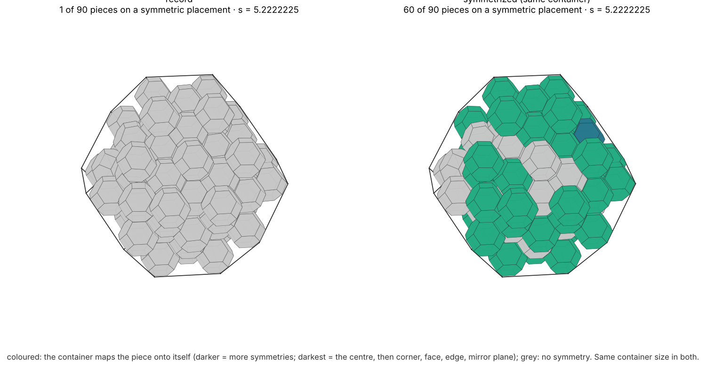
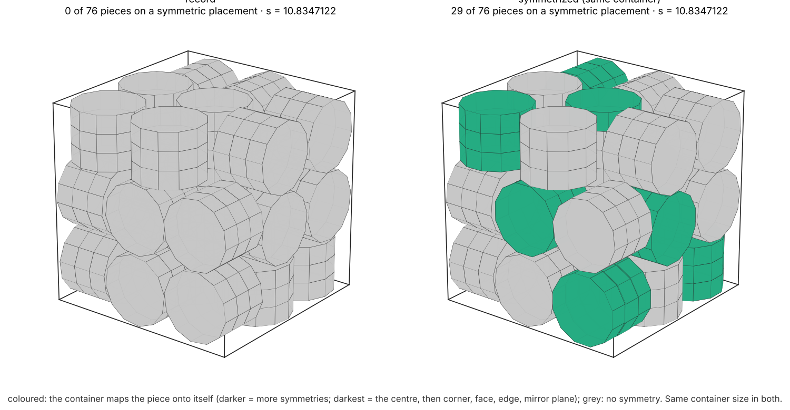
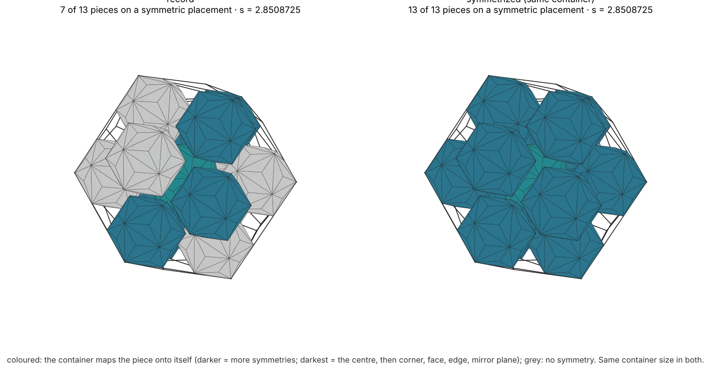

# More symmetric packings in the same container

_14 November 2026. Alejandro Zarzuelo's idea; tool and runs with Claude (Anthropic)._

**The idea.** Many records have pieces that are nearly symmetric with the container. Some sit almost nested in a
corner, almost centred on a face or an edge, or almost on a mirror plane, but not exactly. Such a piece can often be
moved onto the symmetric placement without making the container any larger. The pieces near the corners and sides
should be the easiest to move; the interior ones are more constrained.

**What was done.** The container is held fixed at the record's exact size (`s_full`). The pieces are moved one at a
time, outermost first, onto symmetric placements. A move is kept only if the whole packing stays legal with the
record's clearances: every pair at least 10⁻⁷ apart and every piece at least 10⁻⁷ inside every face. Every result is
then checked like the records: `verify.py` and `certify_exact.py` for the Platonic records, `verify_general.py`
and `certify_general.py` for the prisms, Archimedean and Catalan records, and `certify_nd.py` in 4D–6D. All
10,402 records were run: 2,475 Platonic, 6,039 family and 1,888 in 4D–6D. The symmetrized packings are in [records/symmetric/](../records/symmetric/README.md), and the records
themselves are unchanged.

**In total:**
- 2,917 packings changed, all certified in their record's container.
- Pieces on symmetric placements: 70,927 → 79,019.
- The packing group grew in 36 records.

## Method ([scripts/symmetrize.py](../scripts/symmetrize.py))

**Symmetric placements.** A placement is symmetric when some symmetry of the container, other than the identity,
maps the piece onto itself. The candidate symmetry groups K are the stabilizers of the container's vertices, edge
midpoints and face centres, their rotation subgroups, single mirror planes and cyclic subgroups, largest first.

**The nearest symmetric placement.** Take a piece at (c, R) whose orientation is close to being K-symmetric (within
25°). Let φ(h) be the symmetry of the piece with R⁻¹hR ≈ φ(h). The nearest K-symmetric placement is the group average

  c* = (1/|K|) Σ h c,  R* = polar((1/|K|) Σ h R φ(h)ᵀ),

which satisfies h c* = c* and h R* = R* φ(h) exactly whenever φ is a homomorphism.

**Where the piece goes.** On an axis (a vertex, edge or face direction), the piece is first pushed as deep as it
goes: fully nested in the corner, or against the edge or the face. If that is not legal, it goes as close as possible
to where it was, within 0.35 edge lengths. On a mirror plane it is placed at the projection, or a little away from it.

**Measures.**
- A piece's *stabilizer* is the set of container symmetries that map it onto itself. Its order is 1 for a generic
  piece, 2 on a mirror plane, and for an icosahedral container 4 on an edge, 6 on a face, 10 in a corner and 120 at
  the centre.
- The *packing group* is the set of container symmetries that map the whole packing onto itself.

## Results (all 2,475 Platonic records, n = 2–100)

- 586 packings changed, 1,599 piece moves.
- Pieces on symmetric placements, over all records: 19,832 → 21,280 of 126,225.
- The packing group grew in 13 records, for example:
  - 15 icosahedra in a dodecahedron: 6 → 24
  - 11 octahedra in a cube and 15 and 21 octahedra in a dodecahedron: 1 → 6
  - 18 tetrahedra in a tetrahedron, 11 cubes in a cube and 28 octahedra in a tetrahedron: 1 → 3

All 586 symmetrized packings use the record's container (identical `s_full` and n). All 586 are VALID
(`verify.py`) and CERTIFIED in exact arithmetic (`certify_exact.py`). Their checker outputs sit next to each file in
[records/symmetric/](../records/symmetric/README.md).

| problem | packings changed | pieces on symmetric placements (all n) | pieces (all n) |
|---|---|---|---|
| cubes in a tetrahedron | 68 | 95 → 342 | 5,049 |
| dodecahedra in a dodecahedron | 45 | 718 → 915 | 5,049 |
| icosahedra in an icosahedron | 46 | 368 → 510 | 5,049 |
| cubes in a cube | 21 | 4,159 → 4,285 | 5,049 |
| dodecahedra in an icosahedron | 30 | 56 → 167 | 5,049 |
| octahedra in an octahedron | 43 | 1,449 → 1,527 | 5,049 |
| cubes in an octahedron | 39 | 1,176 → 1,246 | 5,049 |
| cubes in a dodecahedron | 28 | 960 → 1,026 | 5,049 |
| octahedra in a tetrahedron | 37 | 1,987 → 2,052 | 5,049 |
| icosahedra in a tetrahedron | 31 | 388 → 443 | 5,049 |
| tetrahedra in a tetrahedron | 36 | 857 → 906 | 5,049 |
| dodecahedra in a tetrahedron | 29 | 537 → 585 | 5,049 |
| octahedra in a cube | 24 | 886 → 923 | 5,049 |
| cubes in an icosahedron | 19 | 138 → 173 | 5,049 |
| icosahedra in an octahedron | 21 | 2,419 → 2,454 | 5,049 |
| the other 10 problems | 69 | 3,639 → 3,726 | 50,490 |

**Examples.** Coloured pieces are mapped onto themselves by the container; darker means more symmetries. The
container is the same size on both sides.

- 96 icosahedra in an icosahedron: 0 → 20 pieces on symmetric placements.
  
- 65 cubes in a cube: 5 → 32 (corner and face cubes aligned).
  
- 77 dodecahedra in a dodecahedron: 2 → 19.
  
- 15 icosahedra in a dodecahedron: the packing group grows from 6 to 24 (the centre piece becomes fully symmetric).
  
- 11 octahedra in a cube: packing group 1 → 6.
  

## Prisms, antiprisms, Archimedean and Catalan records (6,039 records, 61 problems)

The same tool (`symmetrize.py --families`) on every family record; checked by `verify_general.py` and
`certify_general.py`, like those records.

- 1,993 packings changed, with 6,006 piece moves.
- Pieces on symmetric placements, over all records: 40,599 → 46,408 of 307,989.
- All 1,993 are VALID and CERTIFIED in the record's container.
- The packing group grew in 17 records, for example:
  - 13 triakis icosahedra in a triakis icosahedron: 1 → 6
  - 14 square antiprisms in a cube, 13 dodecagonal prisms of height 1.5 in a cube, 15 truncated cuboctahedra in a
    truncated cuboctahedron and 5 snub cubes in a snub cube: 1 → 4
  - 17 rhombicuboctahedra in a rhombicuboctahedron: 2 → 4

| family | records | packings changed | pieces on symmetric placements (all n) | pieces (all n) |
|---|---|---|---|---|
| prisms and antiprisms | 3,465 | 1,236 | 23,417 → 27,709 | 176,715 |
| Archimedean | 1,287 | 373 | 11,276 → 12,232 | 65,637 |
| Catalan | 1,287 | 384 | 5,906 → 6,467 | 65,637 |

**Examples.**

- 90 truncated octahedra in a truncated octahedron: 1 → 60 pieces on symmetric placements.
  
- 76 dodecagonal prisms in a cube: 0 → 29.
  
- 13 triakis icosahedra in a triakis icosahedron: packing group 1 → 6.
  

## 4D–6D records (1,888 records, 54 problems)

[`scripts/symmetrize_nd.py`](../scripts/symmetrize_nd.py) does the same for the regular polytopes in 4, 5 and 6
dimensions.
- The container's symmetry group is generated by the reflections that map its vertex set to itself; every regular
  polytope has a Coxeter group, of order up to 46,080 for the 6-cube.
- The candidate subgroups are the stabilizers of vertices, edge midpoints, facet centres and the centres of facet
  intersections, plus single mirrors.
- A move is kept only if the piece keeps a 10⁻⁷ wall gap and a separating hyperplane with gap at least 10⁻⁷ to
  every neighbour.
- Moved pieces get exactly orthogonal rational rotations and fresh rational hyperplane witnesses, and `certify_nd.py`
  checks each file, as for the records.

Results:
- 338 packings changed, with 890 piece moves.
- Pieces on symmetric placements: 10,496 → 11,331 of 36,839.
- The packing group grew in 6 records:
  - 4 5-simplices in a 5-simplex: 1 → 4
  - 9 5-simplices in a 5-simplex: 1 → 3
  - 7 5-cells in a 5-cell, 16 5-cubes in a 5-orthoplex, and 5 and 8 6-cubes in a 6-orthoplex: 1 → 2
- Largest gains:
  - 24 5-cubes in a 5-simplex: 0 → 16
  - 25 24-cells in a 16-cell: 5 → 21
  - 26 tesseracts in a tesseract: 10 → 24

| dimension | records | packings changed | pieces on symmetric placements (all n) | pieces (all n) |
|---|---|---|---|---|
| 4 | 1,402 | 258 | 7,933 → 8,472 | 29,405 |
| 5 | 279 | 47 | 1,496 → 1,688 | 4,743 |
| 6 | 207 | 33 | 1,067 → 1,171 | 2,691 |

Many 4D–6D packings are lattice cuts, which are already highly symmetric. For example, 24 16-cells in a 24-cell
already have the container's full group of order 1,152, so there was less to gain than in 3D.


## What does not move: jammed packings

20 icosahedra in an icosahedron shows the limit.
- All 20 pieces are already within 0.1° of the container's orientation.
- Two pieces are only 0.03 edge lengths from being fully nested in a corner.
- Their neighbours block them: nesting either piece would need an overlap of about 0.015.

Only one piece of this record could be nested. Letting the neighbourhood relax by SLSQP at the same container size
(`pull_sym`, `pull_local` in the same script) brought one more piece within 10⁻⁶ of a symmetric placement, but not
onto it.

Most records are tight: the container is held by a rigid core of contacts, and at the record's size only the loose
pieces (rattlers and outer pieces with slack) can move. More symmetry for the jammed ones needs a new search: the
tightening constrained to a symmetry group from the start, with the record's size as the bound to beat. The linear
form of those constraints is already in `solve_sym` (centres in the fixed subspace, rotation increments in the
fixed subspace of the conjugation action).

## Reproduce

```bash
python3 scripts/symmetrize.py --all OUTDIR            # all Platonic records (about 30 minutes)
python3 scripts/symmetrize.py --families OUTDIR       # prisms, Archimedean, Catalan (about 3 hours)
python3 scripts/symmetrize_nd.py --all OUTDIR         # 4D-6D records; check with certify_nd.py
python3 scripts/symmetrize.py records/icoinico/icoinico_n96.json out.json
python3 verify.py out.json && python3 certify_exact.py out.json
python3 scripts/symmetrize.py --summary               # records/symmetric/SUMMARY.csv and README.md
python3 scripts/symmetry_figure.py RECORD.json SYMMETRIZED.json out.png
```
