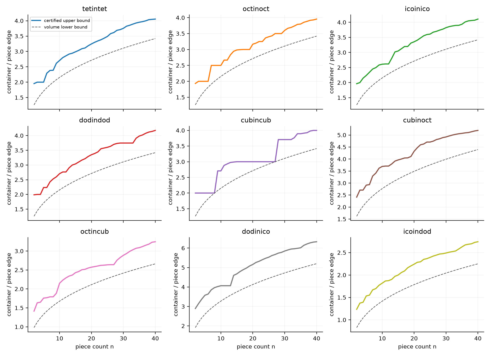
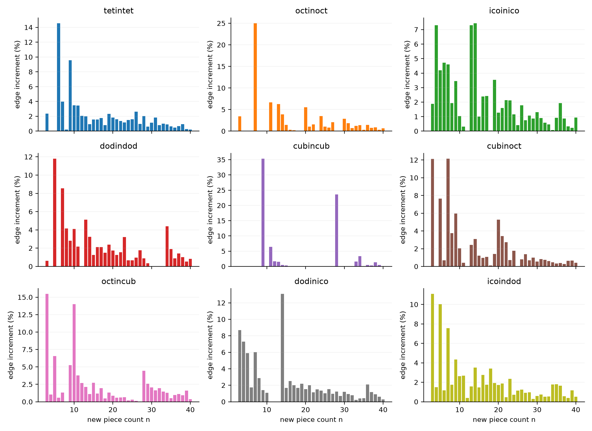
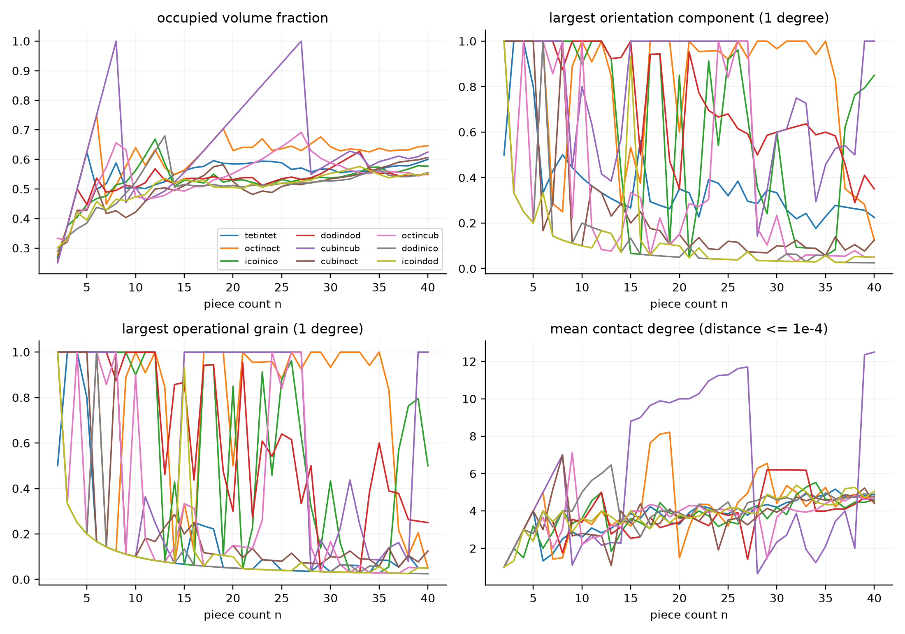

# Finite polyhedral fits: discrete scale jumps, orientational domains, and contact structure in 351 certified constructions

**Alejandro Zarzuelo Urdiales**

**Data and software:** [alejandrozu/platonic-packing](https://github.com/alejandrozu/platonic-packing). The data freeze is Git commit `e15b496ae7306287e0e70bb5b14be79f5dfdde84`. This manuscript reports that finite archive, rather than claiming a complete or continuously updated catalogue of the world's best packings.

## Abstract

Packing a finite number of congruent polyhedra inside a polyhedral container produces pronounced changes in required container size as the number of pieces increases. Some adjacent counts share a construction scale, while other additions require a substantial expansion. We study 351 certified constructions in nine ordered pairs of Platonic solids, with every count from 2 through 40. Five pairs use the same solid for pieces and container; four use mixed pairs. We distinguish the exact feasible scale of each archived construction, the numerically estimated touching limit, and a monotone feasible envelope obtained by deleting pieces from larger constructions. We analyze absolute and relative scale increments, occupied volume fraction, orientational similarity modulo the proper rotational symmetry group of the piece, and graphs of near contacts determined by Euclidean feature distances. Contact-connected orientational domains provide a precisely defined geometric proxy for grains, while avoiding a claim of physical crystallization. The archive exhibits long count plateaus, sharp expansion steps, aligned and dispersed orientations, and large differences between raw edge scale and volume-normalized efficiency. None of these observations establishes global optimality. Closed-form labels attached to numerical touching limits remain conjectures unless supported by an independent symbolic construction. The accompanying machine-readable tables, source hashes, scripts, and figures expose every calculation and provide a basis for experiments on confinement, orientational organization, and lower-bound proofs.

**Keywords:** finite packing; Platonic solid; convex polytope; confinement; contact graph; orientational order; certified upper bound.

## 1. Finite confinement as a distinct packing problem

The density of an infinite or periodic packing and the size of a container holding a prescribed finite number of pieces ask related but different questions. A finite container imposes a particular boundary shape and a fixed count. Its corners, faces, and edges can reward arrangements that do not extend periodically. Removing one piece can leave an extensive void without changing the arrangement's bounding scale; adding one piece can force a new layer, an altered orientation pattern, or a different contact structure. The resulting count-dependent curve is therefore a useful object in its own right.

This paper studies *polyhedral fits*: finite arrangements of congruent polyhedra with disjoint interiors inside a polyhedral container. The expression is descriptive. It is not used here to claim that a new mathematical subject has been established by consensus, nor to replace the established language of packing convex bodies. The practical aim is to place several familiar finite packing problems and less extensively tabulated shape pairs in a common framework with explicit geometry, common units, and comparable structural measurements.

A close experimental precedent is [Teich et al. (2016)](https://doi.org/10.1073/pnas.1524875113), who compressed clusters of Platonic solids with 4–60 pieces in spherical containers and studied density, layers, symmetry, and particularly dense counts. Their sphere boundary differs from the polyhedral boundaries here, so their count sequences are comparison material rather than predictions for this archive. General finite-container methods also precede the current project: [Egeblad et al. (2009)](https://doi.org/10.1016/j.comgeo.2008.06.003) treated translational packing of arbitrary polytopes, while [Romanova et al. (2018)](https://doi.org/10.1016/j.ejor.2018.01.025) treated continuous rotations in a cuboid-volume objective. The contribution evaluated here is the particular certified dataset and its structural measurements.

The underlying project generalizes a soft-to-rigid computational search from cubes to convex polyhedra. That procedure is documented in the companion methods paper and in the repository's `docs/FINAL_REPORT.md`. The present paper concentrates on the *arrangements found*: which counts require expansions, which share a scale, how the pieces orient, how contacts connect them, and which patterns justify further mathematical investigation. Methodological novelty and geometric novelty should be evaluated separately. A more general search can be useful even when a particular cube record is equaled or improved elsewhere.

The scope is nine ordered piece/container pairs, not all 25 pairs of the five Platonic solids and not all convex polyhedra. All arrangements use a single piece type within a given container. There are no records here of simultaneous mixtures of tetrahedra and cubes, or of other two-species mixtures. Reaching the same scale at two different *counts* is consequently an observation about one species at a time. Questions about jointly packing two *types* require a separate heterogeneous dataset.

## 2. Definitions, normalization, and evidence levels

### 2.1 The optimum and the archived construction

Let $A$ be a centered unit-edge container solid and $B$ a centered unit-edge piece solid. Define

\[
s^*_{A,B}(n)=\min\{s>0:\ \bigcup_{i=1}^n(c_i+R_iB)\subseteq sA,
\quad \operatorname{int}(c_i+R_iB)\cap\operatorname{int}(c_j+R_jB)=\varnothing\ (i\ne j)\},
\]

where $R_i\in SO(3)$. The feasible arrangements allow translations and proper rotations. The optimum is attained: a known finite feasible scale bounds the translations, rotations form a compact space, and the weak containment and non-overlap conditions persist under limits. Removing a piece immediately gives $s^*(n)\le s^*(n+1)$.

An archived feasible value is denoted $U_n$, corresponding to the record field `s_full`. An independently verified record establishes $s^*(n)\le U_n$. It does not establish equality. The record also contains `s_tight`, denoted $T_n$, a numerical touching-limit estimate from local tightening. Its twelve displayed decimal places are a computational output convention, not twelve independently proved digits of the optimum. A reported algebraic expression near $T_n$ remains a conjectural recognition of that numerical value.

The exact verifier interprets stored floating-point coordinates as exact dyadic rationals, and the homogeneous quaternion rotation formula maps each nonzero rational quaternion to an exactly orthogonal rational matrix. Combined with canonical solid coordinates in $\mathbb Q(\sqrt2,\sqrt5)$, containment and separating-plane signs can therefore be decided in exact arithmetic. The certificate concerns the stored construction at $U_n$, with positive clearance, rather than the inferred touching configuration at $T_n$. Floating-point calculations of angles, distances, and structural descriptors in this paper are a different evidence layer and are not promoted to exact theorems by the existence of a feasibility certificate.

### 2.2 Volume-normalized scale

If $V_A,V_B$ are the volumes of unit-edge solids, every feasible arrangement satisfies

\[
L_n=\left(\frac{nV_B}{V_A}\right)^{1/3}\le s^*(n)\le U_n.
\]

We use the occupied volume fraction $\eta_n=nV_B/(V_AU_n^3)$ and the normalized scale $\lambda_n=U_n/L_n=\eta_n^{-1/3}$. These are equivalent summaries of finite confinement efficiency. A value $\lambda=1$ would saturate the volume bound, leaving no void volume; a value $\lambda>1$ includes both voids and any limitations of the search. The relative linear gap to this lower bound is $100(\lambda-1)\%$. It is a bound gap, not a measured error relative to the unknown optimum.

Raw edge ratios are appropriate for describing a named shape pair, but can mislead across mixed pairs. A unit-edge dodecahedron has substantially more volume than a unit-edge icosahedron, and a unit-edge cube has more volume than a unit-edge octahedron. Reversing pieces and container consequently changes the volume bound even before orientation or packing organization enters. Comparisons between mixed pairs therefore report both $U$ and $\eta$, rather than treating a smaller edge ratio as automatically more efficient.

The common normalization also exposes a useful limitation. An occupied volume fraction from 2–40 pieces in a bounded solid is not an estimate of the asymptotic density of the same shape in unbounded space. Surface layers occupy a substantial share of the configurations, and the container and piece geometries can be specially matched. No extrapolated infinite-packing density is claimed.

### 2.3 Three meanings of a plateau

We distinguish an identical stored certified value, an identical certified envelope value, and a numerical touching plateau. Two `s_full` entries are identical only when their parsed binary floating-point values coincide; the hexadecimal representations are retained in the data table. In that case, both certified constructions exist at the same stated scale. This proves equality of the *reported upper bounds*, not equality of the optima.

For numerical touching plateaus we require $\max T_n-\min T_n\le10^{-8}$ over a contiguous count interval. The comparison uses the whole run's range, avoiding a chain of individually small increments whose total exceeds the threshold. Five-decimal table equality is insufficient: distinct sizes can round or truncate to the same display. Moreover, differing clearances can make equal touching estimates yield slightly different $U_n$ values.

The third object is a certified deletion envelope,

\[
E_n=\min_{m\ge n} U_m.
\]

Any selection of $n$ pieces from the feasible $m$-piece witness remains feasible at $U_m$, so $E_n$ is a valid monotone upper bound. Every envelope entry records its witness. A plateau in $E_n$ can be produced by deletion without showing that the independently optimized $n$-piece geometry is congruent to the larger arrangement. It is consequently a statement about available feasible scales, not a claim of a unique structural family.

### 2.4 Absolute and relative marginal costs

For $n\ge3$, define the absolute edge increment $\Delta U_n=U_n-U_{n-1}$, the relative edge increment $r_n=U_n/U_{n-1}-1$, and the relative container-volume increment $v_n=(U_n/U_{n-1})^3-1$. These three quantities answer different practical questions. An absolute change is expressed in piece-edge units; a relative change compares that change with the previous container; and $v_n$ measures the additional container volume incurred by an extra piece.

The exact density relation is

\[
\frac{\eta_n}{\eta_{n-1}}=\frac{n}{n-1}\left(\frac{U_{n-1}}{U_n}\right)^3.
\]

Density rises after adding a piece precisely when the relative container-volume expansion is smaller than $1/(n-1)$. On a constant-scale plateau, density increases in proportion to count; at an expansion step it can drop sharply. Thus an increasing size curve does not imply an increasing density curve. A supplementary count-scaled edge increment $a_n=(n-1)r_n$ compares changes with the $\sim1/[3(n-1)]$ relative growth of the elementary volume bound. This normalization is descriptive; finite discrete changes need not follow a smooth derivative.

## 3. Methodology: computational tools and structural measurements

The structural analysis was implemented in Python with NumPy; Matplotlib generated the scientific figures, and the repository's Node.js geometry kernel supplied an independently implemented distance cross-check. Exact feasibility was checked with the Python standard-library verifier. Claude (Anthropic) was used as a computational development tool in the underlying packing search under the author's direction. OpenAI Codex was used as a research tool for implementing and auditing the structural measurements, exploring explanatory hypotheses, checking source provenance, and preparing the exposition. The numerical tables, pose files, explicit measurement definitions, source hashes, and rerunnable checks provide the evidence for the results independently of these tools.

### 3.1 Frozen input and provenance

The analysis reads every `records/*/*_nNN.json` file in the frozen repository. It verifies that the declared piece count equals the pose-array length, checks recomputed density against the stored full-precision value, and requires all 39 counts for each of the nine families. The script also checks geometric distance calculations against known cube face, edge, and vertex separations. A SHA-256 manifest records the bytes of every analyzed record and of `src/solids.json`; the metadata includes the Git commit, Python and NumPy versions, thresholds, and a combined record-manifest hash. The full numerical tables are derived from the JSON values rather than from the rounded README or historical prose.

This distinction matters because the large project report preserves intermediate results and quotes earlier mathematical notes. For example, intermediate tetrahedral and octahedral plateau boundaries were subsequently improved. Historical text remains valuable for reconstructing the search, but the current coordinates and scale fields are the evidence for this analysis. Search provenance in a winning record describes the final accepted candidate, not necessarily the complete ancestry or all attempted constructions at that count.

An independent implementation cross-check compared 3,511 selected pair distances with the repository geometry kernel: the maximum absolute difference was approximately 2.0e-15 piece edges, with no contact classification differences at any of the three thresholds. The generated symmetry groups also passed a closure check to approximately 5.72e-16, and a representative-invariance check changed disorientation angles by at most approximately 2.21e-13 degrees. `research/geometry-crosscheck.json` records the tests. This sampled agreement supports the implementation, while the structural measurements retain their double-precision status.

### 3.2 Orientation modulo the solid's own symmetry

Quaternions are a representation of orientation, not a direct measure of geometrically different poses. The quaternions $q$ and $-q$ represent the same rotation. In addition, a solid can be unchanged by a nontrivial proper rotation. The proper symmetry group $G_B$ has order 12 for a tetrahedron, 24 for a cube or octahedron, and 60 for a dodecahedron or icosahedron.

We construct each group by mapping an ordered pair of non-collinear canonical vertices to every ordered pair with the same inner product. The resulting proper rotations are retained only when they map the entire vertex set to itself. Orthogonality, positive determinant, and the expected group cardinality are checked. This produces groups in the repository's coordinate convention, avoiding an accidental mismatch with a library's canonical orientation.

For orientations $R_i,R_j$, define the disorientation angle

\[
\theta_{ij}=\min_{g\in G_B}\cos^{-1}\left[\frac{\operatorname{tr}(R_i^TR_jg)-1}{2}\right].
\]

The argument is numerically clipped to $[-1,1]$. Minimizing over the symmetry representatives of both pieces reduces to this single-group minimum by cyclic invariance of trace and closure of $G_B$. This angle is invariant under a common rotation of the entire arrangement and under choosing another symmetry-equivalent representative for either piece. Using raw quaternion distance would incorrectly count several visually identical solid orientations as different.

We compute orientation graphs at 0.1°, 1°, and 5°. An edge joins any two pieces whose disorientation is at most the threshold, without a spatial-neighbor requirement. The connected components provide orientation-domain sizes, the largest-domain fraction, and normalized Shannon entropy

\[
H=-\frac{\sum_k p_k\log p_k}{\log n},\qquad p_k=|C_k|/n.
\]

Here $H=0$ for one orientation component and $H=1$ when every piece has a distinct component. Components use single linkage, so their full angular diameter may exceed the threshold through a chain. The maximum component diameter is therefore explicitly retained; the connected-component rule is not silently interpreted as pairwise uniformity. All component memberships are supplied for alternative clustering.

### 3.3 Contacts from actual Euclidean distance

Center proximity alone does not identify a contact, especially for anisotropic polyhedra. The separating-axis theorem gives a reliable overlap test, but the largest projection gap across the finite SAT axis set is generally only a lower bound on the Euclidean distance of two disjoint bodies. Treating that gap as the actual contact distance would introduce false edges.

We first reject pairs whose center distance exceeds twice the piece circumradius plus the largest threshold. A SAT lower bound provides a second rejection. Surviving pairs are measured with Euclidean feature enumeration: vertex projections onto face interiors and distances between every pair of edge segments. For disjoint convex polytopes a closest pair is attained on these features; endpoint-to-segment cases cover parallel and boundary degeneracies. The segment computation evaluates the interior stationary point when both parameters lie in the segments and all four endpoint projections. The minimum candidate distance is the distance used for the contact graph.

Near-contact graphs use thresholds $10^{-5},10^{-4},10^{-3}$ in piece-edge units. The central threshold $10^{-4}$ is substantially larger than the archive's nominal $10^{-7}$ clearance and is small relative to an edge. These are tolerance-defined near contacts in the slightly expanded certified construction, rather than exact contacts in an algebraic touching limit. For each graph we report edge count, mean degree $2|E|/n$, connected components, and isolated pieces. Wall proximity is measured separately as the minimum vertex-to-container-face-plane gap of each piece.

An interior piece with few or no near contacts can be a candidate rattler, but a static contact count does not prove a continuous feasible motion. Conversely, high contact degree does not prove collective rigidity: constraints can be redundant and contact geometry matters. A rigidity conclusion would require a motion or constraint-rank analysis that is outside the current calculations.

### 3.4 An operational grain proxy

For the central contact graph, keep only edges for which $\theta_{ij}\le1°$. Connected components of the resulting graph are called *operational grains* in this paper. This definition requires both spatial near contact and orientational similarity. Two distant pieces can share an orientation domain without belonging to the same grain, while two contacting pieces with different orientations belong to different grains.

The definition captures one geometrical feature suggested by a grain analogy, but a material grain usually requires positional crystalline order as well as a coherent orientation of that order. Piece orientation, lattice orientation, and thermodynamic phase are distinct. The records do not contain a temperature, interparticle interaction model, diffusion dynamics, lattice-order parameter, or grain-boundary energy. An operational grain is therefore a reproducible descriptor of a finite packing, not evidence that the packing represents an equilibrium crystal or reproduces a crystal-growth mechanism. The 0.1° and 5° alternatives expose sensitivity to the orientational criterion.

## 4. Quantitative results across the nine shape pairs

| Piece in container | U(2) | U(40) | Median density | Density at 40 | Highest density (n) | Median normalized scale |
|---|---|---|---|---|---|---|
| tetintet | 1.953565 | 4.055059 | 0.5670 | 0.5999 | 0.6250 (5) | 1.2082 |
| octinoct | 1.933120 | 3.955548 | 0.6316 | 0.6463 | 0.7500 (6) | 1.1655 |
| icoinico | 1.963086 | 4.107511 | 0.5318 | 0.5772 | 0.6687 (12) | 1.2343 |
| dodindod | 1.987598 | 4.176266 | 0.5360 | 0.5492 | 0.6272 (33) | 1.2311 |
| cubincub | 2.000000 | 4.000001 | 0.6094 | 0.6250 | 1.0000 (27) | 1.1795 |
| cubinoct | 2.414214 | 5.191942 | 0.5145 | 0.6063 | 0.6063 (40) | 1.2480 |
| octincub | 1.414214 | 3.245184 | 0.5558 | 0.5517 | 0.6919 (27) | 1.2163 |
| dodinico | 2.894427 | 6.324721 | 0.5157 | 0.5553 | 0.6797 (13) | 1.2470 |
| icoindod | 1.236068 | 2.741842 | 0.5205 | 0.5525 | 0.5760 (33) | 1.2432 |

Family identifiers name the piece first: `cubinoct` is cubes in an octahedron and `icoindod` is icosahedra in a dodecahedron. Each row contains 39 constructions, at every count from 2 to 40.

Figure 1 plots all certified edge scales with the elementary volume bounds. The largest raw scales occur in mixed pairs whose unit-edge pieces have larger volume than the unit-edge container. That observation is primarily dimensional. Occupied volume fraction and normalized scale are needed to evaluate how much confinement inefficiency remains after accounting for this volume difference.

Across the 351 records, there are 7,371 placed pieces and 95,940 distinct within-record piece pairs. All nine full-precision certified-scale curves are already non-decreasing. Consequently the deletion envelope changes none of their values. This independently confirms the final archive's monotonicity rather than assuming it from a rounded table.

Among same-solid families, octahedra have the highest median occupied volume fraction, 0.6316, followed by cubes at 0.6094, tetrahedra at 0.5670, dodecahedra at 0.5360, and icosahedra at 0.5318. These medians describe the sampled counts equally weighted. They are not asymptotic packing densities. The best single sampled cubic density is approximately 0.9999996 at n=27, reflecting the exact 3-by-3-by-3 tiling plus the record's positive-clearance enlargement. At n=40, the same-solid densities range from 0.5492 for dodecahedra to 0.6463 for octahedra.

For mixed pairs, the raw edge scales at n=40 range from 2.7418 for icosahedra in a dodecahedron to 6.3247 for dodecahedra in an icosahedron. Their densities, however, are much closer: 0.5525 and 0.5553. This is a concrete example of why edge ratios alone cannot rank different piece/container choices. Cubes in an octahedron reach density 0.6063 at n=40, whereas octahedra in a cube reach 0.5517. Reversal of a dual pair is therefore not a symmetry of the finite-fit objective under unit-edge normalization.

The source records carry 105 closed-form labels. They span 26 octahedral same-solid records, 25 cubic same-solid records, 17 dodecahedral same-solid records, and smaller numbers in the other families. These labels identify candidate algebraic scales near the numerical touching output; their frequency is not a count of independently proved optimum formulas.

The nine curves should not be averaged into a single universal law. Differences in rotational symmetry, inradius-to-circumradius ratio, face structure, and boundary compatibility act together. For same-solid problems the volume lower bound is always $n^{1/3}$, so the differences in normalized scale are particularly direct. For mixed pairs, changes in scale also reflect the piece/container volume ratio.

## 5. Plateaus, expansion steps, and finite-count organization

| Family | Identical certified U ranges | Numerical T ranges, tolerance 1e-8 |
|---|---|---|
| tetintet | 3–4 | 3–5 |
| octinoct | 3–6; 7–10; 17–19; 22–23; 27–29 | 3–6; 7–10; 11–12; 17–19; 22–23; 27–29 |
| icoinico | 11–12 | 11–12 |
| dodindod | 3–4; 11–12; 29–33 | 3–4; 5–6; 11–12; 29–33 |
| cubincub | 2–8; 9–10; 15–27 | 2–8; 9–10; 15–27; 28–32; 34–35; 39–40 |
| cubinoct | 3–4; 11–12 | 3–4; 11–12; 24–25 |
| octincub | 26–27 | 7–8; 26–27 |
| dodinico | 10–12 | 10–13 |
| icoindod | none | none |

The tetrahedral n=3–5 range illustrates the evidence distinction: the three touching estimates are exactly 2 in the recorded numerical output, but only n=3 and n=4 have identical certified U=2.0000006123725. The n=5 certified construction has U=2.000000734847. An explicit subdivision separately proves the touching construction exists at edge 2; the two certificate sizes differ because their clearances are imposed on different arrangements.

The dodecahedral n=29–33 range is stronger as a reported-scale plateau: all five records share exactly U=3.7470909531576. The occupied fraction rises from 0.551208 at n=29 to 0.627236 at n=33, a 13.7931% relative increase in density with no change in the certified container scale. The tentative expression (55+24 sqrt(5))/29 for its touching estimate remains unproved. Equal certified scales and a numerical algebraic guess are different claims.

For cubes, n=15–27 has exactly U=3.0000004000001 throughout, while n=28–32 is a numerical touching plateau with values near 3+1/sqrt(2), spanning approximately 1.275e-9. Its certified full scales differ, so it is not placed in the exact reported-scale column. In the mixed golden-ratio pair, dodecahedra in an icosahedron have equal numerical touching output at n=10–13, but identical U only at n=10–12. Icosahedra in a dodecahedron have no plateau meeting either criterion within the sampled counts.

| Family | Addition | Absolute edge increase | Relative edge increase | Container-volume increase | Density change |
|---|---|---|---|---|---|
| tetintet | 5 to 6 | 0.290995 | 14.550% | 50.308% | -0.1260 |
| octinoct | 6 to 7 | 0.500000 | 25.000% | 95.312% | -0.3020 |
| icoinico | 13 to 14 | 0.208785 | 7.433% | 23.996% | -0.0771 |
| dodindod | 4 to 5 | 0.236068 | 11.803% | 39.754% | -0.0528 |
| cubincub | 8 to 9 | 0.707107 | 35.355% | 147.985% | -0.5463 |
| cubinoct | 6 to 7 | 0.356671 | 12.155% | 41.077% | -0.0872 |
| octincub | 2 to 3 | 0.218780 | 15.470% | 53.960% | -0.0086 |
| dodinico | 13 to 14 | 0.531701 | 13.079% | 44.593% | -0.1735 |
| icoindod | 2 to 3 | 0.136966 | 11.081% | 37.062% | +0.0285 |

The largest relative edge step in the entire archive is the transition from eight to nine cubes: 35.3553%, corresponding to approximately 148.0% more container volume and a density loss of 0.5463. The second conspicuous cubic transition, from 27 to 28 pieces, increases the edge by 23.5702%, the volume by 88.6868%, and decreases density by 0.4504. These transitions occur immediately after complete integer cube grids, making grid capacity a concrete upper-bound construction mechanism; their exact global-optimality implications require separate lower bounds.

Octahedra in an octahedron change from six pieces at U=2.0000003674235 to seven at U=2.5000004286608, a 25.0% edge increase and 95.3125% volume increase. The density falls from approximately 0.7500 to 0.4480. At the same time the central contact graph changes from 15 edges, with mean degree 5, to only 5 edges, with mean degree about 1.429. One orientation component and one operational grain at n=6 become five orientation components and seven singleton grains at n=7. This is quantitative evidence that the archived winner changes organization at the capacity step, though it does not prove no denser seven-piece organization exists.

Dodecahedra in an icosahedron show a particularly clear mixed-pair change from n=13 to n=14: 13.0792% additional edge and 44.5932% additional volume. Density drops from 0.6797 to 0.5062, central contact edges from 42 to 24, and mean degree from approximately 6.462 to 3.429. Seven orientation components at n=13 become fourteen at n=14. Both arrangements nevertheless have only singleton operational grains at the 1-degree contact-and-angle criterion. A scale transition can therefore accompany a change in repeated orientations without producing contact-connected aligned domains.

A plateau offers a concrete way to distinguish count utilization from bounding scale. The larger-count construction can be pruned to smaller counts at the same scale, so unused capacity can be filled without enlarging the enclosing solid. This does not imply that every added piece occupies a pre-existing empty slot in the independently optimized smaller configuration. The archive may instead switch between different arrangements that happen to have a similar bounding size. Tracking that distinction requires comparing the full pose sets after optimal global alignment and piece matching; scale equality alone cannot do so.

A sharp expansion step is equally ambiguous mechanistically. It may indicate that a particular geometric family has reached capacity, or it may reveal that the search has not found a better family at the next count. The upper-bound curve is an empirical frontier of feasible examples. No lower bound in the present dataset forces its large jumps. The safest interpretation is that these counts expose useful *candidate* transitions in the archive, which can guide new searches or proof attempts.

For this reason, the strongest comparisons combine a jump with structural evidence: orientation-domain changes, changes in wall-supported pieces, contact-graph changes, and density loss. A discontinuity in only a rounded table is weak evidence. A large relative expansion, stable contact structure under tolerance changes, and an explicit construction mechanism would be much stronger. The accompanying tables make all of these checks possible without treating them as equivalent.

The useful practical question about an additional piece is often a volume question. A 10% edge expansion requires roughly 33.1% additional container volume. Conversely, a visually modest linear improvement of 1% produces approximately a 3% reduction in container volume. Edge ratios should therefore be accompanied by their cubic consequences when discussing capacity, material efficiency, or confinement.

## 6. Orientation distributions and contact-connected domains

| Family | Median orientation components | One orientation component | All pairwise angles <=1 degree | Every orientation distinct | Median operational grains | Median contact degree |
|---|---|---|---|---|---|---|
| tetintet | 15 | 2 | 2 | 1 | 21 | 3.905 |
| octinoct | 2 | 18 | 18 | 0 | 2 | 4.242 |
| icoinico | 7 | 10 | 10 | 3 | 10 | 3.739 |
| dodindod | 7 | 11 | 10 | 0 | 9 | 3.760 |
| cubincub | 1 | 22 | 22 | 0 | 1 | 4.000 |
| cubinoct | 19 | 5 | 5 | 3 | 20 | 3.714 |
| octincub | 13 | 8 | 8 | 6 | 13 | 4.000 |
| dodinico | 20 | 2 | 2 | 26 | 21 | 4.364 |
| icoindod | 21 | 1 | 1 | 24 | 21 | 3.926 |

Component and pairwise columns use the 1-degree disorientation threshold, and record counts are out of 39. Contact degree uses Euclidean distance <=1e-4 piece edges. A one-component count is a single-linkage result; the next column explicitly checks that every pair in the record lies within 1 degree. The difference for dodecahedra in a dodecahedron is a measured chain effect rather than a labeling ambiguity.

Cubes in a cube have 22 records whose pieces are all pairwise within 1 degree modulo cube symmetry. Octahedra in an octahedron have 18. In contrast, dodecahedra in an icosahedron have 26 records in which every piece is more than 1 degree from every other piece modulo dodecahedral symmetry; the reversed pair has 24 such records. All-distinct orientations thus occur frequently in both directions of this dual pair, while they are absent from the cube-in-cube and octahedron-in-octahedron records.

The distinction between orientation domains and operational grains is substantive. At n=33, the dodecahedron-in-dodecahedron record has seven orientation components, with a largest component of 21 pieces, but no contact-connected aligned pair at the central thresholds: all 33 operational grains are singletons. The contact graph itself has 102 edges. Repeated orientation, many contacts, and spatially connected alignment are therefore three different observations. The n=29 member of the same certified-scale plateau likewise has seven orientation components and 29 singleton grains.

At n=12, the icosahedron-in-icosahedron record is pairwise aligned modulo its 60-element symmetry group and has a connected 30-edge contact graph, mean degree 5. It is one operational grain with density approximately 0.6687. At n=15, icosahedra in a dodecahedron have two orientation components of sizes 14 and 1 and two operational grains with the same sizes; U=2.0000001715822 and the numerical touching estimate is 2. The smaller component should not be inferred to be a physical defect without an appropriate physical model.

For n=27 cubes in a cube, the central graph has 158 edges and mean degree approximately 11.704. Near contacts include face, edge, and vertex proximity. This explains why the degree exceeds the six face-neighbor count of a cubic grid: the graph records all Euclidean near contacts, not only face-sharing interfaces. A material or force-bearing contact graph would require a contact-area or mechanical criterion.

Threshold sensitivity is material. Only 217 of 351 records have identical contact edge sets at all three distance tolerances; because the graphs are nested, equality of edge counts guarantees equality of sets. Only 131 records have unchanged orientation-component counts at 0.1, 1, and 5 degrees; nested graphs again make unchanged counts a sufficient condition for unchanged component partitions. At the central thresholds, 117 records contain only singleton operational grains. These numbers preclude treating any one color partition as a threshold-free physical object. The complete memberships and edges permit sensitivity checks case by case.

It is tempting to divide all constructions into “same orientation” and “different orientations,” but the dataset supports a spectrum. A large orientation component can coexist with many individually tilted boundary pieces. Several repeated orientations can form interlocking domains. At the other extreme, a packing can have nearly one orientation component per piece while maintaining a well-connected contact network. These possibilities are geometrically different and are recorded by separate domain and grain statistics.

Orientation entropy is not an entropy of thermodynamic microstates. It measures only the distribution of component memberships under the chosen threshold. Nor does a uniform orientation imply a lattice. Translational regularity would have to be measured, for example by fitting lattice generators to center differences and checking residuals, or by a suitable positional order parameter. The current analysis therefore uses “aligned” for orientation organization and reserves “lattice” for an explicit construction with a translational rule.

Pairwise disorientation distributions are retained in `pair-metrics.csv`, together with center distances and the calculated near-pair Euclidean distances. This enables distributions conditioned on actual contacts, wall location, or component membership. An unconditioned pair distribution weighs distant pairs heavily at large $n$, while a contact-conditioned distribution probes local alignment. Their answers need not coincide. The domain and grain statistics intentionally keep those notions separate.

## 7. Construction mechanisms and candidate families

### 7.1 Integer subdivision and lattice scaffolds

Three constructions have explicit scales that are independent of numerical root recognition. An edge-$k$ cube admits the regular $k\times k\times k$ grid of unit cubes. Deleting pieces provides every count up to $k^3$ at the same scale. This explains the existence of broad cubic upper-bound plateaus, although it does not prove that a grid is optimal at every count on such a plateau. At the complete-grid counts $n=k^3$, the elementary volume lower bound is exactly $k$ and matches the symbolic tiling construction, proving $s^*_{\mathrm{cube},\mathrm{cube}}(k^3)=k$. In the sampled range this applies to n=8 and n=27. That elementary equality is independent of the small positive clearances of the stored records and of their numerical structural descriptors.

A tetrahedral edge subdivision produces $\binom{k+2}{3}$ upright unit tetrahedra, $\binom{k}{3}$ inverted unit tetrahedra, and $\binom{k+1}{3}$ unit octahedral holes. A unit regular tetrahedron fits into a unit regular octahedron: use one triangular face as the base and the centroid of the opposite face as the apex. The base edge is one and the opposite-face distance equals the tetrahedral height, so the tetrahedron is regular; convexity ensures containment. Inserting one tetrahedron into every octahedral hole gives

\[
N_{\mathrm{tet}}(k)=\binom{k+2}{3}+\binom{k+1}{3}+\binom{k}{3},
\]

which yields 5, 15, and 34 pieces at edges 2, 3, and 4. This is a construction, not a claim that all holes are filled to their full volume. The identity $k^3=\binom{k+2}{3}+4\binom{k+1}{3}+\binom{k}{3}$ checks the tetrahedral/octahedral subdivision volumes.

For an octahedron written as $|x|+|y|+|z|\le a$, $a=1/\sqrt2$, choose centers $a m$ with integer $m$, $|m|_1\le k-1$, and $|m|_1\equiv k-1\pmod2$. These aligned octahedra lie inside the edge-$k$ octahedron; the parity rule separates their interiors. The count $N_{\mathrm{oct}}(k)=(2k^3+k)/3$ gives 6, 19, and 44 at edges 2, 3, and 4. A repeated orientation is expected from the construction rule, but numerical winners near these counts can abandon that rule and improve the scale.

These scaffolds give reference capacities that are useful for interpreting the search. A certified improvement below an integer edge establishes that the corresponding explicit scaffold was not the best available construction at that count. It does not establish the global optimum of the improved arrangement.

### 7.2 Boundary accommodation and polyhedral duality

Tetrahedron, cube, octahedron, dodecahedron, and icosahedron differ in face type, number of faces, and available proper symmetries. The cube and octahedron form a dual pair, as do the dodecahedron and icosahedron. A piece with vertices directed toward a container's face regions and a piece whose faces align with those walls can accommodate confinement differently. This motivates the mixed pairs in the archive, but duality alone supplies no universal packing-size formula.

The dodecahedron and icosahedron use canonical coordinates containing the golden ratio. Low-complexity expressions involving $\sqrt5$ therefore have a natural geometric motivation in explicit constructions. Nevertheless, a high-coefficient quadratic expression recognized from a twelve-digit touching estimate can be accidental. The coefficient size, uniqueness among nearby candidate expressions, and exact solvability of the corresponding contact constraints should be considered before presenting it as a geometric law.

The boundary-accommodation interpretation is testable. One can compare the number of wall-supported pieces, orientation components, and contact constraints across adjacent counts, and then inspect whether repeated patterns are attached to particular faces, edges, or vertex regions. These measurements establish where a proposed mechanism acts; a visual resemblance alone does not establish that two constructions share the same mechanism.

### 7.3 Hybrids and dispersed arrangements

We propose a descriptive hierarchy of candidates: explicit lattice scaffolds; aligned arrangements without a demonstrated lattice; several repeated orientational domains; and dispersed arrangements with many distinct piece orientations. Boundary-adapted pieces can appear within any of these categories, so the categories do not form a disjoint mathematical classification. Contact-connected grains further distinguish a spatially coherent domain from separated pieces that happen to have the same orientation.

For future work, family membership should be supported by invariants or fitted rules: a center lattice with small residuals, an identifiable layered construction, a stable contact graph under small geometric perturbations, or a parameterized algebraic placement. The present dataset is large enough to motivate such a classification, but only contains one final winner per count. It does not contain the full distribution of competing families or the frequency with which they were reached. A single winner cannot establish that a family dominates the search landscape.

## 8. Correlations, optimality priorities, and limits of inference

Within-family correlations do not support a universal rule that more alignment or a larger operational grain yields higher density. For density versus largest orientation-component fraction, Spearman rho ranges from approximately -0.720 for icosahedra in a dodecahedron to +0.563 for cubes in a cube. Density versus largest operational-grain fraction ranges from approximately -0.768 for the former pair to +0.539 for the latter. Octahedra in an octahedron have a positive orientation association of about +0.307, while dodecahedra in a dodecahedron have about -0.542. Shape-pair dependence is clear in the selected archive.

Density and central contact mean degree have positive within-family rank correlations in all nine families, ranging from about +0.364 for octahedra in a cube to +0.892 for dodecahedra in an icosahedron. This is consistent with denser selected arrangements tending to exhibit more near contacts, but may also reflect piece-count effects and the changing proportion of boundary pieces. Relative edge increments correlate especially strongly with orientation entropy for cubes in a cube (rho about +0.832), while the corresponding tetrahedral coefficient is slightly negative (about -0.102). The complete coefficient table is included for reproducibility rather than for post-hoc selection of a universal mechanism.

The supplied within-family Spearman coefficients are descriptive rank comparisons. They use one selected final construction per count, so neighboring observations are dependent through deletion and insertion moves, and the piece count itself can influence both density and structural descriptors. No $p$-values, significance stars, causal interpretation, or general law about grains improving density is attached to these coefficients. Repeated independent searches at fixed counts, with a retained ensemble of feasible arrangements, would provide a more suitable test of such a hypothesis.

The volume lower bound remains loose for many cases. A numerically stable arrangement and a small rate of further improvement establish neither local rigidity nor global optimality. A long plateau can be a convenient target for a proof because one larger-count witness simultaneously provides several upper bounds; however, a proof for the beginning of the plateau still requires a matching lower bound at that count. Without it, the true optimum could be lower for some or all of the displayed counts.

We suggest selecting proof targets using explicit evidence rather than a claimed probability of optimality. Useful features include a low-complexity symbolic construction, an independently reproduced scale, a small gap to a valid problem-specific lower bound, a contact system whose exact geometry is tractable, and a finite case decomposition suitable for interval branch-and-bound. Small counts often reduce the dimensional burden, whereas lattice plateaus provide strong upper-bound witnesses. Neither feature replaces the lower-bound argument.

For numerical follow-up, large jumps with low density are natural targets for new basin searches, alternative scaffold seeds, and insertion moves. Candidate algebraic plateaus are natural targets for exact contact reconstruction. Orientation-dispersed winners are natural targets for testing whether constraints force the diversity or whether an aligned competitor exists. These are priorities for investigation, not rankings of demonstrated closeness to the unknown global optimum.

## 9. Hypotheses: mechanisms, extrapolations, and tests

The unusual configurations in this archive are feasible, reproducible results. Their explanations need not be numerical accidents: plateau scales, repeated orientations without aligned contacts, and abrupt density losses can follow from identifiable geometry. This section separates three evidence levels. **Established statements** include deletion feasibility, the volume bound, the density-increment identity, and the symbolic scaffolds of Section 7. **Observed statements** describe the certified coordinates and the floating-point structural measurements. **Hypotheses H1–H20** propose mechanisms or behavior beyond those observations; they are not claims that the archived scales are globally optimal. A hypothesis about a construction family can be correct even if a better competing family is subsequently found.

### 9.1 An explicit explanation of the dodecahedral plateau

The records `dodindod_n29` through `dodindod_n33` share the identical certified scale $U=3.7470909531576$. A further coordinate analysis identifies a concrete common construction. At $n=33$, one piece is centered at the origin, twelve centers lie on an inner shell of radius approximately $2.227032828823$, and twenty lie on an outer shell of radius approximately $3.849384528154$, in piece-edge units. The outer directions match the twenty vertices of the canonical dodecahedron; the inner directions match its twelve face normals, the vertices of the dual icosahedron. The largest unit-direction residuals are approximately $1.75\times10^{-14}$ and $2.60\times10^{-14}$, respectively. Thus the frozen numerical arrangement has a highly regular $1+12+20$ organization despite its apparently fragmented orientation coloring.

The center and all twenty outer pieces form a single orientation component. The twelve inner pieces form six same-orientation pairs, each pair at opposite shell positions. The near-contact graph contains 12 center–inner edges, 30 inner–inner edges, and 60 inner–outer edges. The inner–inner edges coincide with nearest neighbors on the icosahedral shell; each outer piece meets its three nearest inner-shell pieces. The central degree is 12, every inner degree is 11, and every outer degree is 3. Every near-contact pair has disorientation between approximately $36°$ and $37.3988°$. Consequently, none of the 102 contacts joins pieces in the same orientation component. The 33 singleton operational grains are therefore explained by the placement of repeated orientations on separated sites, rather than by an absence of order or contacts. This conclusion persists over all three contact tolerances and all three orientation thresholds studied here.

Matching smaller plateau members to the $n=33$ poses shows that the retained centers and quaternion coordinates agree to approximately $3.8\times10^{-14}$ and $3.2\times10^{-14}$, respectively. These poses are not bitwise identical, so the comparison is a numerical structural observation. The omitted pieces are exclusively outer-shell pieces: four at $n=29$, three at 30, two at 31, and one at 32. Their removal preserves the 13-piece center-plus-inner core, removes three contacts per omitted piece, and preserves seven orientation components. This explains the observed sequence:

| n | Outer-shell pieces | Near-contact edges | Wall-near pieces | Largest orientation component | Occupied volume fraction |
|---|---|---|---|---|---|
| 29 | 16 | 90 | 16 | 17 | 0.551208 |
| 30 | 17 | 93 | 17 | 18 | 0.570215 |
| 31 | 18 | 96 | 18 | 19 | 0.589222 |
| 32 | 19 | 99 | 19 | 20 | 0.608229 |
| 33 | 20 | 102 | 20 | 21 | 0.627236 |

At a common scale, the density increment per piece is exactly $1/U^3$, approximately $0.0190072$; the linear density progression is an identity. The placement explains why the same core can support different counts at that scale. It does not prove that these counts require that scale. The detailed measurements and pose matches are reproduced by `research/hypothesis_evidence.py` and retained in `research/hypothesis-evidence.json`. The original [33-piece construction](https://github.com/alejandrozu/platonic-packing/blob/e15b496ae7306287e0e70bb5b14be79f5dfdde84/records/dodindod/dodindod_n33.json) exposes the poses directly.

### 9.2 Count, capacity, and changes of construction family

**H1. A persistent interior core can generate shell-filling plateaus.** The dodecahedral sequence above motivates the hypothesis that some efficient finite families preserve an interior core while varying occupancy of geometrically prescribed outer sites. Once the core determines the required scale and the remaining sites do not conflict, filling those sites has zero scale cost within that family. The prediction is that additional same-solid and dual-solid plateaus will exhibit small pose-matching residuals in a common core, with added pieces localized to a shell or boundary layer. Test this by global pose alignment, one-to-one matching, and fixed-core insertion at every plateau. A plateau whose matched core changes substantially falsifies this explanation for that plateau. It remains possible that a different construction improves a smaller count before all shell sites are occupied.

**H2. Complementary orientations can stabilize a regular shell with no aligned contact-connected grain.** In `dodindod_n33`, the contact network is organized around two dual shells, while equal orientations occupy noncontacting sites. We hypothesize that certain near-optimal arrangements favor different orientations at neighboring shell sites because their faces and vertices accommodate one another, with repeated orientations recurring at remote symmetry-related sites. This predicts ordered center geometry together with weak local alignment in other shell constructions, including some presently unmeasured Platonic pairs. The test is a comparison of contact-conditioned disorientation, center-shell fits, and optimized configurations with neighboring orientations constrained equal. If that constraint incurs no scale penalty or improves the scale, complementary local orientations are unnecessary in the proposed family. The hypothesis concerns geometry; it does not establish a crystal phase or force-bearing stability.

**H3. Closing a compatible shell can produce a density peak followed by a construction change.** The dodecahedral plateau reaches its highest archived family density at 33. At 34, the edge grows by 4.38734%, container volume by 13.7479%, density falls from 0.627236 to 0.568137, and central contact edges fall from 102 to 68. Likewise, `dodinico_n13` is followed by a 13.0792% edge step and a contact decrease from 42 to 24 at 14. We hypothesize that complete or nearly complete boundary-compatible motifs often mark such peaks. New counts should then occupy a different shell, layer, or orientational arrangement. Identify the candidate motif before examining the next count, then compare contact topology and matched poses. A smooth insertion into the same motif at essentially unchanged scale refutes the proposed capacity transition. A better next-count competitor can reduce the archived jump without invalidating the completed motif.

**H4. Scaffold capacities are useful predictors of family transitions, with shape-dependent deviations.** Exact constructions provide capacities $k^3$ for cubic grids, $(2k^3+k)/3$ for the octahedral scaffold, and $(k^3+k)/2$ for the tetrahedral construction. These identities explain feasible constant-scale intervals within those families. The pronounced archived cube transitions at 8–9 and 27–28, and octahedral transition at 6–7, motivate the hypothesis that counts immediately beyond scaffold capacity are unusually fertile locations for tilted, layered, or hybrid competitors. Test larger $k$, especially octahedral capacity 44 and tetrahedral capacity 65, with both scaffold-based and unrestricted starts. The prediction concerns candidate family changes, not equality of optimal and scaffold scales. It fails as a universal count rule if well-performing unrestricted families cross those counts without any special structural change; the volume-saturating cubic counts remain separate proved cases.

**H5. Large expansion steps can mark temporary failure of an efficient family to continue.** At octahedral 6–7, density falls from approximately 0.750 to 0.448 and contact degree from 5 to 1.429. The six-piece witness is aligned; the seven-piece witness has several orientations and seven singleton grains. We hypothesize that such sharp steps can combine a genuine capacity limit of the previous family with an improvable successor family. This predicts particularly valuable improvements from searches that reorganize several pieces jointly, rather than inserting one piece into a fixed predecessor. Compare fixed-core insertion, collective basin moves, and independent starts at the same computational budget, retaining all outcomes. Finding a substantially smaller certified successor supports this hypothesis. A valid matching lower bound at the reported successor scale rejects the improvability claim. Sparse contacts alone are insufficient to select between the two possibilities, because walls can supply active constraints.

**H6. Small steps are more often associated with structural continuation than large steps, but continuation must be measured.** `icoinico_n17` to `icoinico_n18` changes scale by only about 0.001289, whereas the preceding and following changes are larger. The archive also contains true plateau members with a retained dodecahedral core. We hypothesize that small increments will, within a fixed pair, more often preserve a substantial contact motif and pose subset than large increments. This predicts a relationship between structural matching scores and marginal scale cost, rather than a universal orientation rule. Define the matching and graph-edit thresholds in advance, compare all adjacent counts, and test fresh counts and independent search ensembles. Finding no difference after controlling for $n$ falsifies the statistical prediction. Counterexamples are expected: different families can have nearly equal scales, and a retained core can undergo a relatively costly boundary adjustment.

### 9.3 Orientational organization, domains, and confinement

**H7. The value of alignment depends on face compatibility and container shape.** The selected cube family has density/alignment rank correlation approximately +0.563, compared with −0.720 for icosahedra in a dodecahedron and −0.542 for dodecahedra in a dodecahedron. These signs suggest that alignment facilitates some compatible tilings while restricting useful local accommodation elsewhere. We hypothesize that favorable alignment is conditional on a face-compatible translational or layered family; orientation dispersion can improve boundary use when that compatibility is absent. At fixed counts, compare unconstrained searches with globally aligned and several-orientation searches at equal budgets. Predictions concern achievable scales and boundary fit, not the existing cross-count correlations alone. Repeated discovery of equally efficient aligned golden-dual competitors would weaken the proposed frustration mechanism. Nonaligned cubes can also improve counts between complete grids, so the positive cubic association is not an all-count law.

**H8. Boundary pieces and interior pieces can prefer different orientation distributions.** Many archived mixed-pair configurations have numerous distinct orientations and substantial wall proximity: at $n=40$, both golden-dual directions have 30 or 31 wall-near pieces. We hypothesize that part of their dispersion is associated with adapting to particular face, edge, and vertex regions of the container. The prediction is a systematic difference between wall-conditioned and interior-conditioned orientation distributions, strongest at small counts and near construction changes. Measure support-face identities, wall-normal alignment, and center depth, then compare fixed-count ensembles and other container shapes. If dispersion is equally strong deep inside large configurations and insensitive to changing walls, a boundary explanation is inadequate. Boundary fit is only one possible cause: the complementary inner orientations in the dodecahedral 33-piece shell show that internal packing compatibility can also require orientation diversity.

**H9. Global repetition and local alignment can be anticorrelated in organized shell families.** The dodecahedral 33-piece witness has an orientation component containing 21 pieces, yet none of its near contacts is aligned within 5°. We hypothesize that this separation persists within related shell families: repeated orientations are distributed over symmetry-related positions while contacts preferentially link different orientations. Predict a low aligned-contact fraction despite a large global orientation component, and stable contact-angle peaks associated with the motif. Test this using contact-conditioned angle distributions and orientation-label mixing matrices, comparing nearest-neighbor and all-pair statistics. A newly optimized member with many same-orientation local contacts falsifies persistence for that extension. The current 36° and 37.3988° angles describe this witness; they should not be exported as universal angles for other polyhedra or counts. This mechanism explains singleton operational grains while preserving substantial positional order.

**H10. An orientation exception can be a complementary interior piece rather than a boundary defect.** `icoindod_n15` contains one orientation component of 14 pieces and a singleton. The singleton is piece 11, centered within approximately $2.5\times10^{-14}$ of the origin, with six near contacts; it is not one of the 14 wall-near pieces. This motivates the hypothesis that a small minority orientation can accommodate the interior void left by an aligned boundary arrangement. Predict analogous center or core exceptions in other efficient mixed-pair constructions. Hold the outer arrangement fixed, optimize the central orientation, and compare constrained alignment with a freely rotating core. A scale-neutral aligned core would refute necessity in this family; a different entire arrangement could supersede the motif. The term defect should consequently be reserved for a specified positional or physical reference structure, since an orientation outlier may be an essential construction element.

**H11. Persistent threshold partitions identify sharper orientational motifs than a single chosen coloring.** Only 131 of 351 records retain their orientation-component partition across 0.1°, 1°, and 5°; the dodecahedral plateau is among them. We hypothesize that sharply separated repeated-orientation motifs will remain recognizable over a wider interval of thresholds and under small pose perturbations, whereas continuously tilted boundary arrangements will show gradual merging. Predict distinct gaps in the disorientation spectrum for the former and smoother spectra for the latter. Sweep thresholds, retain component diameters, and compare reclustered perturbations that preserve feasibility. Repeated large partition changes inside an alleged discrete motif refute its angular robustness. Persistence alone does not prove exact symmetry or optimality, and single-linkage chains must be checked against pairwise diameters. Contact persistence requires an independent distance sweep: only 217 records retain the same contact edges at the three tested tolerances.

**H12. Positional order can coexist with fragmented operational grains.** The $1+12+20$ shell is a direct counterexample to identifying geometric order with one aligned contact component. We hypothesize that family classification will improve when center geometry, contact topology, and particle orientation are fitted separately. Ordered shells should have small shell or orbit residuals even when the grain proxy is highly fragmented; aligned nonlattice configurations may have the opposite combination. Extend the analysis with explicit orbit, layer, and lattice fits, validating on held-out counts and reconstructed seeds. The prediction is falsified if the additional descriptors do not separate constructions or predict their continuation better than existing orientation measures. For Archimedean solids with several face types, separate face-normal and center-order descriptors should be particularly informative. No one descriptor is an equilibrium order parameter until a physical model and ensemble have been specified.

### 9.4 Contact mechanisms and candidates for optimality proofs

**H13. Contact geometry is more informative about constraint structure than unweighted degree.** The 27-cube grid has 158 proximity edges and mean degree approximately 11.704 because face, edge, and vertex proximity all enter the graph. A face-only grid graph would have 54 edges. We hypothesize that contact-type and normal-direction information will distinguish compressible arrangements from constrained motifs better than total degree alone. Near-optimal candidates should exhibit a set of active pair and wall constraints that obstruct scale reduction, after removing rattlers and accounting for redundant constraints. Test this with feature classification, first-order feasible-motion analysis, and validated nonlinear perturbations; compare configurations of similar $n$ and density. A high-degree arrangement with an explicit shrinking motion rejects degree-based rigidity. Even a full-rank local contact system cannot establish global optimality, since a different basin may achieve a smaller scale.

**H14. A scale-controlling backbone can permit count changes without changing the bound.** The dodecahedral plateau retains all center–inner and inner–inner edges while varying low-degree outer pieces. We hypothesize that efficient plateau families often contain a contact-and-wall backbone determining their bounding scale, with additional pieces occupying compatible residual sites. Such pieces need not be rattlers: outer dodecahedra have three pair contacts and wall proximity. Predict that removing selected peripheral pieces leaves the backbone geometry and local scale optimum unchanged more often than removing core pieces. Test every deletion separately with reoptimization, reconstruct active supports, and compare resulting scales. A core deletion that consistently lowers scale supports the backbone interpretation; equivalent sensitivity for all removals weakens it. The present subset relation supplies feasible witnesses, while identifying which constraints force the common scale still requires exact contact equations or validated optimization.

**H15. Some algebraic scale candidates arise from a small set of shell-contact equations.** The regular dodecahedral shell suggests a lower-dimensional symbolic description than 33 unconstrained poses, and its recorded touching-scale label is $(55+24\sqrt5)/29$. We hypothesize that a subset of repeated shell and contact constraints can produce this value from exact geometry. Reconstruct shell radii and rotations in an algebraic field, solve the proposed active equations, and verify every remaining containment and separation inequality. A successful reconstruction would prove an explicit touching construction at the derived scale, not global optimality. Failure of the equations to reproduce all contacts, or a nearby but different exact value, rejects the particular recognition. The existing numerical label is evidence to investigate rather than a theorem. Other golden-ratio records are suitable for the same test only when their proposed exact coordinates and contact system are independently specified.

**H16. Repeated low-dimensional motifs are promising proof targets, with measurable criteria for near-optimality.** The complete cubic grids already match the volume lower bound at 8 and 27, whereas the densest noncubic archived record can retain a substantial bound gap. We hypothesize that tractable contact families, independently recovered poses, and strong problem-specific lower bounds will yield more provable optima than density rank or numerical stability alone. A construction is within relative scale error $\epsilon$ of optimality whenever a valid lower bound $L'_n$ satisfies $U_n/L'_n\le1+\epsilon$; this implication is established, while discovering such bounds is future work. Preselect counts and a common target such as $\epsilon=0.01$, then compare proof or interval-bound outcomes across structural classes. Failure to obtain tighter bounds is inconclusive; a substantially better feasible competitor disproves a proposed optimum. No probability of optimality is assigned to the archive.

### 9.5 Extension to other shapes, larger counts, and mixtures

**H17. Reversing a dual pair changes finite efficiency in a count-dependent way.** At 40, dodecahedra in an icosahedron require edge ratio 6.32472 and the reverse pair 2.74184, yet their occupied fractions are approximately 0.55533 and 0.55249. The raw edge difference mostly reflects unit-edge volumes. Cube/octahedron directions have median fractions 0.51450 and 0.55580, but at 40 their order reverses to 0.60628 and 0.55174. We hypothesize that differences after volume normalization depend on boundary support and family changes, rather than a general equality imposed by duality. Predict crossings or nonmonotone efficiency differences as counts vary, including in the omitted ordered pairs. Compare equal-volume normalization and matched wall descriptors at fixed $n$. A persistent universal relation across independently optimized pairs would challenge this hypothesis; the current near-equality of the golden pair at 40 alone cannot justify such a relation.

**H18. Boundary effects should weaken with count within families having a stable bulk structure.** If pieces of bounded size occupy a three-dimensional cluster with bounded-density layers, boundary-layer counts scale like surface area, approximately $n^{2/3}$, while their fraction scales like $n^{-1/3}$. We hypothesize that, under these conditions, the same piece shape in different fixed convex container shapes increasingly shares interior motifs as $n$ grows, although finite curves retain shell oscillations. Test counts far beyond 40, measure boundary and interior descriptors separately, and fit a proposed scaling only after enough sizes are available. Extensive voids, thin structures, persistent multiple domains, or family changes can violate the assumed bulk organization. Dual reversal changes the piece shape, so this hypothesis does not predict equal asymptotic densities for two dual directions. The present boundary-dominated sample is insufficient to estimate the asymptotic coefficients.

**H19. Compatible holes can make heterogeneous packing qualitatively different from either pure-species curve.** The tetrahedral subdivision contains regular octahedral holes, demonstrating geometric complementarity without a heterogeneous optimization experiment. We hypothesize that selected mixtures of suitably sized tetrahedra and octahedra, or other explicitly complementary polyhedra, can fill residual sites at unchanged container scale and exceed the occupied fraction of a corresponding pure scaffold. Predict particular composition plateaus tied to verified hole capacities, rather than arbitrary gains from mixing any two shapes. Introduce two species, specify edge ratios, define separate counts, and verify containment and disjointness for each candidate. A mixture that requires rearrangement or expansion does not fit the fixed-hole mechanism. The nine present curves contain one species each and provide no evidence for an optimal mixture composition, improved kinetic crystallization, or a universal dual-pair filling rule.

**H20. Face-compatible motifs should transfer more reliably than numerical scales to additional polyhedra.** The archive's contrasting aligned scaffolds, dual shells, and dispersed boundary arrangements suggest that a useful extension to the other Platonic ordered pairs and to Archimedean solids should preserve geometric mechanisms. We hypothesize that matching face normals, compatible edge directions, and complementary local void shapes will predict transferable construction seeds better than copying a dimensionless scale or a preferred orientation count. Choose candidate motifs from geometry before optimization, then compare transferred seeds with uninformed starts at equal budgets, retaining failed as well as successful trials. Predict scale improvements or reproducible structural families only for geometrically compatible transfers. A uniform advantage for transferred seeds irrespective of compatibility would reject the proposed selector. Several face types, differing dihedral angles, and additional orientation freedoms can frustrate a transfer even between superficially similar solids.

These hypotheses define a research program in which every proposed mechanism has an observable consequence and a possible counterexample. The most immediate tests are fixed-core insertion around the dodecahedral shell, exact reconstruction of its contact equations, constrained-orientation competitors at selected counts, and retained ensembles of independent searches. A broader catalogue should preserve winning and competing families, search budgets, parameter choices, lower bounds, and structural descriptors. This would make hypotheses about near-optimal organization assessable across solids and counts, while retaining the distinction between a feasible construction, a proved optimum, and a physical prediction.

## 10. Relevance to grains and crystalline organization

Finite hard-particle packings provide a controlled geometric setting for investigating excluded volume, orientational compatibility, and boundary frustration. These ingredients also arise in models of anisotropic colloids and crystalline organization. The present archive is useful because each static arrangement is explicitly reconstructible and feasibility can be verified, allowing structural measurements to be repeated or replaced.

For comparison, [Khadilkar and Escobedo (2016)](https://doi.org/10.1039/C5SM02570B) studied hard polyhedral nanoparticles between parallel plates with a specified physical model, including ordered, buckled, plastic, and disordered structures near layer changes. That evidence supports the relevance of confinement to physical organization, while also specifying variables and a statistical model that the finite-fit archive does not include. The present discrete size jumps should not be labeled thermodynamic phase transitions without such additional evidence.

The connection to crystal formation is nevertheless a research motivation, not a result of these experiments. A physical prediction would require an interaction model, thermodynamic conditions, a sampling or dynamical process, and appropriate order parameters. A finite optimal or locally optimized packing need not be selected by kinetic growth; a physical grain boundary need not coincide with a connected component of similarly oriented particle shapes. In particular, an arrangement can exhibit positional crystalline order while individual particle orientations vary, or repeated particle orientations without any translational lattice.

A concrete bridge would use archived arrangements as candidate seeds or reference configurations in a specified hard-polyhedron simulation. One could compare equilibrium or growth-generated configurations with the finite-fit descriptors, measure positional and orientational order separately, and test whether confinement produces similar domain patterns. The difference between geometry and dynamics would then be measured rather than assumed. The operational grains defined here would remain one explicit observable among others.

## 11. Data availability and reproducibility

The original pose files, feasibility checkers, search programs, historical logs, and interactive viewer are available in the [repository](https://github.com/alejandrozu/platonic-packing). The viewer supports rotation, slicing, selection, and orientation coloring; it is a valuable aid to geometric inspection. Its visual orientation-color rule uses a vertex-set tolerance and need not coincide exactly with the symmetry-angle components defined here. Numerical values and component memberships in this paper are determined by the accompanying analysis script.

The supplementary directory contains `analyze_records.py`, `record-metrics.csv`, `family-summary.csv`, `pair-metrics.csv`, `plateaus.csv`, `largest-jumps.csv`, `descriptive-correlations.csv`, `geometry-details.json`, `source-manifest.csv`, and `analysis-metadata.json`. Run the script with `--repo` pointing to the frozen checkout and `--out` pointing to a new directory. NumPy is required; Matplotlib adds the figures. The geometric calculations use double precision, while exact feasibility is reproduced separately with the repository's standard-library checker.

A fresh independent rerun of the repository's exact arithmetic checker and floating-point checker passed all 351 frozen records, with zero failures; pose-count and schema checks also passed for every record. The detailed machine-readable result is `research/verification.json`, accompanied by per-record verification output. This rerun establishes feasibility of the archived constructions at `s_full`; it does not certify the floating-point structural descriptors or prove optimality. Later GitHub updates or later social-media claims require a new freeze and a new comparison; they are not silently merged into these curves. Archiving a tagged version or DOI-linked software/data release would improve long-term citation before a journal submission.

## Figure captions

**Figure 1.** Certified container-edge upper bounds for all nine shape pairs, $n=2,\ldots,40$. Dashed curves are the elementary volume lower bounds. A visible gap does not measure the error of the search: the true optimum is only constrained to lie between the two curves. Mixed-pair raw scales reflect different unit-edge volumes.

**Figure 2.** Relative edge increments when the piece count increases from $n-1$ to $n$, for $n=3,\ldots,40$. Near-zero bars identify numerical or exact reported-scale plateaus; large bars identify archive expansion steps. The increments use `s_full`; exact equality, numerical touching equality, and certified-envelope equality are tabulated separately.

**Figure 3.** Structural curves for all nine families: occupied volume fraction, largest orientation-component fraction at 1°, largest contact-connected operational-grain fraction at 1°, and mean near-contact degree at Euclidean distance $\le10^{-4}$ piece edges. Orientation and contact quantities are floating-point descriptors of the certified pose files. They do not establish crystallinity, rigidity, or optimality.

## References and source notes

The companion methods paper and repository source are primary descriptions of the project. External scholarly references are listed below after verification; source notes on the status of current numerical records are maintained separately to avoid conflating preprints, catalogues, social-media announcements, and proven optima.

1. E. G. Teich, G. van Anders, D. Klotsa, J. Dshemuchadse, and S. C. Glotzer, “Clusters of polyhedra in spherical confinement,” *PNAS* 113, E669–E678 (2016), [doi:10.1073/pnas.1524875113](https://doi.org/10.1073/pnas.1524875113). Direct finite-count precedent; the container is spherical, rather than polyhedral.
2. M. R. Khadilkar and F. A. Escobedo, “Phase behavior of polyhedral nanoparticles in parallel plate confinement,” *Soft Matter* 12, 1506–1516 (2016), [doi:10.1039/C5SM02570B](https://doi.org/10.1039/C5SM02570B). Physical context for layer transitions and frustration under confinement.
3. J. Egeblad, B. K. Nielsen, and M. Brazil, “Translational packing of arbitrary polytopes,” *Computational Geometry* 42, 269–288 (2009), [doi:10.1016/j.comgeo.2008.06.003](https://doi.org/10.1016/j.comgeo.2008.06.003). General polytope-container methodology restricted to translations.
4. T. Romanova, J. Bennell, Y. Stoyan, and A. Pankratov, “Packing of concave polyhedra with continuous rotations using nonlinear optimisation,” *European Journal of Operational Research* 268, 37–53 (2018), [doi:10.1016/j.ejor.2018.01.025](https://doi.org/10.1016/j.ejor.2018.01.025). Related freely rotating finite packing methodology with a cuboid-volume objective.
5. H. F. Callisaya and E. R. V. Kari, “Packing Polyhedra within Convex Sets,” *Trends in Computational and Applied Mathematics* 26, e01823 (2025; collection publication 2026), [doi:10.5540/tcam.2025.026.e01823](https://doi.org/10.5540/tcam.2025.026.e01823). A general separating-hyperplane formulation; its three-dimensional example uses a spherical container.
6. S. Torquato and Y. Jiao, “Dense packings of polyhedra: Platonic and Archimedean solids,” *Physical Review E* 80, 041104 (2009), [doi:10.1103/PhysRevE.80.041104](https://doi.org/10.1103/PhysRevE.80.041104). Periodic packing background; its organizing conjectures are not finite-container theorems.
7. E. R. Chen, M. Engel, and S. C. Glotzer, “Dense crystalline dimer packings of regular tetrahedra,” *Discrete & Computational Geometry* 44, 253 (2010), [doi:10.1007/s00454-010-9273-0](https://doi.org/10.1007/s00454-010-9273-0). A construction proved optimal within a stated parameterized family, illustrating the distinction from global optimality.
8. E. Friedman, [Packing Center](https://erich-friedman.github.io/packing/index.html), including [cubes in cubes](https://erich-friedman.github.io/packing/cubincub/), [tetrahedra in cubes](https://erich-friedman.github.io/packing/tetincub/), and [octahedra in cubes](https://erich-friedman.github.io/packing/octincub/), retrieved 11 October 2026. These are primary numerical record catalogues; rounded entries are not exact optimality proofs.
9. Y. Nakajima, [soft-to-rigid-packing](https://github.com/yoheinakajima/soft-to-rigid-packing), repository, retrieved 11 October 2026. Computational precursor of the present generalized search.
10. A. Zarzuelo, [platonic-packing](https://github.com/alejandrozu/platonic-packing), commit `e15b496ae7306287e0e70bb5b14be79f5dfdde84`, data and software, 11 October 2026.

Nearby work already investigates finite polyhedral clusters, general polytope packing, and confinement-induced organization. This manuscript's contribution is the certified polyhedral-container dataset and its explicitly reproducible structural analysis, not a claim to have introduced finite polyhedral packing.

## Appendix A. Complete numerical scale table

Values in this appendix are rounded for readability. The full-precision `s_full`, hexadecimal representations, touching estimates, densities, normalized scales, and envelope witnesses are in `record-metrics.csv`. Rounded equality in this table is not the criterion used to identify plateaus.

| n | tetintet | octinoct | icoinico | dodindod | cubincub | cubinoct | octincub | dodinico | icoindod |
|---|---|---|---|---|---|---|---|---|---|
| 2 | 1.953565 | 1.933120 | 1.963086 | 1.987598 | 2.000000 | 2.414214 | 1.414214 | 2.894427 | 1.236068 |
| 3 | 2.000001 | 2.000000 | 2.000000 | 2.000000 | 2.000000 | 2.707107 | 1.632993 | 3.145624 | 1.373034 |
| 4 | 2.000001 | 2.000000 | 2.145898 | 2.000000 | 2.000000 | 2.707107 | 1.649916 | 3.375464 | 1.393447 |
| 5 | 2.000001 | 2.000000 | 2.236068 | 2.236068 | 2.000000 | 2.914214 | 1.757826 | 3.574901 | 1.533190 |
| 6 | 2.290995 | 2.000000 | 2.341641 | 2.236068 | 2.000000 | 2.934354 | 1.767767 | 3.637560 | 1.551316 |
| 7 | 2.381952 | 2.500000 | 2.449316 | 2.427051 | 2.000000 | 3.291025 | 1.791337 | 3.856416 | 1.668532 |
| 8 | 2.387427 | 2.500000 | 2.496617 | 2.527864 | 2.000000 | 3.414214 | 1.791337 | 3.966580 | 1.697790 |
| 9 | 2.615564 | 2.500000 | 2.582955 | 2.598882 | 2.707107 | 3.617605 | 1.885618 | 4.022064 | 1.771634 |
| 10 | 2.706304 | 2.500000 | 2.609893 | 2.705202 | 2.707107 | 3.691812 | 2.149366 | 4.065248 | 1.818215 |
| 11 | 2.799388 | 2.666667 | 2.618034 | 2.763932 | 2.881712 | 3.707107 | 2.230711 | 4.065248 | 1.867142 |
| 12 | 2.857605 | 2.666667 | 2.618034 | 2.763932 | 2.931515 | 3.707107 | 2.291026 | 4.065248 | 1.874620 |
| 13 | 2.915146 | 2.833334 | 2.809017 | 2.905573 | 2.976620 | 3.797374 | 2.339443 | 4.065248 | 1.904025 |
| 14 | 2.943005 | 2.943118 | 3.017802 | 3.000000 | 2.989950 | 3.915127 | 2.365476 | 4.596948 | 1.971077 |
| 15 | 2.988834 | 2.985332 | 3.048321 | 3.037436 | 3.000000 | 3.962663 | 2.429993 | 4.674811 | 2.000000 |
| 16 | 3.035381 | 2.994652 | 3.121305 | 3.102104 | 3.000000 | 4.000523 | 2.458658 | 4.792454 | 2.055106 |
| 17 | 3.089368 | 3.000000 | 3.196924 | 3.167740 | 3.000000 | 4.043966 | 2.506599 | 4.889163 | 2.090858 |
| 18 | 3.114666 | 3.000000 | 3.198213 | 3.215491 | 3.000000 | 4.048989 | 2.518754 | 4.971239 | 2.162159 |
| 19 | 3.187266 | 3.000000 | 3.311471 | 3.292183 | 3.000000 | 4.106581 | 2.552093 | 5.079367 | 2.203559 |
| 20 | 3.245809 | 3.166537 | 3.353710 | 3.349699 | 3.000000 | 4.322697 | 2.574181 | 5.157604 | 2.241766 |
| 21 | 3.298272 | 3.200001 | 3.407052 | 3.391486 | 3.000000 | 4.470616 | 2.589573 | 5.261428 | 2.283706 |
| 22 | 3.343401 | 3.250001 | 3.479548 | 3.444287 | 3.000000 | 4.593109 | 2.605693 | 5.322410 | 2.294592 |
| 23 | 3.382592 | 3.250001 | 3.552964 | 3.554883 | 3.000000 | 4.625766 | 2.622463 | 5.401953 | 2.348720 |
| 24 | 3.433884 | 3.363637 | 3.593990 | 3.578600 | 3.000000 | 4.707107 | 2.627923 | 5.474745 | 2.365414 |
| 25 | 3.489102 | 3.399830 | 3.609019 | 3.602376 | 3.000000 | 4.707107 | 2.636203 | 5.530873 | 2.392586 |
| 26 | 3.580913 | 3.428572 | 3.673286 | 3.637181 | 3.000000 | 4.745300 | 2.639866 | 5.615525 | 2.422444 |
| 27 | 3.616028 | 3.500001 | 3.700955 | 3.701302 | 3.000000 | 4.810537 | 2.639866 | 5.669858 | 2.444757 |
| 28 | 3.689632 | 3.500001 | 3.740700 | 3.733695 | 3.707107 | 4.844194 | 2.757318 | 5.739450 | 2.468239 |
| 29 | 3.711668 | 3.500001 | 3.773486 | 3.747091 | 3.707107 | 4.892432 | 2.828428 | 5.779179 | 2.475722 |
| 30 | 3.754128 | 3.600001 | 3.822556 | 3.747091 | 3.707107 | 4.919816 | 2.886590 | 5.848339 | 2.490704 |
| 31 | 3.823272 | 3.666667 | 3.856959 | 3.747091 | 3.707107 | 4.960974 | 2.934223 | 5.902533 | 2.509166 |
| 32 | 3.853842 | 3.692308 | 3.879286 | 3.747091 | 3.707107 | 4.998538 | 2.991467 | 5.949694 | 2.522169 |
| 33 | 3.892139 | 3.736843 | 3.896993 | 3.747091 | 3.766282 | 5.028439 | 3.034941 | 5.963712 | 2.536011 |
| 34 | 3.927574 | 3.788447 | 3.900160 | 3.911488 | 3.894428 | 5.052510 | 3.073740 | 5.988126 | 2.581152 |
| 35 | 3.952510 | 3.800001 | 3.936299 | 3.985653 | 3.894428 | 5.069745 | 3.089103 | 6.013972 | 2.627531 |
| 36 | 3.971367 | 3.854336 | 4.012314 | 4.021420 | 3.912282 | 5.089749 | 3.118592 | 6.140696 | 2.670962 |
| 37 | 3.998182 | 3.883761 | 4.047274 | 4.078725 | 3.926312 | 5.103246 | 3.153141 | 6.212957 | 2.686157 |
| 38 | 4.035552 | 3.916964 | 4.060300 | 4.120501 | 3.980774 | 5.136013 | 3.182379 | 6.269229 | 2.696559 |
| 39 | 4.046304 | 3.929591 | 4.069653 | 4.142217 | 4.000000 | 5.170028 | 3.232861 | 6.307366 | 2.728054 |
| 40 | 4.055059 | 3.955548 | 4.107511 | 4.176266 | 4.000001 | 5.191942 | 3.245184 | 6.324721 | 2.741842 |
