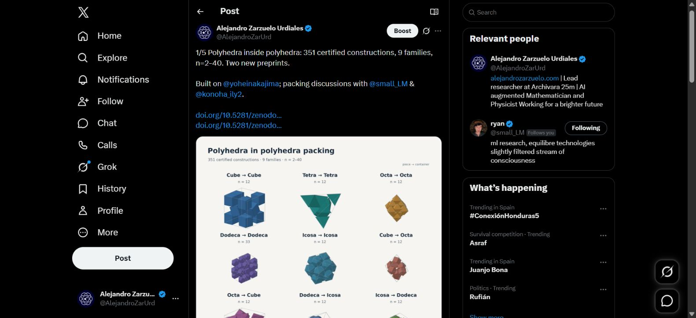

# Published X thread — 12 October 2026

The approved five-post thread is live under **@AlejandroZarUrd**: [open the thread](https://x.com/AlejandroZarUrd/status/2109430713577865667). Publication completed at 01:47:28 Europe/Paris (23:47:28 UTC on 11 October). X confirmed “Your posts were sent.”

| Post | Live URL / ID | Immediate reply parent | Approved image |
|---|---|---|---|
| 1/5 | [2109430713577865667](https://x.com/AlejandroZarUrd/status/2109430713577865667) | Root | 01-nine-families.png |
| 2/5 | [2109430716610040009](https://x.com/AlejandroZarUrd/status/2109430716610040009) | 2109430713577865667 | None |
| 3/5 | [2109430718921073062](https://x.com/AlejandroZarUrd/status/2109430718921073062) | 2109430716610040009 | None |
| 4/5 | [2109430721668329670](https://x.com/AlejandroZarUrd/status/2109430721668329670) | 2109430718921073062 | 03-plateau-and-jump.png |
| 5/5 | [2109430725514838306](https://x.com/AlejandroZarUrd/status/2109430725514838306) | 2109430721668329670 | 02-dodecahedral-shell.png |

All five editor texts matched the approved JSON exactly before the single Post all action. After publication, expanded live text, all eight unique @mentions, all three image placements, and their full alt text were checked. Independent public syndication verified the author, every reply parent, the media counts (1, 0, 0, 1, 1), and image alt text and original dimensions. Public syndication exposes previews for Premium posts; the browser supplied the full-text verification. X renders Ryan’s final linked cube announcement as a quote card in post 5, alongside the approved shell image.

The submitted text is preserved in [the thread source](../twitter-thread-polyhedral-packing.md); [machine-readable receipts](receipt.json) include IDs, approved-text hashes, image hashes and alt text. [Independent public checks](independent-public-verification.json) record their scope.

The Wikipedia article remains saved for the later step.
