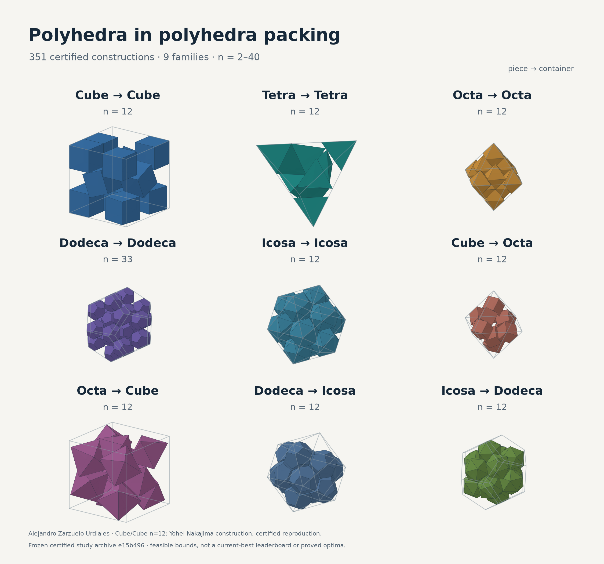
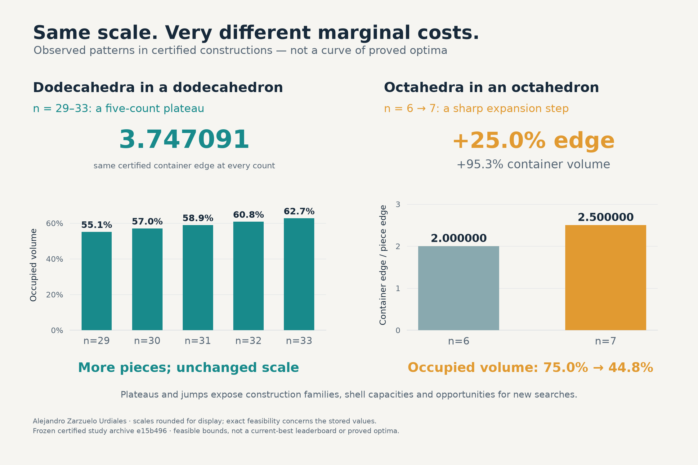
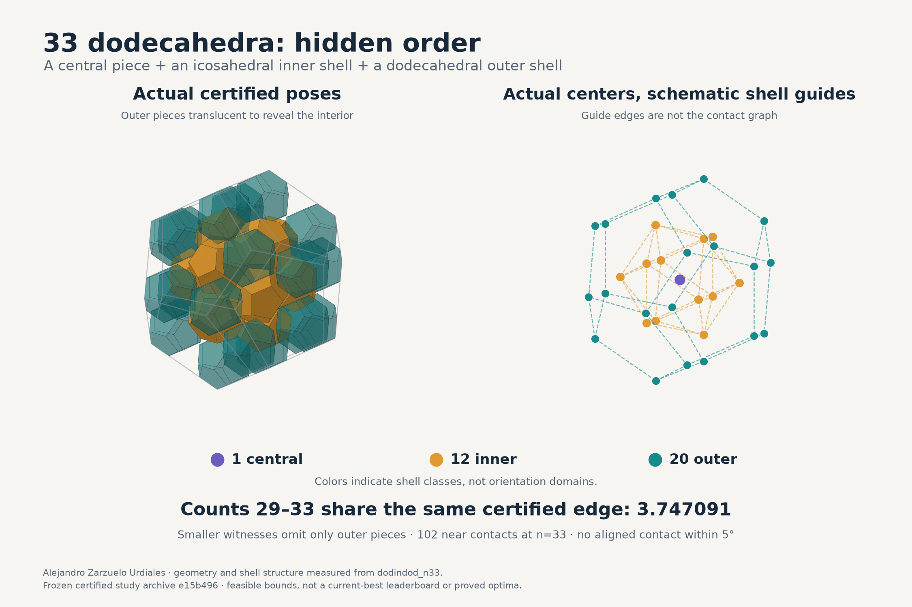

# Twitter thread: polyhedra inside polyhedra

**LOCAL DRAFT — NOT POSTED.** Revised 12 October 2026. Posts 1–2 fit ordinary 280-character posts; posts 3–10 are longer Premium posts, with early hooks followed by the technical account and direct sources. Post 2 is preserved exactly as requested.

Publish as one reply chain: post 1 is the root, post 2 replies to 1, post 3 replies to 2, and so on through 10. The JSON records that chain explicitly. This file has not been entered into a live composer or uploaded to X.

Verified mentions appear early: @yoheinakajima, @small_LM and @konoha_ily2 in post 1; @AndyLin2001 and @TencentHunyuan in post 3; @keenanisalive, @mathematics_inc and @AlexKontorovich in post 4. The methods/seeds/discussions and adjacent audiences have separate factual roles. [Mention evidence](research/twitter-mention-evidence-2026-10-12.md).

Use the published [methods preprint](https://doi.org/10.5281/zenodo.23306098), [patterns preprint](https://doi.org/10.5281/zenodo.23306126) and [reproducibility dataset](https://doi.org/10.5281/zenodo.23306130). They are public preprints and a dataset, not accepted journal articles.

## Suggested pictures

**Post 1 — nine-family overview.** This is the main attachment: actual poses from the frozen certified study archive, with every specimen's count labeled. It represents the archive rather than a current-best leaderboard. Cube/cube n=12 retains Nakajima credit.



**Post 5 — plateau versus jump.** The dodecahedral container stays at the same stored scale while count and density rise; the octahedral six-to-seven step expands the container sharply.



**Post 6 — the dodecahedral shell.** The left view uses actual solid poses with translucent outer pieces. The right shows actual centers and schematic shell guides; those lines are not the contact graph.



The images are new geometry/data renderings, not invented configurations. [Alt text](twitter-assets/alt-text.md), [reproduction script](twitter-assets/render_graphics.py), and [source/figure manifest](twitter-assets/figure-manifest.json) accompany the PNGs and editable SVGs.

## Copy-ready posts

### Post 1 (226/280 weighted characters; attach twitter-assets/01-nine-families.png)

```text
1/10 Polyhedra inside polyhedra: 351 certified constructions, 9 families, n=2-40. Two new preprints.

Built on @yoheinakajima; packing discussions with @small_LM & @konoha_ily2.

https://doi.org/10.5281/zenodo.23306098
https://doi.org/10.5281/zenodo.23306126
```

### Post 2 (182/280 weighted characters)

```text
2/10 Five same-solid families, plus their duals. Pieces can translate and rotate. Scale means container edge / piece edge; volume-normalized density makes the mixed pairs comparable.
```

### Post 3 (1,872/25,000 weighted characters)

```text
3/10 Start with balls, end with rigid polyhedra. The useful generalization is a nested rounding family for convex shapes, combined with a search that rearranges the pieces as the rounding disappears.

The lineage and seed providers: @yoheinakajima; Haowei Lin (@AndyLin2001) and @TencentHunyuan's Hyra. Their published code and witnesses make the comparison reproducible.

The tetrahedron is self-dual, so the same-solid and dual cases give nine distinct ordered problems.

@yoheinakajima's soft-to-rigid cube method is the starting point. For a convex piece P containing a centered ball of radius rho, I use

S_r = (1-r/rho)P (+) B(0,r), for 0 <= r <= rho.

Here (+) is the Minkowski sum: a scaled copy of P thickened by a radius-r ball. At r=rho we have the inscribed ball; at r=0 we have the full polyhedron. Convexity proves every intermediate body lies inside P and grows as r decreases. That geometric proof transfers the construction beyond cubes.

The search then compresses, sharpens and tightens. The geometry handles asymmetric support intervals for tetrahedra, face and edge-cross-product separating axes, actual vertex-face/edge-edge distances, and gradients for translations and rotations.

Jiggling is a separate search move: expand a little, soften, shake, re-sharpen, legalize and tighten. The shake target measures changes in neighboring center distances AFTER expansion, so moving or rotating the whole cluster does not count as rearrangement. It can shake a focused subset as well as the whole packing. The criterion measures center geometry; it neither captures every orientation change nor proves escape from a basin.

Nakajima's paper:
https://github.com/yoheinakajima/soft-to-rigid-packing/blob/efe7a920142350a4f0678633490c3e3dbed71fa0/paper/main.pdf
My methods paper:
https://doi.org/10.5281/zenodo.23306098
Implemented search:
https://github.com/alejandrozu/platonic-packing/blob/e15b496ae7306287e0e70bb5b14be79f5dfdde84/scripts/engine.py
Hyra packing artifacts:
https://github.com/Tencent-Hunyuan/Hyra-results/tree/09b2d2e3c362c67a78f544c836bd8e4b54a05527/AI4Science/packing_records
Haowei Lin's research/software:
https://linhaowei1.github.io/
```

### Post 4 (2,276/25,000 weighted characters)

```text
4/10 Search needs independently checkable witnesses. For @keenanisalive @mathematics_inc @AlexKontorovich: here is a 351-record geometry dataset with exact verification and open poses.

A solver suggests a packing. A separate exact checker proves the stored pieces fit. Every one of the 351 records passed fresh containment and separation checks, plus a floating-point check.

For containment, every transformed piece vertex is tested against every container face. For each pair, an explicit separating plane places all vertices on opposite sides. Convexity turns those vertex checks into statements about the entire solids.

Stored floating-point coordinates are interpreted as exact dyadic rationals. A homogeneous quaternion formula supplies an exactly orthogonal rational rotation. The canonical Platonic coordinates lie in Q(sqrt(2),sqrt(5)), where the checker decides signs exactly. Floating point may propose a separating direction; exact arithmetic decides whether it works.

Three values must stay distinct: the unknown globally optimal scale; the certified stored scale s_full, which is an upper bound; and the numerical touching estimate s_tight from local tightening. Small positive clearances separate the stored pieces. An attractive radical fitted to s_tight is a conjecture until an exact construction is recovered.

That distinction lets the dataset remain useful when another search improves a bound: the earlier construction stays feasible, inspectable and reusable as a seed. Complete cubic grids at 8 and 27 pieces have an elementary matching volume proof; most other optima remain open.

Exact checker:
https://github.com/alejandrozu/platonic-packing/blob/e15b496ae7306287e0e70bb5b14be79f5dfdde84/certify_exact.py
Example: 33 dodecahedra, full poses:
https://github.com/alejandrozu/platonic-packing/blob/e15b496ae7306287e0e70bb5b14be79f5dfdde84/records/dodindod/dodindod_n33.json
Reproducibility archive:
https://doi.org/10.5281/zenodo.23306130
Related work and why I am mentioning these accounts: @keenanisalive has demonstrated constraint-based square-packing visualization; @mathematics_inc has shared sphere-packing formalization; @AlexKontorovich has discussed Apollonian packing geometry and mathematical formalization. This project's exact geometry checker is its own implementation.

Square-packing visualization example:
https://x.com/keenanisalive/status/1626707731339173888
Sphere-packing formalization:
https://x.com/mathematics_inc/status/2028542388717986135
Apollonian packing discussion:
https://x.com/AlexKontorovich/status/1229500439315525632
```

### Post 5 (1,440/25,000 weighted characters; attach twitter-assets/03-plateau-and-jump.png)

```text
5/10 Adding one piece can barely change the container, or require a huge expansion in the best construction found. Edge increments and volume increments tell very different stories.

In the frozen archive, six to seven octahedra in an octahedron changes the edge from about 2 to 2.5: +25% in edge, +95.3% in container volume. Occupied volume fraction falls from about 75% to 44.8%. The near-contact graph changes from 15 edges to 5, and the aligned six-piece arrangement gives way to a differently organized seven-piece witness.

Eight to nine cubes produces a 35.36% edge step, approximately 148% more container volume. From 27 to 28 cubes, the edge step is 23.57%, approximately 88.69% more volume. These occur just beyond complete cubic grids.

Plateaus do the opposite: count rises while the reported container scale stays fixed, so density rises in direct proportion to count. Cubes 15-27 share one certified scale. Dodecahedra 29-33 share another.

I check equality using full stored values, not matching five-decimal displays. I also distinguish numerical touching plateaus and the feasible envelope obtained by deleting pieces from larger witnesses. The actual optimum may improve more smoothly than the archive: these jumps identify construction transitions and promising search targets.

Six-octahedron witness:
https://github.com/alejandrozu/platonic-packing/blob/e15b496ae7306287e0e70bb5b14be79f5dfdde84/records/octinoct/octinoct_n06.json
Seven-octahedron witness:
https://github.com/alejandrozu/platonic-packing/blob/e15b496ae7306287e0e70bb5b14be79f5dfdde84/records/octinoct/octinoct_n07.json
Full patterns paper:
https://doi.org/10.5281/zenodo.23306126
```

### Post 6 (1,489/25,000 weighted characters; attach twitter-assets/02-dodecahedral-shell.png)

```text
6/10 The 29-33 dodecahedron plateau has a concrete explanation: a shared inner core and optional outer-shell pieces. The 33-piece construction is organized as 1 + 12 + 20.

One piece sits at the center. Twelve centers occupy inner-shell directions matching the vertices of an icosahedron, the dual of the dodecahedron. Twenty occupy outer-shell directions matching dodecahedral vertices. The shell-direction fits agree to about 1e-14 in the numerical coordinates.

Every record from 29 to 33 has exactly the same stored certified edge ratio: 3.7470909531576. Matching their poses shows the smaller members omit only outer-shell pieces while retaining the 13-piece center-plus-inner core.

The core contributes 12 center-inner contacts and 30 inner-inner contacts. Each outer piece adds 3 inner-outer contacts. That gives 90, 93, 96, 99 and 102 near contacts as the count runs from 29 to 33.

Density rises from 0.551208 to 0.627236 without increasing the container. This is a measured shell-filling mechanism within the construction family. The pose matches are numerical comparisons, and equal certified scales do not prove equal globally optimal scales.

The next count is interesting too: at 34 the archived edge increases by 4.39%, volume by 13.75%, and density drops to 0.5681. Can a different family continue more efficiently?

Inspect the 33-piece record:
https://github.com/alejandrozu/platonic-packing/blob/e15b496ae7306287e0e70bb5b14be79f5dfdde84/records/dodindod/dodindod_n33.json
Compare the 29-piece record:
https://github.com/alejandrozu/platonic-packing/blob/e15b496ae7306287e0e70bb5b14be79f5dfdde84/records/dodindod/dodindod_n29.json
Rotate the constructions:
https://alejandrozu.github.io/platonic-packing/#dodindod_n33
```

### Post 7 (1,648/25,000 weighted characters)

```text
7/10 The surprising part of that shell: repeated orientations and local alignment come apart. It has 7 orientation components and 102 near contacts, yet none of those contacts joins aligned pieces.

Orientation must be measured modulo the solid's own proper rotational symmetries: 12 for tetrahedra, 24 for cubes/octahedra, 60 for dodecahedra/icosahedra. Raw quaternion differences would split geometrically identical orientations.

In the 33-dodecahedron witness, the center and 20 outer pieces share an orientation. The 12 inner pieces form six same-orientation antipodal pairs. Equal orientations occupy separated sites; the contacts join different orientations, with angles around 36 and 37.4 degrees.

I separately measure orientation components, Euclidean near-contact graphs, and their intersection: contact-connected orientation domains, called operational grains. At a 1-degree angle threshold and 1e-4 piece-edge distance threshold, all 33 domains are singletons. That remains true at the other tested thresholds. The shells still have highly regular positional order.

This is why a single orientation coloring can miss the organization. Across the full archive, only 131/351 orientation partitions and 217/351 contact sets remain unchanged over the tested threshold ranges. I retain component memberships, angular diameters and contact edges so those choices can be inspected.

These domains measure packing geometry. A physical crystal grain also requires a positional/physical reference and a model of assembly.

Patterns and explicit definitions:
https://doi.org/10.5281/zenodo.23306126
Pose data and rerunnable measurements:
https://doi.org/10.5281/zenodo.23306130
```

### Post 8 (1,653/25,000 weighted characters)

```text
8/10 There is no single "best orientation pattern" across the nine families. The useful commonalities concern compatible faces, repeated motifs, boundary accommodation and how a construction continues with count.

Explicit scaffolds supply reference capacities: k^3 cubes in an edge-k cube; (2k^3+k)/3 octahedra in an edge-k octahedron; (k^3+k)/2 tetrahedra in an edge-k tetrahedron, using the tetrahedral subdivision and one tetrahedron per octahedral hole. Those are constructive upper bounds, not all-count optimum formulas.

Other witnesses have several repeated orientation domains, dual shells, or nearly one orientation per piece. At the 1-degree criterion, 22 cube-in-cube records are pairwise aligned, versus 18 octahedron-in-octahedron records. In the golden-ratio dual pairs, 26/39 dodecahedron-in-icosahedron records and 24/39 in the reverse direction have all orientations distinct.

Raw scale can also hide commonality. At 40 pieces, dodecahedra in an icosahedron need edge ratio 6.32472; the reverse needs 2.74184. Their occupied fractions are close: 0.55533 and 0.55249. Unit-edge volumes explain much of the apparent difference. Duality does not guarantee equal efficiency: the cube/octahedron directions differ and their efficiency ordering changes with count.

A repeated orientation is not automatically a lattice, and high proximity degree is not automatically rigidity. The next classification should fit center lattices/layers/shells, contact topology and orientation separately, then compare competing families at the same count.

Explicit constructive seeds:
https://github.com/alejandrozu/platonic-packing/blob/e15b496ae7306287e0e70bb5b14be79f5dfdde84/scripts/constructions.py
Nine-family analysis:
https://doi.org/10.5281/zenodo.23306126
```

### Post 9 (1,756/25,000 weighted characters)

```text
9/10 Paper 2 turns the atlas into 20 testable hypotheses. The aim is to explain which geometric mechanisms recur, predict useful constructions, and give each proposal a test that could reject it.

Shell filling: does a preserved core support added boundary sites at the same scale? Fixed-core insertion and pose matching can test that beyond the observed dodecahedral plateau.

Complementary orientations: do differently oriented neighbors enable the dual shell? Constrain neighboring orientations to agree and compare achievable scale with the unconstrained family.

Construction changes: do large jumps appear just beyond scaffold or shell capacity? Compare insertion, collective perturbations and fresh searches at matched budgets. A better successor can shrink the archive's jump while leaving the earlier motif intact.

Boundary accommodation: do wall-near pieces have systematically different orientation distributions? Separate boundary from interior measurements rather than treating every tilted piece alike. The 15-icosahedron-in-dodecahedron exception is actually central: 14 pieces share one orientation and the interior piece another.

Proof targets: recover low-dimensional exact contact equations and stronger problem-specific lower bounds. A plateau or stable numerical result is a useful lead; a matching lower bound is what proves an optimum.

Extensions: test larger counts, the omitted ordered pairs, other convex polyhedra and specified mixtures. The present 351 records contain one piece species per case. They motivate experiments on confinement and order, not an established crystal-growth mechanism.

All 20 hypotheses, tests and possible counterexamples:
https://doi.org/10.5281/zenodo.23306126
The 15-piece mixed witness:
https://github.com/alejandrozu/platonic-packing/blob/e15b496ae7306287e0e70bb5b14be79f5dfdde84/records/icoindod/icoindod_n15.json
```

### Post 10 (1,874/25,000 weighted characters)

```text
10/10 Two preprints, an open archive, and constructions you can inspect rather than take on trust. The contribution is the generalized search, certified finite dataset and structural explanations.

Credit matters. @yoheinakajima supplied the immediate soft-to-rigid cube method and code lineage. My 11-cube refinement starts from Haowei Lin's (@AndyLin2001) published seed. The 12-cube result reproduces Nakajima's touching family with a different clearance convention; a smaller strict-clearance number is not a new geometric improvement. Friedman and Walsh supply important benchmark constructions, and Lin supplies additional improvements.

The papers preserve their source freeze and dated comparisons. @konoha_ily2 announced cube improvements at 28, 34, 35 and 36; @small_LM then announced further improvements at 34-36, and ties at 11 and 12. These are dated announcements, not certificate replays I have independently performed. Individual bounds can move while the broader geometry, reusable poses and reproducible analysis remain valuable.

Both papers also describe the computational tools used: Claude in the underlying development and Codex in inspection, measurement and exposition. The evidence is in the coordinates, scripts, checks and source hashes.

Methods, including development and failures:
https://doi.org/10.5281/zenodo.23306098
Patterns, shells and 20 hypotheses:
https://doi.org/10.5281/zenodo.23306126
Data/software/reproducibility archive:
https://doi.org/10.5281/zenodo.23306130
Open repository:
https://github.com/alejandrozu/platonic-packing
Rotating viewer:
https://alejandrozu.github.io/platonic-packing/
Upstream MIT credit:
https://github.com/yoheinakajima/soft-to-rigid-packing/blob/efe7a920142350a4f0678633490c3e3dbed71fa0/LICENSE
External cube announcements:
https://x.com/konoha_ily2/status/2109306733999120589
https://x.com/small_LM/status/2109345921465229780

I'd particularly welcome independently certified competitors, exact shell reconstruction, stronger lower bounds, and tests of whether these motifs transfer to other shapes. The two papers are public preprints.
```

## Posting notes

Keep the images as attachments to the indicated posts and add the supplied alt text. Keep the DOI/source URLs intact. X counts each URL as 23 characters; the copy-ready text is ASCII so its weighted count is unambiguous. Current [X Premium guidance](https://help.x.com/en/using-x/x-premium) permits longer posts and longer replies; [counting rules](https://docs.x.com/fundamentals/counting-characters) explain URL weighting. Check the final composer counter after any edits.

The source freeze is `e15b496ae7306287e0e70bb5b14be79f5dfdde84`; the papers preserve that dataset even when later announcements improve individual cube bounds. The thread's invitation mentions do not assign anyone a contribution to this project. The existing Wikipedia article remains saved for the later step.
