# Polyhedra in polyhedra packing

**Polyhedra in polyhedra packing** is a class of finite [packing problems](https://en.wikipedia.org/wiki/Packing_problems) in which [polyhedra](https://en.wikipedia.org/wiki/Polyhedron) are placed inside a polyhedral container without overlapping interiors. Typical objectives are to minimize the container, maximize the common size of its pieces, or maximize their number. The pieces may be [congruent](https://en.wikipedia.org/wiki/Congruence_(geometry)) or of different shapes and sizes; their permitted motions may include [translations](https://en.wikipedia.org/wiki/Translation_(geometry)) and [rotations](https://en.wikipedia.org/wiki/Rotation_(mathematics)).[1](#reference-1)[36](#reference-36)

The problem combines [discrete geometry](https://en.wikipedia.org/wiki/Discrete_geometry), [mathematical optimization](https://en.wikipedia.org/wiki/Mathematical_optimization), and computational geometry. It belongs to the established theory of packing [convex bodies](https://en.wikipedia.org/wiki/Convex_body) in bounded containers. Related applications include arranging manufactured parts in a build volume and studying the geometric organization of confined particles.[3](#reference-3)[37](#reference-37)[25](#reference-25)

## Mathematical formulation

For a particle $P$ and a fixed-shape container $C$, let $s^*_{C,P}(n)$ be the smallest scale of the container that can accommodate $n$ congruent copies. In the freely rotating formulation, each copy has the form $P_i=t_i+R_iP$, with translation $t_i$ and proper rotation $R_i$, and must satisfy $P_i\subseteq sC$ and $\operatorname{int}(P_i)\cap\operatorname{int}(P_j)=\varnothing$ for $i\ne j$. Touching is permitted; positive-clearance constructions impose an additional gap.[3](#reference-3)[5](#reference-5)[6](#reference-6)

For unit-edge particles and a [homothetic](https://en.wikipedia.org/wiki/Homothetic_transformation) container, the reported scale is the container edge divided by the particle edge. A feasible construction at scale $U_n$ gives an [upper bound](https://en.wikipedia.org/wiki/Upper_and_lower_bounds) on the unknown minimum. Volume supplies a lower bound and a corresponding [packing density](https://en.wikipedia.org/wiki/Packing_density):

$$
\left(\frac{nV(P)}{V(C)}\right)^{1/3}\le s^*_{C,P}(n)\le U_n,
\qquad \eta_n=\frac{nV(P)}{V(C)U_n^3}.
$$

Comparing densities rather than raw edge ratios matters when the particle and container have different unit-edge volumes. Removing a piece preserves feasibility, so $s^*(n)\le s^*(n+1)$; this does not imply a strict increase at every count.[3](#reference-3)[37](#reference-37)

## Established theory and computational methods

### Finite packing and three-dimensional layout

Böröczky's *Finite Packing and Covering* develops finite arrangements of congruent convex bodies in convex containers, including density and extremal questions. Fejes Tóth's handbook chapter likewise formulates the minimum container scale for a specified population. These treatments place finite packing alongside [sphere packing](https://en.wikipedia.org/wiki/Sphere_packing), covering, and [lattice](https://en.wikipedia.org/wiki/Lattice_(group)) arrangements. Their detailed examples often concern disks and spheres; they provide a general framework rather than a catalogue of the polyhedral records below.[37](#reference-37)[3](#reference-3)

Cagan, Shimada, and Yin's 2002 survey reviews the layout of complex three-dimensional objects, including their positions and orientations, containment constraints, and interference evaluation. It discusses geometric representations and search procedures such as [local search](https://en.wikipedia.org/wiki/Local_search_(optimization)) and [simulated annealing](https://en.wikipedia.org/wiki/Simulated_annealing). This literature predates recent regular-solid catalogues and supplies a broader setting for packing algorithms.[36](#reference-36)

Irregular packing is also studied in [additive manufacturing](https://en.wikipedia.org/wiki/3D_printing), where parts must fit in an enclosed build volume. Araújo and colleagues review this three-dimensional problem and introduce a taxonomy and benchmark dataset. Wäscher and colleagues distinguish packing problems by their inputs and objectives; Leão and colleagues survey mathematical models, chiefly for two-dimensional irregular nesting. These classifications help separate congruent, freely rotating solids from unequal boxes, planar pieces, and mechanical layouts with additional design constraints.[25](#reference-25)[1](#reference-1)[16](#reference-16)

### Geometry, search, and verification

Published algorithms include translational packing of arbitrary polytopes by Egeblad and colleagues, continuously rotating concave polyhedra in cuboids by Romanova and colleagues, and polyhedra within bounded convex sets by Callisaya and Kari. These are distinct formulations, with different allowable motions and container objectives.[2](#reference-2)[5](#reference-5)[6](#reference-6)

[Collision detection](https://en.wikipedia.org/wiki/Collision_detection) and containment tests enforce the geometry. For convex pieces, [separating hyperplanes](https://en.wikipedia.org/wiki/Hyperplane_separation_theorem) can establish nonoverlap. Search may alternate perturbations, local improvement, and feasibility repair. Finding a feasible arrangement is different from proving [global optimality](https://en.wikipedia.org/wiki/Global_optimization): a certificate for one construction supplies an upper bound, while an optimality proof also needs a matching lower bound.[36](#reference-36)[6](#reference-6)

In 2026, Alejandro Zarzuelo Urdiales generalized Yohei Nakajima's rounded-cube continuation procedure to the Platonic particle and container families represented below. The procedure starts with sphere-like particles, progressively restores their polyhedral geometry, and then uses rigid-motion refinement and perturbations to tighten the container. A separate exact-arithmetic checker verifies the archived constructions. The methods preprint documents the generalization, search, and certification; its certificates establish stored feasibility rather than global optimality.[27](#reference-27)[28](#reference-28)[34](#reference-34)

## Cubes and other regular polyhedra

The five [Platonic solids](https://en.wikipedia.org/wiki/Platonic_solid) are the [tetrahedron](https://en.wikipedia.org/wiki/Tetrahedron), [cube](https://en.wikipedia.org/wiki/Cube), [octahedron](https://en.wikipedia.org/wiki/Octahedron), [dodecahedron](https://en.wikipedia.org/wiki/Dodecahedron), and [icosahedron](https://en.wikipedia.org/wiki/Icosahedron). Cubes and octahedra form a [dual pair](https://en.wikipedia.org/wiki/Dual_polyhedron), as do dodecahedra and icosahedra; the tetrahedron is self-dual. Reversing the particle and container produces a different packing problem.

For cubes in a cube, a $k\times k\times k$ grid fits $k^3$ unit cubes at container edge $k$. Its volume matches the container, proving optimality at complete-grid counts. At intermediate counts, rotations can improve on the next larger grid. Erich Friedman's catalogue documents such constructions, including the nine- and ten-cube arrangement at edge $2+1/\sqrt2$ and later eleven- and twelve-cube improvements. The catalogue also records octahedra in cubes. These entries are construction bounds unless an optimality proof is supplied.[11](#reference-11)[13](#reference-13)

Other cube questions impose different conditions. Januszewski and Zielonka study unequal cubes packed parallel to the walls and prove a sharp sufficient-volume guarantee for a non-blocking class. This does not determine the freely rotating congruent-cube records. Inscribing a single regular polyhedron in another is also distinct: Croft and Firsching study maximal individual copies, which need not combine into a nonoverlapping multi-piece packing.[35](#reference-35)[9](#reference-9)[7](#reference-7)

## Same-solid and dual-solid results

The following tables retain the sourced construction scales for two through twelve pieces: five identical-solid families and four ordered dual-solid families. They report feasible bounds rather than universal proved optima. Each image links to inspection of its construction, with source and coordinate links retained. Original catalogue diagrams are used for the two superior external octahedra-in-cube entries for which public poses were not located.[11](#reference-11)[13](#reference-13)[28](#reference-28)[34](#reference-34)

### Identical particle and container solids

| n | Tetrahedra in tetrahedron | Cubes in cube | Octahedra in octahedron | Dodecahedra in dodecahedron | Icosahedra in icosahedron |
|---:|---|---|---|---|---|
| 2 | [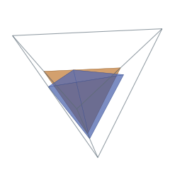](https://alejandrozu.github.io/platonic-packing/#tetintet_n02) [1.95356+](https://doi.org/10.5281/zenodo.23306098) [source](https://doi.org/10.5281/zenodo.23306098) · [3D](https://alejandrozu.github.io/platonic-packing/#tetintet_n02) · [construction](https://github.com/alejandrozu/platonic-packing/blob/e15b496ae7306287e0e70bb5b14be79f5dfdde84/records/tetintet/tetintet_n02.json) | [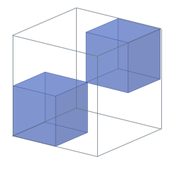](https://alejandrozu.github.io/platonic-packing/#cubincub_n02) [2](https://erich-friedman.github.io/packing/cubincub/) [source](https://erich-friedman.github.io/packing/cubincub/) · [3D](https://alejandrozu.github.io/platonic-packing/#cubincub_n02) · [construction](https://github.com/alejandrozu/platonic-packing/blob/e15b496ae7306287e0e70bb5b14be79f5dfdde84/records/cubincub/cubincub_n02.json) | [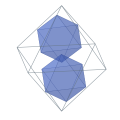](https://alejandrozu.github.io/platonic-packing/#octinoct_n02) [1.93311+](https://doi.org/10.5281/zenodo.23306098) [source](https://doi.org/10.5281/zenodo.23306098) · [3D](https://alejandrozu.github.io/platonic-packing/#octinoct_n02) · [construction](https://github.com/alejandrozu/platonic-packing/blob/e15b496ae7306287e0e70bb5b14be79f5dfdde84/records/octinoct/octinoct_n02.json) | [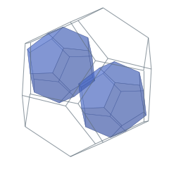](https://alejandrozu.github.io/platonic-packing/#dodindod_n02) [1.98759+](https://doi.org/10.5281/zenodo.23306098) [source](https://doi.org/10.5281/zenodo.23306098) · [3D](https://alejandrozu.github.io/platonic-packing/#dodindod_n02) · [construction](https://github.com/alejandrozu/platonic-packing/blob/e15b496ae7306287e0e70bb5b14be79f5dfdde84/records/dodindod/dodindod_n02.json) | [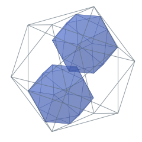](https://alejandrozu.github.io/platonic-packing/#icoinico_n02) [1.96308+](https://doi.org/10.5281/zenodo.23306098) [source](https://doi.org/10.5281/zenodo.23306098) · [3D](https://alejandrozu.github.io/platonic-packing/#icoinico_n02) · [construction](https://github.com/alejandrozu/platonic-packing/blob/e15b496ae7306287e0e70bb5b14be79f5dfdde84/records/icoinico/icoinico_n02.json) |
| 3 | [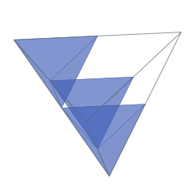](https://alejandrozu.github.io/platonic-packing/#tetintet_n03) [2.00000+](https://doi.org/10.5281/zenodo.23306098) [source](https://doi.org/10.5281/zenodo.23306098) · [3D](https://alejandrozu.github.io/platonic-packing/#tetintet_n03) · [construction](https://github.com/alejandrozu/platonic-packing/blob/e15b496ae7306287e0e70bb5b14be79f5dfdde84/records/tetintet/tetintet_n03.json) | [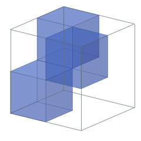](https://alejandrozu.github.io/platonic-packing/#cubincub_n03) [2](https://erich-friedman.github.io/packing/cubincub/) [source](https://erich-friedman.github.io/packing/cubincub/) · [3D](https://alejandrozu.github.io/platonic-packing/#cubincub_n03) · [construction](https://github.com/alejandrozu/platonic-packing/blob/e15b496ae7306287e0e70bb5b14be79f5dfdde84/records/cubincub/cubincub_n03.json) | [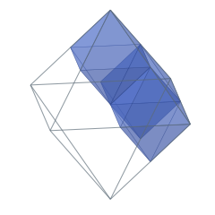](https://alejandrozu.github.io/platonic-packing/#octinoct_n03) [2.00000+](https://doi.org/10.5281/zenodo.23306098) [source](https://doi.org/10.5281/zenodo.23306098) · [3D](https://alejandrozu.github.io/platonic-packing/#octinoct_n03) · [construction](https://github.com/alejandrozu/platonic-packing/blob/e15b496ae7306287e0e70bb5b14be79f5dfdde84/records/octinoct/octinoct_n03.json) | [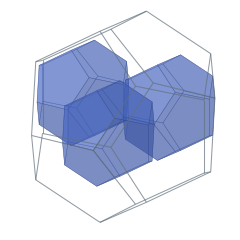](https://alejandrozu.github.io/platonic-packing/#dodindod_n03) [2.00000+](https://doi.org/10.5281/zenodo.23306098) [source](https://doi.org/10.5281/zenodo.23306098) · [3D](https://alejandrozu.github.io/platonic-packing/#dodindod_n03) · [construction](https://github.com/alejandrozu/platonic-packing/blob/e15b496ae7306287e0e70bb5b14be79f5dfdde84/records/dodindod/dodindod_n03.json) | [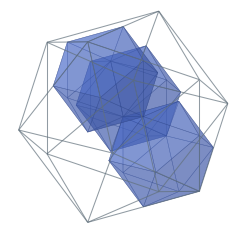](https://alejandrozu.github.io/platonic-packing/#icoinico_n03) [2.00000+](https://doi.org/10.5281/zenodo.23306098) [source](https://doi.org/10.5281/zenodo.23306098) · [3D](https://alejandrozu.github.io/platonic-packing/#icoinico_n03) · [construction](https://github.com/alejandrozu/platonic-packing/blob/e15b496ae7306287e0e70bb5b14be79f5dfdde84/records/icoinico/icoinico_n03.json) |
| 4 | [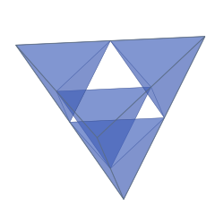](https://alejandrozu.github.io/platonic-packing/#tetintet_n04) [2.00000+](https://doi.org/10.5281/zenodo.23306098) [source](https://doi.org/10.5281/zenodo.23306098) · [3D](https://alejandrozu.github.io/platonic-packing/#tetintet_n04) · [construction](https://github.com/alejandrozu/platonic-packing/blob/e15b496ae7306287e0e70bb5b14be79f5dfdde84/records/tetintet/tetintet_n04.json) | [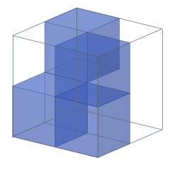](https://alejandrozu.github.io/platonic-packing/#cubincub_n04) [2](https://erich-friedman.github.io/packing/cubincub/) [source](https://erich-friedman.github.io/packing/cubincub/) · [3D](https://alejandrozu.github.io/platonic-packing/#cubincub_n04) · [construction](https://github.com/alejandrozu/platonic-packing/blob/e15b496ae7306287e0e70bb5b14be79f5dfdde84/records/cubincub/cubincub_n04.json) | [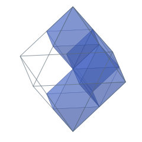](https://alejandrozu.github.io/platonic-packing/#octinoct_n04) [2.00000+](https://doi.org/10.5281/zenodo.23306098) [source](https://doi.org/10.5281/zenodo.23306098) · [3D](https://alejandrozu.github.io/platonic-packing/#octinoct_n04) · [construction](https://github.com/alejandrozu/platonic-packing/blob/e15b496ae7306287e0e70bb5b14be79f5dfdde84/records/octinoct/octinoct_n04.json) | [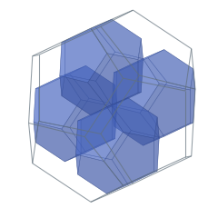](https://alejandrozu.github.io/platonic-packing/#dodindod_n04) [2.00000+](https://doi.org/10.5281/zenodo.23306098) [source](https://doi.org/10.5281/zenodo.23306098) · [3D](https://alejandrozu.github.io/platonic-packing/#dodindod_n04) · [construction](https://github.com/alejandrozu/platonic-packing/blob/e15b496ae7306287e0e70bb5b14be79f5dfdde84/records/dodindod/dodindod_n04.json) | [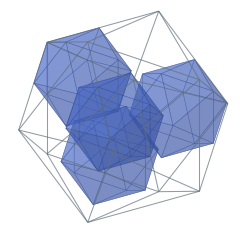](https://alejandrozu.github.io/platonic-packing/#icoinico_n04) [2.14589+](https://doi.org/10.5281/zenodo.23306098) [source](https://doi.org/10.5281/zenodo.23306098) · [3D](https://alejandrozu.github.io/platonic-packing/#icoinico_n04) · [construction](https://github.com/alejandrozu/platonic-packing/blob/e15b496ae7306287e0e70bb5b14be79f5dfdde84/records/icoinico/icoinico_n04.json) |
| 5 | [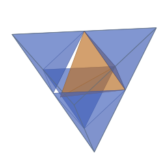](https://alejandrozu.github.io/platonic-packing/#tetintet_n05) [2.00000+](https://doi.org/10.5281/zenodo.23306098) [source](https://doi.org/10.5281/zenodo.23306098) · [3D](https://alejandrozu.github.io/platonic-packing/#tetintet_n05) · [construction](https://github.com/alejandrozu/platonic-packing/blob/e15b496ae7306287e0e70bb5b14be79f5dfdde84/records/tetintet/tetintet_n05.json) | [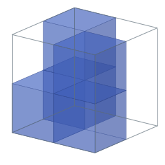](https://alejandrozu.github.io/platonic-packing/#cubincub_n05) [2](https://erich-friedman.github.io/packing/cubincub/) [source](https://erich-friedman.github.io/packing/cubincub/) · [3D](https://alejandrozu.github.io/platonic-packing/#cubincub_n05) · [construction](https://github.com/alejandrozu/platonic-packing/blob/e15b496ae7306287e0e70bb5b14be79f5dfdde84/records/cubincub/cubincub_n05.json) | [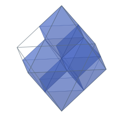](https://alejandrozu.github.io/platonic-packing/#octinoct_n05) [2.00000+](https://doi.org/10.5281/zenodo.23306098) [source](https://doi.org/10.5281/zenodo.23306098) · [3D](https://alejandrozu.github.io/platonic-packing/#octinoct_n05) · [construction](https://github.com/alejandrozu/platonic-packing/blob/e15b496ae7306287e0e70bb5b14be79f5dfdde84/records/octinoct/octinoct_n05.json) | [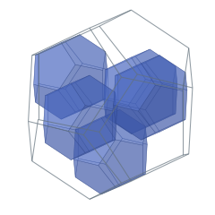](https://alejandrozu.github.io/platonic-packing/#dodindod_n05) [2.23606+](https://doi.org/10.5281/zenodo.23306098) [source](https://doi.org/10.5281/zenodo.23306098) · [3D](https://alejandrozu.github.io/platonic-packing/#dodindod_n05) · [construction](https://github.com/alejandrozu/platonic-packing/blob/e15b496ae7306287e0e70bb5b14be79f5dfdde84/records/dodindod/dodindod_n05.json) | [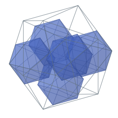](https://alejandrozu.github.io/platonic-packing/#icoinico_n05) [2.23606+](https://doi.org/10.5281/zenodo.23306098) [source](https://doi.org/10.5281/zenodo.23306098) · [3D](https://alejandrozu.github.io/platonic-packing/#icoinico_n05) · [construction](https://github.com/alejandrozu/platonic-packing/blob/e15b496ae7306287e0e70bb5b14be79f5dfdde84/records/icoinico/icoinico_n05.json) |
| 6 | [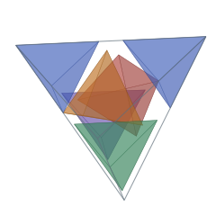](https://alejandrozu.github.io/platonic-packing/#tetintet_n06) [2.29099+](https://doi.org/10.5281/zenodo.23306098) [source](https://doi.org/10.5281/zenodo.23306098) · [3D](https://alejandrozu.github.io/platonic-packing/#tetintet_n06) · [construction](https://github.com/alejandrozu/platonic-packing/blob/e15b496ae7306287e0e70bb5b14be79f5dfdde84/records/tetintet/tetintet_n06.json) | [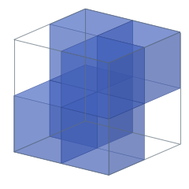](https://alejandrozu.github.io/platonic-packing/#cubincub_n06) [2](https://erich-friedman.github.io/packing/cubincub/) [source](https://erich-friedman.github.io/packing/cubincub/) · [3D](https://alejandrozu.github.io/platonic-packing/#cubincub_n06) · [construction](https://github.com/alejandrozu/platonic-packing/blob/e15b496ae7306287e0e70bb5b14be79f5dfdde84/records/cubincub/cubincub_n06.json) | [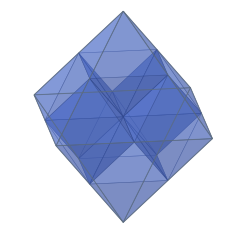](https://alejandrozu.github.io/platonic-packing/#octinoct_n06) [2.00000+](https://doi.org/10.5281/zenodo.23306098) [source](https://doi.org/10.5281/zenodo.23306098) · [3D](https://alejandrozu.github.io/platonic-packing/#octinoct_n06) · [construction](https://github.com/alejandrozu/platonic-packing/blob/e15b496ae7306287e0e70bb5b14be79f5dfdde84/records/octinoct/octinoct_n06.json) | [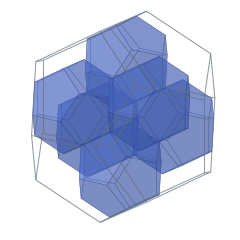](https://alejandrozu.github.io/platonic-packing/#dodindod_n06) [2.23606+](https://doi.org/10.5281/zenodo.23306098) [source](https://doi.org/10.5281/zenodo.23306098) · [3D](https://alejandrozu.github.io/platonic-packing/#dodindod_n06) · [construction](https://github.com/alejandrozu/platonic-packing/blob/e15b496ae7306287e0e70bb5b14be79f5dfdde84/records/dodindod/dodindod_n06.json) | [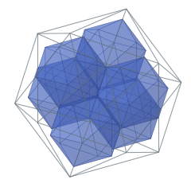](https://alejandrozu.github.io/platonic-packing/#icoinico_n06) [2.34164+](https://doi.org/10.5281/zenodo.23306098) [source](https://doi.org/10.5281/zenodo.23306098) · [3D](https://alejandrozu.github.io/platonic-packing/#icoinico_n06) · [construction](https://github.com/alejandrozu/platonic-packing/blob/e15b496ae7306287e0e70bb5b14be79f5dfdde84/records/icoinico/icoinico_n06.json) |
| 7 | [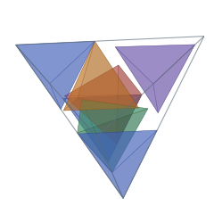](https://alejandrozu.github.io/platonic-packing/#tetintet_n07) [2.38195+](https://doi.org/10.5281/zenodo.23306098) [source](https://doi.org/10.5281/zenodo.23306098) · [3D](https://alejandrozu.github.io/platonic-packing/#tetintet_n07) · [construction](https://github.com/alejandrozu/platonic-packing/blob/e15b496ae7306287e0e70bb5b14be79f5dfdde84/records/tetintet/tetintet_n07.json) | [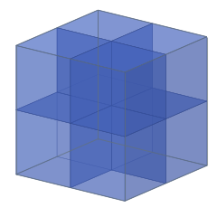](https://alejandrozu.github.io/platonic-packing/#cubincub_n07) [2](https://erich-friedman.github.io/packing/cubincub/) [source](https://erich-friedman.github.io/packing/cubincub/) · [3D](https://alejandrozu.github.io/platonic-packing/#cubincub_n07) · [construction](https://github.com/alejandrozu/platonic-packing/blob/e15b496ae7306287e0e70bb5b14be79f5dfdde84/records/cubincub/cubincub_n07.json) | [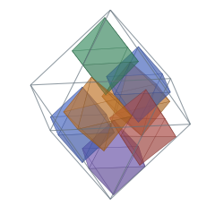](https://alejandrozu.github.io/platonic-packing/#octinoct_n07) [2.50000+](https://doi.org/10.5281/zenodo.23306098) [source](https://doi.org/10.5281/zenodo.23306098) · [3D](https://alejandrozu.github.io/platonic-packing/#octinoct_n07) · [construction](https://github.com/alejandrozu/platonic-packing/blob/e15b496ae7306287e0e70bb5b14be79f5dfdde84/records/octinoct/octinoct_n07.json) | [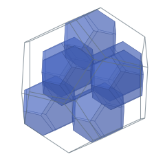](https://alejandrozu.github.io/platonic-packing/#dodindod_n07) [2.42705+](https://doi.org/10.5281/zenodo.23306098) [source](https://doi.org/10.5281/zenodo.23306098) · [3D](https://alejandrozu.github.io/platonic-packing/#dodindod_n07) · [construction](https://github.com/alejandrozu/platonic-packing/blob/e15b496ae7306287e0e70bb5b14be79f5dfdde84/records/dodindod/dodindod_n07.json) | [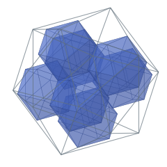](https://alejandrozu.github.io/platonic-packing/#icoinico_n07) [2.44931+](https://doi.org/10.5281/zenodo.23306098) [source](https://doi.org/10.5281/zenodo.23306098) · [3D](https://alejandrozu.github.io/platonic-packing/#icoinico_n07) · [construction](https://github.com/alejandrozu/platonic-packing/blob/e15b496ae7306287e0e70bb5b14be79f5dfdde84/records/icoinico/icoinico_n07.json) |
| 8 | [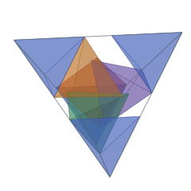](https://alejandrozu.github.io/platonic-packing/#tetintet_n08) [2.38742+](https://doi.org/10.5281/zenodo.23306098) [source](https://doi.org/10.5281/zenodo.23306098) · [3D](https://alejandrozu.github.io/platonic-packing/#tetintet_n08) · [construction](https://github.com/alejandrozu/platonic-packing/blob/e15b496ae7306287e0e70bb5b14be79f5dfdde84/records/tetintet/tetintet_n08.json) | [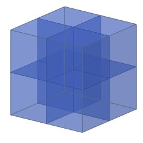](https://alejandrozu.github.io/platonic-packing/#cubincub_n08) [2](https://erich-friedman.github.io/packing/cubincub/) [source](https://erich-friedman.github.io/packing/cubincub/) · [3D](https://alejandrozu.github.io/platonic-packing/#cubincub_n08) · [construction](https://github.com/alejandrozu/platonic-packing/blob/e15b496ae7306287e0e70bb5b14be79f5dfdde84/records/cubincub/cubincub_n08.json) | [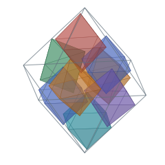](https://alejandrozu.github.io/platonic-packing/#octinoct_n08) [2.50000+](https://doi.org/10.5281/zenodo.23306098) [source](https://doi.org/10.5281/zenodo.23306098) · [3D](https://alejandrozu.github.io/platonic-packing/#octinoct_n08) · [construction](https://github.com/alejandrozu/platonic-packing/blob/e15b496ae7306287e0e70bb5b14be79f5dfdde84/records/octinoct/octinoct_n08.json) | [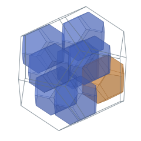](https://alejandrozu.github.io/platonic-packing/#dodindod_n08) [2.52786+](https://doi.org/10.5281/zenodo.23306098) [source](https://doi.org/10.5281/zenodo.23306098) · [3D](https://alejandrozu.github.io/platonic-packing/#dodindod_n08) · [construction](https://github.com/alejandrozu/platonic-packing/blob/e15b496ae7306287e0e70bb5b14be79f5dfdde84/records/dodindod/dodindod_n08.json) | [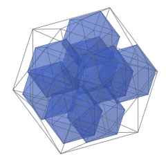](https://alejandrozu.github.io/platonic-packing/#icoinico_n08) [2.49661+](https://doi.org/10.5281/zenodo.23306098) [source](https://doi.org/10.5281/zenodo.23306098) · [3D](https://alejandrozu.github.io/platonic-packing/#icoinico_n08) · [construction](https://github.com/alejandrozu/platonic-packing/blob/e15b496ae7306287e0e70bb5b14be79f5dfdde84/records/icoinico/icoinico_n08.json) |
| 9 | [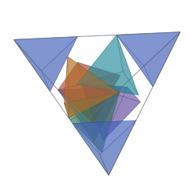](https://alejandrozu.github.io/platonic-packing/#tetintet_n09) [2.61556+](https://doi.org/10.5281/zenodo.23306098) [source](https://doi.org/10.5281/zenodo.23306098) · [3D](https://alejandrozu.github.io/platonic-packing/#tetintet_n09) · [construction](https://github.com/alejandrozu/platonic-packing/blob/e15b496ae7306287e0e70bb5b14be79f5dfdde84/records/tetintet/tetintet_n09.json) | [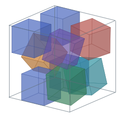](https://alejandrozu.github.io/platonic-packing/#cubincub_n09) [2 + 1/√2](https://erich-friedman.github.io/packing/cubincub/) [source](https://erich-friedman.github.io/packing/cubincub/) · [3D](https://alejandrozu.github.io/platonic-packing/#cubincub_n09) · [construction](https://github.com/alejandrozu/platonic-packing/blob/e15b496ae7306287e0e70bb5b14be79f5dfdde84/records/cubincub/cubincub_n09.json) | [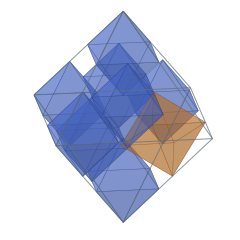](https://alejandrozu.github.io/platonic-packing/#octinoct_n09) [2.50000+](https://doi.org/10.5281/zenodo.23306098) [source](https://doi.org/10.5281/zenodo.23306098) · [3D](https://alejandrozu.github.io/platonic-packing/#octinoct_n09) · [construction](https://github.com/alejandrozu/platonic-packing/blob/e15b496ae7306287e0e70bb5b14be79f5dfdde84/records/octinoct/octinoct_n09.json) | [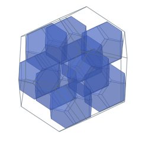](https://alejandrozu.github.io/platonic-packing/#dodindod_n09) [2.59888+](https://doi.org/10.5281/zenodo.23306098) [source](https://doi.org/10.5281/zenodo.23306098) · [3D](https://alejandrozu.github.io/platonic-packing/#dodindod_n09) · [construction](https://github.com/alejandrozu/platonic-packing/blob/e15b496ae7306287e0e70bb5b14be79f5dfdde84/records/dodindod/dodindod_n09.json) | [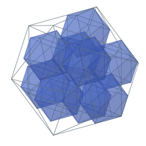](https://alejandrozu.github.io/platonic-packing/#icoinico_n09) [2.58295+](https://doi.org/10.5281/zenodo.23306098) [source](https://doi.org/10.5281/zenodo.23306098) · [3D](https://alejandrozu.github.io/platonic-packing/#icoinico_n09) · [construction](https://github.com/alejandrozu/platonic-packing/blob/e15b496ae7306287e0e70bb5b14be79f5dfdde84/records/icoinico/icoinico_n09.json) |
| 10 | [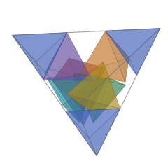](https://alejandrozu.github.io/platonic-packing/#tetintet_n10) [2.70630+](https://doi.org/10.5281/zenodo.23306098) [source](https://doi.org/10.5281/zenodo.23306098) · [3D](https://alejandrozu.github.io/platonic-packing/#tetintet_n10) · [construction](https://github.com/alejandrozu/platonic-packing/blob/e15b496ae7306287e0e70bb5b14be79f5dfdde84/records/tetintet/tetintet_n10.json) | [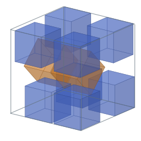](https://alejandrozu.github.io/platonic-packing/#cubincub_n10) [2 + 1/√2](https://erich-friedman.github.io/packing/cubincub/) [source](https://erich-friedman.github.io/packing/cubincub/) · [3D](https://alejandrozu.github.io/platonic-packing/#cubincub_n10) · [construction](https://github.com/alejandrozu/platonic-packing/blob/e15b496ae7306287e0e70bb5b14be79f5dfdde84/records/cubincub/cubincub_n10.json) | [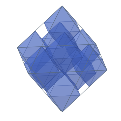](https://alejandrozu.github.io/platonic-packing/#octinoct_n10) [2.50000+](https://doi.org/10.5281/zenodo.23306098) [source](https://doi.org/10.5281/zenodo.23306098) · [3D](https://alejandrozu.github.io/platonic-packing/#octinoct_n10) · [construction](https://github.com/alejandrozu/platonic-packing/blob/e15b496ae7306287e0e70bb5b14be79f5dfdde84/records/octinoct/octinoct_n10.json) | [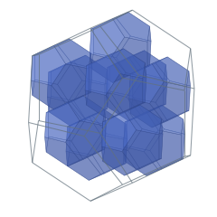](https://alejandrozu.github.io/platonic-packing/#dodindod_n10) [2.70520+](https://doi.org/10.5281/zenodo.23306098) [source](https://doi.org/10.5281/zenodo.23306098) · [3D](https://alejandrozu.github.io/platonic-packing/#dodindod_n10) · [construction](https://github.com/alejandrozu/platonic-packing/blob/e15b496ae7306287e0e70bb5b14be79f5dfdde84/records/dodindod/dodindod_n10.json) | [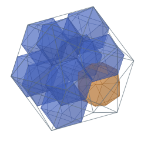](https://alejandrozu.github.io/platonic-packing/#icoinico_n10) [2.60989+](https://doi.org/10.5281/zenodo.23306098) [source](https://doi.org/10.5281/zenodo.23306098) · [3D](https://alejandrozu.github.io/platonic-packing/#icoinico_n10) · [construction](https://github.com/alejandrozu/platonic-packing/blob/e15b496ae7306287e0e70bb5b14be79f5dfdde84/records/icoinico/icoinico_n10.json) |
| 11 | [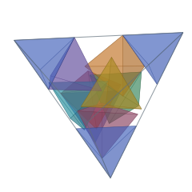](https://alejandrozu.github.io/platonic-packing/#tetintet_n11) [2.79938+](https://doi.org/10.5281/zenodo.23306098) [source](https://doi.org/10.5281/zenodo.23306098) · [3D](https://alejandrozu.github.io/platonic-packing/#tetintet_n11) · [construction](https://github.com/alejandrozu/platonic-packing/blob/e15b496ae7306287e0e70bb5b14be79f5dfdde84/records/tetintet/tetintet_n11.json) | [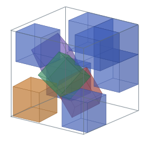](https://alejandrozu.github.io/platonic-packing/#cubincub_n11) [2.88171+](https://doi.org/10.5281/zenodo.23306098) [source](https://doi.org/10.5281/zenodo.23306098) · [3D](https://alejandrozu.github.io/platonic-packing/#cubincub_n11) · [construction](https://github.com/alejandrozu/platonic-packing/blob/e15b496ae7306287e0e70bb5b14be79f5dfdde84/records/cubincub/cubincub_n11.json) | [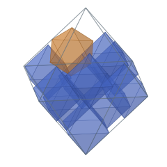](https://alejandrozu.github.io/platonic-packing/#octinoct_n11) [2.66666+](https://doi.org/10.5281/zenodo.23306098) [source](https://doi.org/10.5281/zenodo.23306098) · [3D](https://alejandrozu.github.io/platonic-packing/#octinoct_n11) · [construction](https://github.com/alejandrozu/platonic-packing/blob/e15b496ae7306287e0e70bb5b14be79f5dfdde84/records/octinoct/octinoct_n11.json) | [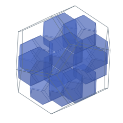](https://alejandrozu.github.io/platonic-packing/#dodindod_n11) [2.76393+](https://doi.org/10.5281/zenodo.23306098) [source](https://doi.org/10.5281/zenodo.23306098) · [3D](https://alejandrozu.github.io/platonic-packing/#dodindod_n11) · [construction](https://github.com/alejandrozu/platonic-packing/blob/e15b496ae7306287e0e70bb5b14be79f5dfdde84/records/dodindod/dodindod_n11.json) | [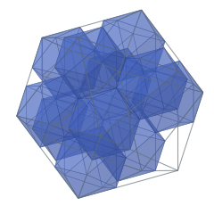](https://alejandrozu.github.io/platonic-packing/#icoinico_n11) [2.61803+](https://doi.org/10.5281/zenodo.23306098) [source](https://doi.org/10.5281/zenodo.23306098) · [3D](https://alejandrozu.github.io/platonic-packing/#icoinico_n11) · [construction](https://github.com/alejandrozu/platonic-packing/blob/e15b496ae7306287e0e70bb5b14be79f5dfdde84/records/icoinico/icoinico_n11.json) |
| 12 |  [2.85760+](https://doi.org/10.5281/zenodo.23306098) [source](https://doi.org/10.5281/zenodo.23306098) · [3D](https://alejandrozu.github.io/platonic-packing/#tetintet_n12) · [construction](https://github.com/alejandrozu/platonic-packing/blob/e15b496ae7306287e0e70bb5b14be79f5dfdde84/records/tetintet/tetintet_n12.json) |  [2.93151+](https://github.com/yoheinakajima/soft-to-rigid-packing/blob/efe7a920142350a4f0678633490c3e3dbed71fa0/paper/main.pdf) [source](https://github.com/yoheinakajima/soft-to-rigid-packing/blob/efe7a920142350a4f0678633490c3e3dbed71fa0/paper/main.pdf) · [3D](https://alejandrozu.github.io/platonic-packing/#cubincub_n12) · [construction](https://github.com/alejandrozu/platonic-packing/blob/e15b496ae7306287e0e70bb5b14be79f5dfdde84/records/cubincub/cubincub_n12.json) |  [2.66666+](https://doi.org/10.5281/zenodo.23306098) [source](https://doi.org/10.5281/zenodo.23306098) · [3D](https://alejandrozu.github.io/platonic-packing/#octinoct_n12) · [construction](https://github.com/alejandrozu/platonic-packing/blob/e15b496ae7306287e0e70bb5b14be79f5dfdde84/records/octinoct/octinoct_n12.json) |  [2.76393+](https://doi.org/10.5281/zenodo.23306098) [source](https://doi.org/10.5281/zenodo.23306098) · [3D](https://alejandrozu.github.io/platonic-packing/#dodindod_n12) · [construction](https://github.com/alejandrozu/platonic-packing/blob/e15b496ae7306287e0e70bb5b14be79f5dfdde84/records/dodindod/dodindod_n12.json) |  [2.61803+](https://doi.org/10.5281/zenodo.23306098) [source](https://doi.org/10.5281/zenodo.23306098) · [3D](https://alejandrozu.github.io/platonic-packing/#icoinico_n12) · [construction](https://github.com/alejandrozu/platonic-packing/blob/e15b496ae7306287e0e70bb5b14be79f5dfdde84/records/icoinico/icoinico_n12.json) |

<!-- PACKING_SAME_SOURCE_NOTE_START -->
<small>Construction sources: [Zarzuelo Urdiales](https://doi.org/10.5281/zenodo.23306098) for all non-cube columns and the refinements/reproductions below. Cubes: n=2–8, grid; n=9–10, [Friedman](https://erich-friedman.github.io/packing/cubincub/); n=11, [Lin](https://github.com/Tencent-Hunyuan/Hyra-results/tree/09b2d2e3c362c67a78f544c836bd8e4b54a05527/AI4Science/packing_records) seed, refined; n=12, [Nakajima](https://github.com/yoheinakajima/soft-to-rigid-packing/blob/efe7a920142350a4f0678633490c3e3dbed71fa0/paper/main.pdf) family, reproduced.</small>
<!-- PACKING_SAME_SOURCE_NOTE_END -->

### Distinct dual particle and container solids

| n | Cubes in octahedron | Octahedra in cube | Dodecahedra in icosahedron | Icosahedra in dodecahedron |
|---:|---|---|---|---|
| 2 |  [2.41421+](https://doi.org/10.5281/zenodo.23306098) [source](https://doi.org/10.5281/zenodo.23306098) · [3D](https://alejandrozu.github.io/platonic-packing/#cubinoct_n02) · [construction](https://github.com/alejandrozu/platonic-packing/blob/e15b496ae7306287e0e70bb5b14be79f5dfdde84/records/cubinoct/cubinoct_n02.json) |  [1.41421+](https://erich-friedman.github.io/packing/octincub/) [source](https://erich-friedman.github.io/packing/octincub/) · [3D](https://alejandrozu.github.io/platonic-packing/#octincub_n02) · [construction](https://github.com/alejandrozu/platonic-packing/blob/e15b496ae7306287e0e70bb5b14be79f5dfdde84/records/octincub/octincub_n02.json) |  [2.89442+](https://doi.org/10.5281/zenodo.23306098) [source](https://doi.org/10.5281/zenodo.23306098) · [3D](https://alejandrozu.github.io/platonic-packing/#dodinico_n02) · [construction](https://github.com/alejandrozu/platonic-packing/blob/e15b496ae7306287e0e70bb5b14be79f5dfdde84/records/dodinico/dodinico_n02.json) |  [1.23606+](https://doi.org/10.5281/zenodo.23306098) [source](https://doi.org/10.5281/zenodo.23306098) · [3D](https://alejandrozu.github.io/platonic-packing/#icoindod_n02) · [construction](https://github.com/alejandrozu/platonic-packing/blob/e15b496ae7306287e0e70bb5b14be79f5dfdde84/records/icoindod/icoindod_n02.json) |
| 3 |  [2.70710+](https://doi.org/10.5281/zenodo.23306098) [source](https://doi.org/10.5281/zenodo.23306098) · [3D](https://alejandrozu.github.io/platonic-packing/#cubinoct_n03) · [construction](https://github.com/alejandrozu/platonic-packing/blob/e15b496ae7306287e0e70bb5b14be79f5dfdde84/records/cubinoct/cubinoct_n03.json) |  [1.63299+](https://erich-friedman.github.io/packing/octincub/) [source](https://erich-friedman.github.io/packing/octincub/) · [3D](https://alejandrozu.github.io/platonic-packing/#octincub_n03) · [construction](https://github.com/alejandrozu/platonic-packing/blob/e15b496ae7306287e0e70bb5b14be79f5dfdde84/records/octincub/octincub_n03.json) |  [3.14562+](https://doi.org/10.5281/zenodo.23306098) [source](https://doi.org/10.5281/zenodo.23306098) · [3D](https://alejandrozu.github.io/platonic-packing/#dodinico_n03) · [construction](https://github.com/alejandrozu/platonic-packing/blob/e15b496ae7306287e0e70bb5b14be79f5dfdde84/records/dodinico/dodinico_n03.json) |  [1.37303+](https://doi.org/10.5281/zenodo.23306098) [source](https://doi.org/10.5281/zenodo.23306098) · [3D](https://alejandrozu.github.io/platonic-packing/#icoindod_n03) · [construction](https://github.com/alejandrozu/platonic-packing/blob/e15b496ae7306287e0e70bb5b14be79f5dfdde84/records/icoindod/icoindod_n03.json) |
| 4 |  [2.70710+](https://doi.org/10.5281/zenodo.23306098) [source](https://doi.org/10.5281/zenodo.23306098) · [3D](https://alejandrozu.github.io/platonic-packing/#cubinoct_n04) · [construction](https://github.com/alejandrozu/platonic-packing/blob/e15b496ae7306287e0e70bb5b14be79f5dfdde84/records/cubinoct/cubinoct_n04.json) |  [1.64991+](https://erich-friedman.github.io/packing/octincub/) [source](https://erich-friedman.github.io/packing/octincub/) · [3D](https://alejandrozu.github.io/platonic-packing/#octincub_n04) · [construction](https://github.com/alejandrozu/platonic-packing/blob/e15b496ae7306287e0e70bb5b14be79f5dfdde84/records/octincub/octincub_n04.json) |  [3.37546+](https://doi.org/10.5281/zenodo.23306098) [source](https://doi.org/10.5281/zenodo.23306098) · [3D](https://alejandrozu.github.io/platonic-packing/#dodinico_n04) · [construction](https://github.com/alejandrozu/platonic-packing/blob/e15b496ae7306287e0e70bb5b14be79f5dfdde84/records/dodinico/dodinico_n04.json) |  [1.39344+](https://doi.org/10.5281/zenodo.23306098) [source](https://doi.org/10.5281/zenodo.23306098) · [3D](https://alejandrozu.github.io/platonic-packing/#icoindod_n04) · [construction](https://github.com/alejandrozu/platonic-packing/blob/e15b496ae7306287e0e70bb5b14be79f5dfdde84/records/icoindod/icoindod_n04.json) |
| 5 |  [2.91421+](https://doi.org/10.5281/zenodo.23306098) [source](https://doi.org/10.5281/zenodo.23306098) · [3D](https://alejandrozu.github.io/platonic-packing/#cubinoct_n05) · [construction](https://github.com/alejandrozu/platonic-packing/blob/e15b496ae7306287e0e70bb5b14be79f5dfdde84/records/cubinoct/cubinoct_n05.json) |  [1.75782+](https://erich-friedman.github.io/packing/octincub/) [source](https://erich-friedman.github.io/packing/octincub/) · [3D](https://alejandrozu.github.io/platonic-packing/#octincub_n05) · [construction](https://github.com/alejandrozu/platonic-packing/blob/e15b496ae7306287e0e70bb5b14be79f5dfdde84/records/octincub/octincub_n05.json) |  [3.57490+](https://doi.org/10.5281/zenodo.23306098) [source](https://doi.org/10.5281/zenodo.23306098) · [3D](https://alejandrozu.github.io/platonic-packing/#dodinico_n05) · [construction](https://github.com/alejandrozu/platonic-packing/blob/e15b496ae7306287e0e70bb5b14be79f5dfdde84/records/dodinico/dodinico_n05.json) |  [1.53319+](https://doi.org/10.5281/zenodo.23306098) [source](https://doi.org/10.5281/zenodo.23306098) · [3D](https://alejandrozu.github.io/platonic-packing/#icoindod_n05) · [construction](https://github.com/alejandrozu/platonic-packing/blob/e15b496ae7306287e0e70bb5b14be79f5dfdde84/records/icoindod/icoindod_n05.json) |
| 6 |  [2.93435+](https://doi.org/10.5281/zenodo.23306098) [source](https://doi.org/10.5281/zenodo.23306098) · [3D](https://alejandrozu.github.io/platonic-packing/#cubinoct_n06) · [construction](https://github.com/alejandrozu/platonic-packing/blob/e15b496ae7306287e0e70bb5b14be79f5dfdde84/records/cubinoct/cubinoct_n06.json) |  [1.76776+](https://erich-friedman.github.io/packing/octincub/) [source](https://erich-friedman.github.io/packing/octincub/) · [3D](https://alejandrozu.github.io/platonic-packing/#octincub_n06) · [construction](https://github.com/alejandrozu/platonic-packing/blob/e15b496ae7306287e0e70bb5b14be79f5dfdde84/records/octincub/octincub_n06.json) |  [3.63755+](https://doi.org/10.5281/zenodo.23306098) [source](https://doi.org/10.5281/zenodo.23306098) · [3D](https://alejandrozu.github.io/platonic-packing/#dodinico_n06) · [construction](https://github.com/alejandrozu/platonic-packing/blob/e15b496ae7306287e0e70bb5b14be79f5dfdde84/records/dodinico/dodinico_n06.json) |  [1.55131+](https://doi.org/10.5281/zenodo.23306098) [source](https://doi.org/10.5281/zenodo.23306098) · [3D](https://alejandrozu.github.io/platonic-packing/#icoindod_n06) · [construction](https://github.com/alejandrozu/platonic-packing/blob/e15b496ae7306287e0e70bb5b14be79f5dfdde84/records/icoindod/icoindod_n06.json) |
| 7 |  [3.29102+](https://doi.org/10.5281/zenodo.23306098) [source](https://doi.org/10.5281/zenodo.23306098) · [3D](https://alejandrozu.github.io/platonic-packing/#cubinoct_n07) · [construction](https://github.com/alejandrozu/platonic-packing/blob/e15b496ae7306287e0e70bb5b14be79f5dfdde84/records/cubinoct/cubinoct_n07.json) |  [1.79133+](https://erich-friedman.github.io/packing/octincub/) [source](https://erich-friedman.github.io/packing/octincub/) · [3D](https://alejandrozu.github.io/platonic-packing/#octincub_n07) · [construction](https://github.com/alejandrozu/platonic-packing/blob/e15b496ae7306287e0e70bb5b14be79f5dfdde84/records/octincub/octincub_n07.json) |  [3.85641+](https://doi.org/10.5281/zenodo.23306098) [source](https://doi.org/10.5281/zenodo.23306098) · [3D](https://alejandrozu.github.io/platonic-packing/#dodinico_n07) · [construction](https://github.com/alejandrozu/platonic-packing/blob/e15b496ae7306287e0e70bb5b14be79f5dfdde84/records/dodinico/dodinico_n07.json) |  [1.66853+](https://doi.org/10.5281/zenodo.23306098) [source](https://doi.org/10.5281/zenodo.23306098) · [3D](https://alejandrozu.github.io/platonic-packing/#icoindod_n07) · [construction](https://github.com/alejandrozu/platonic-packing/blob/e15b496ae7306287e0e70bb5b14be79f5dfdde84/records/icoindod/icoindod_n07.json) |
| 8 |  [3.41421+](https://doi.org/10.5281/zenodo.23306098) [source](https://doi.org/10.5281/zenodo.23306098) · [3D](https://alejandrozu.github.io/platonic-packing/#cubinoct_n08) · [construction](https://github.com/alejandrozu/platonic-packing/blob/e15b496ae7306287e0e70bb5b14be79f5dfdde84/records/cubinoct/cubinoct_n08.json) |  [1.79133+](https://erich-friedman.github.io/packing/octincub/) [source](https://erich-friedman.github.io/packing/octincub/) · [3D](https://alejandrozu.github.io/platonic-packing/#octincub_n08) · [construction](https://github.com/alejandrozu/platonic-packing/blob/e15b496ae7306287e0e70bb5b14be79f5dfdde84/records/octincub/octincub_n08.json) |  [3.96658+](https://doi.org/10.5281/zenodo.23306098) [source](https://doi.org/10.5281/zenodo.23306098) · [3D](https://alejandrozu.github.io/platonic-packing/#dodinico_n08) · [construction](https://github.com/alejandrozu/platonic-packing/blob/e15b496ae7306287e0e70bb5b14be79f5dfdde84/records/dodinico/dodinico_n08.json) |  [1.69778+](https://doi.org/10.5281/zenodo.23306098) [source](https://doi.org/10.5281/zenodo.23306098) · [3D](https://alejandrozu.github.io/platonic-packing/#icoindod_n08) · [construction](https://github.com/alejandrozu/platonic-packing/blob/e15b496ae7306287e0e70bb5b14be79f5dfdde84/records/icoindod/icoindod_n08.json) |
| 9 |  [3.61760+](https://doi.org/10.5281/zenodo.23306098) [source](https://doi.org/10.5281/zenodo.23306098) · [3D](https://alejandrozu.github.io/platonic-packing/#cubinoct_n09) · [construction](https://github.com/alejandrozu/platonic-packing/blob/e15b496ae7306287e0e70bb5b14be79f5dfdde84/records/cubinoct/cubinoct_n09.json) |  [1.88561+](https://erich-friedman.github.io/packing/octincub/) [source](https://erich-friedman.github.io/packing/octincub/) · [3D](https://alejandrozu.github.io/platonic-packing/#octincub_n09) · [construction](https://github.com/alejandrozu/platonic-packing/blob/e15b496ae7306287e0e70bb5b14be79f5dfdde84/records/octincub/octincub_n09.json) |  [4.02206+](https://doi.org/10.5281/zenodo.23306098) [source](https://doi.org/10.5281/zenodo.23306098) · [3D](https://alejandrozu.github.io/platonic-packing/#dodinico_n09) · [construction](https://github.com/alejandrozu/platonic-packing/blob/e15b496ae7306287e0e70bb5b14be79f5dfdde84/records/dodinico/dodinico_n09.json) |  [1.77163+](https://doi.org/10.5281/zenodo.23306098) [source](https://doi.org/10.5281/zenodo.23306098) · [3D](https://alejandrozu.github.io/platonic-packing/#icoindod_n09) · [construction](https://github.com/alejandrozu/platonic-packing/blob/e15b496ae7306287e0e70bb5b14be79f5dfdde84/records/icoindod/icoindod_n09.json) |
| 10 |  [3.69181+](https://doi.org/10.5281/zenodo.23306098) [source](https://doi.org/10.5281/zenodo.23306098) · [3D](https://alejandrozu.github.io/platonic-packing/#cubinoct_n10) · [construction](https://github.com/alejandrozu/platonic-packing/blob/e15b496ae7306287e0e70bb5b14be79f5dfdde84/records/cubinoct/cubinoct_n10.json) |  [2.14936+](https://erich-friedman.github.io/packing/octincub/) [source](https://erich-friedman.github.io/packing/octincub/) · [3D](https://alejandrozu.github.io/platonic-packing/#octincub_n10) · [construction](https://github.com/alejandrozu/platonic-packing/blob/e15b496ae7306287e0e70bb5b14be79f5dfdde84/records/octincub/octincub_n10.json) |  [4.06524+](https://doi.org/10.5281/zenodo.23306098) [source](https://doi.org/10.5281/zenodo.23306098) · [3D](https://alejandrozu.github.io/platonic-packing/#dodinico_n10) · [construction](https://github.com/alejandrozu/platonic-packing/blob/e15b496ae7306287e0e70bb5b14be79f5dfdde84/records/dodinico/dodinico_n10.json) |  [1.81821+](https://doi.org/10.5281/zenodo.23306098) [source](https://doi.org/10.5281/zenodo.23306098) · [3D](https://alejandrozu.github.io/platonic-packing/#icoindod_n10) · [construction](https://github.com/alejandrozu/platonic-packing/blob/e15b496ae7306287e0e70bb5b14be79f5dfdde84/records/icoindod/icoindod_n10.json) |
| 11 |  [3.70710+](https://doi.org/10.5281/zenodo.23306098) [source](https://doi.org/10.5281/zenodo.23306098) · [3D](https://alejandrozu.github.io/platonic-packing/#cubinoct_n11) · [construction](https://github.com/alejandrozu/platonic-packing/blob/e15b496ae7306287e0e70bb5b14be79f5dfdde84/records/cubinoct/cubinoct_n11.json) |  [2.19540+](https://erich-friedman.github.io/packing/octincub/) [source](https://erich-friedman.github.io/packing/octincub/) · [diagram](https://erich-friedman.github.io/packing/octincub/11.gif) · [catalogue](https://erich-friedman.github.io/packing/octincub/) |  [4.06524+](https://doi.org/10.5281/zenodo.23306098) [source](https://doi.org/10.5281/zenodo.23306098) · [3D](https://alejandrozu.github.io/platonic-packing/#dodinico_n11) · [construction](https://github.com/alejandrozu/platonic-packing/blob/e15b496ae7306287e0e70bb5b14be79f5dfdde84/records/dodinico/dodinico_n11.json) |  [1.86714+](https://doi.org/10.5281/zenodo.23306098) [source](https://doi.org/10.5281/zenodo.23306098) · [3D](https://alejandrozu.github.io/platonic-packing/#icoindod_n11) · [construction](https://github.com/alejandrozu/platonic-packing/blob/e15b496ae7306287e0e70bb5b14be79f5dfdde84/records/icoindod/icoindod_n11.json) |
| 12 |  [3.70710+](https://doi.org/10.5281/zenodo.23306098) [source](https://doi.org/10.5281/zenodo.23306098) · [3D](https://alejandrozu.github.io/platonic-packing/#cubinoct_n12) · [construction](https://github.com/alejandrozu/platonic-packing/blob/e15b496ae7306287e0e70bb5b14be79f5dfdde84/records/cubinoct/cubinoct_n12.json) |  [2.25949+](https://erich-friedman.github.io/packing/octincub/) [source](https://erich-friedman.github.io/packing/octincub/) · [diagram](https://erich-friedman.github.io/packing/octincub/12.gif) · [catalogue](https://erich-friedman.github.io/packing/octincub/) |  [4.06524+](https://doi.org/10.5281/zenodo.23306098) [source](https://doi.org/10.5281/zenodo.23306098) · [3D](https://alejandrozu.github.io/platonic-packing/#dodinico_n12) · [construction](https://github.com/alejandrozu/platonic-packing/blob/e15b496ae7306287e0e70bb5b14be79f5dfdde84/records/dodinico/dodinico_n12.json) |  [1.87461+](https://doi.org/10.5281/zenodo.23306098) [source](https://doi.org/10.5281/zenodo.23306098) · [3D](https://alejandrozu.github.io/platonic-packing/#icoindod_n12) · [construction](https://github.com/alejandrozu/platonic-packing/blob/e15b496ae7306287e0e70bb5b14be79f5dfdde84/records/icoindod/icoindod_n12.json) |

<!-- PACKING_DUAL_SOURCE_NOTE_START -->
<small>Construction sources: [Zarzuelo Urdiales](https://doi.org/10.5281/zenodo.23306098) for cubes in octahedra and both dodecahedron–icosahedron directions. Octahedra in cubes: n=2–11, [Walsh](https://erich-friedman.github.io/packing/octincub/) (n=2–10 independently certified here); n=12, [Lin](https://erich-friedman.github.io/packing/octincub/).</small>
<!-- PACKING_DUAL_SOURCE_NOTE_END -->

**Precision and construction evidence.** A plus sign marks a truncated source decimal. Exact stored scales and feasibility certificates are available through the construction links; numerical touching estimates and rounded catalogue reports are separate evidence. The source notes distinguish original constructions, seed refinements, and independently certified reproductions.

## Density, structure, and physical context

Finite containers introduce faces, edges, and corners that do not occur in an unbounded periodic arrangement. Consequently, a finite cluster and a [Bravais lattice](https://en.wikipedia.org/wiki/Bravais_lattice) packing answer different optimization questions. Reviews by Torquato and Stillinger, and Torquato's perspective on condensed phases, discuss how particle shape, orientation, density, and [jamming](https://en.wikipedia.org/wiki/Jamming_(physics)) characterize arrangements. A jammed or highly symmetric configuration is not automatically the densest possible one.[3](#reference-3)[22](#reference-22)[4](#reference-4)

Two recurring finite-construction features are equal-scale capacities and abrupt increases between successive counts. Deletion explains why a construction also accommodates smaller populations. Repeated orientations, shells, and contact networks provide ways to describe its organization without proving that its scale is minimal. The comparative preprint linked with the records studies these descriptors; one archived example contains thirty-three dodecahedra arranged as a central piece and shells of twelve and twenty pieces.[29](#reference-29)[34](#reference-34)

Packing models also inform the study of [crystals](https://en.wikipedia.org/wiki/Crystal) and [self-assembly](https://en.wikipedia.org/wiki/Self-assembly). Experiments and simulations introduce interactions, entropy, and confinement in addition to geometric exclusion. Studies of polyhedra in spherical confinement, parallel plates, and mixed tetrahedron–octahedron systems investigate settings different from the single-species polyhedral containers tabulated here. Those physical models are needed to connect a geometric fit to an assembly process or crystal phase.[4](#reference-4)[21](#reference-21)[23](#reference-23)[24](#reference-24)

## See also

* [Convex polytope](https://en.wikipedia.org/wiki/Convex_polytope)
* [Space-filling polyhedron](https://en.wikipedia.org/wiki/Space-filling_polyhedron)
* [Tessellation](https://en.wikipedia.org/wiki/Tessellation)
* [Crystallography](https://en.wikipedia.org/wiki/Crystallography)

## References

1. Wäscher, Haußner, Schumann. [An improved typology of cutting and packing problems](https://doi.org/10.1016/j.ejor.2005.12.047). European Journal of Operational Research 183, 1109–1130 (2007).

2. Egeblad, Nielsen, Brazil. [Translational packing of arbitrary polytopes](https://www.sciencedirect.com/science/article/pii/S0925772108000576). Computational Geometry 42, 269–288 (2009).

3. Fejes Tóth. [Packing and covering, in Handbook of Discrete and Computational Geometry](https://www.csun.edu/~ctoth/Handbook/chap2.pdf).Third edition, chapter 2, pp. 27–66; §2.2, pp. 37–39, treats finite arrangements. CRC Press (2017).

4. Torquato. [Perspective: Basic understanding of condensed phases of matter via packing models](https://doi.org/10.1063/1.5036657). The Journal of Chemical Physics 149, 020901 (2018).

5. Romanova, Bennell, Stoyan, Pankratov. [Packing of concave polyhedra with continuous rotations using nonlinear optimisation](https://eprints.soton.ac.uk/418130/). European Journal of Operational Research 268, 37–53 (2018).

6. Callisaya, Kari. [Packing Polyhedra within Convex Sets](https://www.scielo.br/j/tcam/a/nbGY4xC4KMxq7XbYZTybvHj/?format=html&lang=en). Trends in Computational and Applied Mathematics 26, e01823 (2025).

7. Firsching. [Computing Maximal Copies of Polyhedra Contained in a Polyhedron](https://firsching.ch/assets/pdfs/ComputingMaximalCopies.pdf). Experimental Mathematics 24, 98–105 (2015).

9. Croft. [On Maximal Regular Polyhedra Inscribed in a Regular Polyhedron](https://doi.org/10.1112/plms/s3-41.2.279). Proceedings of the London Mathematical Society s3-41, 279–296 (1980).

11. Friedman. [Cubes in Cubes](https://erich-friedman.github.io/packing/cubincub/).Online construction catalogue, retrieved 11 October 2026.

13. Friedman. [Octahedra in Cubes](https://erich-friedman.github.io/packing/octincub/).Online construction catalogue, retrieved 11 October 2026.

16. Leao, Toledo, Oliveira, Carravilla, Alvarez-Valdés. [Irregular packing problems: A review of mathematical models](https://www.sciencedirect.com/science/article/pii/S0377221719303820). European Journal of Operational Research 282, 803–822 (2020).

21. Teich, van Anders, Klotsa, Dshemuchadse, Glotzer. [Clusters of polyhedra in spherical confinement](https://doi.org/10.1073/pnas.1524875113). Proceedings of the National Academy of Sciences 113, E669–E678 (2016).

22. Torquato, Stillinger. [Jammed hard-particle packings: From Kepler to Bernal and beyond](https://doi.org/10.1103/RevModPhys.82.2633). Reviews of Modern Physics 82, 2633 (2010).

23. Khadilkar, Escobedo. [Phase behavior of polyhedral nanoparticles in parallel plate confinement](https://doi.org/10.1039/C5SM02570B). Soft Matter 12, 1506–1516 (2016).

24. Huang, Skye, Dshemuchadse. [Advancing the self-assembly of binary colloidal crystals of tetrahedra and octahedra with confinement](https://pubs.rsc.org/en/content/articlehtml/2026/me/d5me00092k). Molecular Systems Design & Engineering 11, 62–69 (2026).

25. Araújo, Özcan, Atkin, Baumers. [Analysis of irregular three-dimensional packing problems in additive manufacturing: a new taxonomy and dataset](https://nottingham-repository.worktribe.com/output/1190642/analysis-of-irregular-three-dimensional-packing-problems-in-additive-manufacturing-a-new-taxonomy-and-dataset). International Journal of Production Research 57, 5920–5934 (2019). DOI: [10.1080/00207543.2018.1534016](https://doi.org/10.1080/00207543.2018.1534016). Review and original taxonomy/dataset.

27. Yohei Nakajima. [Twelve unit cubes in a cube of side 2.9315: soft-to-rigid packing](https://github.com/yoheinakajima/soft-to-rigid-packing/blob/efe7a920142350a4f0678633490c3e3dbed71fa0/paper/main.pdf). Manuscript, 2026; software release [version DOI 10.5281/zenodo.23248095](https://doi.org/10.5281/zenodo.23248095).

28. Alejandro Zarzuelo Urdiales. [Certified finite packings of Platonic solids: a generalized soft-to-rigid search and its computational development](https://doi.org/10.5281/zenodo.23306098). Preprint and reproducible methods, Zenodo, 12 October 2026. DOI: 10.5281/zenodo.23306098.

29. Alejandro Zarzuelo Urdiales. [Finite polyhedral fits: discrete scale jumps, orientational domains, and contact structure in 351 certified constructions](https://doi.org/10.5281/zenodo.23306126). Preprint, structural analysis, and testable hypotheses, Zenodo, 12 October 2026. DOI: 10.5281/zenodo.23306126.

34. Alejandro Zarzuelo Urdiales. [Polyhedra in polyhedra packing: 351 certified constructions, structural measurements, software, and visualizations](https://doi.org/10.5281/zenodo.23306130). Frozen construction data, source code, certificate replay, and analysis files, Zenodo, 12 October 2026. DOI: 10.5281/zenodo.23306130.

35. Janusz Januszewski, Łukasz Zielonka. [Packing of non-blocking cubes into the unit cube](https://doi.org/10.1007/s13366-023-00710-1). Beiträge zur Algebra und Geometrie 65, 635–643 (2024; published online 11 August 2023).

36. Cagan, Shimada, Yin. [A survey of computational approaches to three-dimensional layout problems](https://doi.org/10.1016/S0010-4485(01)00109-9). Computer-Aided Design 34(8), 597–611 (2002). [Author manuscript](https://www.andrew.cmu.edu/user/shimada/papers/00-cad-cagan.pdf).

37. Böröczky Jr. [Finite Packing and Covering](https://doi.org/10.1017/CBO9780511546587). Cambridge Tracts in Mathematics 154, Cambridge University Press (2004). ISBN 9780521801577. [Preface, pp. xiii–xvi](https://www.cambridge.org/core/books/abs/finite-packing-and-covering/preface/30E354BA61BBEF2FBC8C028B4EFDB01B).

## External links

* [Erich Friedman's Packing Center](https://erich-friedman.github.io/packing/)
* [Rotatable atlas and construction files](https://alejandrozu.github.io/platonic-packing/)
* [Generalized search: methods preprint](https://doi.org/10.5281/zenodo.23306098)
* [Comparative analysis: patterns preprint](https://doi.org/10.5281/zenodo.23306126)
* [Supporting code, data, and certificates](https://doi.org/10.5281/zenodo.23306130)
