# Cubes in a cube

s = container edge / piece edge; every row certified in exact arithmetic.

| n | s | touching limit | closed form (conj.) | previous best | vs previous | volume bound | density | picture |
|---|---|---|---|---|---|---|---|---|
| 2 | [2.00000+](cubincub_n02.json) | 2.000000000000 | 2 | 2.00000 (trivial (2×2×2 grid), Friedman's Packing Center) | equal | 1.25992 | 0.2500 | 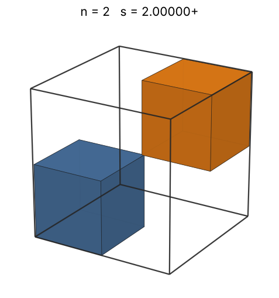 |
| 3 | [2.00000+](cubincub_n03.json) | 2.000000000000 | 2 | 2.00000 (trivial (2×2×2 grid), Friedman's Packing Center) | equal | 1.44225 | 0.3750 | 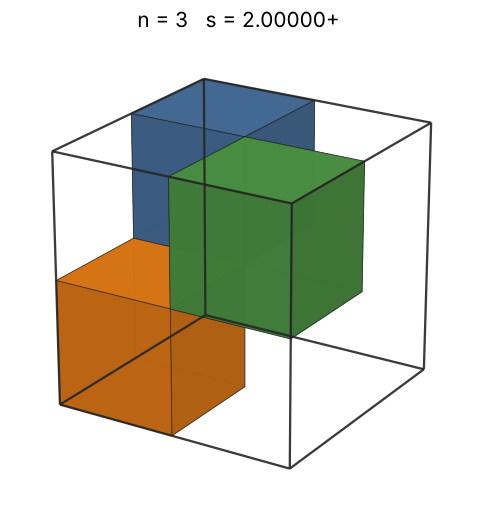 |
| 4 | [2.00000+](cubincub_n04.json) | 2.000000000000 | 2 | 2.00000 (trivial (2×2×2 grid), Friedman's Packing Center) | equal | 1.58740 | 0.5000 | 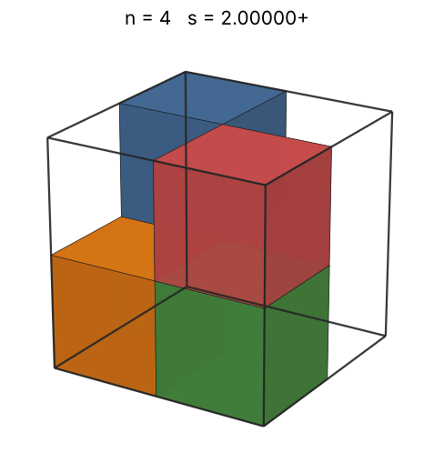 |
| 5 | [2.00000+](cubincub_n05.json) | 2.000000000000 | 2 | 2.00000 (trivial (2×2×2 grid), Friedman's Packing Center) | equal | 1.70998 | 0.6250 | 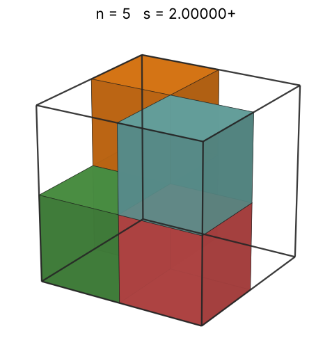 |
| 6 | [2.00000+](cubincub_n06.json) | 2.000000000000 | 2 | 2.00000 (trivial (2×2×2 grid), Friedman's Packing Center) | equal | 1.81712 | 0.7500 | 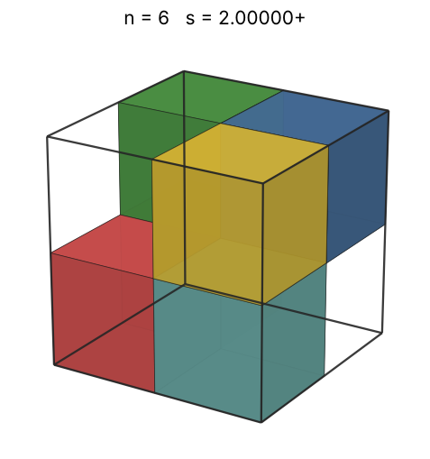 |
| 7 | [2.00000+](cubincub_n07.json) | 2.000000000000 | 2 | 2.00000 (trivial (2×2×2 grid), Friedman's Packing Center) | equal | 1.91293 | 0.8750 | 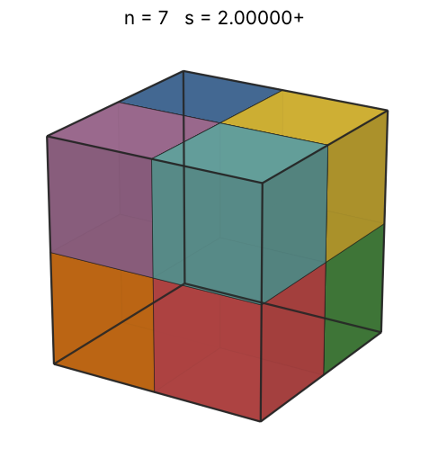 |
| 8 | [2.00000+](cubincub_n08.json) | 2.000000000000 | 2 | 2.00000 (trivial (2×2×2 grid), Friedman's Packing Center) | equal | 2.00000 | 1.0000 | 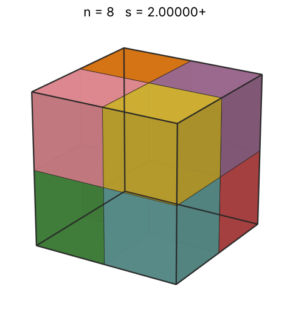 |
| 9 | [2.70710+](cubincub_n09.json) | 2.707106781187 | (4 + √2)/2 | 2.70711 (E. Friedman, 1998 (Friedman's Packing Center), s = 2 + 1/√2) | equal | 2.08008 | 0.4537 | 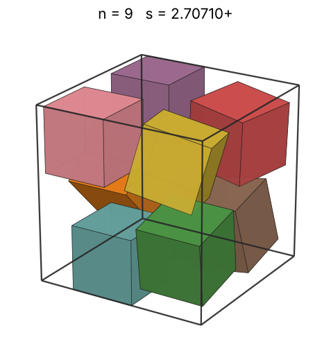 |
| 10 | [2.70710+](cubincub_n10.json) | 2.707106781187 | (4 + √2)/2 | 2.70711 (E. Friedman, 1998 (Friedman's Packing Center), s = 2 + 1/√2) | equal | 2.15443 | 0.5041 | 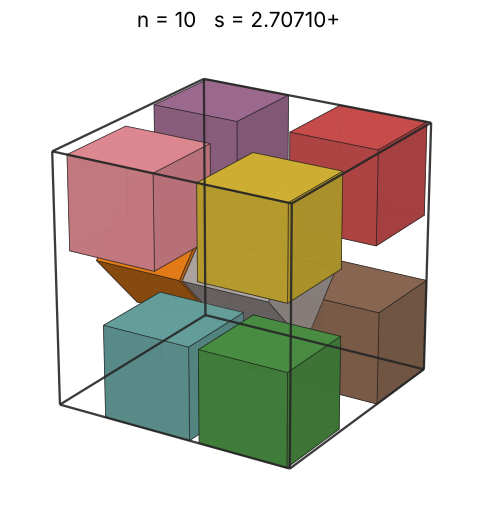 |
| 11 | [2.88171+](cubincub_n11.json) | 2.881711124829 |  | 2.88295 (H. Lin, July 2026 (Hyra-results; Friedman's Packing Center)) | **better** -0.043% | 2.22398 | 0.4597 | 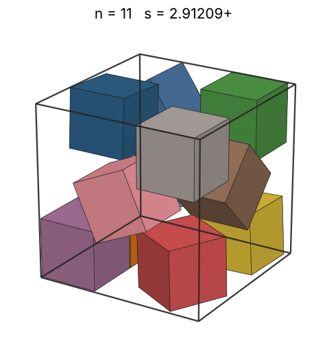 |
| 12 | [2.93151+](cubincub_n12.json) | 2.931514577965 |  | 2.93152 (Y. Nakajima, Oct 2026 (soft-to-rigid-packing); Friedman's page lists 2.93277 (H. Lin, July 2026)) | equal | 2.28943 | 0.4763 | 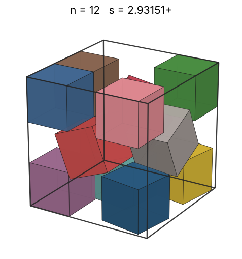 |
| 13 | [2.95614+](cubincub_n13.json) | 2.956145157585 |  | 2.95600 (E. Friedman, 1998 (Friedman's Packing Center), listed as 2.956+) | equal | 2.35133 | 0.5032 | 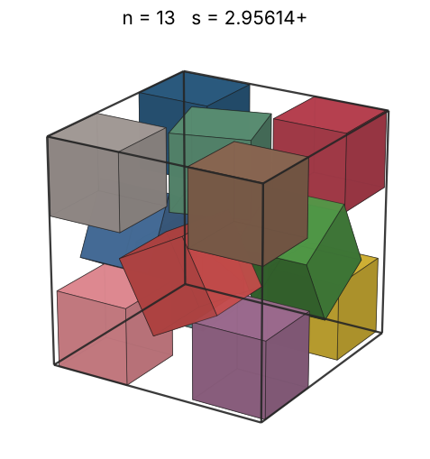 |
| 14 | [2.98994+](cubincub_n14.json) | 2.989949493661 |  | 2.98995 (E. Friedman, 1998 (Friedman's Packing Center), s = 2 + 7√2/10) | equal | 2.41014 | 0.5238 | 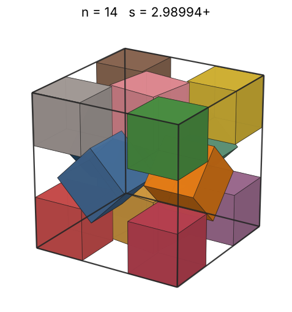 |
| 15 | [3.00000+](cubincub_n15.json) | 3.000000000000 | 3 | 3.00000 (trivial (3×3×3 grid), Friedman's Packing Center) | equal | 2.46621 | 0.5556 | 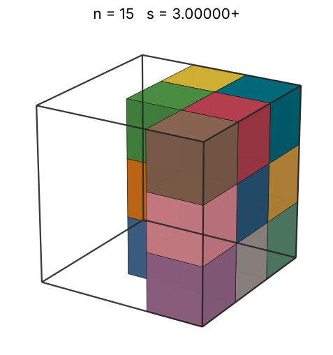 |
| 16 | [3.00000+](cubincub_n16.json) | 3.000000000000 | 3 | 3.00000 (trivial (3×3×3 grid), Friedman's Packing Center) | equal | 2.51984 | 0.5926 | 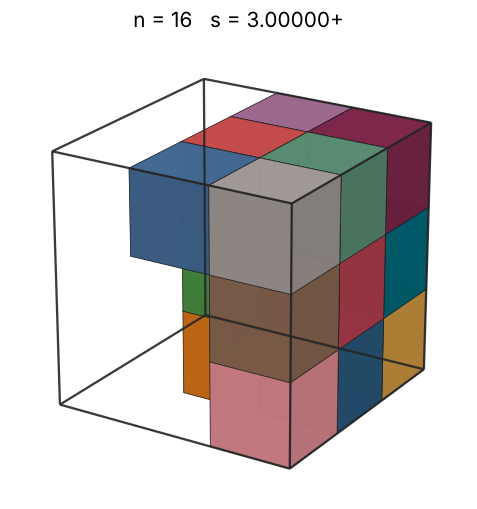 |
| 17 | [3.00000+](cubincub_n17.json) | 3.000000000000 | 3 | 3.00000 (trivial (3×3×3 grid), Friedman's Packing Center) | equal | 2.57128 | 0.6296 | 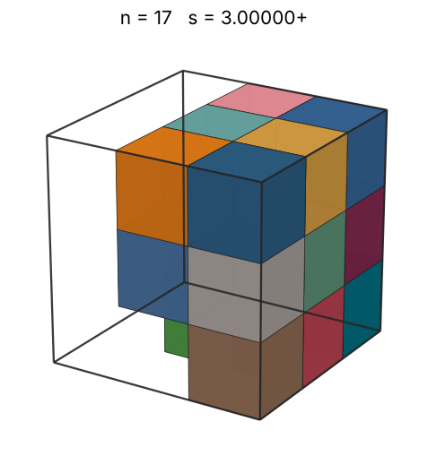 |
| 18 | [3.00000+](cubincub_n18.json) | 3.000000000000 | 3 | 3.00000 (trivial (3×3×3 grid), Friedman's Packing Center) | equal | 2.62074 | 0.6667 | 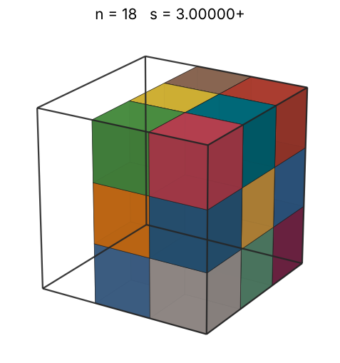 |
| 19 | [3.00000+](cubincub_n19.json) | 3.000000000000 | 3 | 3.00000 (trivial (3×3×3 grid), Friedman's Packing Center) | equal | 2.66840 | 0.7037 | 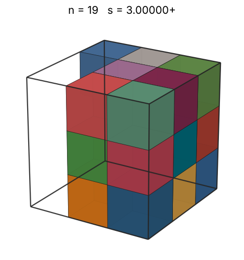 |
| 20 | [3.00000+](cubincub_n20.json) | 3.000000000000 | 3 | 3.00000 (trivial (3×3×3 grid), Friedman's Packing Center) | equal | 2.71442 | 0.7407 | 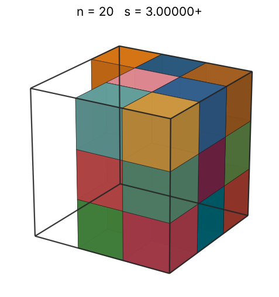 |
| 21 | [3.00000+](cubincub_n21.json) | 3.000000000000 | 3 | 3.00000 (trivial (3×3×3 grid), Friedman's Packing Center) | equal | 2.75892 | 0.7778 | 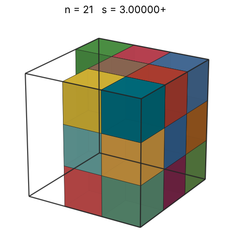 |
| 22 | [3.00000+](cubincub_n22.json) | 3.000000000000 | 3 | 3.00000 (trivial (3×3×3 grid), Friedman's Packing Center) | equal | 2.80204 | 0.8148 | 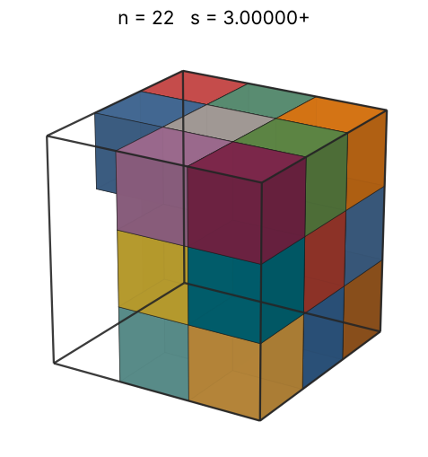 |
| 23 | [3.00000+](cubincub_n23.json) | 3.000000000000 | 3 | 3.00000 (trivial (3×3×3 grid), Friedman's Packing Center) | equal | 2.84387 | 0.8519 | 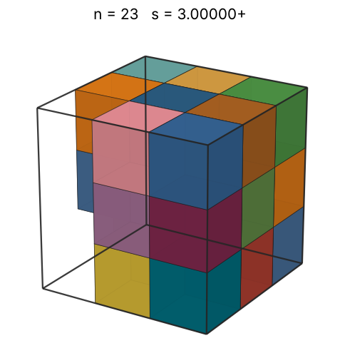 |
| 24 | [3.00000+](cubincub_n24.json) | 3.000000000000 | 3 | 3.00000 (trivial (3×3×3 grid), Friedman's Packing Center) | equal | 2.88450 | 0.8889 | 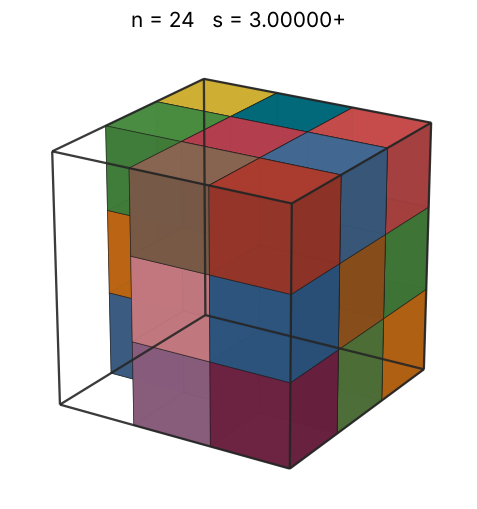 |
| 25 | [3.00000+](cubincub_n25.json) | 3.000000000000 | 3 | 3.00000 (trivial (3×3×3 grid), Friedman's Packing Center) | equal | 2.92402 | 0.9259 | 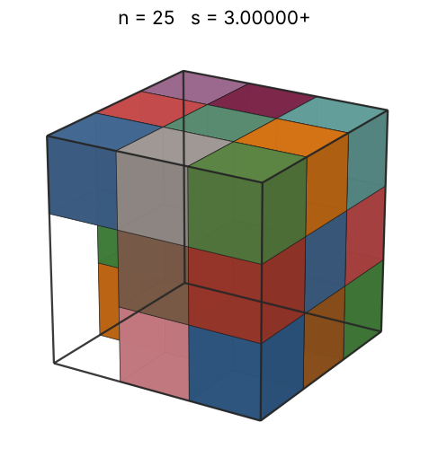 |
| 26 | [3.00000+](cubincub_n26.json) | 3.000000000000 | 3 | 3.00000 (trivial (3×3×3 grid), Friedman's Packing Center) | equal | 2.96250 | 0.9630 | 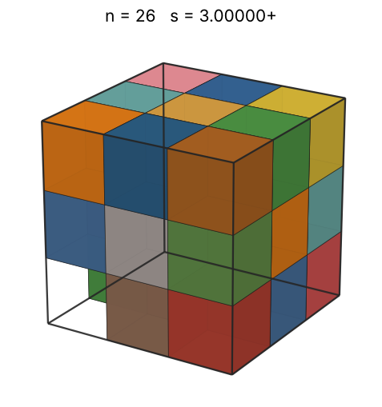 |
| 27 | [3.00000+](cubincub_n27.json) | 3.000000000000 | 3 | 3.00000 (trivial (3×3×3 grid), Friedman's Packing Center) | equal | 3.00000 | 1.0000 | 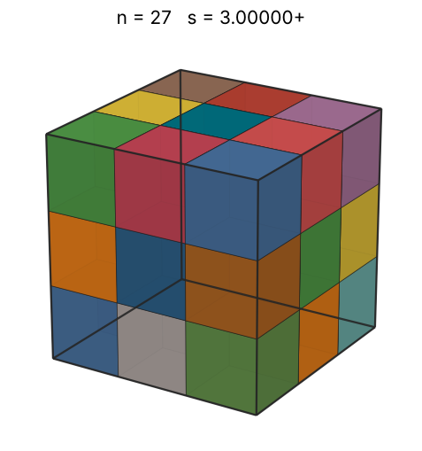 |
| 28 | [3.66599+](cubincub_n28.json) | 3.665997882756 |  | 3.70711 (E. Friedman, 1998 (Friedman's Packing Center), s = 3 + 1/√2) | **better** -1.109% | 3.03659 | 0.5683 | 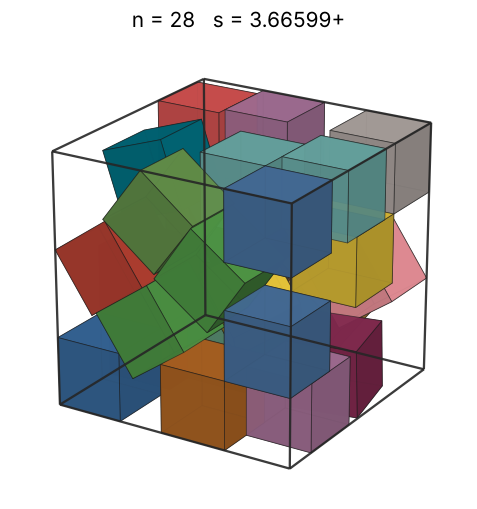 |
| 29 | [3.70710+](cubincub_n29.json) | 3.707106781216 |  | 3.70711 (E. Friedman, 1998 (Friedman's Packing Center), s = 3 + 1/√2) | equal | 3.07232 | 0.5692 | 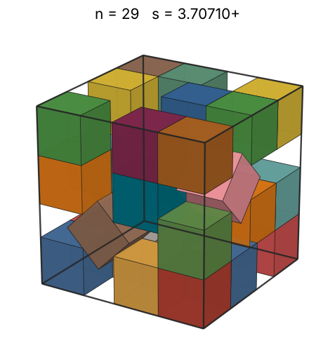 |
| 30 | [3.70710+](cubincub_n30.json) | 3.707106781301 |  | 3.70711 (E. Friedman, 1998 (Friedman's Packing Center), s = 3 + 1/√2) | equal | 3.10723 | 0.5889 | 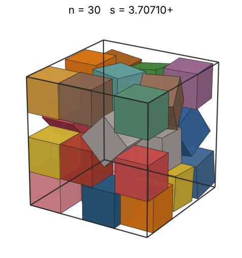 |
| 31 | [3.70710+](cubincub_n31.json) | 3.707106781303 |  | 3.70711 (E. Friedman, 1998 (Friedman's Packing Center), s = 3 + 1/√2) | equal | 3.14138 | 0.6085 | 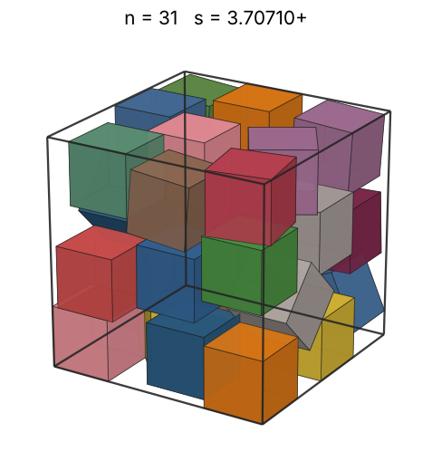 |
| 32 | [3.70710+](cubincub_n32.json) | 3.707106782464 |  | 3.70711 (E. Friedman, 1998 (Friedman's Packing Center), s = 3 + 1/√2) | equal | 3.17480 | 0.6281 | 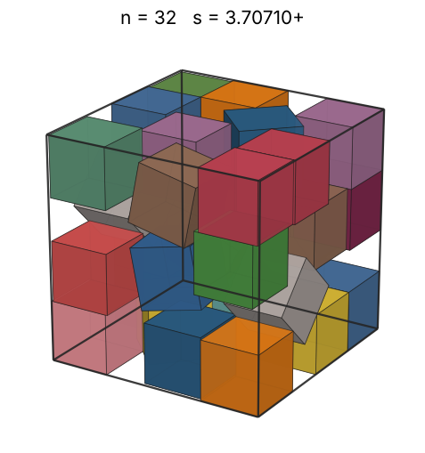 |
| 33 | [3.70710+](cubincub_n33.json) | 3.707107051898 |  | 3.70711 (E. Friedman, 1998 (Friedman's Packing Center), s = 3 + 1/√2) | equal | 3.20753 | 0.6478 | 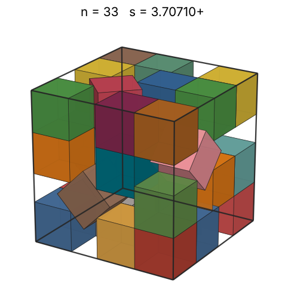 |
| 34 | [3.82287+](cubincub_n34.json) | 3.822875937398 |  | | | 3.23961 | 0.6086 | 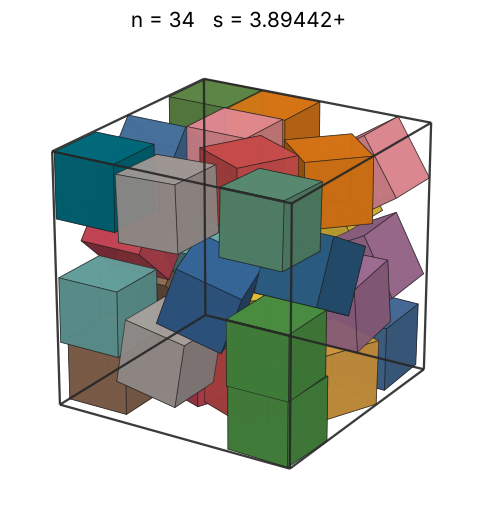 |
| 35 | [3.86068+](cubincub_n35.json) | 3.860686182768 |  | | | 3.27107 | 0.6082 | 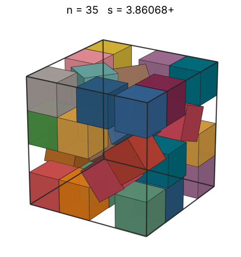 |
| 36 | [3.89442+](cubincub_n36.json) | 3.894427676006 |  | | | 3.30193 | 0.6095 | 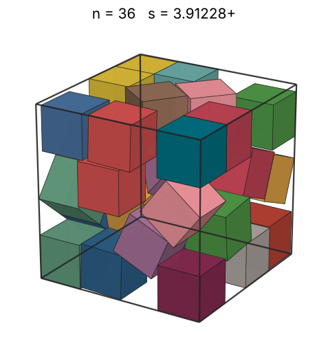 |
| 37 | [3.92631+](cubincub_n37.json) | 3.926311431020 |  | | | 3.33222 | 0.6113 | 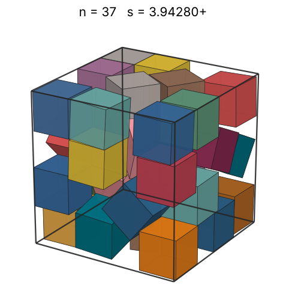 |
| 38 | [3.98077+](cubincub_n38.json) | 3.980773161401 |  | | | 3.36198 | 0.6024 | 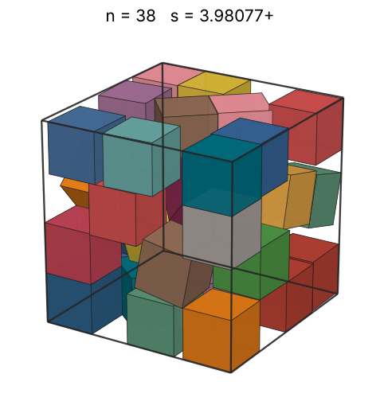 |
| 39 | [4.00000+](cubincub_n39.json) | 4.000000000000 | 4 | | | 3.39121 | 0.6094 | 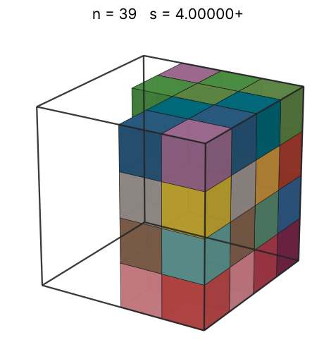 |
| 40 | [4.00000+](cubincub_n40.json) | 4.000000000000 | 4 | | | 3.41995 | 0.6250 | 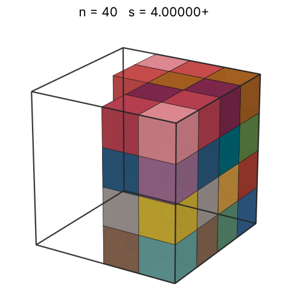 |
| 41 | [4.00000+](cubincub_n41.json) | 4.000000000000 | 4 | | | 3.44822 | 0.6406 |  |
| 42 | [4.00000+](cubincub_n42.json) | 4.000000000000 | 4 | | | 3.47603 | 0.6562 |  |
| 43 | [4.00000+](cubincub_n43.json) | 4.000000000000 | 4 | | | 3.50340 | 0.6719 |  |
| 44 | [4.00000+](cubincub_n44.json) | 4.000000000000 | 4 | | | 3.53035 | 0.6875 |  |
| 45 | [4.00000+](cubincub_n45.json) | 4.000000000000 | 4 | | | 3.55689 | 0.7031 |  |
| 46 | [4.00000+](cubincub_n46.json) | 4.000000000000 | 4 | | | 3.58305 | 0.7187 |  |
| 47 | [4.00000+](cubincub_n47.json) | 4.000000000000 | 4 | | | 3.60883 | 0.7344 |  |
| 48 | [4.00000+](cubincub_n48.json) | 4.000000000000 | 4 | | | 3.63424 | 0.7500 |  |
| 49 | [4.00000+](cubincub_n49.json) | 4.000000000000 | 4 | | | 3.65931 | 0.7656 |  |
| 50 | [4.00000+](cubincub_n50.json) | 4.000000000000 | 4 | | | 3.68403 | 0.7812 |  |
| 51 | [4.00000+](cubincub_n51.json) | 4.000000000000 | 4 | | | 3.70843 | 0.7969 |  |
| 52 | [4.00000+](cubincub_n52.json) | 4.000000000000 | 4 | | | 3.73251 | 0.8125 |  |
| 53 | [4.00000+](cubincub_n53.json) | 4.000000000000 | 4 | | | 3.75629 | 0.8281 |  |
| 54 | [4.00000+](cubincub_n54.json) | 4.000000000000 | 4 | | | 3.77976 | 0.8437 |  |
| 55 | [4.00000+](cubincub_n55.json) | 4.000000000000 | 4 | | | 3.80295 | 0.8594 |  |
| 56 | [4.00000+](cubincub_n56.json) | 4.000000000000 | 4 | | | 3.82586 | 0.8750 |  |
| 57 | [4.00000+](cubincub_n57.json) | 4.000000000000 | 4 | | | 3.84850 | 0.8906 |  |
| 58 | [4.00000+](cubincub_n58.json) | 4.000000000000 | 4 | | | 3.87088 | 0.9062 |  |
| 59 | [4.00000+](cubincub_n59.json) | 4.000000000000 | 4 | | | 3.89300 | 0.9219 |  |
| 60 | [4.00000+](cubincub_n60.json) | 4.000000000000 | 4 | | | 3.91487 | 0.9375 |  |
| 61 | [4.00000+](cubincub_n61.json) | 4.000000000000 | 4 | | | 3.93650 | 0.9531 |  |
| 62 | [4.00000+](cubincub_n62.json) | 4.000000000000 | 4 | | | 3.95789 | 0.9687 |  |
| 63 | [4.00000+](cubincub_n63.json) | 4.000000000000 | 4 | | | 3.97906 | 0.9844 |  |
| 64 | [4.00000+](cubincub_n64.json) | 4.000000000000 | 4 | | | 4.00000 | 1.0000 |  |
| 65 | [5.41421+](cubincub_n65.json) | 5.414213562373 | 4 + √2 | | | 4.02073 | 0.4096 |  |
| 66 | [5.41421+](cubincub_n66.json) | 5.414213562373 | 4 + √2 | | | 4.04124 | 0.4159 |  |
| 67 | [5.41421+](cubincub_n67.json) | 5.414213562373 | 4 + √2 | | | 4.06155 | 0.4222 |  |
| 68 | [5.41421+](cubincub_n68.json) | 5.414213562373 | 4 + √2 | | | 4.08166 | 0.4285 |  |
| 69 | [5.41421+](cubincub_n69.json) | 5.414213562373 | 4 + √2 | | | 4.10157 | 0.4348 |  |
| 70 | [5.41421+](cubincub_n70.json) | 5.414213562373 | 4 + √2 | | | 4.12129 | 0.4411 |  |
| 71 | [5.41421+](cubincub_n71.json) | 5.414213562373 | 4 + √2 | | | 4.14082 | 0.4474 |  |
| 72 | [5.41421+](cubincub_n72.json) | 5.414213562373 | 4 + √2 | | | 4.16017 | 0.4537 |  |
| 73 | [5.41421+](cubincub_n73.json) | 5.414213562373 | 4 + √2 | | | 4.17934 | 0.4600 |  |
| 74 | [5.41421+](cubincub_n74.json) | 5.414213562373 | 4 + √2 | | | 4.19834 | 0.4663 |  |
| 75 | [5.41421+](cubincub_n75.json) | 5.414213562373 | 4 + √2 | | | 4.21716 | 0.4726 |  |
| 76 | [5.41421+](cubincub_n76.json) | 5.414213562373 | 4 + √2 | | | 4.23582 | 0.4789 |  |
| 77 | [5.41421+](cubincub_n77.json) | 5.414213562373 | 4 + √2 | | | 4.25432 | 0.4852 |  |
| 78 | [5.41421+](cubincub_n78.json) | 5.414213562373 | 4 + √2 | | | 4.27266 | 0.4915 |  |
| 79 | [5.41421+](cubincub_n79.json) | 5.414213562373 | 4 + √2 | | | 4.29084 | 0.4978 |  |
| 80 | [5.41421+](cubincub_n80.json) | 5.414213562373 | 4 + √2 | | | 4.30887 | 0.5041 |  |
| 81 | [5.76342+](cubincub_n81.json) | 5.763422249659 |  | | | 4.32675 | 0.4231 |  |
| 82 | [5.76342+](cubincub_n82.json) | 5.763422249659 |  | | | 4.34448 | 0.4283 |  |
| 83 | [5.76342+](cubincub_n83.json) | 5.763422249659 |  | | | 4.36207 | 0.4335 |  |
| 84 | [5.76342+](cubincub_n84.json) | 5.763422249659 |  | | | 4.37952 | 0.4388 |  |
| 85 | [5.76342+](cubincub_n85.json) | 5.763422249659 |  | | | 4.39683 | 0.4440 |  |
| 86 | [5.76342+](cubincub_n86.json) | 5.763422249659 |  | | | 4.41400 | 0.4492 |  |
| 87 | [5.76342+](cubincub_n87.json) | 5.763422249659 |  | | | 4.43105 | 0.4544 |  |
| 88 | [5.76342+](cubincub_n88.json) | 5.763422249659 |  | | | 4.44796 | 0.4597 |  |
| 89 | [5.86302+](cubincub_n89.json) | 5.863029155930 |  | | | 4.46475 | 0.4416 |  |
| 90 | [5.86302+](cubincub_n90.json) | 5.863029155930 |  | | | 4.48140 | 0.4466 |  |
| 91 | [5.86302+](cubincub_n91.json) | 5.863029155930 |  | | | 4.49794 | 0.4515 |  |
| 92 | [5.86302+](cubincub_n92.json) | 5.863029155930 |  | | | 4.51436 | 0.4565 |  |
| 93 | [5.86302+](cubincub_n93.json) | 5.863029155930 |  | | | 4.53065 | 0.4614 |  |
| 94 | [5.86302+](cubincub_n94.json) | 5.863029155930 |  | | | 4.54684 | 0.4664 |  |
| 95 | [5.86302+](cubincub_n95.json) | 5.863029155930 |  | | | 4.56290 | 0.4714 |  |
| 96 | [5.86302+](cubincub_n96.json) | 5.863029155930 |  | | | 4.57886 | 0.4763 |  |
| 97 | [5.91229+](cubincub_n97.json) | 5.912290315170 |  | | | 4.59470 | 0.4694 |  |
| 98 | [5.91229+](cubincub_n98.json) | 5.912290315170 |  | | | 4.61044 | 0.4742 |  |
| 99 | [5.91229+](cubincub_n99.json) | 5.912290315170 |  | | | 4.62607 | 0.4790 |  |
| 100 | [5.91229+](cubincub_n100.json) | 5.912290315170 |  | | | 4.64159 | 0.4839 |  |

**Cubes in a cube vs published values** (n = 2–33): better at 11, 28; equal at 2, 3, 4, 5, 6, 7, 8, 9, 10, 12, 13, 14, 15, 16, 17, 18, 19, 20, 21, 22, 23, 24, 25, 26, 27, 29, 30, 31, 32, 33; behind at none.

