# Cubes in a dodecahedron

s = container edge / piece edge; every row certified in exact arithmetic.

| n | s | touching limit | closed form (conj.) | volume bound | density | picture |
|---|---|---|---|---|---|---|
| 2 | [0.91554+](cubindod_n02.json) | 0.915543919129 |  | 0.63906 | 0.3401 | 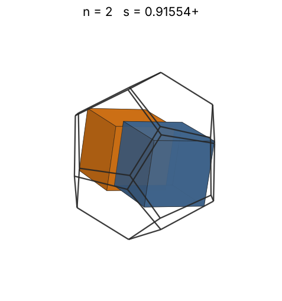 |
| 3 | [1.05146+](cubindod_n03.json) | 1.051462279062 | √(2 - 2√5/5) | 0.73154 | 0.3368 | 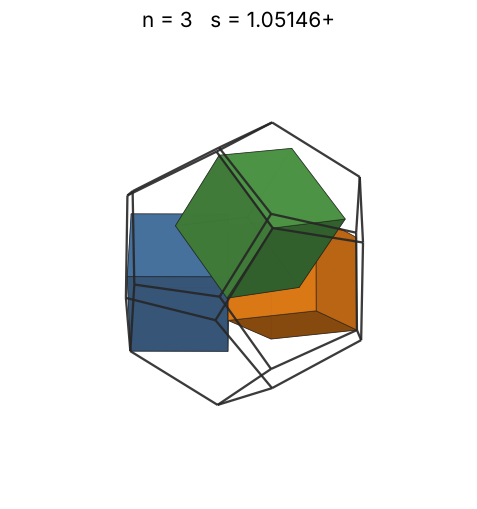 |
| 4 | [1.13211+](cubindod_n04.json) | 1.132117487047 |  | 0.80516 | 0.3597 | 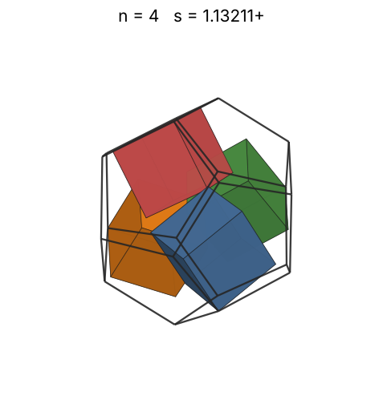 |
| 5 | [1.21696+](cubindod_n05.json) | 1.216969896700 |  | 0.86734 | 0.3620 | 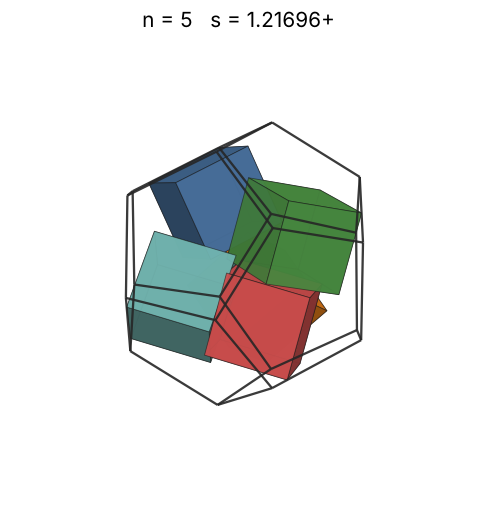 |
| 6 | [1.23606+](cubindod_n06.json) | 1.236067977500 | -1 + √5 | 0.92168 | 0.4146 | 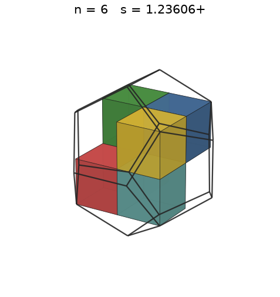 |
| 7 | [1.23606+](cubindod_n07.json) | 1.236067977500 | -1 + √5 | 0.97028 | 0.4837 | 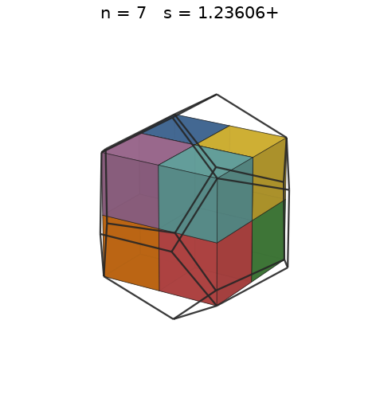 |
| 8 | [1.23606+](cubindod_n08.json) | 1.236067977500 | -1 + √5 | 1.01444 | 0.5528 | 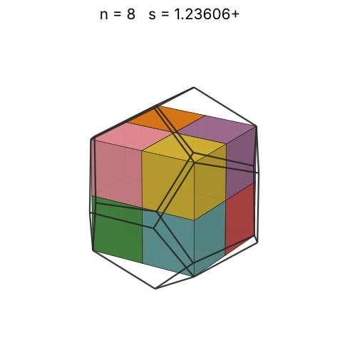 |
| 9 | [1.38863+](cubindod_n09.json) | 1.388632909557 |  | 1.05506 | 0.4386 | 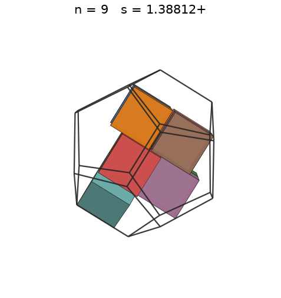 |
| 10 | [1.42289+](cubindod_n10.json) | 1.422892210209 |  | 1.09278 | 0.4530 | 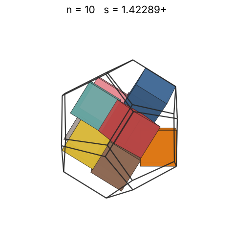 |
| 11 | [1.47416+](cubindod_n11.json) | 1.474168438647 |  | 1.12805 | 0.4481 | 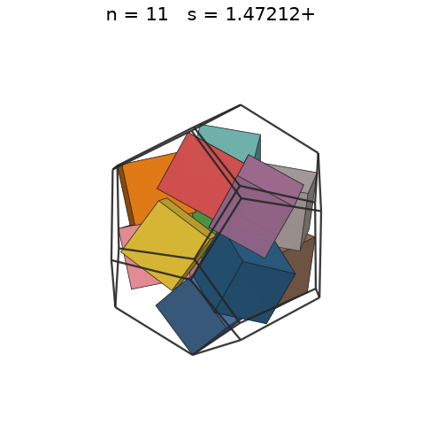 |
| 12 | [1.50105+](cubindod_n12.json) | 1.501058221526 |  | 1.16125 | 0.4630 | 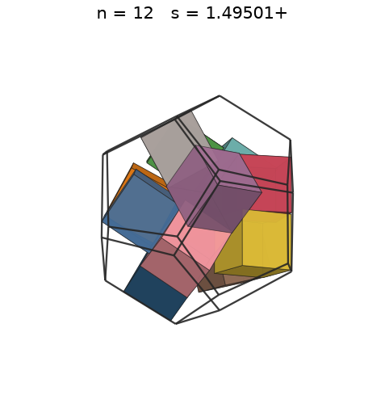 |
| 13 | [1.52798+](cubindod_n13.json) | 1.527984007277 |  | 1.19265 | 0.4755 | 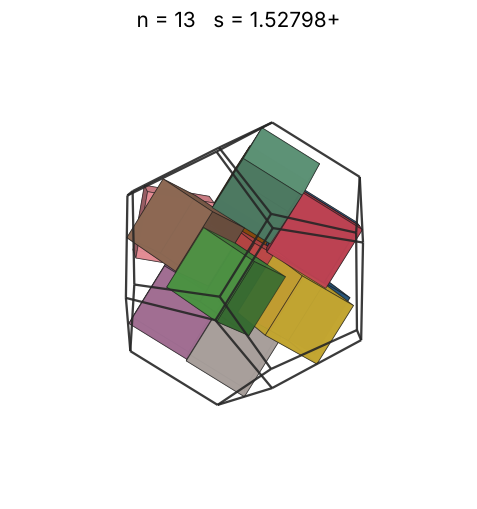 |
| 14 | [1.55591+](cubindod_n14.json) | 1.555910735798 |  | 1.22248 | 0.4850 | 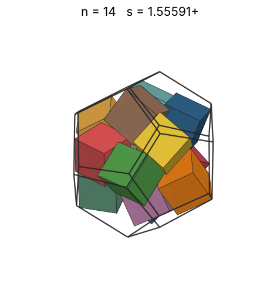 |
| 15 | [1.58086+](cubindod_n15.json) | 1.580866561069 |  | 1.25092 | 0.4955 | 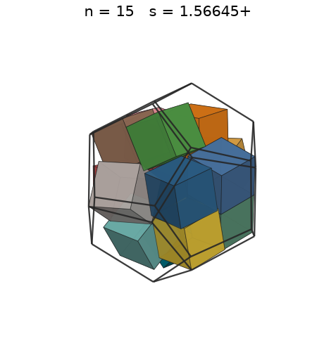 |
| 16 | [1.62300+](cubindod_n16.json) | 1.623007352827 |  | 1.27812 | 0.4884 | 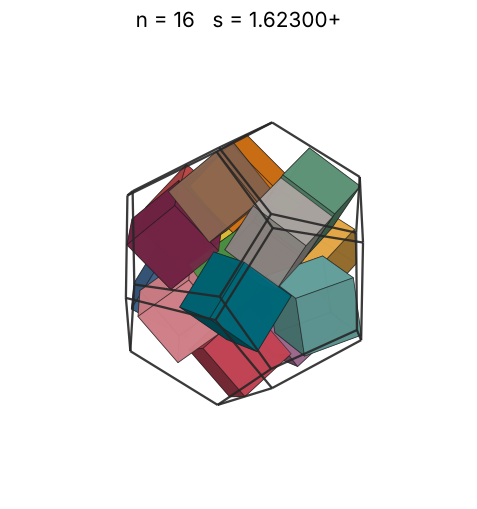 |
| 17 | [1.65720+](cubindod_n17.json) | 1.657208964103 |  | 1.30421 | 0.4874 | 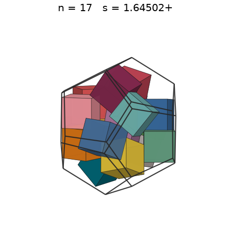 |
| 18 | [1.68938+](cubindod_n18.json) | 1.689388650337 |  | 1.32930 | 0.4872 | 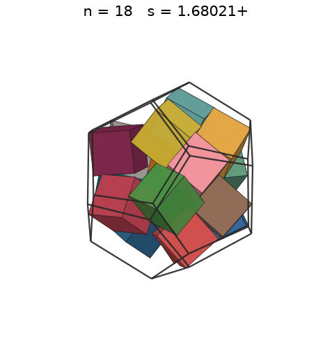 |
| 19 | [1.73548+](cubindod_n19.json) | 1.735482657576 |  | 1.35347 | 0.4743 | 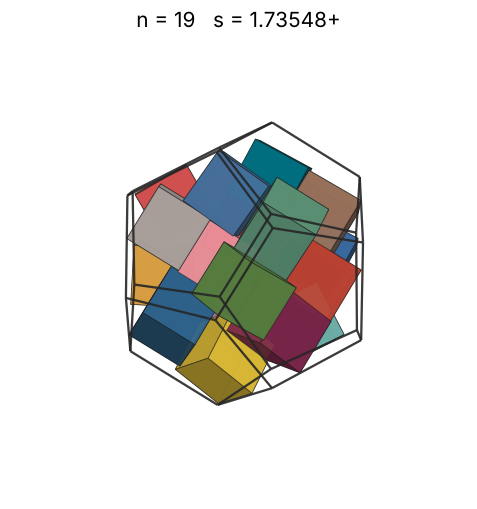 |
| 20 | [1.75332+](cubindod_n20.json) | 1.753325423616 |  | 1.37681 | 0.4842 | 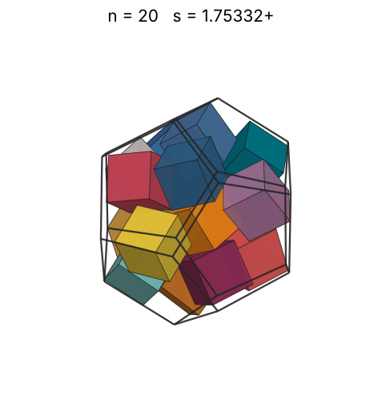 |
| 21 | [1.79681+](cubindod_n21.json) | 1.796819523268 |  | 1.39939 | 0.4724 | 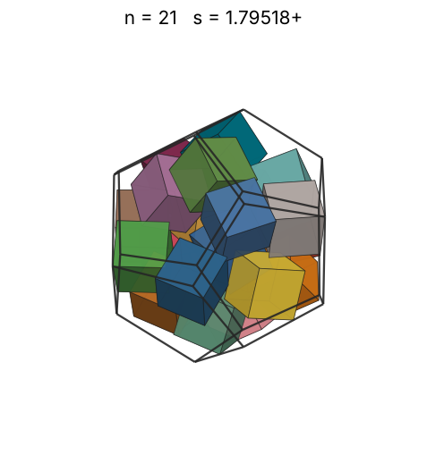 |
| 22 | [1.81589+](cubindod_n22.json) | 1.815893731750 |  | 1.42126 | 0.4795 | 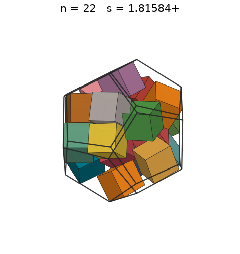 |
| 23 | [1.83470+](cubindod_n23.json) | 1.834707466068 |  | 1.44247 | 0.4860 | 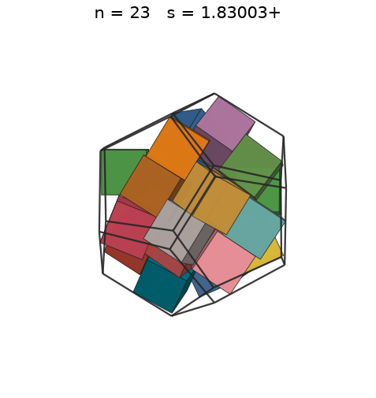 |
| 24 | [1.85302+](cubindod_n24.json) | 1.853028977322 |  | 1.46308 | 0.4922 | 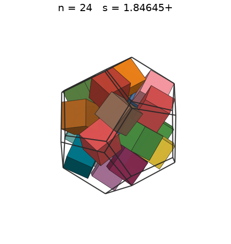 |
| 25 | [1.85410+](cubindod_n25.json) | 1.854101966250 | (-3 + 3√5)/2 | 1.48313 | 0.5118 | 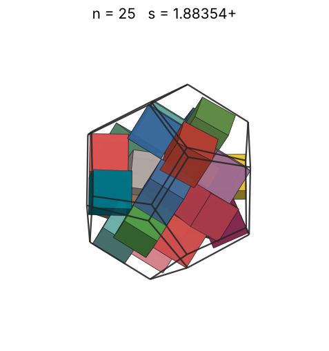 |
| 26 | [1.85410+](cubindod_n26.json) | 1.854101966250 | (-3 + 3√5)/2 | 1.50264 | 0.5323 | 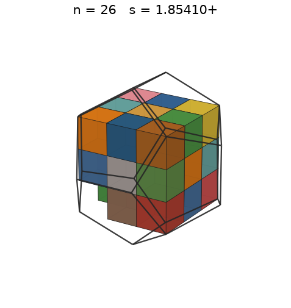 |
| 27 | [1.85410+](cubindod_n27.json) | 1.854101966250 | (-3 + 3√5)/2 | 1.52167 | 0.5528 | 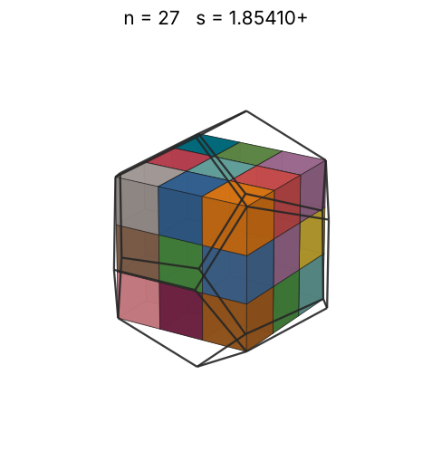 |
| 28 | [1.85410+](cubindod_n28.json) | 1.854101978610 | -3/2 + 3√5/2 | 1.54022 | 0.5733 | 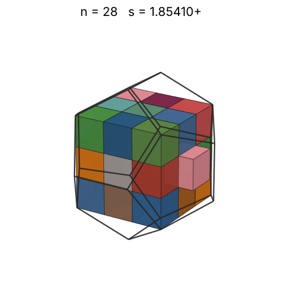 |
| 29 | [1.90983+](cubindod_n29.json) | 1.909830069168 | 15/2 - 5√5/2 | 1.55835 | 0.5433 | 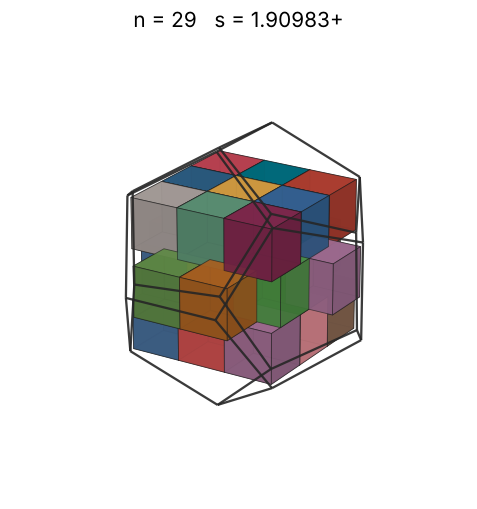 |
| 30 | [1.96555+](cubindod_n30.json) | 1.965558159727 | 33/2 - 13√5/2 | 1.57606 | 0.5155 | 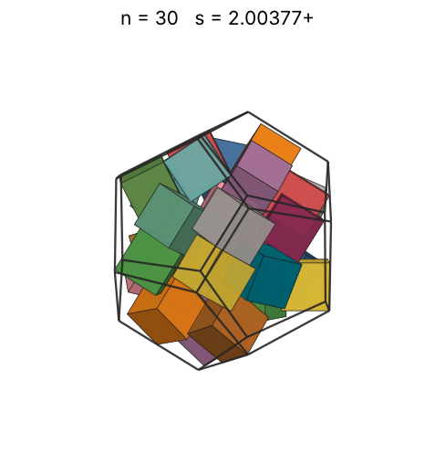 |
| 31 | [2.00000+](cubindod_n31.json) | 2.000000013820 | 2 | 1.59338 | 0.5057 | 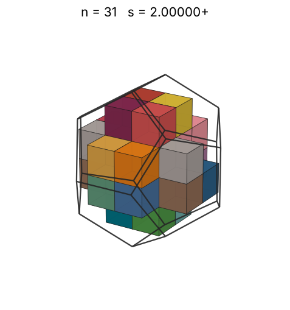 |
| 32 | [2.00000+](cubindod_n32.json) | 2.000000013820 | 2 | 1.61033 | 0.5220 | 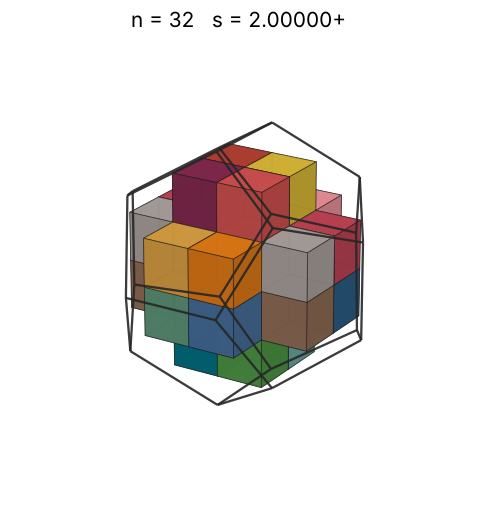 |
| 33 | [2.09017+](cubindod_n33.json) | 2.090169958471 | -7/2 + 5√5/2 | 1.62693 | 0.4716 | 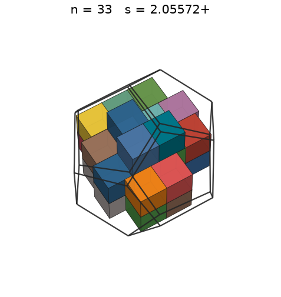 |
| 34 | [2.09017+](cubindod_n34.json) | 2.090169958471 | -7/2 + 5√5/2 | 1.64320 | 0.4859 | 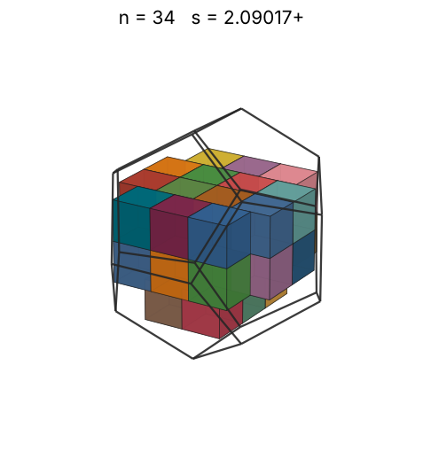 |
| 35 | [2.09017+](cubindod_n35.json) | 2.090169958471 | -7/2 + 5√5/2 | 1.65916 | 0.5002 | 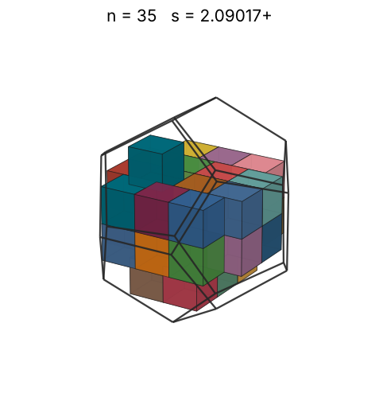 |
| 36 | [2.09017+](cubindod_n36.json) | 2.090169958471 | -7/2 + 5√5/2 | 1.67481 | 0.5145 | 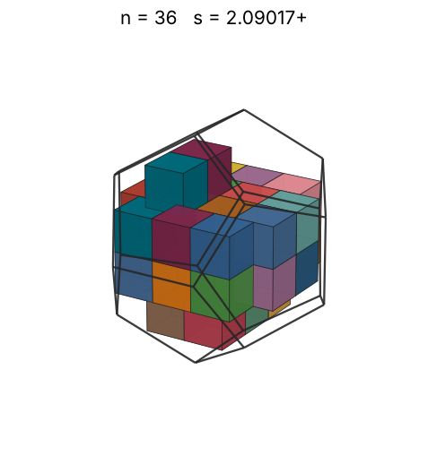 |
| 37 | [2.09017+](cubindod_n37.json) | 2.090169958471 | -7/2 + 5√5/2 | 1.69018 | 0.5288 | 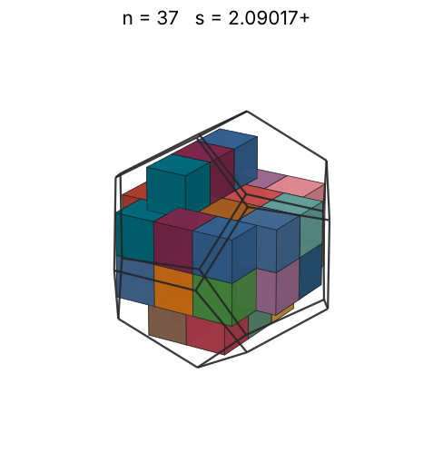 |
| 38 | [2.09017+](cubindod_n38.json) | 2.090169958471 | -7/2 + 5√5/2 | 1.70527 | 0.5430 | 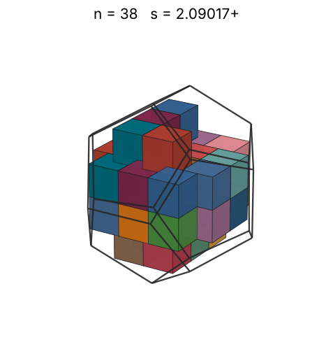 |
| 39 | [2.09017+](cubindod_n39.json) | 2.090169958471 | -7/2 + 5√5/2 | 1.72010 | 0.5573 | 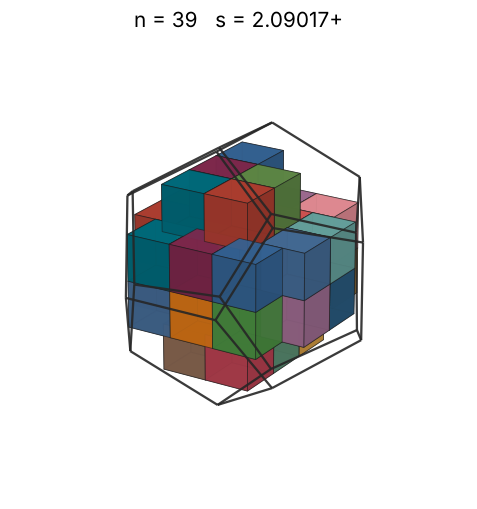 |
| 40 | [2.09017+](cubindod_n40.json) | 2.090169958471 | -7/2 + 5√5/2 | 1.73468 | 0.5716 | 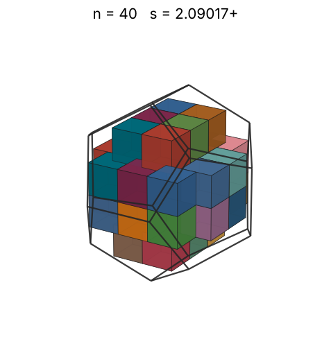 |
| 41 | [2.47213+](cubindod_n41.json) | 2.472135955000 | -2 + 2√5 | 1.74901 | 0.3541 |  |
| 42 | [2.47213+](cubindod_n42.json) | 2.472135955000 | -2 + 2√5 | 1.76312 | 0.3628 |  |
| 43 | [2.47213+](cubindod_n43.json) | 2.472135955000 | -2 + 2√5 | 1.77700 | 0.3714 |  |
| 44 | [2.47213+](cubindod_n44.json) | 2.472135955000 | -2 + 2√5 | 1.79067 | 0.3800 |  |
| 45 | [2.47213+](cubindod_n45.json) | 2.472135955000 | -2 + 2√5 | 1.80413 | 0.3887 |  |
| 46 | [2.47213+](cubindod_n46.json) | 2.472135955000 | -2 + 2√5 | 1.81740 | 0.3973 |  |
| 47 | [2.47213+](cubindod_n47.json) | 2.472135955000 | -2 + 2√5 | 1.83048 | 0.4060 |  |
| 48 | [2.47213+](cubindod_n48.json) | 2.472135955000 | -2 + 2√5 | 1.84337 | 0.4146 |  |
| 49 | [2.47213+](cubindod_n49.json) | 2.472135955000 | -2 + 2√5 | 1.85608 | 0.4232 |  |
| 50 | [2.47213+](cubindod_n50.json) | 2.472135955000 | -2 + 2√5 | 1.86862 | 0.4319 |  |
| 51 | [2.47213+](cubindod_n51.json) | 2.472135955000 | -2 + 2√5 | 1.88100 | 0.4405 |  |
| 52 | [2.47213+](cubindod_n52.json) | 2.472135955000 | -2 + 2√5 | 1.89321 | 0.4491 |  |
| 53 | [2.47213+](cubindod_n53.json) | 2.472135955000 | -2 + 2√5 | 1.90527 | 0.4578 |  |
| 54 | [2.47213+](cubindod_n54.json) | 2.472135955000 | -2 + 2√5 | 1.91718 | 0.4664 |  |
| 55 | [2.47213+](cubindod_n55.json) | 2.472135955000 | -2 + 2√5 | 1.92894 | 0.4751 |  |
| 56 | [2.47213+](cubindod_n56.json) | 2.472135955000 | -2 + 2√5 | 1.94056 | 0.4837 |  |
| 57 | [2.47213+](cubindod_n57.json) | 2.472135955000 | -2 + 2√5 | 1.95204 | 0.4923 |  |
| 58 | [2.47213+](cubindod_n58.json) | 2.472135955000 | -2 + 2√5 | 1.96339 | 0.5010 |  |
| 59 | [2.47213+](cubindod_n59.json) | 2.472135955000 | -2 + 2√5 | 1.97461 | 0.5096 |  |
| 60 | [2.47213+](cubindod_n60.json) | 2.472135955000 | -2 + 2√5 | 1.98571 | 0.5182 |  |
| 61 | [2.47213+](cubindod_n61.json) | 2.472135955000 | -2 + 2√5 | 1.99668 | 0.5269 |  |
| 62 | [2.47213+](cubindod_n62.json) | 2.472135955000 | -2 + 2√5 | 2.00753 | 0.5355 |  |
| 63 | [2.47213+](cubindod_n63.json) | 2.472135955000 | -2 + 2√5 | 2.01827 | 0.5441 |  |
| 64 | [2.47213+](cubindod_n64.json) | 2.472135955000 | -2 + 2√5 | 2.02889 | 0.5528 |  |
| 65 | [2.77625+](cubindod_n65.json) | 2.776250729812 |  | 2.03940 | 0.3964 |  |
| 66 | [2.77625+](cubindod_n66.json) | 2.776250737118 |  | 2.04981 | 0.4025 |  |
| 67 | [2.77648+](cubindod_n67.json) | 2.776489109156 |  | 2.06011 | 0.4085 |  |
| 68 | [2.77726+](cubindod_n68.json) | 2.777265819115 |  | 2.07031 | 0.4142 |  |
| 69 | [2.77726+](cubindod_n69.json) | 2.777265819115 |  | 2.08040 | 0.4203 |  |
| 70 | [2.77726+](cubindod_n70.json) | 2.777265819115 |  | 2.09041 | 0.4264 |  |
| 71 | [2.77726+](cubindod_n71.json) | 2.777265819115 |  | 2.10031 | 0.4325 |  |
| 72 | [2.77726+](cubindod_n72.json) | 2.777265819115 |  | 2.11013 | 0.4386 |  |
| 73 | [2.84547+](cubindod_n73.json) | 2.845475962259 |  | 2.11985 | 0.4135 |  |
| 74 | [2.84547+](cubindod_n74.json) | 2.845476089557 |  | 2.12949 | 0.4191 |  |
| 75 | [2.84578+](cubindod_n75.json) | 2.845784371450 |  | 2.13904 | 0.4247 |  |
| 76 | [2.84578+](cubindod_n76.json) | 2.845784371450 |  | 2.14850 | 0.4303 |  |
| 77 | [2.84578+](cubindod_n77.json) | 2.845784371450 |  | 2.15789 | 0.4360 |  |
| 78 | [2.84578+](cubindod_n78.json) | 2.845784371450 |  | 2.16719 | 0.4417 |  |
| 79 | [2.84578+](cubindod_n79.json) | 2.845784371450 |  | 2.17641 | 0.4473 |  |
| 80 | [2.84578+](cubindod_n80.json) | 2.845784371450 |  | 2.18555 | 0.4530 |  |
| 81 | [2.94833+](cubindod_n81.json) | 2.948336758343 |  | 2.19462 | 0.4124 |  |
| 82 | [2.94833+](cubindod_n82.json) | 2.948336758343 |  | 2.20362 | 0.4175 |  |
| 83 | [2.94833+](cubindod_n83.json) | 2.948336758343 |  | 2.21254 | 0.4226 |  |
| 84 | [2.94833+](cubindod_n84.json) | 2.948336877294 |  | 2.22139 | 0.4277 |  |
| 85 | [2.94833+](cubindod_n85.json) | 2.948336877294 |  | 2.23017 | 0.4328 |  |
| 86 | [2.94833+](cubindod_n86.json) | 2.948336877294 |  | 2.23888 | 0.4379 |  |
| 87 | [2.94833+](cubindod_n87.json) | 2.948336877294 |  | 2.24753 | 0.4430 |  |
| 88 | [2.94833+](cubindod_n88.json) | 2.948336877294 |  | 2.25610 | 0.4481 |  |
| 89 | [3.00211+](cubindod_n89.json) | 3.002116427098 |  | 2.26462 | 0.4292 |  |
| 90 | [3.00211+](cubindod_n90.json) | 3.002116475703 |  | 2.27307 | 0.4341 |  |
| 91 | [3.00211+](cubindod_n91.json) | 3.002116475703 |  | 2.28146 | 0.4389 |  |
| 92 | [3.00211+](cubindod_n92.json) | 3.002116475703 |  | 2.28978 | 0.4437 |  |
| 93 | [3.00211+](cubindod_n93.json) | 3.002116475703 |  | 2.29805 | 0.4485 |  |
| 94 | [3.00211+](cubindod_n94.json) | 3.002116475703 |  | 2.30626 | 0.4534 |  |
| 95 | [3.00211+](cubindod_n95.json) | 3.002116475703 |  | 2.31440 | 0.4582 |  |
| 96 | [3.00211+](cubindod_n96.json) | 3.002116475703 |  | 2.32250 | 0.4630 |  |
| 97 | [3.05596+](cubindod_n97.json) | 3.055967960981 |  | 2.33053 | 0.4435 |  |
| 98 | [3.05596+](cubindod_n98.json) | 3.055967960981 |  | 2.33852 | 0.4481 |  |
| 99 | [3.05596+](cubindod_n99.json) | 3.055967960981 |  | 2.34644 | 0.4527 |  |
| 100 | [3.05596+](cubindod_n100.json) | 3.055967960981 |  | 2.35432 | 0.4572 |  |
