# Cubes in a dodecahedron

s = container edge / piece edge; every row certified in exact arithmetic.

| n | s | touching limit | closed form (conj.) | volume bound | density | picture |
|---|---|---|---|---|---|---|
| 2 | [0.91554+](cubindod_n02.json) | 0.915543919129 |  | 0.63906 | 0.3401 | 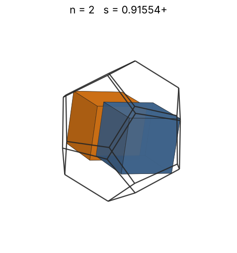 |
| 3 | [1.05146+](cubindod_n03.json) | 1.051462279062 | √(2 - 2√5/5) | 0.73154 | 0.3368 | 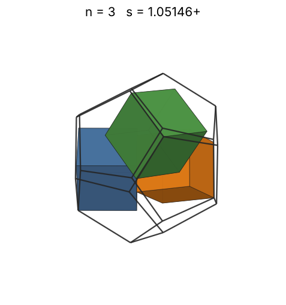 |
| 4 | [1.13211+](cubindod_n04.json) | 1.132117487047 |  | 0.80516 | 0.3597 | 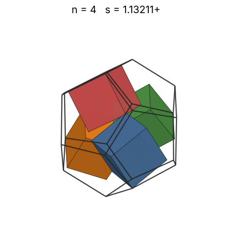 |
| 5 | [1.21696+](cubindod_n05.json) | 1.216969896700 |  | 0.86734 | 0.3620 | 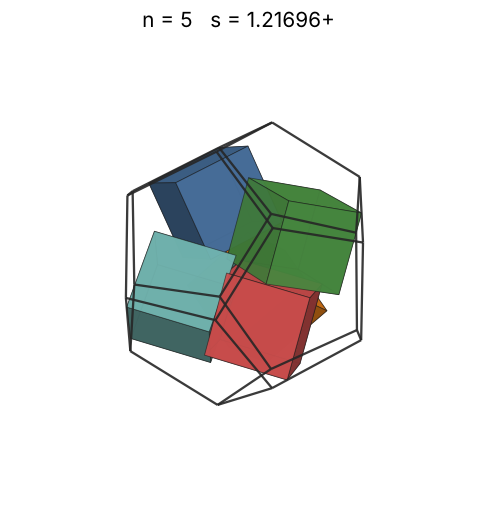 |
| 6 | [1.23606+](cubindod_n06.json) | 1.236067977500 | -1 + √5 | 0.92168 | 0.4146 | 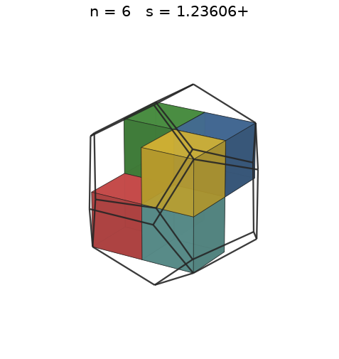 |
| 7 | [1.23606+](cubindod_n07.json) | 1.236067977500 | -1 + √5 | 0.97028 | 0.4837 | 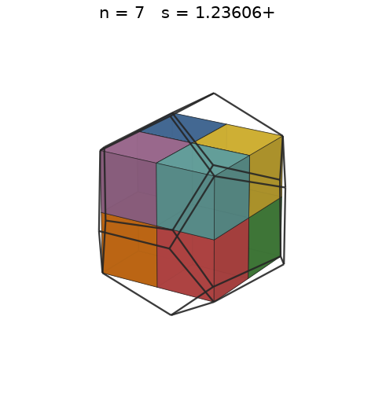 |
| 8 | [1.23606+](cubindod_n08.json) | 1.236067977500 | -1 + √5 | 1.01444 | 0.5528 | 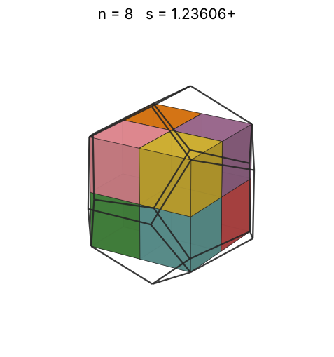 |
| 9 | [1.38812+](cubindod_n09.json) | 1.388124819264 |  | 1.05506 | 0.4391 | 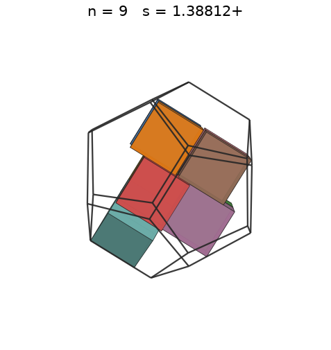 |
| 10 | [1.41860+](cubindod_n10.json) | 1.418606573447 |  | 1.09278 | 0.4571 | 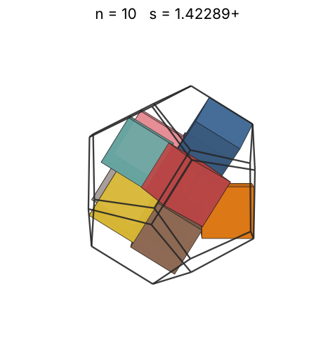 |
| 11 | [1.46645+](cubindod_n11.json) | 1.466453772570 |  | 1.12805 | 0.4552 | 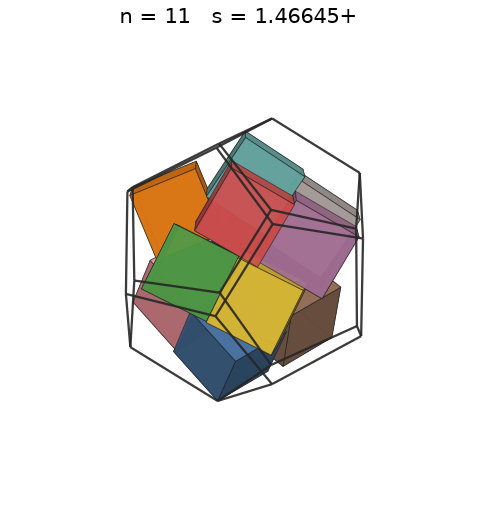 |
| 12 | [1.47213+](cubindod_n12.json) | 1.472136211230 | 2√5 - 3 | 1.16125 | 0.4908 | 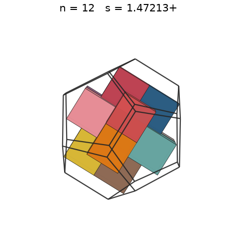 |
| 13 | [1.47213+](cubindod_n13.json) | 1.472136211230 | 2√5 - 3 | 1.19265 | 0.5317 | 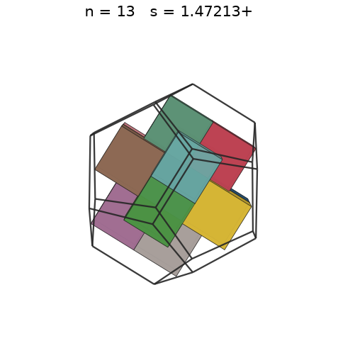 |
| 14 | [1.54173+](cubindod_n14.json) | 1.541730811514 |  | 1.22248 | 0.4985 | 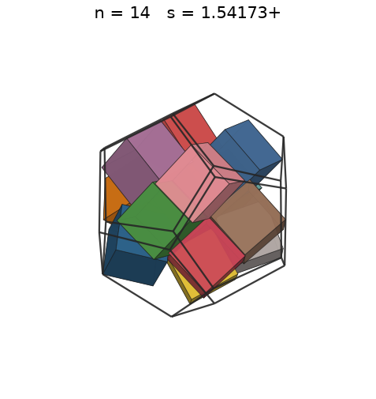 |
| 15 | [1.55584+](cubindod_n15.json) | 1.555843472997 |  | 1.25092 | 0.5197 | 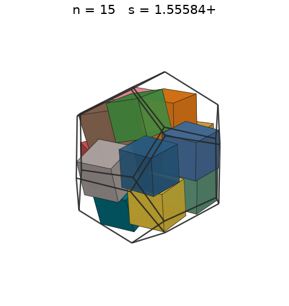 |
| 16 | [1.59888+](cubindod_n16.json) | 1.598888670122 |  | 1.27812 | 0.5108 | 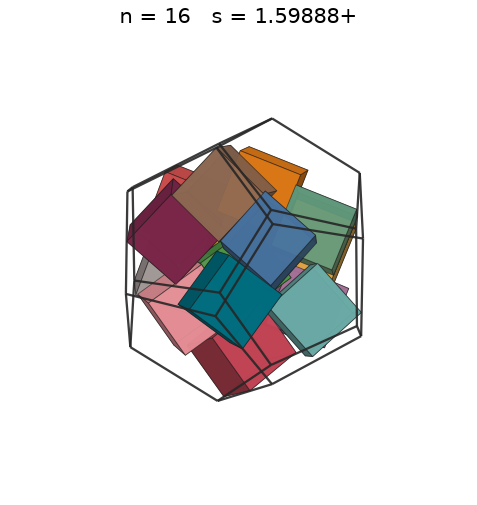 |
| 17 | [1.62687+](cubindod_n17.json) | 1.626871504041 |  | 1.30421 | 0.5152 | 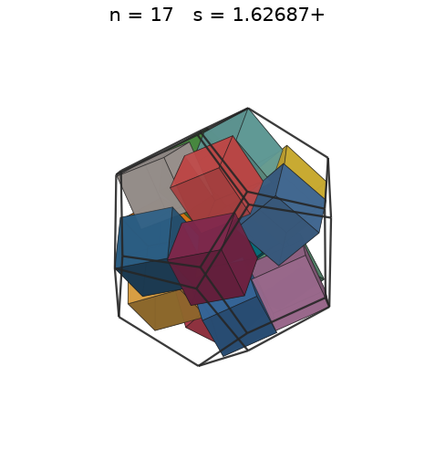 |
| 18 | [1.67436+](cubindod_n18.json) | 1.674363760899 |  | 1.32930 | 0.5004 | 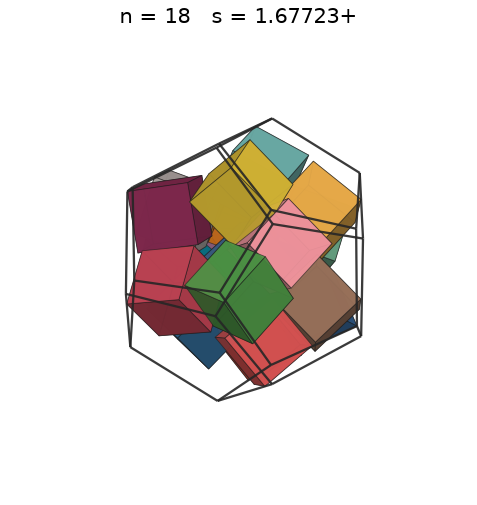 |
| 19 | [1.72410+](cubindod_n19.json) | 1.724108126107 |  | 1.35347 | 0.4838 | 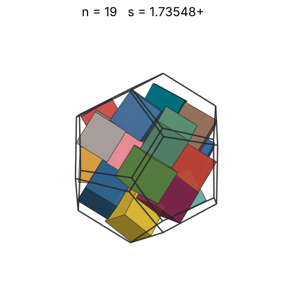 |
| 20 | [1.74404+](cubindod_n20.json) | 1.744043393392 |  | 1.37681 | 0.4920 | 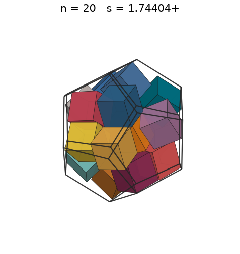 |
| 21 | [1.76724+](cubindod_n21.json) | 1.767248978822 |  | 1.39939 | 0.4965 | 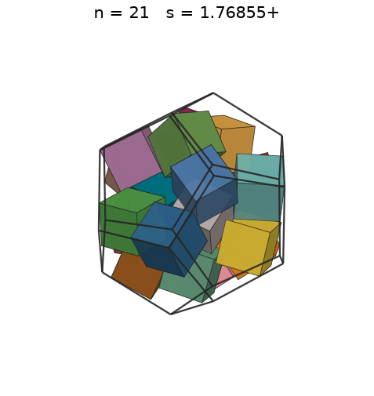 |
| 22 | [1.80901+](cubindod_n22.json) | 1.809009965105 |  | 1.42126 | 0.4849 | 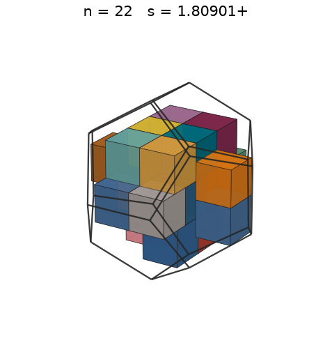 |
| 23 | [1.83003+](cubindod_n23.json) | 1.830035044330 |  | 1.44247 | 0.4897 | 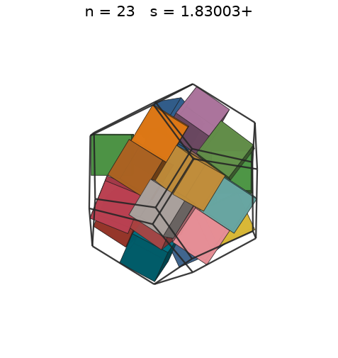 |
| 24 | [1.84645+](cubindod_n24.json) | 1.846455193806 |  | 1.46308 | 0.4975 | 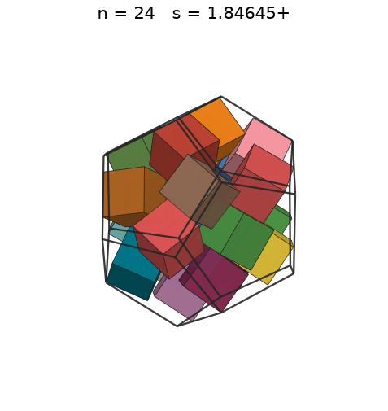 |
| 25 | [1.85410+](cubindod_n25.json) | 1.854101966250 | (-3 + 3√5)/2 | 1.48313 | 0.5118 | 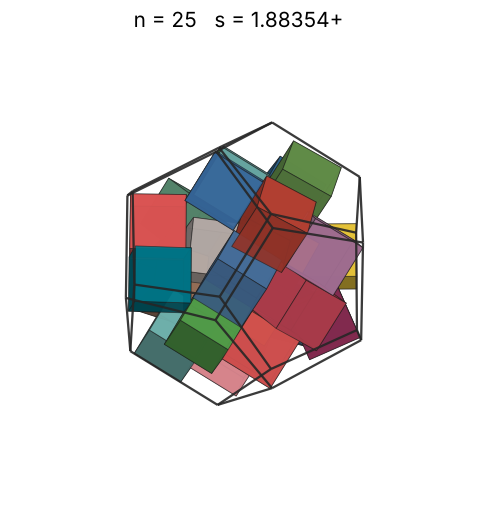 |
| 26 | [1.85410+](cubindod_n26.json) | 1.854101966250 | (-3 + 3√5)/2 | 1.50264 | 0.5323 | 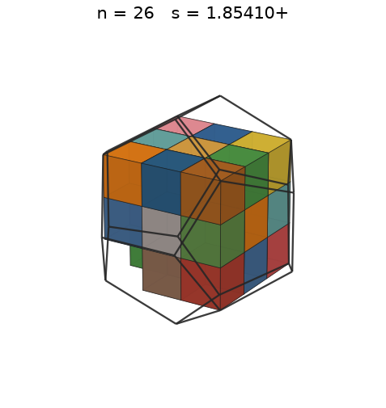 |
| 27 | [1.85410+](cubindod_n27.json) | 1.854101966250 | (-3 + 3√5)/2 | 1.52167 | 0.5528 | 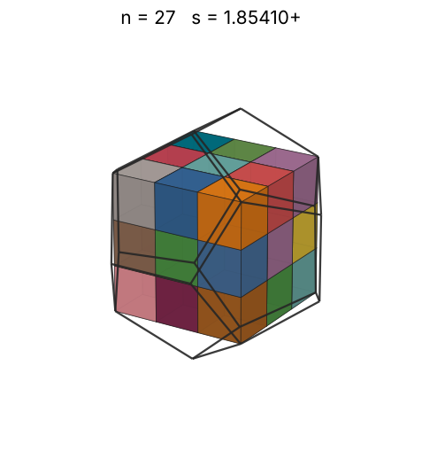 |
| 28 | [1.85410+](cubindod_n28.json) | 1.854101978610 | -3/2 + 3√5/2 | 1.54022 | 0.5733 | 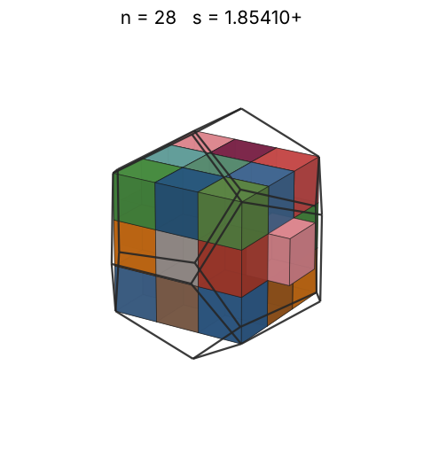 |
| 29 | [1.85951+](cubindod_n29.json) | 1.859518614837 |  | 1.55835 | 0.5886 | 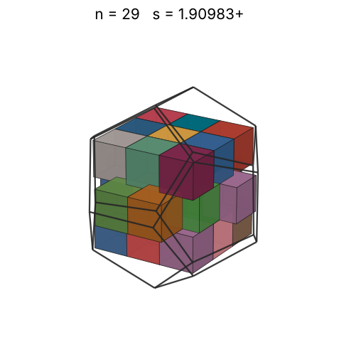 |
| 30 | [1.90217+](cubindod_n30.json) | 1.902177758521 |  | 1.57606 | 0.5688 | 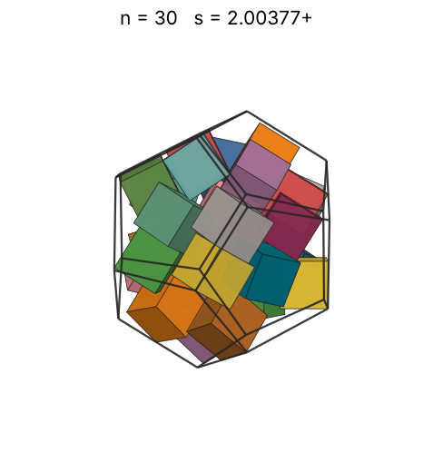 |
| 31 | [1.97357+](cubindod_n31.json) | 1.973576975438 |  | 1.59338 | 0.5263 | 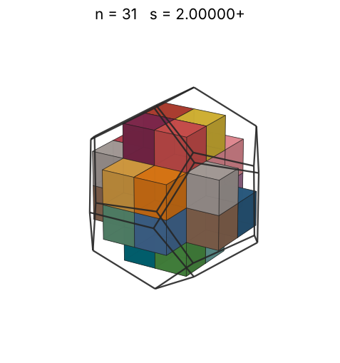 |
| 32 | [1.98756+](cubindod_n32.json) | 1.987565730789 |  | 1.61033 | 0.5318 | 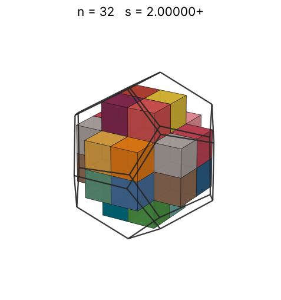 |
| 33 | [2.00000+](cubindod_n33.json) | 2.000000413823 | 2 | 1.62693 | 0.5383 | 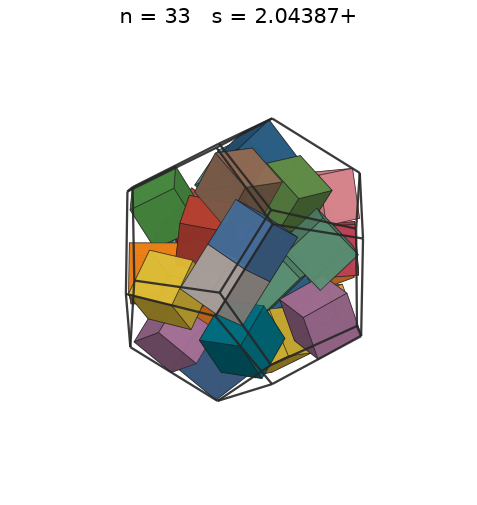 |
| 34 | [2.04387+](cubindod_n34.json) | 2.043873992128 |  | 1.64320 | 0.5197 | 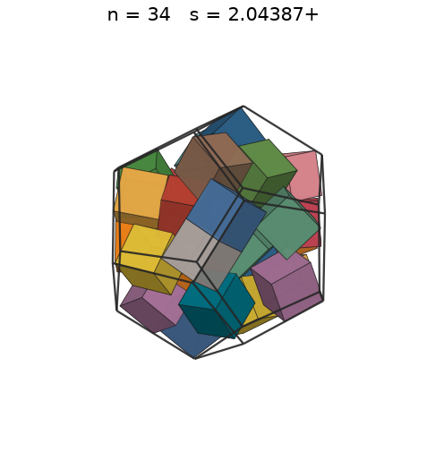 |
| 35 | [2.04387+](cubindod_n35.json) | 2.043874006559 |  | 1.65916 | 0.5349 | 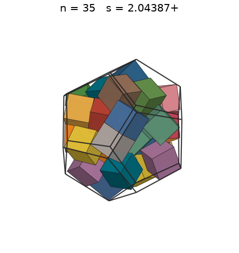 |
| 36 | [2.06172+](cubindod_n36.json) | 2.061728258790 |  | 1.67481 | 0.5360 | 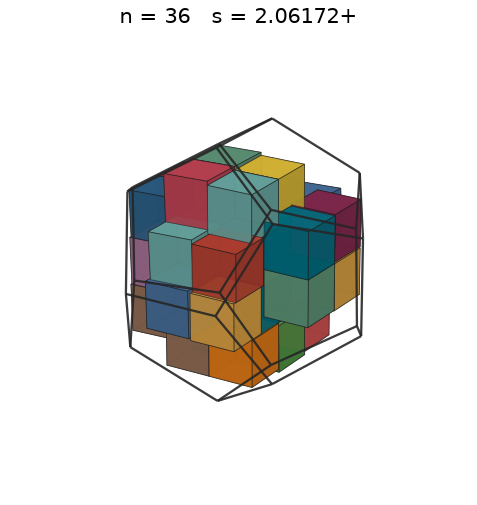 |
| 37 | [2.08955+](cubindod_n37.json) | 2.089553305008 |  | 1.69018 | 0.5292 | 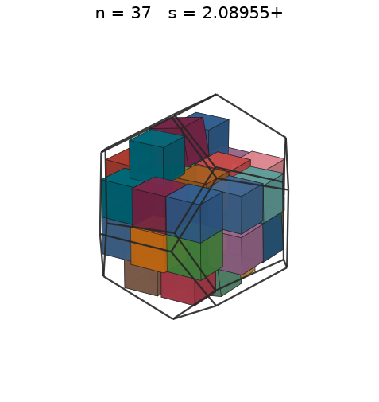 |
| 38 | [2.09017+](cubindod_n38.json) | 2.090169958471 | -7/2 + 5√5/2 | 1.70527 | 0.5430 | 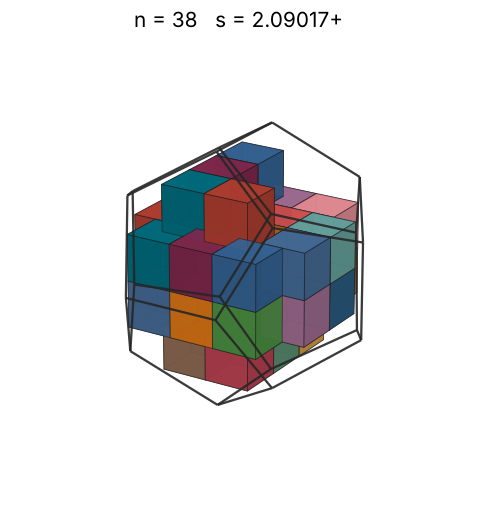 |
| 39 | [2.09017+](cubindod_n39.json) | 2.090169958471 | -7/2 + 5√5/2 | 1.72010 | 0.5573 | 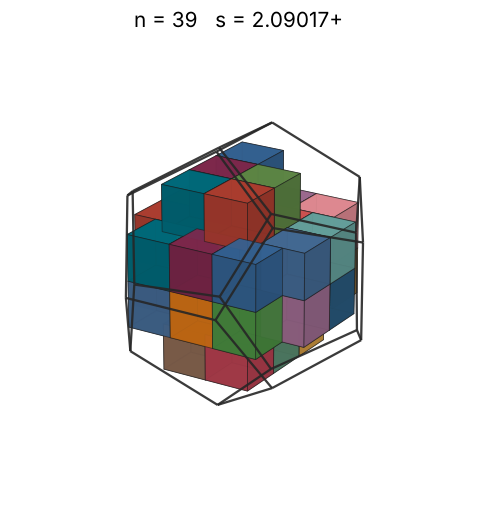 |
| 40 | [2.09017+](cubindod_n40.json) | 2.090169958471 | -7/2 + 5√5/2 | 1.73468 | 0.5716 | 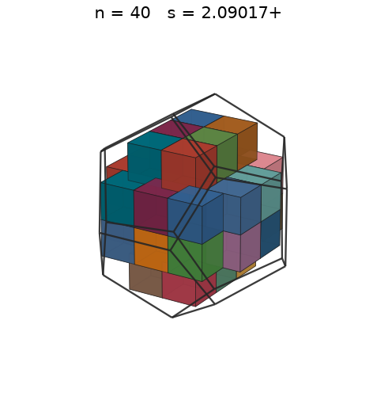 |
| 41 | [2.11803+](cubindod_n41.json) | 2.118034438105 | 1 + √5/2 | 1.74901 | 0.5631 |  |
| 42 | [2.14589+](cubindod_n42.json) | 2.145898492110 | 11/2 - 3√5/2 | 1.76312 | 0.5546 |  |
| 43 | [2.14589+](cubindod_n43.json) | 2.145898492110 | 11/2 - 3√5/2 | 1.77700 | 0.5679 |  |
| 44 | [2.19235+](cubindod_n44.json) | 2.192353930504 |  | 1.79067 | 0.5449 |  |
| 45 | [2.20406+](cubindod_n45.json) | 2.204069086146 |  | 1.80413 | 0.5484 |  |
| 46 | [2.23606+](cubindod_n46.json) | 2.236068462910 |  | 1.81740 | 0.5369 |  |
| 47 | [2.23606+](cubindod_n47.json) | 2.236068462910 |  | 1.83048 | 0.5486 |  |
| 48 | [2.23606+](cubindod_n48.json) | 2.236068462910 |  | 1.84337 | 0.5602 |  |
| 49 | [2.23606+](cubindod_n49.json) | 2.236068462910 | √5 | 1.85608 | 0.5719 |  |
| 50 | [2.26393+](cubindod_n50.json) | 2.263932516237 | 9/2 - √5 | 1.86862 | 0.5623 |  |
| 51 | [2.26393+](cubindod_n51.json) | 2.263932516273 | 9/2 - √5 | 1.88100 | 0.5736 |  |
| 52 | [2.26563+](cubindod_n52.json) | 2.265636539521 |  | 1.89321 | 0.5835 |  |
| 53 | [2.29179+](cubindod_n53.json) | 2.291796569629 | 9 - 3√5 | 1.90527 | 0.5746 |  |
| 54 | [2.29179+](cubindod_n54.json) | 2.291796569629 | 9 - 3√5 | 1.91718 | 0.5854 |  |
| 55 | [2.29779+](cubindod_n55.json) | 2.297796178420 |  | 1.92894 | 0.5916 |  |
| 56 | [2.32623+](cubindod_n56.json) | 2.326238432579 | -11/2 + 7√5/2 | 1.94056 | 0.5805 |  |
| 57 | [2.33698+](cubindod_n57.json) | 2.336987724075 |  | 1.95204 | 0.5828 |  |
| 58 | [2.34880+](cubindod_n58.json) | 2.348807642340 |  | 1.96339 | 0.5841 |  |
| 59 | [2.36238+](cubindod_n59.json) | 2.362385393008 |  | 1.97461 | 0.5840 |  |
| 60 | [2.38196+](cubindod_n60.json) | 2.381966540430 |  | 1.98571 | 0.5793 |  |
| 61 | [2.38196+](cubindod_n61.json) | 2.381966540430 |  | 1.99668 | 0.5890 |  |
| 62 | [2.38196+](cubindod_n62.json) | 2.381966540430 |  | 2.00753 | 0.5987 |  |
| 63 | [2.38196+](cubindod_n63.json) | 2.381966540430 | 7/2 - √5/2 | 2.01827 | 0.6083 |  |
| 64 | [2.42705+](cubindod_n64.json) | 2.427051525469 |  | 2.02889 | 0.5842 |  |
| 65 | [2.42705+](cubindod_n65.json) | 2.427051525558 | 3/4 + 3√5/4 | 2.03940 | 0.5933 |  |
| 66 | [2.47213+](cubindod_n66.json) | 2.472136511230 |  | 2.04981 | 0.5701 |  |
| 67 | [2.47213+](cubindod_n67.json) | 2.472136511230 |  | 2.06011 | 0.5787 |  |
| 68 | [2.47213+](cubindod_n68.json) | 2.472136511230 | -2 + 2√5 | 2.07031 | 0.5873 |  |
| 69 | [2.47213+](cubindod_n69.json) | 2.472136511230 | -2 + 2√5 | 2.08040 | 0.5960 |  |
| 70 | [2.47213+](cubindod_n70.json) | 2.472136511230 | -2 + 2√5 | 2.09041 | 0.6046 |  |
| 71 | [2.49514+](cubindod_n71.json) | 2.495145235840 |  | 2.10031 | 0.5964 |  |
| 72 | [2.49514+](cubindod_n72.json) | 2.495145236019 |  | 2.11013 | 0.6048 |  |
| 73 | [2.50000+](cubindod_n73.json) | 2.500000563874 |  | 2.11985 | 0.6097 |  |
| 74 | [2.50000+](cubindod_n74.json) | 2.500000563875 | 5/2 | 2.12949 | 0.6180 |  |
| 75 | [2.52786+](cubindod_n75.json) | 2.527864617949 | 7 - 2√5 | 2.13904 | 0.6059 |  |
| 76 | [2.52786+](cubindod_n76.json) | 2.527864617949 | 7 - 2√5 | 2.14850 | 0.6140 |  |
| 77 | [2.54915+](cubindod_n77.json) | 2.549150860588 | 61/2 - 25√5/2 | 2.15789 | 0.6066 |  |
| 78 | [2.56230+](cubindod_n78.json) | 2.562306481553 | -15/2 + 9√5/2 | 2.16719 | 0.6051 |  |
| 79 | [2.57294+](cubindod_n79.json) | 2.572949601089 |  | 2.17641 | 0.6052 |  |
| 80 | [2.57294+](cubindod_n80.json) | 2.572949601093 | 17/4 - 3√5/4 | 2.18555 | 0.6129 |  |
| 81 | [2.61803+](cubindod_n81.json) | 2.618034588750 | √5/2 + 3/2 | 2.19462 | 0.5891 |  |
| 82 | [2.61803+](cubindod_n82.json) | 2.618034588750 |  | 2.20362 | 0.5963 |  |
| 83 | [2.61803+](cubindod_n83.json) | 2.618034588750 |  | 2.21254 | 0.6036 |  |
| 84 | [2.61803+](cubindod_n84.json) | 2.618034588750 |  | 2.22139 | 0.6109 |  |
| 85 | [2.61803+](cubindod_n85.json) | 2.618034588750 | √5/2 + 3/2 | 2.23017 | 0.6181 |  |
| 86 | [2.61803+](cubindod_n86.json) | 2.618034588750 | √5/2 + 3/2 | 2.23888 | 0.6254 |  |
| 87 | [2.64589+](cubindod_n87.json) | 2.645898642110 | 6 - 3√5/2 | 2.24753 | 0.6129 |  |
| 88 | [2.66311+](cubindod_n88.json) | 2.663119571730 |  | 2.25610 | 0.6080 |  |
| 89 | [2.66311+](cubindod_n89.json) | 2.663119571730 | -5/4 + 7√5/4 | 2.26462 | 0.6149 |  |
| 90 | [2.67092+](cubindod_n90.json) | 2.670926470308 |  | 2.27307 | 0.6164 |  |
| 91 | [2.67256+](cubindod_n91.json) | 2.672564505451 |  | 2.28146 | 0.6221 |  |
| 92 | [2.68240+](cubindod_n92.json) | 2.682405141166 |  | 2.28978 | 0.6220 |  |
| 93 | [2.70820+](cubindod_n93.json) | 2.708204559105 | -4 + 3√5 | 2.29805 | 0.6110 |  |
| 94 | [2.70820+](cubindod_n94.json) | 2.708204559550 |  | 2.30626 | 0.6176 |  |
| 95 | [2.70820+](cubindod_n95.json) | 2.708204559550 | -4 + 3√5 | 2.31440 | 0.6241 |  |
| 96 | [2.70820+](cubindod_n96.json) | 2.708204559550 | -4 + 3√5 | 2.32250 | 0.6307 |  |
| 97 | [2.70820+](cubindod_n97.json) | 2.708204559550 | -4 + 3√5 | 2.33053 | 0.6373 |  |
| 98 | [2.72948+](cubindod_n98.json) | 2.729485915892 |  | 2.33852 | 0.6289 |  |
| 99 | [2.75247+](cubindod_n99.json) | 2.752470706122 |  | 2.34644 | 0.6195 |  |
| 100 | [2.76393+](cubindod_n100.json) | 2.763932666270 | 5 - √5 | 2.35432 | 0.6180 |  |
