# Cubes in an icosahedron

s = container edge / piece edge; every row certified in exact arithmetic.

| n | s | touching limit | closed form (conj.) | volume bound | density | picture |
|---|---|---|---|---|---|---|
| 2 | [1.48861+](cubinico_n02.json) | 1.488614044226 | -53/38 + 49√5/38 | 0.97143 | 0.2779 | 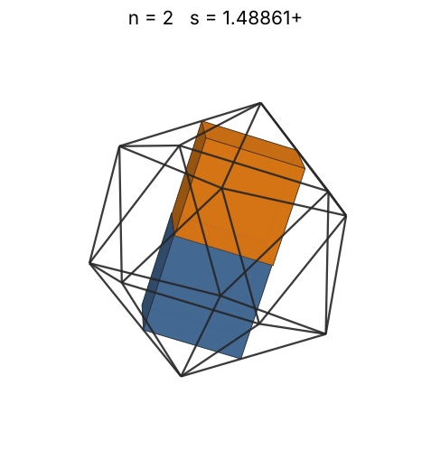 |
| 3 | [1.67433+](cubinico_n03.json) | 1.674338466038 |  | 1.11201 | 0.2930 | 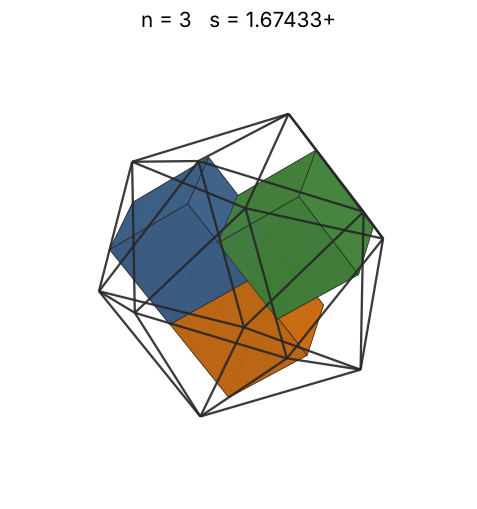 |
| 4 | [1.77569+](cubinico_n04.json) | 1.775698185345 |  | 1.22393 | 0.3275 | 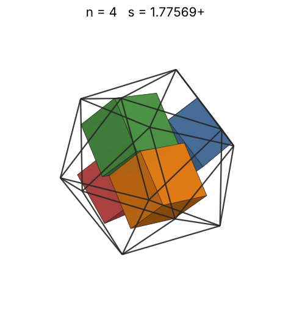 |
| 5 | [1.86891+](cubinico_n05.json) | 1.868912869245 |  | 1.31843 | 0.3511 | 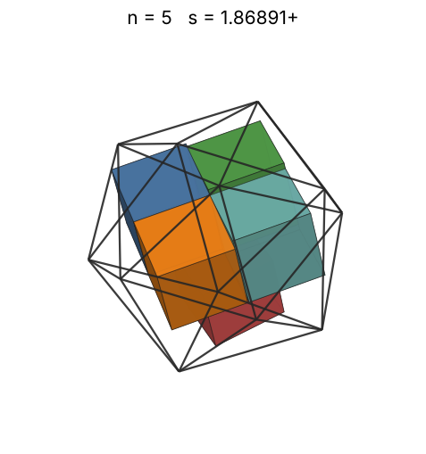 |
| 6 | [1.92552+](cubinico_n06.json) | 1.925529800641 |  | 1.40105 | 0.3852 | 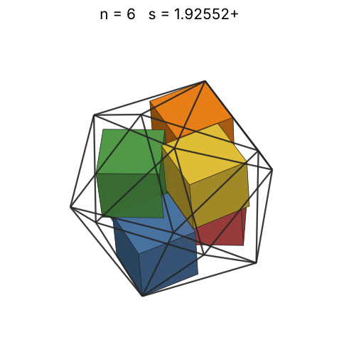 |
| 7 | [1.98137+](cubinico_n07.json) | 1.981371292719 |  | 1.47492 | 0.4125 | 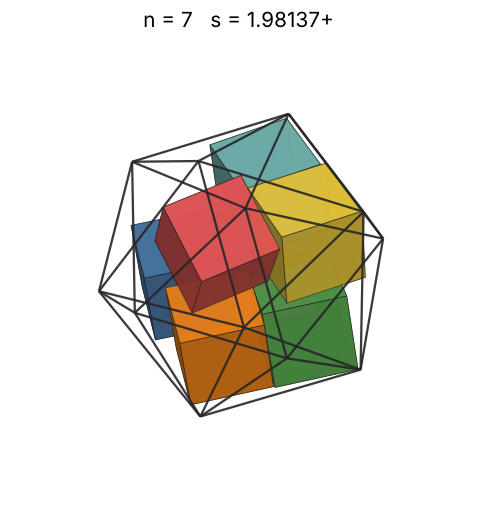 |
| 8 | [2.01077+](cubinico_n08.json) | 2.010771395345 |  | 1.54205 | 0.4510 | 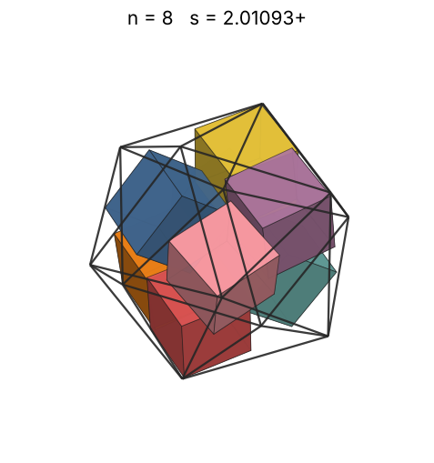 |
| 9 | [2.10570+](cubinico_n09.json) | 2.105703368676 |  | 1.60380 | 0.4418 | 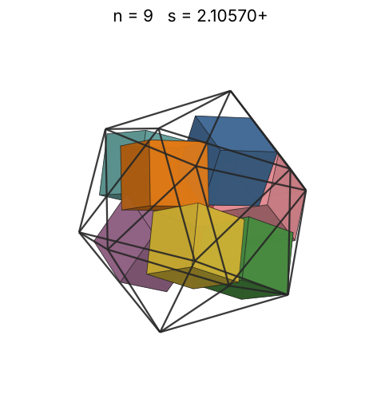 |
| 10 | [2.13529+](cubinico_n10.json) | 2.135297256920 |  | 1.66112 | 0.4708 | 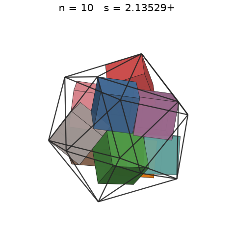 |
| 11 | [2.18110+](cubinico_n11.json) | 2.181101845746 |  | 1.71475 | 0.4859 | 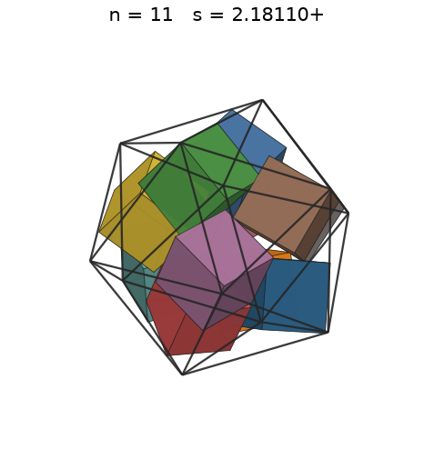 |
| 12 | [2.21000+](cubinico_n12.json) | 2.210004791548 |  | 1.76521 | 0.5096 | 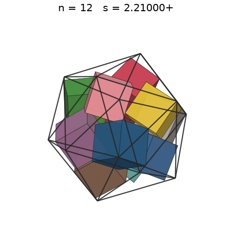 |
| 13 | [2.25336+](cubinico_n13.json) | 2.253366438132 |  | 1.81294 | 0.5208 | 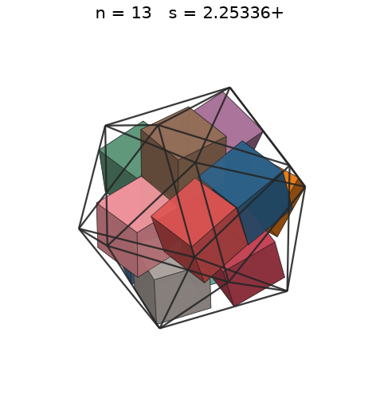 |
| 14 | [2.36994+](cubinico_n14.json) | 2.369946952914 |  | 1.85828 | 0.4821 | 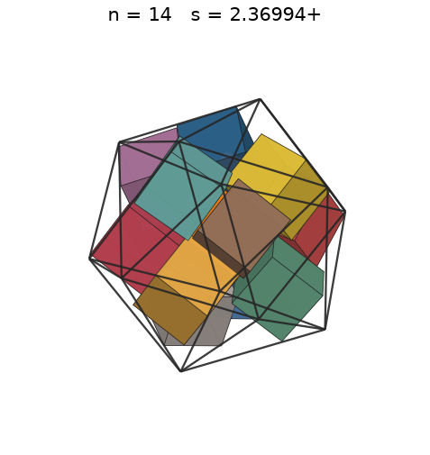 |
| 15 | [2.41489+](cubinico_n15.json) | 2.414893922175 |  | 1.90151 | 0.4882 | 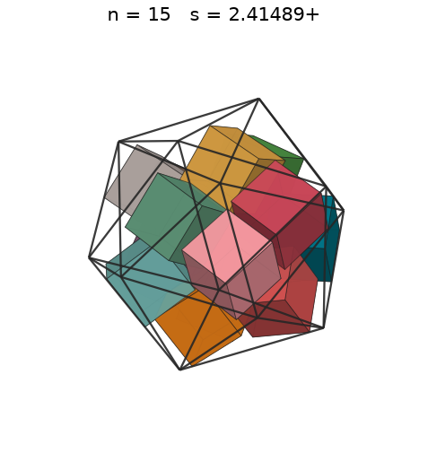 |
| 16 | [2.47269+](cubinico_n16.json) | 2.472698512943 |  | 1.94286 | 0.4851 | 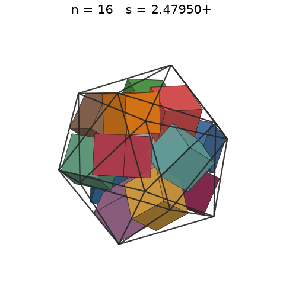 |
| 17 | [2.51468+](cubinico_n17.json) | 2.514687873998 |  | 1.98252 | 0.4900 | 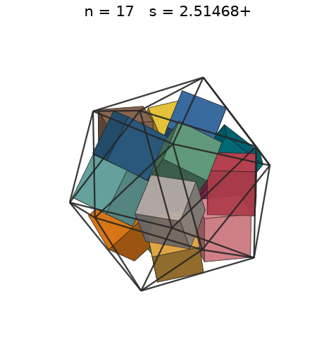 |
| 18 | [2.57889+](cubinico_n18.json) | 2.578899792461 |  | 2.02066 | 0.4810 | 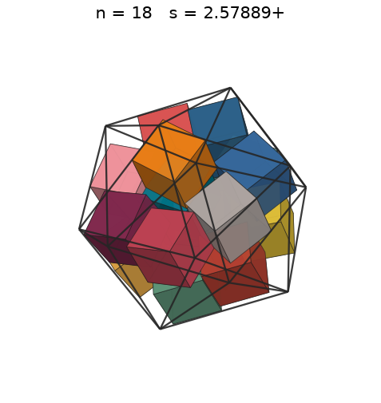 |
| 19 | [2.61913+](cubinico_n19.json) | 2.619135281245 |  | 2.05741 | 0.4847 | 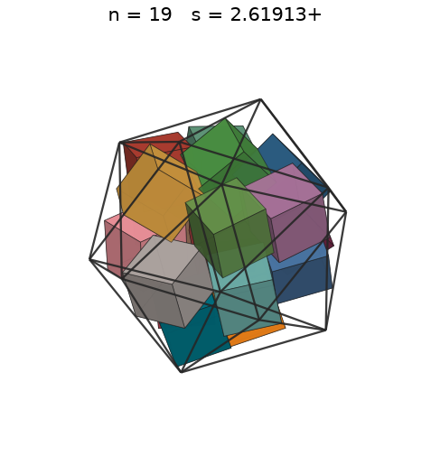 |
| 20 | [2.65519+](cubinico_n20.json) | 2.655197828729 |  | 2.09288 | 0.4897 | 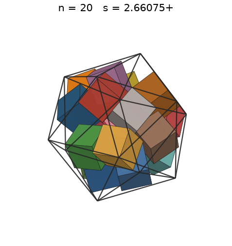 |
| 21 | [2.69267+](cubinico_n21.json) | 2.692673034758 |  | 2.12720 | 0.4930 | 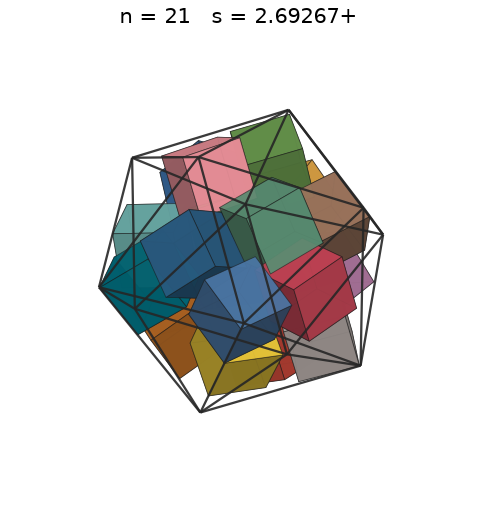 |
| 22 | [2.76765+](cubinico_n22.json) | 2.767657147231 |  | 2.16044 | 0.4757 | 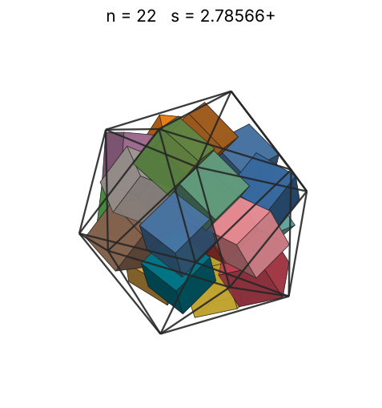 |
| 23 | [2.78071+](cubinico_n23.json) | 2.780716159264 |  | 2.19269 | 0.4903 | 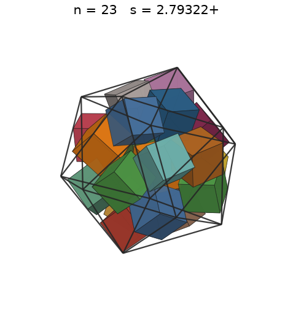 |
| 24 | [2.81756+](cubinico_n24.json) | 2.817561905111 |  | 2.22402 | 0.4918 | 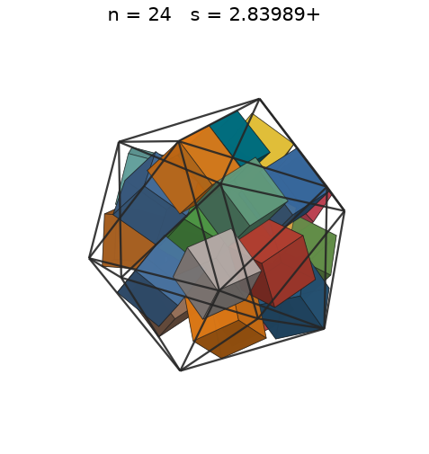 |
| 25 | [2.83671+](cubinico_n25.json) | 2.836714863120 |  | 2.25449 | 0.5020 | 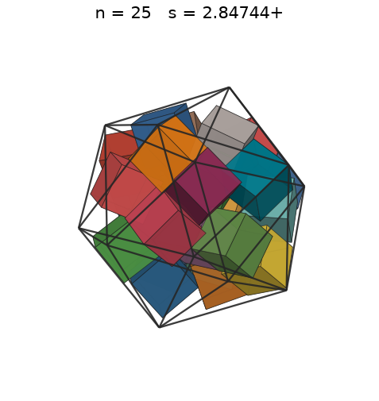 |
| 26 | [2.88759+](cubinico_n26.json) | 2.887595455088 |  | 2.28416 | 0.4950 | 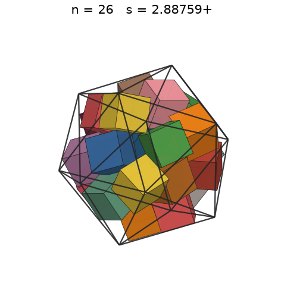 |
| 27 | [2.90870+](cubinico_n27.json) | 2.908700009114 |  | 2.31308 | 0.5029 | 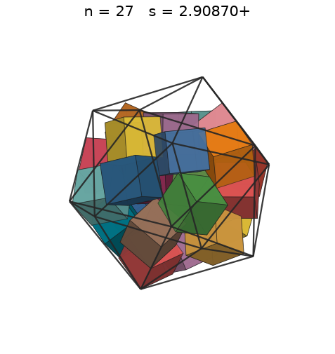 |
| 28 | [2.94776+](cubinico_n28.json) | 2.947767633054 |  | 2.34129 | 0.5011 | 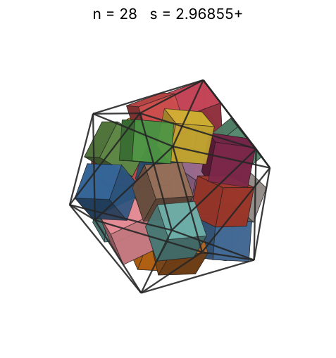 |
| 29 | [2.95472+](cubinico_n29.json) | 2.954723939226 |  | 2.36883 | 0.5153 | 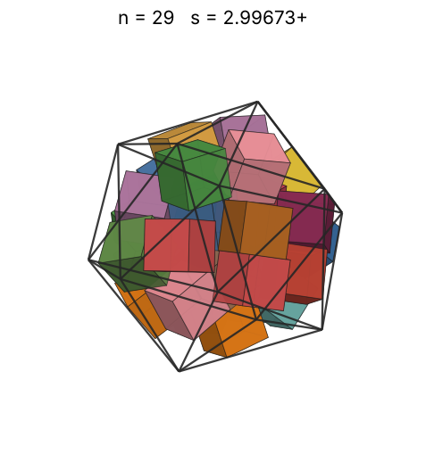 |
| 30 | [2.99129+](cubinico_n30.json) | 2.991291204872 |  | 2.39576 | 0.5137 | 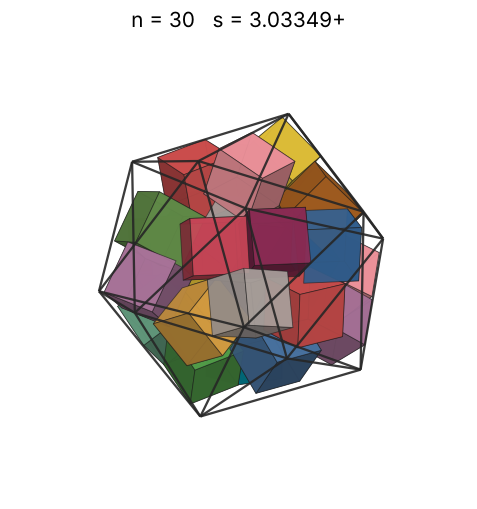 |
| 31 | [3.02319+](cubinico_n31.json) | 3.023190599353 |  | 2.42208 | 0.5142 | 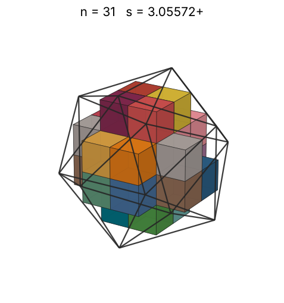 |
| 32 | [3.02908+](cubinico_n32.json) | 3.029080422918 |  | 2.44785 | 0.5277 | 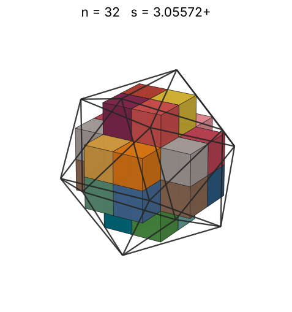 |
| 33 | [3.09644+](cubinico_n33.json) | 3.096446773149 |  | 2.47309 | 0.5095 | 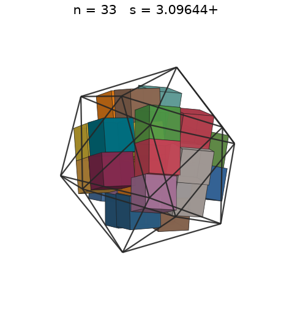 |
| 34 | [3.13395+](cubinico_n34.json) | 3.133952787710 |  | 2.49782 | 0.5063 | 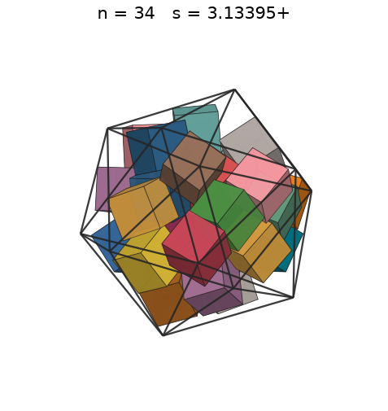 |
| 35 | [3.13395+](cubinico_n35.json) | 3.133952815919 |  | 2.52208 | 0.5212 | 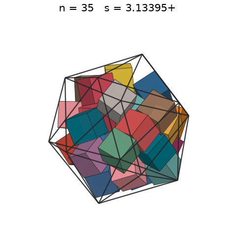 |
| 36 | [3.16382+](cubinico_n36.json) | 3.163827530878 |  | 2.54587 | 0.5210 | 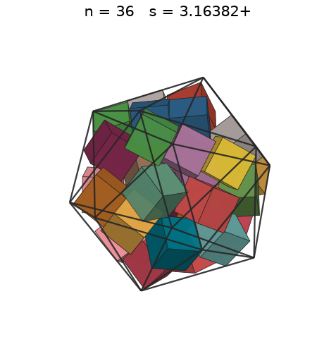 |
| 37 | [3.21203+](cubinico_n37.json) | 3.212035854793 |  | 2.56923 | 0.5118 | 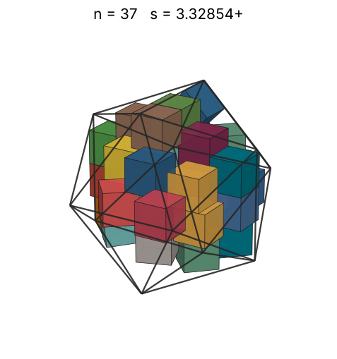 |
| 38 | [3.21623+](cubinico_n38.json) | 3.216232169036 |  | 2.59217 | 0.5235 | 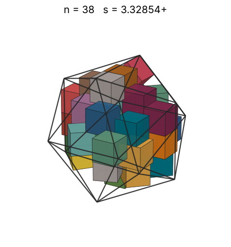 |
| 39 | [3.21623+](cubinico_n39.json) | 3.216232179311 |  | 2.61471 | 0.5373 | 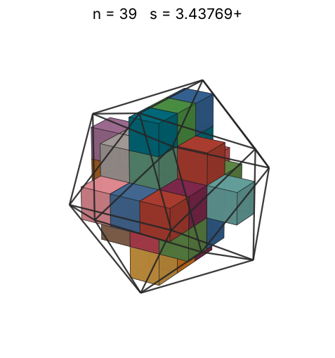 |
| 40 | [3.25341+](cubinico_n40.json) | 3.253410838820 |  | 2.63687 | 0.5324 | 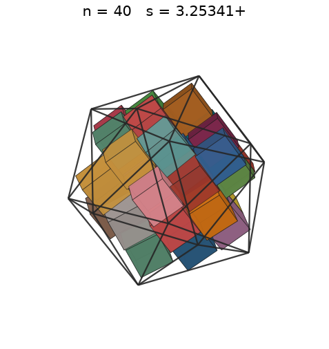 |
| 41 | [3.32795+](cubinico_n41.json) | 3.327950098487 |  | 2.65866 | 0.5099 |  |
| 42 | [3.36184+](cubinico_n42.json) | 3.361841031967 |  | 2.68010 | 0.5067 |  |
| 43 | [3.36184+](cubinico_n43.json) | 3.361841044396 |  | 2.70121 | 0.5187 |  |
| 44 | [3.36904+](cubinico_n44.json) | 3.369044974565 |  | 2.72199 | 0.5274 |  |
| 45 | [3.37951+](cubinico_n45.json) | 3.379516096448 |  | 2.74245 | 0.5344 |  |
| 46 | [3.40306+](cubinico_n46.json) | 3.403060889482 |  | 2.76262 | 0.5350 |  |
| 47 | [3.40837+](cubinico_n47.json) | 3.408379256355 |  | 2.78250 | 0.5441 |  |
| 48 | [3.41866+](cubinico_n48.json) | 3.418660571363 |  | 2.80209 | 0.5507 |  |
| 49 | [3.42522+](cubinico_n49.json) | 3.425220294251 |  | 2.82142 | 0.5589 |  |
| 50 | [3.46933+](cubinico_n50.json) | 3.469333390335 |  | 2.84048 | 0.5488 |  |
| 51 | [3.47100+](cubinico_n51.json) | 3.471000053230 |  | 2.85929 | 0.5590 |  |
| 52 | [3.47969+](cubinico_n52.json) | 3.479691798260 |  | 2.87786 | 0.5657 |  |
| 53 | [3.50677+](cubinico_n53.json) | 3.506774286520 |  | 2.89619 | 0.5633 |  |
| 54 | [3.51334+](cubinico_n54.json) | 3.513343943759 |  | 2.91429 | 0.5707 |  |
| 55 | [3.52768+](cubinico_n55.json) | 3.527682964292 |  | 2.93217 | 0.5742 |  |
| 56 | [3.53640+](cubinico_n56.json) | 3.536406096356 |  | 2.94984 | 0.5804 |  |
| 57 | [3.55835+](cubinico_n57.json) | 3.558355705635 |  | 2.96729 | 0.5799 |  |
| 58 | [3.60122+](cubinico_n58.json) | 3.601226611466 |  | 2.98454 | 0.5692 |  |
| 59 | [3.61430+](cubinico_n59.json) | 3.614309841448 |  | 3.00160 | 0.5728 |  |
| 60 | [3.65639+](cubinico_n60.json) | 3.656396093527 |  | 3.01846 | 0.5626 |  |
| 61 | [3.66373+](cubinico_n61.json) | 3.663731041606 |  | 3.03514 | 0.5685 |  |
| 62 | [3.66741+](cubinico_n62.json) | 3.667411276813 |  | 3.05163 | 0.5761 |  |
| 63 | [3.68338+](cubinico_n63.json) | 3.683381094360 |  | 3.06795 | 0.5778 |  |
| 64 | [3.70183+](cubinico_n64.json) | 3.701830027882 |  | 3.08410 | 0.5783 |  |
| 65 | [3.73233+](cubinico_n65.json) | 3.732336586222 |  | 3.10008 | 0.5730 |  |
| 66 | [3.76224+](cubinico_n66.json) | 3.762241349272 |  | 3.11590 | 0.5681 |  |
| 67 | [3.79392+](cubinico_n67.json) | 3.793920171826 |  | 3.13156 | 0.5624 |  |
| 68 | [3.79480+](cubinico_n68.json) | 3.794800620091 |  | 3.14706 | 0.5704 |  |
| 69 | [3.81670+](cubinico_n69.json) | 3.816706429696 |  | 3.16241 | 0.5688 |  |
| 70 | [3.81966+](cubinico_n70.json) | 3.819661002164 |  | 3.17762 | 0.5757 |  |
| 71 | [3.81966+](cubinico_n71.json) | 3.819661002164 |  | 3.19268 | 0.5840 |  |
| 72 | [3.81966+](cubinico_n72.json) | 3.819661002168 |  | 3.20759 | 0.5922 |  |
| 73 | [3.81966+](cubinico_n73.json) | 3.819661002169 |  | 3.22238 | 0.6004 |  |
| 74 | [3.90364+](cubinico_n74.json) | 3.903646510014 |  | 3.23702 | 0.5702 |  |
| 75 | [3.92956+](cubinico_n75.json) | 3.929564381862 |  | 3.25154 | 0.5665 |  |
| 76 | [3.94000+](cubinico_n76.json) | 3.940009451482 |  | 3.26593 | 0.5695 |  |
| 77 | [3.94339+](cubinico_n77.json) | 3.943399166746 |  | 3.28019 | 0.5756 |  |
| 78 | [3.94427+](cubinico_n78.json) | 3.944272837050 |  | 3.29433 | 0.5826 |  |
| 79 | [3.95426+](cubinico_n79.json) | 3.954260223103 |  | 3.30835 | 0.5856 |  |
| 80 | [3.97128+](cubinico_n80.json) | 3.971285952646 |  | 3.32225 | 0.5855 |  |
| 81 | [4.00439+](cubinico_n81.json) | 4.004392494251 |  | 3.33603 | 0.5782 |  |
| 82 | [4.00455+](cubinico_n82.json) | 4.004555473857 |  | 3.34971 | 0.5853 |  |
| 83 | [4.03444+](cubinico_n83.json) | 4.034442865197 |  | 3.36327 | 0.5793 |  |
| 84 | [4.04257+](cubinico_n84.json) | 4.042573486278 |  | 3.37672 | 0.5828 |  |
| 85 | [4.04759+](cubinico_n85.json) | 4.047598489580 |  | 3.39007 | 0.5875 |  |
| 86 | [4.04759+](cubinico_n86.json) | 4.047598489760 |  | 3.40331 | 0.5944 |  |
| 87 | [4.10332+](cubinico_n87.json) | 4.103326596489 |  | 3.41645 | 0.5772 |  |
| 88 | [4.10613+](cubinico_n88.json) | 4.106135623599 |  | 3.42949 | 0.5826 |  |
| 89 | [4.11476+](cubinico_n89.json) | 4.114760908661 |  | 3.44243 | 0.5855 |  |
| 90 | [4.11518+](cubinico_n90.json) | 4.115185788035 |  | 3.45528 | 0.5919 |  |
| 91 | [4.13776+](cubinico_n91.json) | 4.137768399718 |  | 3.46803 | 0.5888 |  |
| 92 | [4.14292+](cubinico_n92.json) | 4.142922607267 |  | 3.48068 | 0.5930 |  |
| 93 | [4.18034+](cubinico_n93.json) | 4.180340882849 |  | 3.49325 | 0.5835 |  |
| 94 | [4.18034+](cubinico_n94.json) | 4.180340939107 |  | 3.50573 | 0.5898 |  |
| 95 | [4.19349+](cubinico_n95.json) | 4.193496506807 |  | 3.51811 | 0.5905 |  |
| 96 | [4.19349+](cubinico_n96.json) | 4.193496550583 |  | 3.53041 | 0.5967 |  |
| 97 | [4.19520+](cubinico_n97.json) | 4.195201013493 |  | 3.54263 | 0.6022 |  |
| 98 | [4.19533+](cubinico_n98.json) | 4.195339807113 |  | 3.55476 | 0.6083 |  |
| 99 | [4.20162+](cubinico_n99.json) | 4.201627128008 |  | 3.56681 | 0.6118 |  |
| 100 | [4.20162+](cubinico_n100.json) | 4.201627128008 |  | 3.57878 | 0.6180 |  |
