# Cubes in an icosahedron

s = container edge / piece edge; every row certified in exact arithmetic.

| n | s | touching limit | closed form (conj.) | volume bound | density | picture |
|---|---|---|---|---|---|---|
| 2 | [1.48861+](cubinico_n02.json) | 1.488614044226 |  | 0.97143 | 0.2779 | 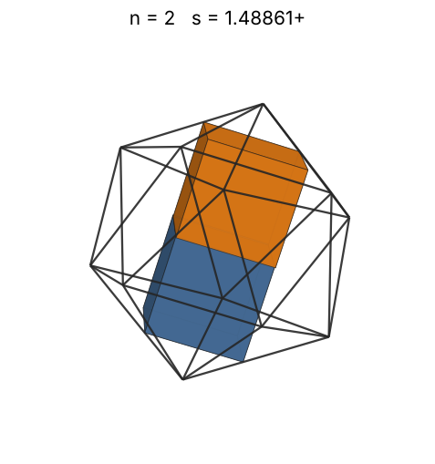 |
| 3 | [1.67433+](cubinico_n03.json) | 1.674338466038 |  | 1.11201 | 0.2930 | 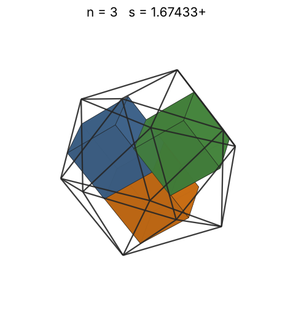 |
| 4 | [1.77569+](cubinico_n04.json) | 1.775698185345 |  | 1.22393 | 0.3275 | 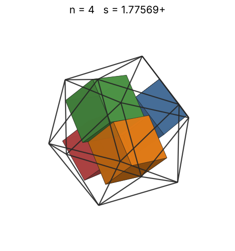 |
| 5 | [1.86891+](cubinico_n05.json) | 1.868912869245 |  | 1.31843 | 0.3511 | 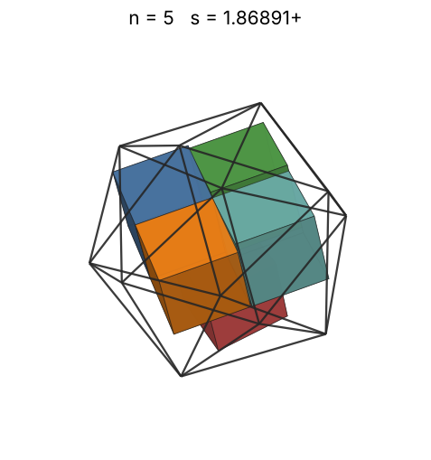 |
| 6 | [1.92552+](cubinico_n06.json) | 1.925529800641 |  | 1.40105 | 0.3852 | 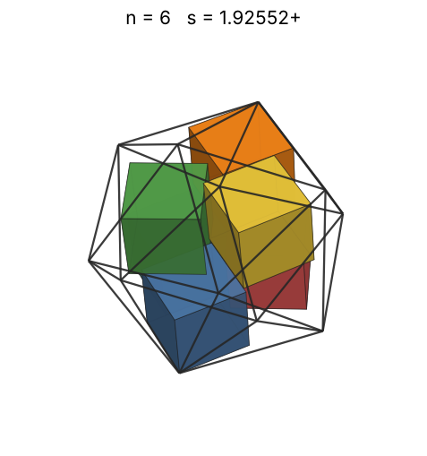 |
| 7 | [1.98137+](cubinico_n07.json) | 1.981371292719 |  | 1.47492 | 0.4125 | 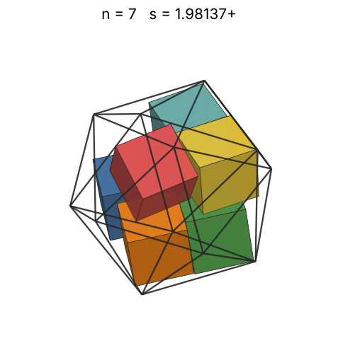 |
| 8 | [2.01093+](cubinico_n08.json) | 2.010935917041 |  | 1.54205 | 0.4509 | 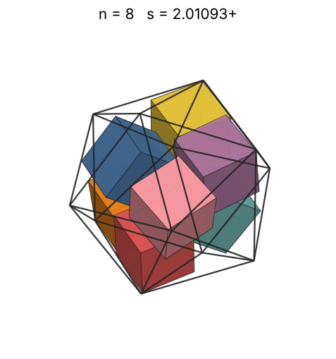 |
| 9 | [2.10570+](cubinico_n09.json) | 2.105708989395 |  | 1.60380 | 0.4418 | 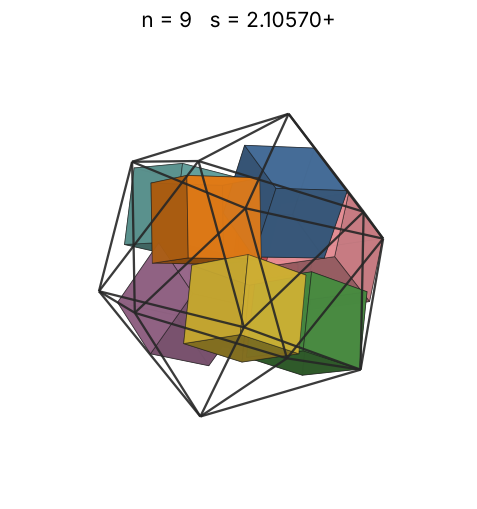 |
| 10 | [2.14529+](cubinico_n10.json) | 2.145298123200 |  | 1.66112 | 0.4642 | 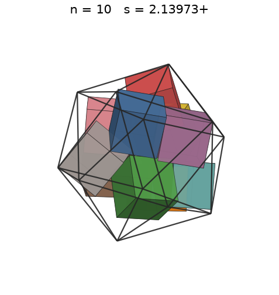 |
| 11 | [2.19133+](cubinico_n11.json) | 2.191330717833 |  | 1.71475 | 0.4792 | 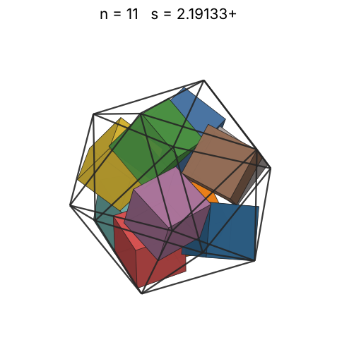 |
| 12 | [2.23031+](cubinico_n12.json) | 2.230312382976 |  | 1.76521 | 0.4958 | 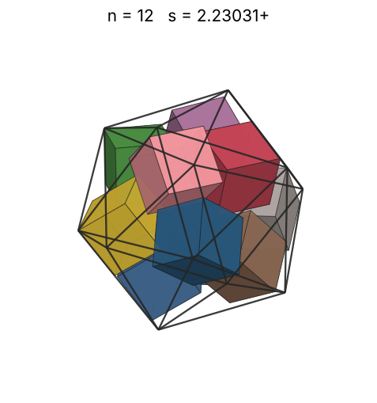 |
| 13 | [2.27049+](cubinico_n13.json) | 2.270494698069 |  | 1.81294 | 0.5091 | 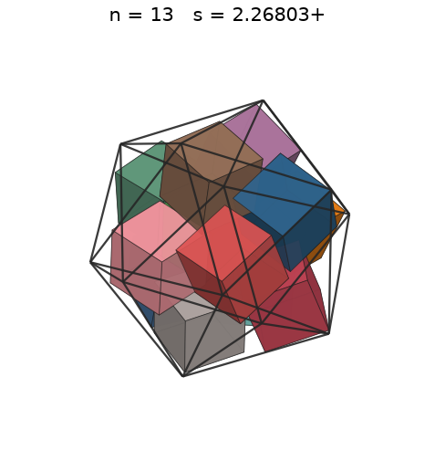 |
| 14 | [2.38899+](cubinico_n14.json) | 2.388998296559 |  | 1.85828 | 0.4706 | 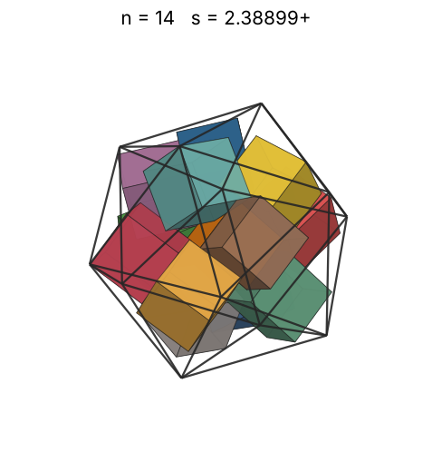 |
| 15 | [2.44896+](cubinico_n15.json) | 2.448968714796 |  | 1.90151 | 0.4681 | 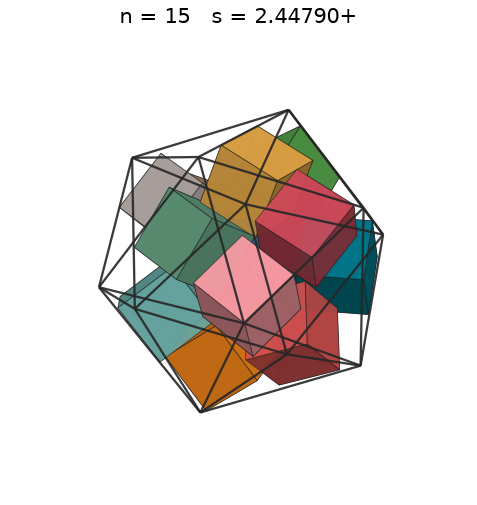 |
| 16 | [2.50092+](cubinico_n16.json) | 2.500925459195 |  | 1.94286 | 0.4688 | 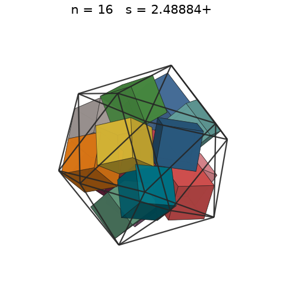 |
| 17 | [2.55400+](cubinico_n17.json) | 2.554002331186 |  | 1.98252 | 0.4677 | 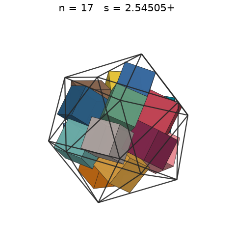 |
| 18 | [2.59994+](cubinico_n18.json) | 2.599945092641 |  | 2.02066 | 0.4694 | 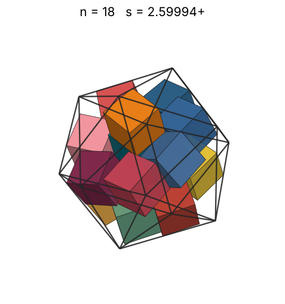 |
| 19 | [2.64812+](cubinico_n19.json) | 2.648128477352 |  | 2.05741 | 0.4690 | 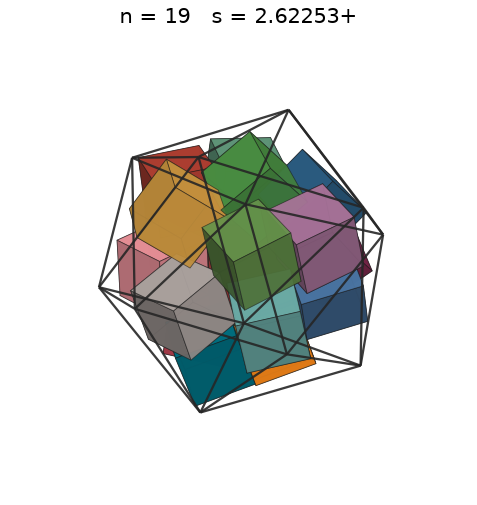 |
| 20 | [2.70200+](cubinico_n20.json) | 2.702000856676 |  | 2.09288 | 0.4647 | 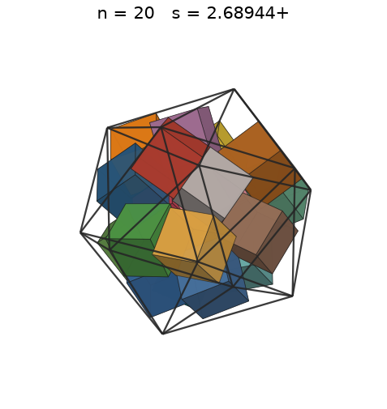 |
| 21 | [2.73627+](cubinico_n21.json) | 2.736278000688 |  | 2.12720 | 0.4698 | 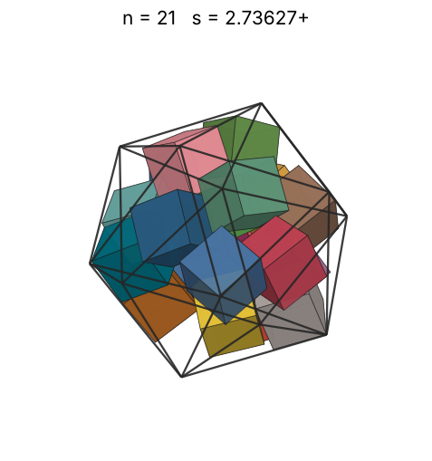 |
| 22 | [2.78566+](cubinico_n22.json) | 2.785660617202 |  | 2.16044 | 0.4665 | 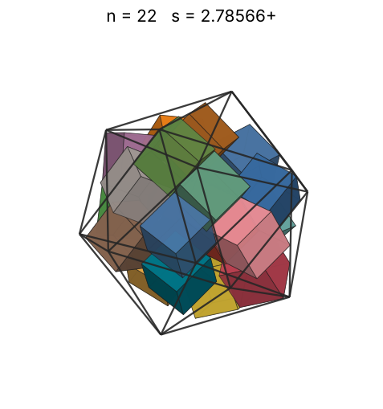 |
| 23 | [2.80441+](cubinico_n23.json) | 2.804410631516 |  | 2.19269 | 0.4780 | 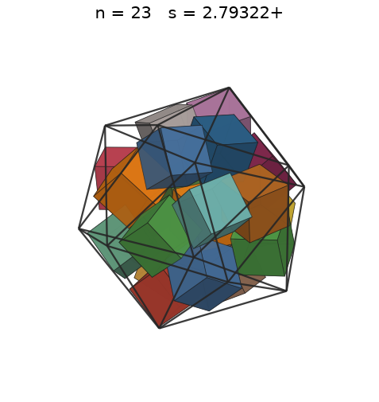 |
| 24 | [2.85307+](cubinico_n24.json) | 2.853075159865 |  | 2.22402 | 0.4737 | 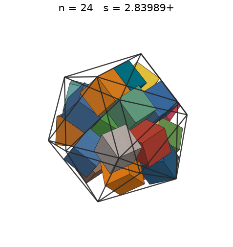 |
| 25 | [2.88140+](cubinico_n25.json) | 2.881408249193 |  | 2.25449 | 0.4790 | 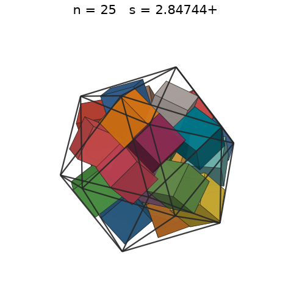 |
| 26 | [2.91598+](cubinico_n26.json) | 2.915987515936 |  | 2.28416 | 0.4806 | 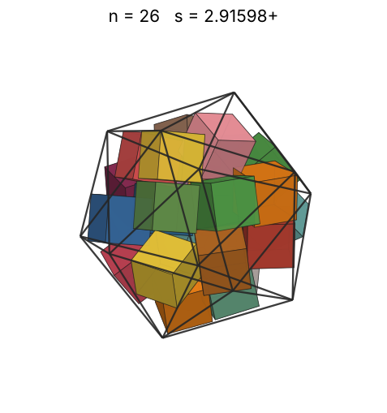 |
| 27 | [2.94068+](cubinico_n27.json) | 2.940689660589 |  | 2.31308 | 0.4867 | 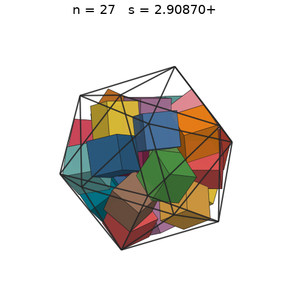 |
| 28 | [2.96855+](cubinico_n28.json) | 2.968556330960 |  | 2.34129 | 0.4906 | 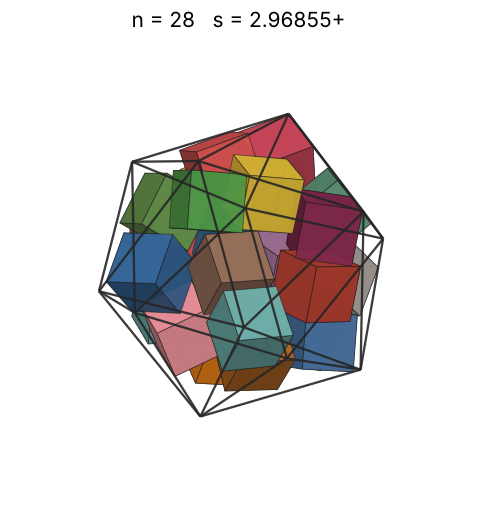 |
| 29 | [2.99673+](cubinico_n29.json) | 2.996731481028 |  | 2.36883 | 0.4939 | 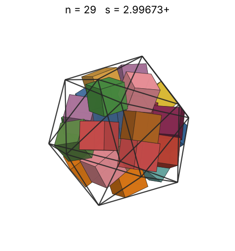 |
| 30 | [3.03349+](cubinico_n30.json) | 3.033492215807 |  | 2.39576 | 0.4926 | 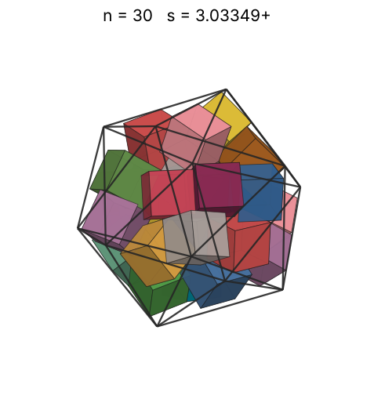 |
| 31 | [3.05572+](cubinico_n31.json) | 3.055728109099 |  | 2.42208 | 0.4980 | 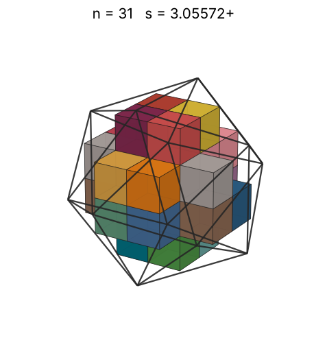 |
| 32 | [3.05572+](cubinico_n32.json) | 3.055728109099 |  | 2.44785 | 0.5141 | 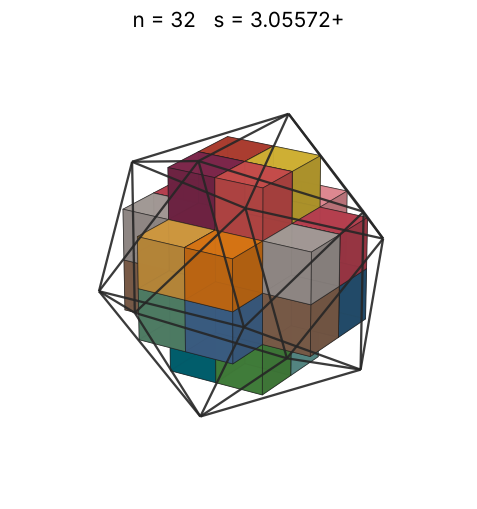 |
| 33 | [3.32854+](cubinico_n33.json) | 3.328546488023 |  | 2.47309 | 0.4102 | 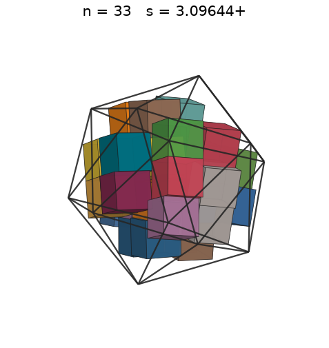 |
| 34 | [3.32854+](cubinico_n34.json) | 3.328546488023 |  | 2.49782 | 0.4226 | 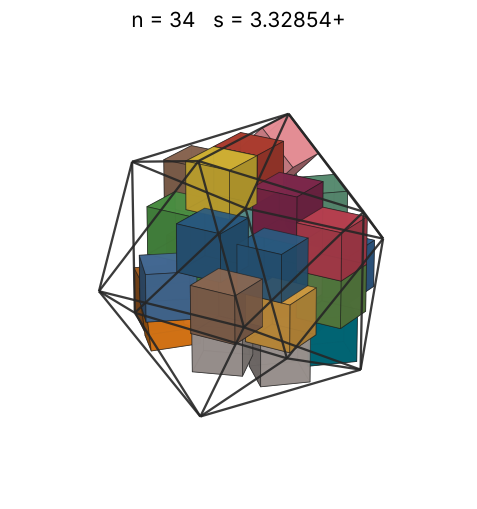 |
| 35 | [3.32854+](cubinico_n35.json) | 3.328546488647 |  | 2.52208 | 0.4350 | 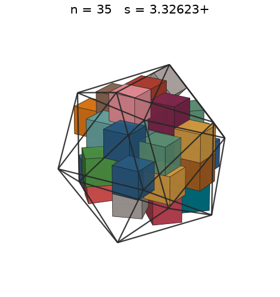 |
| 36 | [3.32854+](cubinico_n36.json) | 3.328546489343 |  | 2.54587 | 0.4474 | 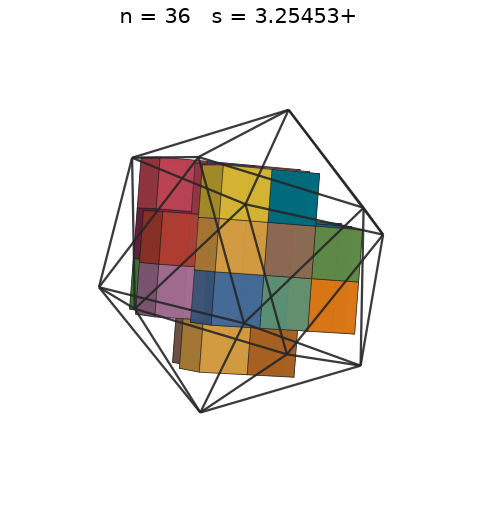 |
| 37 | [3.32854+](cubinico_n37.json) | 3.328546489827 |  | 2.56923 | 0.4599 | 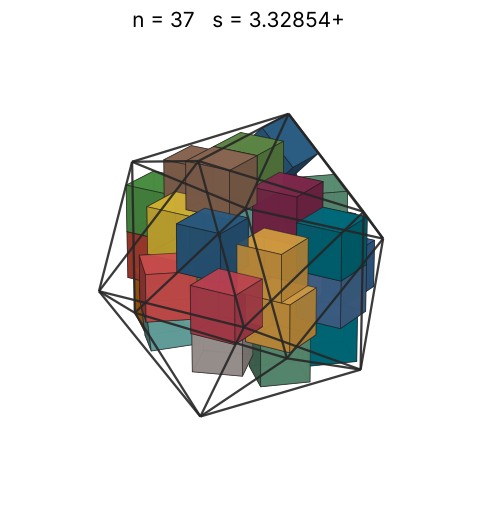 |
| 38 | [3.32854+](cubinico_n38.json) | 3.328546490915 |  | 2.59217 | 0.4723 | 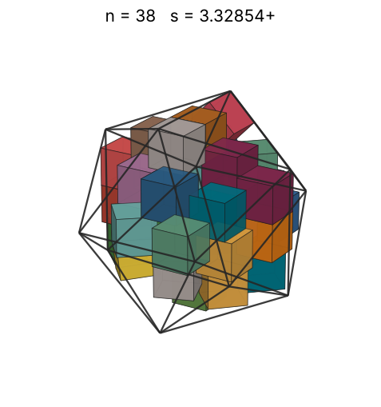 |
| 39 | [3.32854+](cubinico_n39.json) | 3.328546491332 |  | 2.61471 | 0.4847 | 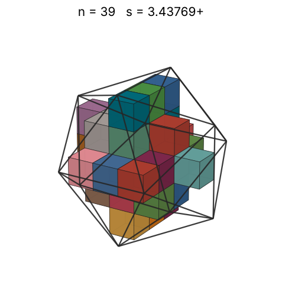 |
| 40 | [3.32854+](cubinico_n40.json) | 3.328546496851 |  | 2.63687 | 0.4972 | 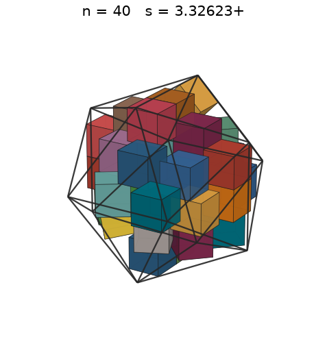 |
| 41 | [3.32854+](cubinico_n41.json) | 3.328546509755 |  | 2.65866 | 0.5096 |  |
| 42 | [3.36747+](cubinico_n42.json) | 3.367469982326 |  | 2.68010 | 0.5041 |  |
| 43 | [3.36916+](cubinico_n43.json) | 3.369160002040 |  | 2.70121 | 0.5154 |  |
| 44 | [3.36916+](cubinico_n44.json) | 3.369160002121 |  | 2.72199 | 0.5273 |  |
| 45 | [3.38739+](cubinico_n45.json) | 3.387394859178 |  | 2.74245 | 0.5307 |  |
| 46 | [3.40306+](cubinico_n46.json) | 3.403063559425 |  | 2.76262 | 0.5350 |  |
| 47 | [3.41458+](cubinico_n47.json) | 3.414582474912 |  | 2.78250 | 0.5411 |  |
| 48 | [3.42643+](cubinico_n48.json) | 3.426429752769 |  | 2.80209 | 0.5469 |  |
| 49 | [3.42643+](cubinico_n49.json) | 3.426429752769 |  | 2.82142 | 0.5583 |  |
| 50 | [3.46933+](cubinico_n50.json) | 3.469333390335 |  | 2.84048 | 0.5488 |  |
| 51 | [3.47729+](cubinico_n51.json) | 3.477297447784 |  | 2.85929 | 0.5560 |  |
| 52 | [3.47969+](cubinico_n52.json) | 3.479691798260 |  | 2.87786 | 0.5657 |  |
| 53 | [3.50677+](cubinico_n53.json) | 3.506774286520 |  | 2.89619 | 0.5633 |  |
| 54 | [3.51338+](cubinico_n54.json) | 3.513385693562 |  | 2.91429 | 0.5707 |  |
| 55 | [3.52794+](cubinico_n55.json) | 3.527948109308 |  | 2.93217 | 0.5741 |  |
| 56 | [3.53642+](cubinico_n56.json) | 3.536420156571 |  | 2.94984 | 0.5804 |  |
| 57 | [3.55835+](cubinico_n57.json) | 3.558355705635 |  | 2.96729 | 0.5799 |  |
| 58 | [3.61444+](cubinico_n58.json) | 3.614447942166 |  | 2.98454 | 0.5630 |  |
| 59 | [3.61444+](cubinico_n59.json) | 3.614448063333 |  | 3.00160 | 0.5727 |  |
| 60 | [3.65642+](cubinico_n60.json) | 3.656428845399 |  | 3.01846 | 0.5626 |  |
| 61 | [3.66373+](cubinico_n61.json) | 3.663731041606 |  | 3.03514 | 0.5685 |  |
| 62 | [3.66741+](cubinico_n62.json) | 3.667411276813 |  | 3.05163 | 0.5761 |  |
| 63 | [3.68338+](cubinico_n63.json) | 3.683381094360 |  | 3.06795 | 0.5778 |  |
| 64 | [3.70183+](cubinico_n64.json) | 3.701830027882 |  | 3.08410 | 0.5783 |  |
| 65 | [3.74598+](cubinico_n65.json) | 3.745987772005 |  | 3.10008 | 0.5668 |  |
| 66 | [3.76231+](cubinico_n66.json) | 3.762318128449 |  | 3.11590 | 0.5680 |  |
| 67 | [3.79392+](cubinico_n67.json) | 3.793920171826 |  | 3.13156 | 0.5624 |  |
| 68 | [3.81670+](cubinico_n68.json) | 3.816706429567 |  | 3.14706 | 0.5606 |  |
| 69 | [3.81670+](cubinico_n69.json) | 3.816706429696 |  | 3.16241 | 0.5688 |  |
| 70 | [3.86605+](cubinico_n70.json) | 3.866049986780 |  | 3.17762 | 0.5553 |  |
| 71 | [3.87849+](cubinico_n71.json) | 3.878498414203 |  | 3.19268 | 0.5578 |  |
| 72 | [3.89147+](cubinico_n72.json) | 3.891471978443 |  | 3.20759 | 0.5600 |  |
| 73 | [3.89147+](cubinico_n73.json) | 3.891471978452 |  | 3.22238 | 0.5678 |  |
| 74 | [3.90364+](cubinico_n74.json) | 3.903646510014 |  | 3.23702 | 0.5702 |  |
| 75 | [3.93247+](cubinico_n75.json) | 3.932472670004 |  | 3.25154 | 0.5653 |  |
| 76 | [3.94351+](cubinico_n76.json) | 3.943514614569 |  | 3.26593 | 0.5680 |  |
| 77 | [3.94381+](cubinico_n77.json) | 3.943811326592 |  | 3.28019 | 0.5754 |  |
| 78 | [3.96078+](cubinico_n78.json) | 3.960784202593 |  | 3.29433 | 0.5754 |  |
| 79 | [4.00824+](cubinico_n79.json) | 4.008240085797 |  | 3.30835 | 0.5623 |  |
| 80 | [4.01072+](cubinico_n80.json) | 4.010722091147 |  | 3.32225 | 0.5684 |  |
| 81 | [4.01072+](cubinico_n81.json) | 4.010722091147 |  | 3.33603 | 0.5755 |  |
| 82 | [4.01072+](cubinico_n82.json) | 4.010722091147 |  | 3.34971 | 0.5826 |  |
| 83 | [4.07269+](cubinico_n83.json) | 4.072698531454 |  | 3.36327 | 0.5632 |  |
| 84 | [4.38266+](cubinico_n84.json) | 4.382661339211 |  | 3.37672 | 0.4574 |  |
| 85 | [4.38266+](cubinico_n85.json) | 4.382661339211 |  | 3.39007 | 0.4628 |  |
| 86 | [4.38266+](cubinico_n86.json) | 4.382661339211 |  | 3.40331 | 0.4683 |  |
| 87 | [4.38266+](cubinico_n87.json) | 4.382661435666 |  | 3.41645 | 0.4737 |  |
| 88 | [4.38266+](cubinico_n88.json) | 4.382661435666 |  | 3.42949 | 0.4792 |  |
| 89 | [4.46062+](cubinico_n89.json) | 4.460624747922 |  | 3.44243 | 0.4596 |  |
| 90 | [4.46062+](cubinico_n90.json) | 4.460624765951 |  | 3.45528 | 0.4648 |  |
| 91 | [4.46062+](cubinico_n91.json) | 4.460624765951 |  | 3.46803 | 0.4700 |  |
| 92 | [4.46062+](cubinico_n92.json) | 4.460624765951 |  | 3.48068 | 0.4751 |  |
| 93 | [4.46062+](cubinico_n93.json) | 4.460624765951 |  | 3.49325 | 0.4803 |  |
| 94 | [4.46062+](cubinico_n94.json) | 4.460624765951 |  | 3.50573 | 0.4855 |  |
| 95 | [4.46062+](cubinico_n95.json) | 4.460624765951 |  | 3.51811 | 0.4906 |  |
| 96 | [4.46062+](cubinico_n96.json) | 4.460624765951 |  | 3.53041 | 0.4958 |  |
| 97 | [4.54098+](cubinico_n97.json) | 4.540989396138 |  | 3.54263 | 0.4748 |  |
| 98 | [4.54098+](cubinico_n98.json) | 4.540989396138 |  | 3.55476 | 0.4797 |  |
| 99 | [4.54098+](cubinico_n99.json) | 4.540989396138 |  | 3.56681 | 0.4846 |  |
| 100 | [4.54098+](cubinico_n100.json) | 4.540989396138 |  | 3.57878 | 0.4895 |  |
