# Cubes in an octahedron

s = container edge / piece edge; every row certified in exact arithmetic.

| n | s | touching limit | closed form (conj.) | volume bound | density | picture |
|---|---|---|---|---|---|---|
| 2 | [2.41421+](cubinoct_n02.json) | 2.414213562373 | 1 + √2 | 1.61887 | 0.3015 | 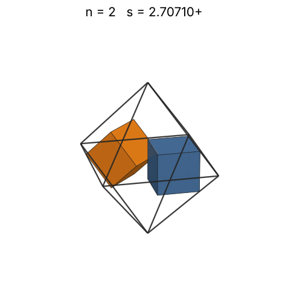 |
| 3 | [2.70710+](cubinoct_n03.json) | 2.707106781187 | (4 + √2)/2 | 1.85314 | 0.3208 | 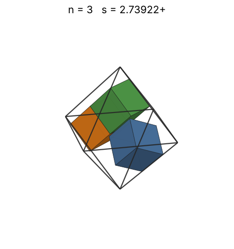 |
| 4 | [2.70710+](cubinoct_n04.json) | 2.707106781187 | (4 + √2)/2 | 2.03965 | 0.4277 | 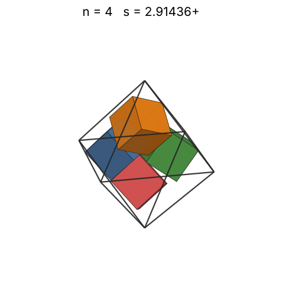 |
| 5 | [2.91260+](cubinoct_n05.json) | 2.912604413240 |  | 2.19715 | 0.4293 | 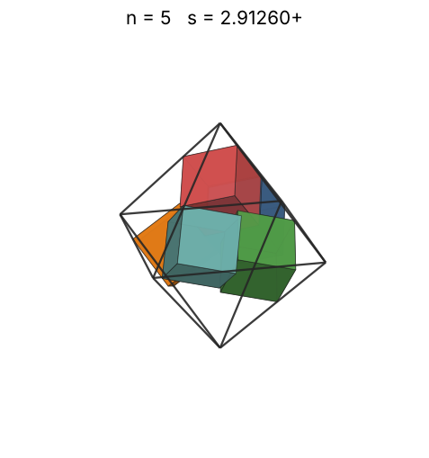 |
| 6 | [2.93185+](cubinoct_n06.json) | 2.931851815435 | 1 + √(√3 + 2) | 2.33482 | 0.5050 | 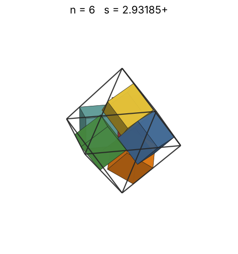 |
| 7 | [3.29102+](cubinoct_n07.json) | 3.291024682315 |  | 2.45792 | 0.4166 | 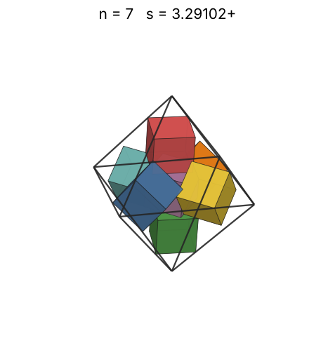 |
| 8 | [3.41421+](cubinoct_n08.json) | 3.414213562373 | 2 + √2 | 2.56980 | 0.4264 | 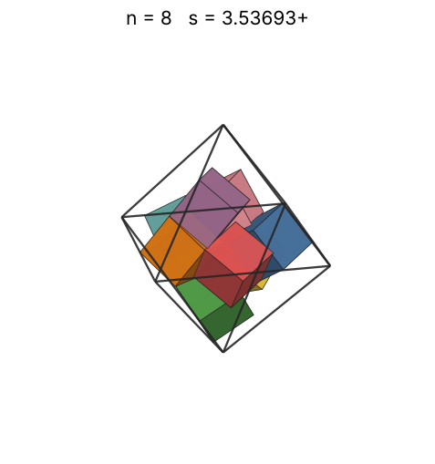 |
| 9 | [3.61760+](cubinoct_n09.json) | 3.617604106285 |  | 2.67270 | 0.4033 | 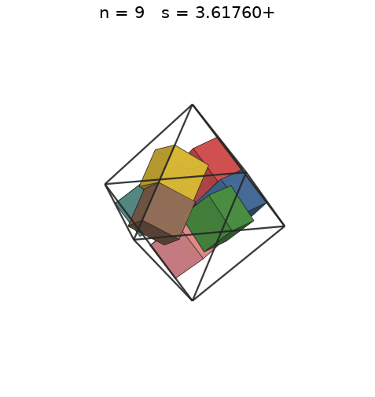 |
| 10 | [3.66667+](cubinoct_n10.json) | 3.666677777038 |  | 2.76823 | 0.4303 | 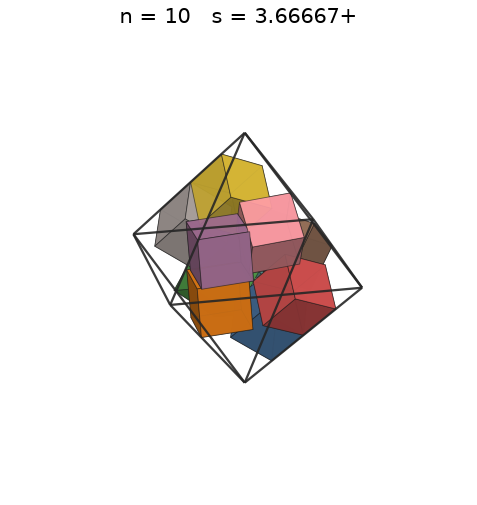 |
| 11 | [3.70710+](cubinoct_n11.json) | 3.707106781187 | (6 + √2)/2 | 2.85759 | 0.4580 | 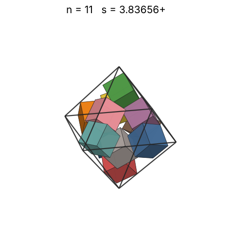 |
| 12 | [3.70710+](cubinoct_n12.json) | 3.707106781187 | (6 + √2)/2 | 2.94168 | 0.4997 |  |
| 13 | [3.79737+](cubinoct_n13.json) | 3.797373821506 |  | 3.02123 | 0.5036 | 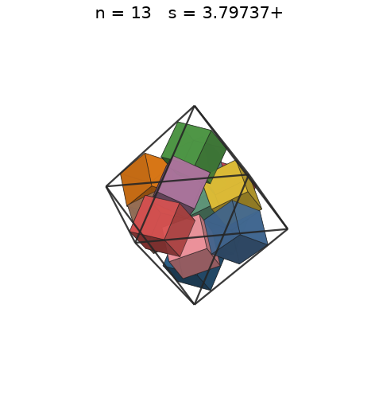 |
| 14 | [3.90180+](cubinoct_n14.json) | 3.901808107997 |  | 3.09679 | 0.5000 | 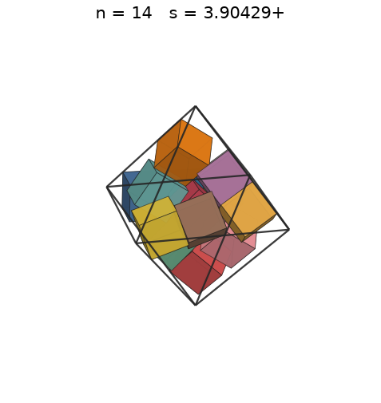 |
| 15 | [3.93490+](cubinoct_n15.json) | 3.934906105827 |  | 3.16883 | 0.5223 | 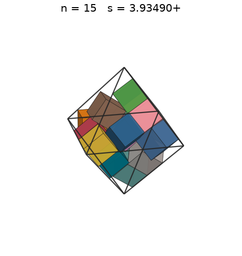 |
| 16 | [3.99294+](cubinoct_n16.json) | 3.992941003620 |  | 3.23774 | 0.5331 | 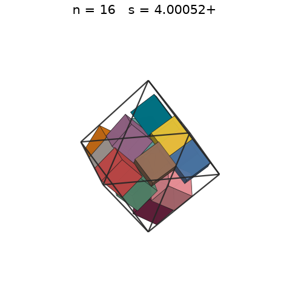 |
| 17 | [4.02915+](cubinoct_n17.json) | 4.029153242744 |  | 3.30384 | 0.5513 | 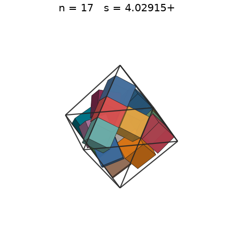 |
| 18 | [4.04898+](cubinoct_n18.json) | 4.048988042691 |  | 3.36739 | 0.5752 | 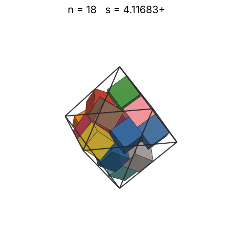 |
| 19 | [4.10658+](cubinoct_n19.json) | 4.106580061553 |  | 3.42862 | 0.5820 | 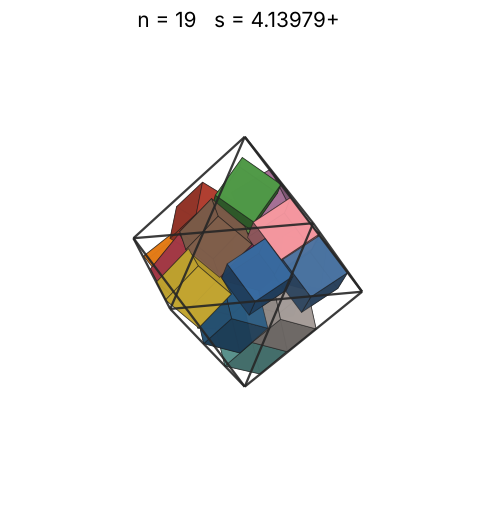 |
| 20 | [4.32269+](cubinoct_n20.json) | 4.322696356082 |  | 3.48775 | 0.5253 | 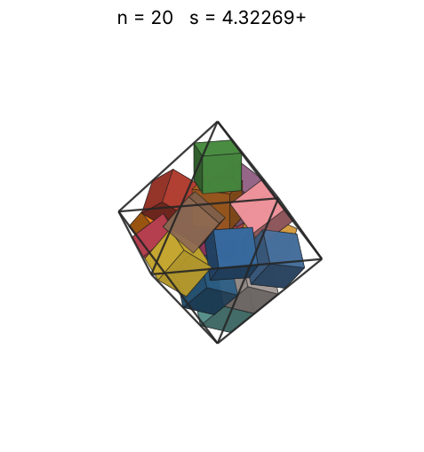 |
| 21 | [4.47061+](cubinoct_n21.json) | 4.470615485578 |  | 3.54494 | 0.4986 | 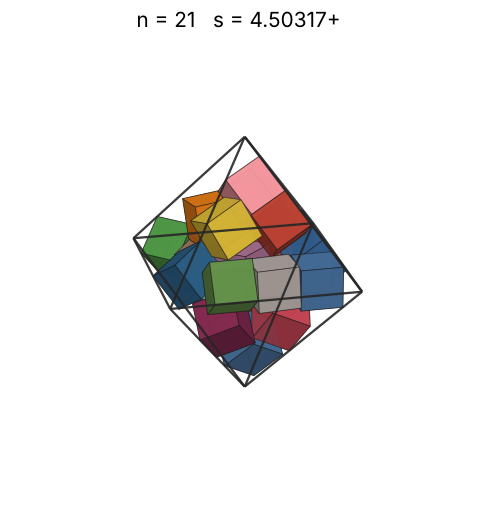 |
| 22 | [4.59310+](cubinoct_n22.json) | 4.593108671908 |  | 3.60034 | 0.4816 | 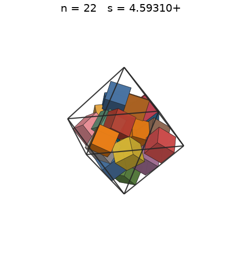 |
| 23 | [4.62132+](cubinoct_n23.json) | 4.621321217824 | 3√2/2 + 5/2 | 3.65408 | 0.4944 | 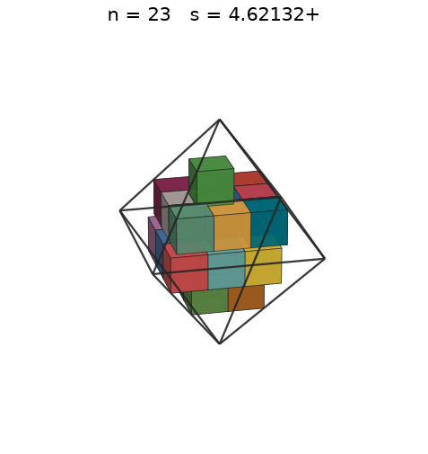 |
| 24 | [4.70710+](cubinoct_n24.json) | 4.707106781199 | √2/2 + 4 | 3.70629 | 0.4882 | 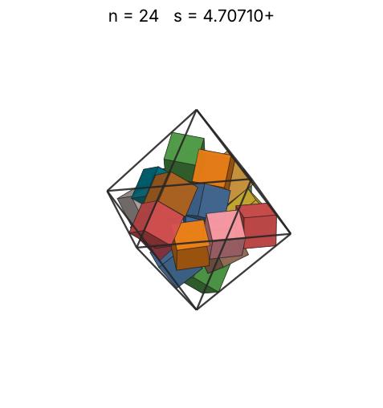 |
| 25 | [4.70710+](cubinoct_n25.json) | 4.707106781199 | √2/2 + 4 | 3.75707 | 0.5085 | 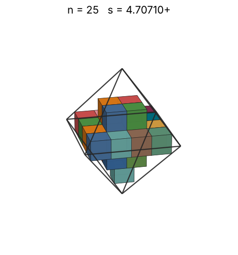 |
| 26 | [4.70710+](cubinoct_n26.json) | 4.707106811187 | √2/2 + 4 | 3.80651 | 0.5288 | 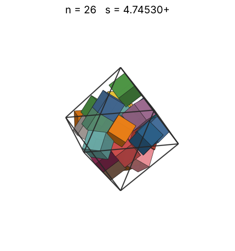 |
| 27 | [4.81053+](cubinoct_n27.json) | 4.810536448806 |  | 3.85469 | 0.5145 | 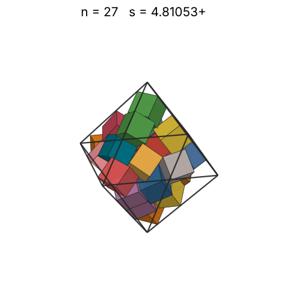 |
| 28 | [4.82842+](cubinoct_n28.json) | 4.828427155959 |  | 3.90171 | 0.5277 | 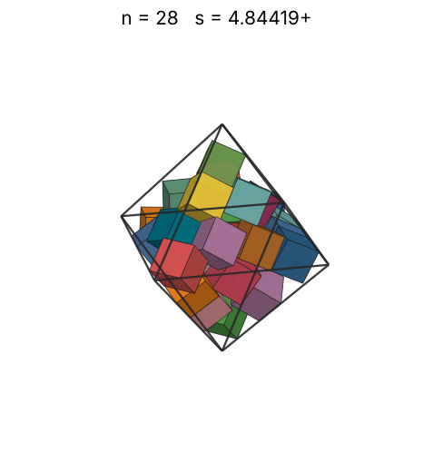 |
| 29 | [4.89243+](cubinoct_n29.json) | 4.892431820404 |  | 3.94761 | 0.5253 | 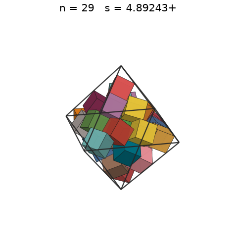 |
| 30 | [4.91421+](cubinoct_n30.json) | 4.914214524505 |  | 3.99248 | 0.5362 | 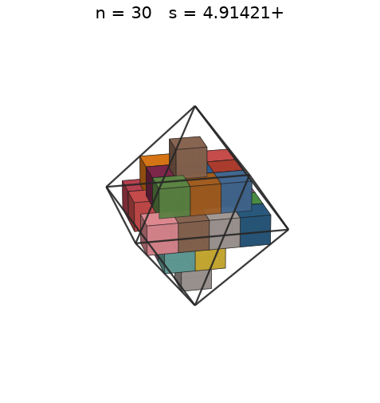 |
| 31 | [4.91421+](cubinoct_n31.json) | 4.914214524505 | √2 + 7/2 | 4.03635 | 0.5541 | 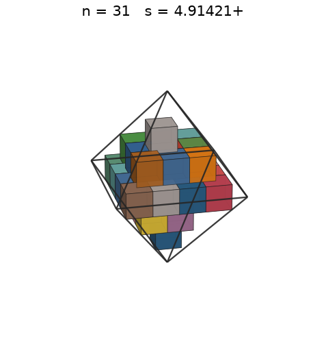 |
| 32 | [4.99853+](cubinoct_n32.json) | 4.998537004618 |  | 4.07930 | 0.5435 | 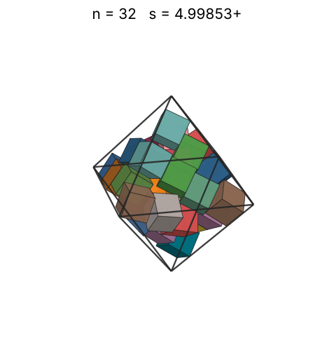 |
| 33 | [5.02843+](cubinoct_n33.json) | 5.028438606181 |  | 4.12136 | 0.5506 | 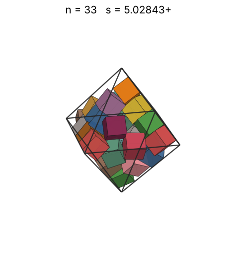 |
| 34 | [5.05251+](cubinoct_n34.json) | 5.052509671837 |  | 4.16257 | 0.5592 | 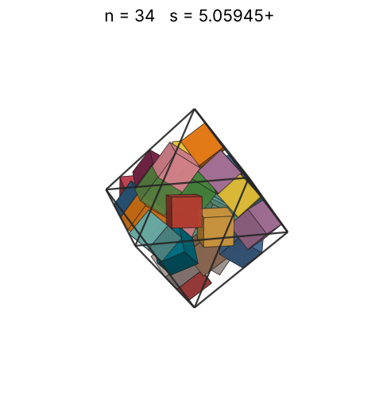 |
| 35 | [5.06974+](cubinoct_n35.json) | 5.069744656460 |  | 4.20299 | 0.5698 | 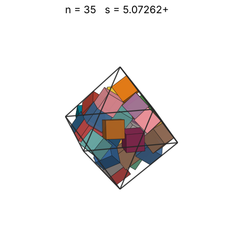 |
| 36 | [5.08974+](cubinoct_n36.json) | 5.089748060798 |  | 4.24264 | 0.5792 | 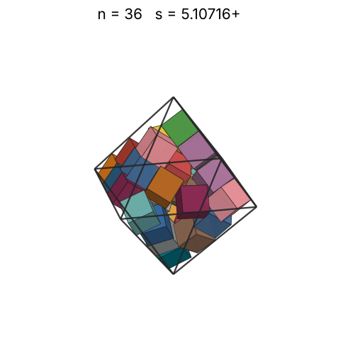 |
| 37 | [5.10324+](cubinoct_n37.json) | 5.103245053183 |  | 4.28157 | 0.5906 | 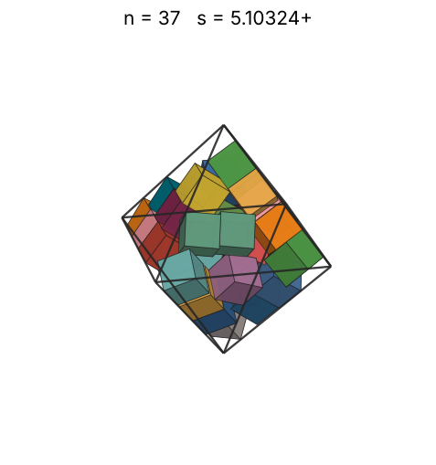 |
| 38 | [5.13601+](cubinoct_n38.json) | 5.136011943669 |  | 4.31980 | 0.5950 | 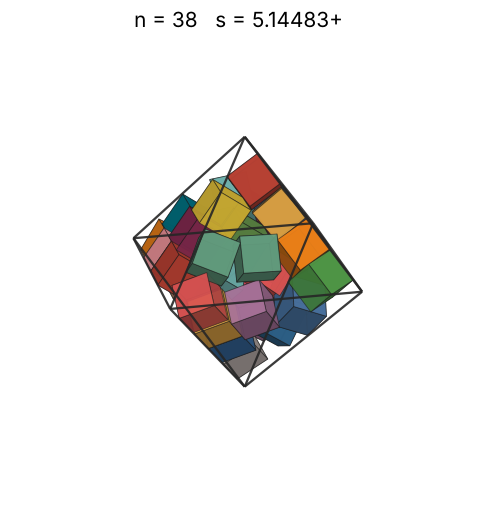 |
| 39 | [5.17002+](cubinoct_n39.json) | 5.170026906759 |  | 4.35736 | 0.5987 | 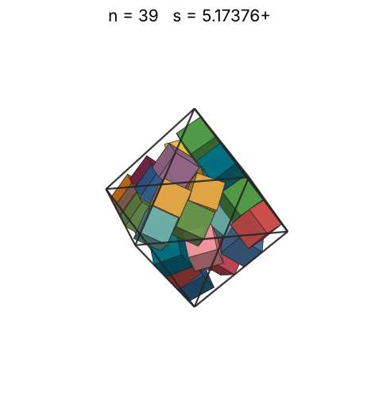 |
| 40 | [5.19194+](cubinoct_n40.json) | 5.191941372801 |  | 4.39429 | 0.6063 | 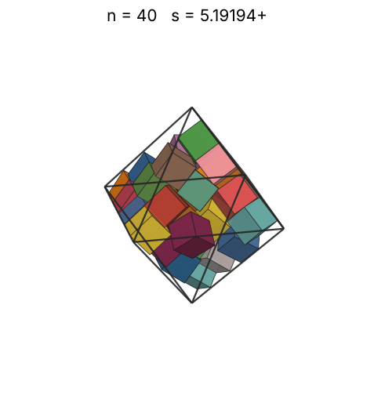 |
| 41 | [5.21960+](cubinoct_n41.json) | 5.219607692027 |  | 4.43061 | 0.6116 |  |
| 42 | [5.23444+](cubinoct_n42.json) | 5.234448782854 |  | 4.46634 | 0.6212 |  |
| 43 | [5.27348+](cubinoct_n43.json) | 5.273489500418 |  | 4.50151 | 0.6220 |  |
| 44 | [5.27349+](cubinoct_n44.json) | 5.273496774020 |  | 4.53614 | 0.6364 |  |
| 45 | [5.60624+](cubinoct_n45.json) | 5.606245471108 |  | 4.57025 | 0.5418 |  |
| 46 | [5.62132+](cubinoct_n46.json) | 5.621321517824 | 3√2/2 + 7/2 | 4.60385 | 0.5493 |  |
| 47 | [5.62132+](cubinoct_n47.json) | 5.621321517824 | 3√2/2 + 7/2 | 4.63697 | 0.5613 |  |
| 48 | [5.67251+](cubinoct_n48.json) | 5.672517239776 |  | 4.66963 | 0.5579 |  |
| 49 | [5.70710+](cubinoct_n49.json) | 5.707107981187 | √2/2 + 5 | 4.70184 | 0.5592 |  |
| 50 | [5.70710+](cubinoct_n50.json) | 5.707107981187 | √2/2 + 5 | 4.73361 | 0.5706 |  |
| 51 | [5.70710+](cubinoct_n51.json) | 5.707107981187 | √2/2 + 5 | 4.76496 | 0.5820 |  |
| 52 | [5.82842+](cubinoct_n52.json) | 5.828428361142 |  | 4.79590 | 0.5571 |  |
| 53 | [5.82842+](cubinoct_n53.json) | 5.828428361142 | 2√2 + 3 | 4.82645 | 0.5678 |  |
| 54 | [5.82842+](cubinoct_n54.json) | 5.828428361142 | 2√2 + 3 | 4.85661 | 0.5786 |  |
| 55 | [5.91421+](cubinoct_n55.json) | 5.914214824505 | √2 + 9/2 | 4.88641 | 0.5640 |  |
| 56 | [5.91421+](cubinoct_n56.json) | 5.914214824505 | √2 + 9/2 | 4.91584 | 0.5743 |  |
| 57 | [5.91421+](cubinoct_n57.json) | 5.914214824505 | √2 + 9/2 | 4.94493 | 0.5845 |  |
| 58 | [5.91421+](cubinoct_n58.json) | 5.914214824505 | √2 + 9/2 | 4.97368 | 0.5948 |  |
| 59 | [5.91421+](cubinoct_n59.json) | 5.914214824505 | √2 + 9/2 | 5.00210 | 0.6050 |  |
| 60 | [6.03545+](cubinoct_n60.json) | 6.035455930604 |  | 5.03021 | 0.5789 |  |
| 61 | [6.11980+](cubinoct_n61.json) | 6.119803693803 |  | 5.05800 | 0.5646 |  |
| 62 | [6.12132+](cubinoct_n62.json) | 6.121321642767 |  | 5.08549 | 0.5734 |  |
| 63 | [6.12132+](cubinoct_n63.json) | 6.121321667824 | 3√2/2 + 4 | 5.11268 | 0.5827 |  |
| 64 | [6.12132+](cubinoct_n64.json) | 6.121321667824 | 3√2/2 + 4 | 5.13959 | 0.5919 |  |
| 65 | [6.12132+](cubinoct_n65.json) | 6.121321667824 | 3√2/2 + 4 | 5.16622 | 0.6012 |  |
| 66 | [6.12132+](cubinoct_n66.json) | 6.121321667824 | 3√2/2 + 4 | 5.19258 | 0.6104 |  |
| 67 | [6.12132+](cubinoct_n67.json) | 6.121321667824 | 3√2/2 + 4 | 5.21868 | 0.6196 |  |
| 68 | [6.18147+](cubinoct_n68.json) | 6.181474920170 |  | 5.24451 | 0.6107 |  |
| 69 | [6.18147+](cubinoct_n69.json) | 6.181474958192 |  | 5.27010 | 0.6197 |  |
| 70 | [6.18148+](cubinoct_n70.json) | 6.181486389669 |  | 5.29543 | 0.6287 |  |
| 71 | [6.19692+](cubinoct_n71.json) | 6.196921786053 |  | 5.32053 | 0.6329 |  |
| 72 | [6.22320+](cubinoct_n72.json) | 6.223204021558 |  | 5.34539 | 0.6337 |  |
| 73 | [6.22530+](cubinoct_n73.json) | 6.225301226812 |  | 5.37003 | 0.6419 |  |
| 74 | [6.24651+](cubinoct_n74.json) | 6.246512847923 |  | 5.39444 | 0.6441 |  |
| 75 | [6.26690+](cubinoct_n75.json) | 6.266907520730 |  | 5.41863 | 0.6464 |  |
| 76 | [6.27362+](cubinoct_n76.json) | 6.273623206293 |  | 5.44260 | 0.6529 |  |
| 77 | [6.28612+](cubinoct_n77.json) | 6.286126345228 |  | 5.46637 | 0.6576 |  |
| 78 | [6.31394+](cubinoct_n78.json) | 6.313943292706 |  | 5.48993 | 0.6574 |  |
| 79 | [6.34973+](cubinoct_n79.json) | 6.349737638017 |  | 5.51329 | 0.6546 |  |
| 80 | [6.35518+](cubinoct_n80.json) | 6.355180308748 |  | 5.53646 | 0.6612 |  |
| 81 | [6.38973+](cubinoct_n81.json) | 6.389730494308 |  | 5.55943 | 0.6586 |  |
| 82 | [6.41149+](cubinoct_n82.json) | 6.411491332925 |  | 5.58222 | 0.6600 |  |
| 83 | [6.44465+](cubinoct_n83.json) | 6.444652935621 |  | 5.60482 | 0.6578 |  |
| 84 | [6.44465+](cubinoct_n84.json) | 6.444652935621 |  | 5.62724 | 0.6657 |  |
| 85 | [6.44920+](cubinoct_n85.json) | 6.449204653077 |  | 5.64948 | 0.6722 |  |
| 86 | [6.68668+](cubinoct_n86.json) | 6.686683385635 |  | 5.67155 | 0.6102 |  |
| 87 | [6.68668+](cubinoct_n87.json) | 6.686683385635 |  | 5.69345 | 0.6173 |  |
| 88 | [6.70710+](cubinoct_n88.json) | 6.707108281187 | √2/2 + 6 | 5.71518 | 0.6187 |  |
| 89 | [6.76119+](cubinoct_n89.json) | 6.761196548751 |  | 5.73674 | 0.6108 |  |
| 90 | [6.79391+](cubinoct_n90.json) | 6.793914593369 | √3 + 2 + 5√6/4 | 5.75815 | 0.6088 |  |
| 91 | [6.79427+](cubinoct_n91.json) | 6.794275361988 |  | 5.77940 | 0.6155 |  |
| 92 | [6.79427+](cubinoct_n92.json) | 6.794275372858 |  | 5.80049 | 0.6222 |  |
| 93 | [6.83624+](cubinoct_n93.json) | 6.836242708751 | 3/2 + √6 + 5√3/3 | 5.82143 | 0.6175 |  |
| 94 | [6.87126+](cubinoct_n94.json) | 6.871264885764 | 3/2 + 4√3/3 + 5√6/4 | 5.84222 | 0.6146 |  |
| 95 | [6.91421+](cubinoct_n95.json) | 6.914215124505 |  | 5.86287 | 0.6097 |  |
| 96 | [6.91421+](cubinoct_n96.json) | 6.914215124505 |  | 5.88337 | 0.6161 |  |
| 97 | [6.91421+](cubinoct_n97.json) | 6.914215124505 |  | 5.90372 | 0.6225 |  |
| 98 | [6.91421+](cubinoct_n98.json) | 6.914215124505 |  | 5.92394 | 0.6289 |  |
| 99 | [6.91421+](cubinoct_n99.json) | 6.914215124505 |  | 5.94402 | 0.6353 |  |
| 100 | [6.91421+](cubinoct_n100.json) | 6.914215124505 | √2 + 11/2 | 5.96397 | 0.6418 |  |
