# Cubes in an octahedron

s = container edge / piece edge; every row certified in exact arithmetic.

| n | s | touching limit | closed form (conj.) | volume bound | density | picture |
|---|---|---|---|---|---|---|
| 2 | [2.41421+](cubinoct_n02.json) | 2.414213562373 | 1 + √2 | 1.61887 | 0.3015 | 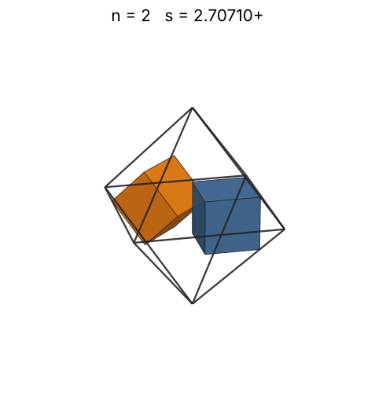 |
| 3 | [2.70710+](cubinoct_n03.json) | 2.707106781187 | (4 + √2)/2 | 1.85314 | 0.3208 | 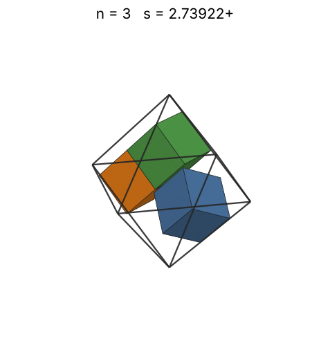 |
| 4 | [2.70710+](cubinoct_n04.json) | 2.707106781187 | (4 + √2)/2 | 2.03965 | 0.4277 | 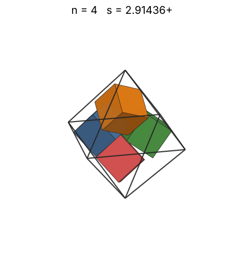 |
| 5 | [2.91421+](cubinoct_n05.json) | 2.914213562373 | (3 + 2√2)/2 | 2.19715 | 0.4286 | 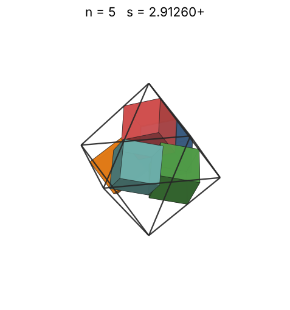 |
| 6 | [2.93435+](cubinoct_n06.json) | 2.934353214549 |  | 2.33482 | 0.5038 | 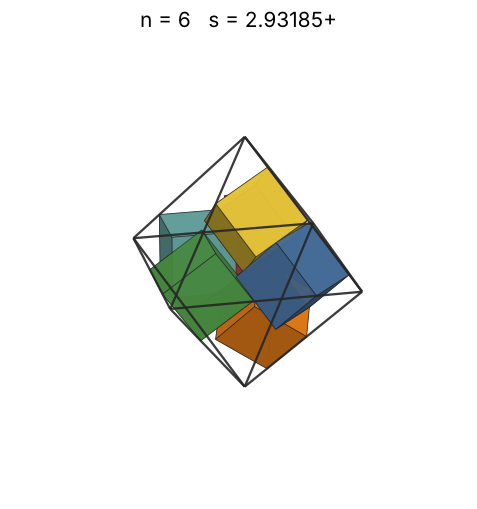 |
| 7 | [3.29102+](cubinoct_n07.json) | 3.291024682315 |  | 2.45792 | 0.4166 | 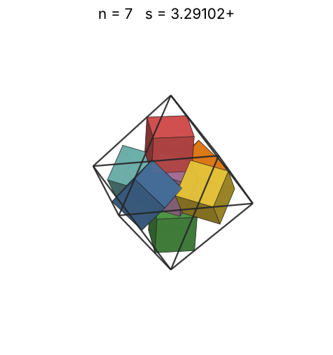 |
| 8 | [3.41421+](cubinoct_n08.json) | 3.414213562373 | 2 + √2 | 2.56980 | 0.4264 | 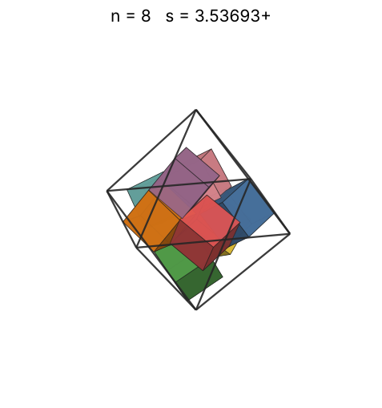 |
| 9 | [3.61760+](cubinoct_n09.json) | 3.617604106285 |  | 2.67270 | 0.4033 | 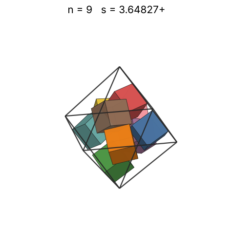 |
| 10 | [3.69181+](cubinoct_n10.json) | 3.691811969946 |  | 2.76823 | 0.4216 | 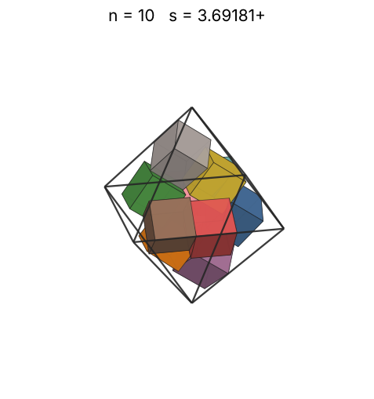 |
| 11 | [3.70710+](cubinoct_n11.json) | 3.707106781187 | (6 + √2)/2 | 2.85759 | 0.4580 | 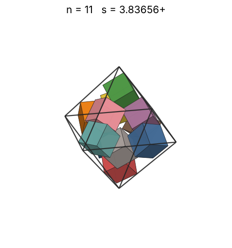 |
| 12 | [3.70710+](cubinoct_n12.json) | 3.707106781187 | (6 + √2)/2 | 2.94168 | 0.4997 |  |
| 13 | [3.79737+](cubinoct_n13.json) | 3.797373821506 |  | 3.02123 | 0.5036 | 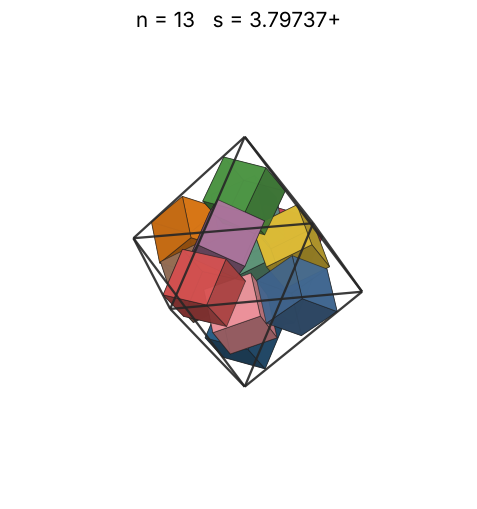 |
| 14 | [3.91512+](cubinoct_n14.json) | 3.915126657232 |  | 3.09679 | 0.4949 | 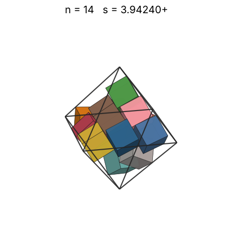 |
| 15 | [3.96266+](cubinoct_n15.json) | 3.962662900755 |  | 3.16883 | 0.5114 | 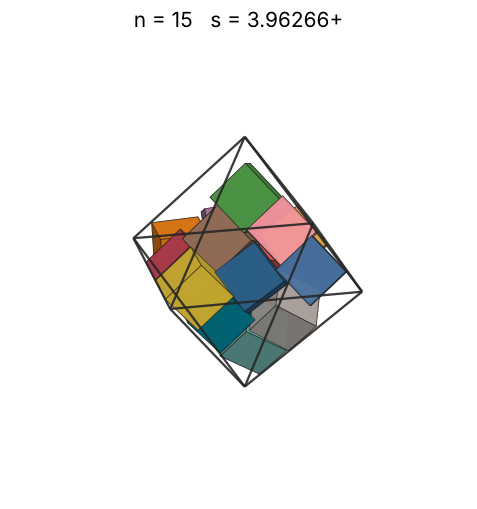 |
| 16 | [4.00052+](cubinoct_n16.json) | 4.000522820924 |  | 3.23774 | 0.5301 | 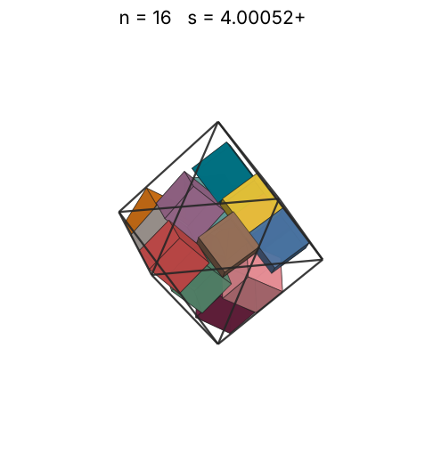 |
| 17 | [4.04405+](cubinoct_n17.json) | 4.044055209304 |  | 3.30384 | 0.5453 | 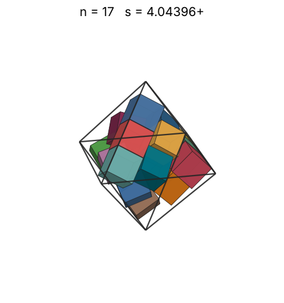 |
| 18 | [4.04898+](cubinoct_n18.json) | 4.048988042691 |  | 3.36739 | 0.5752 | 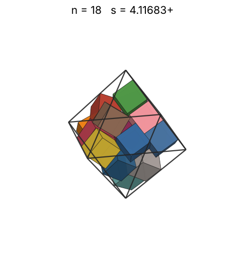 |
| 19 | [4.10658+](cubinoct_n19.json) | 4.106580061553 |  | 3.42862 | 0.5820 | 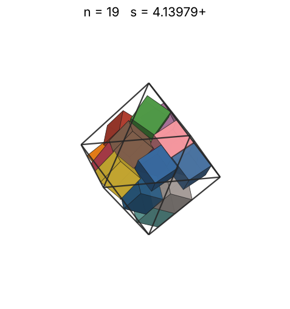 |
| 20 | [4.32269+](cubinoct_n20.json) | 4.322696356082 |  | 3.48775 | 0.5253 | 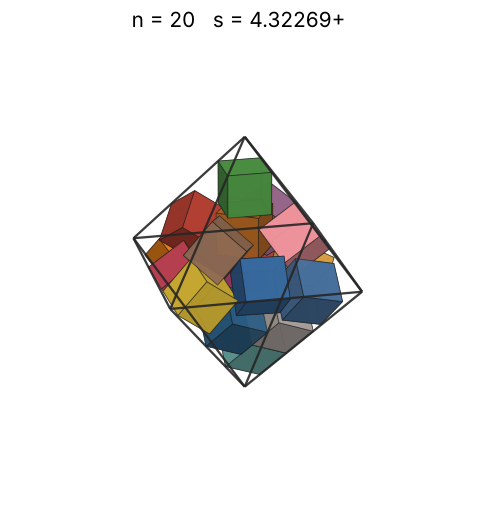 |
| 21 | [4.47061+](cubinoct_n21.json) | 4.470615485578 |  | 3.54494 | 0.4986 | 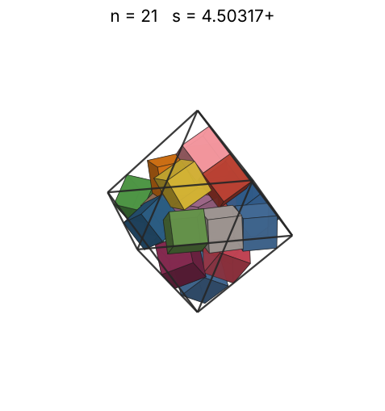 |
| 22 | [4.59310+](cubinoct_n22.json) | 4.593108671908 |  | 3.60034 | 0.4816 | 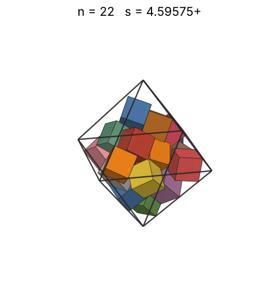 |
| 23 | [4.62576+](cubinoct_n23.json) | 4.625765607852 |  | 3.65408 | 0.4929 | 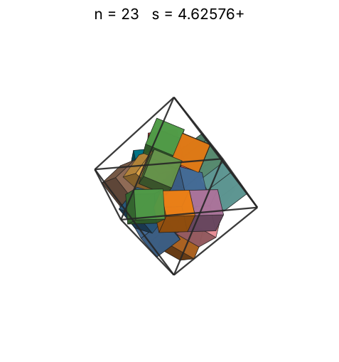 |
| 24 | [4.70710+](cubinoct_n24.json) | 4.707106781199 |  | 3.70629 | 0.4882 | 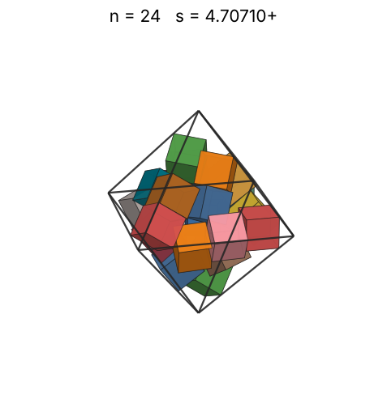 |
| 25 | [4.70710+](cubinoct_n25.json) | 4.707106781199 |  | 3.75707 | 0.5085 | 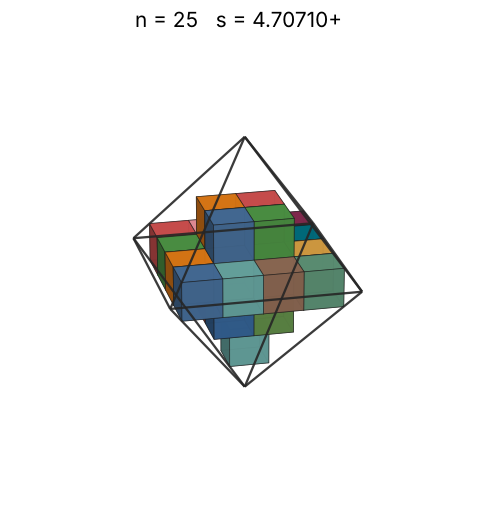 |
| 26 | [4.75455+](cubinoct_n26.json) | 4.754551039166 |  | 3.80651 | 0.5132 | 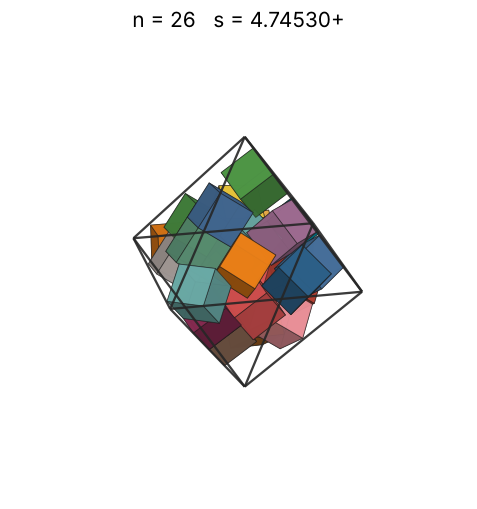 |
| 27 | [4.81053+](cubinoct_n27.json) | 4.810536448806 |  | 3.85469 | 0.5145 | 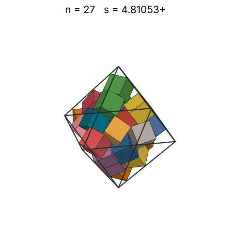 |
| 28 | [4.84419+](cubinoct_n28.json) | 4.844192997311 |  | 3.90171 | 0.5225 | 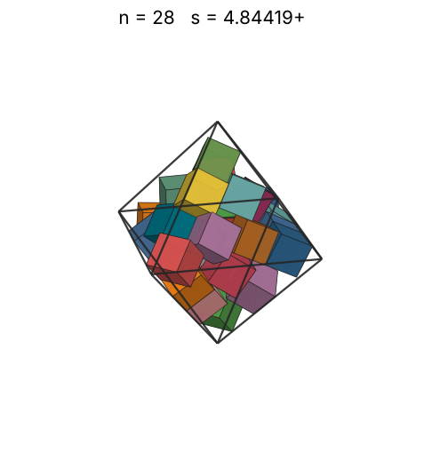 |
| 29 | [4.89243+](cubinoct_n29.json) | 4.892431820404 |  | 3.94761 | 0.5253 | 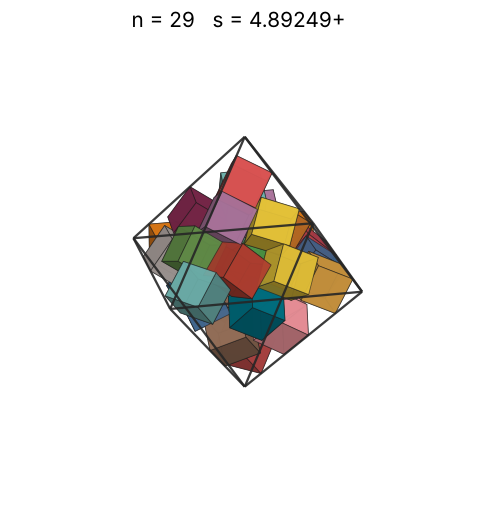 |
| 30 | [4.91981+](cubinoct_n30.json) | 4.919815224415 |  | 3.99248 | 0.5344 | 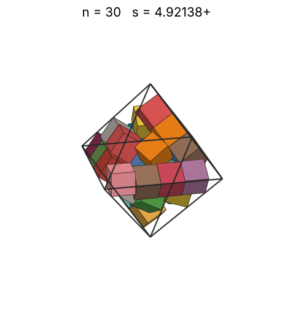 |
| 31 | [4.96097+](cubinoct_n31.json) | 4.960973656033 |  | 4.03635 | 0.5386 | 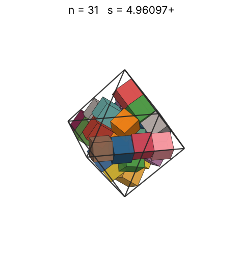 |
| 32 | [4.99853+](cubinoct_n32.json) | 4.998537004627 |  | 4.07930 | 0.5435 | 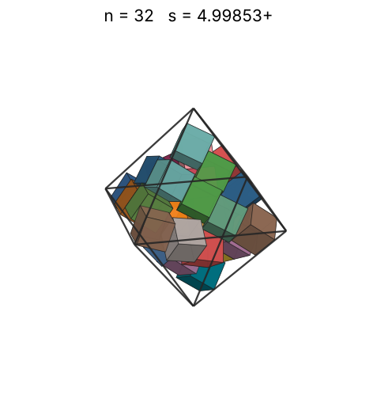 |
| 33 | [5.02843+](cubinoct_n33.json) | 5.028438606181 |  | 4.12136 | 0.5506 | 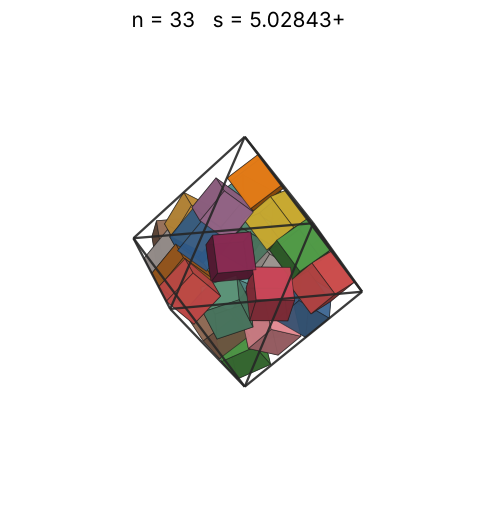 |
| 34 | [5.05419+](cubinoct_n34.json) | 5.054191668952 |  | 4.16257 | 0.5586 | 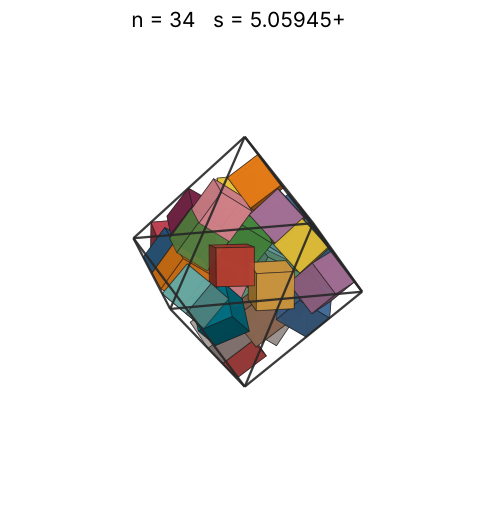 |
| 35 | [5.06974+](cubinoct_n35.json) | 5.069744656460 |  | 4.20299 | 0.5698 | 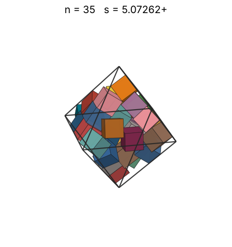 |
| 36 | [5.08975+](cubinoct_n36.json) | 5.089753510286 |  | 4.24264 | 0.5792 | 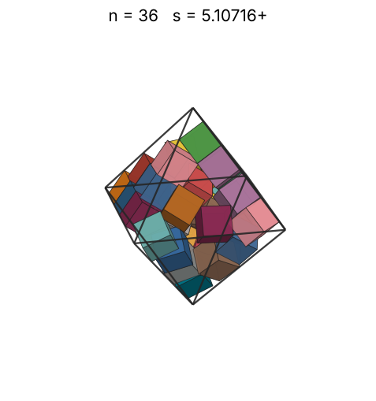 |
| 37 | [5.10437+](cubinoct_n37.json) | 5.104378048326 |  | 4.28157 | 0.5902 | 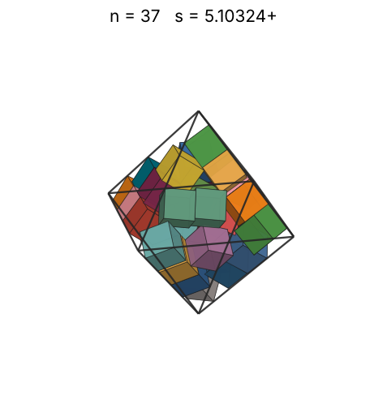 |
| 38 | [5.13601+](cubinoct_n38.json) | 5.136011943669 |  | 4.31980 | 0.5950 | 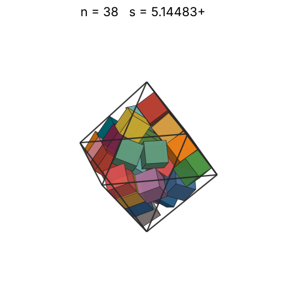 |
| 39 | [5.17002+](cubinoct_n39.json) | 5.170026906759 |  | 4.35736 | 0.5987 | 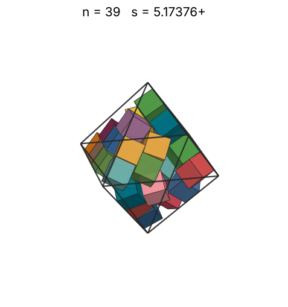 |
| 40 | [5.19194+](cubinoct_n40.json) | 5.191941372801 |  | 4.39429 | 0.6063 | 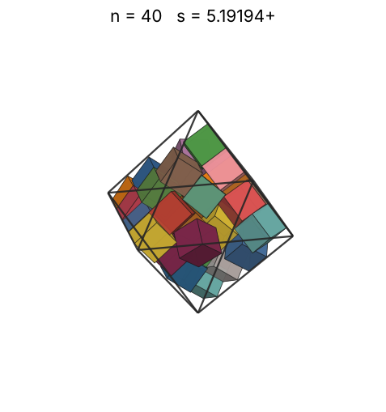 |
