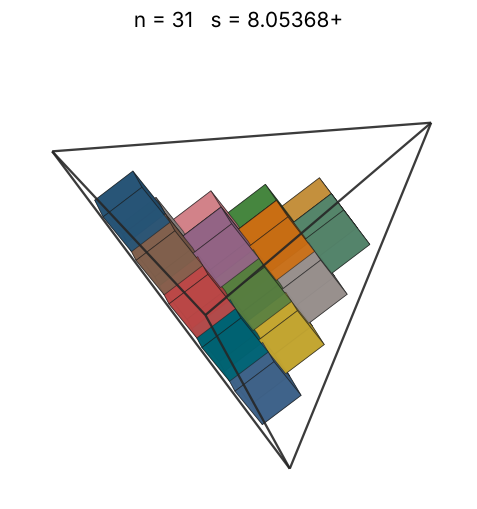
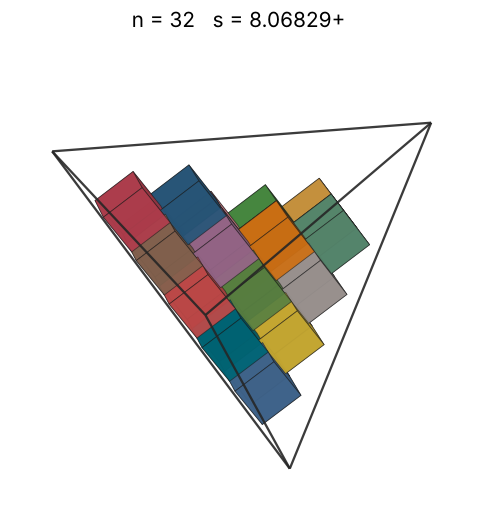
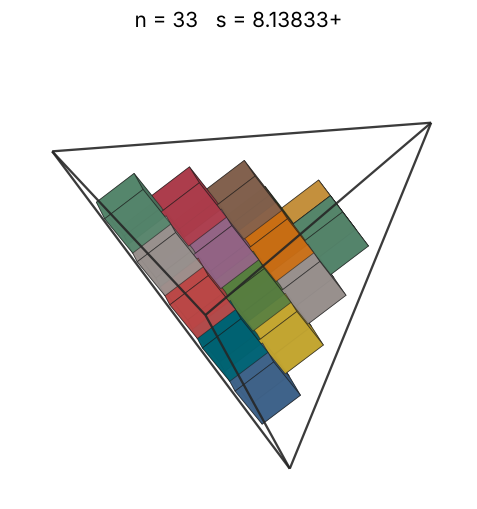
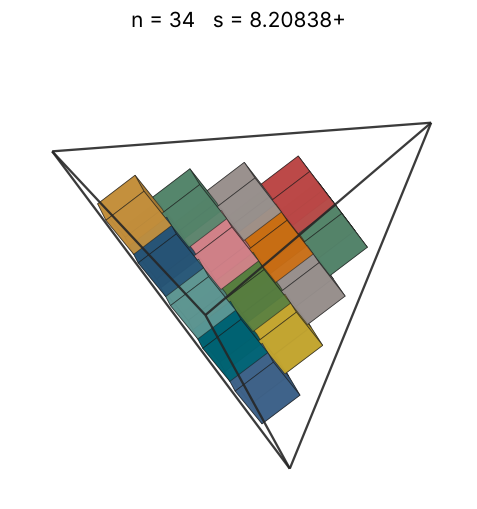
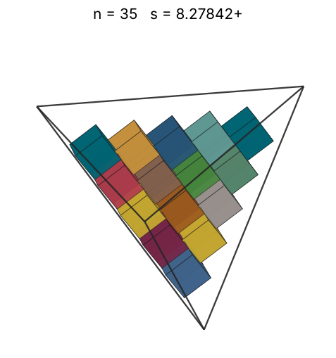
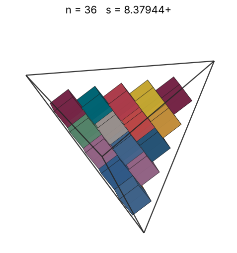
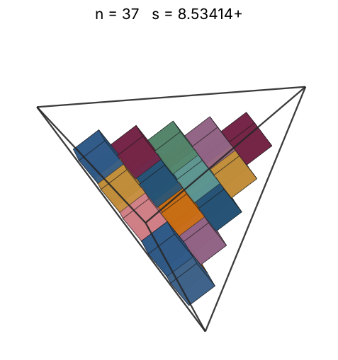
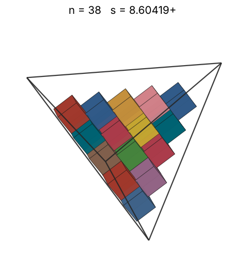
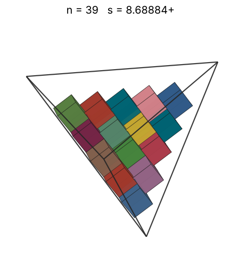
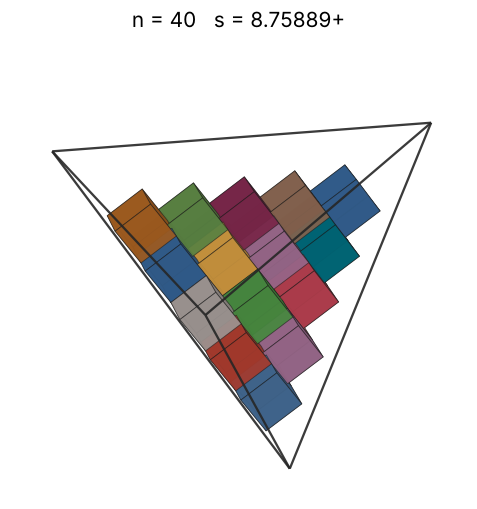

# Cubes in a tetrahedron

s = container edge / piece edge; every row certified in exact arithmetic.

| n | s | touching limit | closed form (conj.) | volume bound | density | picture |
|---|---|---|---|---|---|---|
| 2 | [4.37944+](cubintet_n02.json) | 4.379445526964 | 2 + √(72√2 + 102)/6 | 2.56980 | 0.2020 |  |
| 3 | [4.45679+](cubintet_n03.json) | 4.456795812570 | 3/2 + √(12√2 + 18)/2 | 2.94168 | 0.2876 |  |
| 4 | [4.51380+](cubintet_n04.json) | 4.513800723532 |  | 3.23774 | 0.3691 |  |
| 5 | [5.37944+](cubintet_n05.json) | 5.379445707540 | √(72√2 + 102)/6 + 3 | 3.48775 | 0.2725 |  |
| 6 | [5.37944+](cubintet_n06.json) | 5.379445708263 | √(72√2 + 102)/6 + 3 | 3.70629 | 0.3270 |  |
| 7 | [5.53414+](cubintet_n07.json) | 5.534146262613 | 2 + √(144√2 + 246)/6 | 3.90171 | 0.3504 |  |
| 8 | [5.55749+](cubintet_n08.json) | 5.557494414042 | 2 + 2√3√(30√2 + 43)/9 | 4.07930 | 0.3955 |  |
| 9 | [5.62840+](cubintet_n09.json) | 5.628406457154 |  | 4.24264 | 0.4283 |  |
| 10 | [5.68154+](cubintet_n10.json) | 5.681540891682 | 3/2 + √(6√2 + 9) | 4.39429 | 0.4627 |  |
| 11 | [6.17310+](cubintet_n11.json) | 6.173104796109 | √6·(3 + √(4√6 + 11))/3 | 4.53614 | 0.3968 |  |
| 12 | [6.45679+](cubintet_n12.json) | 6.456796095248 | √(12√2 + 18)/2 + 7/2 | 4.66963 | 0.3783 |  |
| 13 | [6.45679+](cubintet_n13.json) | 6.456796114075 | √(12√2 + 18)/2 + 7/2 | 4.79590 | 0.4098 |  |
| 14 | [6.58084+](cubintet_n14.json) | 6.580842611189 | 3 + √(1440√2 + 2118)/18 | 4.91584 | 0.4168 |  |
| 15 | [6.65855+](cubintet_n15.json) | 6.658549726385 |  | 5.03021 | 0.4311 |  |
| 16 | [6.72867+](cubintet_n16.json) | 6.728679342297 |  | 5.13959 | 0.4457 |  |
| 17 | [6.75892+](cubintet_n17.json) | 6.758928182815 |  | 5.24451 | 0.4672 |  |
| 18 | [6.81345+](cubintet_n18.json) | 6.813454287141 |  | 5.34539 | 0.4829 |  |
| 19 | [6.82829+](cubintet_n19.json) | 6.828293558689 |  | 5.44260 | 0.5064 |  |
| 20 | [6.88400+](cubintet_n20.json) | 6.884002704413 |  | 5.53646 | 0.5202 |  |
| 21 | [7.37944+](cubintet_n21.json) | 7.379445449771 | √(72√2 + 102)/6 + 5 | 5.62724 | 0.4434 |  |
| 22 | [7.53414+](cubintet_n22.json) | 7.534145989697 | √(144√2 + 246)/6 + 4 | 5.71518 | 0.4365 |  |
| 23 | [7.60419+](cubintet_n23.json) | 7.604190323410 | √(36√2 + 66)/3 + 4 | 5.80049 | 0.4438 |  |
| 24 | [7.68884+](cubintet_n24.json) | 7.688846529623 | 3 + √(24√2 + 54)/2 | 5.88337 | 0.4480 |  |
| 25 | [7.75889+](cubintet_n25.json) | 7.758890863336 | 3 + √(72√2 + 102)/3 | 5.96397 | 0.4542 |  |
| 26 | [7.82893+](cubintet_n26.json) | 7.828935197049 | 3 + √(216√2 + 534)/6 | 6.04245 | 0.4598 |  |
| 27 | [7.84354+](cubintet_n27.json) | 7.843547069550 | 2 + √(288√2 + 822)/6 | 6.11895 | 0.4748 |  |
| 28 | [7.91359+](cubintet_n28.json) | 7.913591403262 | 2 + √(12√2 + 18) | 6.19358 | 0.4794 |  |
| 29 | [7.98363+](cubintet_n29.json) | 7.983635736975 | 2 + √(432√2 + 678)/6 | 6.26645 | 0.4836 |  |
| 30 | [7.99824+](cubintet_n30.json) | 7.998247609476 | 1 + √(360√2 + 1254)/6 | 6.33766 | 0.4975 |  |
| 31 | [8.05368+](cubintet_n31.json) | 8.053680070688 | 2 + 2√(18√2 + 57)/3 | 6.40731 | 0.5036 |  |
| 32 | [8.06829+](cubintet_n32.json) | 8.068291943189 | 1 + √(144√2 + 246)/3 | 6.47548 | 0.5170 |  |
| 33 | [8.13833+](cubintet_n33.json) | 8.138336276901 | 1 + √(72√2 + 102)/2 | 6.54224 | 0.5195 |  |
| 34 | [8.20838+](cubintet_n34.json) | 8.208380610614 | 1 + 2√(36√2 + 66)/3 | 6.60767 | 0.5216 |  |
| 35 | [8.27842+](cubintet_n35.json) | 8.278424944327 | 1 + √(360√2 + 1398)/6 | 6.67183 | 0.5235 |  |
| 36 | [8.37944+](cubintet_n36.json) | 8.379445459771 | √(72√2 + 102)/6 + 6 | 6.73477 | 0.5192 |  |
| 37 | [8.53414+](cubintet_n37.json) | 8.534145999697 | √(144√2 + 246)/6 + 5 | 6.79656 | 0.5051 |  |
| 38 | [8.60419+](cubintet_n38.json) | 8.604190333410 | √(36√2 + 66)/3 + 5 | 6.85725 | 0.5062 |  |
| 39 | [8.68884+](cubintet_n39.json) | 8.688846539623 | 4 + √(24√2 + 54)/2 | 6.91688 | 0.5045 |  |
| 40 | [8.75889+](cubintet_n40.json) | 8.758890873336 | 4 + √(72√2 + 102)/3 | 6.97550 | 0.5051 |  |
| 41 | [10.75889+](cubintet_n41.json) | 10.758891416526 | √(72√2 + 102)/3 + 6 | 7.03315 | 0.2793 |  |
| 42 | [10.75889+](cubintet_n42.json) | 10.758891416526 | √(72√2 + 102)/3 + 6 | 7.08987 | 0.2862 |  |
| 43 | [10.75889+](cubintet_n43.json) | 10.758891416526 | √(72√2 + 102)/3 + 6 | 7.14570 | 0.2930 |  |
| 44 | [10.75889+](cubintet_n44.json) | 10.758891416526 | √(72√2 + 102)/3 + 6 | 7.20067 | 0.2998 |  |
| 45 | [10.75889+](cubintet_n45.json) | 10.758891416526 | √(72√2 + 102)/3 + 6 | 7.25481 | 0.3066 |  |
| 46 | [10.75889+](cubintet_n46.json) | 10.758891416526 | √(72√2 + 102)/3 + 6 | 7.30816 | 0.3134 |  |
| 47 | [10.75889+](cubintet_n47.json) | 10.758891416526 | √(72√2 + 102)/3 + 6 | 7.36074 | 0.3202 |  |
| 48 | [10.75889+](cubintet_n48.json) | 10.758891416526 | √(72√2 + 102)/3 + 6 | 7.41258 | 0.3270 |  |
| 49 | [11.06829+](cubintet_n49.json) | 11.068292525225 | 4 + √(144√2 + 246)/3 | 7.46370 | 0.3066 |  |
| 50 | [11.06829+](cubintet_n50.json) | 11.068292525225 | 4 + √(144√2 + 246)/3 | 7.51413 | 0.3129 |  |
| 51 | [11.06829+](cubintet_n51.json) | 11.068292525225 | 4 + √(144√2 + 246)/3 | 7.56389 | 0.3191 |  |
| 52 | [11.06829+](cubintet_n52.json) | 11.068292525225 | 4 + √(144√2 + 246)/3 | 7.61301 | 0.3254 |  |
| 53 | [11.06829+](cubintet_n53.json) | 11.068292525225 | 4 + √(144√2 + 246)/3 | 7.66150 | 0.3317 |  |
| 54 | [11.06829+](cubintet_n54.json) | 11.068292525225 | 4 + √(144√2 + 246)/3 | 7.70939 | 0.3379 |  |
| 55 | [11.06829+](cubintet_n55.json) | 11.068292525225 | 4 + √(144√2 + 246)/3 | 7.75669 | 0.3442 |  |
| 56 | [11.06829+](cubintet_n56.json) | 11.068292525225 | 4 + √(144√2 + 246)/3 | 7.80342 | 0.3504 |  |
| 57 | [11.11499+](cubintet_n57.json) | 11.114988828083 | 4 + 4√(90√2 + 129)/9 | 7.84959 | 0.3522 |  |
| 58 | [11.11499+](cubintet_n58.json) | 11.114988828083 | 4 + 4√(90√2 + 129)/9 | 7.89523 | 0.3584 |  |
| 59 | [11.11499+](cubintet_n59.json) | 11.114988828083 | 4 + 4√(90√2 + 129)/9 | 7.94035 | 0.3646 |  |
| 60 | [11.11499+](cubintet_n60.json) | 11.114988828083 | 4 + 4√(90√2 + 129)/9 | 7.98496 | 0.3708 |  |
| 61 | [11.11499+](cubintet_n61.json) | 11.114988828083 | 4 + 4√(90√2 + 129)/9 | 8.02907 | 0.3769 |  |
| 62 | [11.11499+](cubintet_n62.json) | 11.114988828083 | 4 + 4√(90√2 + 129)/9 | 8.07271 | 0.3831 |  |
| 63 | [11.11499+](cubintet_n63.json) | 11.114988828083 | 4 + 4√(90√2 + 129)/9 | 8.11588 | 0.3893 |  |
| 64 | [11.11499+](cubintet_n64.json) | 11.114988828083 | 4 + 4√(90√2 + 129)/9 | 8.15860 | 0.3955 |  |
| 65 | [11.25681+](cubintet_n65.json) | 11.256812914307 |  | 8.20087 | 0.3867 |  |
| 66 | [11.25681+](cubintet_n66.json) | 11.256812914307 |  | 8.24271 | 0.3926 |  |
| 67 | [11.25681+](cubintet_n67.json) | 11.256812914307 |  | 8.28413 | 0.3986 |  |
| 68 | [11.25681+](cubintet_n68.json) | 11.256812914307 |  | 8.32514 | 0.4045 |  |
| 69 | [11.25681+](cubintet_n69.json) | 11.256812914307 |  | 8.36575 | 0.4105 |  |
| 70 | [11.25681+](cubintet_n70.json) | 11.256812914307 |  | 8.40598 | 0.4164 |  |
| 71 | [11.25681+](cubintet_n71.json) | 11.256812914307 |  | 8.44581 | 0.4224 |  |
| 72 | [11.25681+](cubintet_n72.json) | 11.256812914307 |  | 8.48528 | 0.4283 |  |
| 73 | [11.36308+](cubintet_n73.json) | 11.363081783363 | 3 + 2√(6√2 + 9) | 8.52438 | 0.4222 |  |
| 74 | [11.36308+](cubintet_n74.json) | 11.363081783363 |  | 8.56313 | 0.4280 |  |
| 75 | [11.36308+](cubintet_n75.json) | 11.363081783363 | 3 + 2√(6√2 + 9) | 8.60153 | 0.4337 |  |
| 76 | [11.36308+](cubintet_n76.json) | 11.363081783363 | 3 + 2√(6√2 + 9) | 8.63959 | 0.4395 |  |
| 77 | [11.36308+](cubintet_n77.json) | 11.363081783363 | 3 + 2√(6√2 + 9) | 8.67732 | 0.4453 |  |
| 78 | [11.36308+](cubintet_n78.json) | 11.363081783363 | 3 + 2√(6√2 + 9) | 8.71472 | 0.4511 |  |
| 79 | [11.36308+](cubintet_n79.json) | 11.363081783363 | 3 + 2√(6√2 + 9) | 8.75181 | 0.4569 |  |
| 80 | [11.36308+](cubintet_n80.json) | 11.363081783363 | 3 + 2√(6√2 + 9) | 8.78858 | 0.4627 |  |
| 81 | [12.34621+](cubintet_n81.json) | 12.346209584679 | 2√6·(3 + √(4√6 + 11))/3 | 8.82505 | 0.3652 |  |
| 82 | [12.34621+](cubintet_n82.json) | 12.346209584679 | 2√6·(3 + √(4√6 + 11))/3 | 8.86122 | 0.3697 |  |
| 83 | [12.34621+](cubintet_n83.json) | 12.346209592219 | 2√6·(3 + √(4√6 + 11))/3 | 8.89709 | 0.3742 |  |
| 84 | [12.34621+](cubintet_n84.json) | 12.346209592219 | 2√6·(3 + √(4√6 + 11))/3 | 8.93268 | 0.3787 |  |
| 85 | [12.34621+](cubintet_n85.json) | 12.346209592219 | 2√6·(3 + √(4√6 + 11))/3 | 8.96799 | 0.3833 |  |
| 86 | [12.34621+](cubintet_n86.json) | 12.346209592219 | 2√6·(3 + √(4√6 + 11))/3 | 9.00302 | 0.3878 |  |
| 87 | [12.34621+](cubintet_n87.json) | 12.346209592219 | 2√6·(3 + √(4√6 + 11))/3 | 9.03778 | 0.3923 |  |
| 88 | [12.34621+](cubintet_n88.json) | 12.346209592219 | 2√6·(3 + √(4√6 + 11))/3 | 9.07228 | 0.3968 |  |
| 89 | [12.91359+](cubintet_n89.json) | 12.913592190496 | √(12√2 + 18) + 7 | 9.10651 | 0.3507 |  |
| 90 | [12.91359+](cubintet_n90.json) | 12.913592190496 | √(12√2 + 18) + 7 | 9.14049 | 0.3546 |  |
| 91 | [12.91359+](cubintet_n91.json) | 12.913592190496 | √(12√2 + 18) + 7 | 9.17422 | 0.3586 |  |
| 92 | [12.91359+](cubintet_n92.json) | 12.913592190496 | √(12√2 + 18) + 7 | 9.20770 | 0.3625 |  |
| 93 | [12.91359+](cubintet_n93.json) | 12.913592190496 | √(12√2 + 18) + 7 | 9.24095 | 0.3664 |  |
| 94 | [12.91359+](cubintet_n94.json) | 12.913592190496 | √(12√2 + 18) + 7 | 9.27395 | 0.3704 |  |
| 95 | [12.91359+](cubintet_n95.json) | 12.913592190496 | √(12√2 + 18) + 7 | 9.30672 | 0.3743 |  |
| 96 | [12.91359+](cubintet_n96.json) | 12.913592190496 | √(12√2 + 18) + 7 | 9.33926 | 0.3783 |  |
| 97 | [12.91359+](cubintet_n97.json) | 12.913592228150 | √(12√2 + 18) + 7 | 9.37158 | 0.3822 |  |
| 98 | [12.91359+](cubintet_n98.json) | 12.913592228150 | √(12√2 + 18) + 7 | 9.40367 | 0.3861 |  |
| 99 | [12.91359+](cubintet_n99.json) | 12.913592228150 | √(12√2 + 18) + 7 | 9.43555 | 0.3901 |  |
| 100 | [12.91359+](cubintet_n100.json) | 12.913592228150 | √(12√2 + 18) + 7 | 9.46721 | 0.3940 |  |
