# Cubes in a tetrahedron

s = container edge / piece edge; every row certified in exact arithmetic.

| n | s | touching limit | closed form (conj.) | volume bound | density | picture |
|---|---|---|---|---|---|---|
| 2 | [4.37944+](cubintet_n02.json) | 4.379445526964 |  | 2.56980 | 0.2020 | 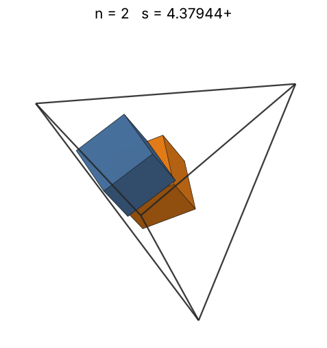 |
| 3 | [4.45679+](cubintet_n03.json) | 4.456795812570 |  | 2.94168 | 0.2876 | 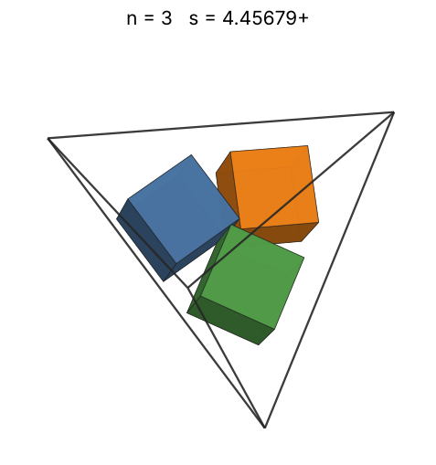 |
| 4 | [4.51380+](cubintet_n04.json) | 4.513800723532 |  | 3.23774 | 0.3691 | 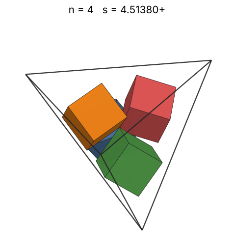 |
| 5 | [5.37944+](cubintet_n05.json) | 5.379445707540 |  | 3.48775 | 0.2725 | 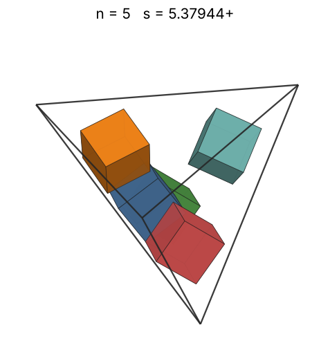 |
| 6 | [5.37944+](cubintet_n06.json) | 5.379445708263 |  | 3.70629 | 0.3270 | 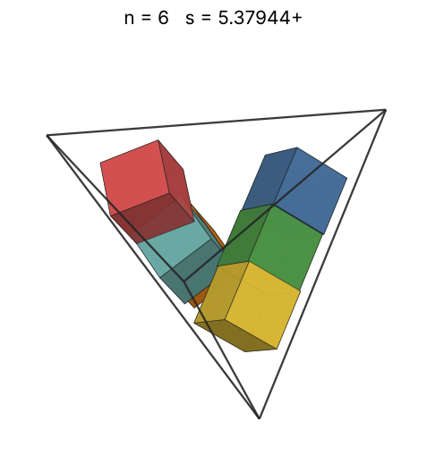 |
| 7 | [5.53414+](cubintet_n07.json) | 5.534146262613 |  | 3.90171 | 0.3504 | 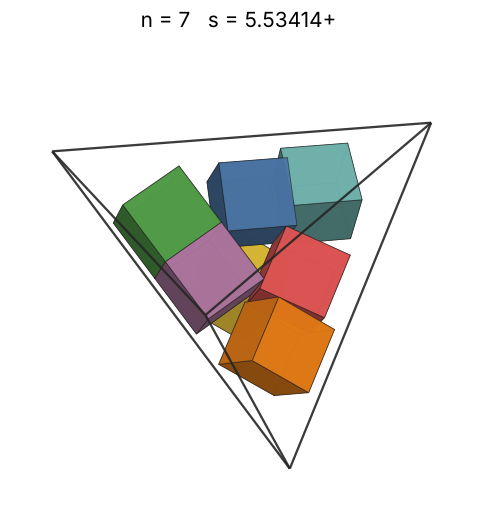 |
| 8 | [5.55749+](cubintet_n08.json) | 5.557494414042 |  | 4.07930 | 0.3955 | 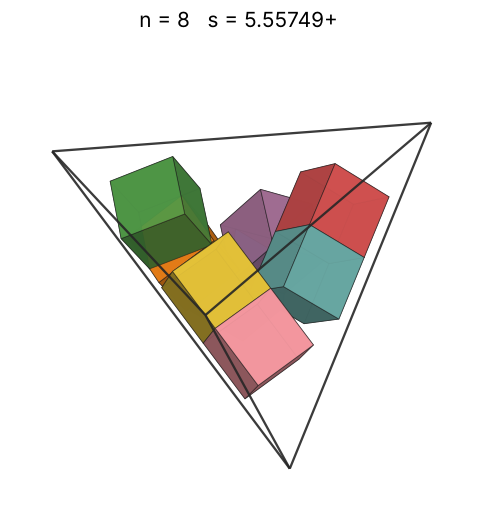 |
| 9 | [5.62840+](cubintet_n09.json) | 5.628406457154 |  | 4.24264 | 0.4283 | 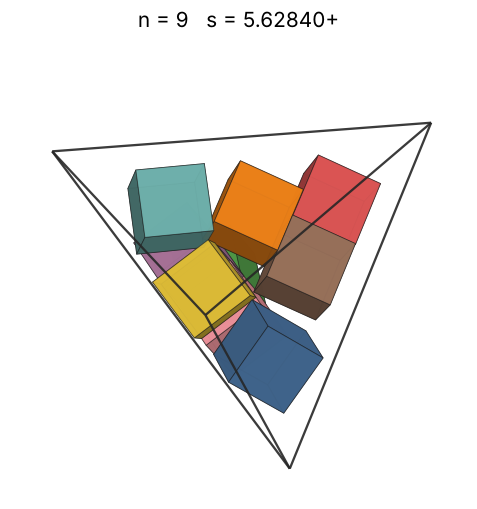 |
| 10 | [5.68154+](cubintet_n10.json) | 5.681540891682 |  | 4.39429 | 0.4627 | 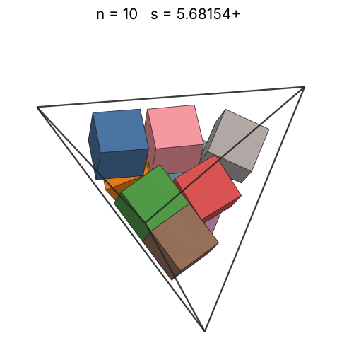 |
| 11 | [6.17310+](cubintet_n11.json) | 6.173104796109 |  | 4.53614 | 0.3968 | 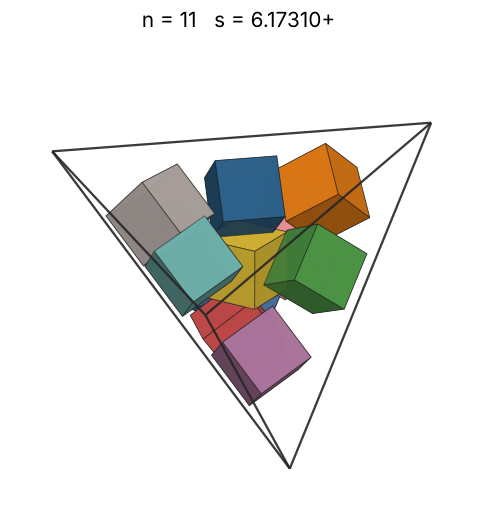 |
| 12 | [6.45679+](cubintet_n12.json) | 6.456796095248 |  | 4.66963 | 0.3783 | 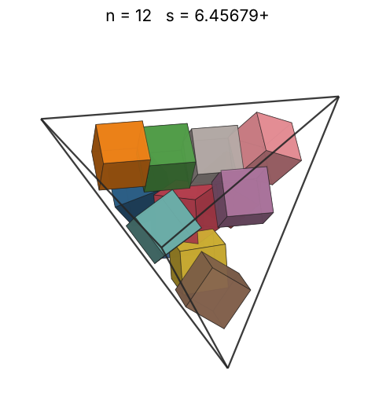 |
| 13 | [6.45679+](cubintet_n13.json) | 6.456796114075 |  | 4.79590 | 0.4098 | 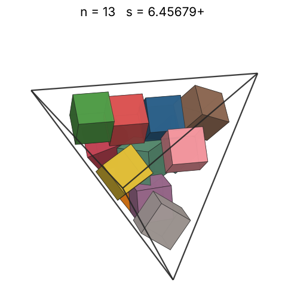 |
| 14 | [6.58084+](cubintet_n14.json) | 6.580842611189 |  | 4.91584 | 0.4168 | 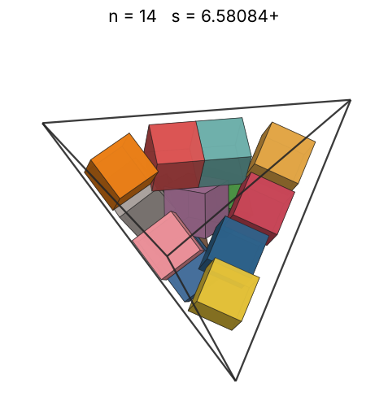 |
| 15 | [6.65855+](cubintet_n15.json) | 6.658549726385 |  | 5.03021 | 0.4311 | 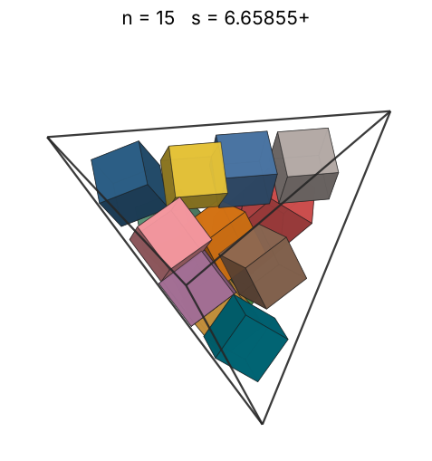 |
| 16 | [6.72867+](cubintet_n16.json) | 6.728679342297 |  | 5.13959 | 0.4457 | 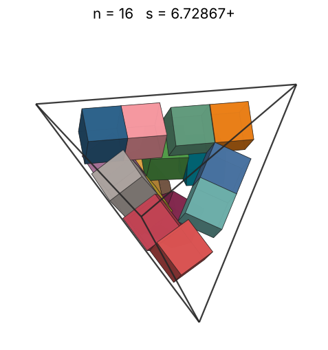 |
| 17 | [6.75892+](cubintet_n17.json) | 6.758928182815 |  | 5.24451 | 0.4672 | 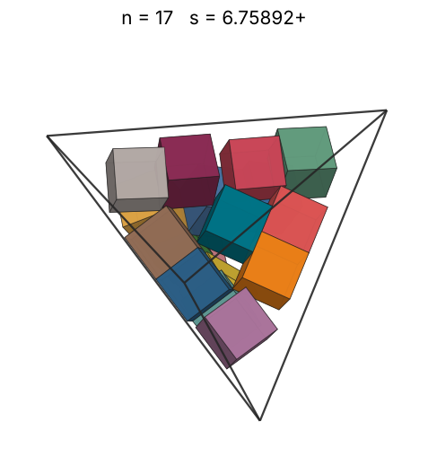 |
| 18 | [6.81345+](cubintet_n18.json) | 6.813454287141 |  | 5.34539 | 0.4829 | 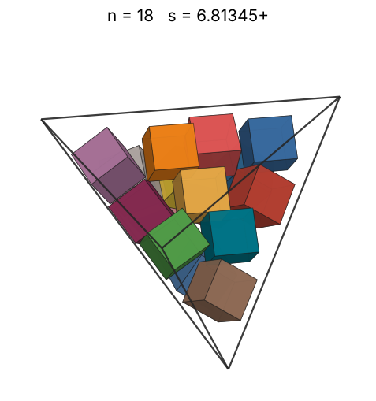 |
| 19 | [6.82829+](cubintet_n19.json) | 6.828293558689 |  | 5.44260 | 0.5064 | 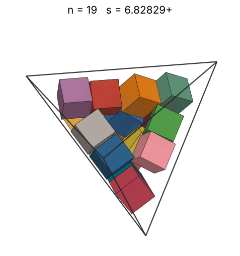 |
| 20 | [6.88400+](cubintet_n20.json) | 6.884002704413 |  | 5.53646 | 0.5202 | 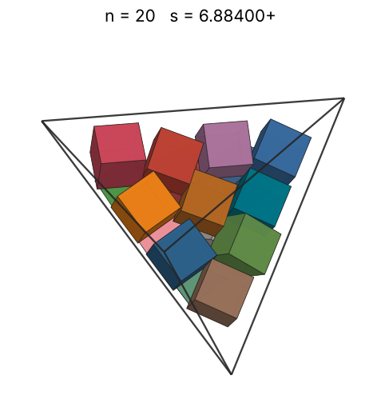 |
| 21 | [7.38269+](cubintet_n21.json) | 7.382692227024 |  | 5.62724 | 0.4428 | 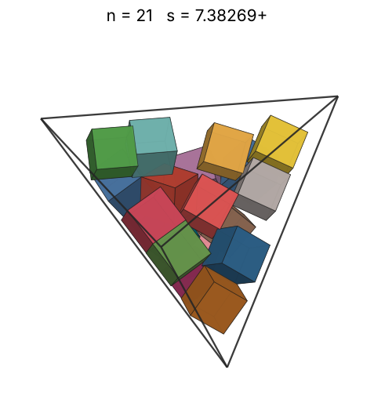 |
| 22 | [7.58085+](cubintet_n22.json) | 7.580852506212 |  | 5.71518 | 0.4285 | 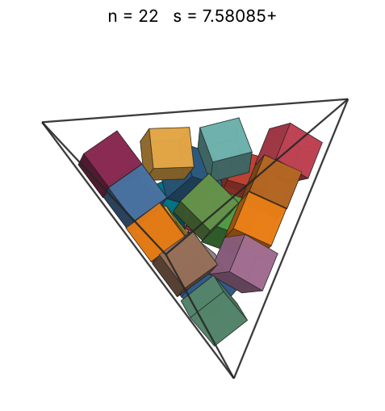 |
| 23 | [7.87848+](cubintet_n23.json) | 7.878483092360 |  | 5.80049 | 0.3991 | 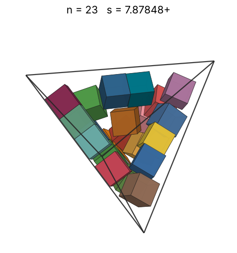 |
| 24 | [7.87848+](cubintet_n24.json) | 7.878483814992 |  | 5.88337 | 0.4164 | 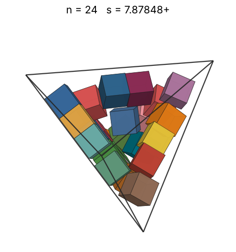 |
| 25 | [7.87848+](cubintet_n25.json) | 7.878484460922 |  | 5.96397 | 0.4338 | 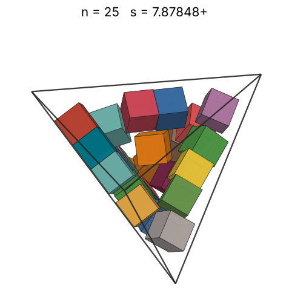 |
| 26 | [7.89205+](cubintet_n26.json) | 7.892049794076 |  | 6.04245 | 0.4488 | 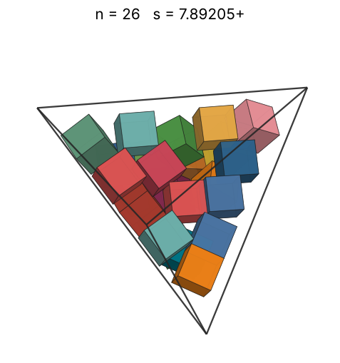 |
| 27 | [7.95289+](cubintet_n27.json) | 7.952889900894 |  | 6.11895 | 0.4555 | 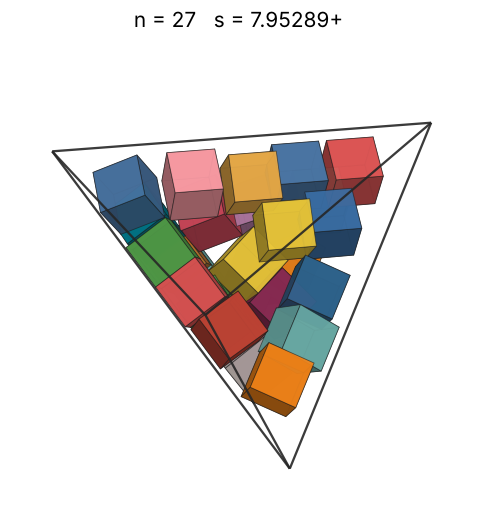 |
| 28 | [8.02075+](cubintet_n28.json) | 8.020754450075 |  | 6.19358 | 0.4604 | 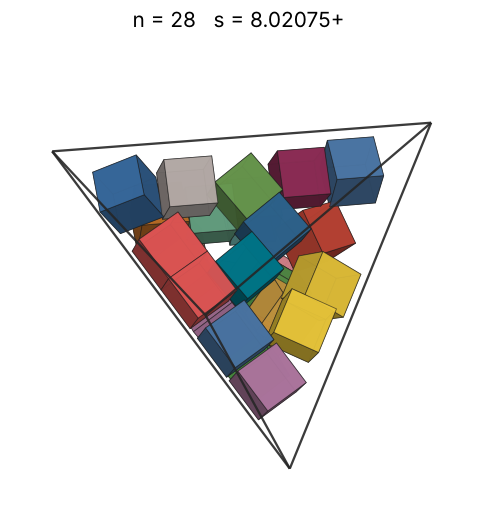 |
| 29 | [8.02075+](cubintet_n29.json) | 8.020755120183 |  | 6.26645 | 0.4769 | 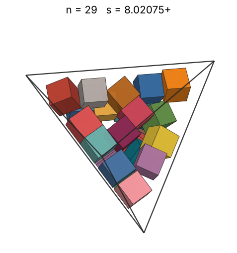 |
| 30 | [8.14620+](cubintet_n30.json) | 8.146205866676 |  | 6.33766 | 0.4709 | 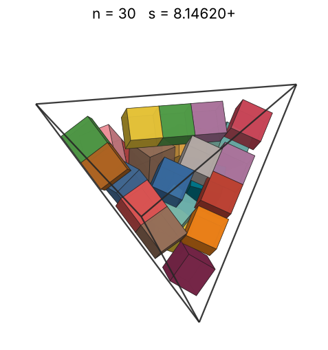 |
