# Cubes in a tetrahedron

s = container edge / piece edge; every row certified in exact arithmetic.

| n | s | touching limit | closed form (conj.) | volume bound | density | picture |
|---|---|---|---|---|---|---|
| 2 | [4.37944+](cubintet_n02.json) | 4.379445526964 | 2 + √(72√2 + 102)/6 | 2.56980 | 0.2020 | 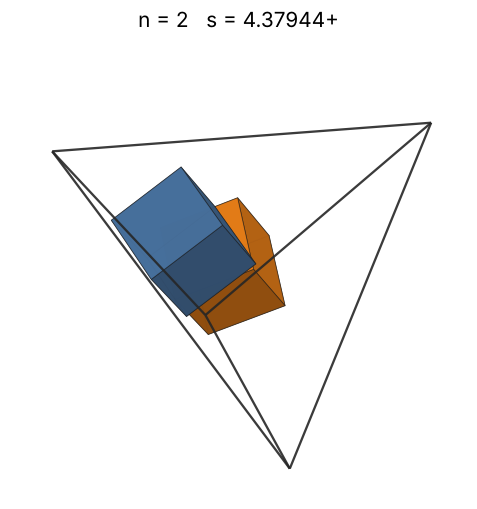 |
| 3 | [4.45679+](cubintet_n03.json) | 4.456795812570 | 3/2 + √(12√2 + 18)/2 | 2.94168 | 0.2876 | 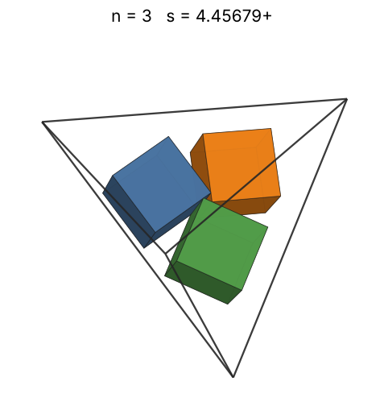 |
| 4 | [4.51380+](cubintet_n04.json) | 4.513800723532 |  | 3.23774 | 0.3691 | 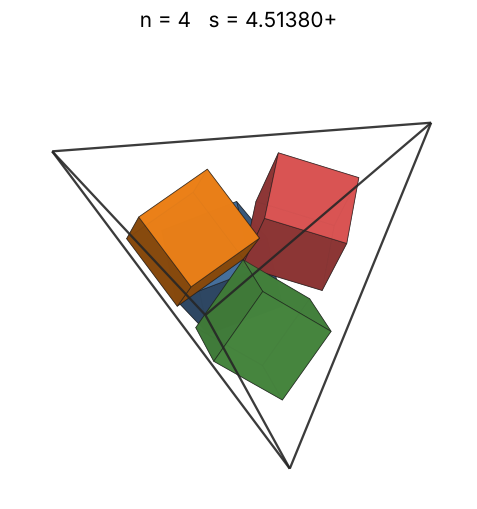 |
| 5 | [5.37944+](cubintet_n05.json) | 5.379445707540 | √(72√2 + 102)/6 + 3 | 3.48775 | 0.2725 | 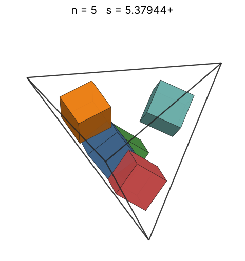 |
| 6 | [5.37944+](cubintet_n06.json) | 5.379445708263 | √(72√2 + 102)/6 + 3 | 3.70629 | 0.3270 | 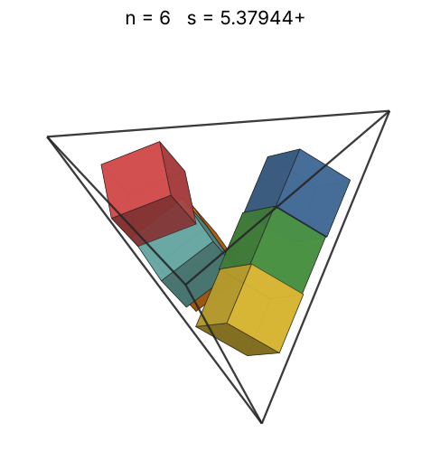 |
| 7 | [5.53414+](cubintet_n07.json) | 5.534146262613 | 2 + √(144√2 + 246)/6 | 3.90171 | 0.3504 | 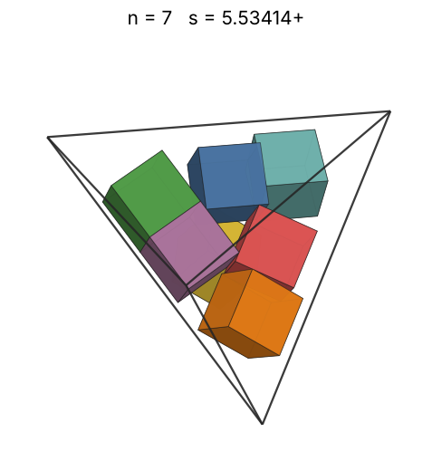 |
| 8 | [5.55749+](cubintet_n08.json) | 5.557494414042 | 2 + 2√3√(30√2 + 43)/9 | 4.07930 | 0.3955 | 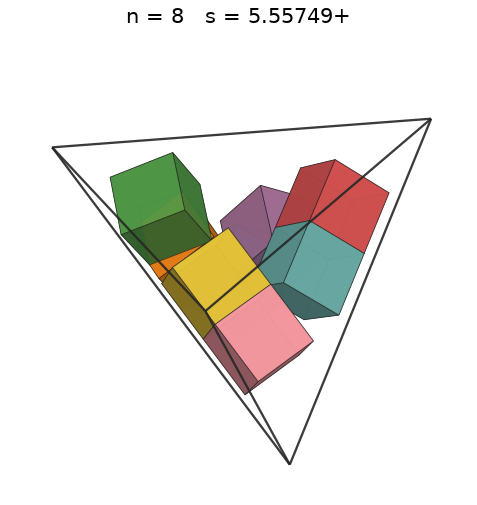 |
| 9 | [5.61149+](cubintet_n09.json) | 5.611497115211 | 3/2 + √6/2 + 5√3/3 | 4.24264 | 0.4322 | 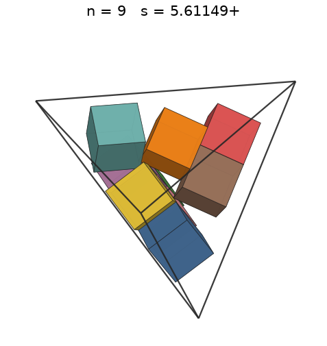 |
| 10 | [5.66850+](cubintet_n10.json) | 5.668502013843 | -5/2 - √2 + 4√3/3 - √6/4 + 3√5/2 + √10 + √30/4 | 4.39429 | 0.4659 | 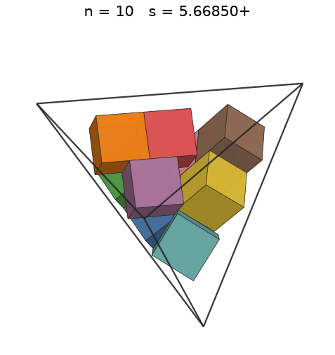 |
| 11 | [6.17310+](cubintet_n11.json) | 6.173104796109 | √6·(3 + √(4√6 + 11))/3 | 4.53614 | 0.3968 | 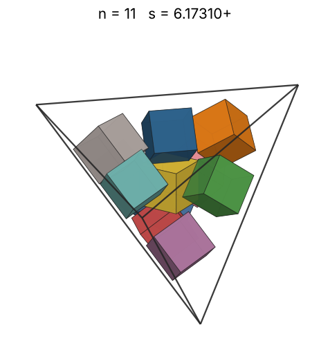 |
| 12 | [6.37944+](cubintet_n12.json) | 6.379445710101 |  | 4.66963 | 0.3922 | 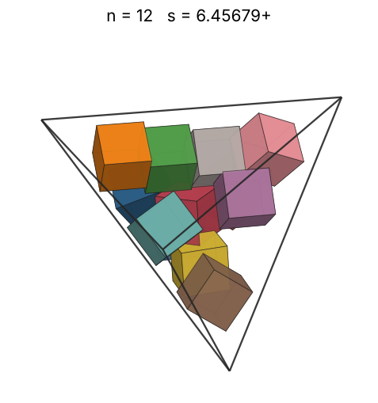 |
| 13 | [6.37944+](cubintet_n13.json) | 6.379446538026 | 4 + √6/2 + 2√3/3 | 4.79590 | 0.4249 | 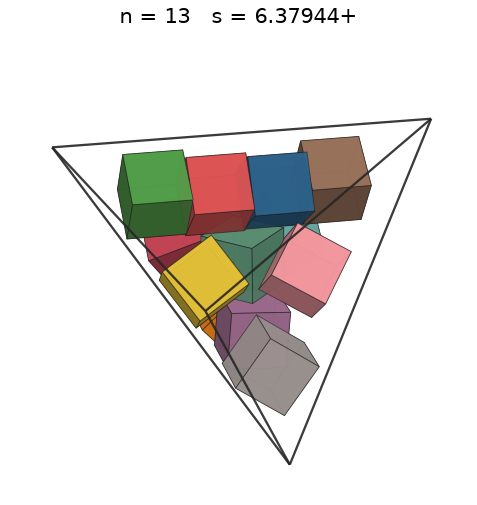 |
| 14 | [6.53414+](cubintet_n14.json) | 6.534146264588 |  | 4.91584 | 0.4258 | 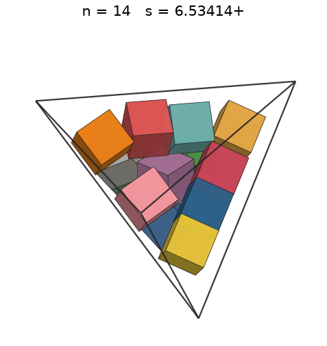 |
| 15 | [6.53414+](cubintet_n15.json) | 6.534147173547 | 3 + √6/2 + 4√3/3 | 5.03021 | 0.4562 | 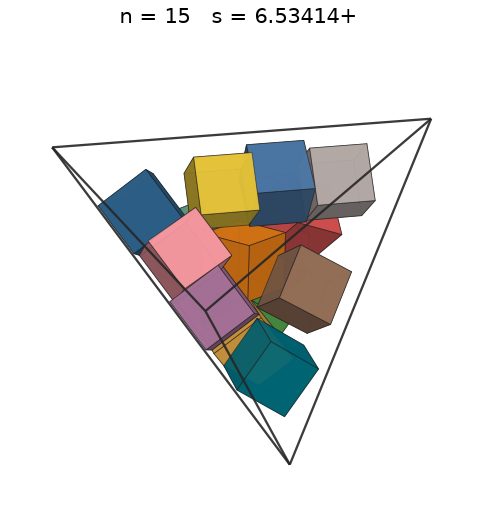 |
| 16 | [6.68056+](cubintet_n16.json) | 6.680564844675 |  | 5.13959 | 0.4554 | 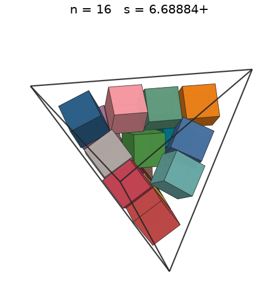 |
| 17 | [6.73554+](cubintet_n17.json) | 6.735543992408 | 2 + 5√6/6 + 14√3/9 | 5.24451 | 0.4721 | 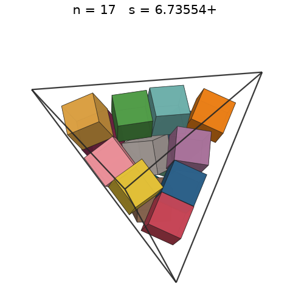 |
| 18 | [6.74404+](cubintet_n18.json) | 6.744044605932 |  | 5.34539 | 0.4979 | 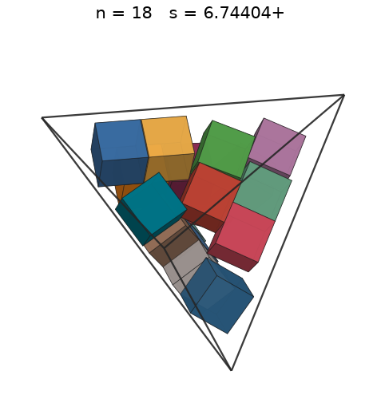 |
| 19 | [6.75889+](cubintet_n19.json) | 6.758892112362 | 2 + √6 + 4√3/3 | 5.44260 | 0.5221 | 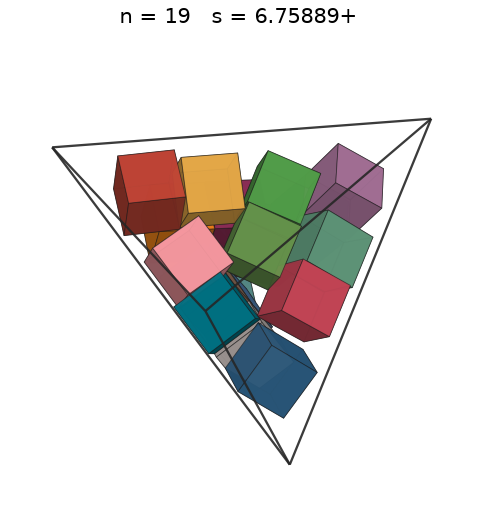 |
| 20 | [6.79201+](cubintet_n20.json) | 6.792014996950 |  | 5.53646 | 0.5416 | 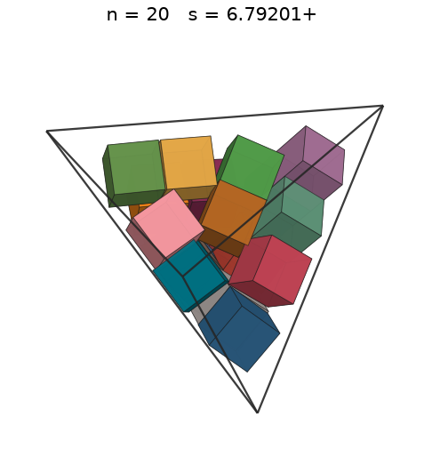 |
| 21 | [7.26135+](cubintet_n21.json) | 7.261351424951 |  | 5.62724 | 0.4654 | 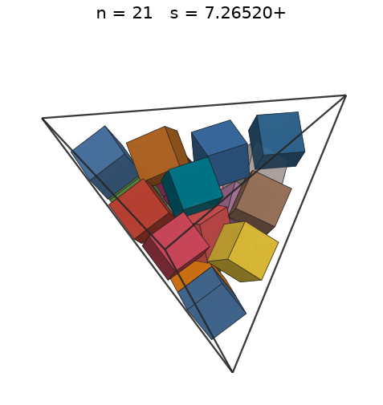 |
| 22 | [7.37944+](cubintet_n22.json) | 7.379446872475 |  | 5.71518 | 0.4645 | 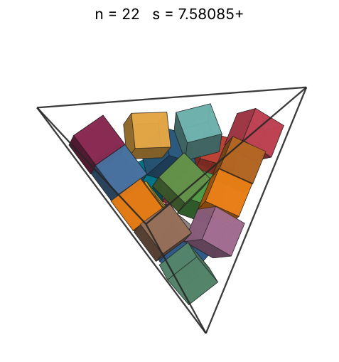 |
| 23 | [7.53414+](cubintet_n23.json) | 7.534147290116 |  | 5.80049 | 0.4563 | 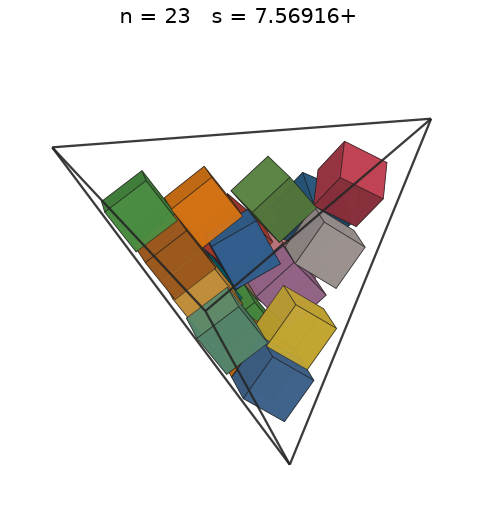 |
| 24 | [7.59821+](cubintet_n24.json) | 7.598218517151 |  | 5.88337 | 0.4642 | 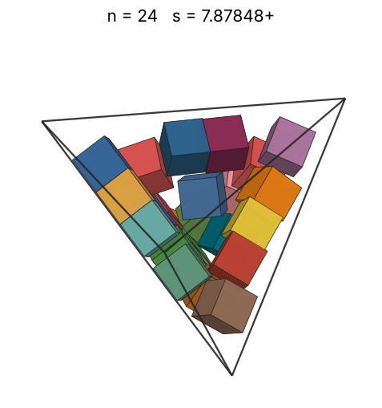 |
| 25 | [7.59821+](cubintet_n25.json) | 7.598218521683 |  | 5.96397 | 0.4836 | 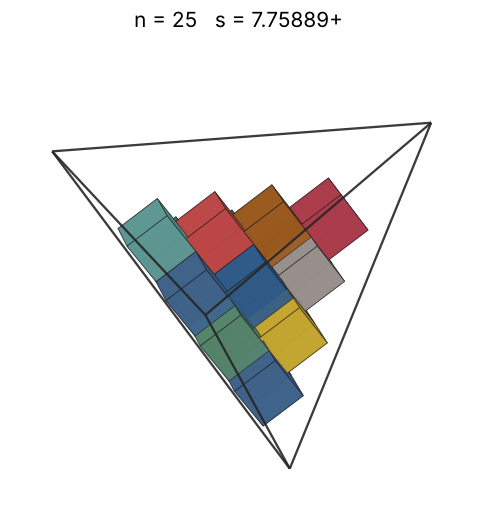 |
| 26 | [7.79391+](cubintet_n26.json) | 7.793914361119 |  | 6.04245 | 0.4660 | 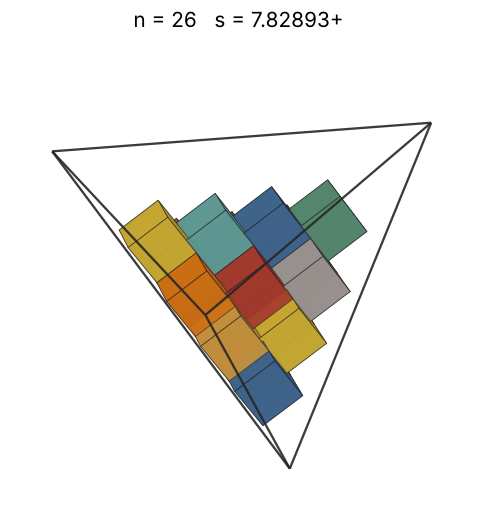 |
| 27 | [7.84354+](cubintet_n27.json) | 7.843547069550 | 2 + √(288√2 + 822)/6 | 6.11895 | 0.4748 | 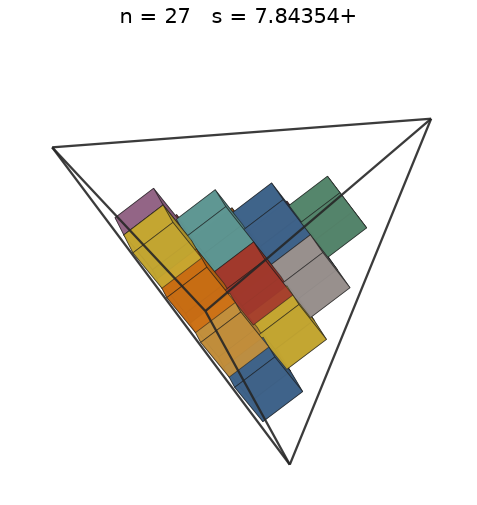 |
| 28 | [7.89233+](cubintet_n28.json) | 7.892337744468 |  | 6.19358 | 0.4833 | 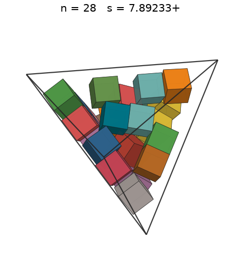 |
| 29 | [7.89233+](cubintet_n29.json) | 7.892337776945 |  | 6.26645 | 0.5005 | 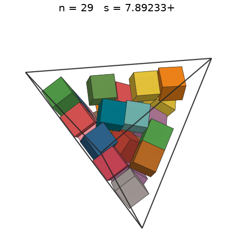 |
| 30 | [7.91500+](cubintet_n30.json) | 7.915000830178 |  | 6.33766 | 0.5134 | 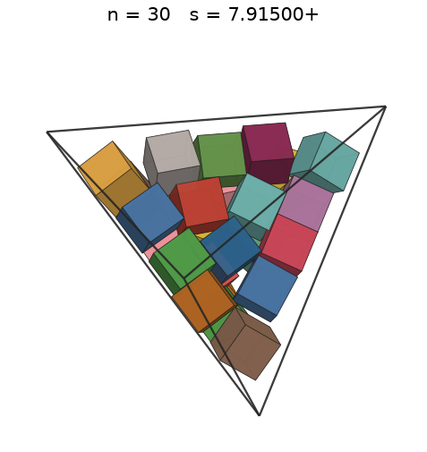 |
| 31 | [7.98363+](cubintet_n31.json) | 7.983637351177 |  | 6.40731 | 0.5169 | 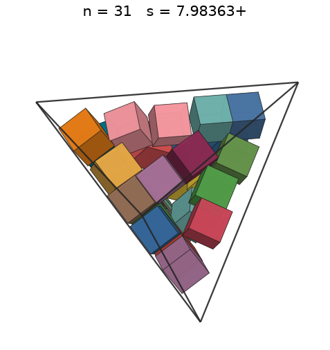 |
| 32 | [7.98363+](cubintet_n32.json) | 7.983637351177 | 2 + 4√3/3 + 3√6/2 | 6.47548 | 0.5336 | 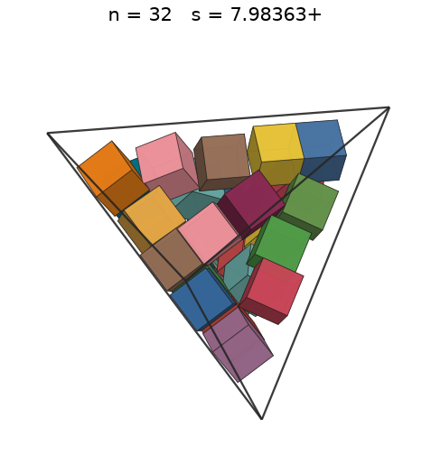 |
| 33 | [8.06921+](cubintet_n33.json) | 8.069213431661 |  | 6.54224 | 0.5330 | 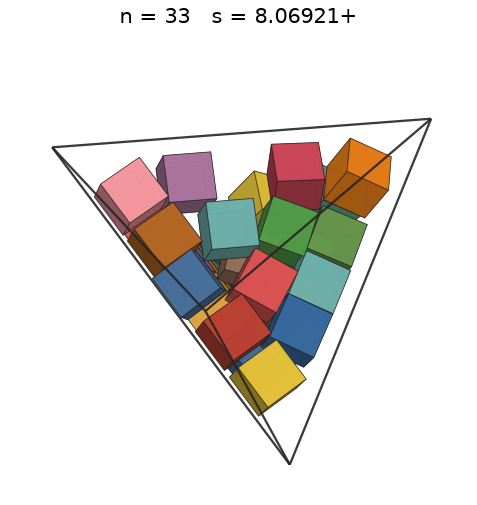 |
| 34 | [8.06921+](cubintet_n34.json) | 8.069213457666 |  | 6.60767 | 0.5491 | 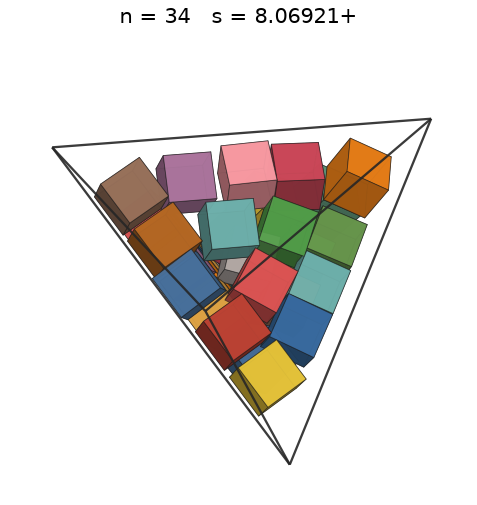 |
| 35 | [8.06921+](cubintet_n35.json) | 8.069213458379 |  | 6.67183 | 0.5653 | 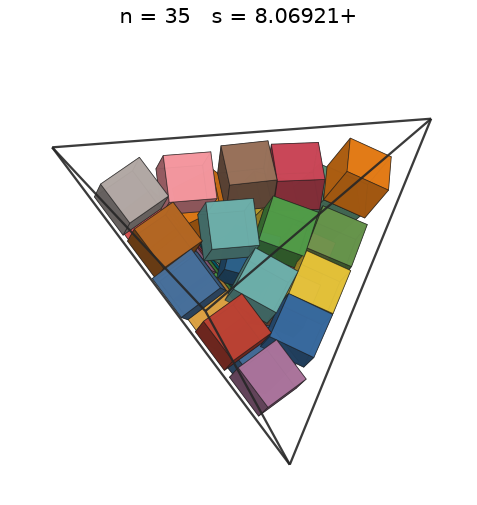 |
| 36 | [8.37944+](cubintet_n36.json) | 8.379445459771 | √(72√2 + 102)/6 + 6 | 6.73477 | 0.5192 | 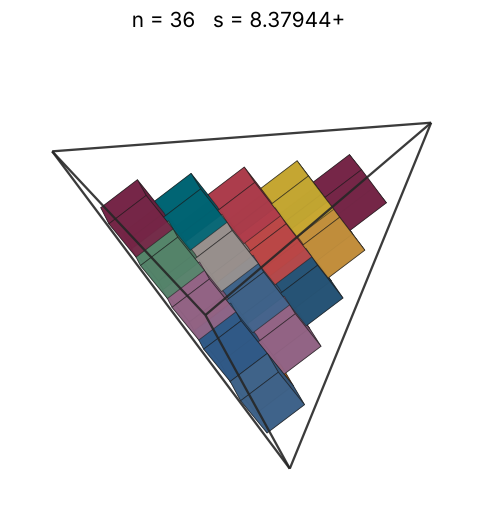 |
| 37 | [8.53414+](cubintet_n37.json) | 8.534145999697 | √(144√2 + 246)/6 + 5 | 6.79656 | 0.5051 | 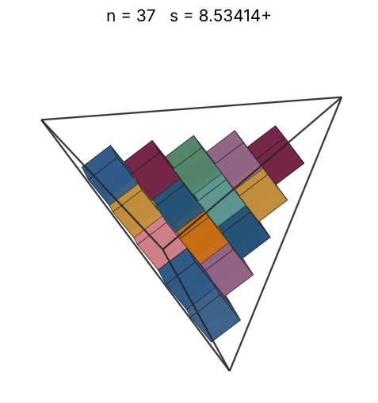 |
| 38 | [8.60419+](cubintet_n38.json) | 8.604190333410 | √(36√2 + 66)/3 + 5 | 6.85725 | 0.5062 | 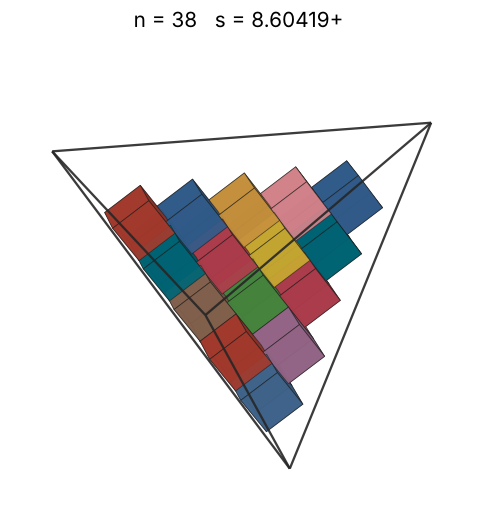 |
| 39 | [8.68884+](cubintet_n39.json) | 8.688846539623 | 4 + √(24√2 + 54)/2 | 6.91688 | 0.5045 | 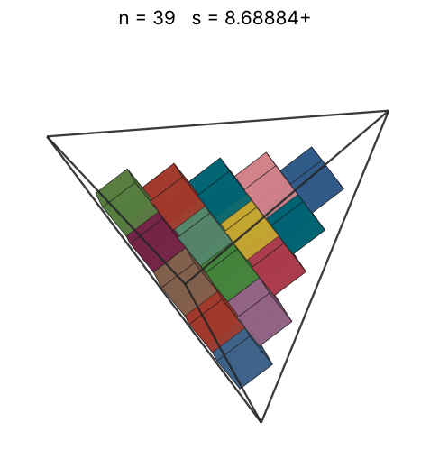 |
| 40 | [8.75889+](cubintet_n40.json) | 8.758890873336 | 4 + √(72√2 + 102)/3 | 6.97550 | 0.5051 | 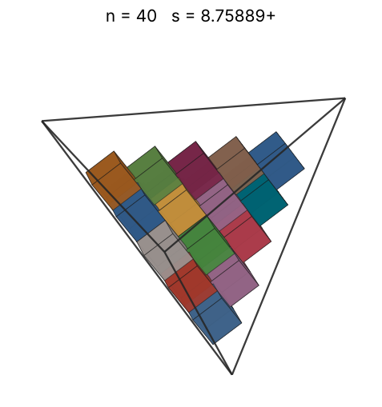 |
| 41 | [8.75889+](cubintet_n41.json) | 8.758891357497 |  | 7.03315 | 0.5177 |  |
| 42 | [8.84354+](cubintet_n42.json) | 8.843547571330 |  | 7.08987 | 0.5153 |  |
| 43 | [8.90578+](cubintet_n43.json) | 8.905788019271 |  | 7.14570 | 0.5166 |  |
| 44 | [8.90578+](cubintet_n44.json) | 8.905788019271 |  | 7.20067 | 0.5286 |  |
| 45 | [8.99824+](cubintet_n45.json) | 8.998249248928 | √6/2 + 2 + 10√3/3 | 7.25481 | 0.5241 |  |
| 46 | [9.05368+](cubintet_n46.json) | 9.053681726216 | 2√3/3 + 3 + 2√6 | 7.30816 | 0.5260 |  |
| 47 | [9.06829+](cubintet_n47.json) | 9.068293602954 | 2 + √6 + 8√3/3 | 7.36074 | 0.5348 |  |
| 48 | [9.13833+](cubintet_n48.json) | 9.138337956980 | 2 + 2√3 + 3√6/2 | 7.41258 | 0.5337 |  |
| 49 | [9.15295+](cubintet_n49.json) | 9.152949833718 | 1 + √6/2 + 4√3 | 7.46370 | 0.5422 |  |
| 50 | [9.20838+](cubintet_n50.json) | 9.208382311005 | 2 + 4√3/3 + 2√6 | 7.51413 | 0.5434 |  |
| 51 | [9.22299+](cubintet_n51.json) | 9.222994187744 | 1 + √6 + 10√3/3 | 7.56389 | 0.5516 |  |
| 52 | [9.27842+](cubintet_n52.json) | 9.278426665031 | 2√3/3 + 2 + 5√6/2 | 7.61301 | 0.5524 |  |
| 53 | [9.29303+](cubintet_n53.json) | 9.293038541769 | 1 + 3√6/2 + 8√3/3 | 7.66150 | 0.5604 |  |
| 54 | [9.36308+](cubintet_n54.json) | 9.363082895795 | 1 + 2√3 + 2√6 | 7.70939 | 0.5582 |  |
| 55 | [9.37944+](cubintet_n55.json) | 9.379447209771 | 2√3/3 + √6/2 + 7 | 7.75669 | 0.5656 |  |
| 56 | [9.43312+](cubintet_n56.json) | 9.433127249820 | 1 + 4√3/3 + 5√6/2 | 7.80342 | 0.5661 |  |
| 57 | [9.50317+](cubintet_n57.json) | 9.503171603846 |  | 7.84959 | 0.5636 |  |
| 58 | [9.53414+](cubintet_n58.json) | 9.534147794560 |  | 7.89523 | 0.5679 |  |
| 59 | [9.60419+](cubintet_n59.json) | 9.604192148586 |  | 7.94035 | 0.5651 |  |
| 60 | [9.68884+](cubintet_n60.json) | 9.688848379350 |  | 7.98496 | 0.5598 |  |
| 61 | [9.75889+](cubintet_n61.json) | 9.758892733375 |  | 8.02907 | 0.5569 |  |
| 62 | [9.82893+](cubintet_n62.json) | 9.828937087401 |  | 8.07271 | 0.5540 |  |
| 63 | [9.84354+](cubintet_n63.json) | 9.843548964139 |  | 8.11588 | 0.5605 |  |
| 64 | [9.91359+](cubintet_n64.json) | 9.913593318165 |  | 8.15860 | 0.5574 |  |
| 65 | [9.98363+](cubintet_n65.json) | 9.983637672190 |  | 8.20087 | 0.5543 |  |
| 66 | [9.99825+](cubintet_n66.json) | 9.998249548928 |  | 8.24271 | 0.5603 |  |
| 67 | [10.05368+](cubintet_n67.json) | 10.053682026216 |  | 8.28413 | 0.5595 |  |
| 68 | [10.06829+](cubintet_n68.json) | 10.068293902954 |  | 8.32514 | 0.5653 |  |
| 69 | [10.13833+](cubintet_n69.json) | 10.138338256980 |  | 8.36575 | 0.5618 |  |
| 70 | [10.15295+](cubintet_n70.json) | 10.152950133718 |  | 8.40598 | 0.5675 |  |
| 71 | [10.20838+](cubintet_n71.json) | 10.208382611005 |  | 8.44581 | 0.5663 |  |
| 72 | [10.22299+](cubintet_n72.json) | 10.222994487744 |  | 8.48528 | 0.5718 |  |
| 73 | [10.27842+](cubintet_n73.json) | 10.278426965031 |  | 8.52438 | 0.5704 |  |
| 74 | [10.29303+](cubintet_n74.json) | 10.293038841769 |  | 8.56313 | 0.5758 |  |
| 75 | [10.30765+](cubintet_n75.json) | 10.307650718507 |  | 8.60153 | 0.5811 |  |
| 76 | [10.36308+](cubintet_n76.json) | 10.363083195795 |  | 8.63959 | 0.5794 |  |
| 77 | [10.37769+](cubintet_n77.json) | 10.377695072533 |  | 8.67732 | 0.5846 |  |
| 78 | [10.37944+](cubintet_n78.json) | 10.379447509771 |  | 8.71472 | 0.5919 |  |
| 79 | [10.43312+](cubintet_n79.json) | 10.433127549820 |  | 8.75181 | 0.5903 |  |
| 80 | [10.44773+](cubintet_n80.json) | 10.447739426559 |  | 8.78858 | 0.5952 |  |
| 81 | [10.50317+](cubintet_n81.json) | 10.503171903846 |  | 8.82505 | 0.5932 |  |
| 82 | [10.51778+](cubintet_n82.json) | 10.517783780584 |  | 8.86122 | 0.5980 |  |
| 83 | [10.53414+](cubintet_n83.json) | 10.534148094560 |  | 8.89709 | 0.6025 |  |
| 84 | [10.58782+](cubintet_n84.json) | 10.587828134610 |  | 8.93268 | 0.6005 |  |
| 85 | [10.60419+](cubintet_n85.json) | 10.604192448586 |  | 8.96799 | 0.6049 |  |
| 86 | [10.65787+](cubintet_n86.json) | 10.657872488636 |  | 9.00302 | 0.6028 |  |
| 87 | [10.68884+](cubintet_n87.json) | 10.688848679350 |  | 9.03778 | 0.6045 |  |
| 88 | [10.72791+](cubintet_n88.json) | 10.727916842661 |  | 9.07228 | 0.6048 |  |
| 89 | [10.75889+](cubintet_n89.json) | 10.758893033375 |  | 9.10651 | 0.6064 |  |
| 90 | [10.82893+](cubintet_n90.json) | 10.828937387401 |  | 9.14049 | 0.6014 |  |
| 91 | [10.84354+](cubintet_n91.json) | 10.843549264139 |  | 9.17422 | 0.6056 |  |
| 92 | [10.91359+](cubintet_n92.json) | 10.913593618165 |  | 9.20770 | 0.6006 |  |
| 93 | [10.98363+](cubintet_n93.json) | 10.983637972190 |  | 9.24095 | 0.5955 |  |
| 94 | [10.99825+](cubintet_n94.json) | 10.998249848928 |  | 9.27395 | 0.5995 |  |
| 95 | [11.05368+](cubintet_n95.json) | 11.053682326216 |  | 9.30672 | 0.5969 |  |
| 96 | [11.06829+](cubintet_n96.json) | 11.068294202954 |  | 9.33926 | 0.6008 |  |
| 97 | [11.13833+](cubintet_n97.json) | 11.138338556980 |  | 9.37158 | 0.5956 |  |
| 98 | [11.15295+](cubintet_n98.json) | 11.152950433718 |  | 9.40367 | 0.5994 |  |
| 99 | [11.20838+](cubintet_n99.json) | 11.208382911005 |  | 9.43555 | 0.5966 |  |
| 100 | [11.22299+](cubintet_n100.json) | 11.222994787744 | √6 + 3 + 10√3/3 | 9.46721 | 0.6003 |  |
