# Dodecahedra in a cube

s = container edge / piece edge; every row certified in exact arithmetic.

| n | s | touching limit | closed form (conj.) | volume bound | density | picture |
|---|---|---|---|---|---|---|
| 2 | [3.83684+](dodincub_n02.json) | 3.836848358937 | 16/267 + (334√2 + √(63020√2 + 198270))/267 | 2.48396 | 0.2713 | 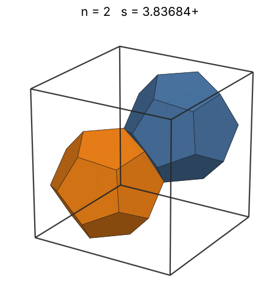 |
| 3 | [4.23606+](dodincub_n03.json) | 4.236068050289 | 2 + √5 | 2.84343 | 0.3024 | 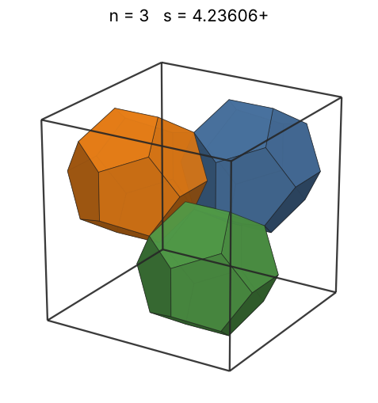 |
| 4 | [4.23606+](dodincub_n04.json) | 4.236068050347 | 2 + √5 | 3.12960 | 0.4033 | 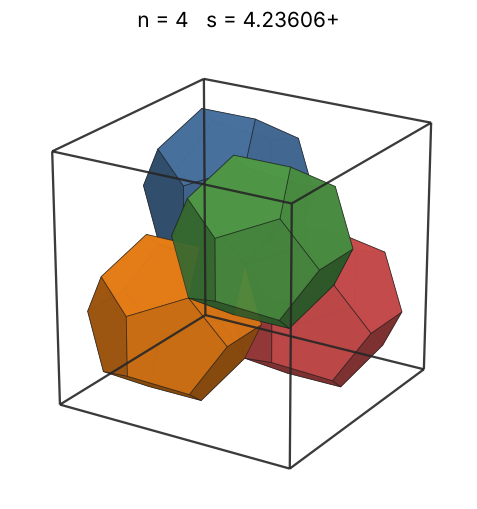 |
| 5 | [4.62701+](dodincub_n05.json) | 4.627018118505 |  | 3.37126 | 0.3868 | 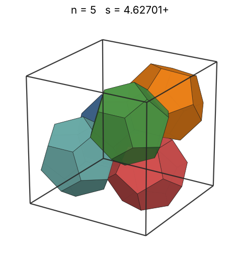 |
| 6 | [4.70898+](dodincub_n06.json) | 4.708987994281 |  | 3.58250 | 0.4403 | 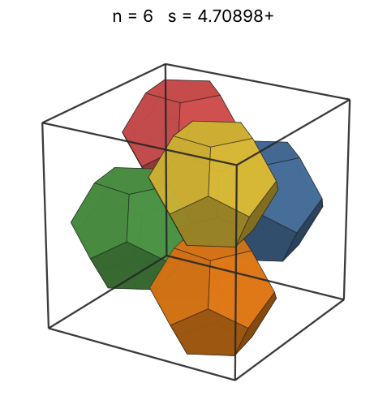 |
| 7 | [4.84190+](dodincub_n07.json) | 4.841904790230 |  | 3.77139 | 0.4726 | 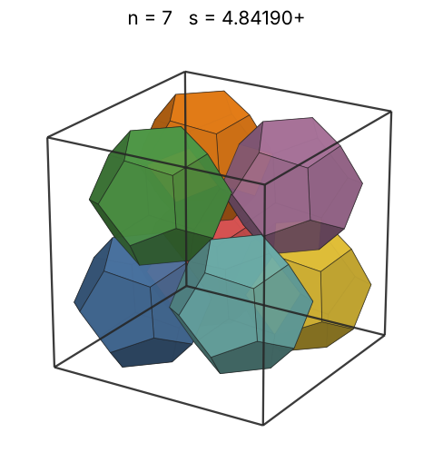 |
| 8 | [4.86954+](dodincub_n08.json) | 4.869542021132 | -43/3 + (√(4255 - 1330√10) + 16√10)/3 | 3.94305 | 0.5309 | 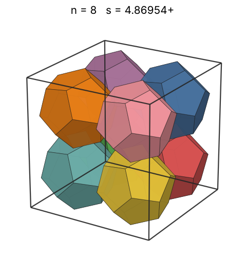 |
| 9 | [5.31288+](dodincub_n09.json) | 5.312881186904 |  | 4.10093 | 0.4599 | 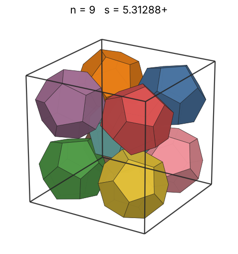 |
| 10 | [5.59263+](dodincub_n10.json) | 5.592638093416 |  | 4.24752 | 0.4381 | 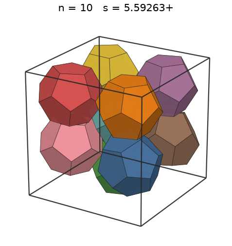 |
| 11 | [5.84798+](dodincub_n11.json) | 5.847981434928 |  | 4.38463 | 0.4215 | 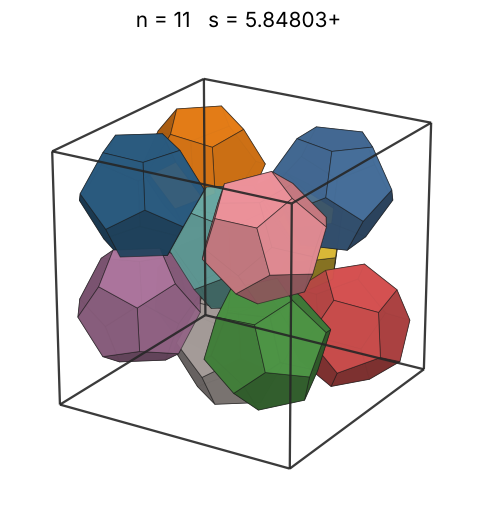 |
| 12 | [5.85410+](dodincub_n12.json) | 5.854102613463 |  | 4.51366 | 0.4584 | 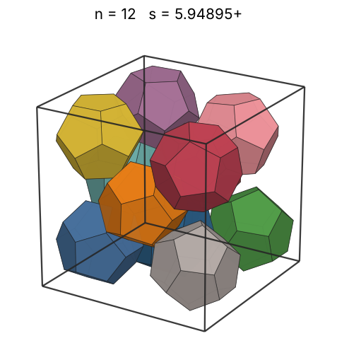 |
| 13 | [5.85410+](dodincub_n13.json) | 5.854102613463 |  | 4.63571 | 0.4966 | 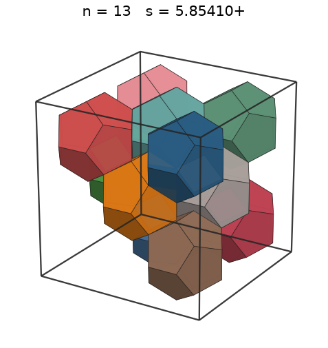 |
| 14 | [5.85410+](dodincub_n14.json) | 5.854102613463 |  | 4.75165 | 0.5348 | 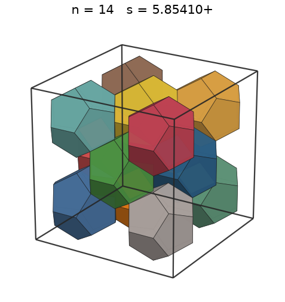 |
| 15 | [6.35075+](dodincub_n15.json) | 6.350754518760 |  | 4.86219 | 0.4488 | 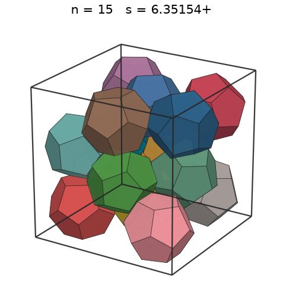 |
| 16 | [6.44271+](dodincub_n16.json) | 6.442711516567 |  | 4.96793 | 0.4585 | 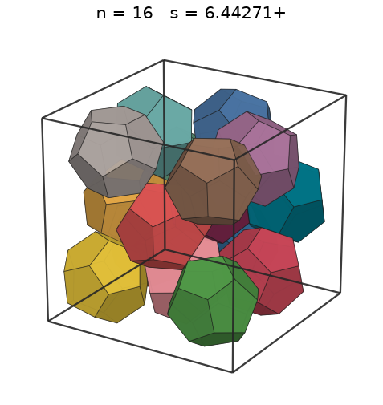 |
| 17 | [6.50407+](dodincub_n17.json) | 6.504070953173 |  | 5.06934 | 0.4735 | 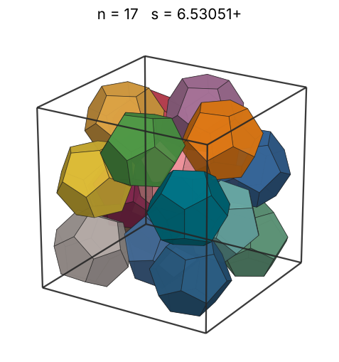 |
| 18 | [6.56191+](dodincub_n18.json) | 6.561911295570 |  | 5.16685 | 0.4882 | 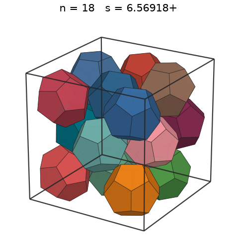 |
| 19 | [6.68419+](dodincub_n19.json) | 6.684195156467 |  | 5.26082 | 0.4875 | 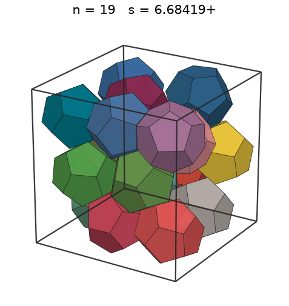 |
| 20 | [6.69542+](dodincub_n20.json) | 6.695422194085 |  | 5.35154 | 0.5106 | 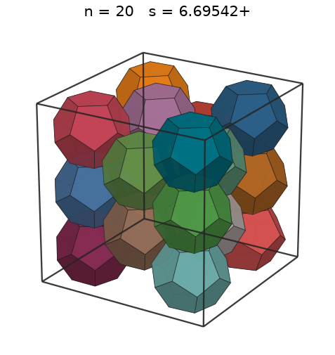 |
| 21 | [6.83372+](dodincub_n21.json) | 6.833725562236 |  | 5.43928 | 0.5043 | 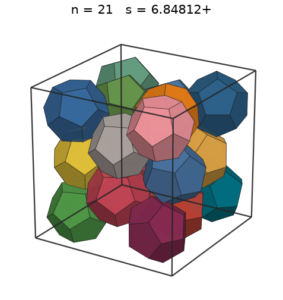 |
| 22 | [6.91917+](dodincub_n22.json) | 6.919177354547 |  | 5.52429 | 0.5089 | 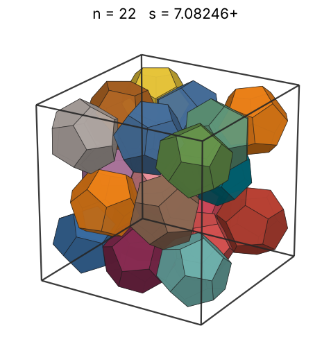 |
| 23 | [6.95113+](dodincub_n23.json) | 6.951132218483 |  | 5.60675 | 0.5248 | 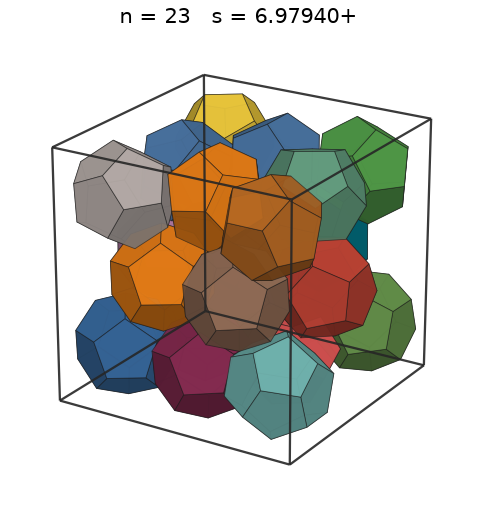 |
| 24 | [7.11143+](dodincub_n24.json) | 7.111430245155 |  | 5.68686 | 0.5114 | 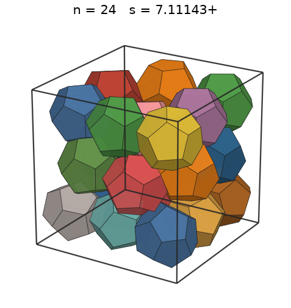 |
| 25 | [7.14960+](dodincub_n25.json) | 7.149607534045 |  | 5.76477 | 0.5242 | 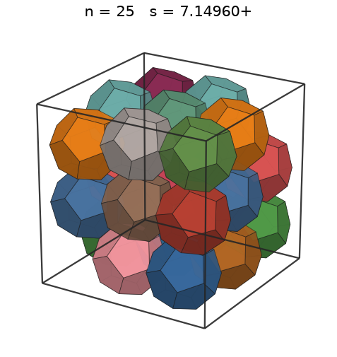 |
| 26 | [7.17653+](dodincub_n26.json) | 7.176534994149 |  | 5.84063 | 0.5391 | 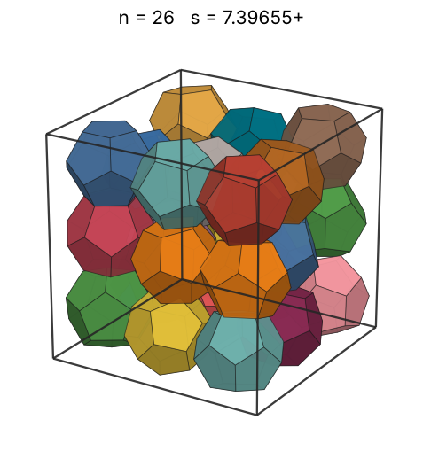 |
| 27 | [7.20283+](dodincub_n27.json) | 7.202838457608 |  | 5.91457 | 0.5537 | 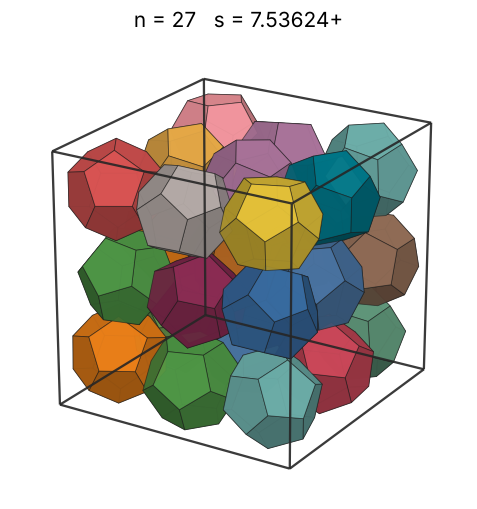 |
| 28 | [7.47213+](dodincub_n28.json) | 7.472136172981 |  | 5.98671 | 0.5143 | 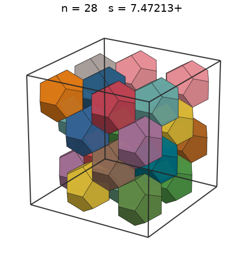 |
| 29 | [7.47213+](dodincub_n29.json) | 7.472136172981 |  | 6.05714 | 0.5327 | 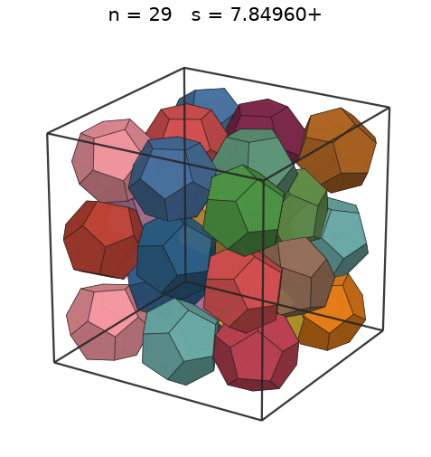 |
| 30 | [7.47213+](dodincub_n30.json) | 7.472136172981 |  | 6.12598 | 0.5511 | 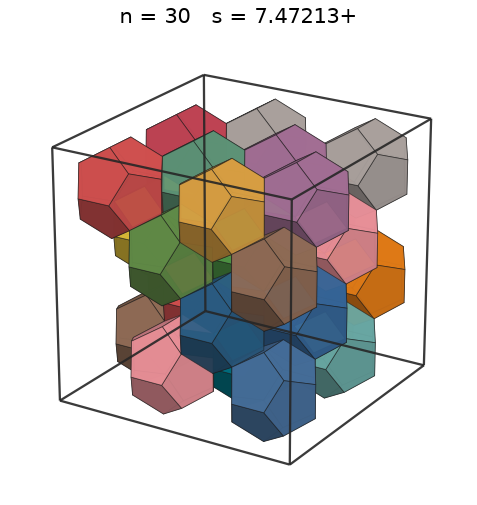 |
| 31 | [7.47213+](dodincub_n31.json) | 7.472137411230 | 3 + 2√5 | 6.19330 | 0.5694 | 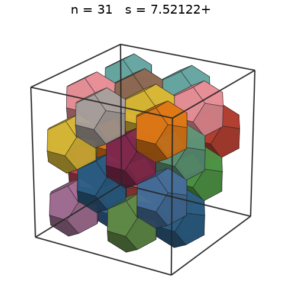 |
| 32 | [7.47213+](dodincub_n32.json) | 7.472137411230 | 3 + 2√5 | 6.25920 | 0.5878 | 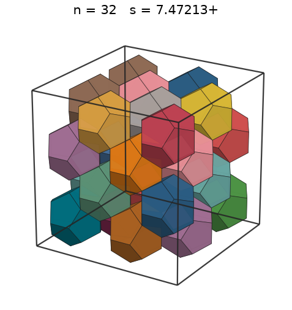 |
| 33 | [7.87119+](dodincub_n33.json) | 7.871193378268 |  | 6.32373 | 0.5186 | 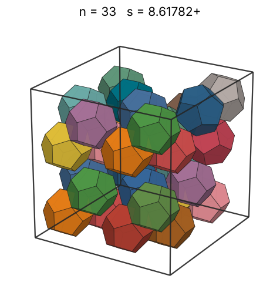 |
| 34 | [8.08498+](dodincub_n34.json) | 8.084986507761 |  | 6.38697 | 0.4930 | 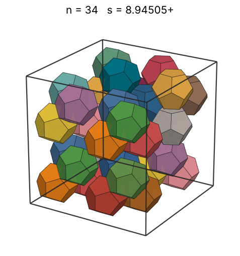 |
| 35 | [8.11403+](dodincub_n35.json) | 8.114038321562 |  | 6.44898 | 0.5021 | 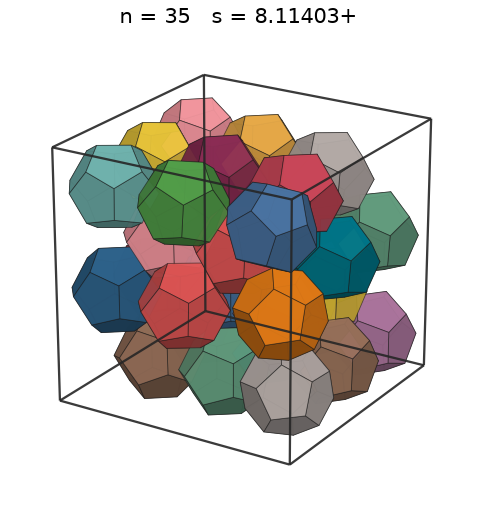 |
| 36 | [8.17562+](dodincub_n36.json) | 8.175622758736 |  | 6.50983 | 0.5048 | 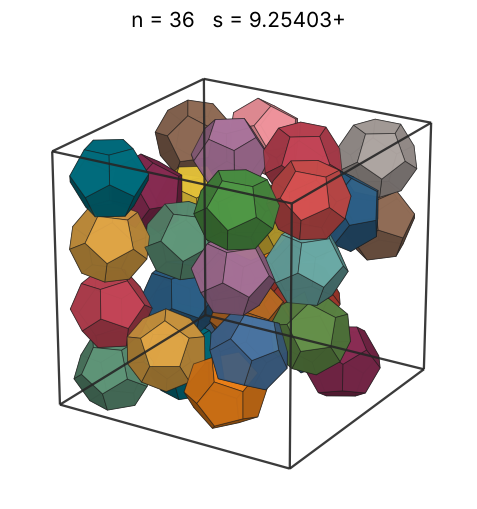 |
| 37 | [8.34339+](dodincub_n37.json) | 8.343396257527 |  | 6.56955 | 0.4882 | 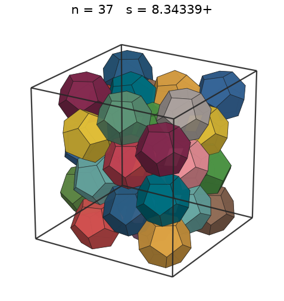 |
| 38 | [8.37965+](dodincub_n38.json) | 8.379653459384 |  | 6.62821 | 0.4949 | 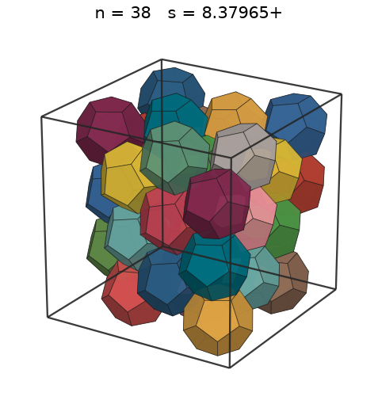 |
| 39 | [8.40146+](dodincub_n39.json) | 8.401461587651 |  | 6.68585 | 0.5040 | 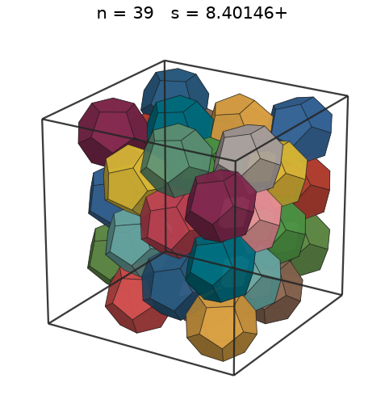 |
| 40 | [8.43541+](dodincub_n40.json) | 8.435419256162 |  | 6.74251 | 0.5107 | 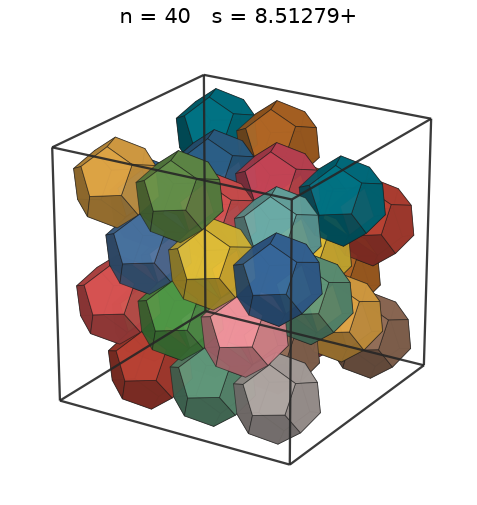 |
| 41 | [8.44315+](dodincub_n41.json) | 8.443157896852 |  | 6.79824 | 0.5220 |  |
| 42 | [8.44772+](dodincub_n42.json) | 8.447720047568 |  | 6.85307 | 0.5339 |  |
| 43 | [8.67563+](dodincub_n43.json) | 8.675631458264 |  | 6.90703 | 0.5046 |  |
| 44 | [8.78911+](dodincub_n44.json) | 8.789110317887 |  | 6.96016 | 0.4966 |  |
| 45 | [8.90813+](dodincub_n45.json) | 8.908132919622 |  | 7.01250 | 0.4878 |  |
| 46 | [8.90813+](dodincub_n46.json) | 8.908132919622 |  | 7.06406 | 0.4987 |  |
| 47 | [8.93485+](dodincub_n47.json) | 8.934856769972 |  | 7.11488 | 0.5049 |  |
| 48 | [9.09017+](dodincub_n48.json) | 9.090171238177 |  | 7.16499 | 0.4897 |  |
| 49 | [9.09017+](dodincub_n49.json) | 9.090171238177 |  | 7.21441 | 0.4999 |  |
| 50 | [9.09017+](dodincub_n50.json) | 9.090171238177 |  | 7.26315 | 0.5101 |  |
| 51 | [9.09017+](dodincub_n51.json) | 9.090171238177 |  | 7.31125 | 0.5203 |  |
| 52 | [9.09017+](dodincub_n52.json) | 9.090171238177 |  | 7.35873 | 0.5305 |  |
| 53 | [9.09017+](dodincub_n53.json) | 9.090171238177 |  | 7.40560 | 0.5407 |  |
| 54 | [9.09017+](dodincub_n54.json) | 9.090171238177 |  | 7.45189 | 0.5509 |  |
| 55 | [9.09017+](dodincub_n55.json) | 9.090171238177 |  | 7.49761 | 0.5611 |  |
| 56 | [9.09017+](dodincub_n56.json) | 9.090171238177 |  | 7.54278 | 0.5713 |  |
| 57 | [9.09017+](dodincub_n57.json) | 9.090171238177 |  | 7.58741 | 0.5815 |  |
| 58 | [9.09017+](dodincub_n58.json) | 9.090171238177 |  | 7.63152 | 0.5917 |  |
| 59 | [9.09017+](dodincub_n59.json) | 9.090171238177 |  | 7.67513 | 0.6019 |  |
| 60 | [9.09017+](dodincub_n60.json) | 9.090171238177 |  | 7.71825 | 0.6121 |  |
| 61 | [9.09017+](dodincub_n61.json) | 9.090171238177 |  | 7.76089 | 0.6223 |  |
| 62 | [9.09017+](dodincub_n62.json) | 9.090171238177 |  | 7.80307 | 0.6325 |  |
| 63 | [9.09017+](dodincub_n63.json) | 9.090171238177 |  | 7.84480 | 0.6427 |  |
| 64 | [9.42250+](dodincub_n64.json) | 9.422500212589 |  | 7.88609 | 0.5863 |  |
| 65 | [9.42250+](dodincub_n65.json) | 9.422500213077 |  | 7.92695 | 0.5954 |  |
| 66 | [9.42260+](dodincub_n66.json) | 9.422605532890 |  | 7.96740 | 0.6046 |  |
| 67 | [9.95672+](dodincub_n67.json) | 9.956721044326 |  | 8.00744 | 0.5202 |  |
| 68 | [9.95722+](dodincub_n68.json) | 9.957225050981 |  | 8.04708 | 0.5278 |  |
| 69 | [9.95722+](dodincub_n69.json) | 9.957225064969 |  | 8.08633 | 0.5356 |  |
| 70 | [9.96065+](dodincub_n70.json) | 9.960653300123 |  | 8.12521 | 0.5428 |  |
| 71 | [10.10419+](dodincub_n71.json) | 10.104196783416 |  | 8.16372 | 0.5274 |  |
| 72 | [10.11869+](dodincub_n72.json) | 10.118690544345 |  | 8.20187 | 0.5326 |  |
| 73 | [10.16915+](dodincub_n73.json) | 10.169154794200 |  | 8.23966 | 0.5320 |  |
| 74 | [10.16963+](dodincub_n74.json) | 10.169632634940 |  | 8.27712 | 0.5392 |  |
| 75 | [10.20843+](dodincub_n75.json) | 10.208430411194 |  | 8.31423 | 0.5402 |  |
| 76 | [10.23862+](dodincub_n76.json) | 10.238623155476 |  | 8.35102 | 0.5426 |  |
| 77 | [10.24098+](dodincub_n77.json) | 10.240986922723 |  | 8.38749 | 0.5494 |  |
| 78 | [10.25805+](dodincub_n78.json) | 10.258051289068 |  | 8.42365 | 0.5537 |  |
| 79 | [10.25901+](dodincub_n79.json) | 10.259010451571 |  | 8.45949 | 0.5607 |  |
| 80 | [10.26023+](dodincub_n80.json) | 10.260235706760 |  | 8.49504 | 0.5676 |  |
| 81 | [10.43598+](dodincub_n81.json) | 10.435985662710 |  | 8.53028 | 0.5461 |  |
| 82 | [10.43619+](dodincub_n82.json) | 10.436192518915 |  | 8.56525 | 0.5528 |  |
| 83 | [10.45364+](dodincub_n83.json) | 10.453647302468 |  | 8.59992 | 0.5568 |  |
| 84 | [10.45752+](dodincub_n84.json) | 10.457525373435 |  | 8.63432 | 0.5629 |  |
| 85 | [10.45946+](dodincub_n85.json) | 10.459463981218 |  | 8.66845 | 0.5692 |  |
| 86 | [10.46456+](dodincub_n86.json) | 10.464559893838 |  | 8.70231 | 0.5751 |  |
| 87 | [10.46746+](dodincub_n87.json) | 10.467460721231 |  | 8.73591 | 0.5813 |  |
| 88 | [10.46817+](dodincub_n88.json) | 10.468173486946 |  | 8.76926 | 0.5879 |  |
| 89 | [10.70820+](dodincub_n89.json) | 10.708206359550 | 4 + 3√5 | 8.80235 | 0.5555 |  |
| 90 | [10.70820+](dodincub_n90.json) | 10.708206359550 | 4 + 3√5 | 8.83519 | 0.5617 |  |
| 91 | [10.70820+](dodincub_n91.json) | 10.708206359550 | 4 + 3√5 | 8.86780 | 0.5679 |  |
| 92 | [10.70820+](dodincub_n92.json) | 10.708206359550 | 4 + 3√5 | 8.90016 | 0.5742 |  |
| 93 | [10.70820+](dodincub_n93.json) | 10.708206359550 | 4 + 3√5 | 8.93229 | 0.5804 |  |
| 94 | [10.70820+](dodincub_n94.json) | 10.708206359550 | 4 + 3√5 | 8.96419 | 0.5867 |  |
| 95 | [10.70820+](dodincub_n95.json) | 10.708206359550 | 4 + 3√5 | 8.99587 | 0.5929 |  |
| 96 | [10.70820+](dodincub_n96.json) | 10.708206359550 | 4 + 3√5 | 9.02732 | 0.5991 |  |
| 97 | [10.70820+](dodincub_n97.json) | 10.708206359550 | 4 + 3√5 | 9.05856 | 0.6054 |  |
| 98 | [10.70820+](dodincub_n98.json) | 10.708206359550 | 4 + 3√5 | 9.08958 | 0.6116 |  |
| 99 | [10.70820+](dodincub_n99.json) | 10.708206359550 | 4 + 3√5 | 9.12039 | 0.6179 |  |
| 100 | [10.70820+](dodincub_n100.json) | 10.708206359550 |  | 9.15100 | 0.6241 |  |
