# Dodecahedra in a cube

s = container edge / piece edge; every row certified in exact arithmetic.

| n | s | touching limit | closed form (conj.) | volume bound | density | picture |
|---|---|---|---|---|---|---|
| 2 | [3.83684+](dodincub_n02.json) | 3.836848358937 | 16/267 + (334√2 + √(63020√2 + 198270))/267 | 2.48396 | 0.2713 | 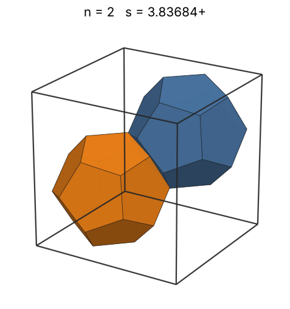 |
| 3 | [4.23606+](dodincub_n03.json) | 4.236068050289 | 2 + √5 | 2.84343 | 0.3024 | 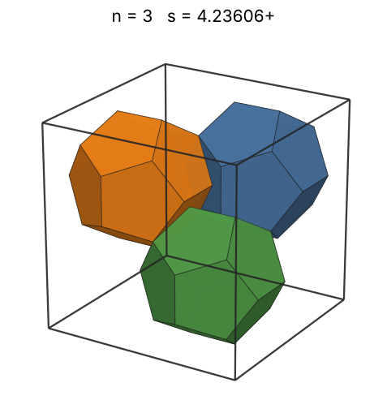 |
| 4 | [4.23606+](dodincub_n04.json) | 4.236068050347 | 2 + √5 | 3.12960 | 0.4033 | 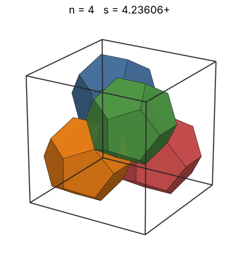 |
| 5 | [4.62701+](dodincub_n05.json) | 4.627018118505 |  | 3.37126 | 0.3868 | 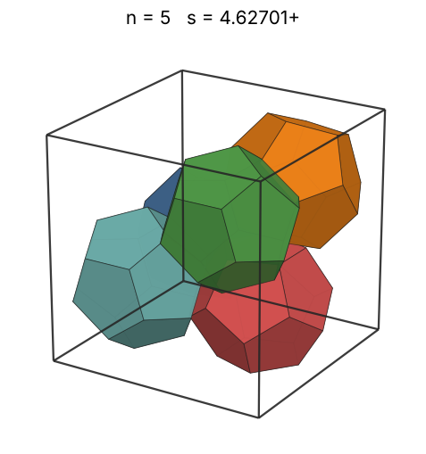 |
| 6 | [4.70898+](dodincub_n06.json) | 4.708987994281 |  | 3.58250 | 0.4403 | 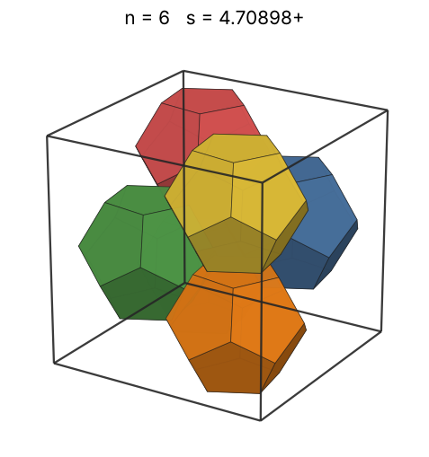 |
| 7 | [4.84190+](dodincub_n07.json) | 4.841904790230 |  | 3.77139 | 0.4726 | 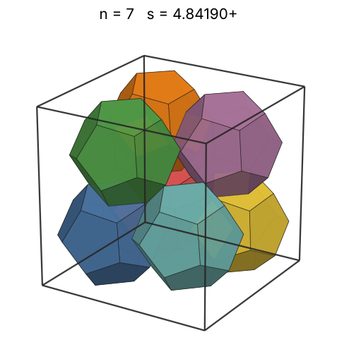 |
| 8 | [4.86954+](dodincub_n08.json) | 4.869542021132 | -43/3 + (√(4255 - 1330√10) + 16√10)/3 | 3.94305 | 0.5309 | 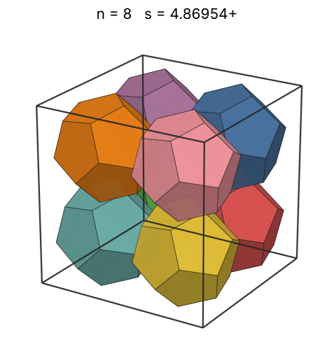 |
| 9 | [5.31288+](dodincub_n09.json) | 5.312881186904 |  | 4.10093 | 0.4599 | 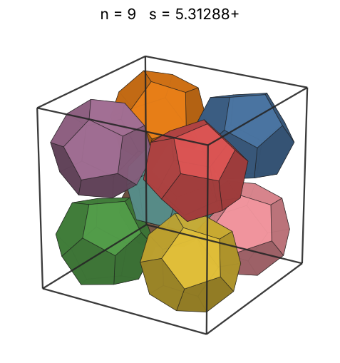 |
| 10 | [5.59293+](dodincub_n10.json) | 5.592930786446 |  | 4.24752 | 0.4380 | 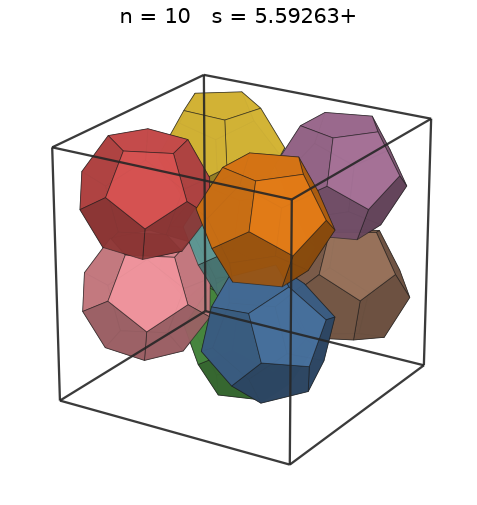 |
| 11 | [5.84803+](dodincub_n11.json) | 5.848033899820 |  | 4.38463 | 0.4215 | 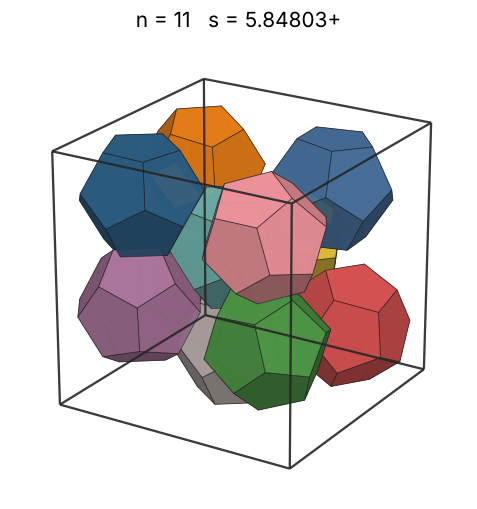 |
| 12 | [5.94797+](dodincub_n12.json) | 5.947971612335 |  | 4.51366 | 0.4370 | 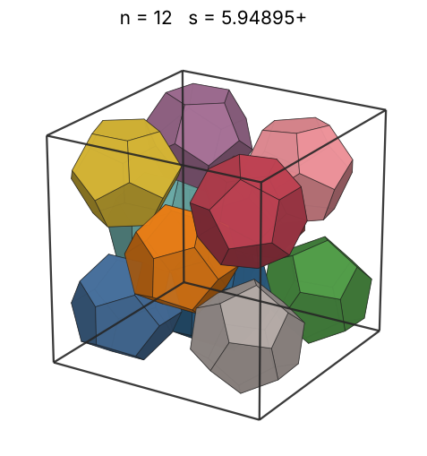 |
| 13 | [5.99604+](dodincub_n13.json) | 5.996041651595 |  | 4.63571 | 0.4621 | 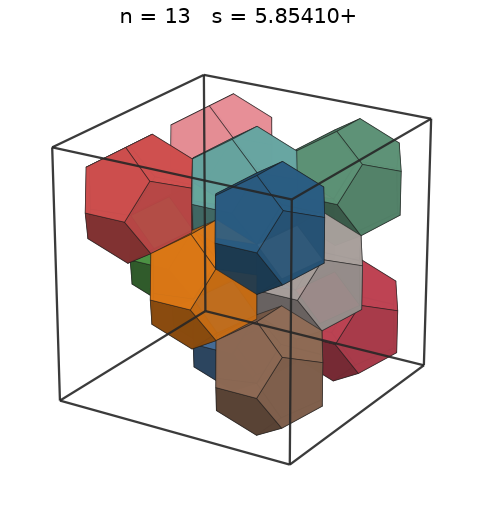 |
| 14 | [6.03198+](dodincub_n14.json) | 6.031986817941 |  | 4.75165 | 0.4888 | 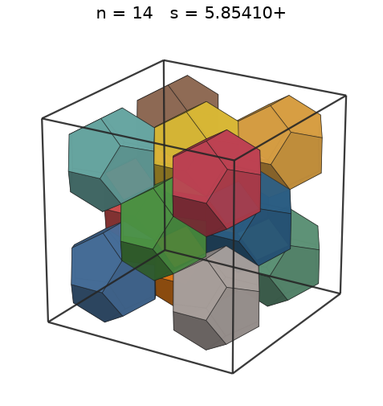 |
| 15 | [6.36843+](dodincub_n15.json) | 6.368432401837 |  | 4.86219 | 0.4450 | 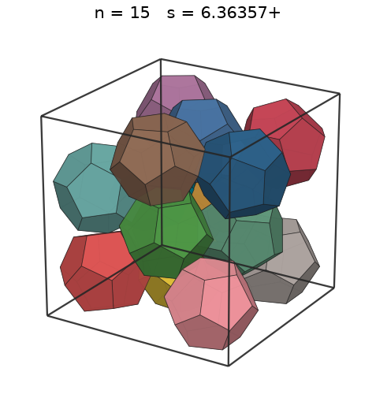 |
| 16 | [6.48092+](dodincub_n16.json) | 6.480921892121 |  | 4.96793 | 0.4504 | 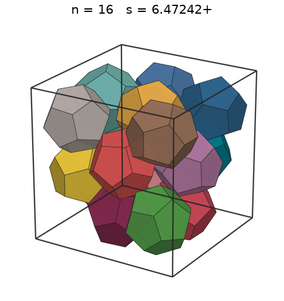 |
| 17 | [6.53051+](dodincub_n17.json) | 6.530518401447 |  | 5.06934 | 0.4677 | 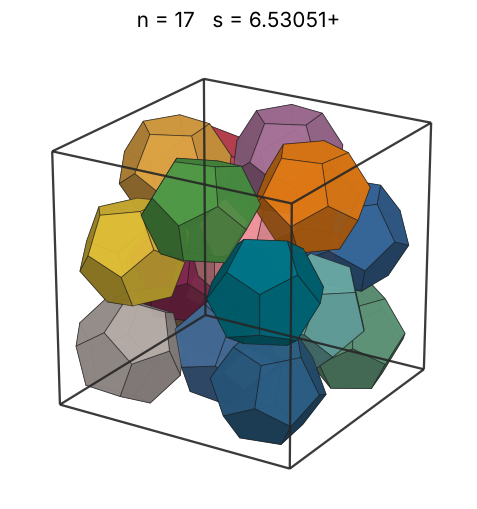 |
| 18 | [6.59367+](dodincub_n18.json) | 6.593670818563 |  | 5.16685 | 0.4812 | 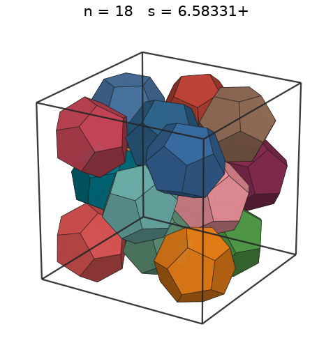 |
| 19 | [6.71934+](dodincub_n19.json) | 6.719346560398 |  | 5.26082 | 0.4799 | 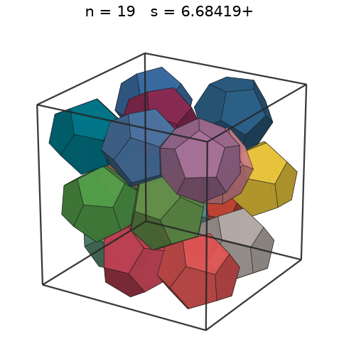 |
| 20 | [6.81553+](dodincub_n20.json) | 6.815536216061 |  | 5.35154 | 0.4841 | 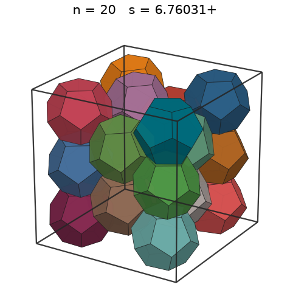 |
| 21 | [6.88592+](dodincub_n21.json) | 6.885926528633 |  | 5.43928 | 0.4929 | 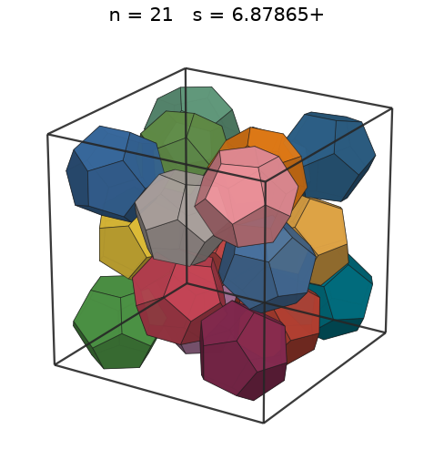 |
| 22 | [7.08246+](dodincub_n22.json) | 7.082464204350 |  | 5.52429 | 0.4745 | 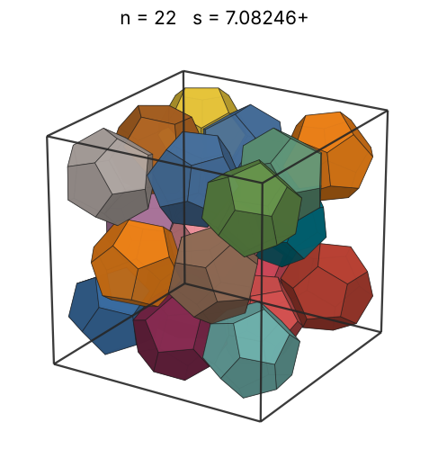 |
| 23 | [7.08246+](dodincub_n23.json) | 7.082465819394 |  | 5.60675 | 0.4961 | 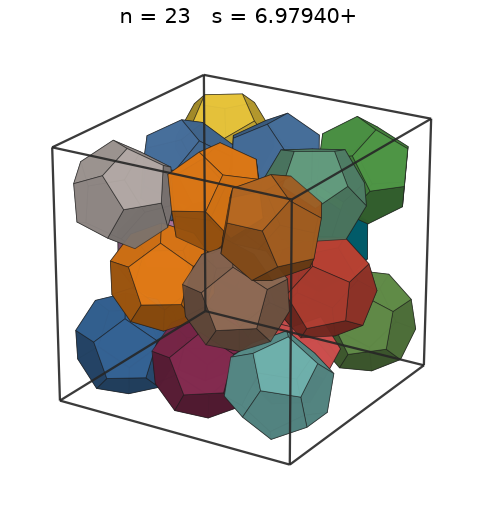 |
| 24 | [7.14348+](dodincub_n24.json) | 7.143482953518 |  | 5.68686 | 0.5045 | 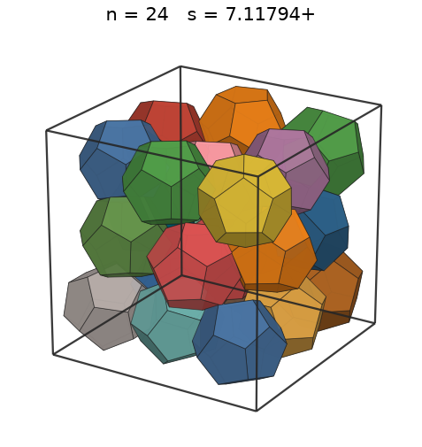 |
| 25 | [7.27663+](dodincub_n25.json) | 7.276639588791 |  | 5.76477 | 0.4972 | 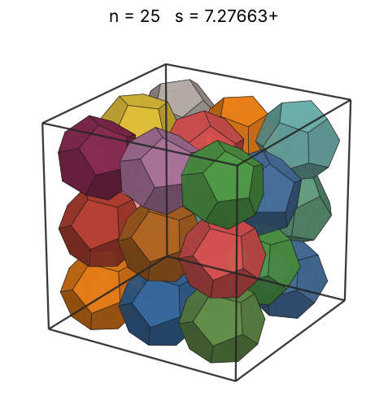 |
| 26 | [7.39655+](dodincub_n26.json) | 7.396559456985 |  | 5.84063 | 0.4924 | 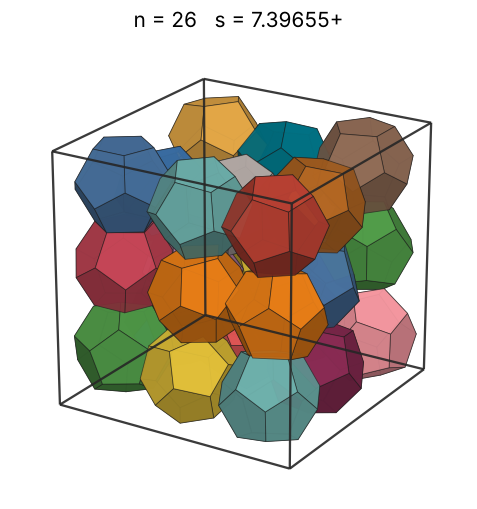 |
| 27 | [7.52843+](dodincub_n27.json) | 7.528436295324 |  | 5.91457 | 0.4849 | 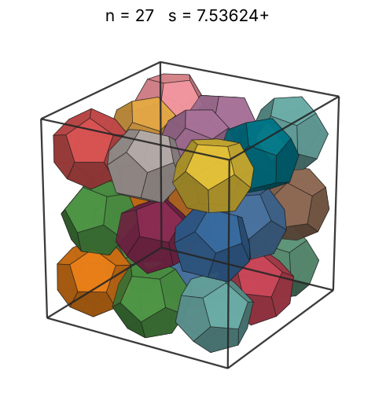 |
| 28 | [7.76115+](dodincub_n28.json) | 7.761154271175 |  | 5.98671 | 0.4590 | 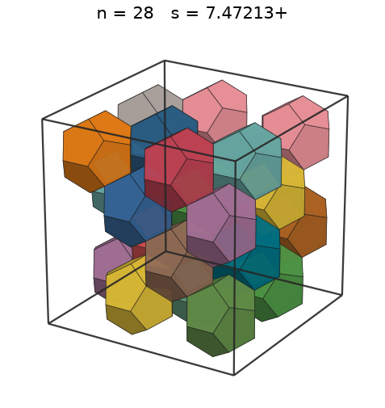 |
| 29 | [7.84960+](dodincub_n29.json) | 7.849601094364 |  | 6.05714 | 0.4595 | 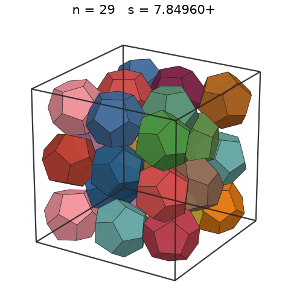 |
| 30 | [7.96125+](dodincub_n30.json) | 7.961252633172 |  | 6.12598 | 0.4556 | 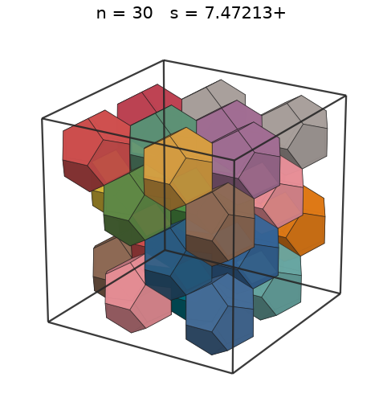 |
| 31 | [8.47213+](dodincub_n31.json) | 8.472136100690 | 4 + 2√5 | 6.19330 | 0.3907 | 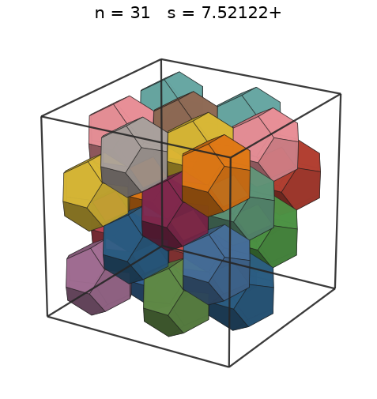 |
| 32 | [8.47213+](dodincub_n32.json) | 8.472136100690 | 4 + 2√5 | 6.25920 | 0.4033 | 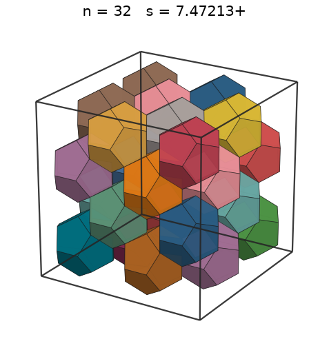 |
| 33 | [8.54439+](dodincub_n33.json) | 8.544398815508 |  | 6.32373 | 0.4054 | 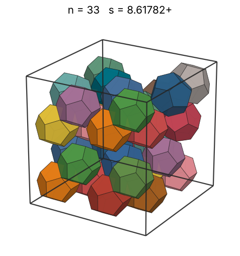 |
| 34 | [8.55533+](dodincub_n34.json) | 8.555336893062 |  | 6.38697 | 0.4161 | 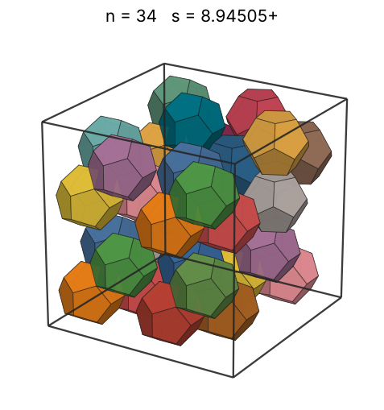 |
| 35 | [8.55585+](dodincub_n35.json) | 8.555855946331 |  | 6.44898 | 0.4282 | 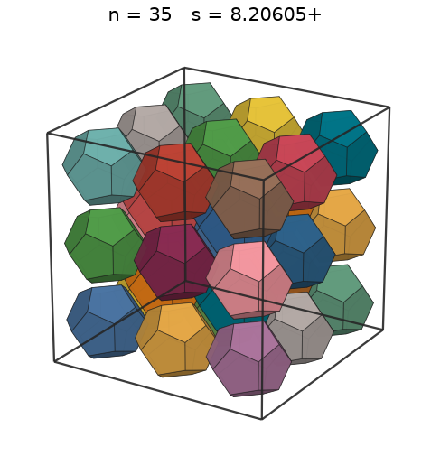 |
| 36 | [8.55597+](dodincub_n36.json) | 8.555970862119 |  | 6.50983 | 0.4405 | 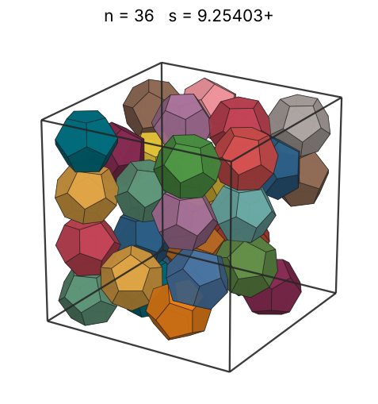 |
| 37 | [8.55987+](dodincub_n37.json) | 8.559872011144 |  | 6.56955 | 0.4521 | 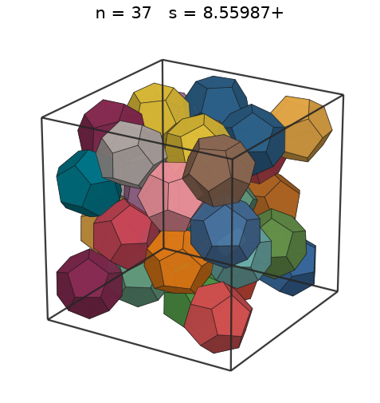 |
| 38 | [8.56231+](dodincub_n38.json) | 8.562312444364 |  | 6.62821 | 0.4639 | 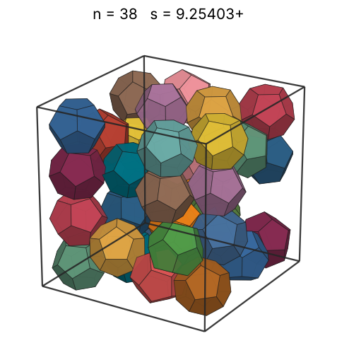 |
| 39 | [8.57067+](dodincub_n39.json) | 8.570679484811 |  | 6.68585 | 0.4747 | 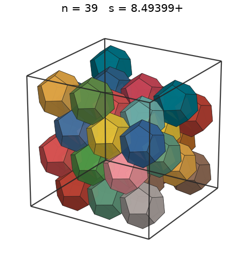 |
| 40 | [8.57112+](dodincub_n40.json) | 8.571124738068 |  | 6.74251 | 0.4868 | 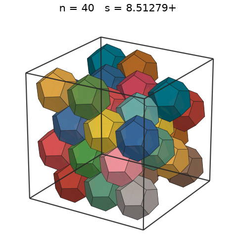 |
| 41 | [8.57200+](dodincub_n41.json) | 8.572005101871 |  | 6.79824 | 0.4988 |  |
| 42 | [8.60822+](dodincub_n42.json) | 8.608228991683 |  | 6.85307 | 0.5046 |  |
| 43 | [8.67563+](dodincub_n43.json) | 8.675631458264 |  | 6.90703 | 0.5046 |  |
| 44 | [8.78911+](dodincub_n44.json) | 8.789110317887 |  | 6.96016 | 0.4966 |  |
| 45 | [9.24009+](dodincub_n45.json) | 9.240093361466 |  | 7.01250 | 0.4371 |  |
| 46 | [9.25583+](dodincub_n46.json) | 9.255835977634 |  | 7.06406 | 0.4445 |  |
| 47 | [9.27267+](dodincub_n47.json) | 9.272678760515 |  | 7.11488 | 0.4517 |  |
| 48 | [9.29454+](dodincub_n48.json) | 9.294545681136 |  | 7.16499 | 0.4581 |  |
| 49 | [9.62616+](dodincub_n49.json) | 9.626167903404 |  | 7.21441 | 0.4210 |  |
| 50 | [9.62616+](dodincub_n50.json) | 9.626167909291 |  | 7.26315 | 0.4296 |  |
| 51 | [9.62617+](dodincub_n51.json) | 9.626177691933 |  | 7.31125 | 0.4381 |  |
| 52 | [9.62618+](dodincub_n52.json) | 9.626180965719 |  | 7.35873 | 0.4467 |  |
| 53 | [9.63026+](dodincub_n53.json) | 9.630269797842 |  | 7.40560 | 0.4547 |  |
| 54 | [9.63162+](dodincub_n54.json) | 9.631623371790 |  | 7.45189 | 0.4631 |  |
| 55 | [9.63598+](dodincub_n55.json) | 9.635984207960 |  | 7.49761 | 0.4711 |  |
| 56 | [9.64712+](dodincub_n56.json) | 9.647127521307 |  | 7.54278 | 0.4780 |  |
| 57 | [9.73908+](dodincub_n57.json) | 9.739084037603 | -86/3 + (2√(4255 - 1330√10) + 32√10)/3 | 7.58741 | 0.4729 |  |
| 58 | [9.73908+](dodincub_n58.json) | 9.739084037603 | -86/3 + (2√(4255 - 1330√10) + 32√10)/3 | 7.63152 | 0.4811 |  |
| 59 | [9.73908+](dodincub_n59.json) | 9.739084037603 | -86/3 + (2√(4255 - 1330√10) + 32√10)/3 | 7.67513 | 0.4894 |  |
| 60 | [9.73908+](dodincub_n60.json) | 9.739084037603 | -86/3 + (2√(4255 - 1330√10) + 32√10)/3 | 7.71825 | 0.4977 |  |
| 61 | [9.73908+](dodincub_n61.json) | 9.739084037603 | -86/3 + (2√(4255 - 1330√10) + 32√10)/3 | 7.76089 | 0.5060 |  |
| 62 | [9.73908+](dodincub_n62.json) | 9.739084037603 | -86/3 + (2√(4255 - 1330√10) + 32√10)/3 | 7.80307 | 0.5143 |  |
| 63 | [9.73908+](dodincub_n63.json) | 9.739084037603 | -86/3 + (2√(4255 - 1330√10) + 32√10)/3 | 7.84480 | 0.5226 |  |
| 64 | [9.73908+](dodincub_n64.json) | 9.739084037603 | -86/3 + (2√(4255 - 1330√10) + 32√10)/3 | 7.88609 | 0.5309 |  |
| 65 | [10.41071+](dodincub_n65.json) | 10.410713483454 |  | 7.92695 | 0.4414 |  |
| 66 | [10.42469+](dodincub_n66.json) | 10.424692933685 |  | 7.96740 | 0.4464 |  |
| 67 | [10.43609+](dodincub_n67.json) | 10.436099215497 |  | 8.00744 | 0.4517 |  |
| 68 | [10.44057+](dodincub_n68.json) | 10.440570770218 |  | 8.04708 | 0.4579 |  |
| 69 | [10.44701+](dodincub_n69.json) | 10.447011789713 |  | 8.08633 | 0.4637 |  |
| 70 | [10.44919+](dodincub_n70.json) | 10.449193631943 |  | 8.12521 | 0.4702 |  |
| 71 | [10.47165+](dodincub_n71.json) | 10.471657269176 |  | 8.16372 | 0.4738 |  |
| 72 | [10.51717+](dodincub_n72.json) | 10.517169947680 |  | 8.20187 | 0.4743 |  |
| 73 | [10.82548+](dodincub_n73.json) | 10.825480579166 |  | 8.23966 | 0.4409 |  |
| 74 | [10.82548+](dodincub_n74.json) | 10.825480579166 |  | 8.27712 | 0.4470 |  |
| 75 | [10.82548+](dodincub_n75.json) | 10.825480579166 |  | 8.31423 | 0.4530 |  |
| 76 | [10.83202+](dodincub_n76.json) | 10.832023656815 |  | 8.35102 | 0.4582 |  |
| 77 | [10.86292+](dodincub_n77.json) | 10.862928643407 |  | 8.38749 | 0.4603 |  |
| 78 | [10.91312+](dodincub_n78.json) | 10.913127989990 |  | 8.42365 | 0.4599 |  |
| 79 | [11.02448+](dodincub_n79.json) | 11.024488138917 |  | 8.45949 | 0.4518 |  |
| 80 | [11.18586+](dodincub_n80.json) | 11.185861544595 |  | 8.49504 | 0.4380 |  |
| 81 | [11.69606+](dodincub_n81.json) | 11.696067799640 |  | 8.53028 | 0.3879 |  |
| 82 | [11.69606+](dodincub_n82.json) | 11.696067799640 |  | 8.56525 | 0.3927 |  |
| 83 | [11.69606+](dodincub_n83.json) | 11.696067799640 |  | 8.59992 | 0.3975 |  |
| 84 | [11.69606+](dodincub_n84.json) | 11.696067799640 |  | 8.63432 | 0.4023 |  |
| 85 | [11.69606+](dodincub_n85.json) | 11.696067799640 |  | 8.66845 | 0.4071 |  |
| 86 | [11.69606+](dodincub_n86.json) | 11.696067799640 |  | 8.70231 | 0.4119 |  |
| 87 | [11.69606+](dodincub_n87.json) | 11.696067799640 |  | 8.73591 | 0.4167 |  |
| 88 | [11.69606+](dodincub_n88.json) | 11.696067799640 |  | 8.76926 | 0.4215 |  |
| 89 | [11.83065+](dodincub_n89.json) | 11.830657934031 |  | 8.80235 | 0.4119 |  |
| 90 | [11.83237+](dodincub_n90.json) | 11.832374285836 |  | 8.83519 | 0.4163 |  |
| 91 | [11.83665+](dodincub_n91.json) | 11.836659392417 |  | 8.86780 | 0.4205 |  |
| 92 | [11.84498+](dodincub_n92.json) | 11.844984674853 |  | 8.90016 | 0.4242 |  |
| 93 | [11.84617+](dodincub_n93.json) | 11.846179524444 |  | 8.93229 | 0.4287 |  |
| 94 | [11.85165+](dodincub_n94.json) | 11.851654592723 |  | 8.96419 | 0.4327 |  |
| 95 | [11.86316+](dodincub_n95.json) | 11.863166942699 |  | 8.99587 | 0.4360 |  |
| 96 | [11.86541+](dodincub_n96.json) | 11.865416160905 |  | 9.02732 | 0.4404 |  |
| 97 | [11.99208+](dodincub_n97.json) | 11.992083303190 |  | 9.05856 | 0.4310 |  |
| 98 | [11.99208+](dodincub_n98.json) | 11.992083303190 |  | 9.08958 | 0.4355 |  |
| 99 | [11.99208+](dodincub_n99.json) | 11.992083303190 |  | 9.12039 | 0.4399 |  |
| 100 | [11.99208+](dodincub_n100.json) | 11.992083303190 |  | 9.15100 | 0.4443 |  |
