# Dodecahedra in an octahedron

s = container edge / piece edge; every row certified in exact arithmetic.

| n | s | touching limit | closed form (conj.) | volume bound | density | picture |
|---|---|---|---|---|---|---|
| 2 | [4.72683+](dodinoct_n02.json) | 4.726839426706 | √(64527√5 + 146083)/114 | 3.19164 | 0.3078 | 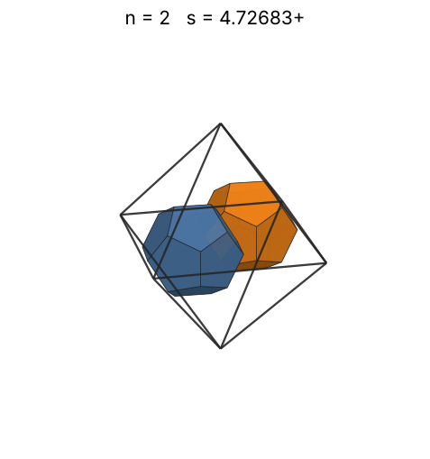 |
| 3 | [5.39557+](dodinoct_n03.json) | 5.395574976898 | √(2520√5 + 6010)/20 | 3.65352 | 0.3105 | 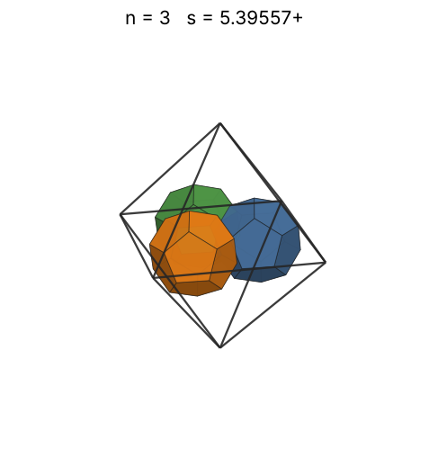 |
| 4 | [5.51395+](dodinoct_n04.json) | 5.513954928241 |  | 4.02121 | 0.3879 | 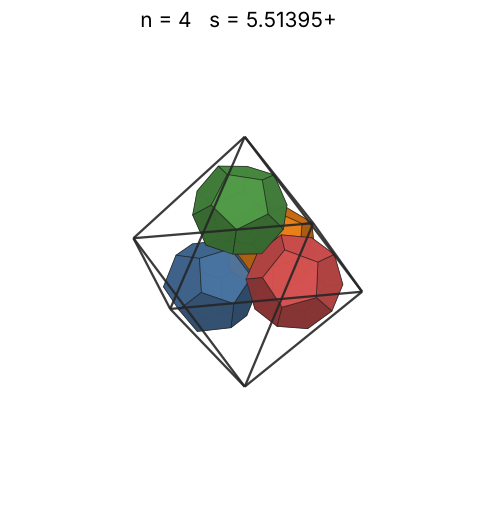 |
| 5 | [5.62608+](dodinoct_n05.json) | 5.626083466936 |  | 4.33172 | 0.4564 | 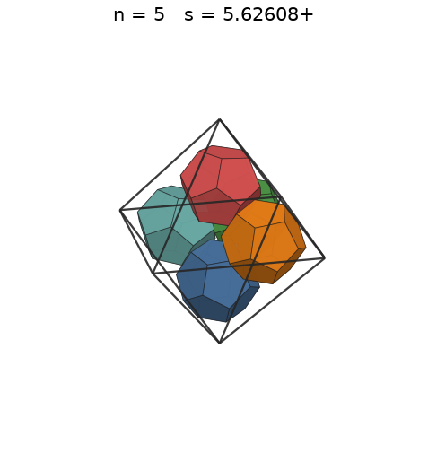 |
| 6 | [5.67171+](dodinoct_n06.json) | 5.671716159582 |  | 4.60314 | 0.5346 | 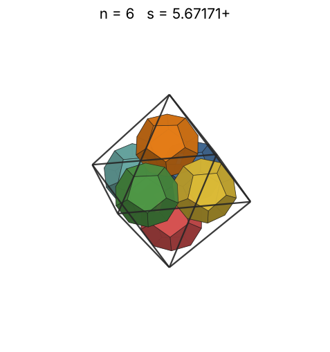 |
| 7 | [6.44876+](dodinoct_n07.json) | 6.448762358458 |  | 4.84585 | 0.4243 | 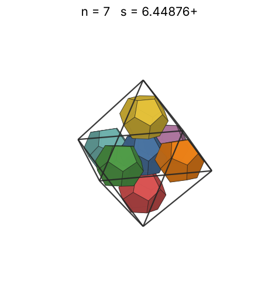 |
| 8 | [6.77653+](dodinoct_n08.json) | 6.776534989923 |  | 5.06641 | 0.4179 | 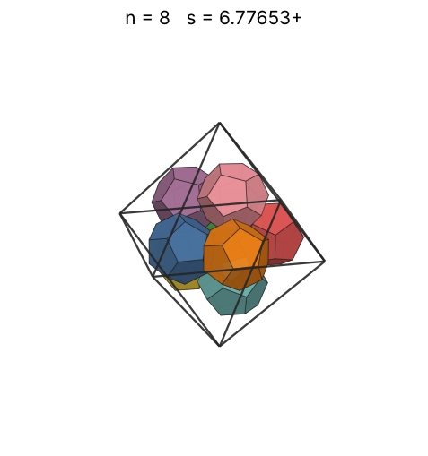 |
| 9 | [6.98357+](dodinoct_n09.json) | 6.983572645417 |  | 5.26928 | 0.4296 | 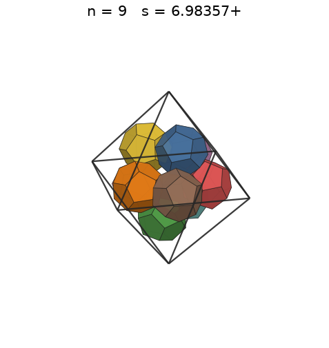 |
| 10 | [7.16471+](dodinoct_n10.json) | 7.164716971556 |  | 5.45763 | 0.4420 | 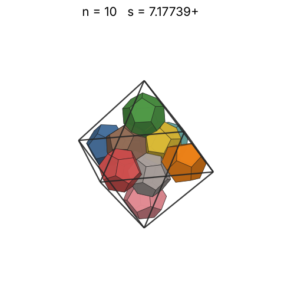 |
| 11 | [7.37717+](dodinoct_n11.json) | 7.377172784996 |  | 5.63380 | 0.4454 | 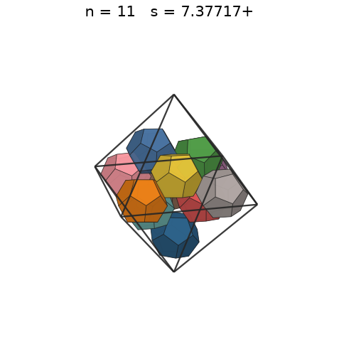 |
| 12 | [7.49486+](dodinoct_n12.json) | 7.494862979432 |  | 5.79960 | 0.4633 | 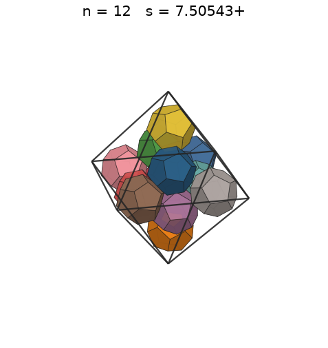 |
| 13 | [7.52570+](dodinoct_n13.json) | 7.525706605720 | √(1265√5 + 2835)/10 | 5.95642 | 0.4958 | 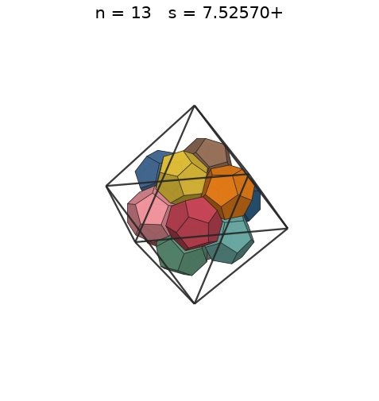 |
| 14 | [7.84523+](dodinoct_n14.json) | 7.845237378949 |  | 6.10539 | 0.4713 | 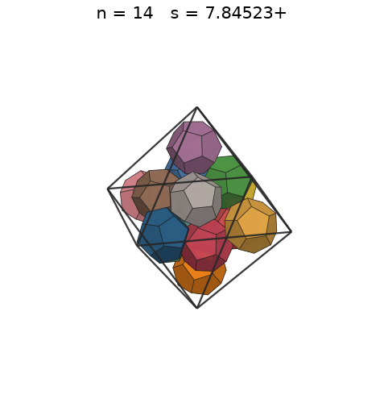 |
| 15 | [7.94801+](dodinoct_n15.json) | 7.948019575188 |  | 6.24742 | 0.4857 | 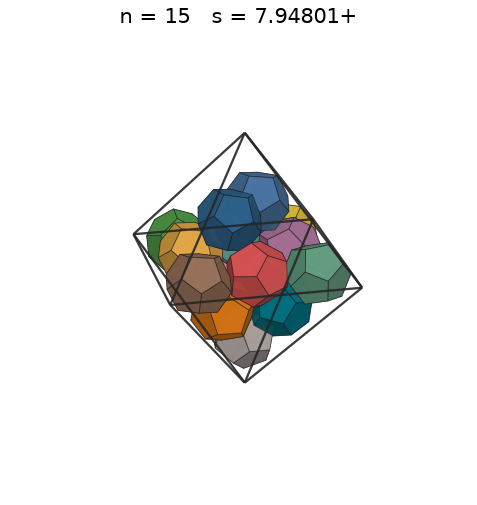 |
| 16 | [8.00349+](dodinoct_n16.json) | 8.003496689919 |  | 6.38328 | 0.5073 | 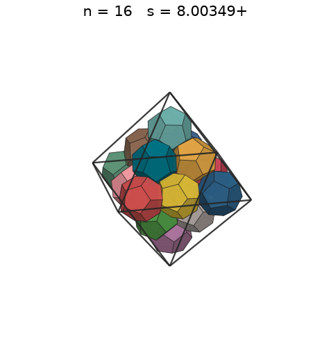 |
| 17 | [8.00886+](dodinoct_n17.json) | 8.008861012395 |  | 6.51359 | 0.5380 | 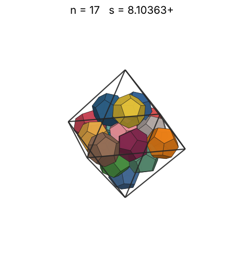 |
| 18 | [8.00886+](dodinoct_n18.json) | 8.008861012395 |  | 6.63888 | 0.5696 | 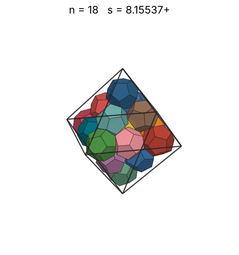 |
| 19 | [8.00886+](dodinoct_n19.json) | 8.008861012395 |  | 6.75961 | 0.6012 | 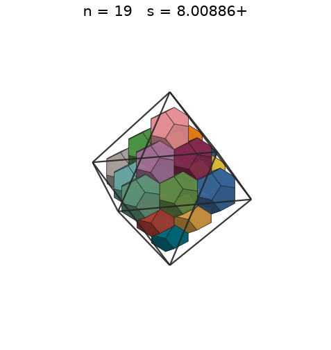 |
| 20 | [8.65827+](dodinoct_n20.json) | 8.658270145596 |  | 6.87618 | 0.5009 | 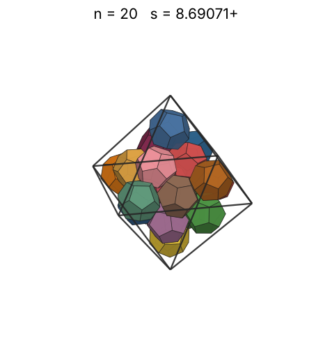 |
| 21 | [8.85925+](dodinoct_n21.json) | 8.859251928297 |  | 6.98892 | 0.4910 | 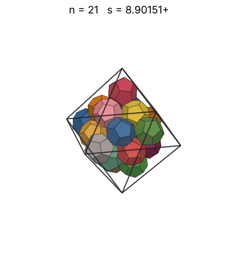 |
| 22 | [8.98577+](dodinoct_n22.json) | 8.985770748405 |  | 7.09814 | 0.4929 | 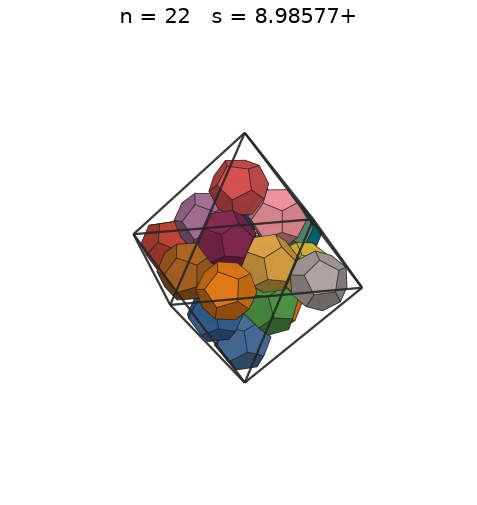 |
| 23 | [9.14997+](dodinoct_n23.json) | 9.149970242467 |  | 7.20410 | 0.4881 | 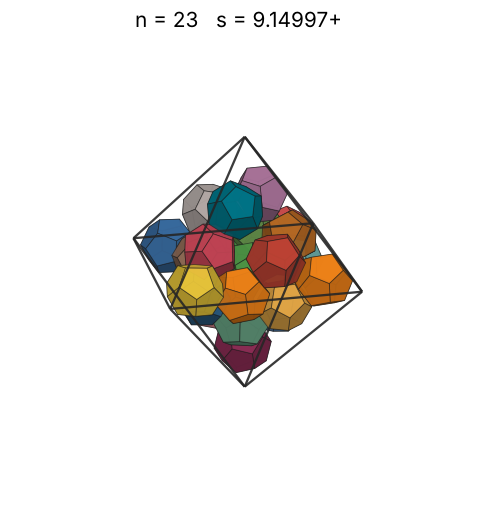 |
| 24 | [9.27968+](dodinoct_n24.json) | 9.279687382035 |  | 7.30703 | 0.4882 | 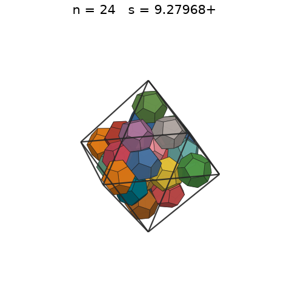 |
| 25 | [9.37634+](dodinoct_n25.json) | 9.376348327344 |  | 7.40714 | 0.4930 | 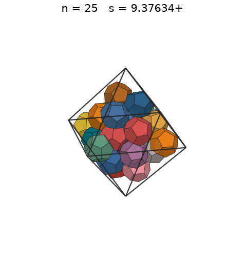 |
| 26 | [9.50870+](dodinoct_n26.json) | 9.508705787084 |  | 7.50461 | 0.4916 | 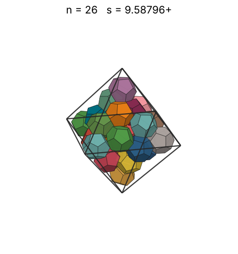 |
| 27 | [9.60874+](dodinoct_n27.json) | 9.608749623080 |  | 7.59962 | 0.4947 | 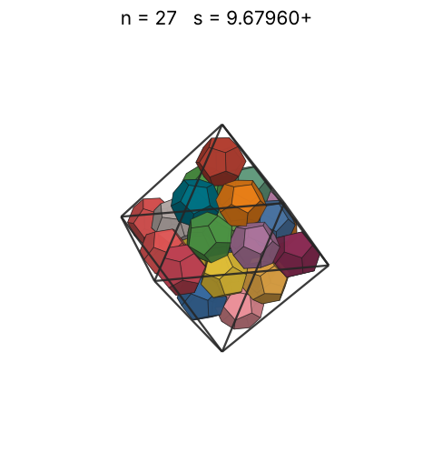 |
| 28 | [9.72164+](dodinoct_n28.json) | 9.721645894504 |  | 7.69231 | 0.4954 | 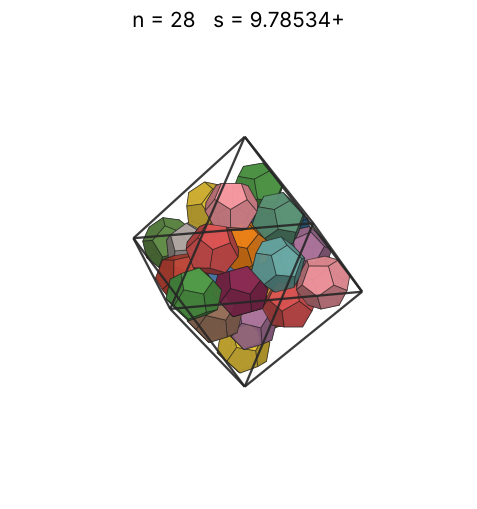 |
| 29 | [9.92127+](dodinoct_n29.json) | 9.921279368668 |  | 7.78281 | 0.4827 | 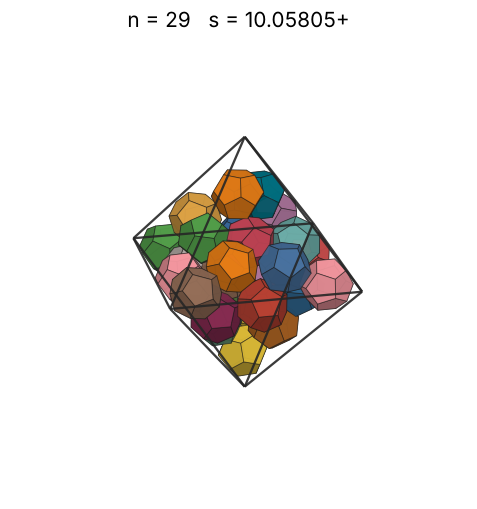 |
| 30 | [10.01068+](dodinoct_n30.json) | 10.010686546990 |  | 7.87126 | 0.4861 | 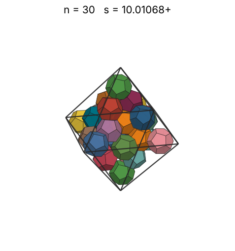 |
| 31 | [10.13336+](dodinoct_n31.json) | 10.133368077269 |  | 7.95777 | 0.4843 | 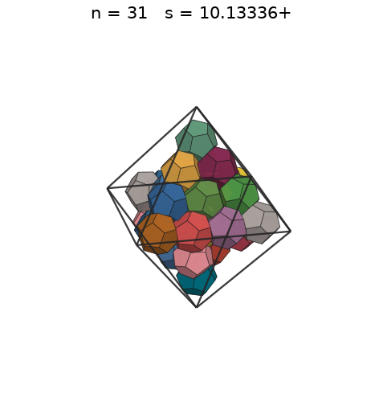 |
| 32 | [10.15338+](dodinoct_n32.json) | 10.153380093104 |  | 8.04243 | 0.4970 | 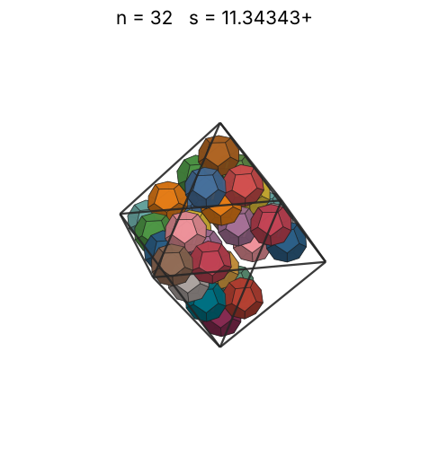 |
| 33 | [10.28517+](dodinoct_n33.json) | 10.285176115584 |  | 8.12535 | 0.4930 | 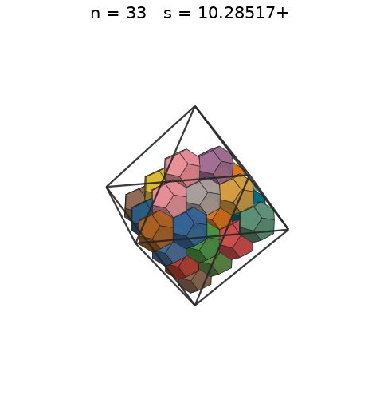 |
| 34 | [10.28636+](dodinoct_n34.json) | 10.286364675392 |  | 8.20661 | 0.5078 | 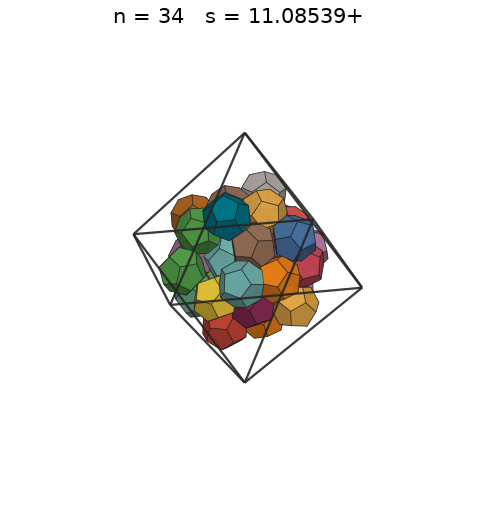 |
| 35 | [10.29710+](dodinoct_n35.json) | 10.297107310139 |  | 8.28629 | 0.5211 | 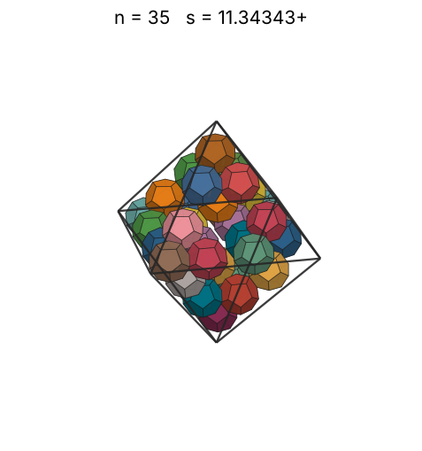 |
| 36 | [10.29710+](dodinoct_n36.json) | 10.297107310139 |  | 8.36446 | 0.5360 | 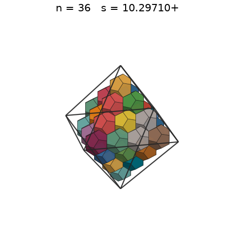 |
| 37 | [10.29710+](dodinoct_n37.json) | 10.297107310139 |  | 8.44121 | 0.5509 | 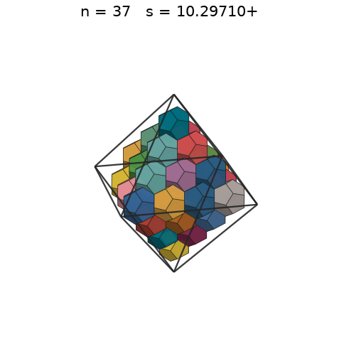 |
| 38 | [10.29710+](dodinoct_n38.json) | 10.297107310139 |  | 8.51658 | 0.5658 | 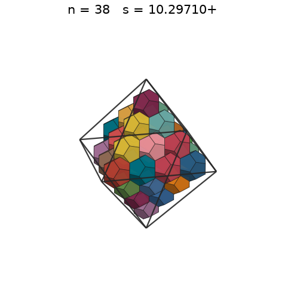 |
| 39 | [10.29710+](dodinoct_n39.json) | 10.297107310139 |  | 8.59064 | 0.5807 | 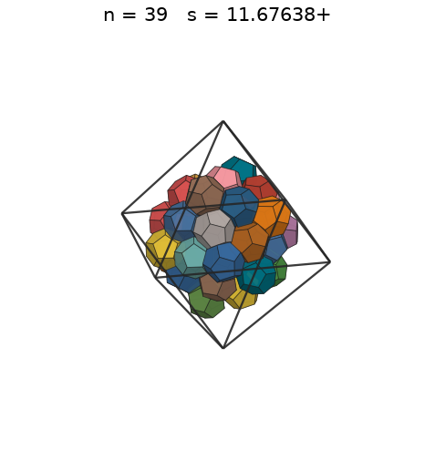 |
| 40 | [10.29710+](dodinoct_n40.json) | 10.297107310139 |  | 8.66344 | 0.5956 | 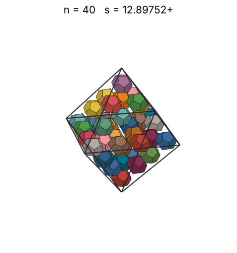 |
| 41 | [10.29710+](dodinoct_n41.json) | 10.297107310139 |  | 8.73505 | 0.6104 |  |
| 42 | [10.29710+](dodinoct_n42.json) | 10.297107310139 |  | 8.80549 | 0.6253 |  |
| 43 | [10.29710+](dodinoct_n43.json) | 10.297107310139 |  | 8.87483 | 0.6402 |  |
| 44 | [10.29710+](dodinoct_n44.json) | 10.297107310139 |  | 8.94310 | 0.6551 |  |
| 45 | [10.93927+](dodinoct_n45.json) | 10.939273025478 |  | 9.01035 | 0.5588 |  |
| 46 | [11.15407+](dodinoct_n46.json) | 11.154079060975 |  | 9.07660 | 0.5389 |  |
| 47 | [11.26805+](dodinoct_n47.json) | 11.268053099819 |  | 9.14190 | 0.5340 |  |
| 48 | [11.37366+](dodinoct_n48.json) | 11.373666147981 |  | 9.20628 | 0.5303 |  |
| 49 | [11.45687+](dodinoct_n49.json) | 11.456875845880 |  | 9.26978 | 0.5297 |  |
| 50 | [11.54600+](dodinoct_n50.json) | 11.546008496604 |  | 9.33241 | 0.5281 |  |
| 51 | [11.60635+](dodinoct_n51.json) | 11.606356099991 |  | 9.39422 | 0.5303 |  |
| 52 | [11.69182+](dodinoct_n52.json) | 11.691826057024 |  | 9.45522 | 0.5289 |  |
| 53 | [11.77233+](dodinoct_n53.json) | 11.772333284190 |  | 9.51545 | 0.5281 |  |
| 54 | [11.86338+](dodinoct_n54.json) | 11.863383363584 |  | 9.57492 | 0.5258 |  |
| 55 | [11.93004+](dodinoct_n55.json) | 11.930046205026 |  | 9.63366 | 0.5266 |  |
| 56 | [11.93415+](dodinoct_n56.json) | 11.934152825810 |  | 9.69170 | 0.5356 |  |
| 57 | [12.02087+](dodinoct_n57.json) | 12.020872706735 |  | 9.74905 | 0.5334 |  |
| 58 | [12.08746+](dodinoct_n58.json) | 12.087468863427 |  | 9.80573 | 0.5339 |  |
| 59 | [12.21198+](dodinoct_n59.json) | 12.211985960372 |  | 9.86176 | 0.5266 |  |
| 60 | [12.22617+](dodinoct_n60.json) | 12.226177032579 |  | 9.91717 | 0.5337 |  |
| 61 | [12.27201+](dodinoct_n61.json) | 12.272015786717 |  | 9.97196 | 0.5365 |  |
| 62 | [12.32290+](dodinoct_n62.json) | 12.322900396780 |  | 10.02616 | 0.5386 |  |
| 63 | [12.38964+](dodinoct_n63.json) | 12.389645407094 |  | 10.07977 | 0.5385 |  |
| 64 | [12.41880+](dodinoct_n64.json) | 12.418801529769 |  | 10.13283 | 0.5432 |  |
| 65 | [12.51726+](dodinoct_n65.json) | 12.517261779571 |  | 10.18533 | 0.5388 |  |
| 66 | [12.53928+](dodinoct_n66.json) | 12.539288710114 |  | 10.23730 | 0.5442 |  |
| 67 | [12.58535+](dodinoct_n67.json) | 12.585353607884 |  | 10.28874 | 0.5464 |  |
| 68 | [12.58535+](dodinoct_n68.json) | 12.585353607884 |  | 10.33968 | 0.5545 |  |
| 69 | [12.58535+](dodinoct_n69.json) | 12.585353607884 |  | 10.39011 | 0.5627 |  |
| 70 | [12.58535+](dodinoct_n70.json) | 12.585353607884 |  | 10.44007 | 0.5708 |  |
| 71 | [12.58535+](dodinoct_n71.json) | 12.585353607884 |  | 10.48955 | 0.5790 |  |
| 72 | [12.58535+](dodinoct_n72.json) | 12.585353607884 |  | 10.53856 | 0.5871 |  |
| 73 | [12.58535+](dodinoct_n73.json) | 12.585353607884 |  | 10.58713 | 0.5953 |  |
| 74 | [12.58535+](dodinoct_n74.json) | 12.585353607884 |  | 10.63525 | 0.6035 |  |
| 75 | [12.58535+](dodinoct_n75.json) | 12.585353607884 |  | 10.68295 | 0.6116 |  |
| 76 | [12.58535+](dodinoct_n76.json) | 12.585353607884 |  | 10.73022 | 0.6198 |  |
| 77 | [12.58535+](dodinoct_n77.json) | 12.585353607884 |  | 10.77707 | 0.6279 |  |
| 78 | [12.58535+](dodinoct_n78.json) | 12.585353607884 |  | 10.82353 | 0.6361 |  |
| 79 | [12.58535+](dodinoct_n79.json) | 12.585353607884 |  | 10.86959 | 0.6442 |  |
| 80 | [12.58535+](dodinoct_n80.json) | 12.585353607884 |  | 10.91526 | 0.6524 |  |
| 81 | [12.58535+](dodinoct_n81.json) | 12.585353607884 |  | 10.96055 | 0.6605 |  |
| 82 | [12.58535+](dodinoct_n82.json) | 12.585353607884 |  | 11.00547 | 0.6687 |  |
| 83 | [12.58535+](dodinoct_n83.json) | 12.585353607884 |  | 11.05003 | 0.6769 |  |
| 84 | [12.58535+](dodinoct_n84.json) | 12.585353607884 |  | 11.09423 | 0.6850 |  |
| 85 | [12.58535+](dodinoct_n85.json) | 12.585353607884 |  | 11.13808 | 0.6932 |  |
| 86 | [13.61669+](dodinoct_n86.json) | 13.616691545226 |  | 11.18159 | 0.5537 |  |
| 87 | [13.67959+](dodinoct_n87.json) | 13.679593898518 |  | 11.22476 | 0.5525 |  |
| 88 | [13.69908+](dodinoct_n88.json) | 13.699089089415 |  | 11.26760 | 0.5564 |  |
| 89 | [13.69908+](dodinoct_n89.json) | 13.699089107217 |  | 11.31012 | 0.5628 |  |
| 90 | [13.73571+](dodinoct_n90.json) | 13.735717751062 |  | 11.35232 | 0.5645 |  |
| 91 | [13.83195+](dodinoct_n91.json) | 13.831958946420 |  | 11.39421 | 0.5590 |  |
| 92 | [13.84665+](dodinoct_n92.json) | 13.846659527704 |  | 11.43580 | 0.5633 |  |
| 93 | [13.99575+](dodinoct_n93.json) | 13.995751144020 |  | 11.47708 | 0.5514 |  |
| 94 | [13.99575+](dodinoct_n94.json) | 13.995751144020 |  | 11.51807 | 0.5574 |  |
| 95 | [14.04283+](dodinoct_n95.json) | 14.042832426387 |  | 11.55877 | 0.5577 |  |
| 96 | [14.08007+](dodinoct_n96.json) | 14.080079333480 |  | 11.59919 | 0.5591 |  |
| 97 | [14.10801+](dodinoct_n97.json) | 14.108015588165 |  | 11.63933 | 0.5615 |  |
| 98 | [14.22574+](dodinoct_n98.json) | 14.225749567407 |  | 11.67919 | 0.5534 |  |
| 99 | [14.22574+](dodinoct_n99.json) | 14.225749567407 |  | 11.71878 | 0.5590 |  |
| 100 | [14.22767+](dodinoct_n100.json) | 14.227670015371 |  | 11.75810 | 0.5644 |  |
