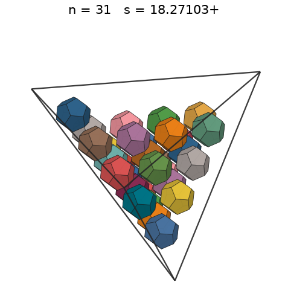
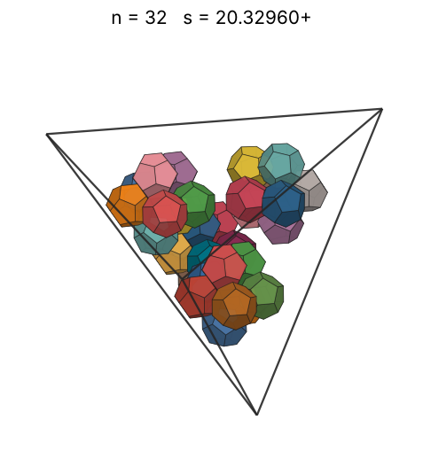
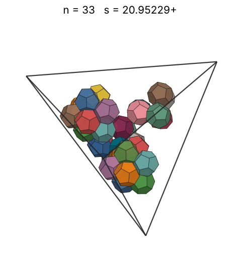
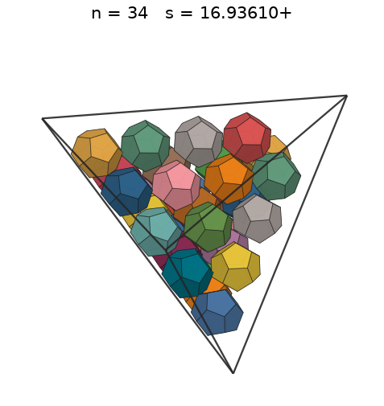
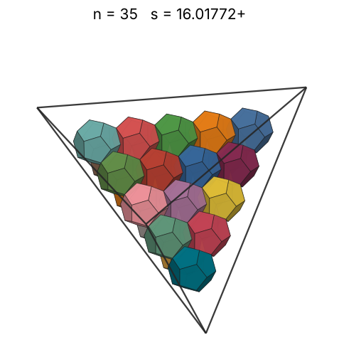
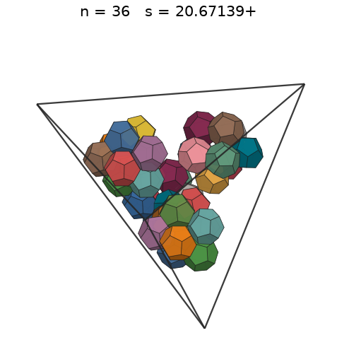
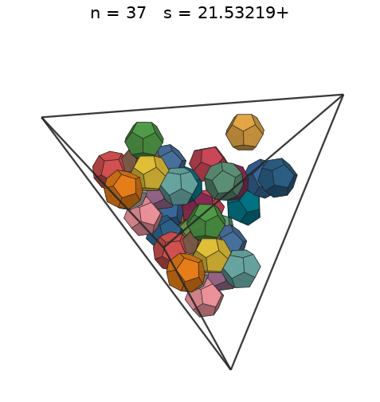
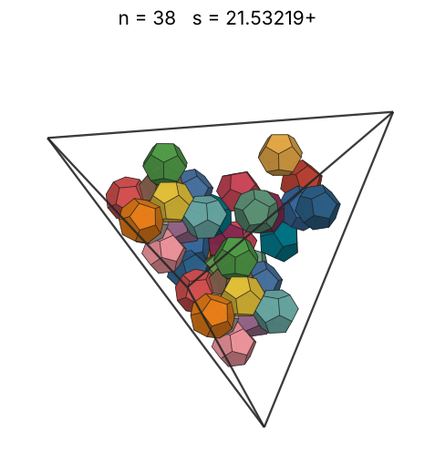
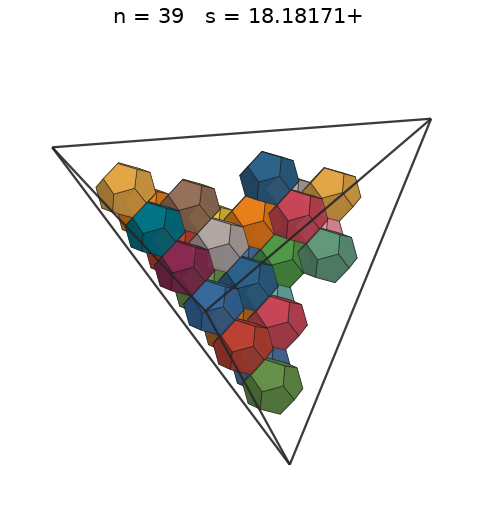
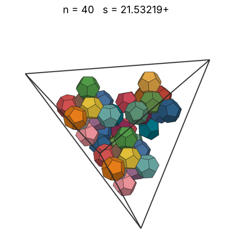

# Dodecahedra in a tetrahedron

s = container edge / piece edge; every row certified in exact arithmetic.

| n | s | touching limit | closed form (conj.) | volume bound | density | picture |
|---|---|---|---|---|---|---|
| 2 | [8.47779+](dodintet_n02.json) | 8.477789848827 |  | 5.06641 | 0.2134 |  |
| 3 | [8.52145+](dodintet_n03.json) | 8.521452018552 |  | 5.79960 | 0.3152 |  |
| 4 | [8.57017+](dodintet_n04.json) | 8.570171444196 |  | 6.38328 | 0.4132 |  |
| 5 | [9.85861+](dodintet_n05.json) | 9.858618831355 |  | 6.87618 | 0.3393 |  |
| 6 | [10.51918+](dodintet_n06.json) | 10.519187653873 |  | 7.30703 | 0.3352 |  |
| 7 | [10.81173+](dodintet_n07.json) | 10.811738204659 |  | 7.69231 | 0.3601 |  |
| 8 | [10.92665+](dodintet_n08.json) | 10.926653075570 |  | 8.04243 | 0.3987 |  |
| 9 | [11.05631+](dodintet_n09.json) | 11.056312912110 |  | 8.36446 | 0.4330 |  |
| 10 | [11.07177+](dodintet_n10.json) | 11.071778881937 |  | 8.66344 | 0.4791 |  |
| 11 | [12.11090+](dodintet_n11.json) | 12.110900204016 |  | 8.94310 | 0.4027 |  |
| 12 | [12.37980+](dodintet_n12.json) | 12.379799536611 |  | 9.20628 | 0.4113 |  |
| 13 | [12.63539+](dodintet_n13.json) | 12.635394091989 |  | 9.45522 | 0.4190 |  |
| 14 | [12.93003+](dodintet_n14.json) | 12.930032454758 |  | 9.69170 | 0.4211 |  |
| 15 | [13.16630+](dodintet_n15.json) | 13.166309221110 |  | 9.91717 | 0.4273 |  |
| 16 | [13.23016+](dodintet_n16.json) | 13.230160321740 |  | 10.13283 | 0.4493 |  |
| 17 | [13.43226+](dodintet_n17.json) | 13.432267341747 |  | 10.33968 | 0.4561 |  |
| 18 | [13.48358+](dodintet_n18.json) | 13.483581029719 |  | 10.53856 | 0.4775 |  |
| 19 | [13.59087+](dodintet_n19.json) | 13.590872157533 |  | 10.73022 | 0.4921 |  |
| 20 | [13.63201+](dodintet_n20.json) | 13.632012629671 |  | 10.91526 | 0.5134 |  |
| 21 | [14.36064+](dodintet_n21.json) | 14.360639995592 |  | 11.09423 | 0.4611 |  |
| 22 | [14.63000+](dodintet_n22.json) | 14.630005965406 |  | 11.26760 | 0.4568 |  |
| 23 | [14.89588+](dodintet_n23.json) | 14.895884692251 |  | 11.43580 | 0.4525 |  |
| 24 | [15.06733+](dodintet_n24.json) | 15.067330005600 |  | 11.59919 | 0.4562 |  |
| 25 | [15.14149+](dodintet_n25.json) | 15.141495090173 |  | 11.75810 | 0.4683 |  |
| 26 | [15.33437+](dodintet_n26.json) | 15.334375313198 |  | 11.91283 | 0.4689 |  |
| 27 | [15.49237+](dodintet_n27.json) | 15.492374887391 |  | 12.06364 | 0.4722 |  |
| 28 | [15.61122+](dodintet_n28.json) | 15.611222791618 |  | 12.21078 | 0.4785 |  |
| 29 | [15.75445+](dodintet_n29.json) | 15.754452215795 |  | 12.35445 | 0.4822 |  |
| 30 | [15.75445+](dodintet_n30.json) | 15.754452215969 |  | 12.49485 | 0.4989 |  |
| 31 | [16.01772+](dodintet_n31.json) | 16.017721109492 |  | 12.63217 | 0.4905 |  |
| 32 | [16.01772+](dodintet_n32.json) | 16.017721109492 |  | 12.76656 | 0.5063 |  |
| 33 | [16.01772+](dodintet_n33.json) | 16.017721109492 |  | 12.89818 | 0.5221 |  |
| 34 | [16.01772+](dodintet_n34.json) | 16.017721109492 |  | 13.02717 | 0.5380 |  |
| 35 | [16.01772+](dodintet_n35.json) | 16.017721109492 |  | 13.15366 | 0.5538 |  |
| 36 | [16.89986+](dodintet_n36.json) | 16.899865962217 |  | 13.27776 | 0.4850 |  |
| 37 | [17.08599+](dodintet_n37.json) | 17.085996089762 |  | 13.39958 | 0.4823 |  |
| 38 | [17.29082+](dodintet_n38.json) | 17.290819882762 |  | 13.51923 | 0.4780 |  |
| 39 | [18.13140+](dodintet_n39.json) | 18.131402806186 |  | 13.63679 | 0.4254 |  |
| 40 | [18.13140+](dodintet_n40.json) | 18.131402818511 |  | 13.75236 | 0.4364 |  |
| 41 | [18.13140+](dodintet_n41.json) | 18.131402833537 |  | 13.86602 | 0.4473 |  |
| 42 | [18.16170+](dodintet_n42.json) | 18.161709249070 |  | 13.97785 | 0.4559 |  |
| 43 | [18.24678+](dodintet_n43.json) | 18.246780067192 |  | 14.08792 | 0.4602 |  |
| 44 | [18.25997+](dodintet_n44.json) | 18.259973898759 |  | 14.19629 | 0.4699 |  |
| 45 | [18.26338+](dodintet_n45.json) | 18.263384281246 |  | 14.30303 | 0.4803 |  |
| 46 | [18.29250+](dodintet_n46.json) | 18.292507607825 |  | 14.40821 | 0.4887 |  |
| 47 | [18.30315+](dodintet_n47.json) | 18.303155529640 |  | 14.51186 | 0.4984 |  |
| 48 | [18.30396+](dodintet_n48.json) | 18.303967161914 |  | 14.61406 | 0.5090 |  |
| 49 | [18.30596+](dodintet_n49.json) | 18.305967178412 |  | 14.71485 | 0.5194 |  |
| 50 | [18.30596+](dodintet_n50.json) | 18.305967178412 |  | 14.81428 | 0.5300 |  |
| 51 | [18.30596+](dodintet_n51.json) | 18.305967178412 |  | 14.91239 | 0.5406 |  |
| 52 | [18.30596+](dodintet_n52.json) | 18.305967178412 |  | 15.00923 | 0.5512 |  |
| 53 | [18.30596+](dodintet_n53.json) | 18.305967178412 |  | 15.10483 | 0.5618 |  |
| 54 | [18.30596+](dodintet_n54.json) | 18.305967178412 |  | 15.19924 | 0.5724 |  |
| 55 | [18.30596+](dodintet_n55.json) | 18.305967178412 |  | 15.29249 | 0.5830 |  |
| 56 | [18.30596+](dodintet_n56.json) | 18.305967178412 |  | 15.38461 | 0.5936 |  |
| 57 | [20.39977+](dodintet_n57.json) | 20.399775839605 |  | 15.47565 | 0.4366 |  |
| 58 | [20.39977+](dodintet_n58.json) | 20.399775847718 |  | 15.56563 | 0.4442 |  |
| 59 | [20.39977+](dodintet_n59.json) | 20.399775871662 |  | 15.65457 | 0.4519 |  |
| 60 | [20.39977+](dodintet_n60.json) | 20.399775878712 |  | 15.74252 | 0.4596 |  |
| 61 | [20.39977+](dodintet_n61.json) | 20.399775885926 |  | 15.82950 | 0.4672 |  |
| 62 | [20.40699+](dodintet_n62.json) | 20.406992524787 |  | 15.91553 | 0.4744 |  |
| 63 | [20.40730+](dodintet_n63.json) | 20.407300311658 |  | 16.00064 | 0.4820 |  |
| 64 | [20.59421+](dodintet_n64.json) | 20.594213247332 |  | 16.08486 | 0.4764 |  |
| 65 | [20.59421+](dodintet_n65.json) | 20.594213247332 |  | 16.16820 | 0.4839 |  |
| 66 | [20.59421+](dodintet_n66.json) | 20.594213247332 |  | 16.25069 | 0.4913 |  |
| 67 | [20.59421+](dodintet_n67.json) | 20.594213247332 |  | 16.33236 | 0.4988 |  |
| 68 | [20.59421+](dodintet_n68.json) | 20.594213247332 |  | 16.41321 | 0.5062 |  |
| 69 | [20.59421+](dodintet_n69.json) | 20.594213247332 |  | 16.49328 | 0.5137 |  |
| 70 | [20.59421+](dodintet_n70.json) | 20.594213247332 |  | 16.57257 | 0.5211 |  |
| 71 | [20.59421+](dodintet_n71.json) | 20.594213247332 |  | 16.65112 | 0.5286 |  |
| 72 | [20.59421+](dodintet_n72.json) | 20.594213247332 |  | 16.72893 | 0.5360 |  |
| 73 | [20.59421+](dodintet_n73.json) | 20.594213247332 |  | 16.80602 | 0.5434 |  |
| 74 | [20.59421+](dodintet_n74.json) | 20.594213247332 |  | 16.88241 | 0.5509 |  |
| 75 | [20.59421+](dodintet_n75.json) | 20.594213247332 |  | 16.95812 | 0.5583 |  |
| 76 | [20.59421+](dodintet_n76.json) | 20.594213247332 |  | 17.03316 | 0.5658 |  |
| 77 | [20.59421+](dodintet_n77.json) | 20.594213247332 |  | 17.10754 | 0.5732 |  |
| 78 | [20.59421+](dodintet_n78.json) | 20.594213247332 |  | 17.18128 | 0.5807 |  |
| 79 | [20.59421+](dodintet_n79.json) | 20.594213247332 |  | 17.25439 | 0.5881 |  |
| 80 | [20.59421+](dodintet_n80.json) | 20.594213247332 |  | 17.32689 | 0.5956 |  |
| 81 | [20.59421+](dodintet_n81.json) | 20.594213247332 |  | 17.39879 | 0.6030 |  |
| 82 | [20.59421+](dodintet_n82.json) | 20.594213247332 |  | 17.47009 | 0.6104 |  |
| 83 | [20.59421+](dodintet_n83.json) | 20.594213247332 |  | 17.54082 | 0.6179 |  |
| 84 | [20.59421+](dodintet_n84.json) | 20.594213247332 |  | 17.61099 | 0.6253 |  |
| 85 | [21.55329+](dodintet_n85.json) | 21.553293638104 |  | 17.68060 | 0.5520 |  |
| 86 | [21.75422+](dodintet_n86.json) | 21.754226435233 |  | 17.74966 | 0.5432 |  |
| 87 | [21.98741+](dodintet_n87.json) | 21.987418554143 |  | 17.81819 | 0.5322 |  |
| 88 | [22.69065+](dodintet_n88.json) | 22.690657941396 |  | 17.88620 | 0.4898 |  |
| 89 | [22.70949+](dodintet_n89.json) | 22.709493820885 |  | 17.95370 | 0.4941 |  |
| 90 | [22.70949+](dodintet_n90.json) | 22.709493825350 |  | 18.02069 | 0.4997 |  |
| 91 | [22.70965+](dodintet_n91.json) | 22.709655679896 |  | 18.08719 | 0.5052 |  |
| 92 | [22.70971+](dodintet_n92.json) | 22.709715134637 |  | 18.15320 | 0.5108 |  |
| 93 | [22.73924+](dodintet_n93.json) | 22.739239604978 |  | 18.21874 | 0.5143 |  |
| 94 | [22.73924+](dodintet_n94.json) | 22.739239634125 |  | 18.28380 | 0.5198 |  |
| 95 | [22.77956+](dodintet_n95.json) | 22.779566522285 |  | 18.34841 | 0.5226 |  |
| 96 | [22.77956+](dodintet_n96.json) | 22.779566522346 |  | 18.41257 | 0.5281 |  |
| 97 | [22.79514+](dodintet_n97.json) | 22.795148320911 |  | 18.47628 | 0.5325 |  |
| 98 | [22.79514+](dodintet_n98.json) | 22.795148320957 |  | 18.53955 | 0.5380 |  |
| 99 | [22.79514+](dodintet_n99.json) | 22.795148321507 |  | 18.60240 | 0.5435 |  |
| 100 | [22.83856+](dodintet_n100.json) | 22.838568944248 |  | 18.66483 | 0.5458 |  |
