# Dodecahedra in a tetrahedron

s = container edge / piece edge; every row certified in exact arithmetic.

| n | s | touching limit | closed form (conj.) | volume bound | density | picture |
|---|---|---|---|---|---|---|
| 2 | [8.47779+](dodintet_n02.json) | 8.477789848827 |  | 5.06641 | 0.2134 | 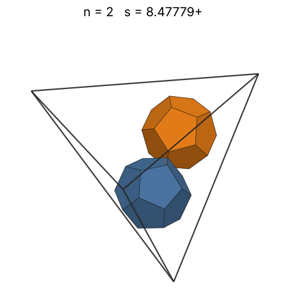 |
| 3 | [8.52145+](dodintet_n03.json) | 8.521452018552 |  | 5.79960 | 0.3152 | 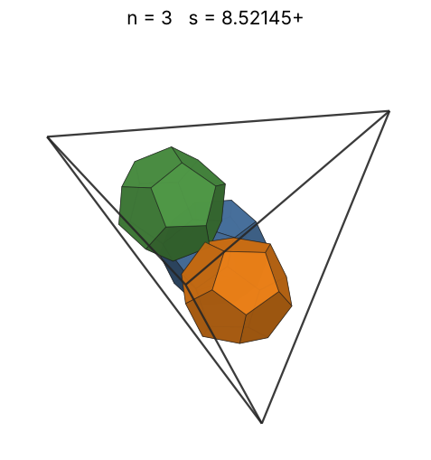 |
| 4 | [8.57017+](dodintet_n04.json) | 8.570171444196 |  | 6.38328 | 0.4132 | 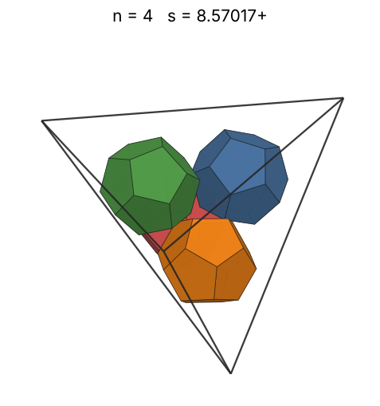 |
| 5 | [9.85861+](dodintet_n05.json) | 9.858618831355 |  | 6.87618 | 0.3393 | 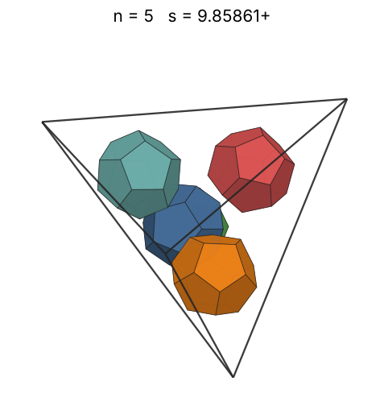 |
| 6 | [10.51918+](dodintet_n06.json) | 10.519187653873 |  | 7.30703 | 0.3352 | 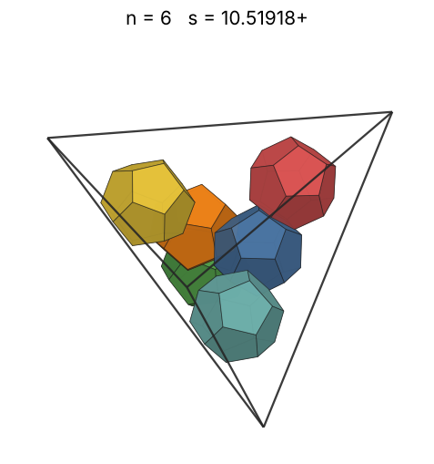 |
| 7 | [10.81173+](dodintet_n07.json) | 10.811738204659 |  | 7.69231 | 0.3601 | 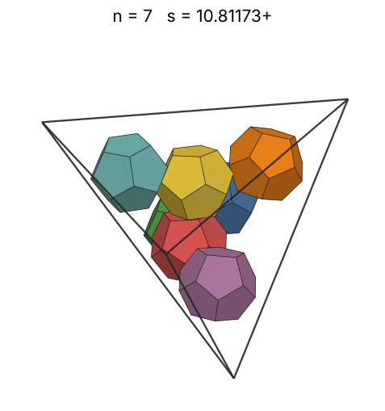 |
| 8 | [10.92665+](dodintet_n08.json) | 10.926653075570 |  | 8.04243 | 0.3987 | 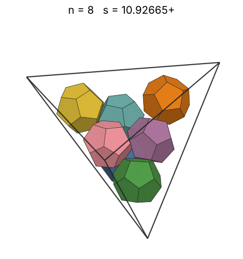 |
| 9 | [11.05645+](dodintet_n09.json) | 11.056457365965 |  | 8.36446 | 0.4330 | 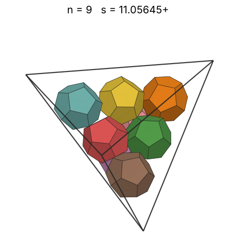 |
| 10 | [11.08402+](dodintet_n10.json) | 11.084024413462 |  | 8.66344 | 0.4775 | 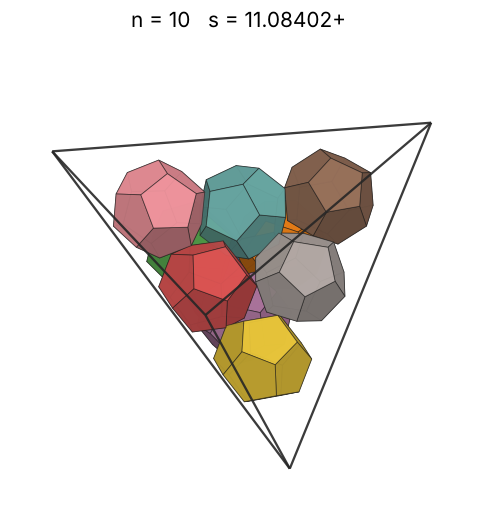 |
| 11 | [12.11125+](dodintet_n11.json) | 12.111250941267 |  | 8.94310 | 0.4026 | 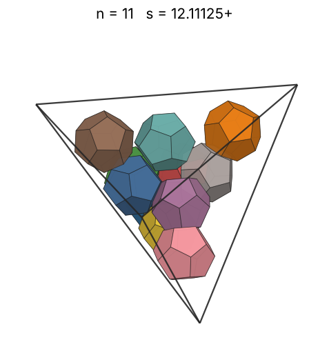 |
| 12 | [12.39293+](dodintet_n12.json) | 12.392929970322 |  | 9.20628 | 0.4100 | 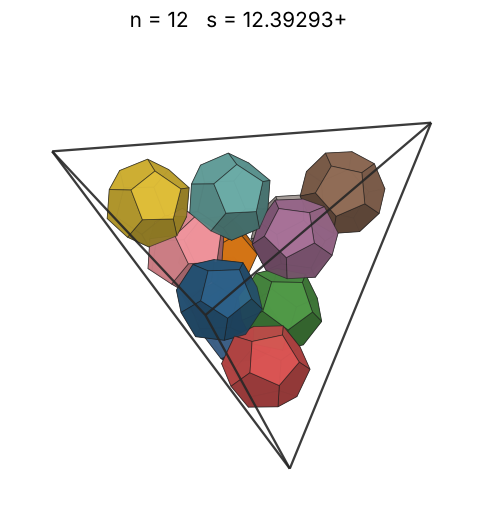 |
| 13 | [12.65172+](dodintet_n13.json) | 12.651729157572 |  | 9.45522 | 0.4174 | 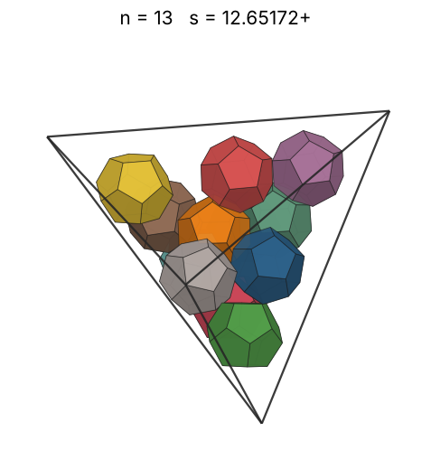 |
| 14 | [12.94984+](dodintet_n14.json) | 12.949842705826 |  | 9.69170 | 0.4192 | 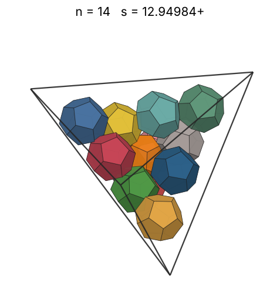 |
| 15 | [13.17639+](dodintet_n15.json) | 13.176393202386 |  | 9.91717 | 0.4264 | 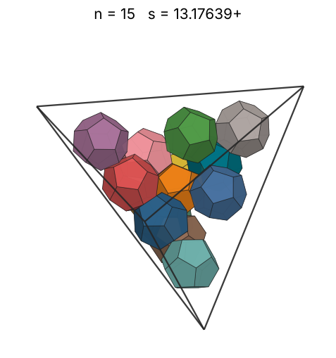 |
| 16 | [13.23559+](dodintet_n16.json) | 13.235590797484 |  | 10.13283 | 0.4487 | 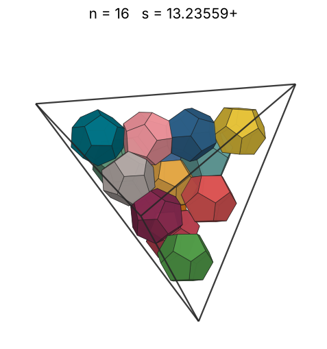 |
| 17 | [13.47196+](dodintet_n17.json) | 13.471959579498 |  | 10.33968 | 0.4521 | 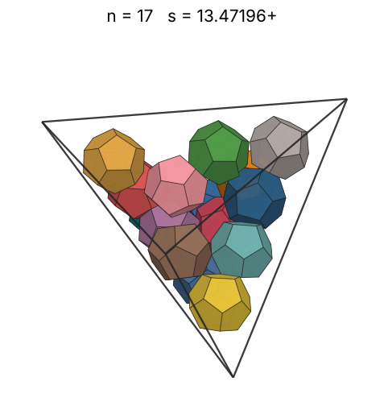 |
| 18 | [13.54528+](dodintet_n18.json) | 13.545286703640 |  | 10.53856 | 0.4710 | 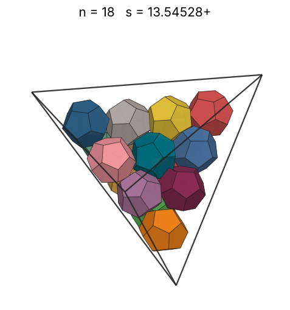 |
| 19 | [13.60782+](dodintet_n19.json) | 13.607820721909 |  | 10.73022 | 0.4903 | 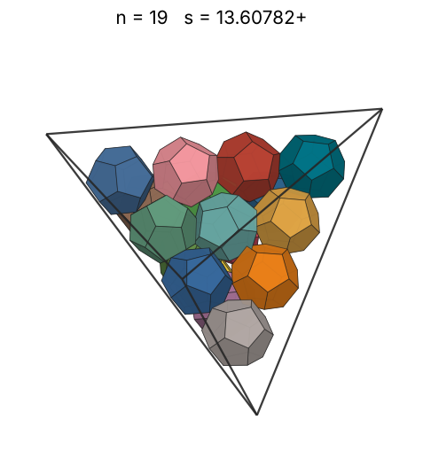 |
| 20 | [13.65846+](dodintet_n20.json) | 13.658462087581 |  | 10.91526 | 0.5104 | 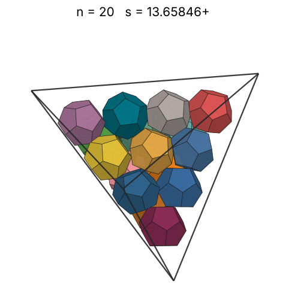 |
| 21 | [14.40410+](dodintet_n21.json) | 14.404106022359 |  | 11.09423 | 0.4569 | 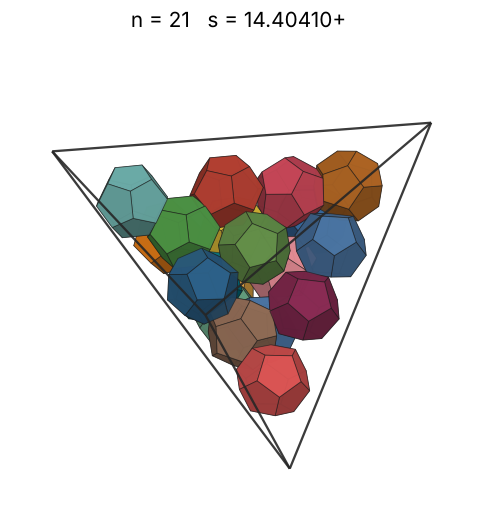 |
| 22 | [14.73056+](dodintet_n22.json) | 14.730563343938 |  | 11.26760 | 0.4475 | 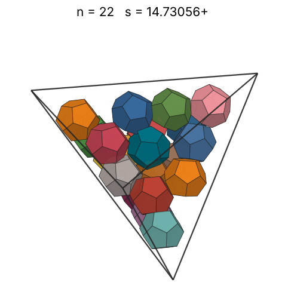 |
| 23 | [14.95760+](dodintet_n23.json) | 14.957602250269 |  | 11.43580 | 0.4469 | 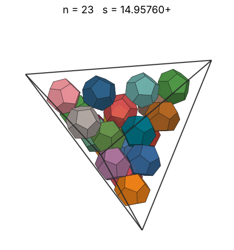 |
| 24 | [15.14593+](dodintet_n24.json) | 15.145935640734 |  | 11.59919 | 0.4492 | 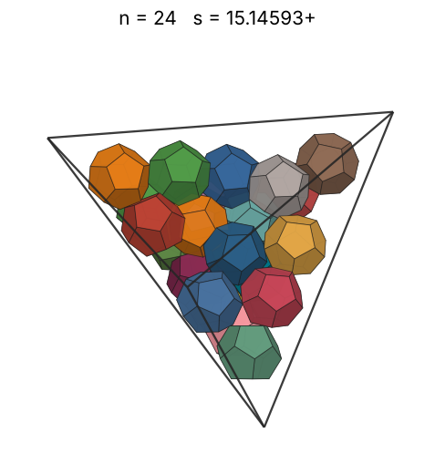 |
| 25 | [15.33409+](dodintet_n25.json) | 15.334090086163 |  | 11.75810 | 0.4509 | 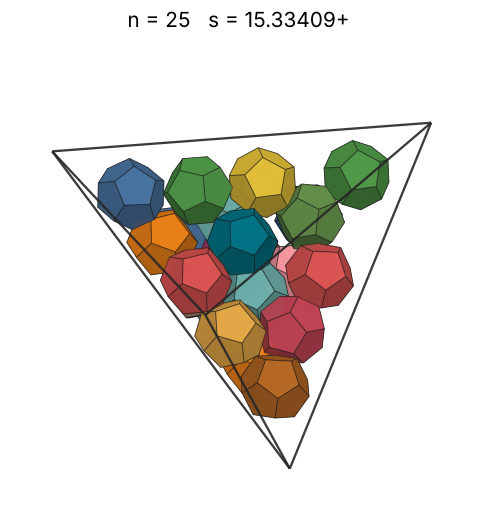 |
| 26 | [15.47939+](dodintet_n26.json) | 15.479399354211 |  | 11.91283 | 0.4558 | 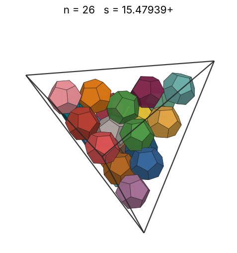 |
| 27 | [15.55392+](dodintet_n27.json) | 15.553921357578 |  | 12.06364 | 0.4666 | 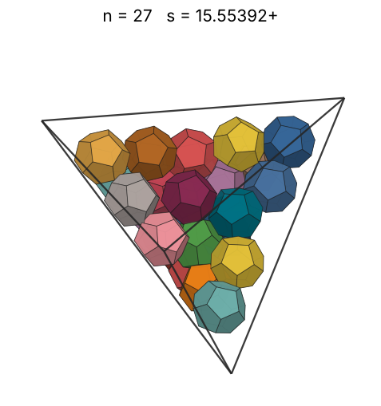 |
| 28 | [15.68122+](dodintet_n28.json) | 15.681220060529 |  | 12.21078 | 0.4722 | 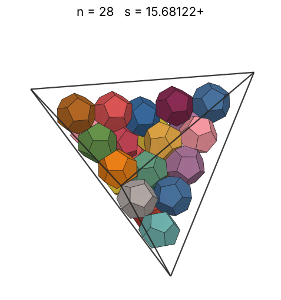 |
| 29 | [15.96711+](dodintet_n29.json) | 15.967110821799 |  | 12.35445 | 0.4632 | 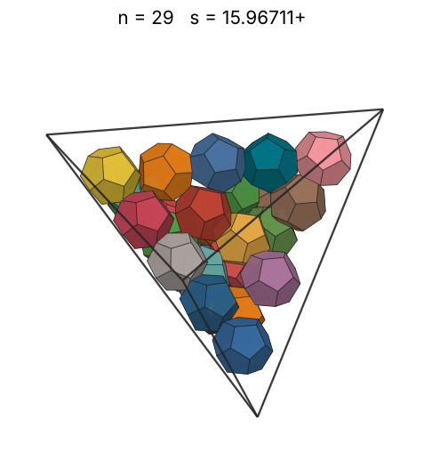 |
| 30 | [15.96711+](dodintet_n30.json) | 15.967111018204 |  | 12.49485 | 0.4792 | 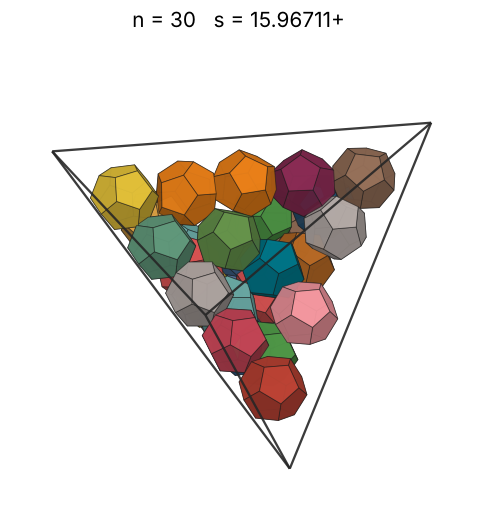 |
