# Icosahedra in a cube

s = container edge / piece edge; every row certified in exact arithmetic.

| n | s | touching limit | closed form (conj.) | volume bound | density | picture |
|---|---|---|---|---|---|---|
| 2 | [2.49071+](icoincub_n02.json) | 2.490712042735 | 1 + 2√5/3 | 1.63409 | 0.2824 | 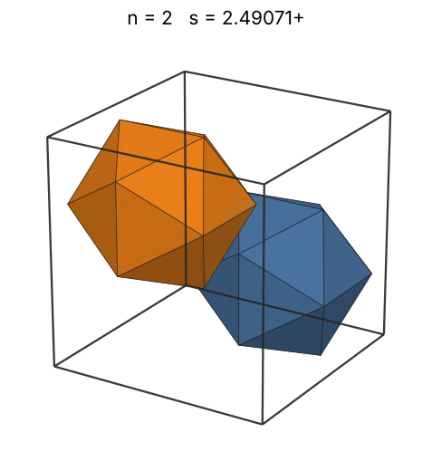 |
| 3 | [2.75550+](icoincub_n03.json) | 2.755506323007 | -644/241 + (√(539067 - 116376√15) + 261√15)/241 | 1.87056 | 0.3128 | 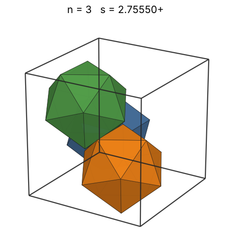 |
| 4 | [2.75633+](icoincub_n04.json) | 2.756339064604 | -5 + (√(555 - 300√3) + 10√3)/3 | 2.05882 | 0.4167 | 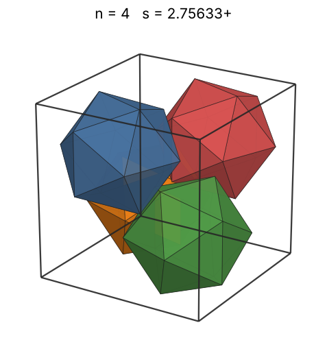 |
| 5 | [3.03667+](icoincub_n05.json) | 3.036676107963 |  | 2.21779 | 0.3896 | 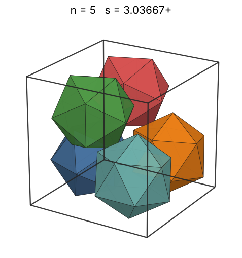 |
| 6 | [3.10330+](icoincub_n06.json) | 3.103300930764 |  | 2.35676 | 0.4380 | 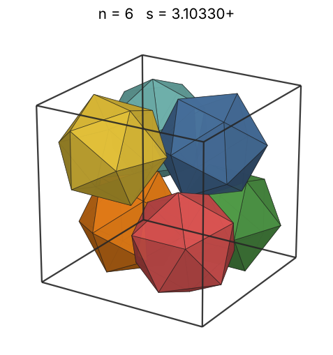 |
| 7 | [3.19155+](icoincub_n07.json) | 3.191552539304 |  | 2.48102 | 0.4698 | 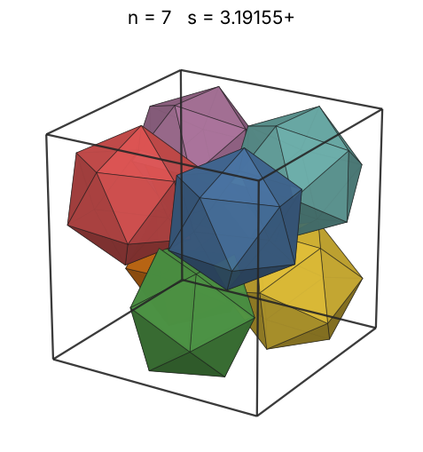 |
| 8 | [3.23606+](icoincub_n08.json) | 3.236067977500 | 1 + √5 | 2.59395 | 0.5150 | 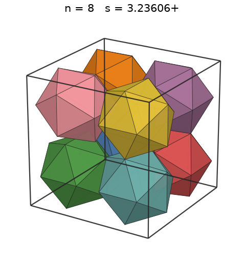 |
| 9 | [3.36339+](icoincub_n09.json) | 3.363390100446 | 3/2 + 5√5/6 | 2.69782 | 0.5161 | 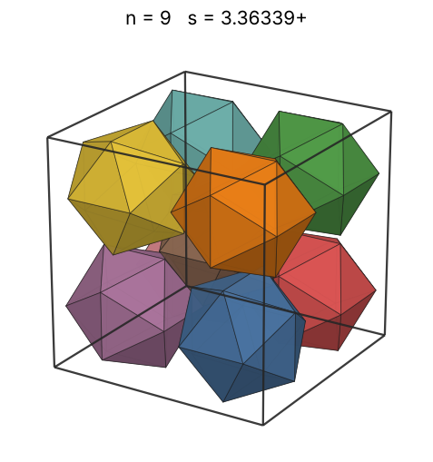 |
| 10 | [3.70419+](icoincub_n10.json) | 3.704191990877 |  | 2.79425 | 0.4293 | 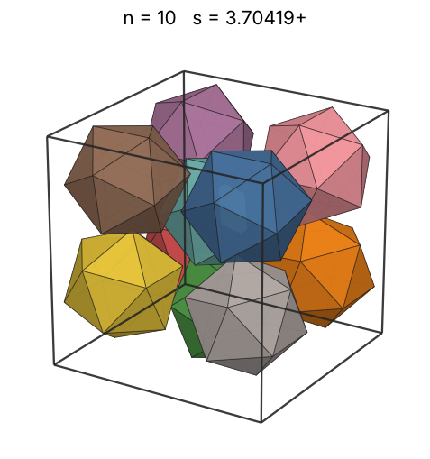 |
| 11 | [3.82821+](icoincub_n11.json) | 3.828216957765 |  | 2.88444 | 0.4278 | 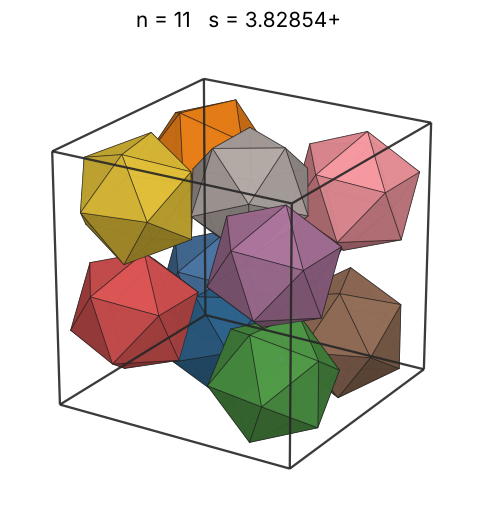 |
| 12 | [3.86775+](icoincub_n12.json) | 3.867759503064 |  | 2.96933 | 0.4525 | 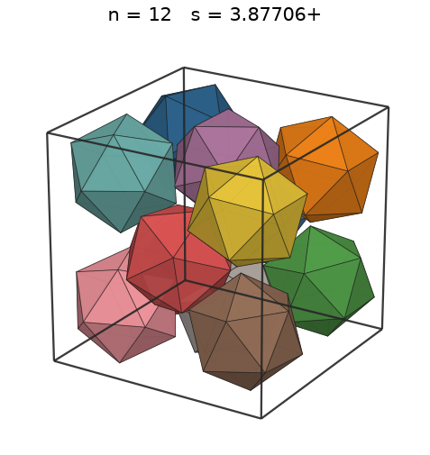 |
| 13 | [3.89802+](icoincub_n13.json) | 3.898024569883 |  | 3.04962 | 0.4789 | 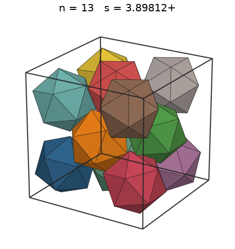 |
| 14 | [3.92303+](icoincub_n14.json) | 3.923034660479 |  | 3.12589 | 0.5059 | 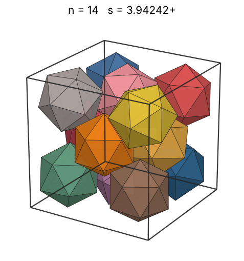 |
| 15 | [4.13716+](icoincub_n15.json) | 4.137168198120 |  | 3.19861 | 0.4621 | 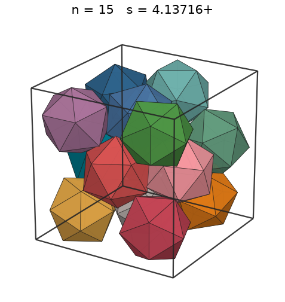 |
| 16 | [4.19606+](icoincub_n16.json) | 4.196060051120 |  | 3.26817 | 0.4725 | 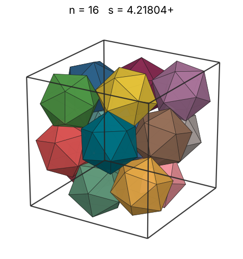 |
| 17 | [4.24160+](icoincub_n17.json) | 4.241608894394 |  | 3.33489 | 0.4860 | 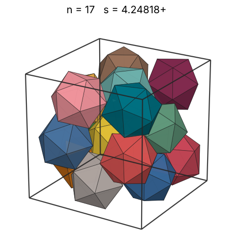 |
| 18 | [4.29959+](icoincub_n18.json) | 4.299597539430 |  | 3.39903 | 0.4941 | 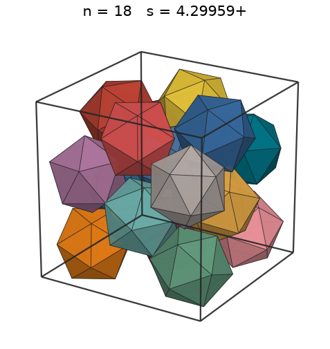 |
| 19 | [4.40243+](icoincub_n19.json) | 4.402436944411 |  | 3.46085 | 0.4858 | 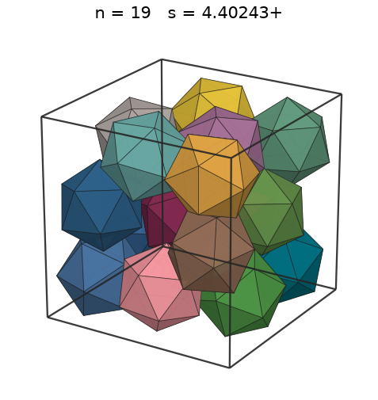 |
| 20 | [4.44998+](icoincub_n20.json) | 4.449983619036 |  | 3.52053 | 0.4952 | 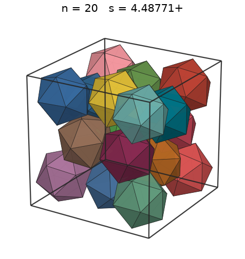 |
| 21 | [4.53456+](icoincub_n21.json) | 4.534568084484 |  | 3.57825 | 0.4914 | 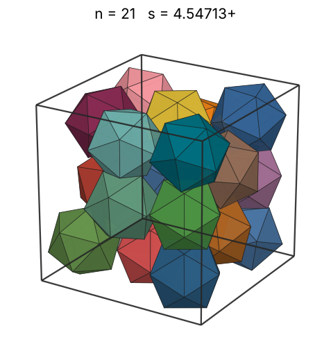 |
| 22 | [4.55396+](icoincub_n22.json) | 4.553960809848 |  | 3.63417 | 0.5082 | 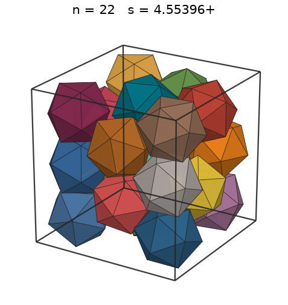 |
| 23 | [4.59662+](icoincub_n23.json) | 4.596626167783 |  | 3.68842 | 0.5167 | 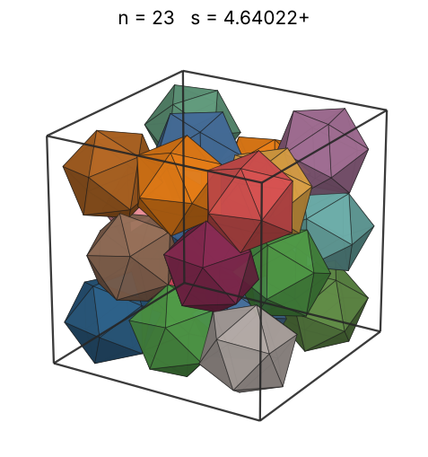 |
| 24 | [4.66801+](icoincub_n24.json) | 4.668016883689 |  | 3.74112 | 0.5148 | 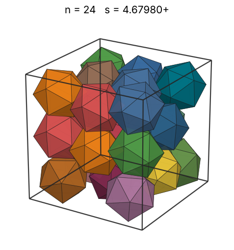 |
| 25 | [4.75635+](icoincub_n25.json) | 4.756358040357 |  | 3.79238 | 0.5069 | 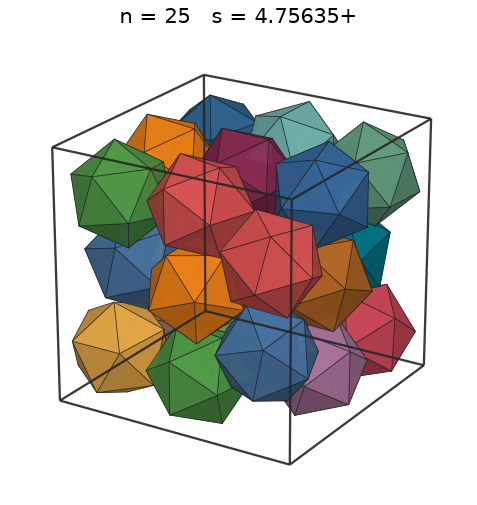 |
| 26 | [4.81278+](icoincub_n26.json) | 4.812781099731 |  | 3.84228 | 0.5088 | 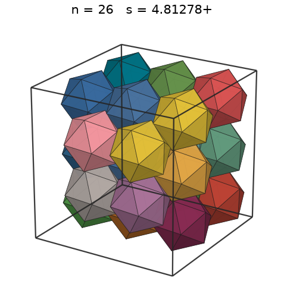 |
| 27 | [4.83314+](icoincub_n27.json) | 4.833141786166 |  | 3.89092 | 0.5218 | 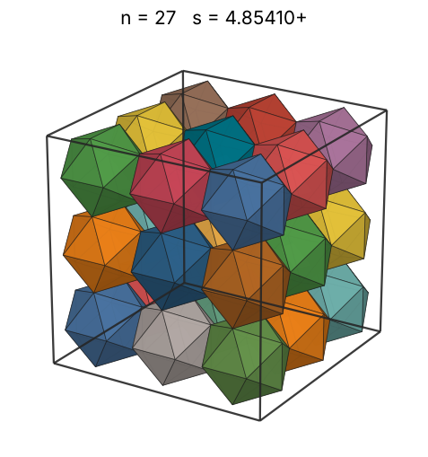 |
| 28 | [4.91717+](icoincub_n28.json) | 4.917175640995 |  | 3.93838 | 0.5138 | 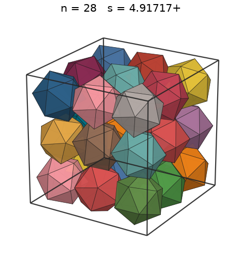 |
| 29 | [4.95199+](icoincub_n29.json) | 4.951992252255 |  | 3.98472 | 0.5210 | 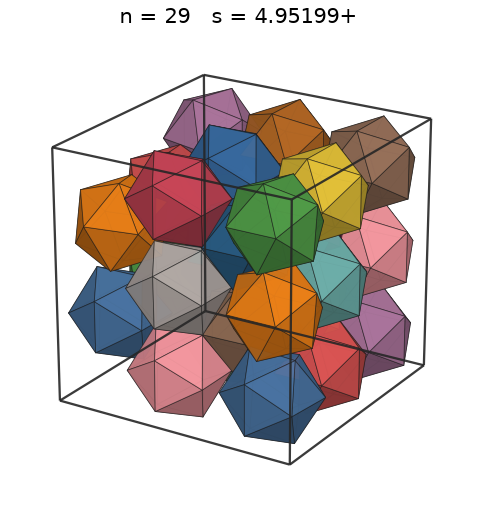 |
| 30 | [4.97246+](icoincub_n30.json) | 4.972459833072 |  | 4.03000 | 0.5324 | 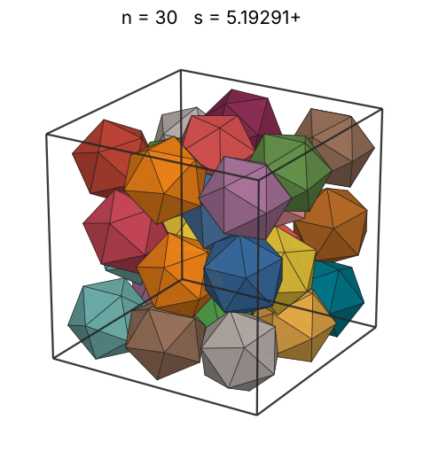 |
| 31 | [5.10874+](icoincub_n31.json) | 5.108746671892 |  | 4.07429 | 0.5072 | 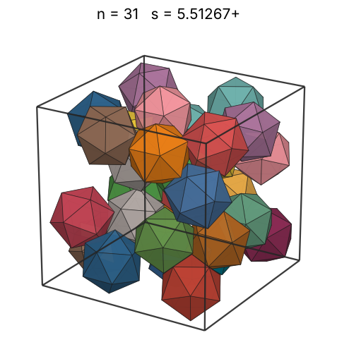 |
| 32 | [5.10874+](icoincub_n32.json) | 5.108746671892 |  | 4.11764 | 0.5236 | 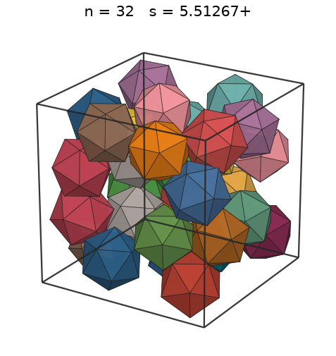 |
| 33 | [5.10874+](icoincub_n33.json) | 5.108746671892 |  | 4.16009 | 0.5400 | 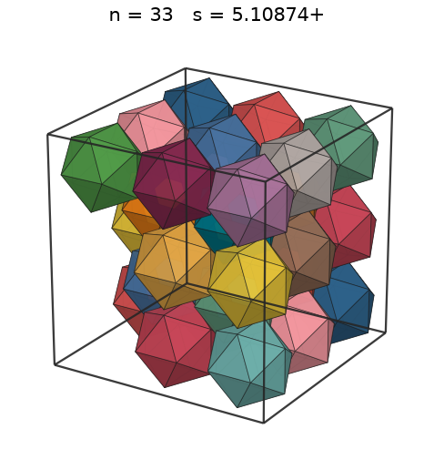 |
| 34 | [5.10874+](icoincub_n34.json) | 5.108746671892 |  | 4.20169 | 0.5563 | 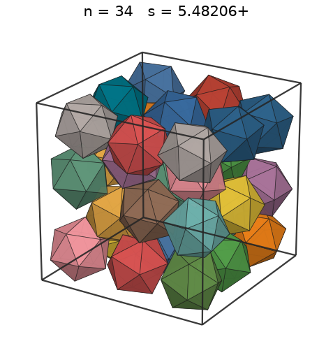 |
| 35 | [5.10874+](icoincub_n35.json) | 5.108746671892 |  | 4.24249 | 0.5727 | 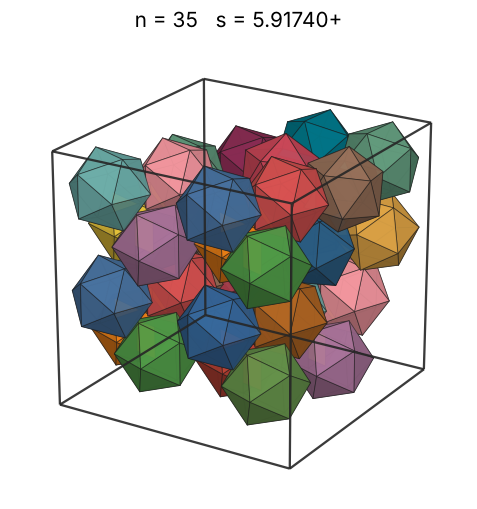 |
| 36 | [5.39949+](icoincub_n36.json) | 5.399496730225 |  | 4.28251 | 0.4989 | 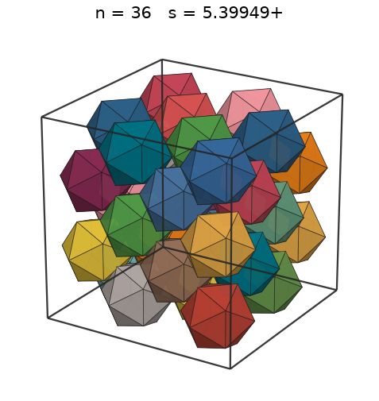 |
| 37 | [5.39949+](icoincub_n37.json) | 5.399496730225 |  | 4.32181 | 0.5128 | 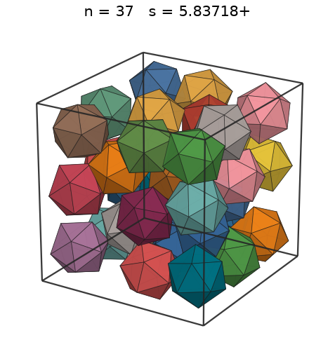 |
| 38 | [5.39949+](icoincub_n38.json) | 5.399496730225 |  | 4.36040 | 0.5266 | 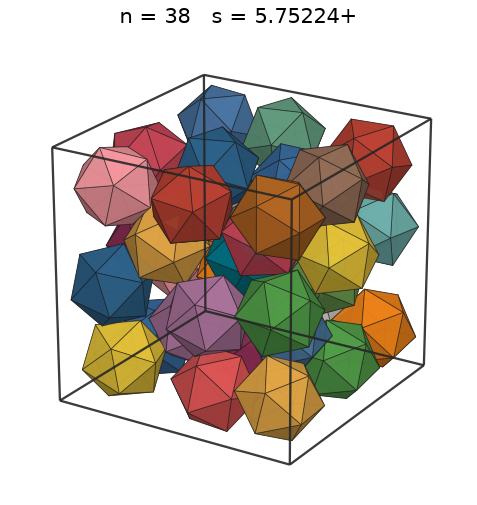 |
| 39 | [5.39949+](icoincub_n39.json) | 5.399496730225 |  | 4.39831 | 0.5405 | 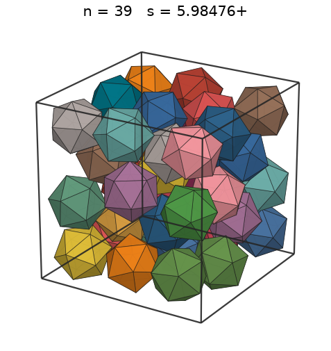 |
| 40 | [5.40661+](icoincub_n40.json) | 5.406610089775 |  | 4.43559 | 0.5522 | 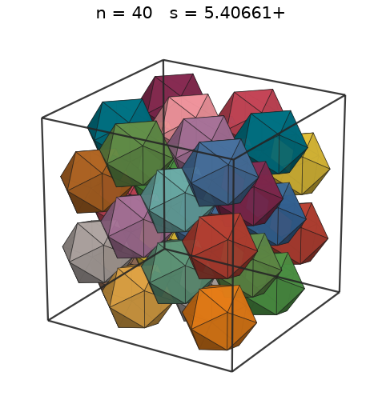 |
| 41 | [5.65358+](icoincub_n41.json) | 5.653581318572 |  | 4.47225 | 0.4950 |  |
| 42 | [5.65524+](icoincub_n42.json) | 5.655240068413 |  | 4.50832 | 0.5066 |  |
| 43 | [5.65524+](icoincub_n43.json) | 5.655240068573 |  | 4.54382 | 0.5187 |  |
| 44 | [5.65550+](icoincub_n44.json) | 5.655503688993 |  | 4.57877 | 0.5307 |  |
| 45 | [5.67977+](icoincub_n45.json) | 5.679776596184 |  | 4.61320 | 0.5358 |  |
| 46 | [5.98142+](icoincub_n46.json) | 5.981425279017 |  | 4.64712 | 0.4690 |  |
| 47 | [5.98142+](icoincub_n47.json) | 5.981425279017 |  | 4.68055 | 0.4792 |  |
| 48 | [5.98142+](icoincub_n48.json) | 5.981425279017 |  | 4.71352 | 0.4894 |  |
| 49 | [5.98142+](icoincub_n49.json) | 5.981425279017 |  | 4.74603 | 0.4995 |  |
| 50 | [5.98142+](icoincub_n50.json) | 5.981425279017 |  | 4.77809 | 0.5097 |  |
| 51 | [5.98142+](icoincub_n51.json) | 5.981425279017 |  | 4.80974 | 0.5199 |  |
| 52 | [5.98142+](icoincub_n52.json) | 5.981425279017 |  | 4.84097 | 0.5301 |  |
| 53 | [5.98142+](icoincub_n53.json) | 5.981425279017 |  | 4.87181 | 0.5403 |  |
| 54 | [5.98142+](icoincub_n54.json) | 5.981425279017 |  | 4.90226 | 0.5505 |  |
| 55 | [6.27440+](icoincub_n55.json) | 6.274406869911 |  | 4.93233 | 0.4858 |  |
| 56 | [6.28767+](icoincub_n56.json) | 6.287670473321 |  | 4.96204 | 0.4915 |  |
| 57 | [6.30131+](icoincub_n57.json) | 6.301316498406 |  | 4.99141 | 0.4970 |  |
| 58 | [6.30131+](icoincub_n58.json) | 6.301316498406 |  | 5.02043 | 0.5057 |  |
| 59 | [6.30131+](icoincub_n59.json) | 6.301316498406 |  | 5.04912 | 0.5145 |  |
| 60 | [6.30131+](icoincub_n60.json) | 6.301316498406 |  | 5.07748 | 0.5232 |  |
| 61 | [6.30131+](icoincub_n61.json) | 6.301316498406 |  | 5.10554 | 0.5319 |  |
| 62 | [6.30131+](icoincub_n62.json) | 6.301316498406 |  | 5.13328 | 0.5406 |  |
| 63 | [6.30131+](icoincub_n63.json) | 6.301316498406 |  | 5.16073 | 0.5493 |  |
| 64 | [6.32745+](icoincub_n64.json) | 6.327453137508 |  | 5.18790 | 0.5512 |  |
| 65 | [6.37098+](icoincub_n65.json) | 6.370986078875 |  | 5.21478 | 0.5484 |  |
| 66 | [6.37107+](icoincub_n66.json) | 6.371076507705 |  | 5.24138 | 0.5568 |  |
| 67 | [6.55171+](icoincub_n67.json) | 6.551718180786 |  | 5.26772 | 0.5198 |  |
| 68 | [6.55171+](icoincub_n68.json) | 6.551718180786 |  | 5.29380 | 0.5275 |  |
| 69 | [6.55171+](icoincub_n69.json) | 6.551718180786 |  | 5.31963 | 0.5353 |  |
| 70 | [6.55171+](icoincub_n70.json) | 6.551718180786 |  | 5.34520 | 0.5430 |  |
| 71 | [6.55171+](icoincub_n71.json) | 6.551718180786 |  | 5.37053 | 0.5508 |  |
| 72 | [6.55171+](icoincub_n72.json) | 6.551718180786 |  | 5.39563 | 0.5585 |  |
| 73 | [6.55171+](icoincub_n73.json) | 6.551718180786 |  | 5.42050 | 0.5663 |  |
| 74 | [6.65088+](icoincub_n74.json) | 6.650887449394 |  | 5.44513 | 0.5488 |  |
| 75 | [6.78697+](icoincub_n75.json) | 6.786974322058 |  | 5.46955 | 0.5234 |  |
| 76 | [6.85410+](icoincub_n76.json) | 6.854103013463 |  | 5.49375 | 0.5149 |  |
| 77 | [6.85410+](icoincub_n77.json) | 6.854103013463 |  | 5.51774 | 0.5217 |  |
| 78 | [6.85410+](icoincub_n78.json) | 6.854103013463 |  | 5.54153 | 0.5285 |  |
| 79 | [6.85410+](icoincub_n79.json) | 6.854103013463 |  | 5.56511 | 0.5353 |  |
| 80 | [6.85410+](icoincub_n80.json) | 6.854103013463 |  | 5.58849 | 0.5420 |  |
| 81 | [6.85410+](icoincub_n81.json) | 6.854103013463 |  | 5.61168 | 0.5488 |  |
| 82 | [6.85410+](icoincub_n82.json) | 6.854103013463 |  | 5.63468 | 0.5556 |  |
| 83 | [6.85410+](icoincub_n83.json) | 6.854103013463 |  | 5.65749 | 0.5624 |  |
| 84 | [6.85410+](icoincub_n84.json) | 6.854103013463 |  | 5.68012 | 0.5691 |  |
| 85 | [6.85410+](icoincub_n85.json) | 6.854103013463 |  | 5.70257 | 0.5759 |  |
| 86 | [6.85410+](icoincub_n86.json) | 6.854103013463 |  | 5.72485 | 0.5827 |  |
| 87 | [6.85410+](icoincub_n87.json) | 6.854103013463 |  | 5.74695 | 0.5895 |  |
| 88 | [6.85410+](icoincub_n88.json) | 6.854103013463 |  | 5.76889 | 0.5962 |  |
| 89 | [6.85410+](icoincub_n89.json) | 6.854103013463 |  | 5.79066 | 0.6030 |  |
| 90 | [6.85410+](icoincub_n90.json) | 6.854103013463 |  | 5.81227 | 0.6098 |  |
| 91 | [6.85410+](icoincub_n91.json) | 6.854103013463 |  | 5.83371 | 0.6166 |  |
| 92 | [7.15774+](icoincub_n92.json) | 7.157747187329 |  | 5.85501 | 0.5473 |  |
| 93 | [7.15774+](icoincub_n93.json) | 7.157747187329 |  | 5.87614 | 0.5533 |  |
| 94 | [7.15774+](icoincub_n94.json) | 7.157747187329 |  | 5.89713 | 0.5592 |  |
| 95 | [7.15774+](icoincub_n95.json) | 7.157747193632 |  | 5.91797 | 0.5652 |  |
| 96 | [7.16594+](icoincub_n96.json) | 7.165940855951 |  | 5.93866 | 0.5692 |  |
| 97 | [7.44544+](icoincub_n97.json) | 7.445446970023 |  | 5.95921 | 0.5127 |  |
| 98 | [7.45634+](icoincub_n98.json) | 7.456348447760 |  | 5.97962 | 0.5158 |  |
| 99 | [7.45636+](icoincub_n99.json) | 7.456366346920 |  | 5.99989 | 0.5210 |  |
| 100 | [7.45638+](icoincub_n100.json) | 7.456384723218 |  | 6.02002 | 0.5263 |  |
