# Icosahedra in a dodecahedron

s = container edge / piece edge; every row certified in exact arithmetic.

| n | s | touching limit | closed form (conj.) | volume bound | density | picture |
|---|---|---|---|---|---|---|
| 2 | [1.23606+](icoindod_n02.json) | 1.236067977500 | -1 + √5 | 0.82884 | 0.3015 | 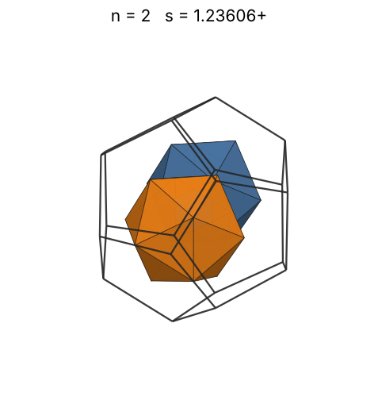 |
| 3 | [1.37303+](icoindod_n03.json) | 1.373033819006 |  | 0.94879 | 0.3300 | 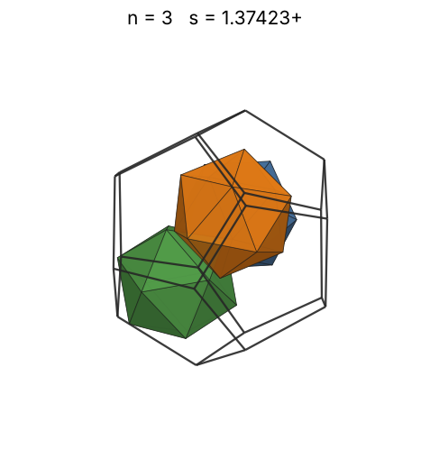 |
| 4 | [1.39344+](icoindod_n04.json) | 1.393446629166 | (-7 + 5√5)/3 | 1.04428 | 0.4209 | 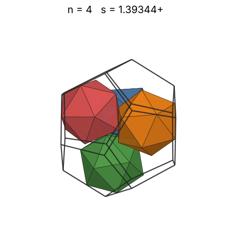 |
| 5 | [1.53319+](icoindod_n05.json) | 1.533190267566 |  | 1.12491 | 0.3950 | 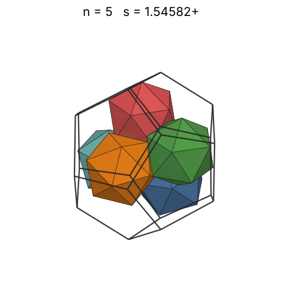 |
| 6 | [1.55131+](icoindod_n06.json) | 1.551315641669 |  | 1.19540 | 0.4576 | 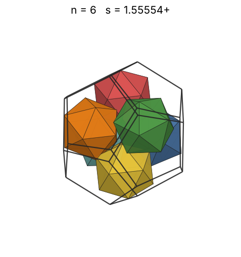 |
| 7 | [1.66853+](icoindod_n07.json) | 1.668531743486 |  | 1.25843 | 0.4290 | 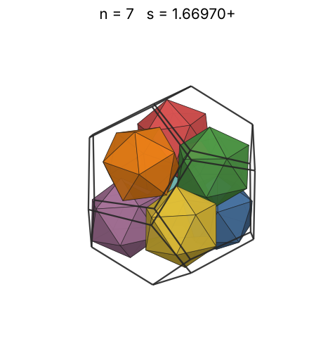 |
| 8 | [1.69778+](icoindod_n08.json) | 1.697789592378 |  | 1.31571 | 0.4654 | 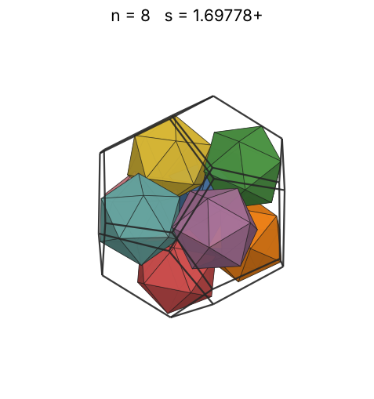 |
| 9 | [1.77163+](icoindod_n09.json) | 1.771633823380 |  | 1.36839 | 0.4608 | 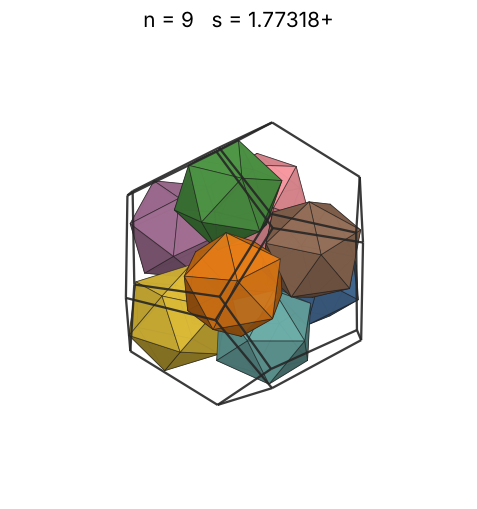 |
| 10 | [1.81821+](icoindod_n10.json) | 1.818214648381 |  | 1.41730 | 0.4736 | 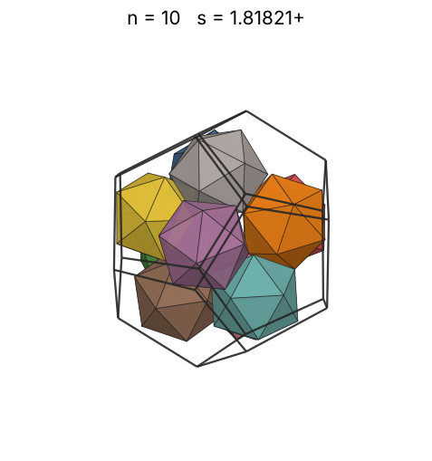 |
| 11 | [1.86714+](icoindod_n11.json) | 1.867141627329 |  | 1.46305 | 0.4811 | 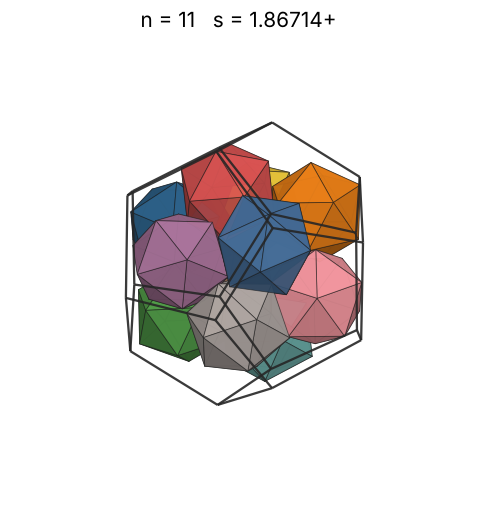 |
| 12 | [1.87461+](icoindod_n12.json) | 1.874619563323 |  | 1.50611 | 0.5186 | 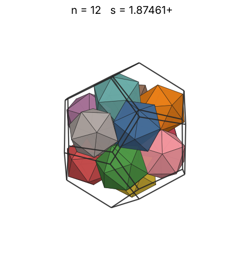 |
| 13 | [1.90402+](icoindod_n13.json) | 1.904024516913 |  | 1.54683 | 0.5362 | 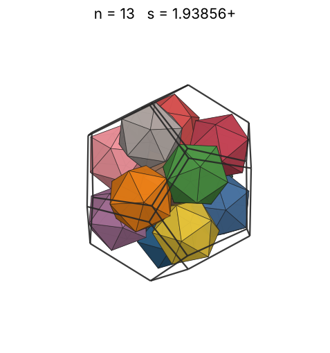 |
| 14 | [1.97107+](icoindod_n14.json) | 1.971077254485 |  | 1.58552 | 0.5205 | 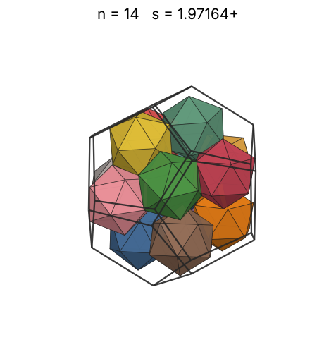 |
| 15 | [2.00000+](icoindod_n15.json) | 2.000000000000 | 2 | 1.62241 | 0.5338 | 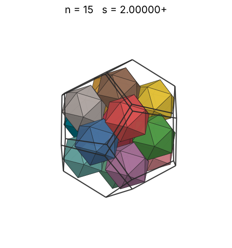 |
| 16 | [2.05510+](icoindod_n16.json) | 2.055105811967 |  | 1.65769 | 0.5248 | 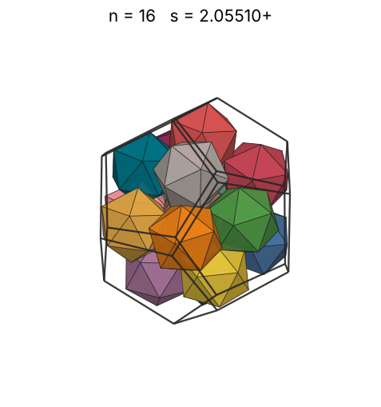 |
| 17 | [2.09085+](icoindod_n17.json) | 2.090857347078 |  | 1.69153 | 0.5295 | 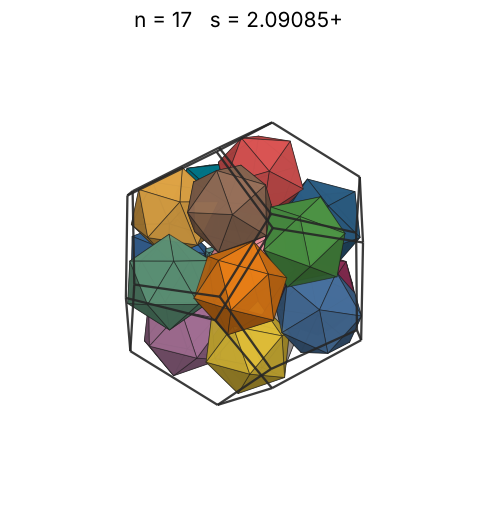 |
| 18 | [2.16215+](icoindod_n18.json) | 2.162158407110 |  | 1.72407 | 0.5070 | 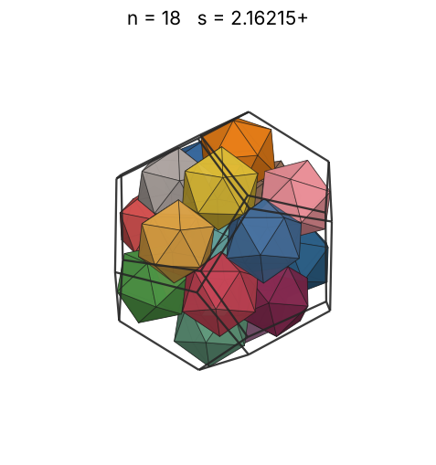 |
| 19 | [2.20355+](icoindod_n19.json) | 2.203558534579 |  | 1.75542 | 0.5056 | 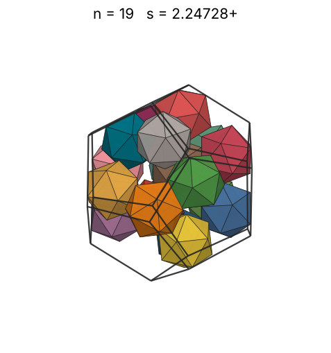 |
| 20 | [2.24176+](icoindod_n20.json) | 2.241765564872 |  | 1.78569 | 0.5054 | 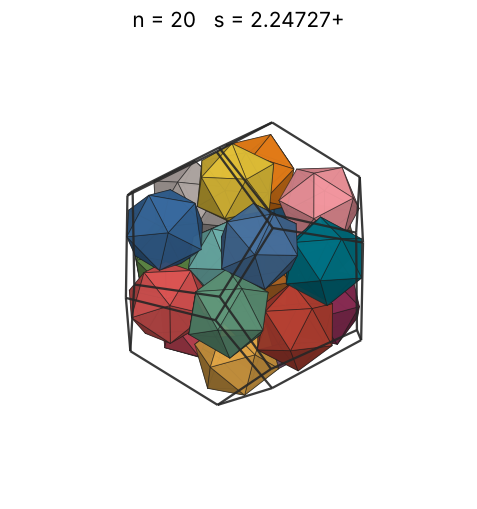 |
| 21 | [2.28370+](icoindod_n21.json) | 2.283706171749 |  | 1.81497 | 0.5020 | 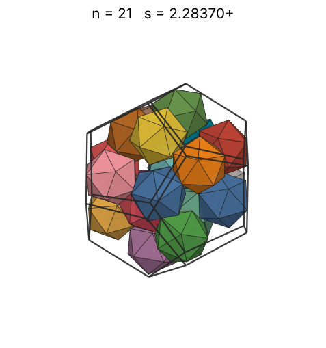 |
| 22 | [2.29459+](icoindod_n22.json) | 2.294591676214 |  | 1.84333 | 0.5184 | 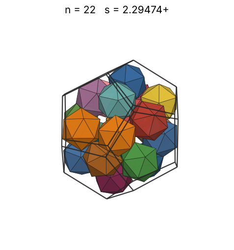 |
| 23 | [2.35149+](icoindod_n23.json) | 2.351498502524 |  | 1.87085 | 0.5036 | 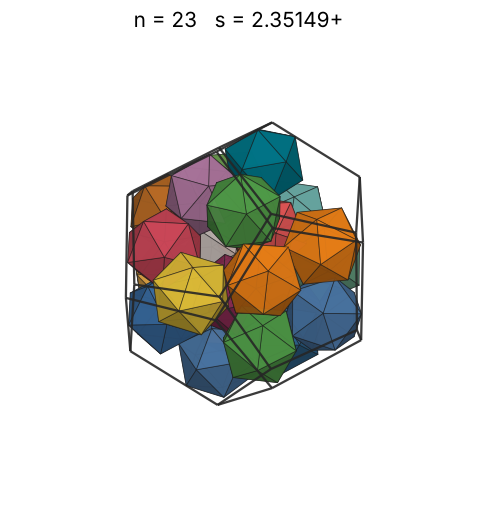 |
| 24 | [2.36541+](icoindod_n24.json) | 2.365414149134 |  | 1.89758 | 0.5163 | 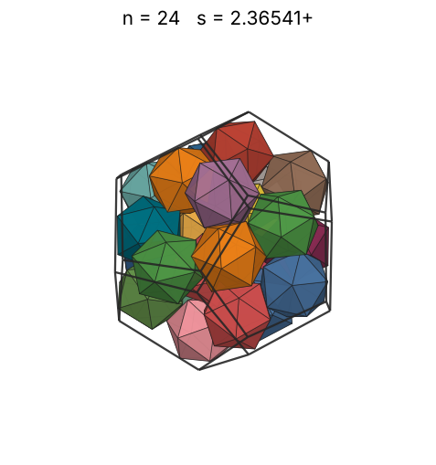 |
| 25 | [2.39406+](icoindod_n25.json) | 2.394065426480 |  | 1.92358 | 0.5187 | 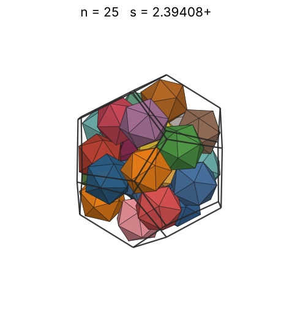 |
| 26 | [2.42248+](icoindod_n26.json) | 2.422488288853 |  | 1.94889 | 0.5207 | 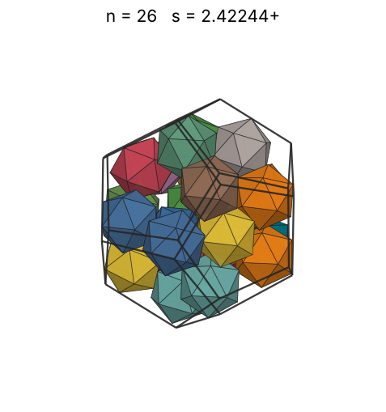 |
| 27 | [2.44475+](icoindod_n27.json) | 2.444756594137 |  | 1.97356 | 0.5261 | 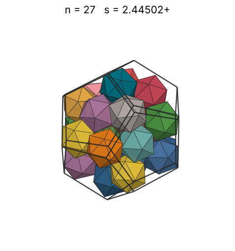 |
| 28 | [2.46823+](icoindod_n28.json) | 2.468239253292 |  | 1.99763 | 0.5301 | 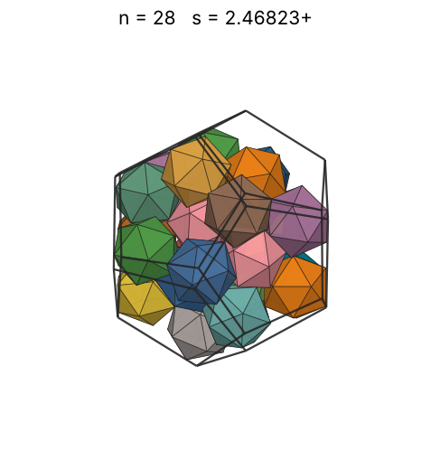 |
| 29 | [2.47572+](icoindod_n29.json) | 2.475721824275 |  | 2.02114 | 0.5441 | 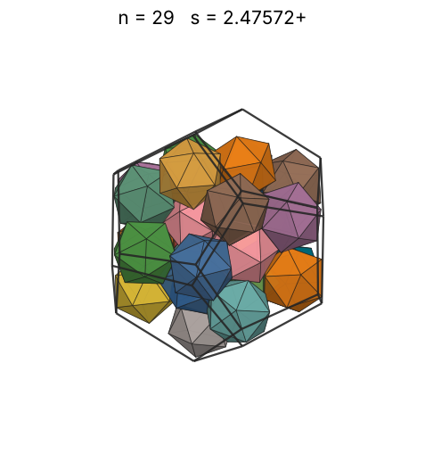 |
| 30 | [2.49070+](icoindod_n30.json) | 2.490703659145 |  | 2.04411 | 0.5528 | 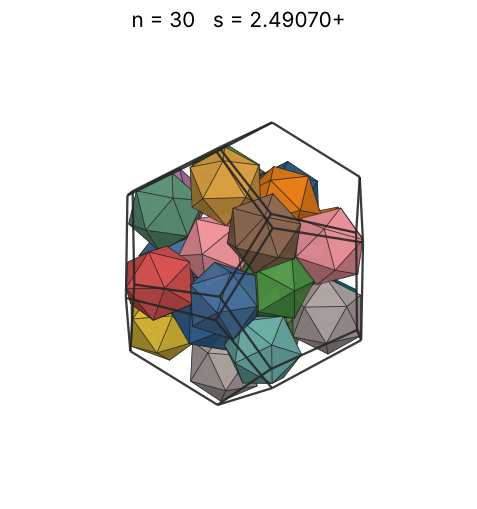 |
| 31 | [2.50916+](icoindod_n31.json) | 2.509166098946 |  | 2.06657 | 0.5587 | 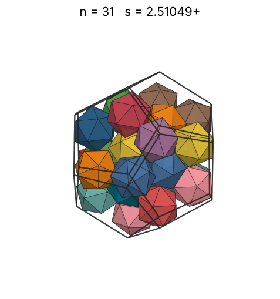 |
| 32 | [2.52216+](icoindod_n32.json) | 2.522169236193 |  | 2.08856 | 0.5678 | 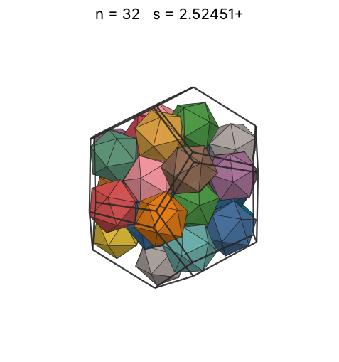 |
| 33 | [2.53601+](icoindod_n33.json) | 2.536010737801 |  | 2.11009 | 0.5760 | 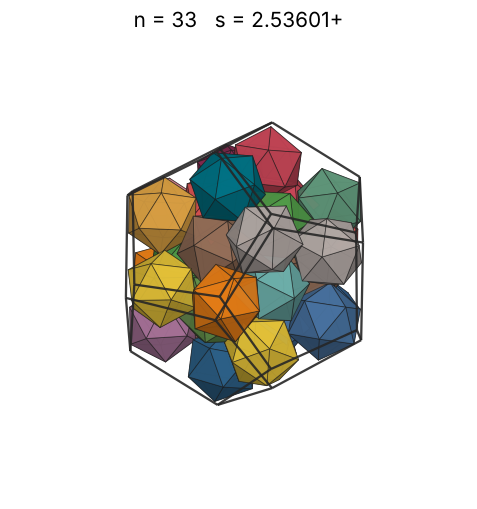 |
| 34 | [2.58115+](icoindod_n34.json) | 2.581151923699 |  | 2.13119 | 0.5629 | 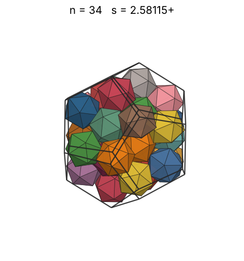 |
| 35 | [2.62753+](icoindod_n35.json) | 2.627530523019 |  | 2.15188 | 0.5493 | 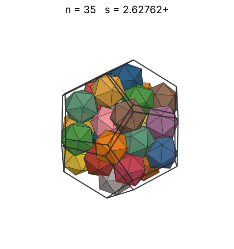 |
| 36 | [2.67151+](icoindod_n36.json) | 2.671515327108 |  | 2.17219 | 0.5375 | 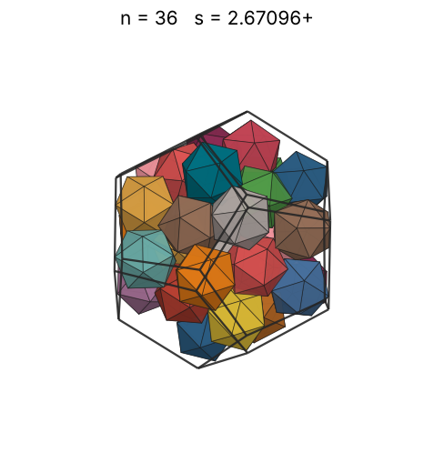 |
| 37 | [2.68681+](icoindod_n37.json) | 2.686818686303 |  | 2.19212 | 0.5431 | 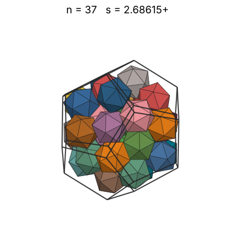 |
| 38 | [2.69655+](icoindod_n38.json) | 2.696558932760 |  | 2.21169 | 0.5517 | 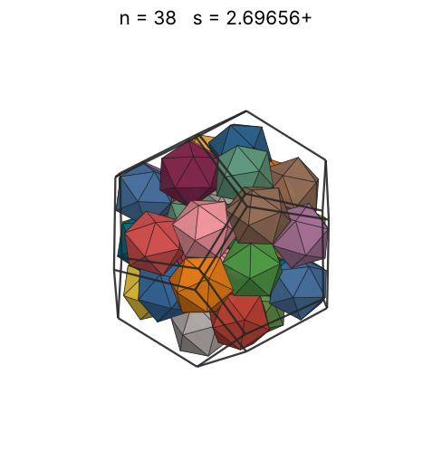 |
| 39 | [2.72805+](icoindod_n39.json) | 2.728053881504 |  | 2.23092 | 0.5469 | 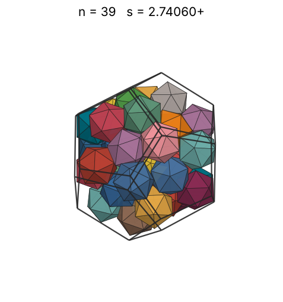 |
| 40 | [2.74184+](icoindod_n40.json) | 2.741841748654 |  | 2.24983 | 0.5525 | 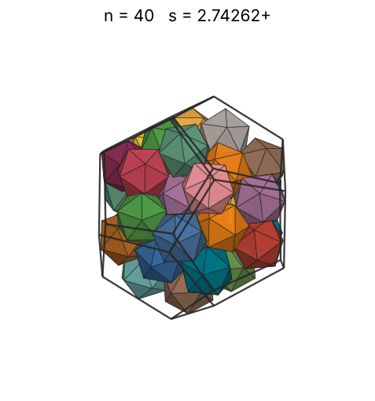 |
