# Icosahedra in an icosahedron

s = container edge / piece edge; every row certified in exact arithmetic.

| n | s | touching limit | closed form (conj.) | volume bound | density | picture |
|---|---|---|---|---|---|---|
| 2 | [1.96308+](icoinico_n02.json) | 1.963086047134 |  | 1.25992 | 0.2644 | 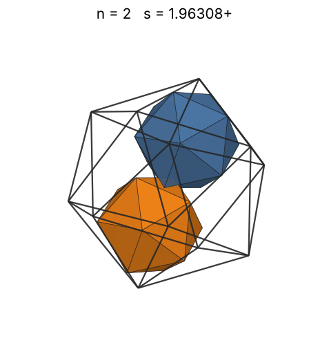 |
| 3 | [2.00000+](icoinico_n03.json) | 2.000000000000 | 2 | 1.44225 | 0.3750 | 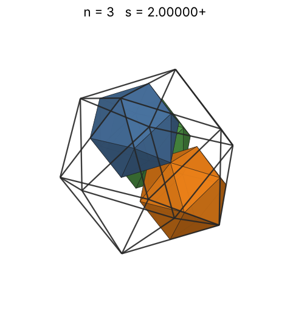 |
| 4 | [2.14589+](icoinico_n04.json) | 2.145898033750 | (11 - 3√5)/2 | 1.58740 | 0.4048 | 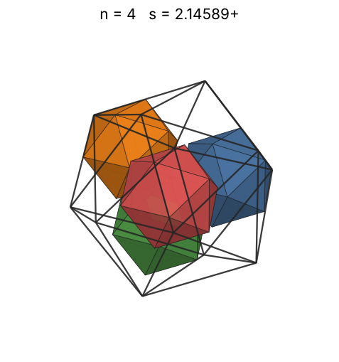 |
| 5 | [2.23606+](icoinico_n05.json) | 2.236067977500 | √5 | 1.70998 | 0.4472 | 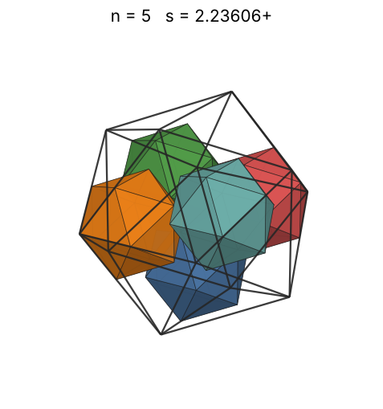 |
| 6 | [2.34164+](icoinico_n06.json) | 2.341640786500 | (5 + 3√5)/5 | 1.81712 | 0.4673 | 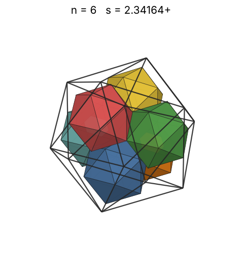 |
| 7 | [2.44931+](icoinico_n07.json) | 2.449316020430 | (149 + 67√5)/122 | 1.91293 | 0.4764 | 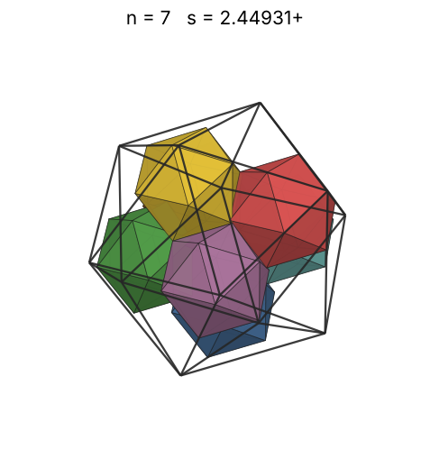 |
| 8 | [2.49661+](icoinico_n08.json) | 2.496616826734 | (81 + 33√5)/62 | 2.00000 | 0.5141 | 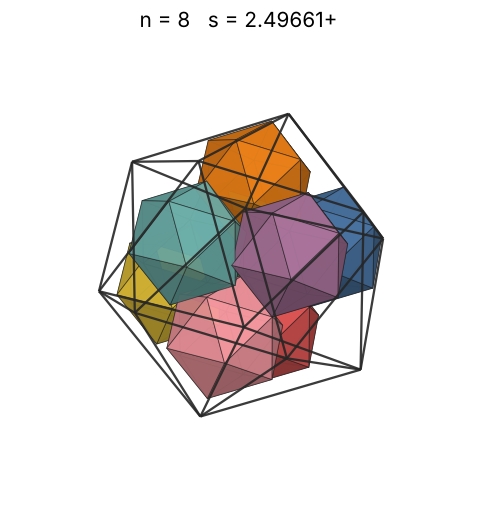 |
| 9 | [2.58295+](icoinico_n09.json) | 2.582954365839 |  | 2.08008 | 0.5223 | 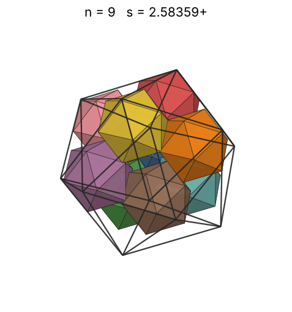 |
| 10 | [2.60989+](icoinico_n10.json) | 2.609892623656 |  | 2.15443 | 0.5625 | 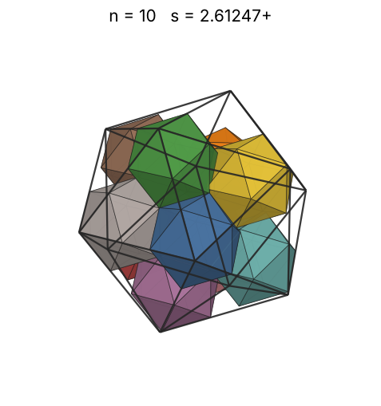 |
| 11 | [2.61803+](icoinico_n11.json) | 2.618033988750 | (3 + √5)/2 | 2.22398 | 0.6130 | 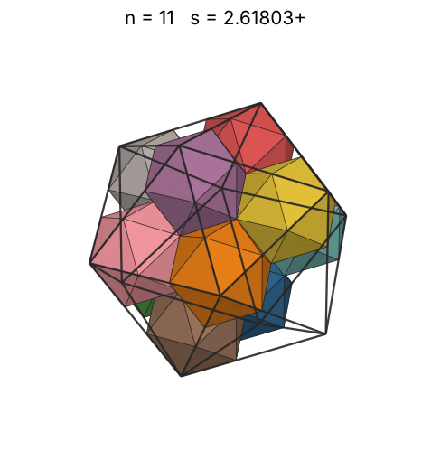 |
| 12 | [2.61803+](icoinico_n12.json) | 2.618033988750 | (3 + √5)/2 | 2.28943 | 0.6687 | 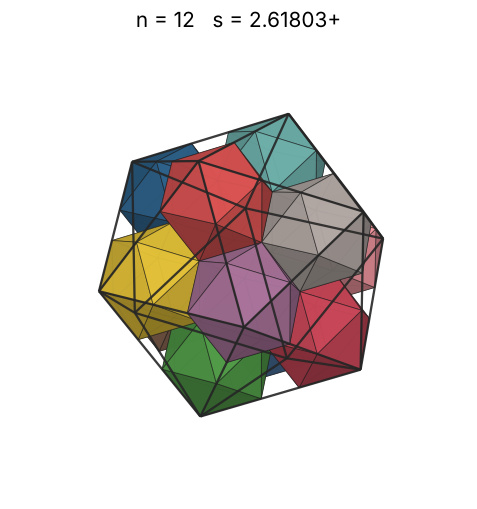 |
| 13 | [2.80901+](icoinico_n13.json) | 2.809016994375 | (9 + √5)/4 | 2.35133 | 0.5865 | 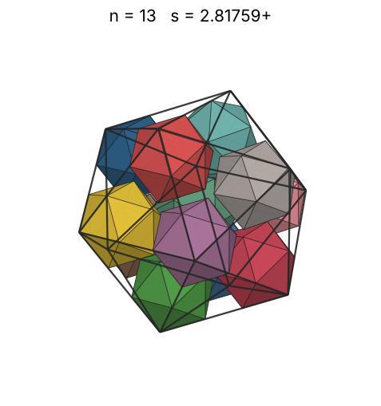 |
| 14 | [3.01780+](icoinico_n14.json) | 3.017801685357 |  | 2.41014 | 0.5094 | 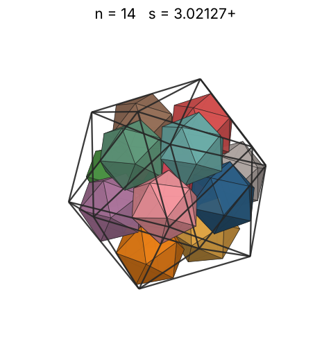 |
| 15 | [3.04832+](icoinico_n15.json) | 3.048320931579 |  | 2.46621 | 0.5296 | 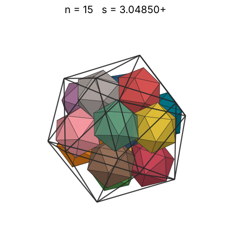 |
| 16 | [3.12130+](icoinico_n16.json) | 3.121305114637 |  | 2.51984 | 0.5262 | 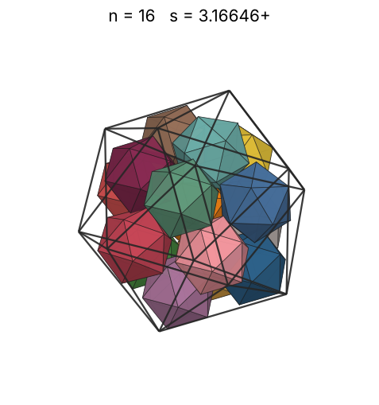 |
| 17 | [3.19692+](icoinico_n17.json) | 3.196923639527 |  | 2.57128 | 0.5203 | 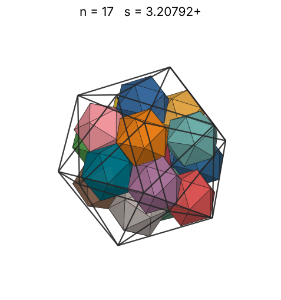 |
| 18 | [3.19821+](icoinico_n18.json) | 3.198212717046 | (24 + 5√5)/11 | 2.62074 | 0.5502 | 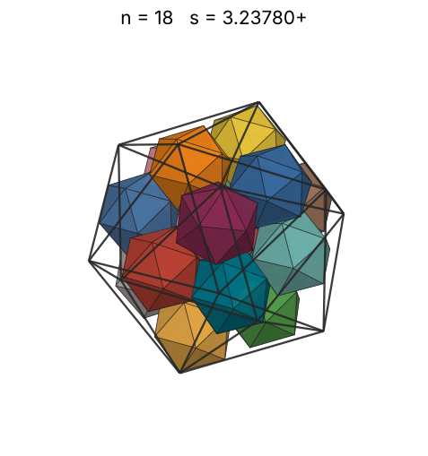 |
| 19 | [3.31147+](icoinico_n19.json) | 3.311471190958 |  | 2.66840 | 0.5232 | 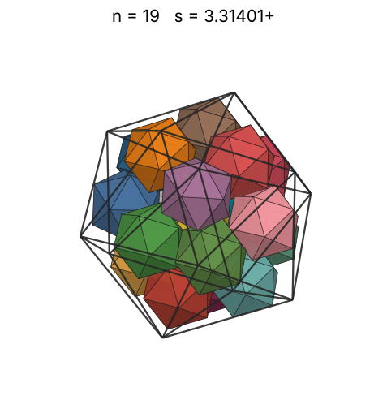 |
| 20 | [3.35370+](icoinico_n20.json) | 3.353709641300 |  | 2.71442 | 0.5302 | 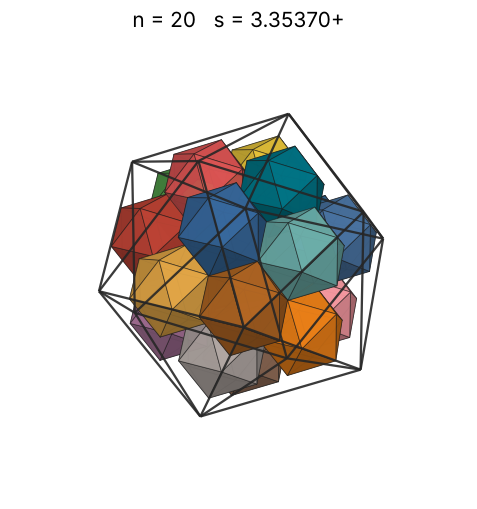 |
| 21 | [3.40705+](icoinico_n21.json) | 3.407051859262 |  | 2.75892 | 0.5310 | 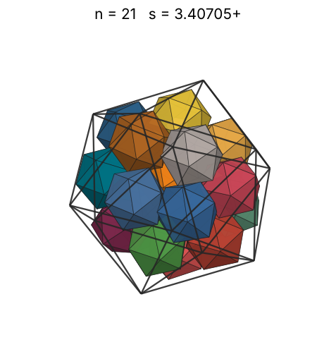 |
| 22 | [3.47954+](icoinico_n22.json) | 3.479548082474 |  | 2.80204 | 0.5222 | 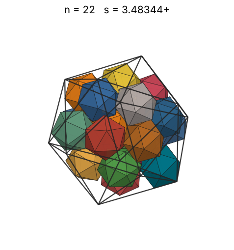 |
| 23 | [3.55296+](icoinico_n23.json) | 3.552963869213 |  | 2.84387 | 0.5128 | 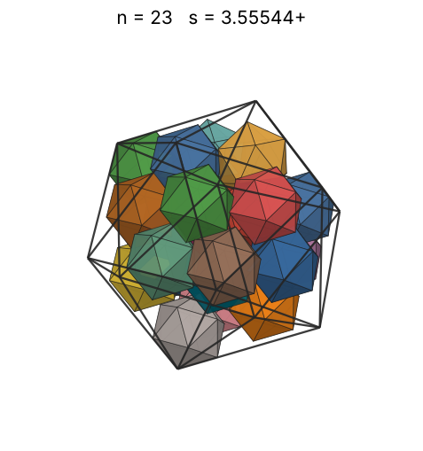 |
| 24 | [3.59398+](icoinico_n24.json) | 3.593989480476 |  | 2.88450 | 0.5170 | 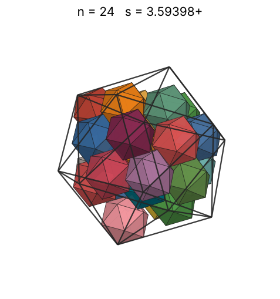 |
| 25 | [3.60901+](icoinico_n25.json) | 3.609018903550 |  | 2.92402 | 0.5318 | 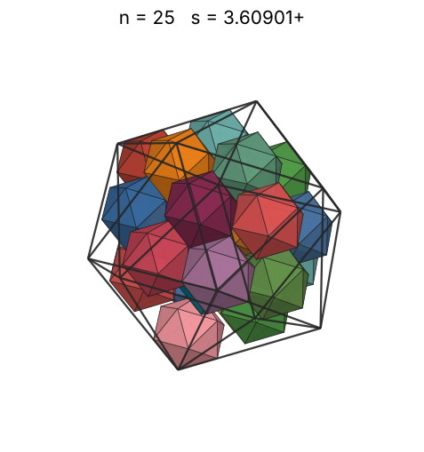 |
| 26 | [3.67328+](icoinico_n26.json) | 3.673285397278 |  | 2.96250 | 0.5246 | 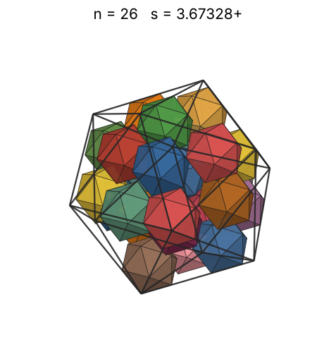 |
| 27 | [3.70095+](icoinico_n27.json) | 3.700954974992 |  | 3.00000 | 0.5326 | 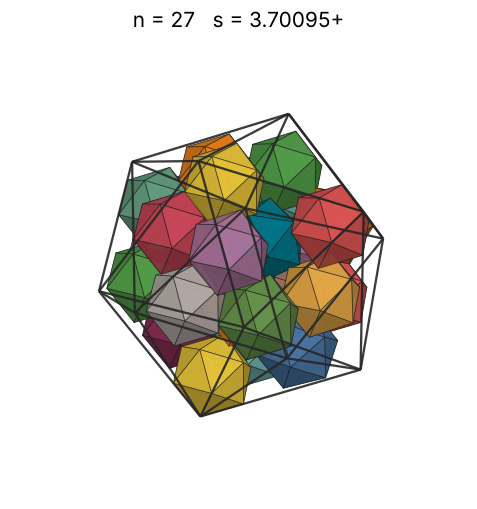 |
| 28 | [3.74070+](icoinico_n28.json) | 3.740699898786 |  | 3.03659 | 0.5349 | 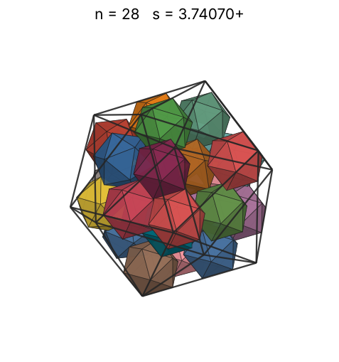 |
| 29 | [3.77348+](icoinico_n29.json) | 3.773486164608 |  | 3.07232 | 0.5397 | 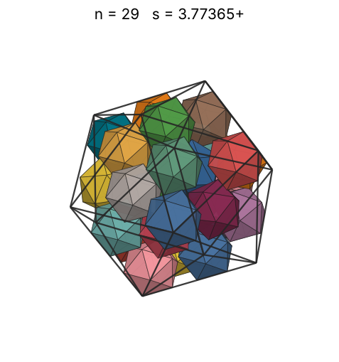 |
| 30 | [3.82255+](icoinico_n30.json) | 3.822555411805 |  | 3.10723 | 0.5371 | 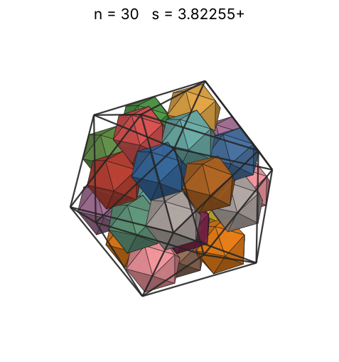 |
| 31 | [3.86045+](icoinico_n31.json) | 3.860451336303 |  | 3.14138 | 0.5388 | 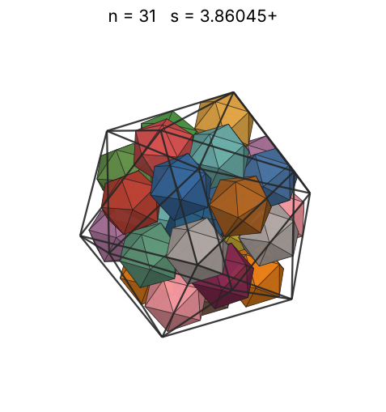 |
| 32 | [3.87964+](icoinico_n32.json) | 3.879643533742 |  | 3.17480 | 0.5480 | 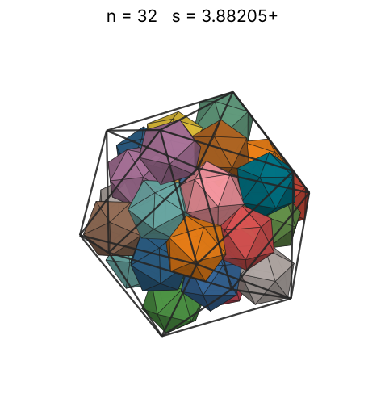 |
| 33 | [3.89855+](icoinico_n33.json) | 3.898550338880 |  | 3.20753 | 0.5569 | 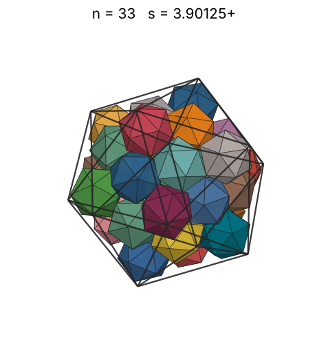 |
| 34 | [3.90451+](icoinico_n34.json) | 3.904513930989 |  | 3.23961 | 0.5712 | 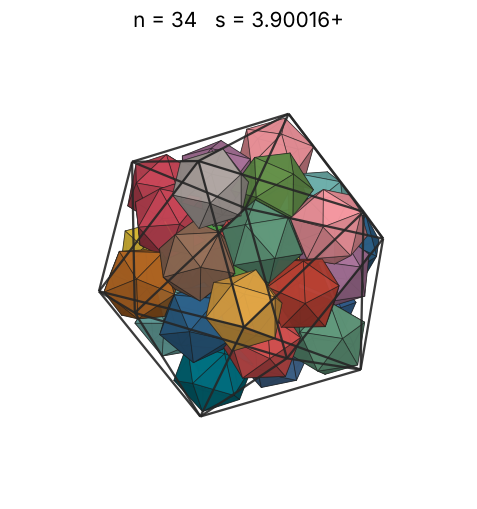 |
| 35 | [3.93652+](icoinico_n35.json) | 3.936521839036 |  | 3.27107 | 0.5738 | 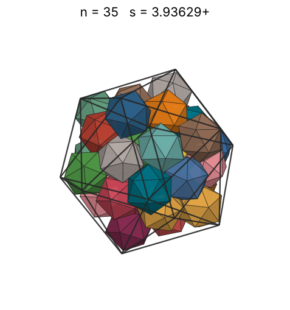 |
| 36 | [4.01231+](icoinico_n36.json) | 4.012316192949 |  | 3.30193 | 0.5573 | 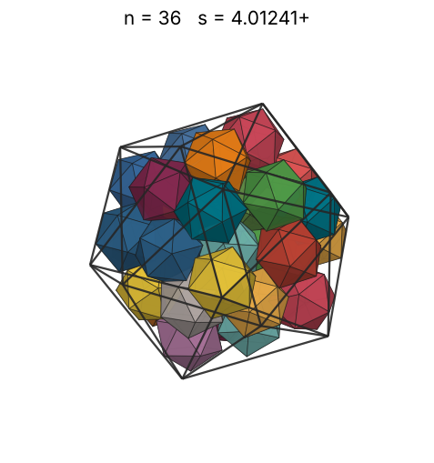 |
| 37 | [4.04727+](icoinico_n37.json) | 4.047278549546 |  | 3.33222 | 0.5581 | 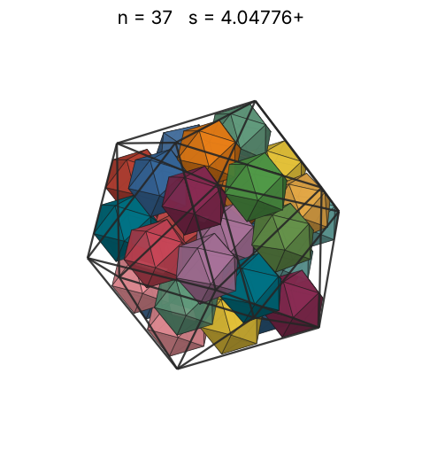 |
| 38 | [4.06153+](icoinico_n38.json) | 4.061532844260 |  | 3.36198 | 0.5672 | 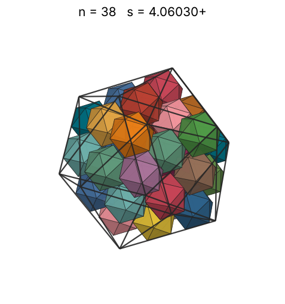 |
| 39 | [4.06977+](icoinico_n39.json) | 4.069774009666 |  | 3.39121 | 0.5786 | 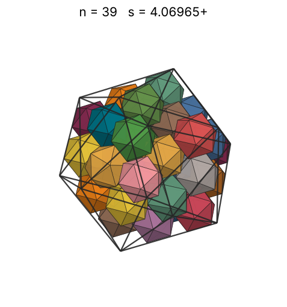 |
| 40 | [4.10751+](icoinico_n40.json) | 4.107510630284 |  | 3.41995 | 0.5772 | 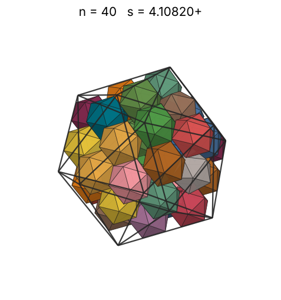 |
