# Icosahedra in an octahedron

s = container edge / piece edge; every row certified in exact arithmetic.

| n | s | touching limit | closed form (conj.) | volume bound | density | picture |
|---|---|---|---|---|---|---|
| 2 | [2.99535+](icoinoct_n02.json) | 2.995352463168 |  | 2.09963 | 0.3444 | 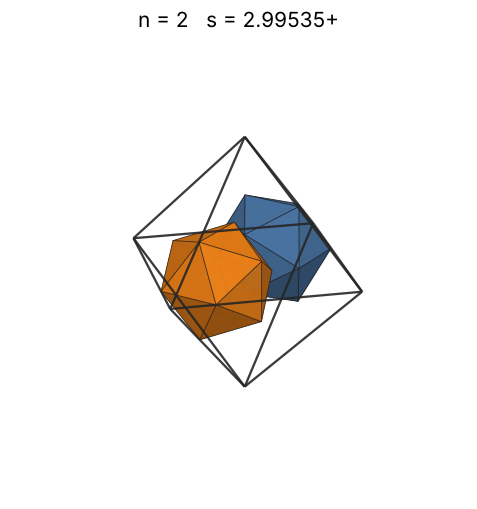 |
| 3 | [3.34890+](icoinoct_n03.json) | 3.348905882363 |  | 2.40348 | 0.3697 | 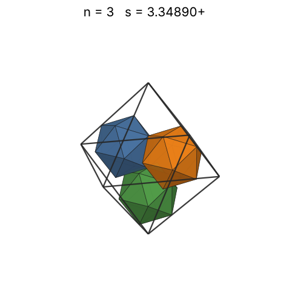 |
| 4 | [3.50702+](icoinoct_n04.json) | 3.507019776397 |  | 2.64537 | 0.4292 | 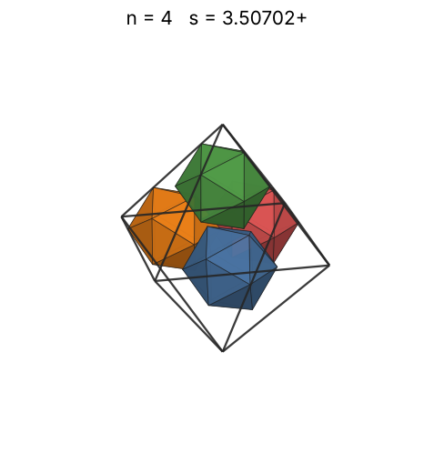 |
| 5 | [3.50702+](icoinoct_n05.json) | 3.507019776528 |  | 2.84964 | 0.5365 | 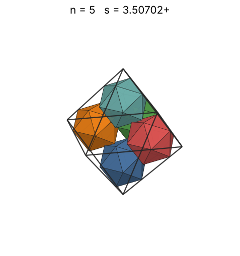 |
| 6 | [3.50702+](icoinoct_n06.json) | 3.507019786628 |  | 3.02820 | 0.6438 | 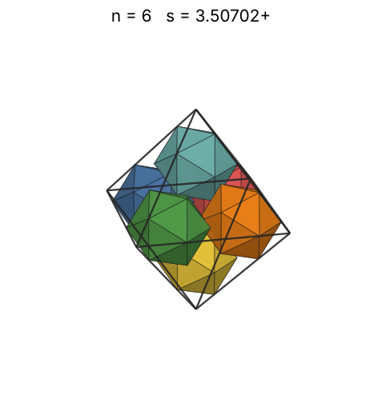 |
| 7 | [4.13947+](icoinoct_n07.json) | 4.139475359704 |  | 3.18786 | 0.4567 | 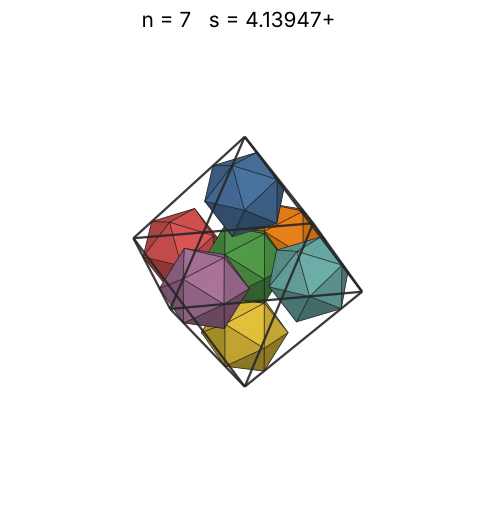 |
| 8 | [4.35798+](icoinoct_n08.json) | 4.357983396124 |  | 3.33296 | 0.4473 | 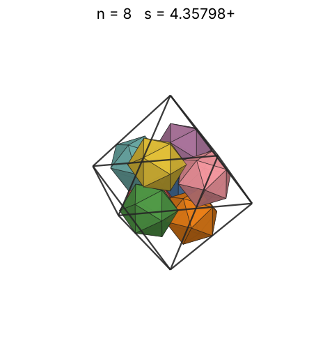 |
| 9 | [4.55763+](icoinoct_n09.json) | 4.557638564545 |  | 3.46642 | 0.4400 | 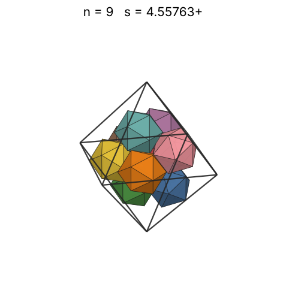 |
| 10 | [4.62807+](icoinoct_n10.json) | 4.628076896965 |  | 3.59032 | 0.4669 | 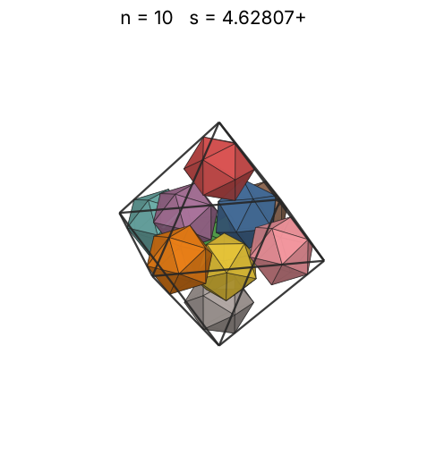 |
| 11 | [4.77232+](icoinoct_n11.json) | 4.772328363157 |  | 3.70622 | 0.4684 | 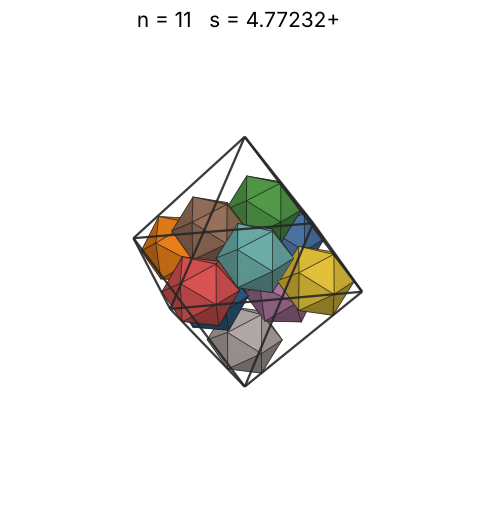 |
| 12 | [4.78619+](icoinoct_n12.json) | 4.786195845757 |  | 3.81529 | 0.5065 | 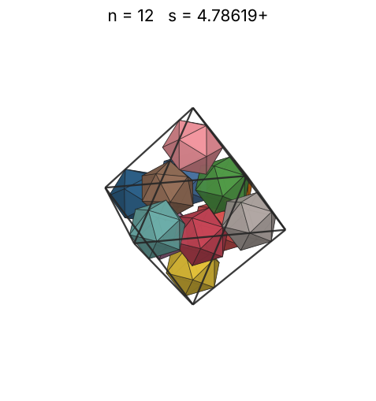 |
| 13 | [4.93589+](icoinoct_n13.json) | 4.935890993220 |  | 3.91845 | 0.5003 | 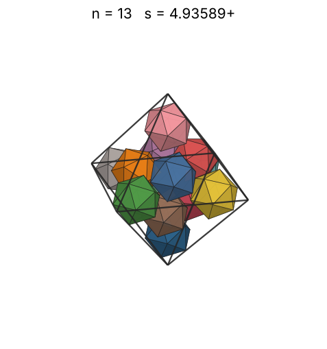 |
| 14 | [5.05566+](icoinoct_n14.json) | 5.055663846456 |  | 4.01645 | 0.5014 | 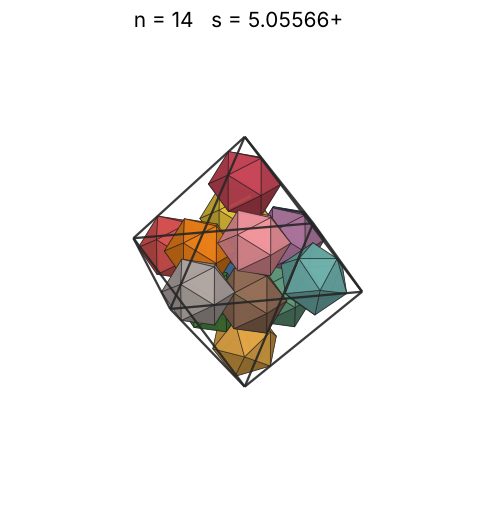 |
| 15 | [5.15991+](icoinoct_n15.json) | 5.159910305472 |  | 4.10989 | 0.5053 | 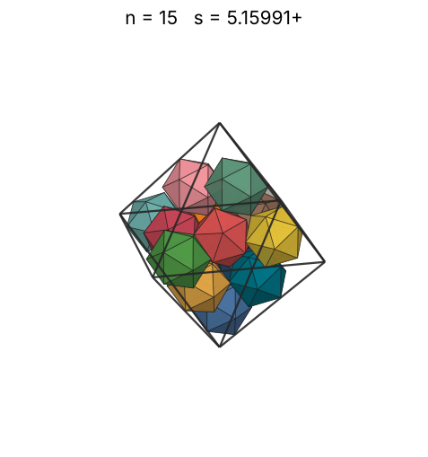 |
| 16 | [5.21290+](icoinoct_n16.json) | 5.212900814930 |  | 4.19927 | 0.5227 | 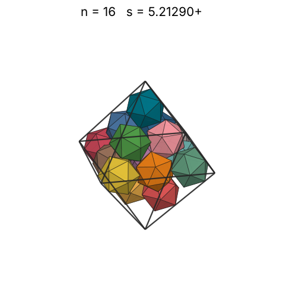 |
| 17 | [5.26739+](icoinoct_n17.json) | 5.267391008765 |  | 4.28499 | 0.5383 | 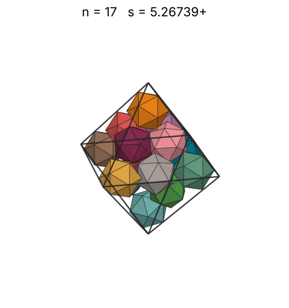 |
| 18 | [5.28514+](icoinoct_n18.json) | 5.285142873074 |  | 4.36741 | 0.5643 | 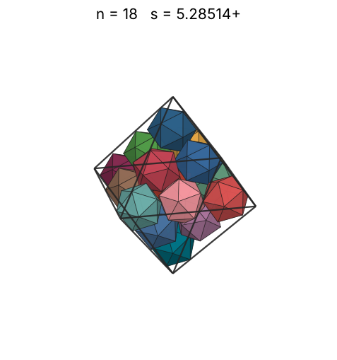 |
| 19 | [5.29844+](icoinoct_n19.json) | 5.298446067331 |  | 4.44684 | 0.5912 | 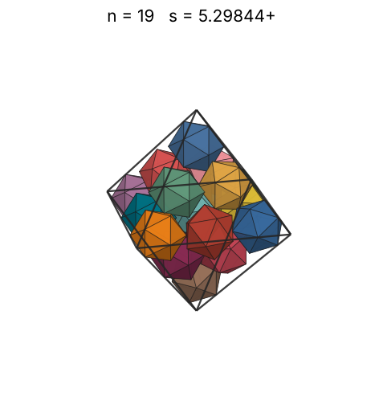 |
| 20 | [5.68237+](icoinoct_n20.json) | 5.682377768418 |  | 4.52352 | 0.5045 | 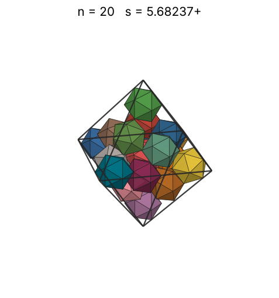 |
| 21 | [5.77406+](icoinoct_n21.json) | 5.774067874084 |  | 4.59769 | 0.5049 | 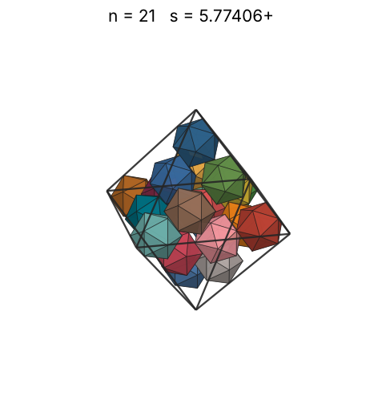 |
| 22 | [5.89626+](icoinoct_n22.json) | 5.896260196078 |  | 4.66954 | 0.4967 | 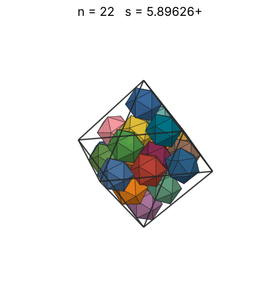 |
| 23 | [5.96332+](icoinoct_n23.json) | 5.963323002563 |  | 4.73925 | 0.5020 | 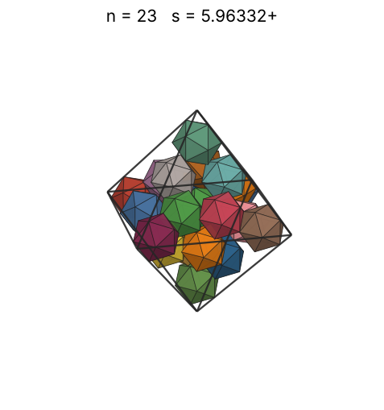 |
| 24 | [6.05407+](icoinoct_n24.json) | 6.054072953702 |  | 4.80696 | 0.5006 | 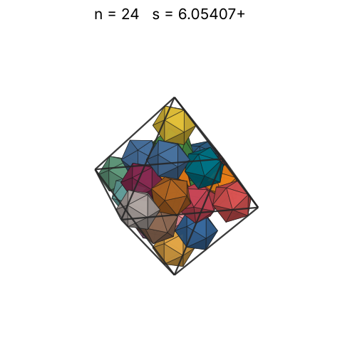 |
| 25 | [6.15060+](icoinoct_n25.json) | 6.150602149984 |  | 4.87282 | 0.4973 | 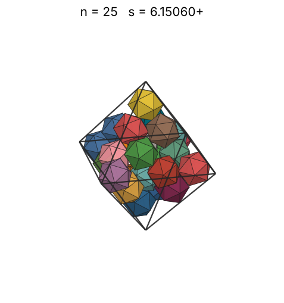 |
| 26 | [6.19329+](icoinoct_n26.json) | 6.193292934460 |  | 4.93694 | 0.5065 | 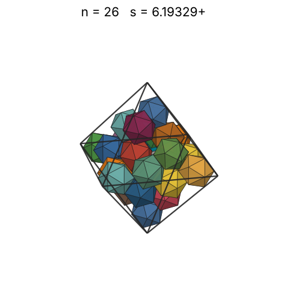 |
| 27 | [6.27711+](icoinoct_n27.json) | 6.277115164189 |  | 4.99944 | 0.5052 | 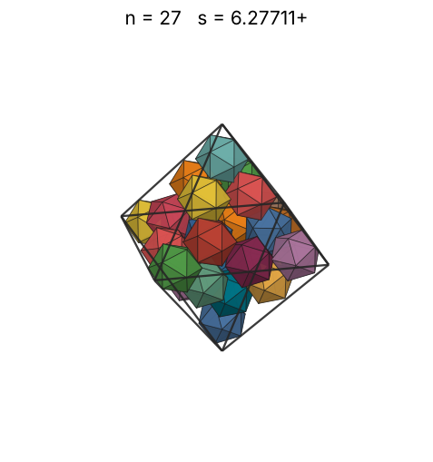 |
| 28 | [6.37610+](icoinoct_n28.json) | 6.376100539755 |  | 5.06041 | 0.4999 | 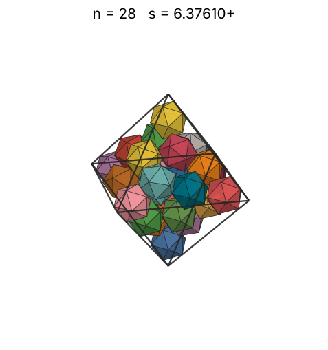 |
| 29 | [6.55349+](icoinoct_n29.json) | 6.553490170440 |  | 5.11995 | 0.4768 | 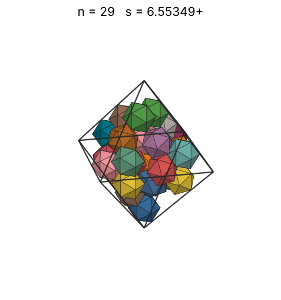 |
| 30 | [6.61769+](icoinoct_n30.json) | 6.617695337591 |  | 5.17814 | 0.4791 | 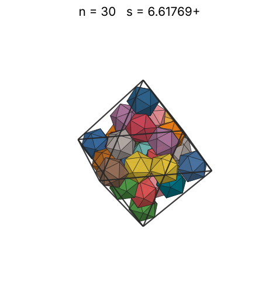 |
