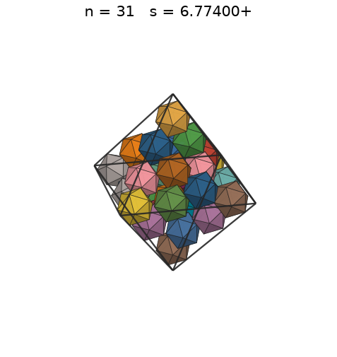
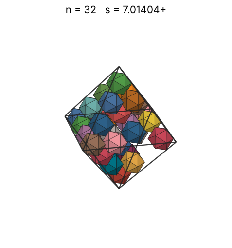
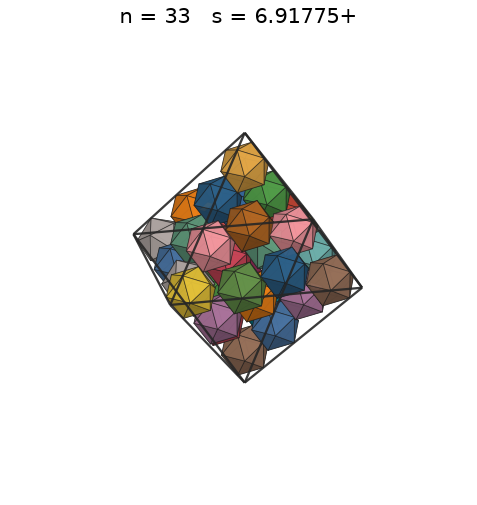
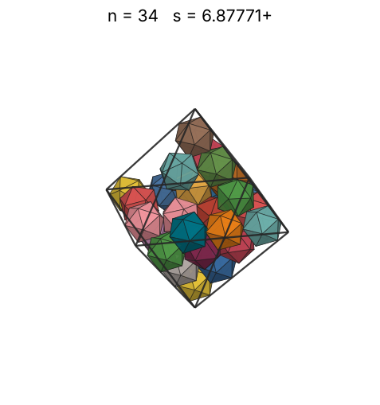
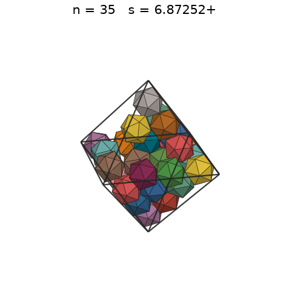
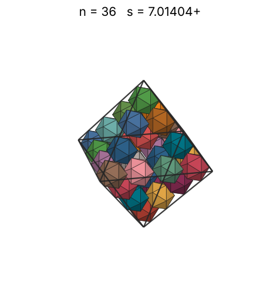
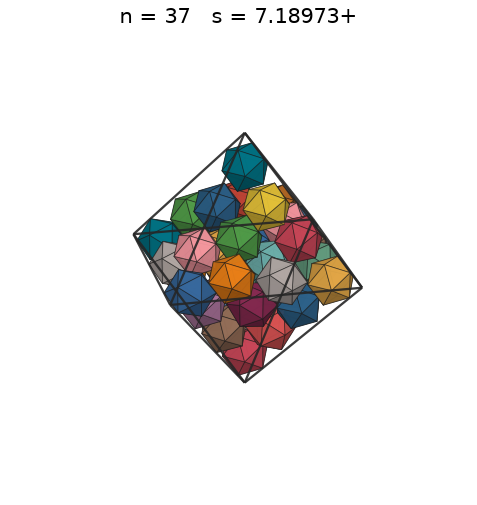
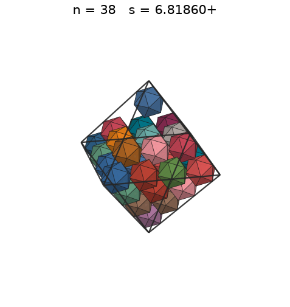
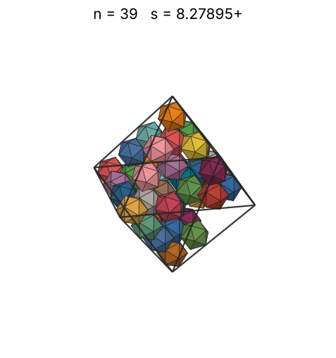

# Icosahedra in an octahedron

s = container edge / piece edge; every row certified in exact arithmetic.

| n | s | touching limit | closed form (conj.) | volume bound | density | picture |
|---|---|---|---|---|---|---|
| 2 | [2.99535+](icoinoct_n02.json) | 2.995352463168 | √(2√5 + 9/2) | 2.09963 | 0.3444 |  |
| 3 | [3.34890+](icoinoct_n03.json) | 3.348905882363 | √(5√5/2 + 45/8) | 2.40348 | 0.3697 |  |
| 4 | [3.50702+](icoinoct_n04.json) | 3.507019776397 | √(275√5 + 615)/10 | 2.64537 | 0.4292 |  |
| 5 | [3.50702+](icoinoct_n05.json) | 3.507019776528 | √(275√5 + 615)/10 | 2.84964 | 0.5365 |  |
| 6 | [3.50702+](icoinoct_n06.json) | 3.507019786628 | √(275√5 + 615)/10 | 3.02820 | 0.6438 |  |
| 7 | [4.13947+](icoinoct_n07.json) | 4.139475359704 | √(15√5/4 + 35/4) | 3.18786 | 0.4567 |  |
| 8 | [4.35798+](icoinoct_n08.json) | 4.357983396124 | √(63√5 + 163)/4 | 3.33296 | 0.4473 |  |
| 9 | [4.55763+](icoinoct_n09.json) | 4.557638564545 | √(6667√5 + 15087)/38 | 3.46642 | 0.4400 |  |
| 10 | [4.62807+](icoinoct_n10.json) | 4.628073967055 | (15√2 + 5√10)/8 | 3.59032 | 0.4669 |  |
| 11 | [4.77232+](icoinoct_n11.json) | 4.772328363157 |  | 3.70622 | 0.4684 |  |
| 12 | [4.78619+](icoinoct_n12.json) | 4.786195845757 | 3√(225√5 + 515)/20 | 3.81529 | 0.5065 |  |
| 13 | [4.93589+](icoinoct_n13.json) | 4.935890993220 |  | 3.91845 | 0.5003 |  |
| 14 | [5.05566+](icoinoct_n14.json) | 5.055663846456 | √(2059√5 + 4623)/19 | 4.01645 | 0.5014 |  |
| 15 | [5.15991+](icoinoct_n15.json) | 5.159910305472 |  | 4.10989 | 0.5053 |  |
| 16 | [5.21290+](icoinoct_n16.json) | 5.212900814930 |  | 4.19927 | 0.5227 |  |
| 17 | [5.26739+](icoinoct_n17.json) | 5.267391008765 |  | 4.28499 | 0.5383 |  |
| 18 | [5.28514+](icoinoct_n18.json) | 5.285142873074 |  | 4.36741 | 0.5643 |  |
| 19 | [5.29844+](icoinoct_n19.json) | 5.298446067331 |  | 4.44684 | 0.5912 |  |
| 20 | [5.68237+](icoinoct_n20.json) | 5.682377768418 |  | 4.52352 | 0.5045 |  |
| 21 | [5.77406+](icoinoct_n21.json) | 5.774067874084 |  | 4.59769 | 0.5049 |  |
| 22 | [5.89626+](icoinoct_n22.json) | 5.896260196078 |  | 4.66954 | 0.4967 |  |
| 23 | [5.96332+](icoinoct_n23.json) | 5.963323002563 |  | 4.73925 | 0.5020 |  |
| 24 | [6.05407+](icoinoct_n24.json) | 6.054072953702 |  | 4.80696 | 0.5006 |  |
| 25 | [6.15060+](icoinoct_n25.json) | 6.150602149984 |  | 4.87282 | 0.4973 |  |
| 26 | [6.19329+](icoinoct_n26.json) | 6.193292934460 |  | 4.93694 | 0.5065 |  |
| 27 | [6.27711+](icoinoct_n27.json) | 6.277115164189 |  | 4.99944 | 0.5052 |  |
| 28 | [6.37610+](icoinoct_n28.json) | 6.376100539755 |  | 5.06041 | 0.4999 |  |
| 29 | [6.47930+](icoinoct_n29.json) | 6.479303553877 | 7√(3√5 + 7)/4 | 5.11995 | 0.4934 |  |
| 30 | [6.61769+](icoinoct_n30.json) | 6.617695337591 |  | 5.17814 | 0.4791 |  |
| 31 | [6.78784+](icoinoct_n31.json) | 6.787841818347 |  | 5.23505 | 0.4587 |  |
| 32 | [6.83530+](icoinoct_n32.json) | 6.835309243650 |  | 5.29074 | 0.4637 |  |
| 33 | [6.87771+](icoinoct_n33.json) | 6.877713139867 |  | 5.34529 | 0.4694 |  |
| 34 | [6.87771+](icoinoct_n34.json) | 6.877713139867 |  | 5.39875 | 0.4837 |  |
| 35 | [6.87771+](icoinoct_n35.json) | 6.877713139867 |  | 5.45117 | 0.4979 |  |
| 36 | [6.87771+](icoinoct_n36.json) | 6.877713139867 |  | 5.50260 | 0.5121 |  |
| 37 | [6.87771+](icoinoct_n37.json) | 6.877713139867 |  | 5.55308 | 0.5263 |  |
| 38 | [6.87771+](icoinoct_n38.json) | 6.877713139867 |  | 5.60266 | 0.5406 |  |
| 39 | [6.87771+](icoinoct_n39.json) | 6.877713139867 |  | 5.65139 | 0.5548 |  |
| 40 | [6.87771+](icoinoct_n40.json) | 6.877713140152 |  | 5.69928 | 0.5690 |  |
| 41 | [6.87771+](icoinoct_n41.json) | 6.877713141849 |  | 5.74638 | 0.5832 |  |
| 42 | [6.88523+](icoinoct_n42.json) | 6.885237224055 |  | 5.79273 | 0.5955 |  |
| 43 | [6.92504+](icoinoct_n43.json) | 6.925042127144 |  | 5.83834 | 0.5992 |  |
| 44 | [6.92504+](icoinoct_n44.json) | 6.925042127144 |  | 5.88325 | 0.6132 |  |
| 45 | [7.21450+](icoinoct_n45.json) | 7.214504111632 |  | 5.92749 | 0.5546 |  |
| 46 | [7.27992+](icoinoct_n46.json) | 7.279920140079 |  | 5.97108 | 0.5518 |  |
| 47 | [7.35686+](icoinoct_n47.json) | 7.356861782013 |  | 6.01404 | 0.5463 |  |
| 48 | [7.44869+](icoinoct_n48.json) | 7.448695665942 |  | 6.05639 | 0.5375 |  |
| 49 | [7.51145+](icoinoct_n49.json) | 7.511453287906 |  | 6.09816 | 0.5351 |  |
| 50 | [7.59302+](icoinoct_n50.json) | 7.593025701502 |  | 6.13936 | 0.5286 |  |
| 51 | [7.61036+](icoinoct_n51.json) | 7.610365099509 |  | 6.18002 | 0.5355 |  |
| 52 | [7.67550+](icoinoct_n52.json) | 7.675503682829 |  | 6.22016 | 0.5322 |  |
| 53 | [7.69061+](icoinoct_n53.json) | 7.690616810678 |  | 6.25977 | 0.5393 |  |
| 54 | [7.73239+](icoinoct_n54.json) | 7.732398470247 |  | 6.29890 | 0.5406 |  |
| 55 | [7.83064+](icoinoct_n55.json) | 7.830647624825 |  | 6.33754 | 0.5301 |  |
| 56 | [8.13985+](icoinoct_n56.json) | 8.139853494354 |  | 6.37572 | 0.4805 |  |
| 57 | [8.13985+](icoinoct_n57.json) | 8.139853494354 |  | 6.41345 | 0.4891 |  |
| 58 | [8.13985+](icoinoct_n58.json) | 8.139853494354 |  | 6.45074 | 0.4977 |  |
| 59 | [8.13985+](icoinoct_n59.json) | 8.139854959772 |  | 6.48760 | 0.5063 |  |
| 60 | [8.13985+](icoinoct_n60.json) | 8.139858754062 |  | 6.52405 | 0.5149 |  |
| 61 | [8.50036+](icoinoct_n61.json) | 8.500362577589 |  | 6.56009 | 0.4596 |  |
| 62 | [8.50036+](icoinoct_n62.json) | 8.500362577589 |  | 6.59575 | 0.4672 |  |
| 63 | [8.50036+](icoinoct_n63.json) | 8.500362577589 |  | 6.63102 | 0.4747 |  |
| 64 | [8.50036+](icoinoct_n64.json) | 8.500362577589 |  | 6.66592 | 0.4822 |  |
| 65 | [8.50036+](icoinoct_n65.json) | 8.500362577589 |  | 6.70046 | 0.4898 |  |
| 66 | [8.50036+](icoinoct_n66.json) | 8.500362577589 |  | 6.73465 | 0.4973 |  |
| 67 | [8.50036+](icoinoct_n67.json) | 8.500362577589 |  | 6.76849 | 0.5049 |  |
| 68 | [8.50036+](icoinoct_n68.json) | 8.500362577589 |  | 6.80200 | 0.5124 |  |
| 69 | [8.50036+](icoinoct_n69.json) | 8.500362577589 |  | 6.83518 | 0.5199 |  |
| 70 | [8.50036+](icoinoct_n70.json) | 8.500362577589 |  | 6.86804 | 0.5275 |  |
| 71 | [8.50036+](icoinoct_n71.json) | 8.500362577589 |  | 6.90059 | 0.5350 |  |
| 72 | [8.50036+](icoinoct_n72.json) | 8.500362577589 |  | 6.93284 | 0.5425 |  |
| 73 | [8.50036+](icoinoct_n73.json) | 8.500362577589 |  | 6.96479 | 0.5501 |  |
| 74 | [8.50036+](icoinoct_n74.json) | 8.500362577589 |  | 6.99644 | 0.5576 |  |
| 75 | [8.50036+](icoinoct_n75.json) | 8.500362577597 |  | 7.02782 | 0.5651 |  |
| 76 | [8.50036+](icoinoct_n76.json) | 8.500362577597 |  | 7.05892 | 0.5727 |  |
| 77 | [8.50036+](icoinoct_n77.json) | 8.500362577597 |  | 7.08974 | 0.5802 |  |
| 78 | [8.50036+](icoinoct_n78.json) | 8.500362577626 |  | 7.12030 | 0.5877 |  |
| 79 | [8.50036+](icoinoct_n79.json) | 8.500362578846 |  | 7.15060 | 0.5953 |  |
| 80 | [8.50036+](icoinoct_n80.json) | 8.500362580822 |  | 7.18064 | 0.6028 |  |
| 81 | [10.11132+](icoinoct_n81.json) | 10.111327692912 |  | 7.21044 | 0.3626 |  |
| 82 | [10.11132+](icoinoct_n82.json) | 10.111327692912 |  | 7.23999 | 0.3671 |  |
| 83 | [10.11132+](icoinoct_n83.json) | 10.111327692912 |  | 7.26930 | 0.3716 |  |
| 84 | [10.11132+](icoinoct_n84.json) | 10.111327692912 |  | 7.29838 | 0.3761 |  |
| 85 | [10.31982+](icoinoct_n85.json) | 10.319820610945 |  | 7.32723 | 0.3579 |  |
| 86 | [10.31982+](icoinoct_n86.json) | 10.319820610945 |  | 7.35585 | 0.3621 |  |
| 87 | [10.31982+](icoinoct_n87.json) | 10.319820610945 |  | 7.38425 | 0.3664 |  |
| 88 | [10.31982+](icoinoct_n88.json) | 10.319820610945 |  | 7.41244 | 0.3706 |  |
| 89 | [10.31982+](icoinoct_n89.json) | 10.319820610945 |  | 7.44041 | 0.3748 |  |
| 90 | [10.31982+](icoinoct_n90.json) | 10.319820610945 |  | 7.46817 | 0.3790 |  |
| 91 | [10.42580+](icoinoct_n91.json) | 10.425801629859 |  | 7.49573 | 0.3716 |  |
| 92 | [10.42580+](icoinoct_n92.json) | 10.425801629859 |  | 7.52309 | 0.3757 |  |
| 93 | [10.42580+](icoinoct_n93.json) | 10.425801629859 |  | 7.55025 | 0.3798 |  |
| 94 | [10.42580+](icoinoct_n94.json) | 10.425801629859 |  | 7.57721 | 0.3839 |  |
| 95 | [10.42580+](icoinoct_n95.json) | 10.425801629859 |  | 7.60399 | 0.3880 |  |
| 96 | [10.42580+](icoinoct_n96.json) | 10.425801629859 |  | 7.63057 | 0.3921 |  |
| 97 | [10.52105+](icoinoct_n97.json) | 10.521059359885 |  | 7.65698 | 0.3855 |  |
| 98 | [10.52105+](icoinoct_n98.json) | 10.521059359885 |  | 7.68320 | 0.3894 |  |
| 99 | [10.52105+](icoinoct_n99.json) | 10.521059359885 |  | 7.70924 | 0.3934 |  |
| 100 | [10.52105+](icoinoct_n100.json) | 10.521059359885 |  | 7.73511 | 0.3974 |  |
