# Icosahedra in a tetrahedron

s = container edge / piece edge; every row certified in exact arithmetic.

| n | s | touching limit | closed form (conj.) | volume bound | density | picture |
|---|---|---|---|---|---|---|
| 2 | [5.35824+](icointet_n02.json) | 5.358249362429 |  | 3.33296 | 0.2407 | 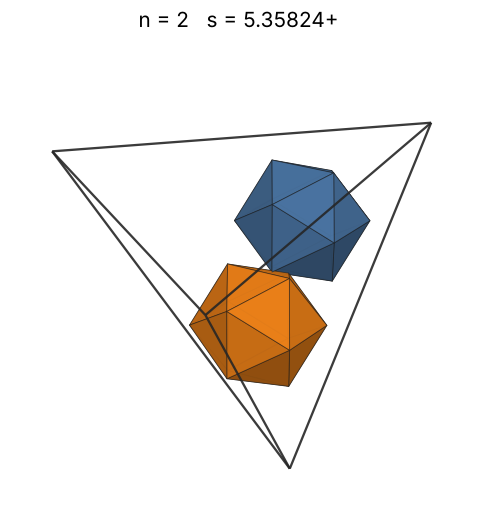 |
| 3 | [5.35824+](icointet_n03.json) | 5.358249362546 |  | 3.81529 | 0.3610 | 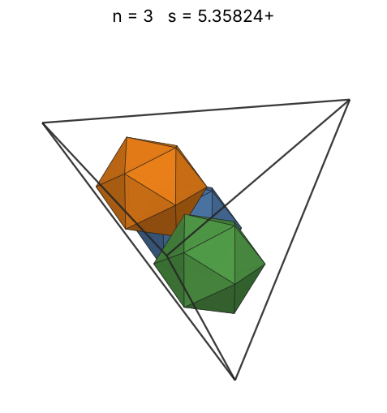 |
| 4 | [5.35824+](icointet_n04.json) | 5.358249362687 |  | 4.19927 | 0.4813 | 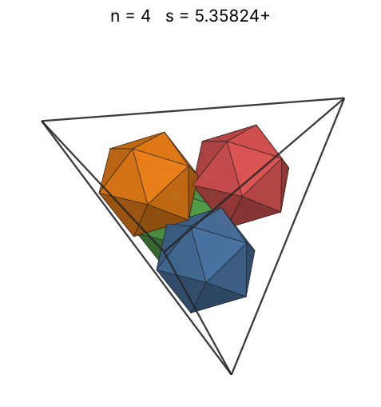 |
| 5 | [6.17076+](icointet_n05.json) | 6.170765452806 |  | 4.52352 | 0.3939 | 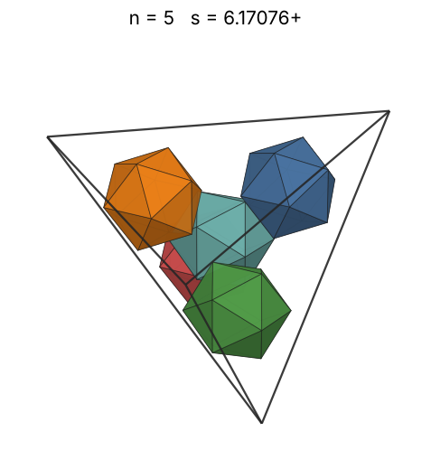 |
| 6 | [6.83920+](icointet_n06.json) | 6.839204846198 |  | 4.80696 | 0.3472 | 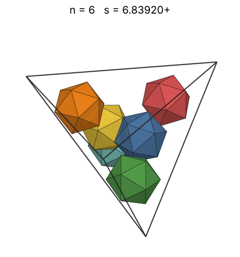 |
| 7 | [7.00065+](icointet_n07.json) | 7.000657403903 |  | 5.06041 | 0.3777 | 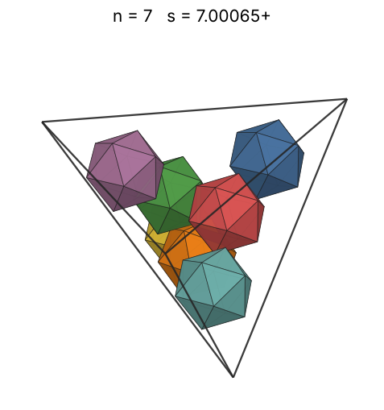 |
| 8 | [7.01404+](icointet_n08.json) | 7.014039565605 |  | 5.29074 | 0.4292 | 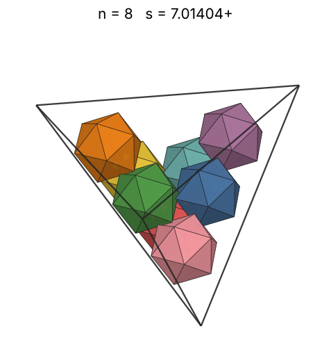 |
| 9 | [7.01404+](icointet_n09.json) | 7.014039567501 |  | 5.50260 | 0.4828 | 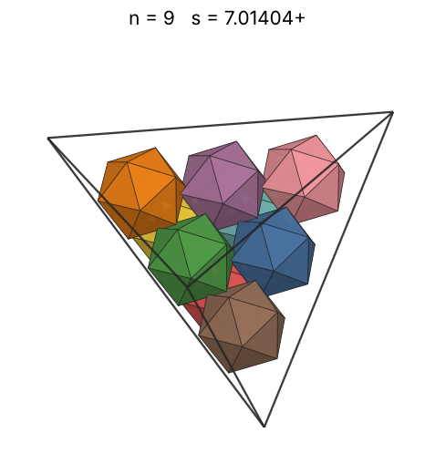 |
| 10 | [7.01404+](icointet_n10.json) | 7.014039587569 |  | 5.69928 | 0.5365 | 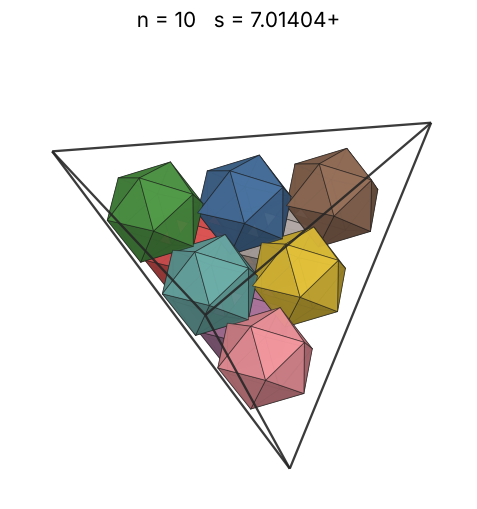 |
| 11 | [7.82655+](icointet_n11.json) | 7.826555671731 |  | 5.88325 | 0.4248 | 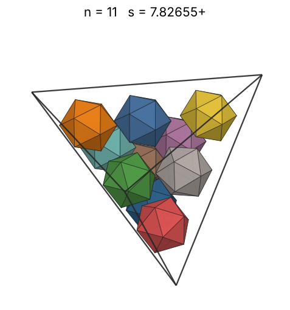 |
| 12 | [7.98905+](icointet_n12.json) | 7.989058901666 |  | 6.05639 | 0.4357 | 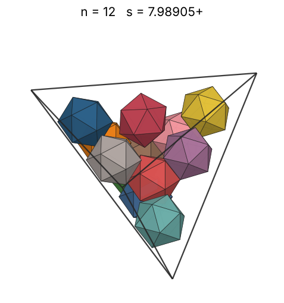 |
| 13 | [8.22368+](icointet_n13.json) | 8.223686231339 |  | 6.22016 | 0.4327 | 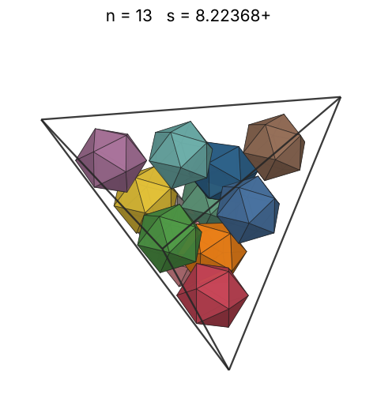 |
| 14 | [8.37425+](icointet_n14.json) | 8.374257212333 |  | 6.37572 | 0.4413 | 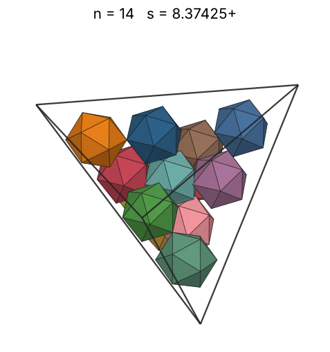 |
| 15 | [8.50457+](icointet_n15.json) | 8.504578556002 |  | 6.52405 | 0.4514 | 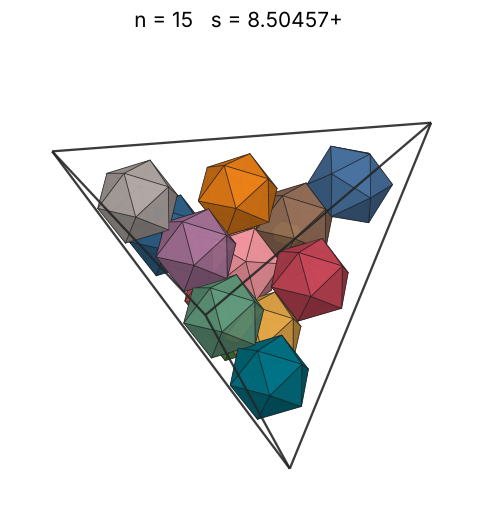 |
| 16 | [8.64515+](icointet_n16.json) | 8.645157180185 |  | 6.66592 | 0.4584 | 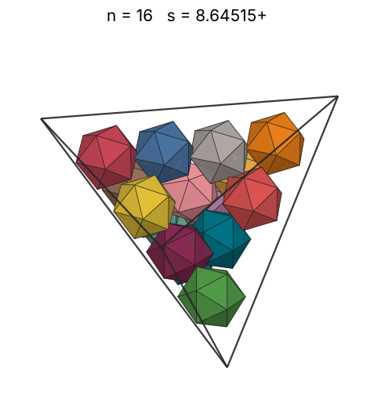 |
| 17 | [8.68987+](icointet_n17.json) | 8.689870892936 |  | 6.80200 | 0.4796 | 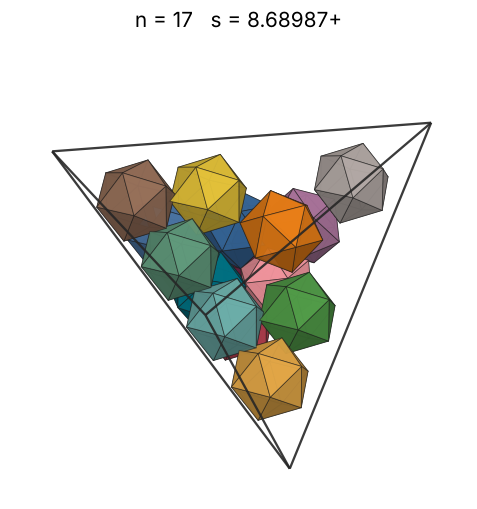 |
| 18 | [8.71024+](icointet_n18.json) | 8.710247527458 |  | 6.93284 | 0.5042 | 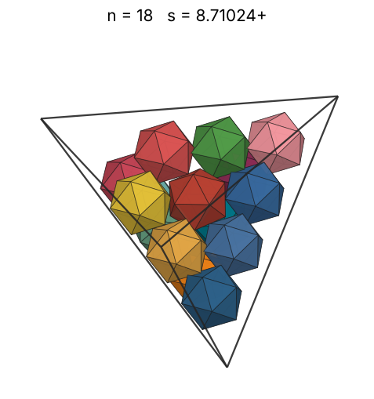 |
| 19 | [8.75661+](icointet_n19.json) | 8.756613821510 |  | 7.05892 | 0.5238 | 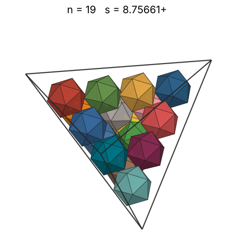 |
| 20 | [8.81528+](icointet_n20.json) | 8.815279559927 |  | 7.18064 | 0.5405 | 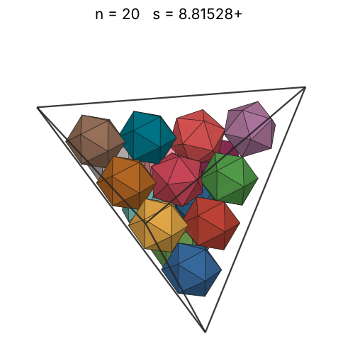 |
| 21 | [9.31571+](icointet_n21.json) | 9.315715553813 |  | 7.29838 | 0.4809 | 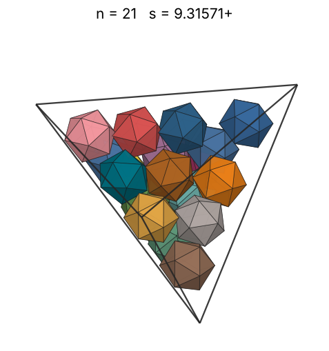 |
| 22 | [9.59003+](icointet_n22.json) | 9.590032400033 |  | 7.41244 | 0.4618 | 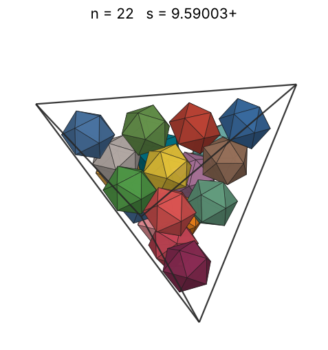 |
| 23 | [9.73543+](icointet_n23.json) | 9.735429784541 |  | 7.52309 | 0.4614 | 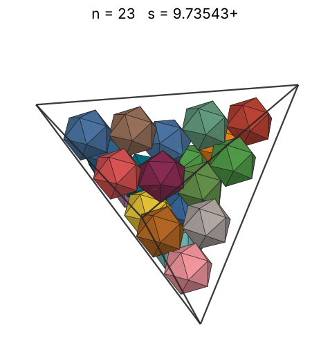 |
| 24 | [9.81006+](icointet_n24.json) | 9.810068709105 |  | 7.63057 | 0.4706 | 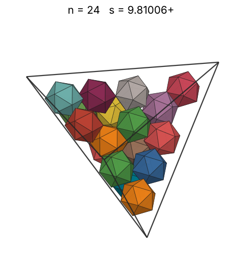 |
| 25 | [9.97645+](icointet_n25.json) | 9.976458011395 |  | 7.73511 | 0.4661 | 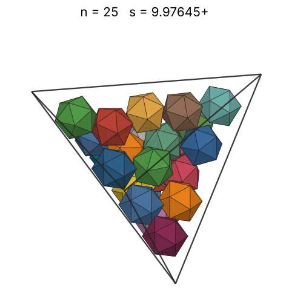 |
| 26 | [10.04506+](icointet_n26.json) | 10.045063103484 |  | 7.83690 | 0.4749 | 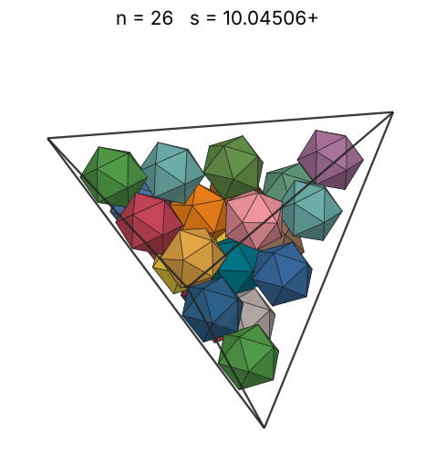 |
| 27 | [10.22192+](icointet_n27.json) | 10.221920193168 |  | 7.93612 | 0.4680 | 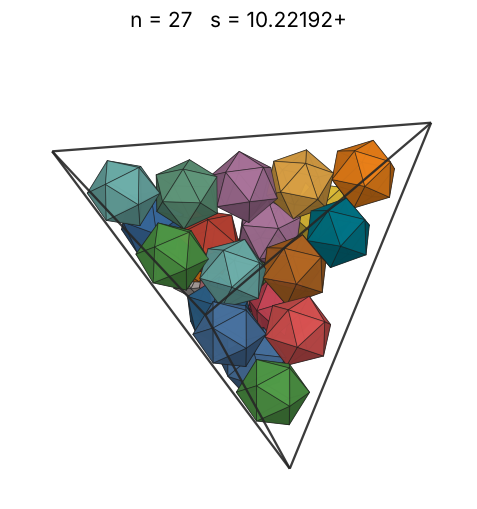 |
| 28 | [10.28313+](icointet_n28.json) | 10.283138491772 |  | 8.03291 | 0.4767 | 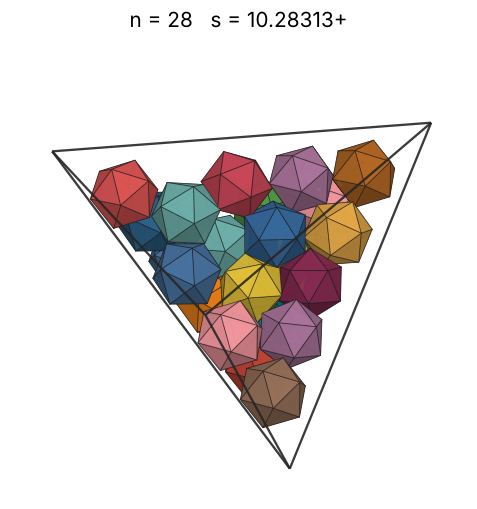 |
| 29 | [10.32732+](icointet_n29.json) | 10.327329235636 |  | 8.12742 | 0.4874 | 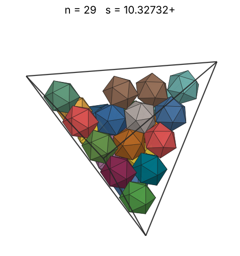 |
| 30 | [10.40742+](icointet_n30.json) | 10.407429498264 |  | 8.21979 | 0.4927 | 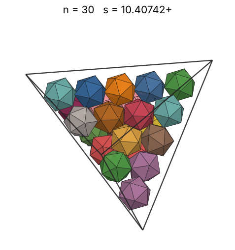 |
