# Icosahedra in a tetrahedron

s = container edge / piece edge; every row certified in exact arithmetic.

| n | s | touching limit | closed form (conj.) | volume bound | density | picture |
|---|---|---|---|---|---|---|
| 2 | [5.35824+](icointet_n02.json) | 5.358249362429 | √(32√5/5 + 72/5) | 3.33296 | 0.2407 | 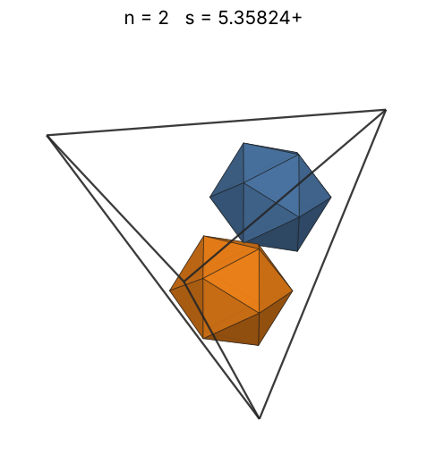 |
| 3 | [5.35824+](icointet_n03.json) | 5.358249362546 | √(32√5/5 + 72/5) | 3.81529 | 0.3610 | 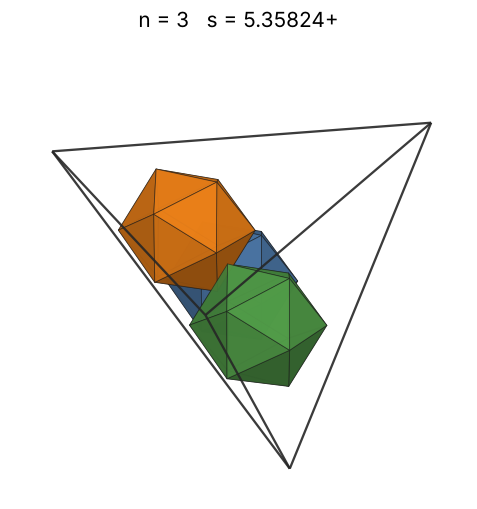 |
| 4 | [5.35824+](icointet_n04.json) | 5.358249362687 | √(32√5/5 + 72/5) | 4.19927 | 0.4813 | 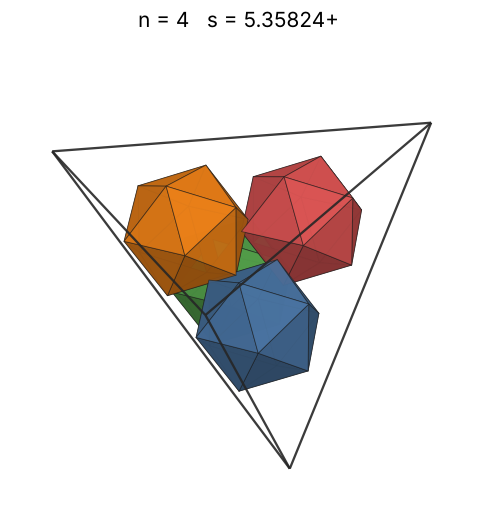 |
| 5 | [6.17076+](icointet_n05.json) | 6.170765452806 | 5√(3√5 + 7)/3 | 4.52352 | 0.3939 | 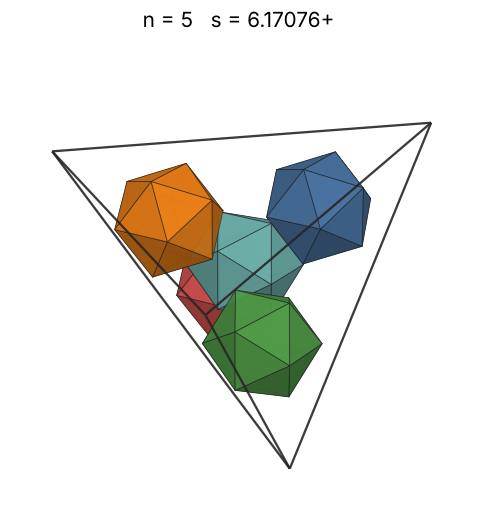 |
| 6 | [6.83920+](icointet_n06.json) | 6.839204846198 |  | 4.80696 | 0.3472 | 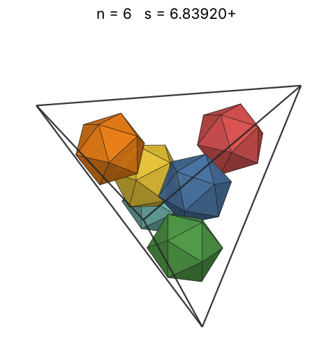 |
| 7 | [7.00065+](icointet_n07.json) | 7.000657403903 |  | 5.06041 | 0.3777 | 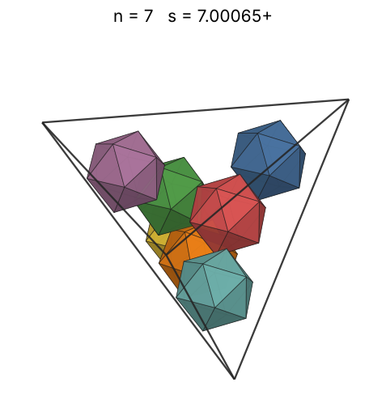 |
| 8 | [7.01404+](icointet_n08.json) | 7.014039565605 | √(275√5 + 615)/5 | 5.29074 | 0.4292 | 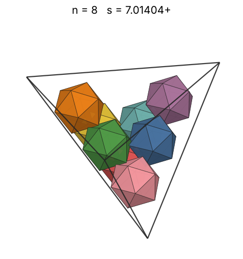 |
| 9 | [7.01404+](icointet_n09.json) | 7.014039567501 | √(275√5 + 615)/5 | 5.50260 | 0.4828 | 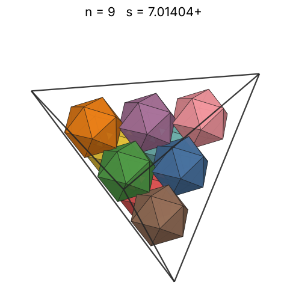 |
| 10 | [7.01404+](icointet_n10.json) | 7.014039587569 | √(275√5 + 615)/5 | 5.69928 | 0.5365 | 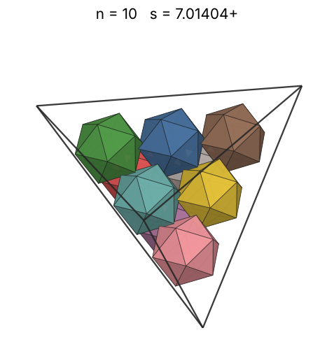 |
| 11 | [7.82655+](icointet_n11.json) | 7.826555671731 | 2√(765√5 + 1735)/15 | 5.88325 | 0.4248 | 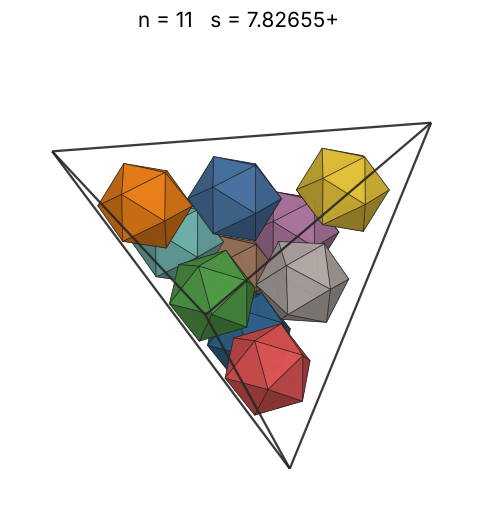 |
| 12 | [7.98905+](icointet_n12.json) | 7.989058901666 | √(8835√5 + 20135)/25 | 6.05639 | 0.4357 | 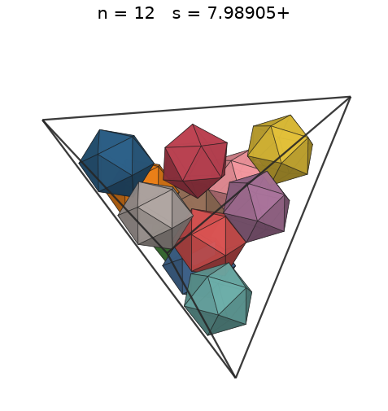 |
| 13 | [8.21020+](icointet_n13.json) | 8.210201871181 |  | 6.22016 | 0.4349 | 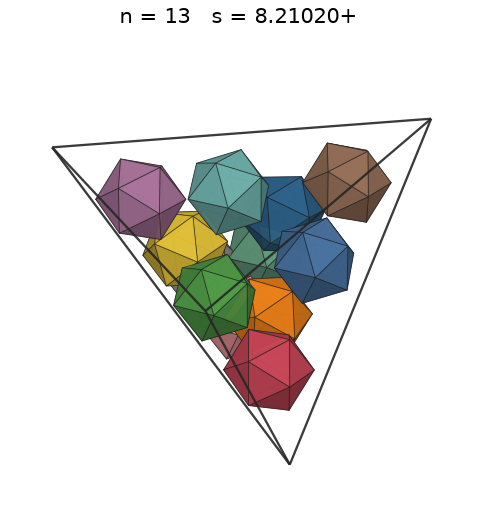 |
| 14 | [8.35360+](icointet_n14.json) | 8.353601948202 |  | 6.37572 | 0.4446 | 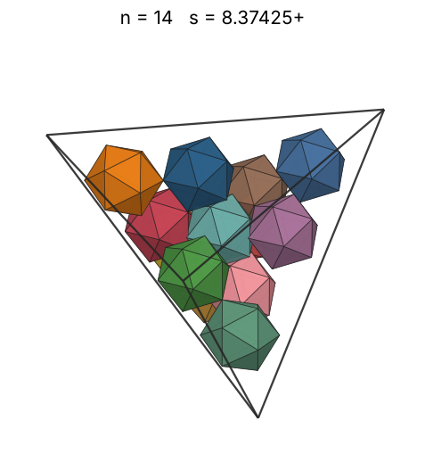 |
| 15 | [8.50332+](icointet_n15.json) | 8.503325413475 |  | 6.52405 | 0.4516 | 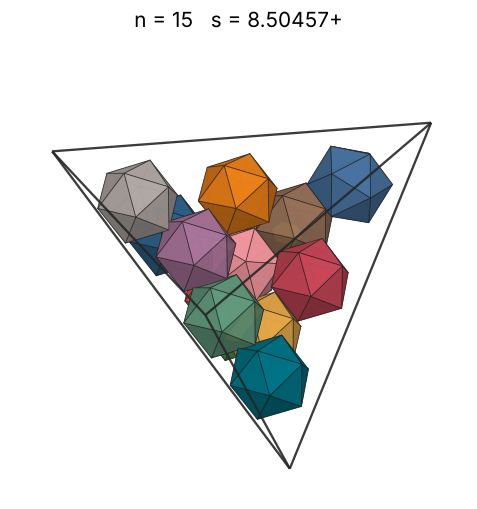 |
| 16 | [8.63470+](icointet_n16.json) | 8.634709435030 |  | 6.66592 | 0.4601 | 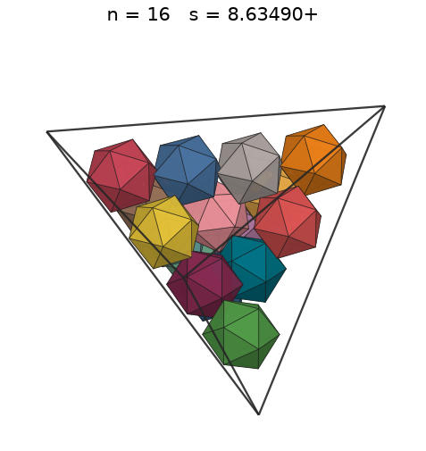 |
| 17 | [8.66883+](icointet_n17.json) | 8.668834950208 |  | 6.80200 | 0.4831 | 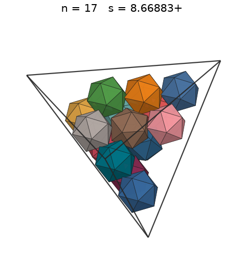 |
| 18 | [8.66883+](icointet_n18.json) | 8.668834950211 |  | 6.93284 | 0.5115 | 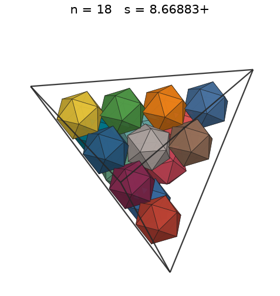 |
| 19 | [8.66956+](icointet_n19.json) | 8.669565538991 |  | 7.05892 | 0.5398 | 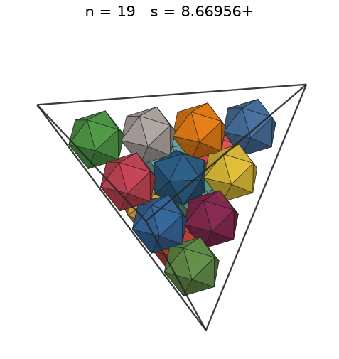 |
| 20 | [8.66983+](icointet_n20.json) | 8.669830404829 | 2√(105√5 + 235)/5 | 7.18064 | 0.5681 | 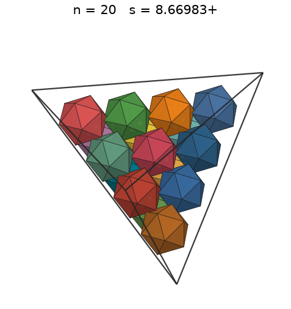 |
| 21 | [9.30353+](icointet_n21.json) | 9.303530163365 |  | 7.29838 | 0.4828 | 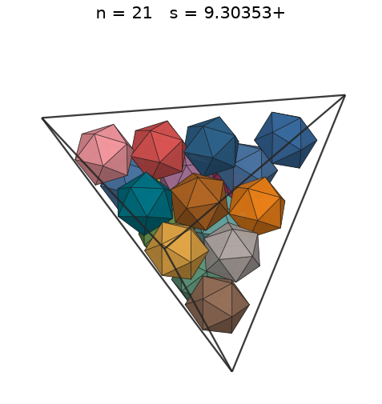 |
| 22 | [9.57064+](icointet_n22.json) | 9.570643331666 |  | 7.41244 | 0.4646 | 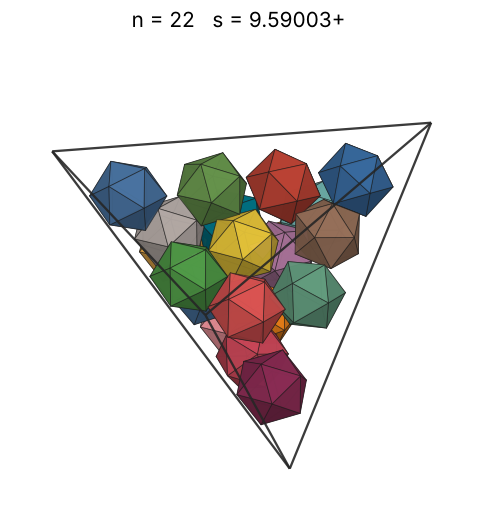 |
| 23 | [9.61547+](icointet_n23.json) | 9.615477090351 |  | 7.52309 | 0.4789 | 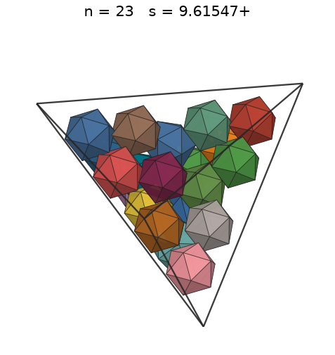 |
| 24 | [9.76179+](icointet_n24.json) | 9.761798080204 |  | 7.63057 | 0.4776 | 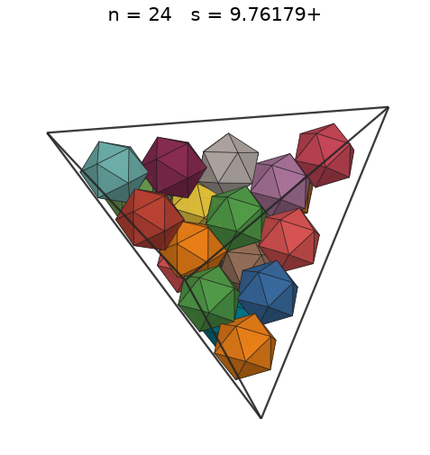 |
| 25 | [9.90497+](icointet_n25.json) | 9.904975042927 |  | 7.73511 | 0.4763 | 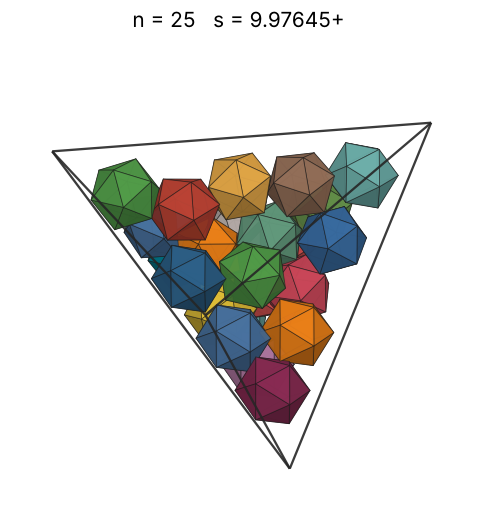 |
| 26 | [10.02607+](icointet_n26.json) | 10.026073011370 |  | 7.83690 | 0.4776 | 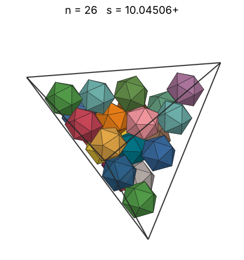 |
| 27 | [10.16176+](icointet_n27.json) | 10.161760211731 |  | 7.93612 | 0.4763 | 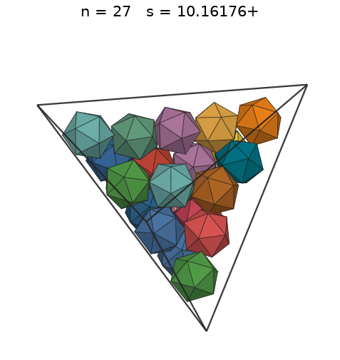 |
| 28 | [10.17667+](icointet_n28.json) | 10.176671127851 |  | 8.03291 | 0.4918 | 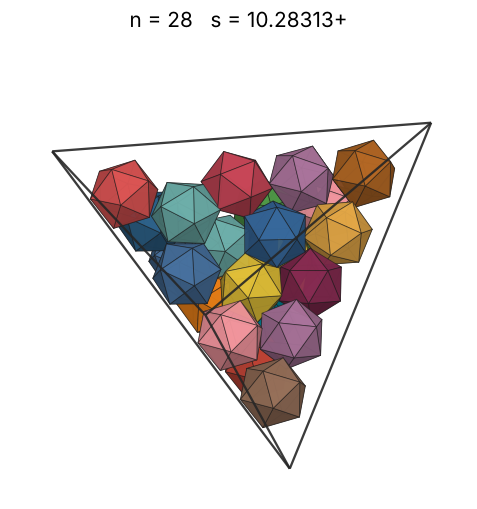 |
| 29 | [10.31983+](icointet_n29.json) | 10.319836789421 |  | 8.12742 | 0.4885 | 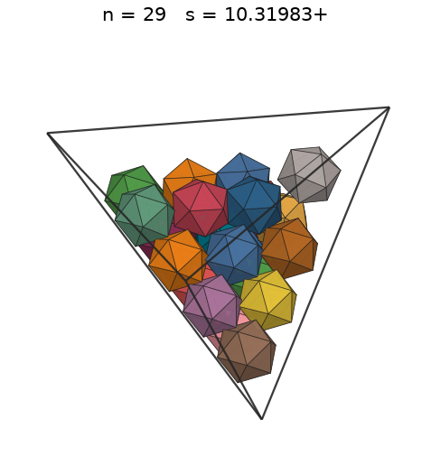 |
| 30 | [10.32556+](icointet_n30.json) | 10.325561246586 |  | 8.21979 | 0.5045 | 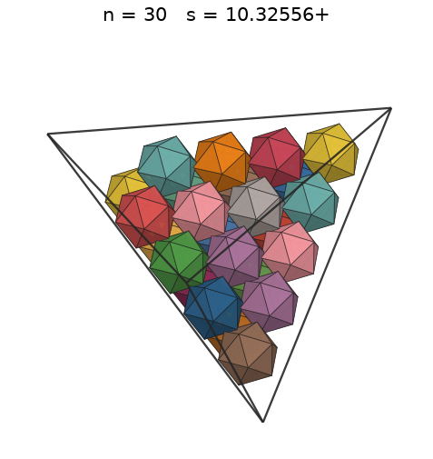 |
| 31 | [10.32562+](icointet_n31.json) | 10.325620815224 | √(595√5 + 1335)/5 | 8.31012 | 0.5213 | 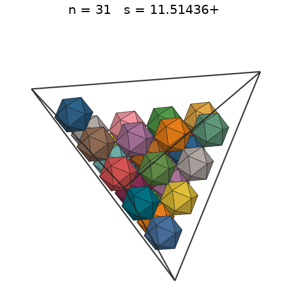 |
| 32 | [10.32562+](icointet_n32.json) | 10.325620815224 | √(595√5 + 1335)/5 | 8.39853 | 0.5381 | 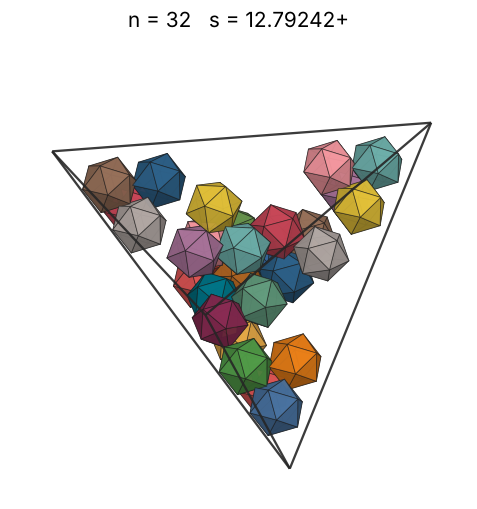 |
| 33 | [10.32562+](icointet_n33.json) | 10.325620815224 | √(595√5 + 1335)/5 | 8.48512 | 0.5549 | 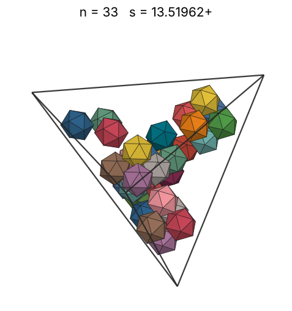 |
| 34 | [10.32562+](icointet_n34.json) | 10.325620815224 | √(595√5 + 1335)/5 | 8.56998 | 0.5717 | 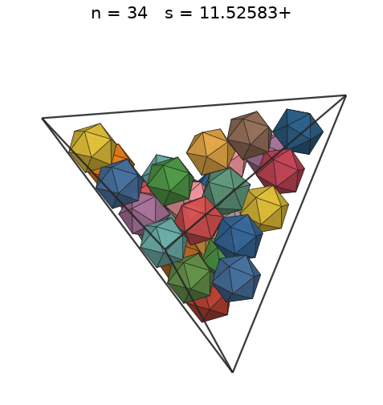 |
| 35 | [10.32562+](icointet_n35.json) | 10.325620815224 | √(595√5 + 1335)/5 | 8.65319 | 0.5885 | 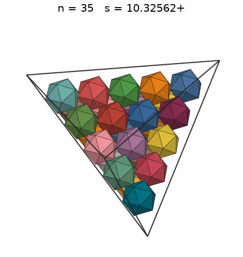 |
| 36 | [11.06816+](icointet_n36.json) | 11.068169057611 |  | 8.73483 | 0.4915 | 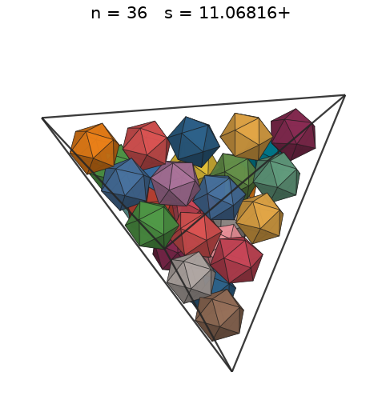 |
| 37 | [11.27671+](icointet_n37.json) | 11.276713756785 |  | 8.81497 | 0.4777 | 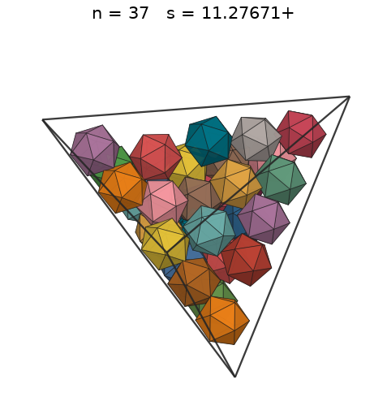 |
| 38 | [11.53251+](icointet_n38.json) | 11.532514159306 |  | 8.89368 | 0.4586 | 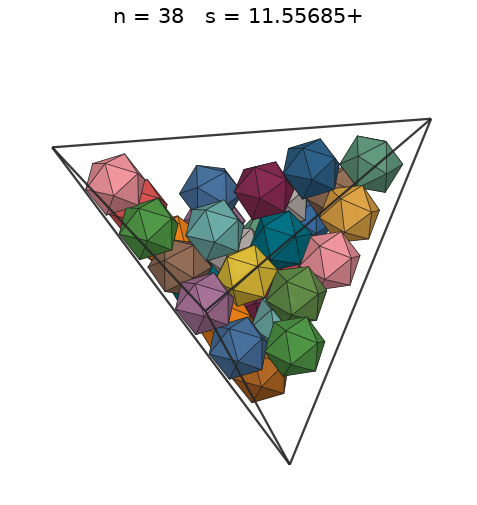 |
| 39 | [11.53258+](icointet_n39.json) | 11.532583456839 |  | 8.97102 | 0.4707 | 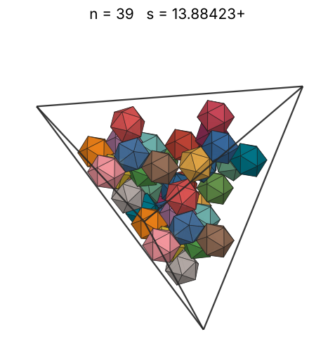 |
| 40 | [11.54246+](icointet_n40.json) | 11.542467180821 |  | 9.04705 | 0.4815 | 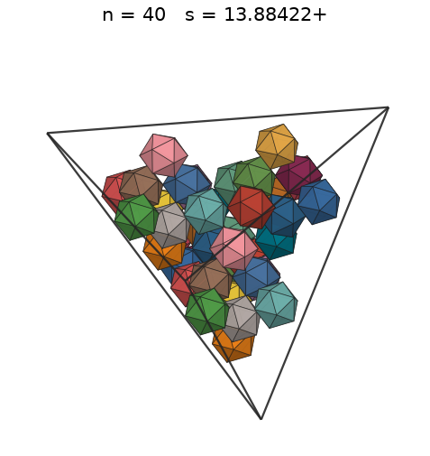 |
| 41 | [11.55388+](icointet_n41.json) | 11.553887325263 |  | 9.12182 | 0.4921 |  |
| 42 | [11.57114+](icointet_n42.json) | 11.571149324850 |  | 9.19538 | 0.5019 |  |
| 43 | [11.59365+](icointet_n43.json) | 11.593653876417 |  | 9.26779 | 0.5108 |  |
| 44 | [11.71569+](icointet_n44.json) | 11.715699505095 |  | 9.33908 | 0.5065 |  |
| 45 | [11.75505+](icointet_n45.json) | 11.755059376209 |  | 9.40931 | 0.5129 |  |
| 46 | [11.78522+](icointet_n46.json) | 11.785220665144 |  | 9.47849 | 0.5202 |  |
| 47 | [11.83655+](icointet_n47.json) | 11.836552850961 |  | 9.54669 | 0.5247 |  |
| 48 | [11.86821+](icointet_n48.json) | 11.868213369884 |  | 9.61392 | 0.5316 |  |
| 49 | [11.91918+](icointet_n49.json) | 11.919185433052 |  | 9.68023 | 0.5357 |  |
| 50 | [11.93230+](icointet_n50.json) | 11.932309140292 |  | 9.74563 | 0.5448 |  |
| 51 | [11.96140+](icointet_n51.json) | 11.961405203213 |  | 9.81018 | 0.5517 |  |
| 52 | [11.98141+](icointet_n52.json) | 11.981411225619 | √(32√5 + 72) | 9.87388 | 0.5597 |  |
| 53 | [11.98141+](icointet_n53.json) | 11.981411225619 | √(32√5 + 72) | 9.93677 | 0.5704 |  |
| 54 | [11.98141+](icointet_n54.json) | 11.981411225619 | √(32√5 + 72) | 9.99888 | 0.5812 |  |
| 55 | [11.98141+](icointet_n55.json) | 11.981411225619 | √(32√5 + 72) | 10.06022 | 0.5920 |  |
| 56 | [11.98141+](icointet_n56.json) | 11.981411225619 | √(32√5 + 72) | 10.12083 | 0.6027 |  |
| 57 | [12.47080+](icointet_n57.json) | 12.470807659097 |  | 10.18072 | 0.5441 |  |
| 58 | [12.65196+](icointet_n58.json) | 12.651969404570 |  | 10.23991 | 0.5302 |  |
| 59 | [12.69337+](icointet_n59.json) | 12.693373493557 |  | 10.29842 | 0.5340 |  |
| 60 | [12.84461+](icointet_n60.json) | 12.844619415851 |  | 10.35628 | 0.5241 |  |
| 61 | [12.87464+](icointet_n61.json) | 12.874639535821 |  | 10.41350 | 0.5292 |  |
| 62 | [12.95311+](icointet_n62.json) | 12.953111384034 |  | 10.47010 | 0.5281 |  |
| 63 | [13.03766+](icointet_n63.json) | 13.037667457970 |  | 10.52609 | 0.5263 |  |
| 64 | [13.13165+](icointet_n64.json) | 13.131653006968 |  | 10.58149 | 0.5232 |  |
| 65 | [13.40261+](icointet_n65.json) | 13.402611588568 |  | 10.63632 | 0.4998 |  |
| 66 | [13.40533+](icointet_n66.json) | 13.405338452352 |  | 10.69058 | 0.5072 |  |
| 67 | [13.43531+](icointet_n67.json) | 13.435313443280 |  | 10.74431 | 0.5114 |  |
| 68 | [13.46297+](icointet_n68.json) | 13.462972133363 |  | 10.79750 | 0.5159 |  |
| 69 | [13.48445+](icointet_n69.json) | 13.484452347381 |  | 10.85017 | 0.5210 |  |
| 70 | [13.49044+](icointet_n70.json) | 13.490443870292 |  | 10.90233 | 0.5278 |  |
| 71 | [13.49085+](icointet_n71.json) | 13.490851110755 |  | 10.95400 | 0.5353 |  |
| 72 | [13.49461+](icointet_n72.json) | 13.494613443328 |  | 11.00519 | 0.5424 |  |
| 73 | [13.51199+](icointet_n73.json) | 13.511992265366 |  | 11.05591 | 0.5478 |  |
| 74 | [13.54018+](icointet_n74.json) | 13.540180206784 |  | 11.10616 | 0.5518 |  |
| 75 | [13.54018+](icointet_n75.json) | 13.540180206784 |  | 11.15597 | 0.5593 |  |
| 76 | [13.55246+](icointet_n76.json) | 13.552464271102 |  | 11.20533 | 0.5652 |  |
| 77 | [13.57928+](icointet_n77.json) | 13.579288209435 |  | 11.25426 | 0.5693 |  |
| 78 | [13.58009+](icointet_n78.json) | 13.580092942926 |  | 11.30277 | 0.5766 |  |
| 79 | [13.61179+](icointet_n79.json) | 13.611796866022 |  | 11.35087 | 0.5799 |  |
| 80 | [13.61589+](icointet_n80.json) | 13.615895382908 |  | 11.39856 | 0.5867 |  |
| 81 | [13.61660+](icointet_n81.json) | 13.616604050514 |  | 11.44586 | 0.5939 |  |
| 82 | [13.63359+](icointet_n82.json) | 13.633593797552 |  | 11.49277 | 0.5990 |  |
| 83 | [13.63720+](icointet_n83.json) | 13.637201636014 | √(1035√5 + 2335)/5 | 11.53930 | 0.6058 |  |
| 84 | [13.63720+](icointet_n84.json) | 13.637201636014 | √(1035√5 + 2335)/5 | 11.58546 | 0.6131 |  |
| 85 | [14.10143+](icointet_n85.json) | 14.101432306118 |  | 11.63125 | 0.5612 |  |
| 86 | [14.20780+](icointet_n86.json) | 14.207805433176 |  | 11.67669 | 0.5551 |  |
| 87 | [14.29567+](icointet_n87.json) | 14.295675877024 |  | 11.72177 | 0.5513 |  |
| 88 | [14.65851+](icointet_n88.json) | 14.658514280095 |  | 11.76651 | 0.5172 |  |
| 89 | [14.71485+](icointet_n89.json) | 14.714855171798 |  | 11.81091 | 0.5171 |  |
| 90 | [14.71667+](icointet_n90.json) | 14.716677075008 |  | 11.85498 | 0.5227 |  |
| 91 | [14.72998+](icointet_n91.json) | 14.729981301829 |  | 11.89873 | 0.5271 |  |
| 92 | [14.79454+](icointet_n92.json) | 14.794542523693 |  | 11.94215 | 0.5259 |  |
| 93 | [14.79454+](icointet_n93.json) | 14.794542523693 |  | 11.98527 | 0.5317 |  |
| 94 | [14.80316+](icointet_n94.json) | 14.803163933772 |  | 12.02807 | 0.5364 |  |
| 95 | [15.08052+](icointet_n95.json) | 15.080520056268 |  | 12.07058 | 0.5128 |  |
| 96 | [15.08507+](icointet_n96.json) | 15.085074589990 |  | 12.11278 | 0.5177 |  |
| 97 | [15.20509+](icointet_n97.json) | 15.205095510636 |  | 12.15469 | 0.5108 |  |
| 98 | [15.20509+](icointet_n98.json) | 15.205095510636 |  | 12.19632 | 0.5161 |  |
| 99 | [15.22384+](icointet_n99.json) | 15.223844677523 |  | 12.23766 | 0.5194 |  |
| 100 | [15.22384+](icointet_n100.json) | 15.223844677523 |  | 12.27873 | 0.5247 |  |
