# Octahedra in a cube

s = container edge / piece edge; every row certified in exact arithmetic.

| n | s | touching limit | closed form (conj.) | previous best | vs previous | volume bound | density | picture |
|---|---|---|---|---|---|---|---|---|
| 2 | [1.41421+](octincub_n02.json) | 1.414213562373 | √2 | 1.41421 (R. Walsh, June 2026 (Friedman's Packing Center), s = √2) | equal | 0.98056 | 0.3333 | 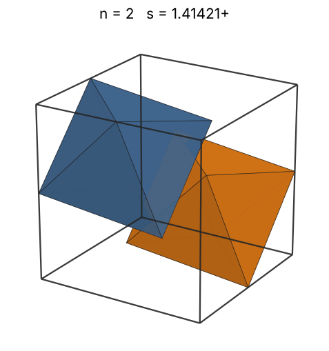 |
| 3 | [1.63299+](octincub_n03.json) | 1.632993161855 | (2√6)/3 | 1.63299 (R. Walsh, June 2026 (Friedman's Packing Center)) | equal | 1.12246 | 0.3248 | 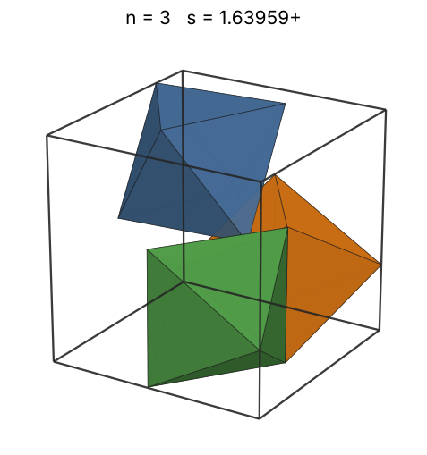 |
| 4 | [1.64991+](octincub_n04.json) | 1.649915822769 | (7√2)/6 | 1.64991 (R. Walsh, June 2026 (Friedman's Packing Center)) | equal | 1.23543 | 0.4198 | 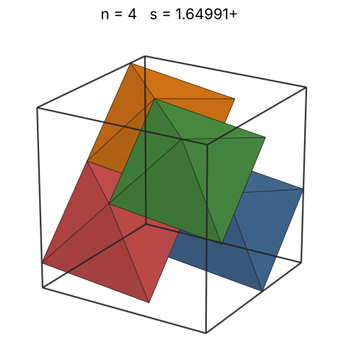 |
| 5 | [1.75782+](octincub_n05.json) | 1.757825197234 |  | 1.75782 (R. Walsh, June 2026 (Friedman's Packing Center)) | equal | 1.33083 | 0.4339 | 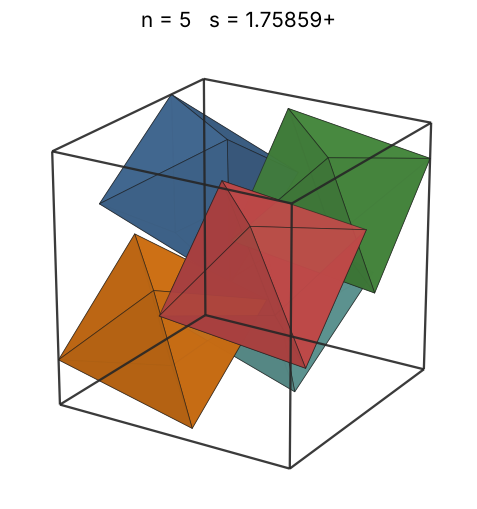 |
| 6 | [1.76776+](octincub_n06.json) | 1.767766952966 | (5√2)/4 | 1.76776 (R. Walsh, June 2026 (Friedman's Packing Center)) | equal | 1.41421 | 0.5120 | 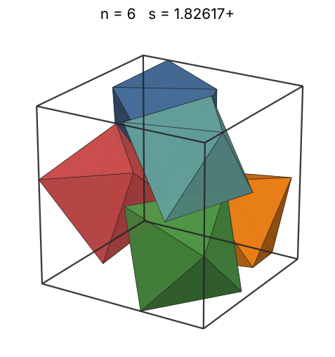 |
| 7 | [1.79133+](octincub_n07.json) | 1.791337179006 | 19√2/15 | 1.79133 (R. Walsh, June 2026 (Friedman's Packing Center)) | equal | 1.48878 | 0.5741 | 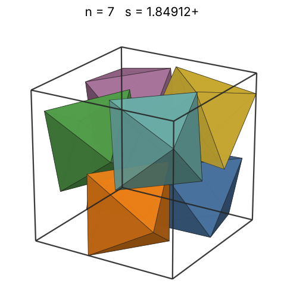 |
| 8 | [1.79133+](octincub_n08.json) | 1.791337179006 | 19√2/15 | 1.79133 (R. Walsh, June 2026 (Friedman's Packing Center)) | equal | 1.55654 | 0.6561 | 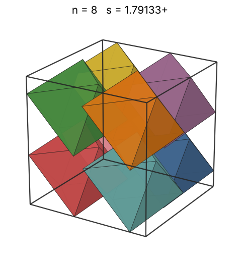 |
| 9 | [1.88561+](octincub_n09.json) | 1.885618083164 | (4√2)/3 | 1.88561 (R. Walsh, June 2026 (Friedman's Packing Center)) | equal | 1.61887 | 0.6328 | 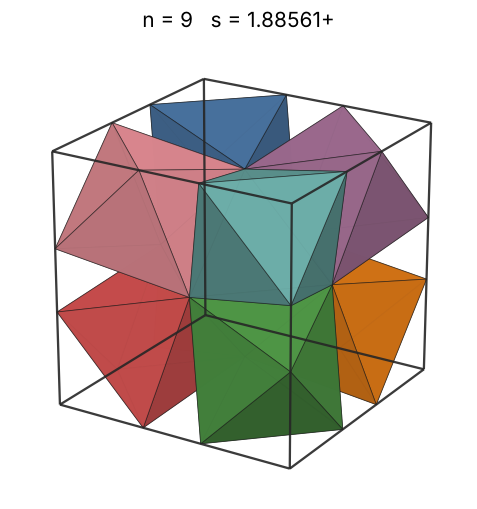 |
| 10 | [2.14936+](octincub_n10.json) | 2.149365928974 | 1801√2/1185 | 2.14936 (R. Walsh, June 2026 (Friedman's Packing Center)) | equal | 1.67674 | 0.4747 | 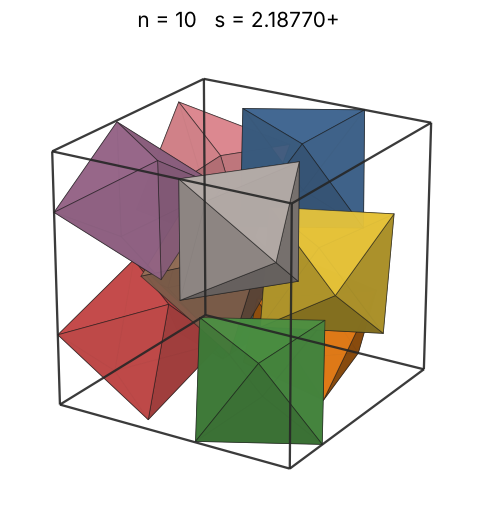 |
| 11 | [2.23071+](octincub_n11.json) | 2.230710143301 | (3√2 + √6)/3 | 2.19540 (R. Walsh, June 2026 (Friedman's Packing Center)) | behind +1.608% | 1.73086 | 0.4672 | 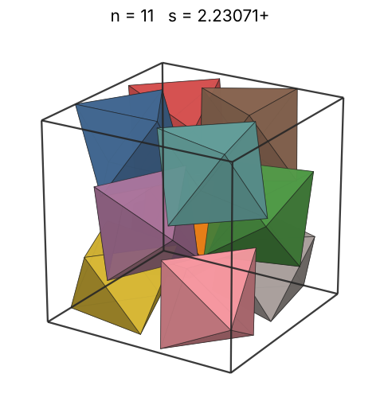 |
| 12 | [2.29102+](octincub_n12.json) | 2.291026016941 |  | 2.25949 (H. Lin, July 2026 (Hyra-results; Friedman's Packing Center)) | behind +1.396% | 1.78180 | 0.4704 | 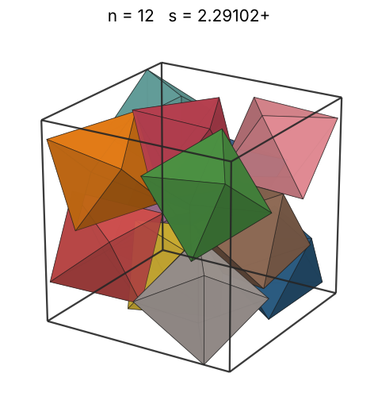 |
| 13 | [2.33663+](octincub_n13.json) | 2.336632396579 |  | 2.33667 (H. Lin, July 2026 (Hyra-results; Friedman's Packing Center)) | **better** -0.002% | 1.82998 | 0.4804 | 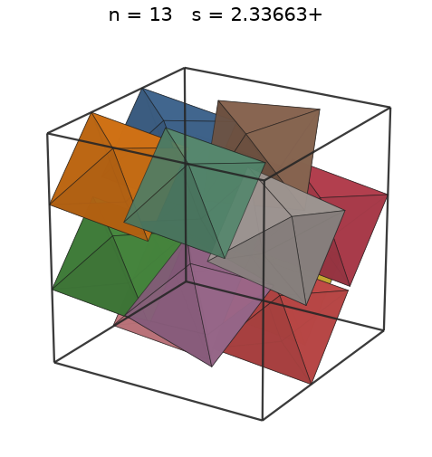 |
| 14 | [2.35702+](octincub_n14.json) | 2.357022886820 |  | 2.35702 (R. Walsh, June 2026 (Friedman's Packing Center)) | equal | 1.87575 | 0.5040 | 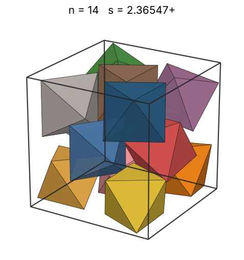 |
| 15 | [2.41967+](octincub_n15.json) | 2.419678689992 |  | 2.41976 (R. Walsh, June 2026 (Friedman's Packing Center)) | **better** -0.003% | 1.91938 | 0.4991 | 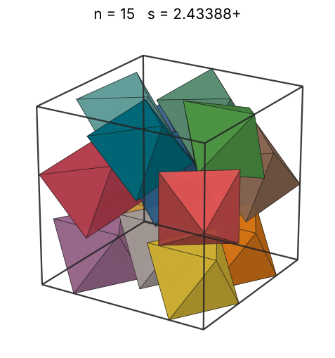 |
| 16 | [2.45865+](octincub_n16.json) | 2.458657514093 |  | 2.46211 (R. Walsh, June 2026 (Friedman's Packing Center)) | **better** -0.140% | 1.96112 | 0.5075 | 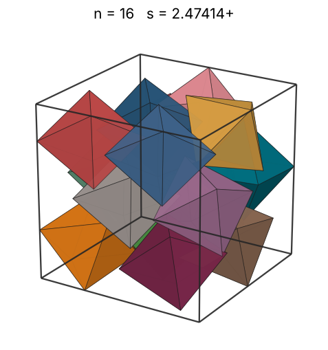 |
| 17 | [2.48065+](octincub_n17.json) | 2.480651633036 |  | 2.47487 (H. Lin, July 2026 (Hyra-results; Friedman's Packing Center)) | behind +0.234% | 2.00116 | 0.5250 | 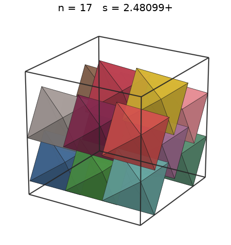 |
| 18 | [2.48099+](octincub_n18.json) | 2.480999621800 |  | 2.48257 (R. Walsh, June 2026 (Friedman's Packing Center)) | **better** -0.063% | 2.03965 | 0.5556 | 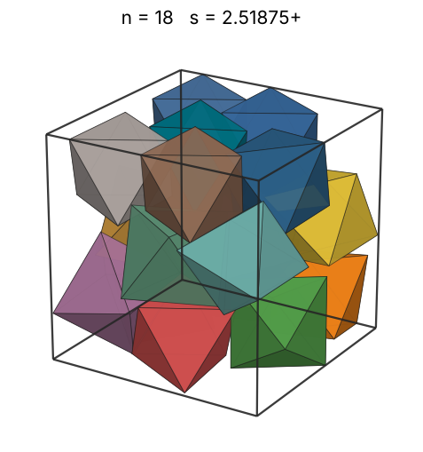 |
| 19 | [2.55209+](octincub_n19.json) | 2.552092570515 |  | 2.52683 (R. Walsh, June 2026 (Friedman's Packing Center)) | behind +1.000% | 2.07674 | 0.5388 | 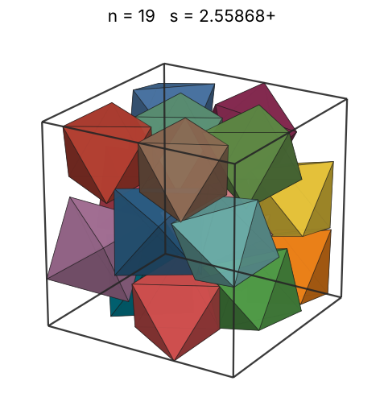 |
| 20 | [2.57418+](octincub_n20.json) | 2.574180952252 |  | 2.57792 (R. Walsh, June 2026 (Friedman's Packing Center)) | **better** -0.145% | 2.11255 | 0.5527 | 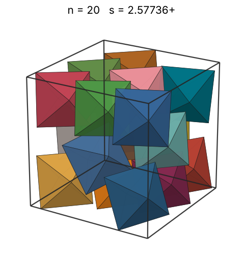 |
| 21 | [2.58891+](octincub_n21.json) | 2.588917805358 |  | 2.59285 (H. Lin, July 2026 (Hyra-results; Friedman's Packing Center)) | **better** -0.152% | 2.14719 | 0.5705 | 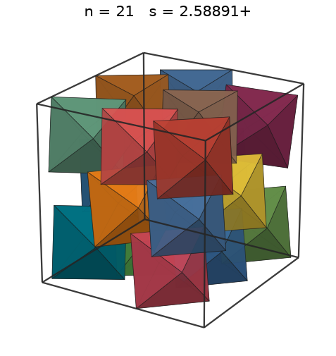 |
| 22 | [2.60569+](octincub_n22.json) | 2.605692460824 |  | 2.60591 (R. Walsh, June 2026 (Friedman's Packing Center)) | **better** -0.008% | 2.18075 | 0.5862 | 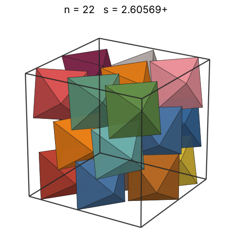 |
| 23 | [2.62246+](octincub_n23.json) | 2.622462556466 |  | 2.61533 (R. Walsh, June 2026 (Friedman's Packing Center)) | behind +0.273% | 2.21330 | 0.6012 | 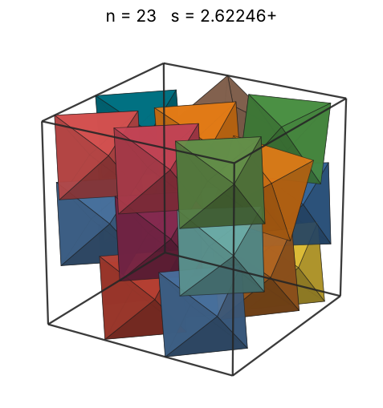 |
| 24 | [2.62792+](octincub_n24.json) | 2.627922547582 |  | 2.63319 (H. Lin, July 2026 (Hyra-results; Friedman's Packing Center)) | **better** -0.200% | 2.24492 | 0.6234 | 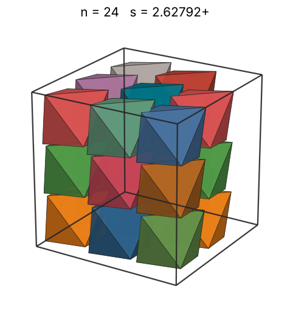 |
| 25 | [2.63620+](octincub_n25.json) | 2.636202204053 |  | 2.63622 (R. Walsh, June 2026 (Friedman's Packing Center)) | **better** -0.001% | 2.27568 | 0.6433 | 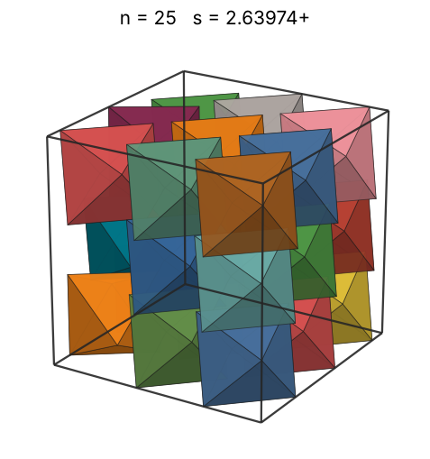 |
| 26 | [2.63986+](octincub_n26.json) | 2.639865316430 | 28√2/15 | 2.63986 (R. Walsh, June 2026 (Friedman's Packing Center)) | equal | 2.30563 | 0.6662 | 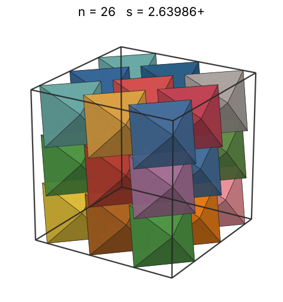 |
| 27 | [2.63986+](octincub_n27.json) | 2.639865316430 | 28√2/15 | 2.63986 (R. Walsh, June 2026 (Friedman's Packing Center)) | equal | 2.33482 | 0.6919 | 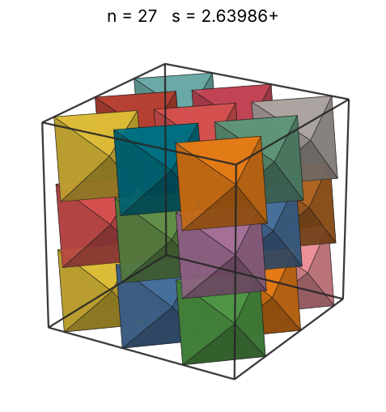 |
| 28 | [2.75731+](octincub_n28.json) | 2.757317929499 |  | 2.75738 (R. Walsh, June 2026 (Friedman's Packing Center)) | **better** -0.002% | 2.36329 | 0.6296 | 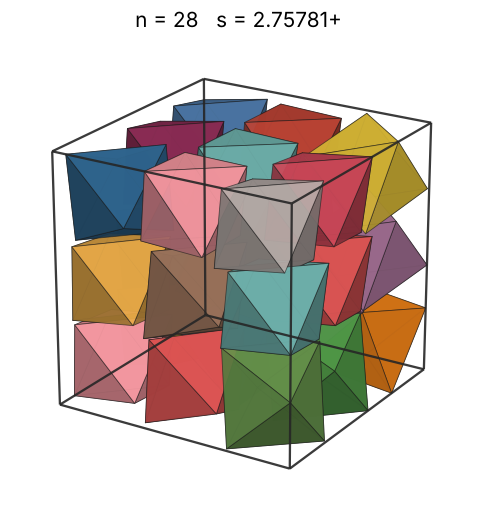 |
| 29 | [2.82842+](octincub_n29.json) | 2.828427124746 | 2√2 | 2.85384 (R. Walsh, June 2026 (Friedman's Packing Center)) | **better** -0.890% | 2.39110 | 0.6042 | 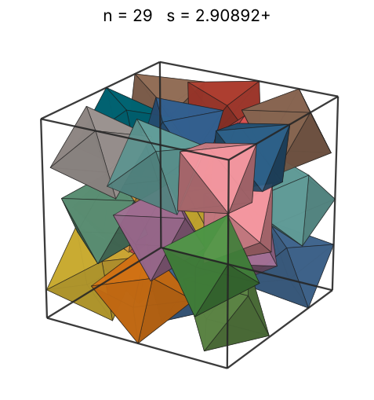 |
| 30 | [2.88658+](octincub_n30.json) | 2.886589169442 |  | 2.89186 (R. Walsh, June 2026 (Friedman's Packing Center)) | **better** -0.182% | 2.41827 | 0.5880 | 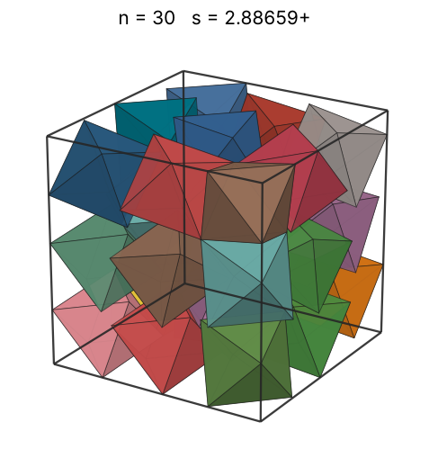 |
| 31 | [2.93422+](octincub_n31.json) | 2.934222950959 |  | | | 2.44485 | 0.5785 | 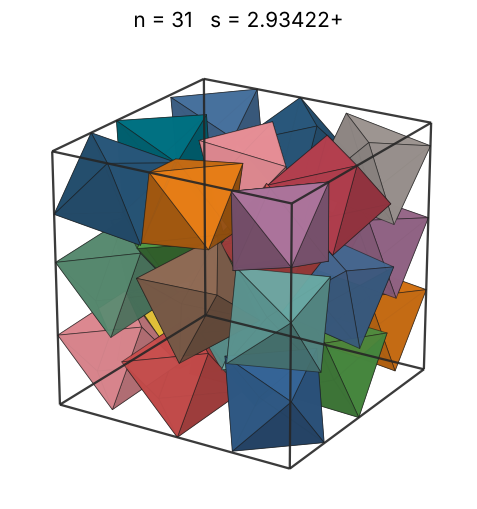 |
| 32 | [2.99146+](octincub_n32.json) | 2.991466949129 |  | | | 2.47086 | 0.5635 | 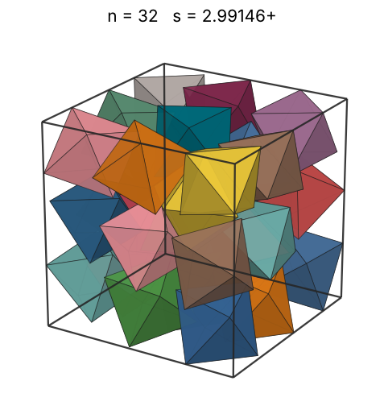 |
| 33 | [3.03494+](octincub_n33.json) | 3.034940115798 |  | | | 2.49633 | 0.5565 | 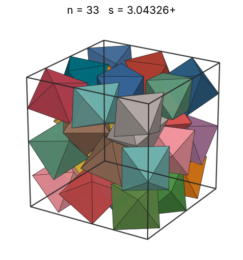 |
| 34 | [3.07374+](octincub_n34.json) | 3.073739530016 |  | | | 2.52130 | 0.5519 | 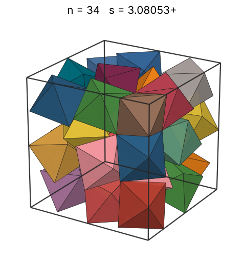 |
| 35 | [3.08910+](octincub_n35.json) | 3.089102927030 |  | | | 2.54578 | 0.5597 | 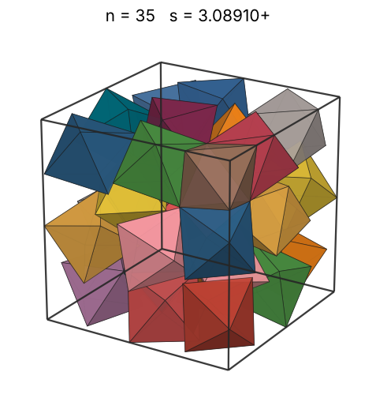 |
| 36 | [3.11859+](octincub_n36.json) | 3.118591874672 |  | | | 2.56980 | 0.5595 | 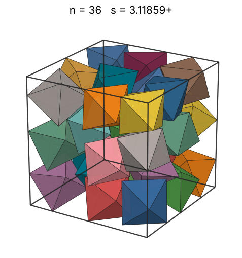 |
| 37 | [3.15314+](octincub_n37.json) | 3.153140031065 |  | | | 2.59337 | 0.5564 | 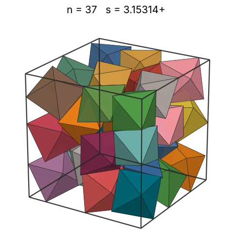 |
| 38 | [3.18237+](octincub_n38.json) | 3.182378187021 |  | | | 2.61653 | 0.5558 | 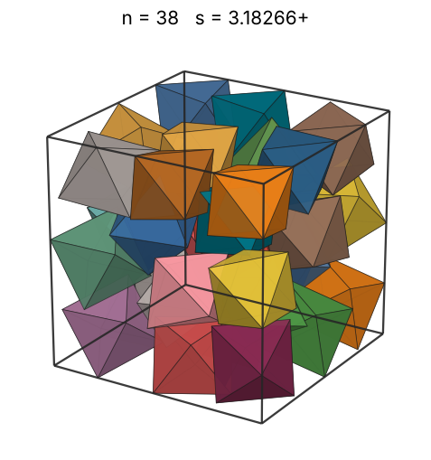 |
| 39 | [3.23286+](octincub_n39.json) | 3.232860252612 |  | | | 2.63928 | 0.5441 | 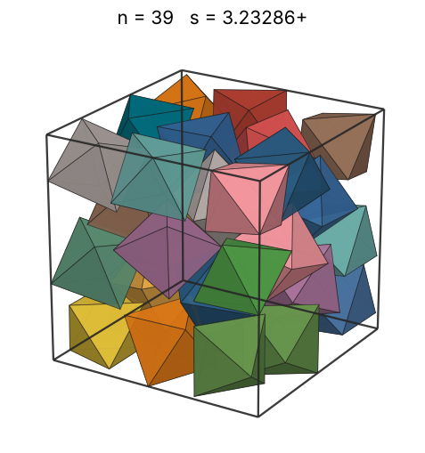 |
| 40 | [3.24518+](octincub_n40.json) | 3.245183342197 |  | | | 2.66165 | 0.5517 | 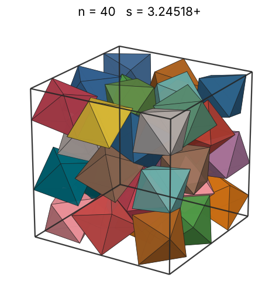 |
| 41 | [3.29304+](octincub_n41.json) | 3.293039775676 |  | | | 2.68365 | 0.5412 |  |
| 42 | [3.30790+](octincub_n42.json) | 3.307906466555 |  | | | 2.70529 | 0.5470 |  |
| 43 | [3.32591+](octincub_n43.json) | 3.325918172333 |  | | | 2.72660 | 0.5510 |  |
| 44 | [3.33882+](octincub_n44.json) | 3.338829127062 |  | | | 2.74757 | 0.5573 |  |
| 45 | [3.35546+](octincub_n45.json) | 3.355469090290 |  | | | 2.76823 | 0.5615 |  |
| 46 | [3.38464+](octincub_n46.json) | 3.384643018448 |  | | | 2.78858 | 0.5593 |  |
| 47 | [3.39126+](octincub_n47.json) | 3.391259774508 |  | | | 2.80865 | 0.5681 |  |
| 48 | [3.41398+](octincub_n48.json) | 3.413986946148 |  | | | 2.82843 | 0.5687 |  |
| 49 | [3.43064+](octincub_n49.json) | 3.430646779704 |  | | | 2.84793 | 0.5721 |  |
| 50 | [3.43064+](octincub_n50.json) | 3.430646779926 |  | | | 2.86718 | 0.5838 |  |
| 51 | [3.44004+](octincub_n51.json) | 3.440047848172 |  | | | 2.88617 | 0.5906 |  |
| 52 | [3.45000+](octincub_n52.json) | 3.449999723622 |  | | | 2.90491 | 0.5970 |  |
| 53 | [3.48839+](octincub_n53.json) | 3.488393962986 |  | | | 2.92341 | 0.5886 |  |
| 54 | [3.48839+](octincub_n54.json) | 3.488393962986 |  | | | 2.94168 | 0.5997 |  |
| 55 | [3.48839+](octincub_n55.json) | 3.488393962986 |  | | | 2.95973 | 0.6108 |  |
| 56 | [3.48839+](octincub_n56.json) | 3.488393962986 |  | | | 2.97756 | 0.6219 |  |
| 57 | [3.48839+](octincub_n57.json) | 3.488393962986 |  | | | 2.99518 | 0.6330 |  |
| 58 | [3.48839+](octincub_n58.json) | 3.488393962986 |  | | | 3.01259 | 0.6441 |  |
| 59 | [3.48839+](octincub_n59.json) | 3.488393962986 |  | | | 3.02981 | 0.6552 |  |
| 60 | [3.48839+](octincub_n60.json) | 3.488393962986 |  | | | 3.04683 | 0.6663 |  |
| 61 | [3.48839+](octincub_n61.json) | 3.488393962986 |  | | | 3.06366 | 0.6774 |  |
| 62 | [3.48839+](octincub_n62.json) | 3.488393962986 |  | | | 3.08032 | 0.6885 |  |
| 63 | [3.48839+](octincub_n63.json) | 3.488393962986 |  | | | 3.09679 | 0.6996 |  |
| 64 | [3.48839+](octincub_n64.json) | 3.488393962986 |  | | | 3.11309 | 0.7107 |  |
| 65 | [3.77123+](octincub_n65.json) | 3.771236166328 | (8√2)/3 | | | 3.12922 | 0.5713 |  |
| 66 | [3.77123+](octincub_n66.json) | 3.771236166328 | (8√2)/3 | | | 3.14518 | 0.5801 |  |
| 67 | [3.77123+](octincub_n67.json) | 3.771236166328 | (8√2)/3 | | | 3.16099 | 0.5889 |  |
| 68 | [3.77123+](octincub_n68.json) | 3.771236166328 | (8√2)/3 | | | 3.17664 | 0.5977 |  |
| 69 | [3.77123+](octincub_n69.json) | 3.771236166328 | (8√2)/3 | | | 3.19213 | 0.6064 |  |
| 70 | [3.77123+](octincub_n70.json) | 3.771236166328 | (8√2)/3 | | | 3.20748 | 0.6152 |  |
| 71 | [3.77123+](octincub_n71.json) | 3.771236166328 | (8√2)/3 | | | 3.22268 | 0.6240 |  |
| 72 | [3.77123+](octincub_n72.json) | 3.771236166328 | (8√2)/3 | | | 3.23774 | 0.6328 |  |
| 73 | [3.77123+](octincub_n73.json) | 3.771236166328 | (8√2)/3 | | | 3.25266 | 0.6416 |  |
| 74 | [3.82485+](octincub_n74.json) | 3.824857817892 |  | | | 3.26745 | 0.6234 |  |
| 75 | [3.87313+](octincub_n75.json) | 3.873136047481 |  | | | 3.28210 | 0.6085 |  |
| 76 | [3.87521+](octincub_n76.json) | 3.875215423187 |  | | | 3.29662 | 0.6156 |  |
| 77 | [3.90973+](octincub_n77.json) | 3.909731478125 |  | | | 3.31102 | 0.6074 |  |
| 78 | [3.93859+](octincub_n78.json) | 3.938589732230 |  | | | 3.32529 | 0.6018 |  |
| 79 | [3.96876+](octincub_n79.json) | 3.968764576877 |  | | | 3.33944 | 0.5957 |  |
| 80 | [3.99373+](octincub_n80.json) | 3.993730077309 |  | | | 3.35347 | 0.5920 |  |
| 81 | [4.02342+](octincub_n81.json) | 4.023426395104 |  | | | 3.36739 | 0.5863 |  |
| 82 | [4.03917+](octincub_n82.json) | 4.039179194307 |  | | | 3.38119 | 0.5866 |  |
| 83 | [4.05375+](octincub_n83.json) | 4.053755335130 |  | | | 3.39488 | 0.5874 |  |
| 84 | [4.08091+](octincub_n84.json) | 4.080913678197 |  | | | 3.40846 | 0.5826 |  |
| 85 | [4.08248+](octincub_n85.json) | 4.082483884435 |  | | | 3.42193 | 0.5889 |  |
| 86 | [4.08248+](octincub_n86.json) | 4.082483884435 |  | | | 3.43530 | 0.5958 |  |
| 87 | [4.08248+](octincub_n87.json) | 4.082483884522 |  | | | 3.44856 | 0.6028 |  |
| 88 | [4.08248+](octincub_n88.json) | 4.082483884522 |  | | | 3.46172 | 0.6097 |  |
| 89 | [4.08248+](octincub_n89.json) | 4.082483884777 |  | | | 3.47478 | 0.6166 |  |
| 90 | [4.16044+](octincub_n90.json) | 4.160441651001 |  | | | 3.48775 | 0.5891 |  |
| 91 | [4.16658+](octincub_n91.json) | 4.166586415546 |  | | | 3.50062 | 0.5931 |  |
| 92 | [4.16658+](octincub_n92.json) | 4.166587423904 |  | | | 3.51340 | 0.5996 |  |
| 93 | [4.16658+](octincub_n93.json) | 4.166587423904 |  | | | 3.52608 | 0.6061 |  |
| 94 | [4.16828+](octincub_n94.json) | 4.168284097853 |  | | | 3.53867 | 0.6119 |  |
| 95 | [4.16828+](octincub_n95.json) | 4.168284097935 |  | | | 3.55118 | 0.6184 |  |
| 96 | [4.26436+](octincub_n96.json) | 4.264366183152 |  | | | 3.56359 | 0.5836 |  |
| 97 | [4.26436+](octincub_n97.json) | 4.264366183152 |  | | | 3.57593 | 0.5897 |  |
| 98 | [4.26436+](octincub_n98.json) | 4.264366183152 |  | | | 3.58817 | 0.5957 |  |
| 99 | [4.28513+](octincub_n99.json) | 4.285136988021 |  | | | 3.60034 | 0.5931 |  |
| 100 | [4.29413+](octincub_n100.json) | 4.294131716813 |  | | | 3.61242 | 0.5953 |  |

**Octahedra in a cube vs published values** (n = 2–30): better at 13, 15, 16, 18, 20, 21, 22, 24, 25, 28, 29, 30; equal at 2, 3, 4, 5, 6, 7, 8, 9, 10, 14, 26, 27; behind at 11 (+1.61%), 12 (+1.40%), 17 (+0.23%), 19 (+1.00%), 23 (+0.27%).

