# Octahedra in a dodecahedron

s = container edge / piece edge; every row certified in exact arithmetic.

| n | s | touching limit | closed form (conj.) | volume bound | density | picture |
|---|---|---|---|---|---|---|
| 2 | [0.74006+](octindod_n02.json) | 0.740066720225 | -4/3 + (2√(3 - √5) + 2√5)/3 | 0.49736 | 0.3035 | 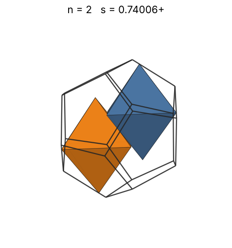 |
| 3 | [0.83184+](octindod_n03.json) | 0.831841816941 |  | 0.56934 | 0.3206 | 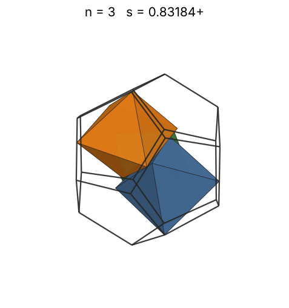 |
| 4 | [0.89628+](octindod_n04.json) | 0.896286525156 |  | 0.62664 | 0.3417 | 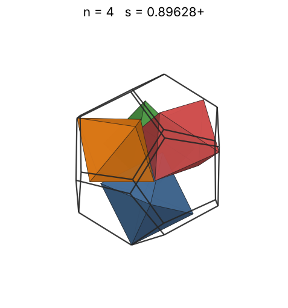 |
| 5 | [0.94386+](octindod_n05.json) | 0.943865253782 |  | 0.67502 | 0.3658 | 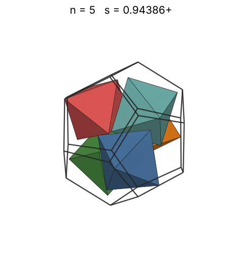 |
| 6 | [0.97789+](octindod_n06.json) | 0.977894199157 |  | 0.71732 | 0.3947 | 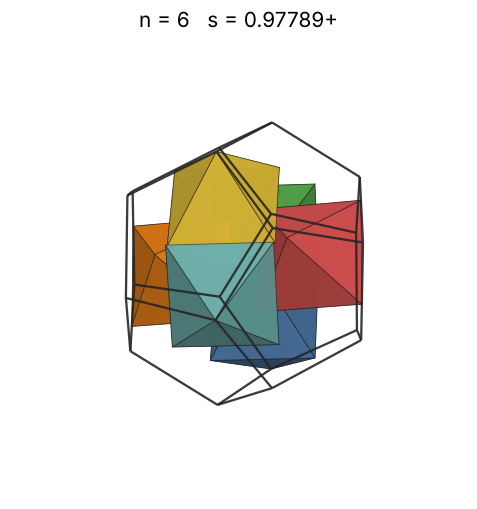 |
| 7 | [1.01305+](octindod_n07.json) | 1.013058550162 |  | 0.75514 | 0.4142 | 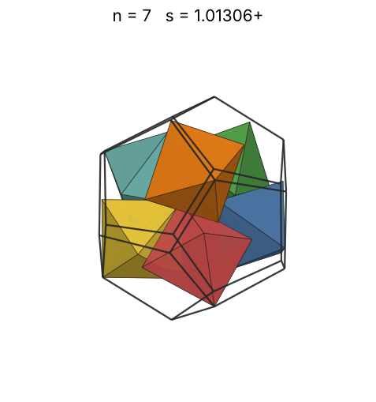 |
| 8 | [1.03859+](octindod_n08.json) | 1.038593549738 |  | 0.78951 | 0.4393 | 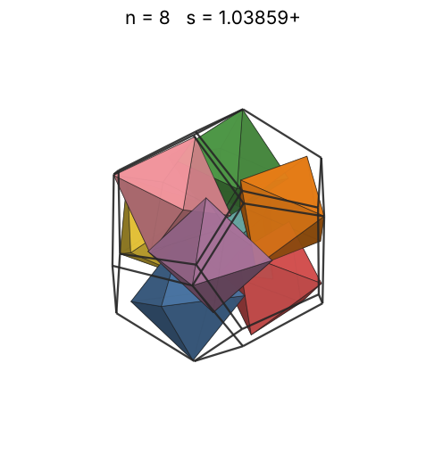 |
| 9 | [1.07298+](octindod_n09.json) | 1.072986935876 |  | 0.82113 | 0.4482 | 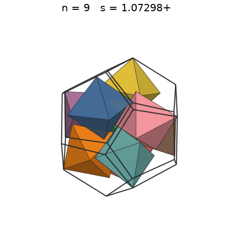 |
| 10 | [1.09181+](octindod_n10.json) | 1.091814477924 |  | 0.85048 | 0.4727 | 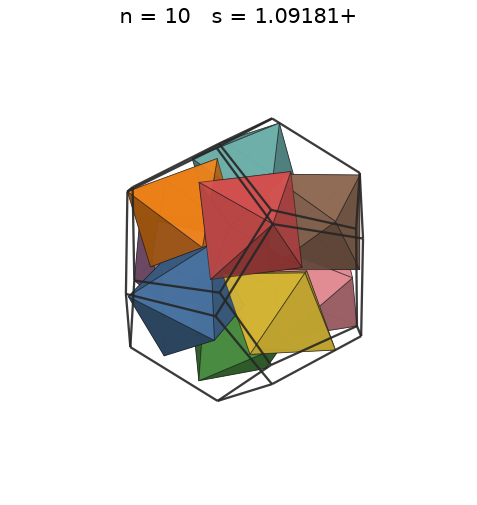 |
| 11 | [1.12605+](octindod_n11.json) | 1.126056998941 |  | 0.87793 | 0.4739 | 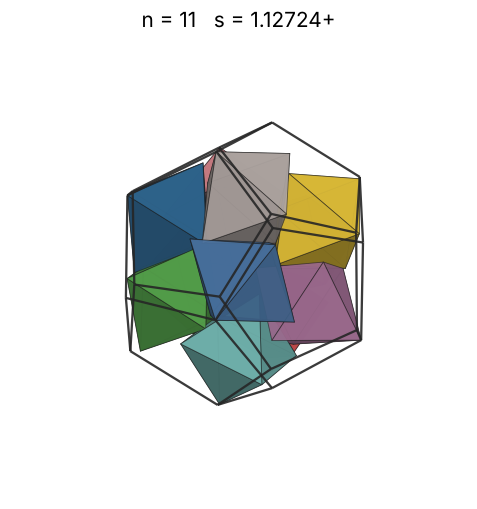 |
| 12 | [1.14362+](octindod_n12.json) | 1.143625719334 |  | 0.90377 | 0.4935 | 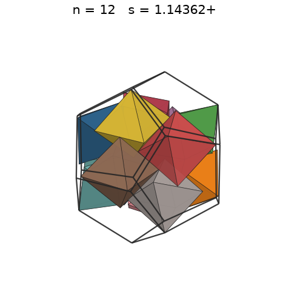 |
| 13 | [1.15520+](octindod_n13.json) | 1.155203786026 |  | 0.92820 | 0.5187 | 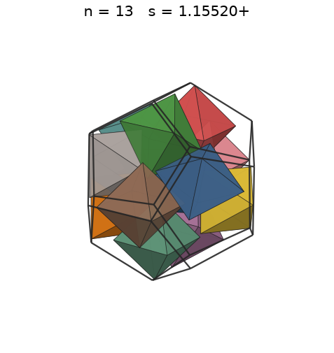 |
| 14 | [1.16778+](octindod_n14.json) | 1.167781741926 |  | 0.95142 | 0.5408 | 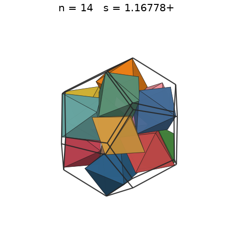 |
| 15 | [1.17361+](octindod_n15.json) | 1.173613052611 |  | 0.97355 | 0.5708 | 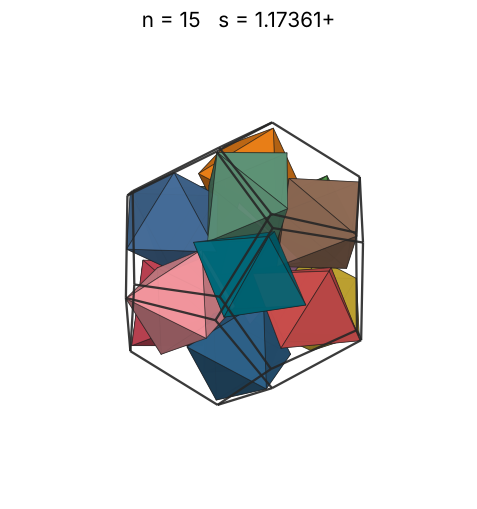 |
| 16 | [1.22491+](octindod_n16.json) | 1.224911174482 |  | 0.99472 | 0.5355 | 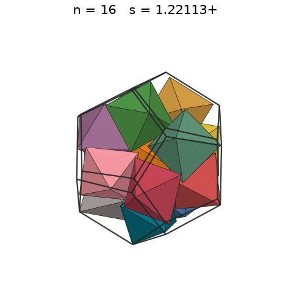 |
| 17 | [1.23700+](octindod_n17.json) | 1.237004918536 |  | 1.01503 | 0.5525 | 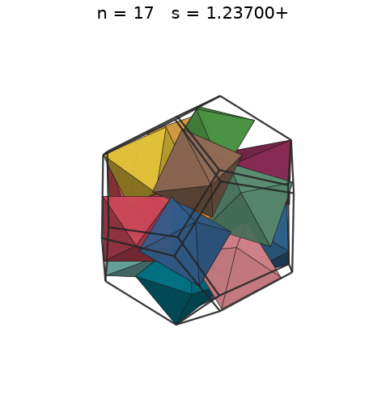 |
| 18 | [1.25996+](octindod_n18.json) | 1.259961371490 |  | 1.03455 | 0.5536 | 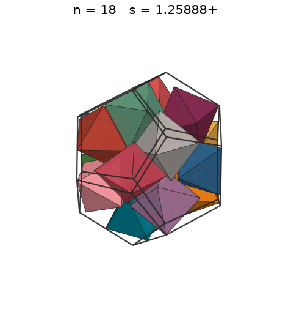 |
| 19 | [1.27098+](octindod_n19.json) | 1.270980343109 |  | 1.05337 | 0.5693 | 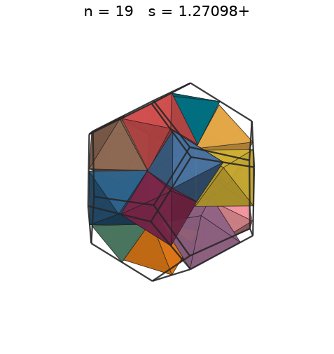 |
| 20 | [1.27859+](octindod_n20.json) | 1.278592196943 |  | 1.07153 | 0.5886 | 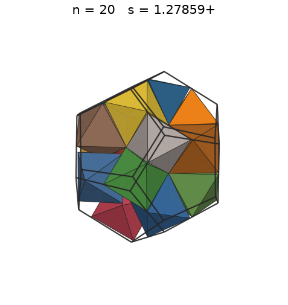 |
| 21 | [1.27941+](octindod_n21.json) | 1.279411596388 |  | 1.08910 | 0.6168 | 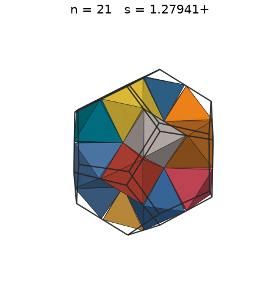 |
| 22 | [1.36881+](octindod_n22.json) | 1.368812747204 |  | 1.10612 | 0.5277 | 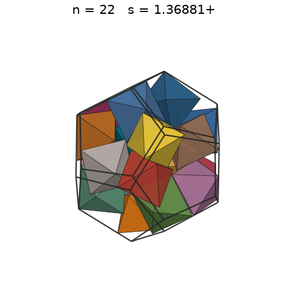 |
| 23 | [1.38189+](octindod_n23.json) | 1.381898627437 |  | 1.12264 | 0.5362 | 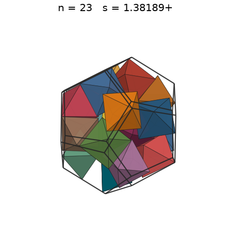 |
| 24 | [1.42761+](octindod_n24.json) | 1.427618876377 |  | 1.13868 | 0.5074 | 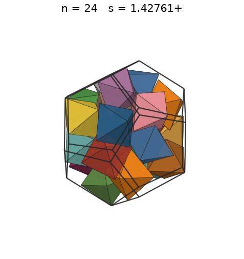 |
| 25 | [1.45180+](octindod_n25.json) | 1.451803798893 |  | 1.15428 | 0.5026 | 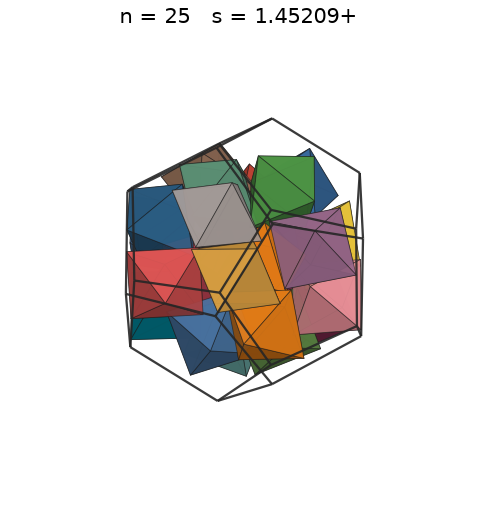 |
| 26 | [1.47848+](octindod_n26.json) | 1.478485100611 |  | 1.16946 | 0.4949 | 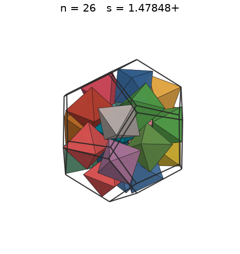 |
| 27 | [1.48374+](octindod_n27.json) | 1.483740277670 |  | 1.18427 | 0.5085 | 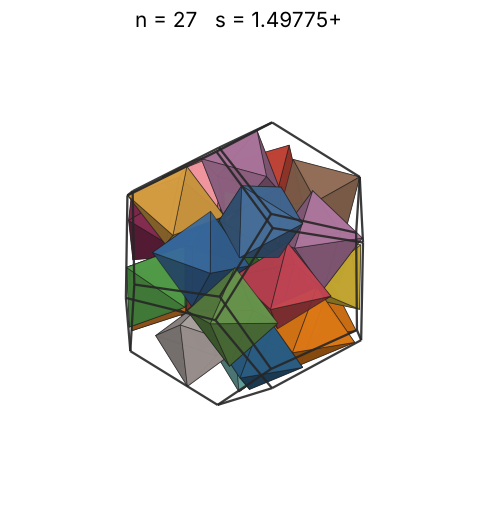 |
| 28 | [1.50499+](octindod_n28.json) | 1.504995616944 |  | 1.19871 | 0.5053 | 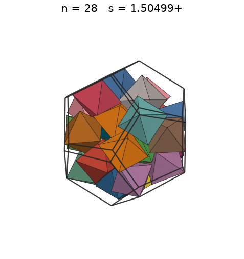 |
| 29 | [1.51706+](octindod_n29.json) | 1.517064537383 |  | 1.21282 | 0.5109 | 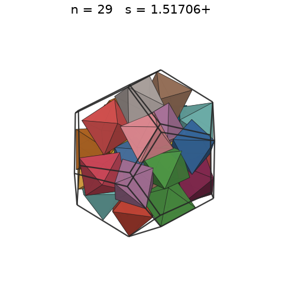 |
| 30 | [1.52877+](octindod_n30.json) | 1.528770835351 |  | 1.22660 | 0.5165 | 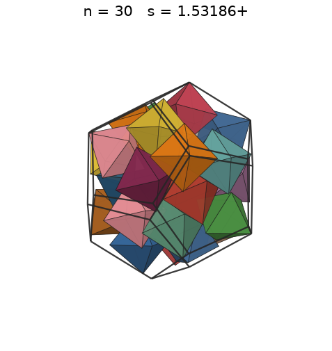 |
| 31 | [1.54202+](octindod_n31.json) | 1.542021366731 |  | 1.24008 | 0.5201 | 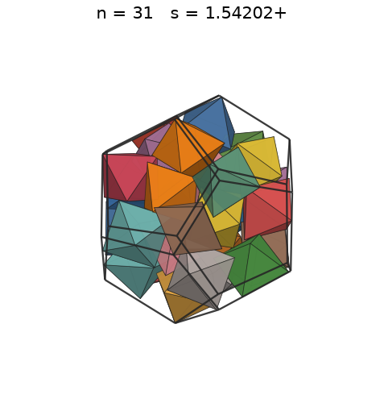 |
| 32 | [1.56826+](octindod_n32.json) | 1.568262770945 |  | 1.25327 | 0.5104 | 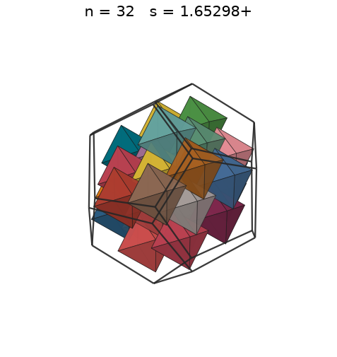 |
| 33 | [1.58364+](octindod_n33.json) | 1.583640164489 |  | 1.26620 | 0.5111 | 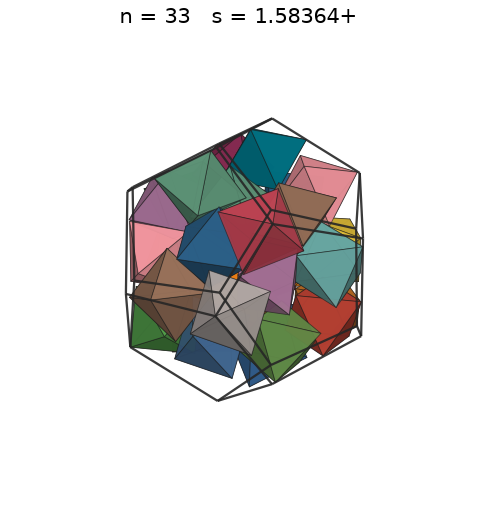 |
| 34 | [1.58619+](octindod_n34.json) | 1.586196528095 |  | 1.27886 | 0.5241 | 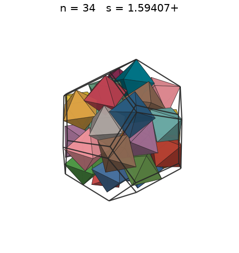 |
| 35 | [1.58619+](octindod_n35.json) | 1.586196528699 |  | 1.29127 | 0.5395 | 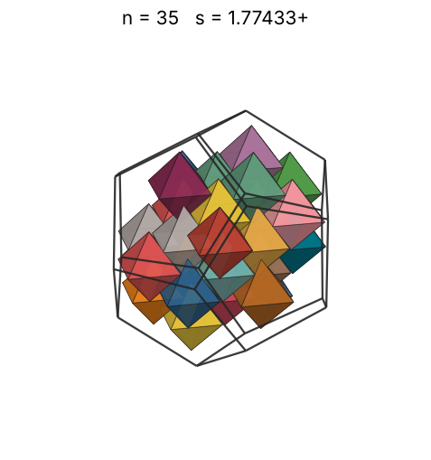 |
| 36 | [1.62021+](octindod_n36.json) | 1.620211221470 |  | 1.30346 | 0.5207 | 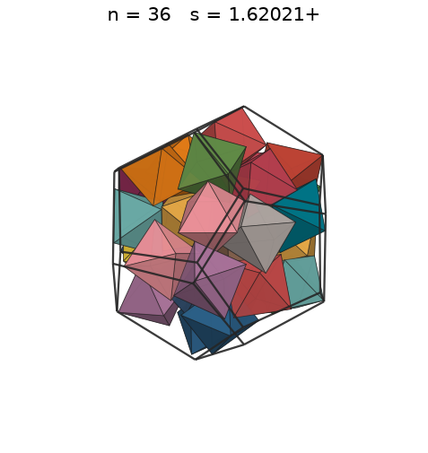 |
| 37 | [1.63642+](octindod_n37.json) | 1.636426595328 |  | 1.31542 | 0.5194 | 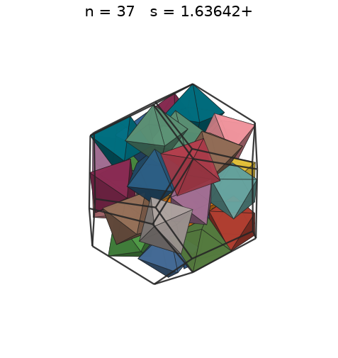 |
| 38 | [1.65151+](octindod_n38.json) | 1.651514559111 |  | 1.32716 | 0.5189 | 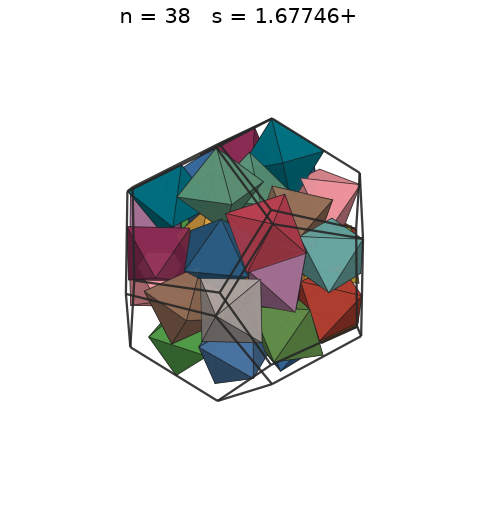 |
| 39 | [1.66334+](octindod_n39.json) | 1.663347871095 |  | 1.33870 | 0.5213 | 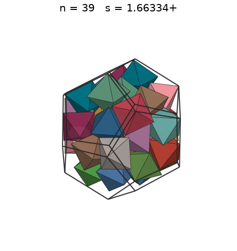 |
| 40 | [1.67524+](octindod_n40.json) | 1.675245818647 |  | 1.35005 | 0.5234 | 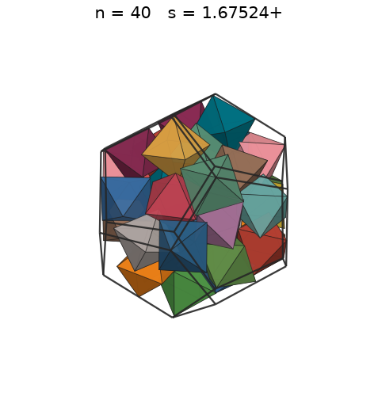 |
| 41 | [1.67524+](octindod_n41.json) | 1.675245822499 |  | 1.36121 | 0.5365 |  |
| 42 | [1.68033+](octindod_n42.json) | 1.680337460630 |  | 1.37218 | 0.5446 |  |
| 43 | [1.68738+](octindod_n43.json) | 1.687386430670 |  | 1.38299 | 0.5506 |  |
| 44 | [1.70802+](octindod_n44.json) | 1.708019910698 |  | 1.39363 | 0.5432 |  |
| 45 | [1.71939+](octindod_n45.json) | 1.719390764422 |  | 1.40411 | 0.5446 |  |
| 46 | [1.73046+](octindod_n46.json) | 1.730465835678 |  | 1.41443 | 0.5461 |  |
| 47 | [1.73873+](octindod_n47.json) | 1.738735454129 |  | 1.42461 | 0.5500 |  |
| 48 | [1.74751+](octindod_n48.json) | 1.747513038175 |  | 1.43464 | 0.5533 |  |
| 49 | [1.77640+](octindod_n49.json) | 1.776405255130 |  | 1.44454 | 0.5377 |  |
| 50 | [1.78506+](octindod_n50.json) | 1.785067780405 |  | 1.45430 | 0.5407 |  |
| 51 | [1.79670+](octindod_n51.json) | 1.796702707014 |  | 1.46393 | 0.5409 |  |
| 52 | [1.79670+](octindod_n52.json) | 1.796702714376 |  | 1.47343 | 0.5515 |  |
| 53 | [1.79825+](octindod_n53.json) | 1.798251954688 |  | 1.48282 | 0.5607 |  |
| 54 | [1.83314+](octindod_n54.json) | 1.833149521122 |  | 1.49209 | 0.5392 |  |
| 55 | [1.83919+](octindod_n55.json) | 1.839199192462 |  | 1.50124 | 0.5438 |  |
| 56 | [1.84626+](octindod_n56.json) | 1.846268826164 |  | 1.51028 | 0.5474 |  |
| 57 | [1.85492+](octindod_n57.json) | 1.854921764577 |  | 1.51922 | 0.5494 |  |
| 58 | [1.86348+](octindod_n58.json) | 1.863485756748 |  | 1.52805 | 0.5514 |  |
| 59 | [1.86598+](octindod_n59.json) | 1.865981167051 |  | 1.53679 | 0.5586 |  |
| 60 | [1.86800+](octindod_n60.json) | 1.868001390389 |  | 1.54542 | 0.5662 |  |
| 61 | [1.87607+](octindod_n61.json) | 1.876075234017 |  | 1.55396 | 0.5683 |  |
| 62 | [1.88744+](octindod_n62.json) | 1.887442524868 |  | 1.56240 | 0.5672 |  |
| 63 | [1.88929+](octindod_n63.json) | 1.889291544203 |  | 1.57076 | 0.5747 |  |
| 64 | [1.93080+](octindod_n64.json) | 1.930802859962 |  | 1.57903 | 0.5470 |  |
| 65 | [1.93626+](octindod_n65.json) | 1.936262692359 |  | 1.58721 | 0.5508 |  |
| 66 | [1.96253+](octindod_n66.json) | 1.962535971473 |  | 1.59531 | 0.5371 |  |
| 67 | [1.96590+](octindod_n67.json) | 1.965907487975 |  | 1.60332 | 0.5425 |  |
| 68 | [1.96590+](octindod_n68.json) | 1.965907488323 |  | 1.61126 | 0.5506 |  |
| 69 | [1.96590+](octindod_n69.json) | 1.965907492627 |  | 1.61912 | 0.5587 |  |
| 70 | [1.97348+](octindod_n70.json) | 1.973489873672 |  | 1.62690 | 0.5602 |  |
| 71 | [1.99011+](octindod_n71.json) | 1.990110448074 |  | 1.63462 | 0.5541 |  |
| 72 | [1.99287+](octindod_n72.json) | 1.992876799163 |  | 1.64225 | 0.5596 |  |
| 73 | [2.02030+](octindod_n73.json) | 2.020301576255 |  | 1.64982 | 0.5446 |  |
| 74 | [2.02126+](octindod_n74.json) | 2.021261880599 |  | 1.65732 | 0.5513 |  |
| 75 | [2.02745+](octindod_n75.json) | 2.027459641725 |  | 1.66475 | 0.5536 |  |
| 76 | [2.02916+](octindod_n76.json) | 2.029163753525 |  | 1.67212 | 0.5596 |  |
| 77 | [2.03891+](octindod_n77.json) | 2.038914042520 |  | 1.67942 | 0.5588 |  |
| 78 | [2.06494+](octindod_n78.json) | 2.064942105281 |  | 1.68666 | 0.5450 |  |
| 79 | [2.06638+](octindod_n79.json) | 2.066382822959 |  | 1.69384 | 0.5508 |  |
| 80 | [2.07017+](octindod_n80.json) | 2.070177559780 |  | 1.70095 | 0.5547 |  |
| 81 | [2.07524+](octindod_n81.json) | 2.075243379478 |  | 1.70801 | 0.5575 |  |
| 82 | [2.07645+](octindod_n82.json) | 2.076455973385 |  | 1.71501 | 0.5634 |  |
| 83 | [2.07964+](octindod_n83.json) | 2.079640840447 |  | 1.72196 | 0.5677 |  |
| 84 | [2.08794+](octindod_n84.json) | 2.087945667023 |  | 1.72884 | 0.5677 |  |
| 85 | [2.10988+](octindod_n85.json) | 2.109888190326 |  | 1.73568 | 0.5567 |  |
| 86 | [2.11244+](octindod_n86.json) | 2.112440190821 |  | 1.74246 | 0.5612 |  |
| 87 | [2.11871+](octindod_n87.json) | 2.118716703367 |  | 1.74919 | 0.5627 |  |
| 88 | [2.12466+](octindod_n88.json) | 2.124661351496 |  | 1.75586 | 0.5644 |  |
| 89 | [2.13870+](octindod_n89.json) | 2.138708036276 |  | 1.76249 | 0.5597 |  |
| 90 | [2.13870+](octindod_n90.json) | 2.138708043050 |  | 1.76906 | 0.5659 |  |
| 91 | [2.14958+](octindod_n91.json) | 2.149588626332 |  | 1.77559 | 0.5636 |  |
| 92 | [2.15490+](octindod_n92.json) | 2.154901682776 |  | 1.78207 | 0.5656 |  |
| 93 | [2.15647+](octindod_n93.json) | 2.156479467545 |  | 1.78851 | 0.5705 |  |
| 94 | [2.16006+](octindod_n94.json) | 2.160066627636 |  | 1.79489 | 0.5737 |  |
| 95 | [2.19977+](octindod_n95.json) | 2.199779406939 |  | 1.80124 | 0.5490 |  |
| 96 | [2.19977+](octindod_n96.json) | 2.199779406939 |  | 1.80753 | 0.5548 |  |
| 97 | [2.19977+](octindod_n97.json) | 2.199779406939 |  | 1.81379 | 0.5606 |  |
| 98 | [2.19977+](octindod_n98.json) | 2.199779406939 |  | 1.82000 | 0.5663 |  |
| 99 | [2.19977+](octindod_n99.json) | 2.199779406939 |  | 1.82617 | 0.5721 |  |
| 100 | [2.20418+](octindod_n100.json) | 2.204184732534 |  | 1.83230 | 0.5744 |  |
