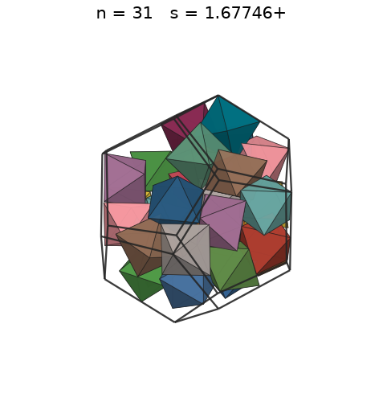
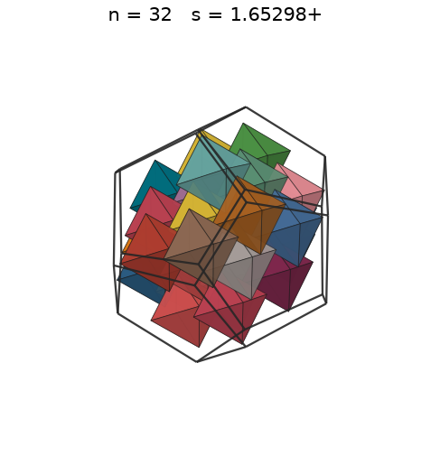
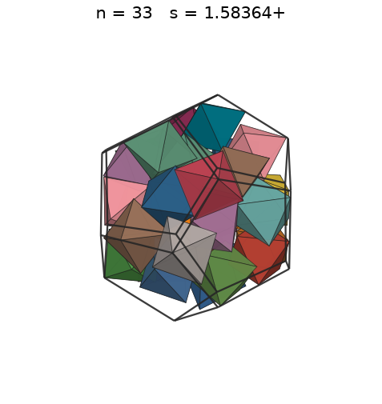
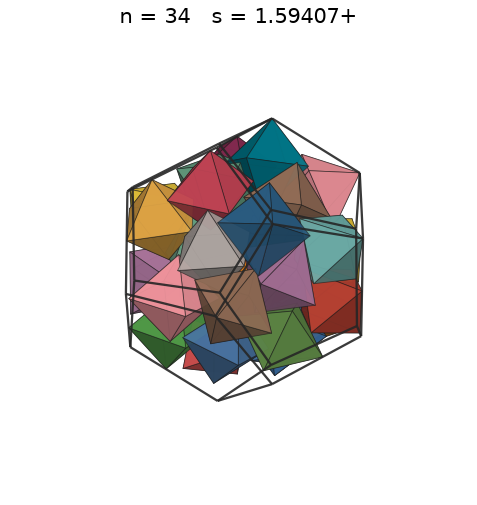
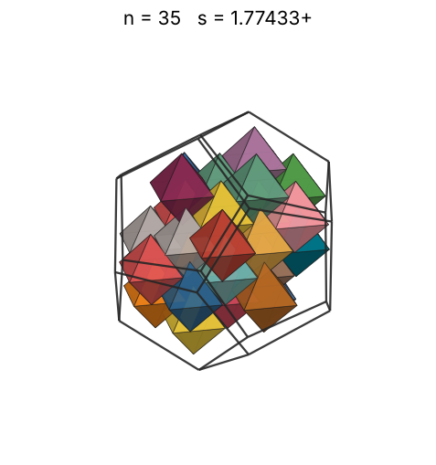
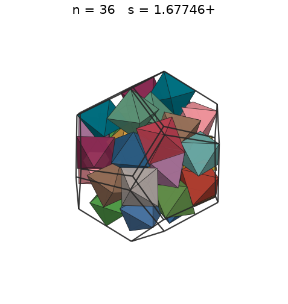
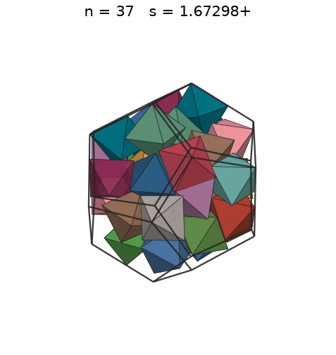
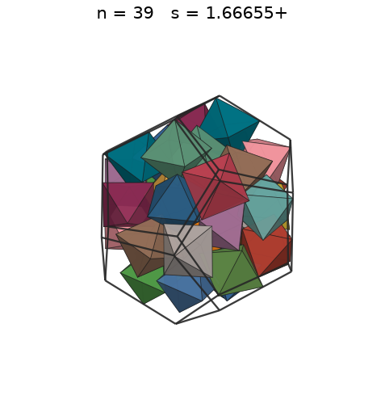
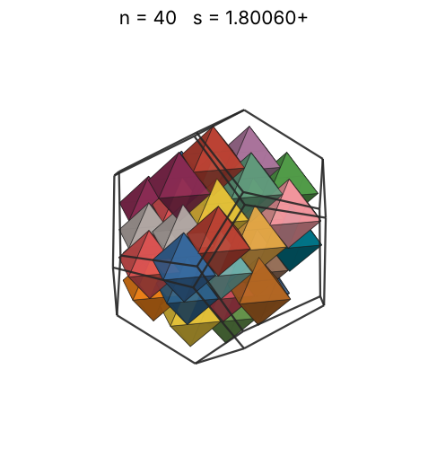

# Octahedra in a dodecahedron

s = container edge / piece edge; every row certified in exact arithmetic.

| n | s | touching limit | closed form (conj.) | volume bound | density | picture |
|---|---|---|---|---|---|---|
| 2 | [0.74006+](octindod_n02.json) | 0.740066720225 | -4/3 + (2√(3 - √5) + 2√5)/3 | 0.49736 | 0.3035 |  |
| 3 | [0.83184+](octindod_n03.json) | 0.831841816941 |  | 0.56934 | 0.3206 |  |
| 4 | [0.89628+](octindod_n04.json) | 0.896286525156 |  | 0.62664 | 0.3417 |  |
| 5 | [0.94386+](octindod_n05.json) | 0.943865253782 |  | 0.67502 | 0.3658 |  |
| 6 | [0.97789+](octindod_n06.json) | 0.977895462591 |  | 0.71732 | 0.3947 |  |
| 7 | [1.01306+](octindod_n07.json) | 1.013060037468 |  | 0.75514 | 0.4142 |  |
| 8 | [1.03859+](octindod_n08.json) | 1.038595011976 |  | 0.78951 | 0.4393 |  |
| 9 | [1.07548+](octindod_n09.json) | 1.075485894006 |  | 0.82113 | 0.4451 |  |
| 10 | [1.09537+](octindod_n10.json) | 1.095371652339 |  | 0.85048 | 0.4681 |  |
| 11 | [1.12724+](octindod_n11.json) | 1.127246383280 |  | 0.87793 | 0.4724 |  |
| 12 | [1.15080+](octindod_n12.json) | 1.150805777323 |  | 0.90377 | 0.4844 |  |
| 13 | [1.16924+](octindod_n13.json) | 1.169247621864 |  | 0.92820 | 0.5003 |  |
| 14 | [1.18010+](octindod_n14.json) | 1.180107691791 |  | 0.95142 | 0.5240 |  |
| 15 | [1.20707+](octindod_n15.json) | 1.207078400620 |  | 0.97355 | 0.5247 |  |
| 16 | [1.23512+](octindod_n16.json) | 1.235126238217 |  | 0.99472 | 0.5224 |  |
| 17 | [1.24272+](octindod_n17.json) | 1.242726098262 |  | 1.01503 | 0.5449 |  |
| 18 | [1.28120+](octindod_n18.json) | 1.281209390614 |  | 1.03455 | 0.5265 |  |
| 19 | [1.31326+](octindod_n19.json) | 1.313265000180 |  | 1.05337 | 0.5160 |  |
| 20 | [1.32591+](octindod_n20.json) | 1.325913247920 |  | 1.07153 | 0.5278 |  |
| 21 | [1.35671+](octindod_n21.json) | 1.356716074004 |  | 1.08910 | 0.5173 |  |
| 22 | [1.39014+](octindod_n22.json) | 1.390147057135 |  | 1.10612 | 0.5038 |  |
| 23 | [1.40620+](octindod_n23.json) | 1.406200265590 |  | 1.12264 | 0.5088 |  |
| 24 | [1.44410+](octindod_n24.json) | 1.444101116590 |  | 1.13868 | 0.4902 |  |
| 25 | [1.45915+](octindod_n25.json) | 1.459154230461 |  | 1.15428 | 0.4950 |  |
| 26 | [1.49447+](octindod_n26.json) | 1.494471634378 |  | 1.16946 | 0.4792 |  |
| 27 | [1.49775+](octindod_n27.json) | 1.497753151799 |  | 1.18427 | 0.4943 |  |
| 28 | [1.51293+](octindod_n28.json) | 1.512937634782 |  | 1.19871 | 0.4974 |  |
| 29 | [1.53223+](octindod_n29.json) | 1.532231264249 |  | 1.21282 | 0.4959 |  |
| 30 | [1.56777+](octindod_n30.json) | 1.567769984352 |  | 1.22660 | 0.4789 |  |
| 31 | [1.67746+](octindod_n31.json) | 1.677463717287 |  | 1.24008 | 0.4040 |  |
| 32 | [1.67746+](octindod_n32.json) | 1.677463717287 |  | 1.25327 | 0.4170 |  |
| 33 | [1.67746+](octindod_n33.json) | 1.677463717287 |  | 1.26620 | 0.4301 |  |
| 34 | [1.67746+](octindod_n34.json) | 1.677463717287 |  | 1.27886 | 0.4431 |  |
| 35 | [1.67746+](octindod_n35.json) | 1.677463717287 |  | 1.29127 | 0.4561 |  |
| 36 | [1.67746+](octindod_n36.json) | 1.677463717287 |  | 1.30346 | 0.4692 |  |
| 37 | [1.67746+](octindod_n37.json) | 1.677463717287 |  | 1.31542 | 0.4822 |  |
| 38 | [1.67746+](octindod_n38.json) | 1.677463717287 |  | 1.32716 | 0.4952 |  |
| 39 | [1.67746+](octindod_n39.json) | 1.677463717287 |  | 1.33870 | 0.5083 |  |
| 40 | [1.67746+](octindod_n40.json) | 1.677463717287 |  | 1.35005 | 0.5213 |  |
| 41 | [1.67746+](octindod_n41.json) | 1.677463717287 |  | 1.36121 | 0.5343 |  |
| 42 | [1.68110+](octindod_n42.json) | 1.681102023578 |  | 1.37218 | 0.5438 |  |
| 43 | [1.69165+](octindod_n43.json) | 1.691653827288 |  | 1.38299 | 0.5464 |  |
| 44 | [1.70857+](octindod_n44.json) | 1.708575010341 |  | 1.39363 | 0.5427 |  |
| 45 | [1.71940+](octindod_n45.json) | 1.719407920076 |  | 1.40411 | 0.5446 |  |
| 46 | [1.73049+](octindod_n46.json) | 1.730494603239 |  | 1.41443 | 0.5461 |  |
| 47 | [1.73935+](octindod_n47.json) | 1.739359317203 |  | 1.42461 | 0.5494 |  |
| 48 | [1.74830+](octindod_n48.json) | 1.748302922769 |  | 1.43464 | 0.5526 |  |
| 49 | [1.78036+](octindod_n49.json) | 1.780365163566 |  | 1.44454 | 0.5341 |  |
| 50 | [2.15097+](octindod_n50.json) | 2.150971788011 |  | 1.45430 | 0.3091 |  |
| 51 | [2.15097+](octindod_n51.json) | 2.150971788011 |  | 1.46393 | 0.3152 |  |
| 52 | [2.15097+](octindod_n52.json) | 2.150971788011 |  | 1.47343 | 0.3214 |  |
| 53 | [2.15097+](octindod_n53.json) | 2.150971788011 |  | 1.48282 | 0.3276 |  |
| 54 | [2.15097+](octindod_n54.json) | 2.150971788011 |  | 1.49209 | 0.3338 |  |
| 55 | [2.19074+](octindod_n55.json) | 2.190743304678 |  | 1.50124 | 0.3218 |  |
| 56 | [2.19074+](octindod_n56.json) | 2.190743304678 |  | 1.51028 | 0.3276 |  |
| 57 | [2.19074+](octindod_n57.json) | 2.190743304678 |  | 1.51922 | 0.3335 |  |
| 58 | [2.19074+](octindod_n58.json) | 2.190743304678 |  | 1.52805 | 0.3393 |  |
| 59 | [2.19074+](octindod_n59.json) | 2.190743304678 |  | 1.53679 | 0.3452 |  |
| 60 | [2.19074+](octindod_n60.json) | 2.190743304678 |  | 1.54542 | 0.3510 |  |
| 61 | [2.21421+](octindod_n61.json) | 2.214214523874 |  | 1.55396 | 0.3457 |  |
| 62 | [2.21421+](octindod_n62.json) | 2.214214523874 |  | 1.56240 | 0.3513 |  |
| 63 | [2.21421+](octindod_n63.json) | 2.214214523874 |  | 1.57076 | 0.3570 |  |
| 64 | [2.21421+](octindod_n64.json) | 2.214214523874 |  | 1.57903 | 0.3627 |  |
| 65 | [2.25449+](octindod_n65.json) | 2.254492738132 |  | 1.58721 | 0.3489 |  |
| 66 | [2.25449+](octindod_n66.json) | 2.254492738132 |  | 1.59531 | 0.3543 |  |
| 67 | [2.30161+](octindod_n67.json) | 2.301611554647 |  | 1.60332 | 0.3380 |  |
| 68 | [2.30161+](octindod_n68.json) | 2.301611554647 |  | 1.61126 | 0.3431 |  |
| 69 | [2.30161+](octindod_n69.json) | 2.301611554647 |  | 1.61912 | 0.3481 |  |
| 70 | [2.30161+](octindod_n70.json) | 2.301611554647 |  | 1.62690 | 0.3532 |  |
| 71 | [2.30161+](octindod_n71.json) | 2.301611554647 |  | 1.63462 | 0.3582 |  |
| 72 | [2.30161+](octindod_n72.json) | 2.301611554647 |  | 1.64225 | 0.3633 |  |
| 73 | [2.33849+](octindod_n73.json) | 2.338495243728 |  | 1.64982 | 0.3512 |  |
| 74 | [2.33849+](octindod_n74.json) | 2.338495243728 |  | 1.65732 | 0.3560 |  |
| 75 | [2.33849+](octindod_n75.json) | 2.338495243728 |  | 1.66475 | 0.3608 |  |
| 76 | [2.33849+](octindod_n76.json) | 2.338495243728 |  | 1.67212 | 0.3656 |  |
| 77 | [2.33849+](octindod_n77.json) | 2.338495243728 |  | 1.67942 | 0.3704 |  |
| 78 | [2.33849+](octindod_n78.json) | 2.338495243728 |  | 1.68666 | 0.3752 |  |
| 79 | [2.36021+](octindod_n79.json) | 2.360215383582 |  | 1.69384 | 0.3696 |  |
| 80 | [2.36021+](octindod_n80.json) | 2.360215383582 |  | 1.70095 | 0.3743 |  |
| 81 | [2.36021+](octindod_n81.json) | 2.360215383582 |  | 1.70801 | 0.3790 |  |
| 82 | [2.36021+](octindod_n82.json) | 2.360215383582 |  | 1.71501 | 0.3837 |  |
| 83 | [2.36021+](octindod_n83.json) | 2.360215383582 |  | 1.72196 | 0.3883 |  |
| 84 | [2.36021+](octindod_n84.json) | 2.360215383582 |  | 1.72884 | 0.3930 |  |
| 85 | [2.41415+](octindod_n85.json) | 2.414156801239 |  | 1.73568 | 0.3716 |  |
| 86 | [2.41415+](octindod_n86.json) | 2.414156801239 |  | 1.74246 | 0.3760 |  |
| 87 | [2.41415+](octindod_n87.json) | 2.414156801239 |  | 1.74919 | 0.3804 |  |
| 88 | [2.41415+](octindod_n88.json) | 2.414156801239 |  | 1.75586 | 0.3847 |  |
| 89 | [2.41415+](octindod_n89.json) | 2.414156801239 |  | 1.76249 | 0.3891 |  |
| 90 | [2.41415+](octindod_n90.json) | 2.414156801239 |  | 1.76906 | 0.3935 |  |
| 91 | [2.47025+](octindod_n91.json) | 2.470252476435 |  | 1.77559 | 0.3714 |  |
| 92 | [2.47025+](octindod_n92.json) | 2.470252476435 |  | 1.78207 | 0.3754 |  |
| 93 | [2.47025+](octindod_n93.json) | 2.470252476435 |  | 1.78851 | 0.3795 |  |
| 94 | [2.47025+](octindod_n94.json) | 2.470252476435 |  | 1.79489 | 0.3836 |  |
| 95 | [2.47025+](octindod_n95.json) | 2.470252476435 |  | 1.80124 | 0.3877 |  |
| 96 | [2.47025+](octindod_n96.json) | 2.470252476435 |  | 1.80753 | 0.3918 |  |
| 97 | [2.48545+](octindod_n97.json) | 2.485452196524 |  | 1.81379 | 0.3886 |  |
| 98 | [2.48545+](octindod_n98.json) | 2.485452196524 |  | 1.82000 | 0.3926 |  |
| 99 | [2.48545+](octindod_n99.json) | 2.485452196524 |  | 1.82617 | 0.3966 |  |
| 100 | [2.48545+](octindod_n100.json) | 2.485452196524 |  | 1.83230 | 0.4007 |  |
