# Octahedra in a dodecahedron

s = container edge / piece edge; every row certified in exact arithmetic.

| n | s | touching limit | closed form (conj.) | volume bound | density | picture |
|---|---|---|---|---|---|---|
| 2 | [0.74006+](octindod_n02.json) | 0.740066720225 |  | 0.49736 | 0.3035 | 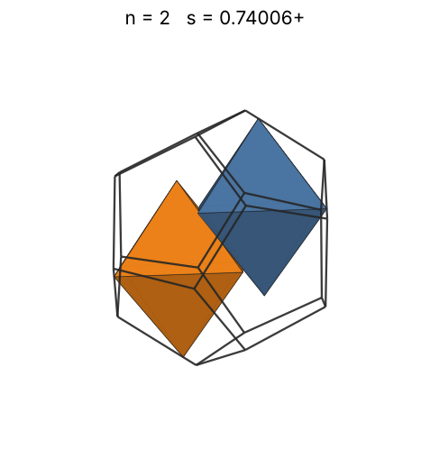 |
| 3 | [0.83184+](octindod_n03.json) | 0.831841816941 |  | 0.56934 | 0.3206 | 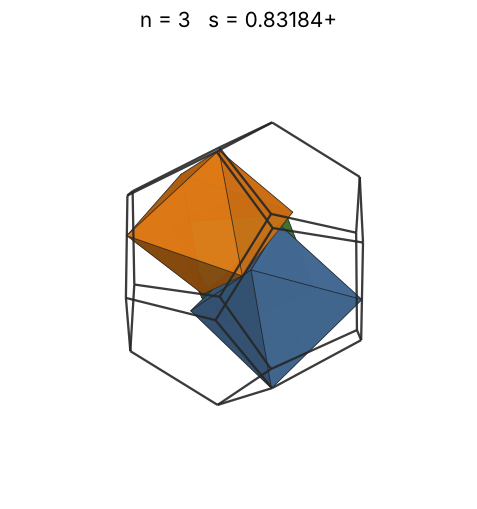 |
| 4 | [0.89628+](octindod_n04.json) | 0.896286525156 |  | 0.62664 | 0.3417 | 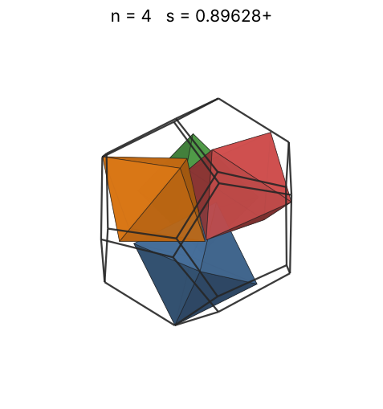 |
| 5 | [0.94386+](octindod_n05.json) | 0.943865253782 |  | 0.67502 | 0.3658 | 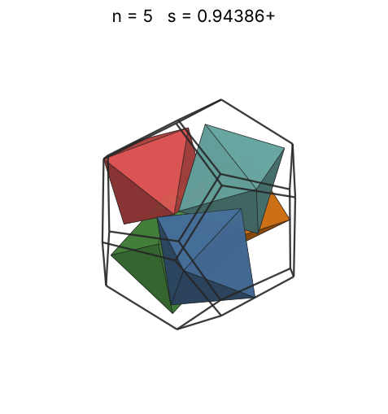 |
| 6 | [0.97789+](octindod_n06.json) | 0.977895462591 |  | 0.71732 | 0.3947 | 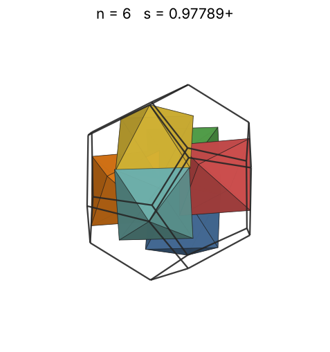 |
| 7 | [1.01306+](octindod_n07.json) | 1.013060037468 |  | 0.75514 | 0.4142 | 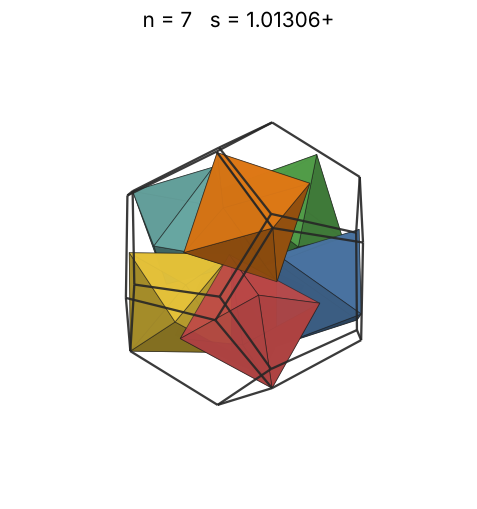 |
| 8 | [1.03859+](octindod_n08.json) | 1.038595011976 |  | 0.78951 | 0.4393 | 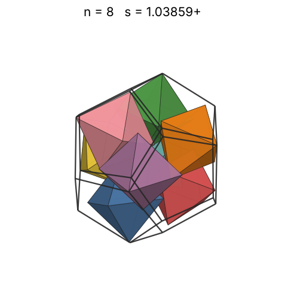 |
| 9 | [1.07548+](octindod_n09.json) | 1.075485894006 |  | 0.82113 | 0.4451 | 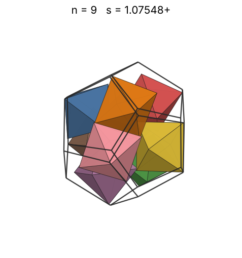 |
| 10 | [1.09537+](octindod_n10.json) | 1.095371652339 |  | 0.85048 | 0.4681 | 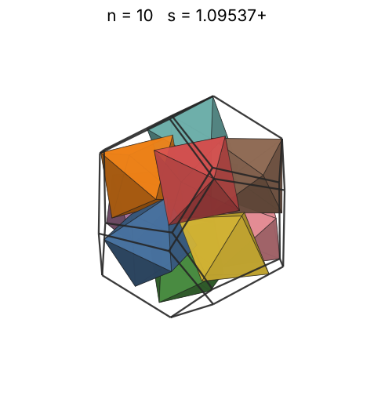 |
| 11 | [1.12724+](octindod_n11.json) | 1.127246383280 |  | 0.87793 | 0.4724 | 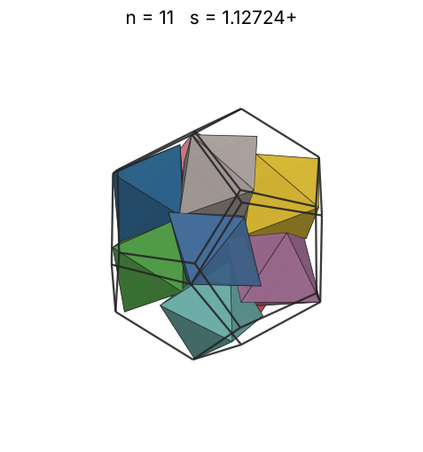 |
| 12 | [1.15080+](octindod_n12.json) | 1.150805777323 |  | 0.90377 | 0.4844 | 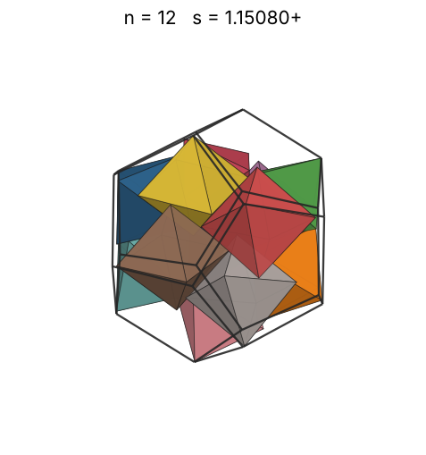 |
| 13 | [1.16924+](octindod_n13.json) | 1.169247621864 |  | 0.92820 | 0.5003 | 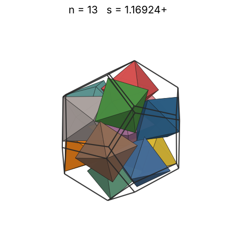 |
| 14 | [1.18010+](octindod_n14.json) | 1.180107691791 |  | 0.95142 | 0.5240 | 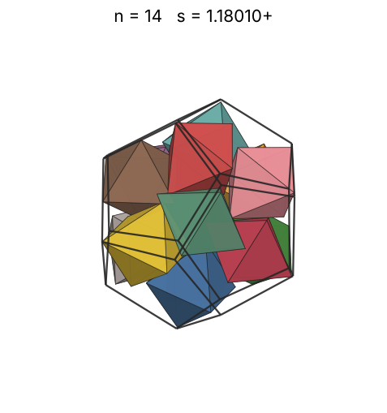 |
| 15 | [1.20707+](octindod_n15.json) | 1.207078400620 |  | 0.97355 | 0.5247 | 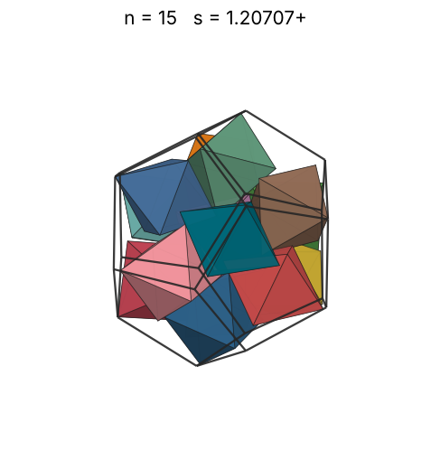 |
| 16 | [1.23512+](octindod_n16.json) | 1.235126238217 |  | 0.99472 | 0.5224 | 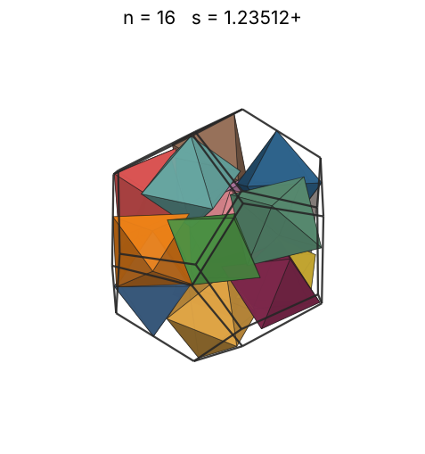 |
| 17 | [1.24272+](octindod_n17.json) | 1.242726098262 |  | 1.01503 | 0.5449 | 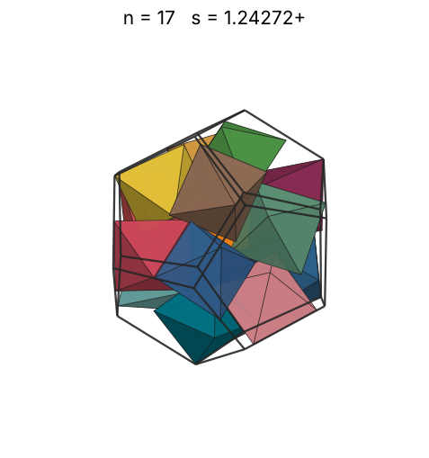 |
| 18 | [1.28120+](octindod_n18.json) | 1.281209390614 |  | 1.03455 | 0.5265 | 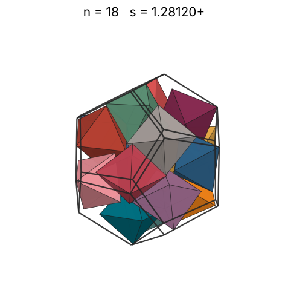 |
| 19 | [1.31326+](octindod_n19.json) | 1.313265000180 |  | 1.05337 | 0.5160 | 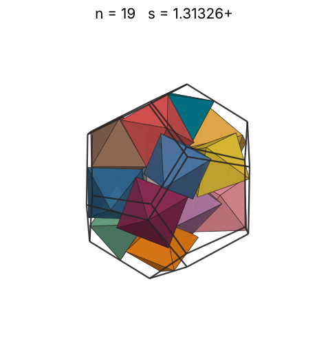 |
| 20 | [1.32591+](octindod_n20.json) | 1.325913247920 |  | 1.07153 | 0.5278 | 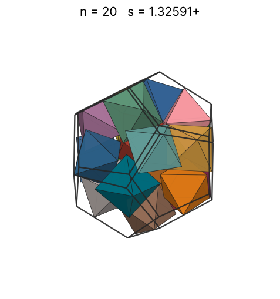 |
| 21 | [1.35671+](octindod_n21.json) | 1.356716074004 |  | 1.08910 | 0.5173 | 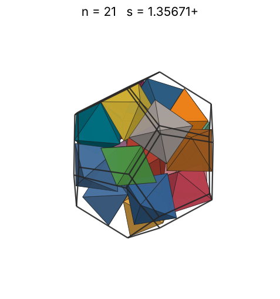 |
| 22 | [1.39014+](octindod_n22.json) | 1.390147057135 |  | 1.10612 | 0.5038 | 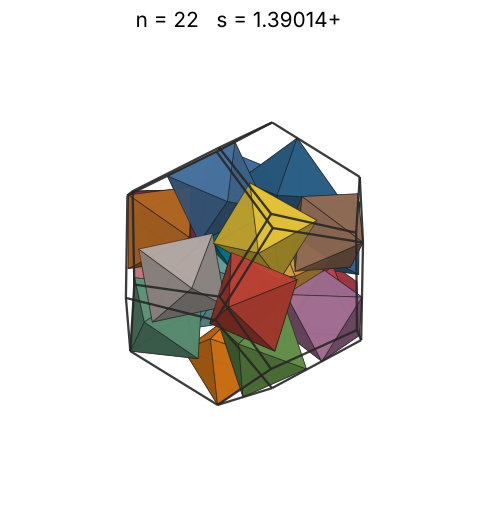 |
| 23 | [1.40620+](octindod_n23.json) | 1.406200265590 |  | 1.12264 | 0.5088 | 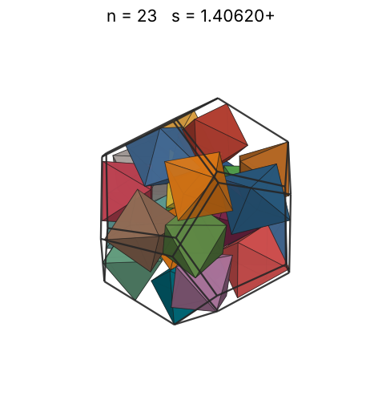 |
| 24 | [1.44410+](octindod_n24.json) | 1.444101116590 |  | 1.13868 | 0.4902 | 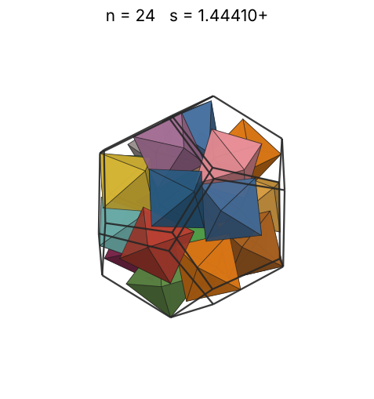 |
| 25 | [1.45915+](octindod_n25.json) | 1.459154230461 |  | 1.15428 | 0.4950 | 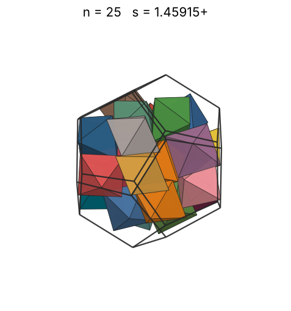 |
| 26 | [1.49447+](octindod_n26.json) | 1.494471634378 |  | 1.16946 | 0.4792 | 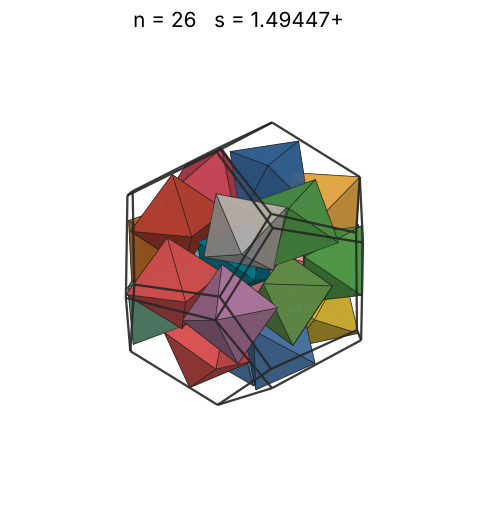 |
| 27 | [1.49775+](octindod_n27.json) | 1.497753151799 |  | 1.18427 | 0.4943 | 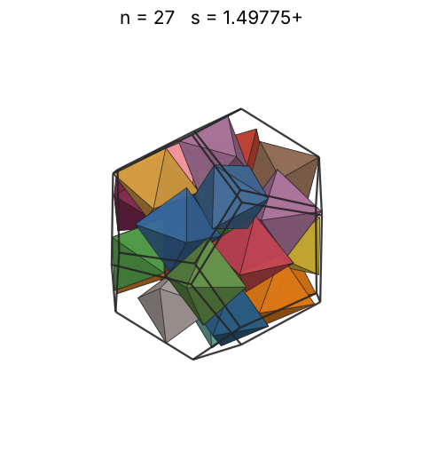 |
| 28 | [1.51293+](octindod_n28.json) | 1.512937634782 |  | 1.19871 | 0.4974 | 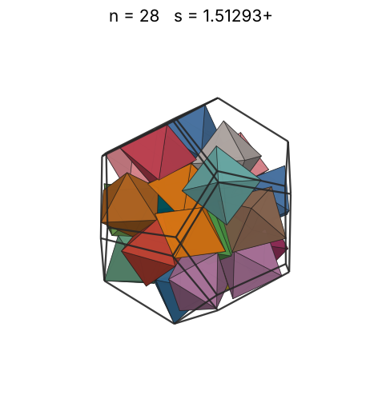 |
| 29 | [1.53223+](octindod_n29.json) | 1.532231264249 |  | 1.21282 | 0.4959 | 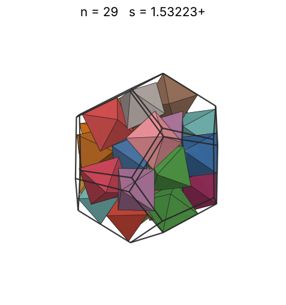 |
| 30 | [1.56777+](octindod_n30.json) | 1.567769984352 |  | 1.22660 | 0.4789 | 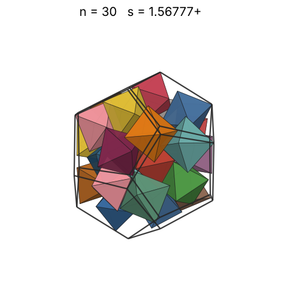 |
