# Octahedra in a dodecahedron

s = container edge / piece edge; every row certified in exact arithmetic.

| n | s | touching limit | closed form (conj.) | volume bound | density | picture |
|---|---|---|---|---|---|---|
| 2 | [0.74006+](octindod_n02.json) | 0.740066720225 | -4/3 + (2√(3 - √5) + 2√5)/3 | 0.49736 | 0.3035 | 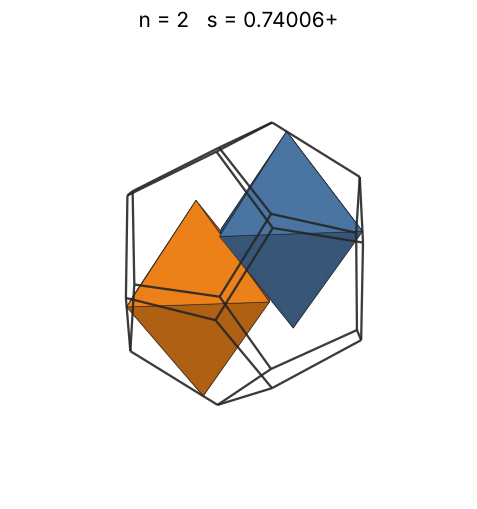 |
| 3 | [0.83184+](octindod_n03.json) | 0.831841816941 |  | 0.56934 | 0.3206 | 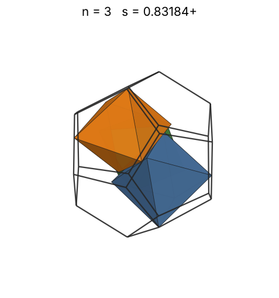 |
| 4 | [0.89628+](octindod_n04.json) | 0.896286525156 |  | 0.62664 | 0.3417 | 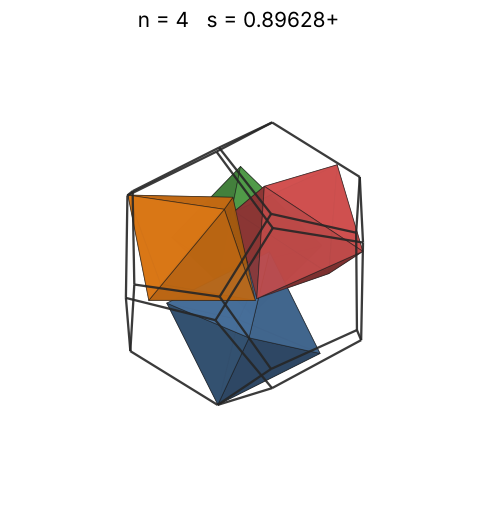 |
| 5 | [0.94386+](octindod_n05.json) | 0.943865253782 |  | 0.67502 | 0.3658 | 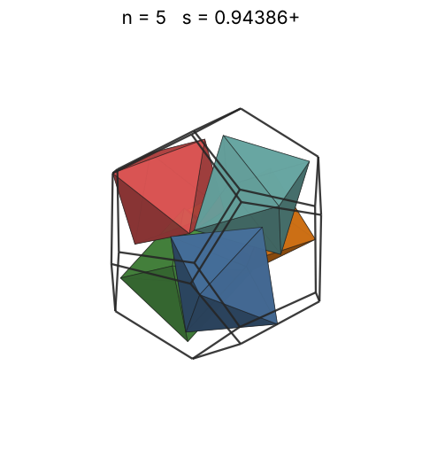 |
| 6 | [0.97789+](octindod_n06.json) | 0.977894199157 |  | 0.71732 | 0.3947 | 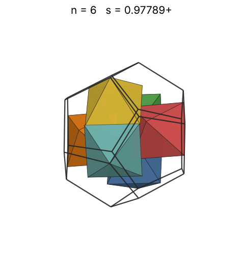 |
| 7 | [1.01305+](octindod_n07.json) | 1.013058550162 |  | 0.75514 | 0.4142 | 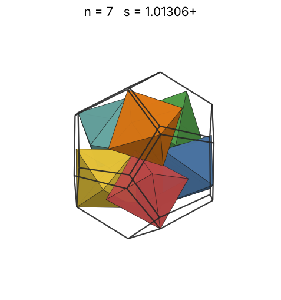 |
| 8 | [1.03859+](octindod_n08.json) | 1.038593549738 |  | 0.78951 | 0.4393 | 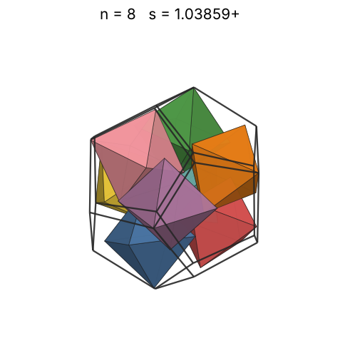 |
| 9 | [1.07298+](octindod_n09.json) | 1.072986935876 |  | 0.82113 | 0.4482 | 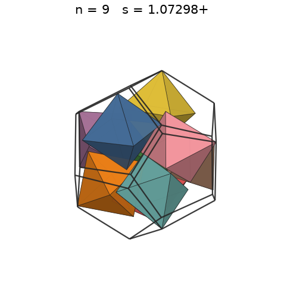 |
| 10 | [1.09181+](octindod_n10.json) | 1.091814477924 |  | 0.85048 | 0.4727 | 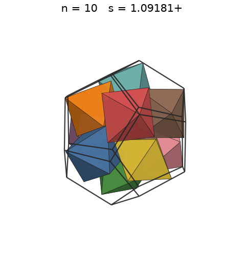 |
| 11 | [1.12602+](octindod_n11.json) | 1.126020660257 |  | 0.87793 | 0.4740 | 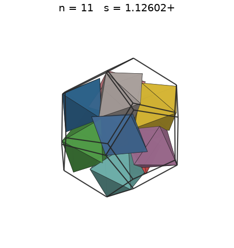 |
| 12 | [1.14362+](octindod_n12.json) | 1.143625719334 |  | 0.90377 | 0.4935 | 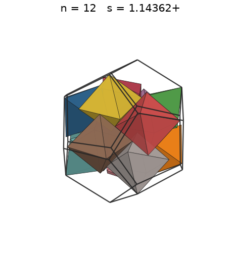 |
| 13 | [1.15520+](octindod_n13.json) | 1.155203786026 |  | 0.92820 | 0.5187 | 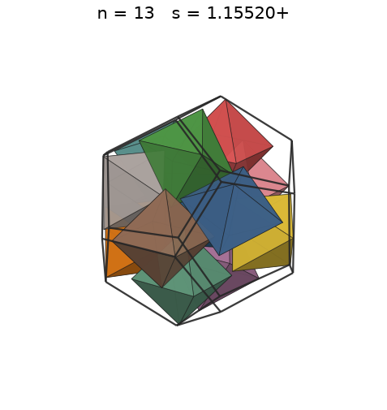 |
| 14 | [1.16777+](octindod_n14.json) | 1.167777718465 |  | 0.95142 | 0.5408 | 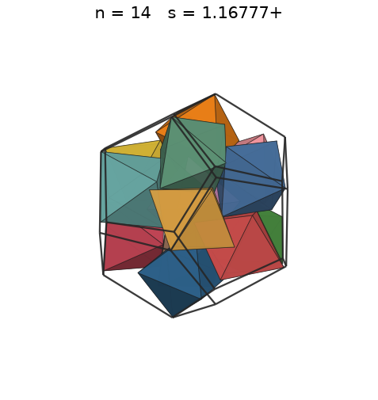 |
| 15 | [1.17361+](octindod_n15.json) | 1.173613052611 |  | 0.97355 | 0.5708 | 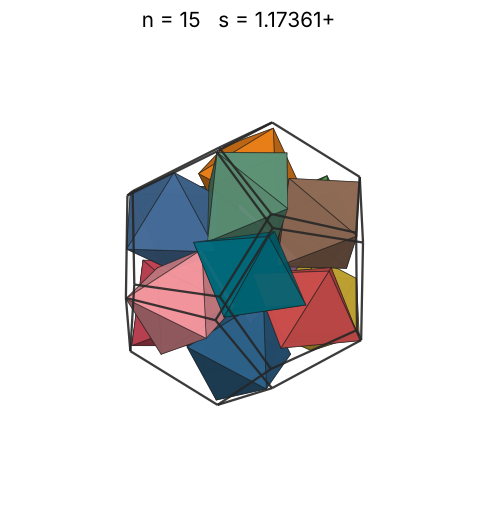 |
| 16 | [1.22074+](octindod_n16.json) | 1.220741475822 |  | 0.99472 | 0.5410 | 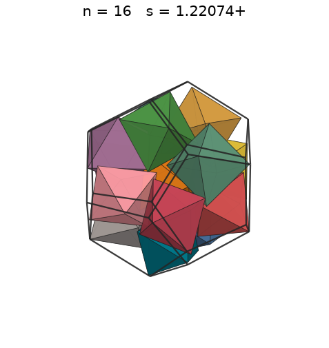 |
| 17 | [1.23700+](octindod_n17.json) | 1.237004918536 |  | 1.01503 | 0.5525 | 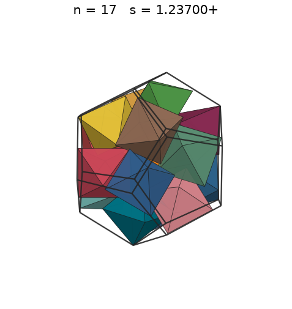 |
| 18 | [1.25756+](octindod_n18.json) | 1.257562660247 |  | 1.03455 | 0.5568 | 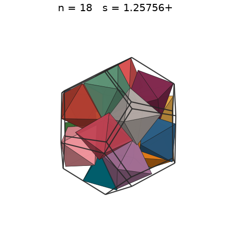 |
| 19 | [1.27091+](octindod_n19.json) | 1.270911897973 |  | 1.05337 | 0.5694 | 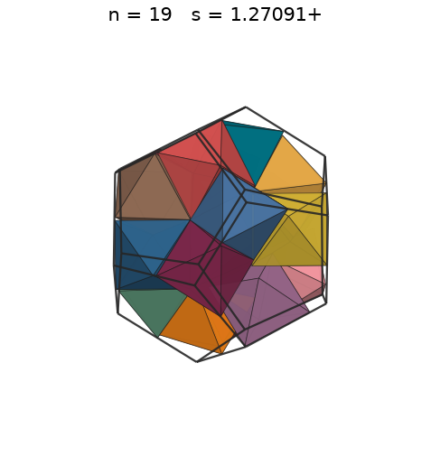 |
| 20 | [1.27855+](octindod_n20.json) | 1.278553384454 |  | 1.07153 | 0.5887 | 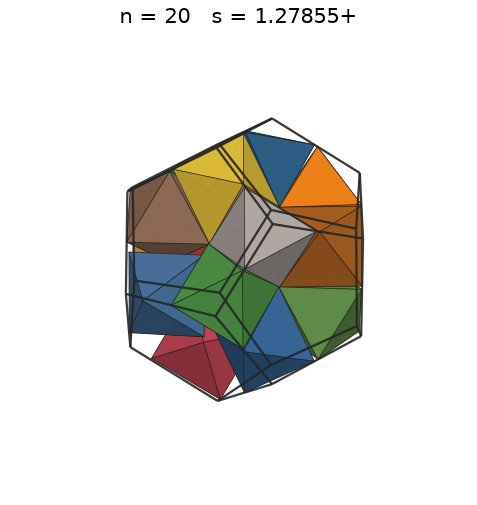 |
| 21 | [1.27941+](octindod_n21.json) | 1.279411596388 | -7/6 + (4√(3 - √5) + 5√5)/6 | 1.08910 | 0.6168 | 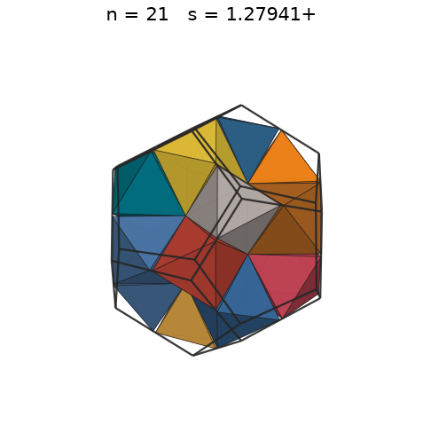 |
| 22 | [1.36881+](octindod_n22.json) | 1.368812747204 |  | 1.10612 | 0.5277 | 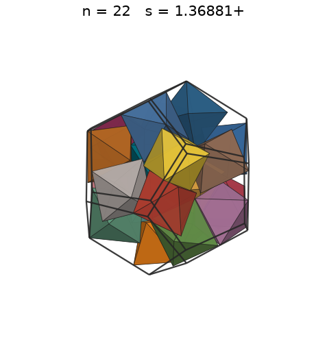 |
| 23 | [1.38189+](octindod_n23.json) | 1.381898627437 |  | 1.12264 | 0.5362 | 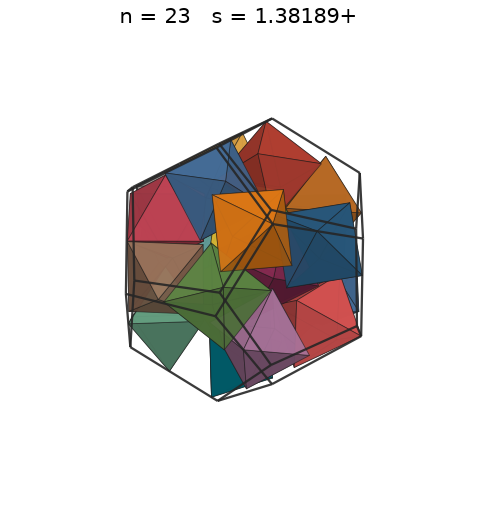 |
| 24 | [1.42761+](octindod_n24.json) | 1.427618876377 |  | 1.13868 | 0.5074 | 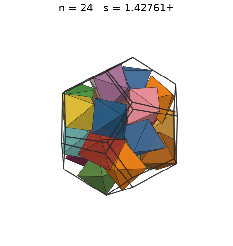 |
| 25 | [1.45180+](octindod_n25.json) | 1.451802722654 |  | 1.15428 | 0.5026 | 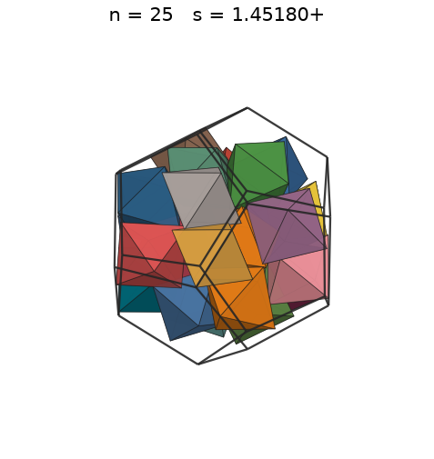 |
| 26 | [1.47848+](octindod_n26.json) | 1.478485100611 |  | 1.16946 | 0.4949 | 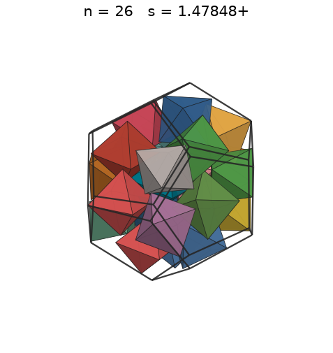 |
| 27 | [1.48374+](octindod_n27.json) | 1.483740277670 |  | 1.18427 | 0.5085 | 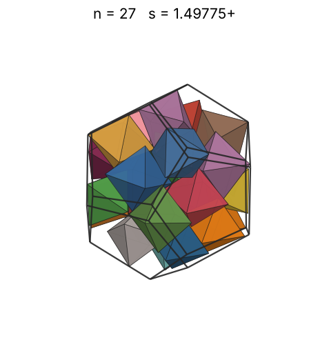 |
| 28 | [1.50499+](octindod_n28.json) | 1.504995616944 |  | 1.19871 | 0.5053 | 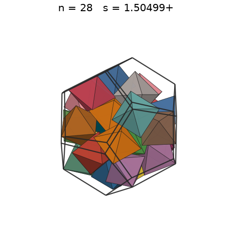 |
| 29 | [1.51706+](octindod_n29.json) | 1.517064537383 |  | 1.21282 | 0.5109 | 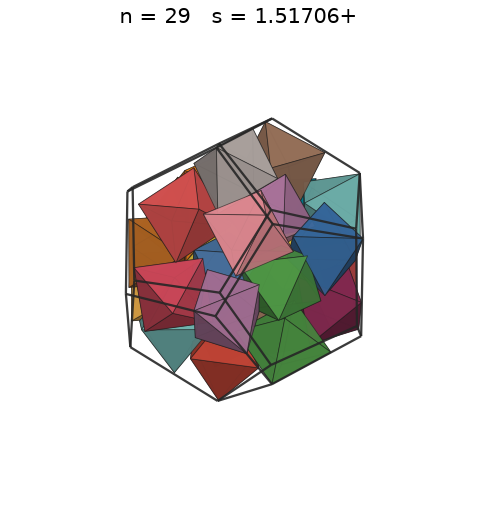 |
| 30 | [1.52865+](octindod_n30.json) | 1.528656518989 |  | 1.22660 | 0.5166 | 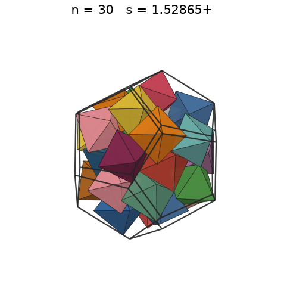 |
| 31 | [1.54201+](octindod_n31.json) | 1.542016938316 |  | 1.24008 | 0.5201 | 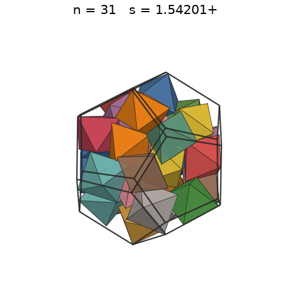 |
| 32 | [1.56824+](octindod_n32.json) | 1.568246276529 |  | 1.25327 | 0.5104 | 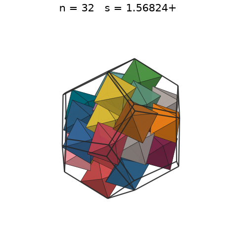 |
| 33 | [1.58102+](octindod_n33.json) | 1.581020986617 |  | 1.26620 | 0.5137 | 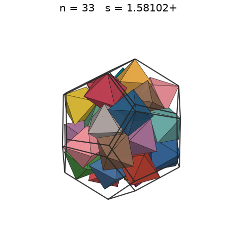 |
| 34 | [1.58102+](octindod_n34.json) | 1.581020990375 |  | 1.27886 | 0.5292 | 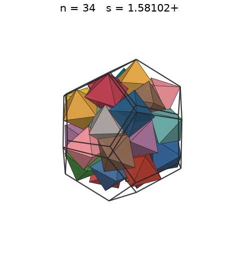 |
| 35 | [1.58614+](octindod_n35.json) | 1.586145280348 |  | 1.29127 | 0.5395 | 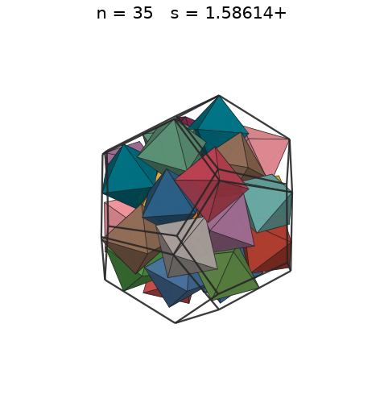 |
| 36 | [1.62021+](octindod_n36.json) | 1.620211221470 |  | 1.30346 | 0.5207 | 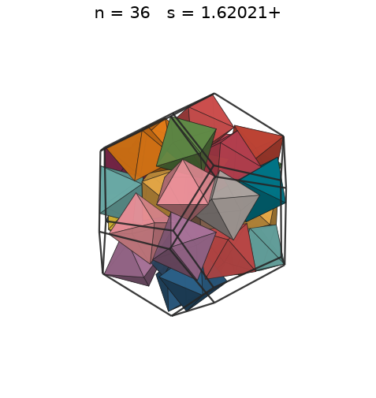 |
| 37 | [1.63642+](octindod_n37.json) | 1.636426595328 |  | 1.31542 | 0.5194 | 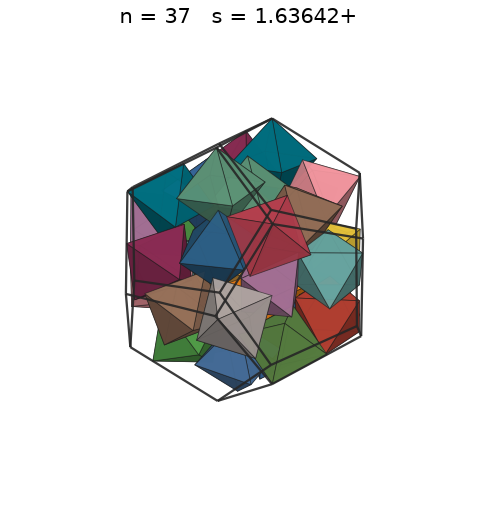 |
| 38 | [1.65151+](octindod_n38.json) | 1.651514559111 |  | 1.32716 | 0.5189 | 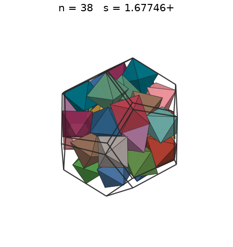 |
| 39 | [1.66334+](octindod_n39.json) | 1.663347871095 |  | 1.33870 | 0.5213 | 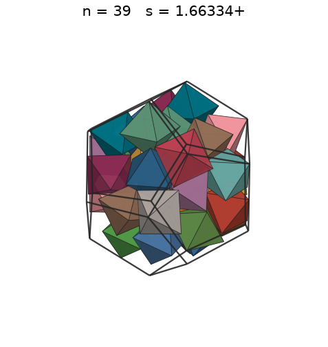 |
| 40 | [1.67524+](octindod_n40.json) | 1.675245818647 |  | 1.35005 | 0.5234 | 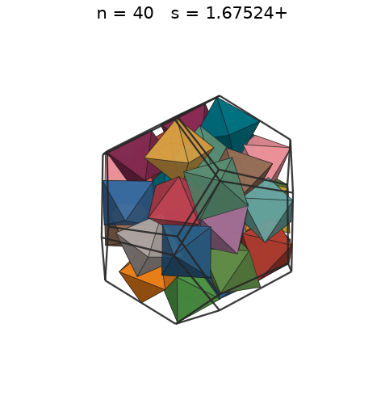 |
| 41 | [1.67524+](octindod_n41.json) | 1.675245822499 |  | 1.36121 | 0.5365 |  |
| 42 | [1.68030+](octindod_n42.json) | 1.680300431406 |  | 1.37218 | 0.5446 |  |
| 43 | [1.68696+](octindod_n43.json) | 1.686964876132 |  | 1.38299 | 0.5510 |  |
| 44 | [1.70794+](octindod_n44.json) | 1.707948864351 |  | 1.39363 | 0.5433 |  |
| 45 | [1.71938+](octindod_n45.json) | 1.719387303115 |  | 1.40411 | 0.5446 |  |
| 46 | [1.73045+](octindod_n46.json) | 1.730458544993 |  | 1.41443 | 0.5461 |  |
| 47 | [1.73867+](octindod_n47.json) | 1.738671995815 |  | 1.42461 | 0.5501 |  |
| 48 | [1.74740+](octindod_n48.json) | 1.747406201590 |  | 1.43464 | 0.5534 |  |
| 49 | [1.77640+](octindod_n49.json) | 1.776405255130 |  | 1.44454 | 0.5377 |  |
| 50 | [1.78506+](octindod_n50.json) | 1.785062353982 |  | 1.45430 | 0.5408 |  |
| 51 | [1.79670+](octindod_n51.json) | 1.796702707014 |  | 1.46393 | 0.5409 |  |
| 52 | [1.79670+](octindod_n52.json) | 1.796702714376 |  | 1.47343 | 0.5515 |  |
| 53 | [1.79825+](octindod_n53.json) | 1.798250986372 |  | 1.48282 | 0.5607 |  |
| 54 | [1.83314+](octindod_n54.json) | 1.833149521122 |  | 1.49209 | 0.5392 |  |
| 55 | [1.83918+](octindod_n55.json) | 1.839189215864 |  | 1.50124 | 0.5438 |  |
| 56 | [1.84626+](octindod_n56.json) | 1.846264838218 |  | 1.51028 | 0.5474 |  |
| 57 | [1.85484+](octindod_n57.json) | 1.854844683430 |  | 1.51922 | 0.5495 |  |
| 58 | [1.86348+](octindod_n58.json) | 1.863485756748 |  | 1.52805 | 0.5514 |  |
| 59 | [1.86596+](octindod_n59.json) | 1.865966898124 |  | 1.53679 | 0.5586 |  |
| 60 | [1.86792+](octindod_n60.json) | 1.867923290942 |  | 1.54542 | 0.5663 |  |
| 61 | [1.87604+](octindod_n61.json) | 1.876042164284 |  | 1.55396 | 0.5683 |  |
| 62 | [1.88744+](octindod_n62.json) | 1.887442524868 |  | 1.56240 | 0.5672 |  |
| 63 | [1.88928+](octindod_n63.json) | 1.889288658633 |  | 1.57076 | 0.5747 |  |
| 64 | [1.93078+](octindod_n64.json) | 1.930785739584 |  | 1.57903 | 0.5470 |  |
| 65 | [1.93619+](octindod_n65.json) | 1.936195430584 |  | 1.58721 | 0.5509 |  |
| 66 | [1.96252+](octindod_n66.json) | 1.962528593552 |  | 1.59531 | 0.5371 |  |
| 67 | [1.96374+](octindod_n67.json) | 1.963744832491 |  | 1.60332 | 0.5443 |  |
| 68 | [1.96505+](octindod_n68.json) | 1.965055655727 |  | 1.61126 | 0.5513 |  |
| 69 | [1.96568+](octindod_n69.json) | 1.965684806450 |  | 1.61912 | 0.5589 |  |
| 70 | [1.97338+](octindod_n70.json) | 1.973381425280 |  | 1.62690 | 0.5603 |  |
| 71 | [1.99003+](octindod_n71.json) | 1.990036182862 |  | 1.63462 | 0.5542 |  |
| 72 | [1.99275+](octindod_n72.json) | 1.992754290833 |  | 1.64225 | 0.5597 |  |
| 73 | [2.02018+](octindod_n73.json) | 2.020185978508 |  | 1.64982 | 0.5447 |  |
| 74 | [2.02113+](octindod_n74.json) | 2.021133375517 |  | 1.65732 | 0.5514 |  |
| 75 | [2.02729+](octindod_n75.json) | 2.027297676599 |  | 1.66475 | 0.5537 |  |
| 76 | [2.02914+](octindod_n76.json) | 2.029148609161 |  | 1.67212 | 0.5596 |  |
| 77 | [2.03870+](octindod_n77.json) | 2.038702439871 |  | 1.67942 | 0.5590 |  |
| 78 | [2.06474+](octindod_n78.json) | 2.064747957214 |  | 1.68666 | 0.5451 |  |
| 79 | [2.06617+](octindod_n79.json) | 2.066176787856 |  | 1.69384 | 0.5510 |  |
| 80 | [2.07007+](octindod_n80.json) | 2.070070993152 |  | 1.70095 | 0.5548 |  |
| 81 | [2.07509+](octindod_n81.json) | 2.075094291507 |  | 1.70801 | 0.5576 |  |
| 82 | [2.07641+](octindod_n82.json) | 2.076414855020 |  | 1.71501 | 0.5635 |  |
| 83 | [2.07954+](octindod_n83.json) | 2.079541873928 |  | 1.72196 | 0.5678 |  |
| 84 | [2.08793+](octindod_n84.json) | 2.087938561074 |  | 1.72884 | 0.5677 |  |
| 85 | [2.10927+](octindod_n85.json) | 2.109272588315 |  | 1.73568 | 0.5572 |  |
| 86 | [2.11241+](octindod_n86.json) | 2.112419067662 |  | 1.74246 | 0.5612 |  |
| 87 | [2.11867+](octindod_n87.json) | 2.118674892671 |  | 1.74919 | 0.5627 |  |
| 88 | [2.12464+](octindod_n88.json) | 2.124647414617 |  | 1.75586 | 0.5644 |  |
| 89 | [2.13861+](octindod_n89.json) | 2.138617495390 |  | 1.76249 | 0.5597 |  |
| 90 | [2.13861+](octindod_n90.json) | 2.138617500416 |  | 1.76906 | 0.5660 |  |
| 91 | [2.14958+](octindod_n91.json) | 2.149588626332 |  | 1.77559 | 0.5636 |  |
| 92 | [2.15490+](octindod_n92.json) | 2.154901682776 |  | 1.78207 | 0.5656 |  |
| 93 | [2.15640+](octindod_n93.json) | 2.156400465435 |  | 1.78851 | 0.5705 |  |
| 94 | [2.15995+](octindod_n94.json) | 2.159959099933 |  | 1.79489 | 0.5738 |  |
| 95 | [2.19977+](octindod_n95.json) | 2.199779406939 |  | 1.80124 | 0.5490 |  |
| 96 | [2.19977+](octindod_n96.json) | 2.199779406939 |  | 1.80753 | 0.5548 |  |
| 97 | [2.19977+](octindod_n97.json) | 2.199779406939 |  | 1.81379 | 0.5606 |  |
| 98 | [2.19977+](octindod_n98.json) | 2.199779406939 |  | 1.82000 | 0.5663 |  |
| 99 | [2.19977+](octindod_n99.json) | 2.199779406939 |  | 1.82617 | 0.5721 |  |
| 100 | [2.20401+](octindod_n100.json) | 2.204011401700 |  | 1.83230 | 0.5746 |  |
