# Octahedra in an icosahedron

s = container edge / piece edge; every row certified in exact arithmetic.

| n | s | touching limit | closed form (conj.) | volume bound | density | picture |
|---|---|---|---|---|---|---|
| 2 | [1.08036+](octinico_n02.json) | 1.080363093110 |  | 0.75604 | 0.3427 | 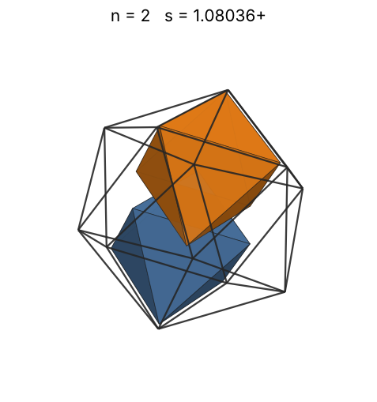 |
| 3 | [1.29397+](octinico_n03.json) | 1.293972680989 |  | 0.86545 | 0.2992 | 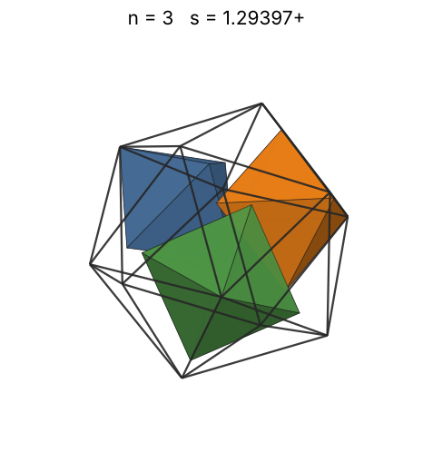 |
| 4 | [1.36155+](octinico_n04.json) | 1.361557615223 |  | 0.95255 | 0.3424 | 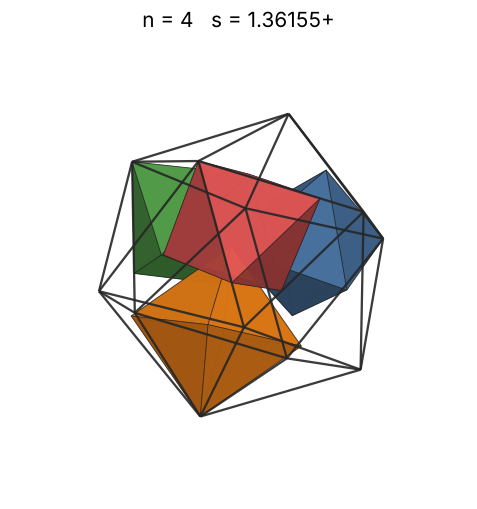 |
| 5 | [1.44205+](octinico_n05.json) | 1.442054869166 |  | 1.02610 | 0.3603 | 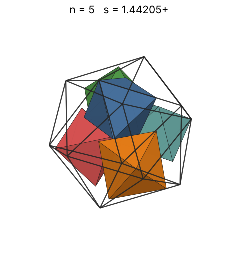 |
| 6 | [1.48797+](octinico_n06.json) | 1.487977365067 |  | 1.09039 | 0.3935 | 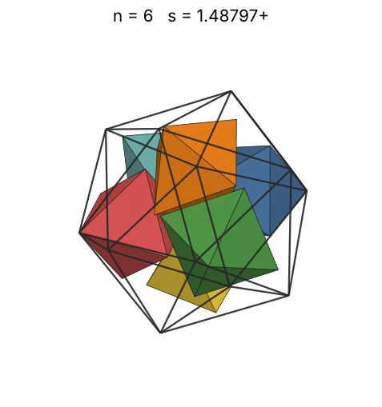 |
| 7 | [1.55165+](octinico_n07.json) | 1.551658376244 |  | 1.14789 | 0.4049 | 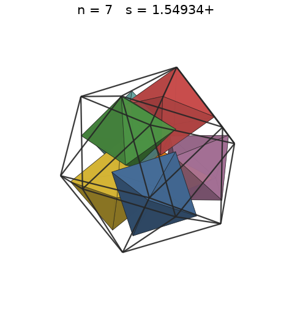 |
| 8 | [1.57683+](octinico_n08.json) | 1.576836240945 |  | 1.20013 | 0.4409 | 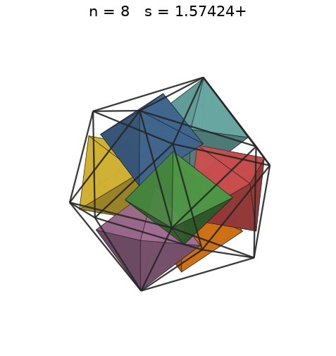 |
| 9 | [1.63098+](octinico_n09.json) | 1.630980935617 |  | 1.24819 | 0.4482 | 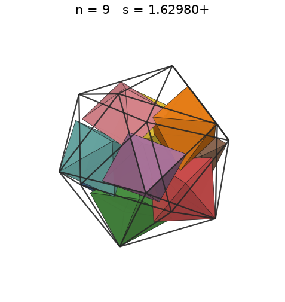 |
| 10 | [1.66820+](octinico_n10.json) | 1.668203649535 |  | 1.29281 | 0.4654 | 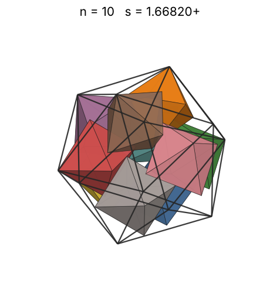 |
| 11 | [1.69435+](octinico_n11.json) | 1.694351467341 |  | 1.33454 | 0.4886 | 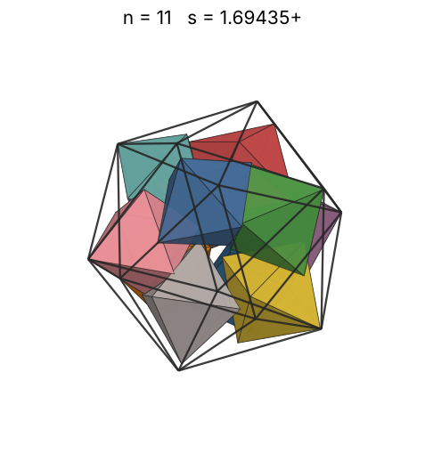 |
| 12 | [1.71440+](octinico_n12.json) | 1.714403156325 |  | 1.37381 | 0.5146 | 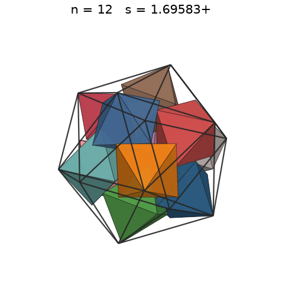 |
| 13 | [1.77174+](octinico_n13.json) | 1.771741198986 |  | 1.41096 | 0.5051 | 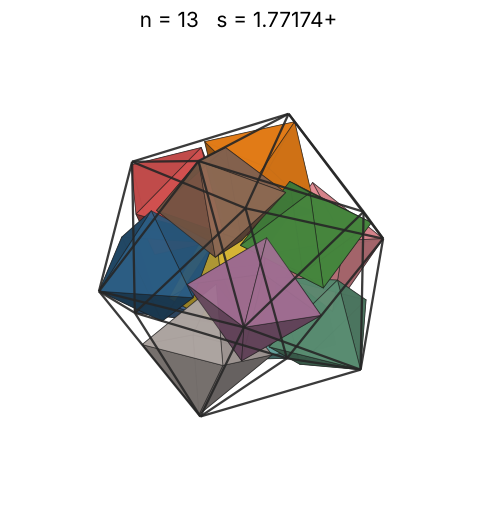 |
| 14 | [1.82070+](octinico_n14.json) | 1.820708838082 |  | 1.44625 | 0.5012 | 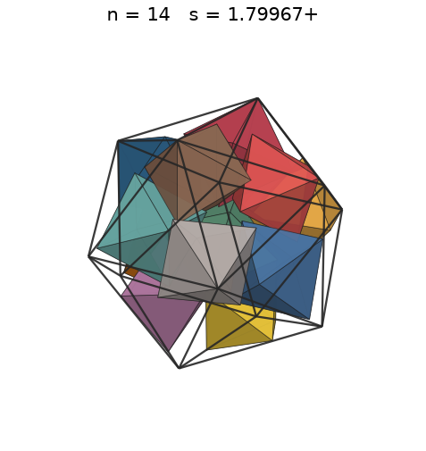 |
| 15 | [1.87438+](octinico_n15.json) | 1.874381757728 |  | 1.47989 | 0.4922 | 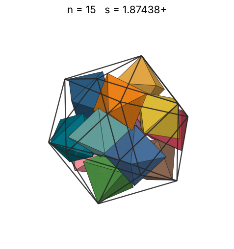 |
| 16 | [1.91395+](octinico_n16.json) | 1.913950115425 |  | 1.51207 | 0.4931 | 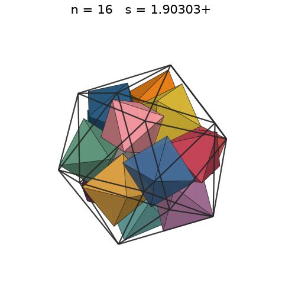 |
| 17 | [1.96813+](octinico_n17.json) | 1.968139109176 |  | 1.54294 | 0.4818 | 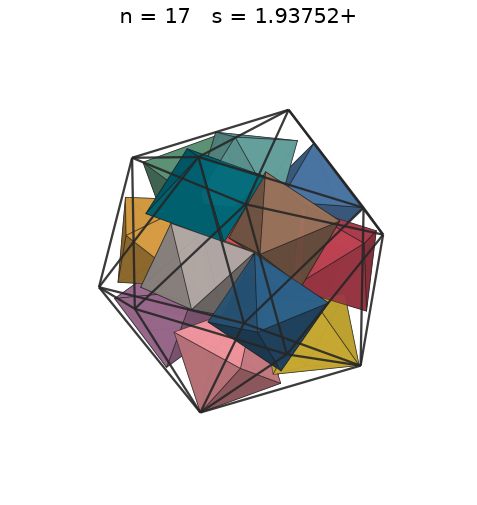 |
| 18 | [2.00221+](octinico_n18.json) | 2.002218392943 |  | 1.57262 | 0.4845 | 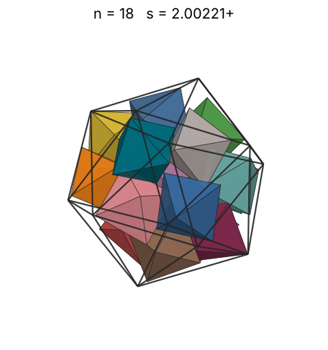 |
| 19 | [2.03391+](octinico_n19.json) | 2.033913132501 |  | 1.60122 | 0.4879 | 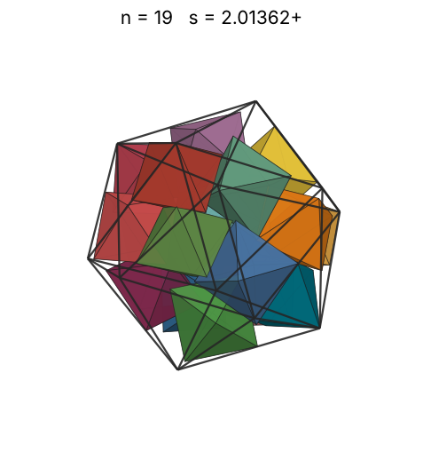 |
| 20 | [2.06222+](octinico_n20.json) | 2.062226747667 |  | 1.62883 | 0.4927 | 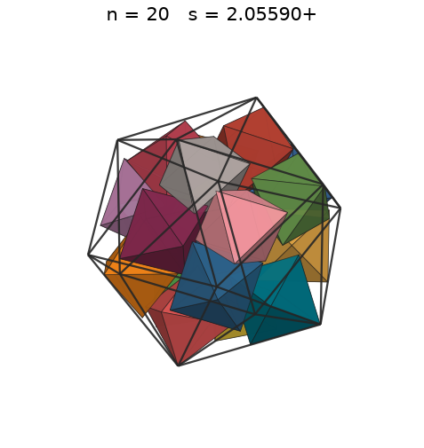 |
| 21 | [2.11395+](octinico_n21.json) | 2.113953407338 |  | 1.65554 | 0.4803 | 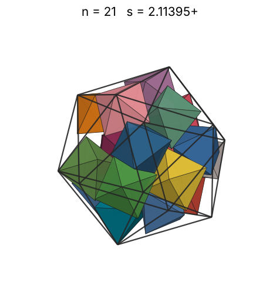 |
| 22 | [2.14547+](octinico_n22.json) | 2.145475670939 |  | 1.68141 | 0.4813 | 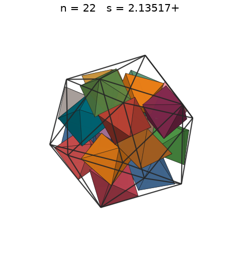 |
| 23 | [2.17681+](octinico_n23.json) | 2.176813806616 |  | 1.70651 | 0.4818 | 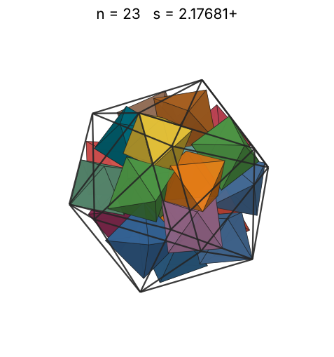 |
| 24 | [2.20955+](octinico_n24.json) | 2.209552746461 |  | 1.73089 | 0.4807 | 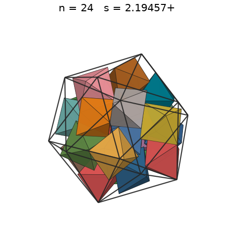 |
| 25 | [2.22299+](octinico_n25.json) | 2.222996920659 |  | 1.75461 | 0.4917 | 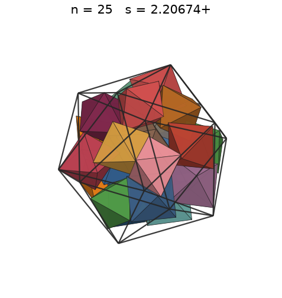 |
| 26 | [2.24960+](octinico_n26.json) | 2.249601394256 |  | 1.77770 | 0.4935 | 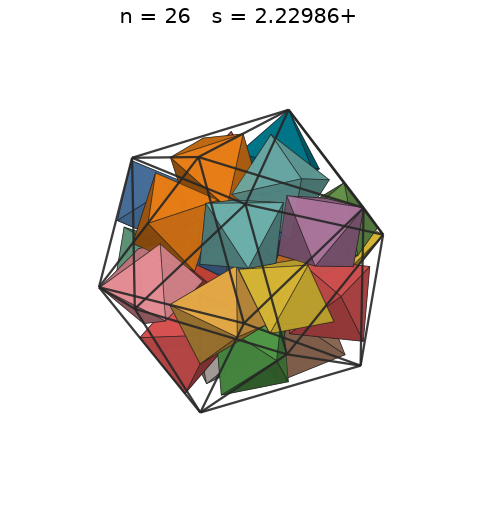 |
| 27 | [2.31988+](octinico_n27.json) | 2.319888730862 |  | 1.80020 | 0.4673 | 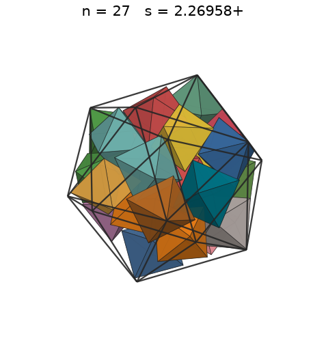 |
| 28 | [2.34337+](octinico_n28.json) | 2.343377229059 |  | 1.82216 | 0.4701 | 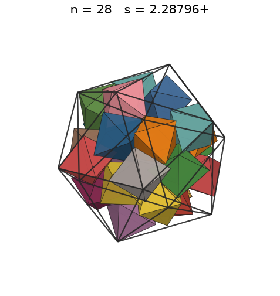 |
| 29 | [2.34766+](octinico_n29.json) | 2.347661538684 |  | 1.84360 | 0.4843 |  |
| 30 | [2.39763+](octinico_n30.json) | 2.397635582124 |  | 1.86455 | 0.4703 | 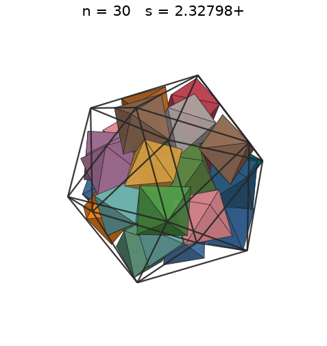 |
| 31 | [2.69362+](octinico_n31.json) | 2.693623610977 |  | 1.88504 | 0.3427 | 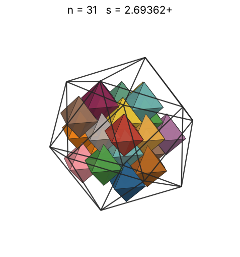 |
| 32 | [2.70091+](octinico_n32.json) | 2.700911888829 |  | 1.90509 | 0.3509 | 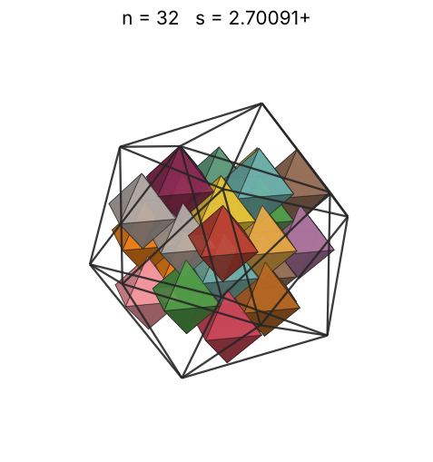 |
| 33 | [2.70091+](octinico_n33.json) | 2.700911888829 |  | 1.92474 | 0.3619 | 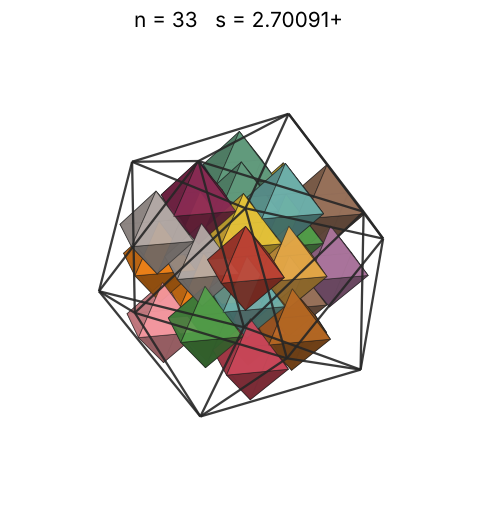 |
| 34 | [2.70091+](octinico_n34.json) | 2.700911888829 |  | 1.94398 | 0.3729 | 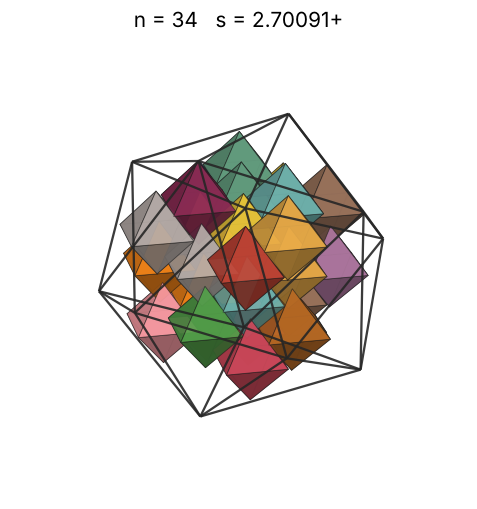 |
| 35 | [2.70091+](octinico_n35.json) | 2.700911888829 |  | 1.96286 | 0.3838 | 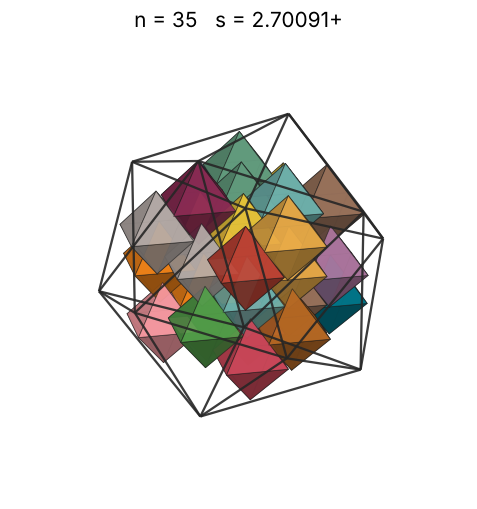 |
| 36 | [2.70317+](octinico_n36.json) | 2.703170174059 |  | 1.98138 | 0.3938 | 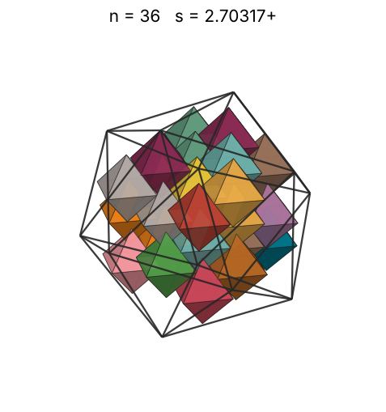 |
| 37 | [2.70317+](octinico_n37.json) | 2.703170174059 |  | 1.99956 | 0.4047 | 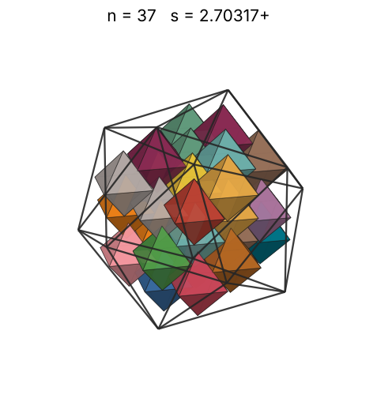 |
| 38 | [2.70553+](octinico_n38.json) | 2.705530679936 |  | 2.01741 | 0.4146 | 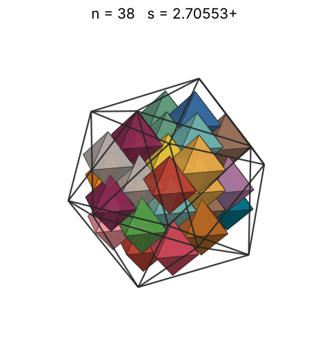 |
| 39 | [2.70940+](octinico_n39.json) | 2.709402793106 |  | 2.03495 | 0.4237 | 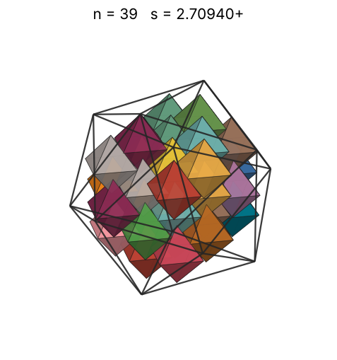 |
| 40 | [2.72475+](octinico_n40.json) | 2.724753045460 |  | 2.05220 | 0.4272 | 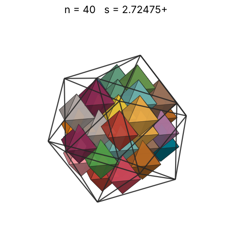 |
