# Octahedra in an octahedron

s = container edge / piece edge; every row certified in exact arithmetic.

| n | s | touching limit | closed form (conj.) | volume bound | density | picture |
|---|---|---|---|---|---|---|
| 2 | [1.93311+](octinoct_n02.json) | 1.933119581160 |  | 1.25992 | 0.2769 | 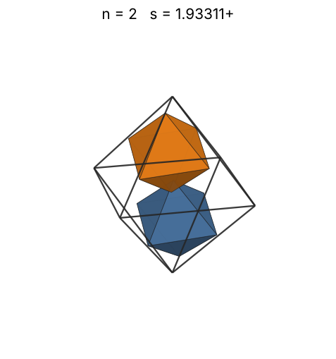 |
| 3 | [2.00000+](octinoct_n03.json) | 2.000000000000 | 2 | 1.44225 | 0.3750 | 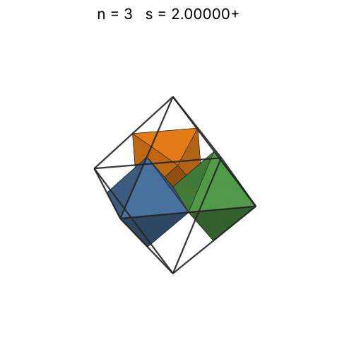 |
| 4 | [2.00000+](octinoct_n04.json) | 2.000000000000 | 2 | 1.58740 | 0.5000 | 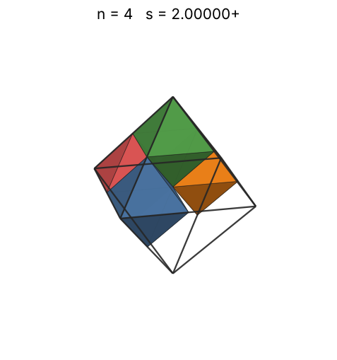 |
| 5 | [2.00000+](octinoct_n05.json) | 2.000000000000 | 2 | 1.70998 | 0.6250 | 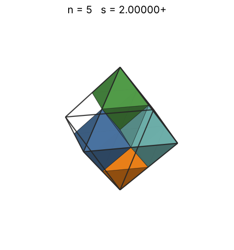 |
| 6 | [2.00000+](octinoct_n06.json) | 2.000000000000 | 2 | 1.81712 | 0.7500 | 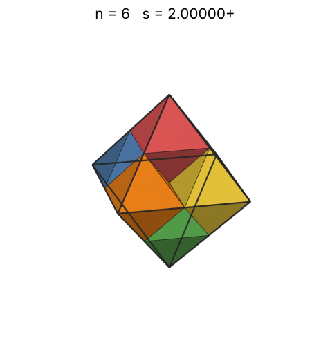 |
| 7 | [2.50000+](octinoct_n07.json) | 2.500000000000 | 5/2 | 1.91293 | 0.4480 | 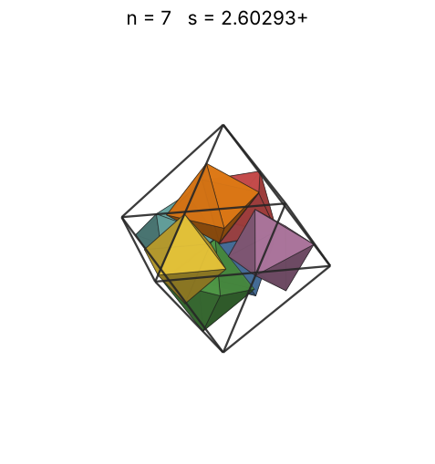 |
| 8 | [2.50000+](octinoct_n08.json) | 2.500000000000 | 5/2 | 2.00000 | 0.5120 | 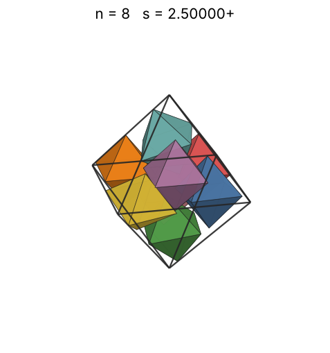 |
| 9 | [2.50000+](octinoct_n09.json) | 2.500000000000 | 5/2 | 2.08008 | 0.5760 | 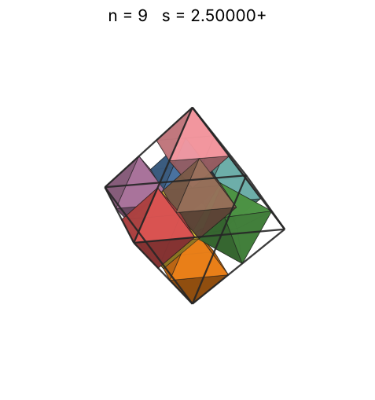 |
| 10 | [2.50000+](octinoct_n10.json) | 2.500000000000 | 5/2 | 2.15443 | 0.6400 | 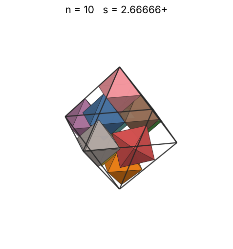 |
| 11 | [2.66666+](octinoct_n11.json) | 2.666666666667 | 8/3 | 2.22398 | 0.5801 | 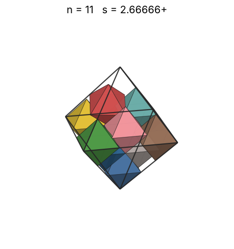 |
| 12 | [2.66666+](octinoct_n12.json) | 2.666666666667 | 8/3 | 2.28943 | 0.6328 |  |
| 13 | [2.83333+](octinoct_n13.json) | 2.833333333333 | 17/6 | 2.35133 | 0.5715 | 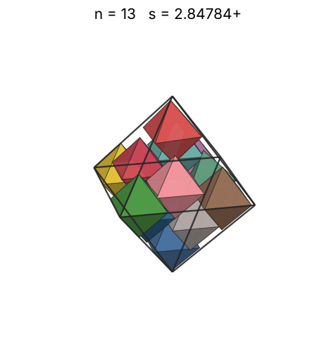 |
| 14 | [2.94311+](octinoct_n14.json) | 2.943117400701 |  | 2.41014 | 0.5492 | 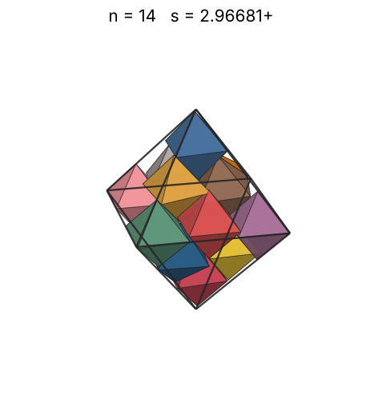 |
| 15 | [2.98533+](octinoct_n15.json) | 2.985331360499 |  | 2.46621 | 0.5638 | 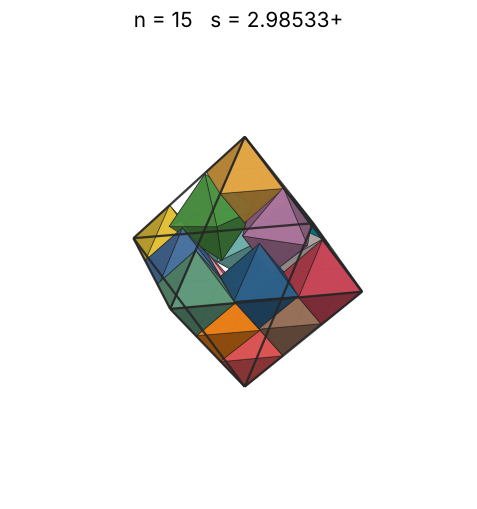 |
| 16 | [2.99465+](octinoct_n16.json) | 2.994651162686 |  | 2.51984 | 0.5958 | 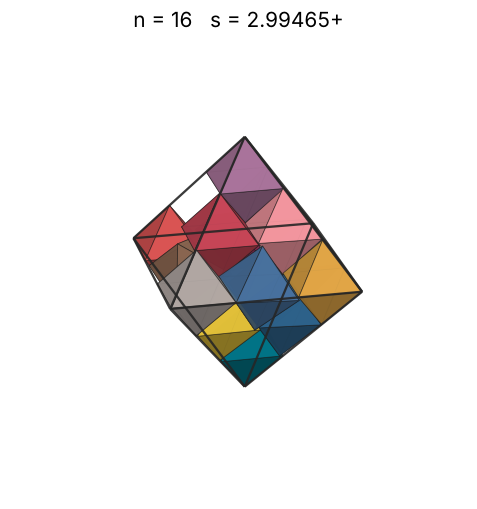 |
| 17 | [3.00000+](octinoct_n17.json) | 3.000000000000 | 3 | 2.57128 | 0.6296 | 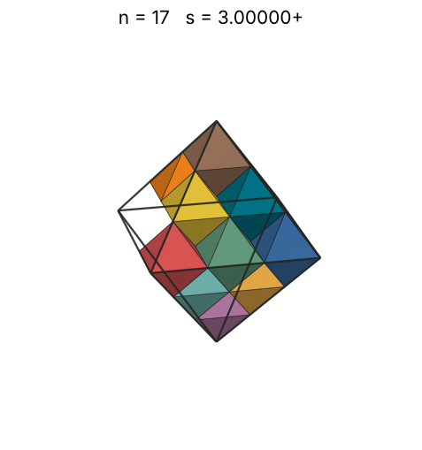 |
| 18 | [3.00000+](octinoct_n18.json) | 3.000000000000 | 3 | 2.62074 | 0.6667 | 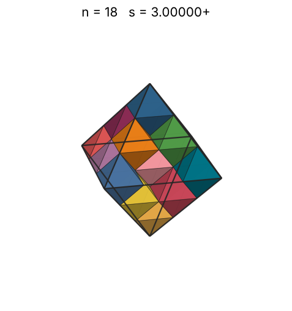 |
| 19 | [3.00000+](octinoct_n19.json) | 3.000000000000 | 3 | 2.66840 | 0.7037 | 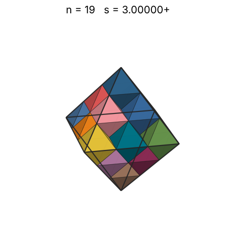 |
| 20 | [3.16653+](octinoct_n20.json) | 3.166536535520 |  | 2.71442 | 0.6299 | 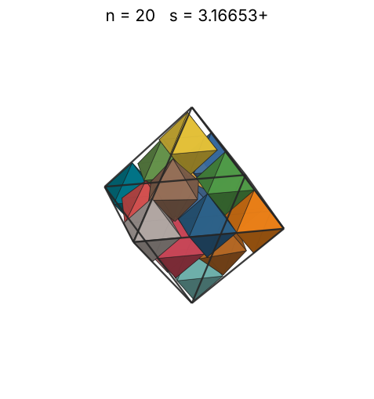 |
| 21 | [3.20000+](octinoct_n21.json) | 3.200000000000 | 16/5 | 2.75892 | 0.6409 | 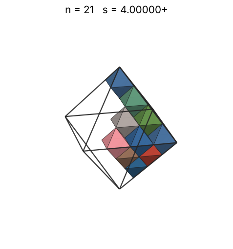 |
| 22 | [3.25000+](octinoct_n22.json) | 3.250000000000 | 13/4 | 2.80204 | 0.6409 | 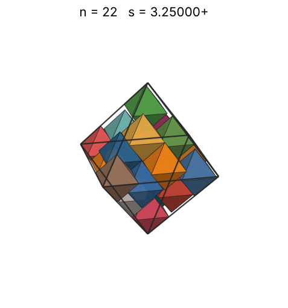 |
| 23 | [3.25000+](octinoct_n23.json) | 3.250000000000 | 13/4 | 2.84387 | 0.6700 | 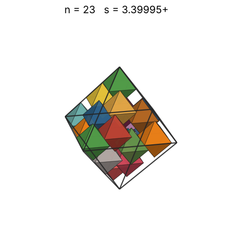 |
| 24 | [3.36363+](octinoct_n24.json) | 3.363636363636 | 37/11 | 2.88450 | 0.6306 | 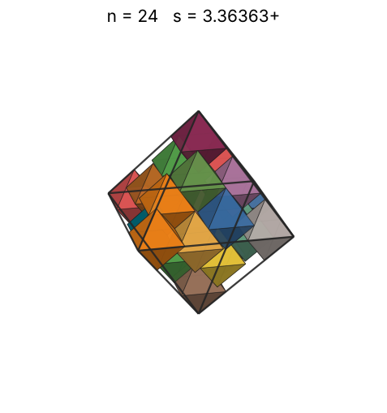 |
| 25 | [3.39983+](octinoct_n25.json) | 3.399829792757 |  | 2.92402 | 0.6362 | 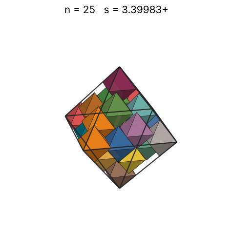 |
| 26 | [3.42857+](octinoct_n26.json) | 3.428571428571 | 24/7 | 2.96250 | 0.6451 | 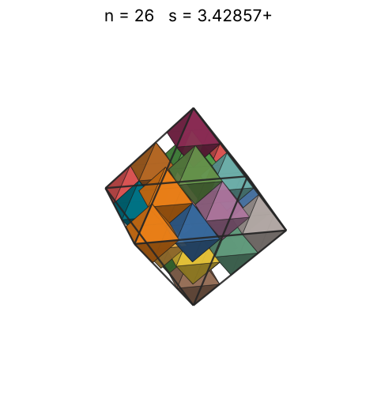 |
| 27 | [3.50000+](octinoct_n27.json) | 3.500000000000 | 7/2 | 3.00000 | 0.6297 | 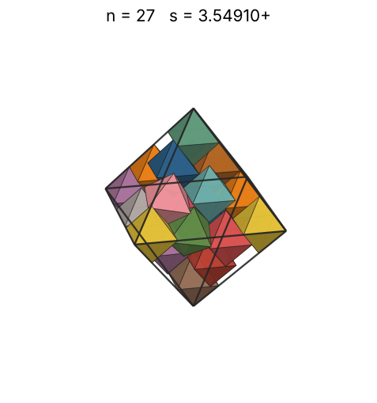 |
| 28 | [3.50000+](octinoct_n28.json) | 3.500000000000 | 7/2 | 3.03659 | 0.6531 | 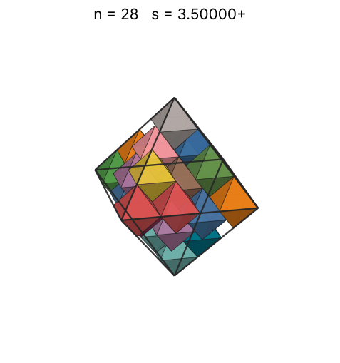 |
| 29 | [3.50000+](octinoct_n29.json) | 3.500000000000 | 7/2 | 3.07232 | 0.6764 | 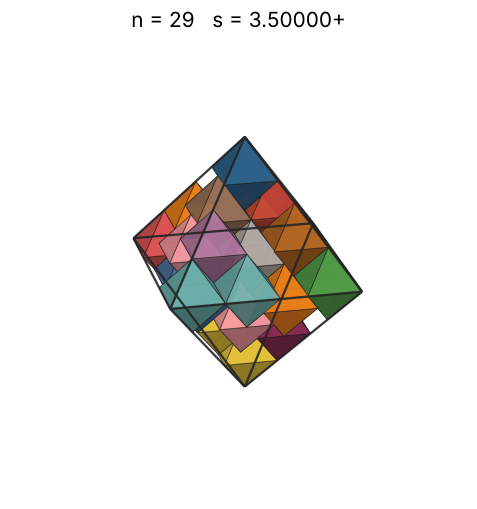 |
| 30 | [3.60000+](octinoct_n30.json) | 3.600000000000 | 18/5 | 3.10723 | 0.6430 | 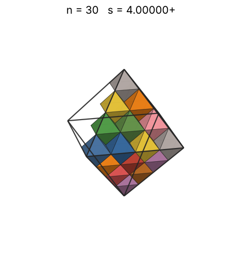 |
| 31 | [3.66666+](octinoct_n31.json) | 3.666666666667 | 11/3 | 3.14138 | 0.6289 | 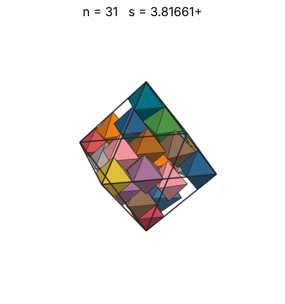 |
| 32 | [3.69230+](octinoct_n32.json) | 3.692307692308 | 48/13 | 3.17480 | 0.6357 | 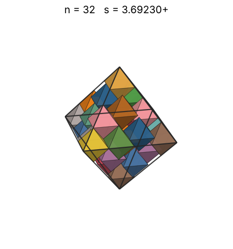 |
| 33 | [3.73684+](octinoct_n33.json) | 3.736842105263 |  | 3.20753 | 0.6324 | 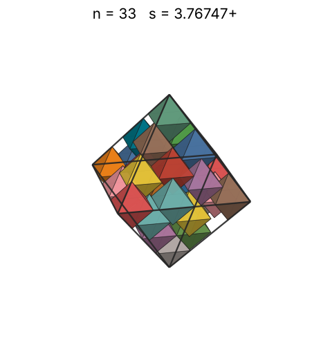 |
| 34 | [3.78844+](octinoct_n34.json) | 3.788446562185 |  | 3.23961 | 0.6253 | 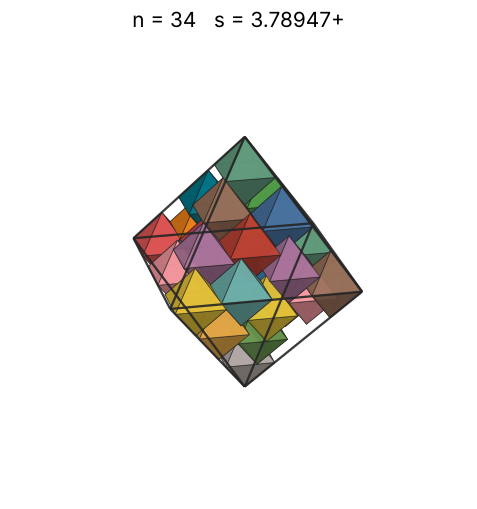 |
| 35 | [3.80000+](octinoct_n35.json) | 3.800000000000 | 19/5 | 3.27107 | 0.6378 | 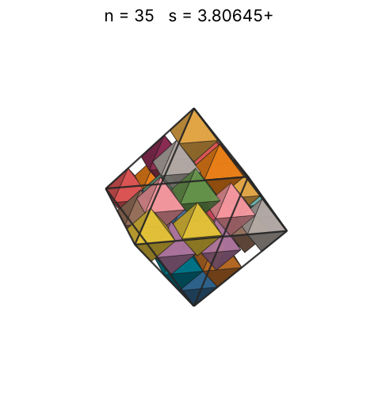 |
| 36 | [3.85433+](octinoct_n36.json) | 3.854335571414 |  | 3.30193 | 0.6287 | 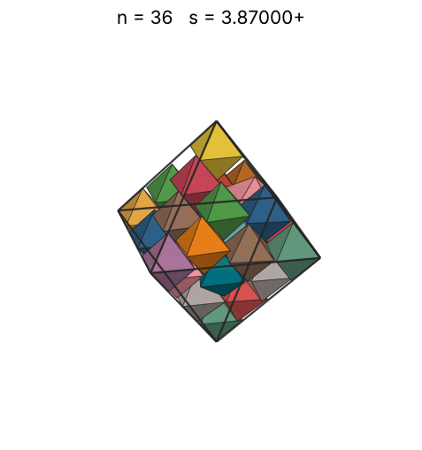 |
| 37 | [3.88376+](octinoct_n37.json) | 3.883760069121 |  | 3.33222 | 0.6316 | 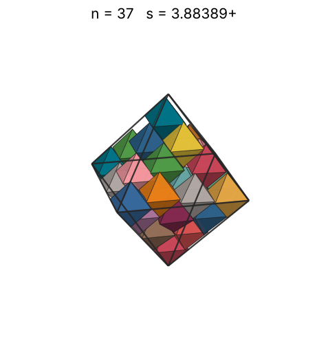 |
| 38 | [3.91696+](octinoct_n38.json) | 3.916963233979 |  | 3.36198 | 0.6323 | 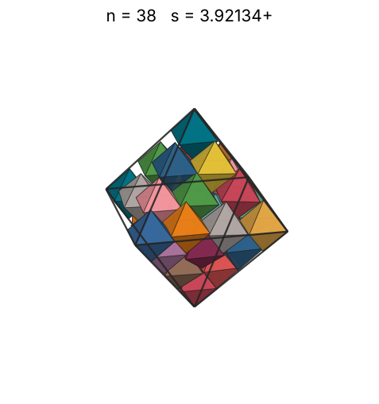 |
| 39 | [3.92959+](octinoct_n39.json) | 3.929589960130 |  | 3.39121 | 0.6427 | 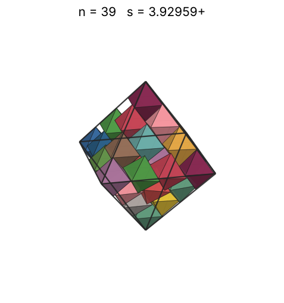 |
| 40 | [3.95554+](octinoct_n40.json) | 3.955547136533 |  | 3.41995 | 0.6463 | 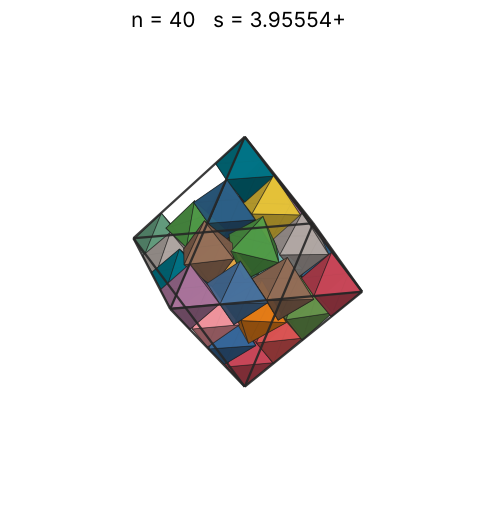 |
| 41 | [3.98275+](octinoct_n41.json) | 3.982755109175 |  | 3.44822 | 0.6490 |  |
| 42 | [3.99013+](octinoct_n42.json) | 3.990131347829 |  | 3.47603 | 0.6611 |  |
| 43 | [3.99416+](octinoct_n43.json) | 3.994165416433 |  | 3.50340 | 0.6748 |  |
| 44 | [3.99517+](octinoct_n44.json) | 3.995174841203 |  | 3.53035 | 0.6900 |  |
| 45 | [4.06338+](octinoct_n45.json) | 4.063387546403 |  | 3.55689 | 0.6707 |  |
| 46 | [4.08154+](octinoct_n46.json) | 4.081541158008 |  | 3.58305 | 0.6765 |  |
| 47 | [4.12721+](octinoct_n47.json) | 4.127212073073 |  | 3.60883 | 0.6685 |  |
| 48 | [4.17805+](octinoct_n48.json) | 4.178057726809 |  | 3.63424 | 0.6581 |  |
| 49 | [4.20329+](octinoct_n49.json) | 4.203293913718 |  | 3.65931 | 0.6598 |  |
| 50 | [4.26187+](octinoct_n50.json) | 4.261873437655 |  | 3.68403 | 0.6459 |  |
| 51 | [4.27623+](octinoct_n51.json) | 4.276239181662 |  | 3.70843 | 0.6522 |  |
| 52 | [4.30860+](octinoct_n52.json) | 4.308604686680 |  | 3.73251 | 0.6501 |  |
| 53 | [4.35347+](octinoct_n53.json) | 4.353479341187 |  | 3.75629 | 0.6423 |  |
| 54 | [4.37500+](octinoct_n54.json) | 4.375000064557 |  | 3.77976 | 0.6449 |  |
| 55 | [4.41624+](octinoct_n55.json) | 4.416239872374 |  | 3.80295 | 0.6386 |  |
| 56 | [4.46183+](octinoct_n56.json) | 4.461832378470 |  | 3.82586 | 0.6304 |  |
| 57 | [4.49089+](octinoct_n57.json) | 4.490891240417 |  | 3.84850 | 0.6293 |  |
| 58 | [4.49933+](octinoct_n58.json) | 4.499329779905 |  | 3.87088 | 0.6368 |  |
| 59 | [4.49933+](octinoct_n59.json) | 4.499329779907 |  | 3.89300 | 0.6478 |  |
| 60 | [4.50000+](octinoct_n60.json) | 4.500000167820 |  | 3.91487 | 0.6584 |  |
| 61 | [4.55202+](octinoct_n61.json) | 4.552022083433 |  | 3.93650 | 0.6467 |  |
| 62 | [4.59144+](octinoct_n62.json) | 4.591448242196 |  | 3.95789 | 0.6405 |  |
| 63 | [4.59911+](octinoct_n63.json) | 4.599117037589 |  | 3.97906 | 0.6476 |  |
| 64 | [4.61159+](octinoct_n64.json) | 4.611592613757 |  | 4.00000 | 0.6526 |  |
| 65 | [4.61159+](octinoct_n65.json) | 4.611592613757 |  | 4.02073 | 0.6628 |  |
| 66 | [4.66611+](octinoct_n66.json) | 4.666109579333 |  | 4.04124 | 0.6496 |  |
| 67 | [4.73832+](octinoct_n67.json) | 4.738322691104 |  | 4.06155 | 0.6298 |  |
| 68 | [4.77435+](octinoct_n68.json) | 4.774356008745 |  | 4.08166 | 0.6248 |  |
| 69 | [4.77435+](octinoct_n69.json) | 4.774356008747 |  | 4.10157 | 0.6340 |  |
| 70 | [4.80724+](octinoct_n70.json) | 4.807242285380 |  | 4.12129 | 0.6301 |  |
| 71 | [4.85247+](octinoct_n71.json) | 4.852476040411 |  | 4.14082 | 0.6214 |  |
| 72 | [4.85578+](octinoct_n72.json) | 4.855789188868 |  | 4.16017 | 0.6289 |  |
| 73 | [4.86683+](octinoct_n73.json) | 4.866833689987 |  | 4.17934 | 0.6333 |  |
| 74 | [4.91966+](octinoct_n74.json) | 4.919662625400 |  | 4.19834 | 0.6215 |  |
| 75 | [4.93143+](octinoct_n75.json) | 4.931429376177 |  | 4.21716 | 0.6254 |  |
| 76 | [4.93260+](octinoct_n76.json) | 4.932600483958 |  | 4.23582 | 0.6333 |  |
| 77 | [4.93541+](octinoct_n77.json) | 4.935412257030 |  | 4.25432 | 0.6405 |  |
| 78 | [4.94141+](octinoct_n78.json) | 4.941411811874 |  | 4.27266 | 0.6465 |  |
| 79 | [4.94214+](octinoct_n79.json) | 4.942147838080 |  | 4.29084 | 0.6545 |  |
| 80 | [4.95357+](octinoct_n80.json) | 4.953578869083 |  | 4.30887 | 0.6582 |  |
| 81 | [4.95357+](octinoct_n81.json) | 4.953578869108 |  | 4.32675 | 0.6664 |  |
| 82 | [4.95357+](octinoct_n82.json) | 4.953578869213 |  | 4.34448 | 0.6746 |  |
| 83 | [4.95357+](octinoct_n83.json) | 4.953578869668 |  | 4.36207 | 0.6828 |  |
| 84 | [4.95846+](octinoct_n84.json) | 4.958467853226 |  | 4.37952 | 0.6890 |  |
| 85 | [4.96896+](octinoct_n85.json) | 4.968963850182 |  | 4.39683 | 0.6928 |  |
| 86 | [5.04282+](octinoct_n86.json) | 5.042827306962 |  | 4.41400 | 0.6706 |  |
| 87 | [5.06739+](octinoct_n87.json) | 5.067393239883 |  | 4.43105 | 0.6686 |  |
| 88 | [5.10396+](octinoct_n88.json) | 5.103967572069 |  | 4.44796 | 0.6618 |  |
| 89 | [5.13076+](octinoct_n89.json) | 5.130761969274 |  | 4.46475 | 0.6589 |  |
| 90 | [5.18505+](octinoct_n90.json) | 5.185057380777 |  | 4.48140 | 0.6456 |  |
| 91 | [5.20600+](octinoct_n91.json) | 5.206000687554 |  | 4.49794 | 0.6450 |  |
| 92 | [5.26598+](octinoct_n92.json) | 5.265986323888 |  | 4.51436 | 0.6300 |  |
| 93 | [5.27414+](octinoct_n93.json) | 5.274146711469 |  | 4.53065 | 0.6339 |  |
| 94 | [5.27414+](octinoct_n94.json) | 5.274146711526 |  | 4.54684 | 0.6407 |  |
| 95 | [5.63299+](octinoct_n95.json) | 5.632993415742 |  | 4.56290 | 0.5315 |  |
| 96 | [5.98930+](octinoct_n96.json) | 5.989302325379 |  | 4.57886 | 0.4468 |  |
| 97 | [6.00000+](octinoct_n97.json) | 6.000000000000 | 6 | 4.59470 | 0.4491 |  |
| 98 | [6.00000+](octinoct_n98.json) | 6.000000000000 | 6 | 4.61044 | 0.4537 |  |
| 99 | [6.00000+](octinoct_n99.json) | 6.000000000000 | 6 | 4.62607 | 0.4583 |  |
| 100 | [6.00000+](octinoct_n100.json) | 6.000000000000 | 6 | 4.64159 | 0.4630 |  |
