# Octahedra in a tetrahedron

s = container edge / piece edge; every row certified in exact arithmetic.

| n | s | touching limit | closed form (conj.) | volume bound | density | picture |
|---|---|---|---|---|---|---|
| 2 | [3.00000+](octintet_n02.json) | 3.000000122491 | 3 | 2.00000 | 0.2963 | 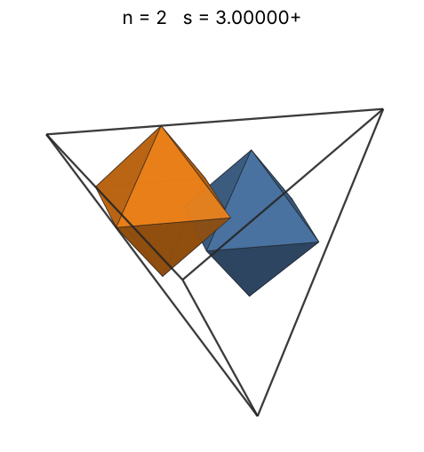 |
| 3 | [3.00000+](octintet_n03.json) | 3.000000122545 | 3 | 2.28943 | 0.4444 | 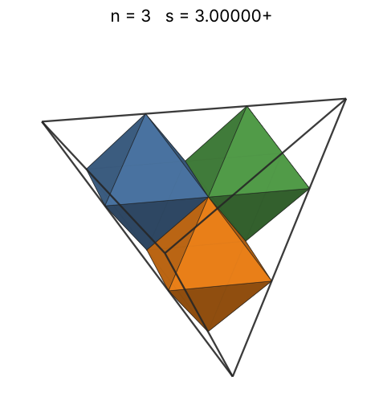 |
| 4 | [3.00000+](octintet_n04.json) | 3.000000122573 | 3 | 2.51984 | 0.5926 | 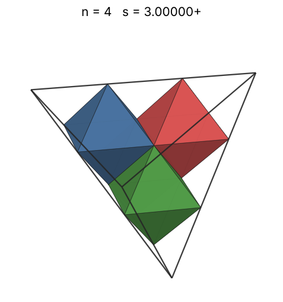 |
| 5 | [3.33333+](octintet_n05.json) | 3.333333496633 | 10/3 | 2.71442 | 0.5400 | 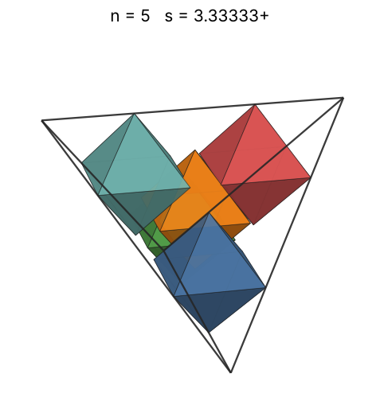 |
| 6 | [3.85501+](octintet_n06.json) | 3.855018795507 | -√(-2·(481422817√479/15768432 + 524213528365/567663552)··(1/3) - 50777449/(342792·(481422817√479/15768432 + 524213528365/567663552)··(1/3)) + 113999311/(146004√(50777449/(342792·(481422817√479/15768432 + 524213528365/567663552)··(1/3)) + 2·(481422817√479/15768432 + 524213528365/567663552)··(1/3) + 1092133/19044)) + 1092133/9522)/2 + √(50777449/(342792·(481422817√479/15768432 + 524213528365/567663552)··(1/3)) + 2·(481422817√479/15768432 + 524213528365/567663552)··(1/3) + 1092133/19044)/2 + 491/92 | 2.88450 | 0.4189 | 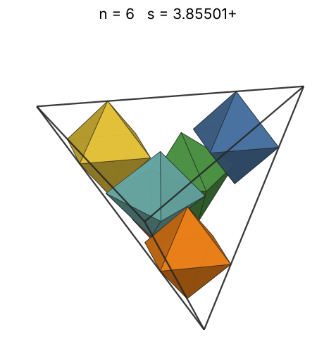 |
| 7 | [4.00000+](octintet_n07.json) | 4.000000245543 | 4 | 3.03659 | 0.4375 | 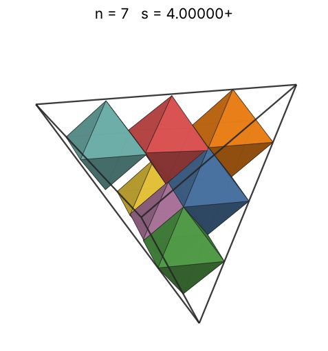 |
| 8 | [4.00000+](octintet_n08.json) | 4.000000245871 | 4 | 3.17480 | 0.5000 | 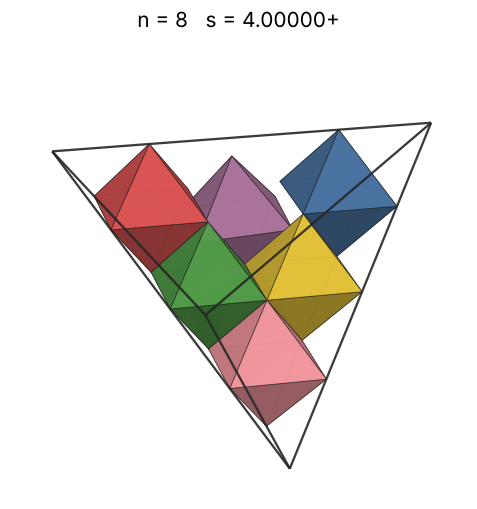 |
| 9 | [4.00000+](octintet_n09.json) | 4.000000246547 | 4 | 3.30193 | 0.5625 | 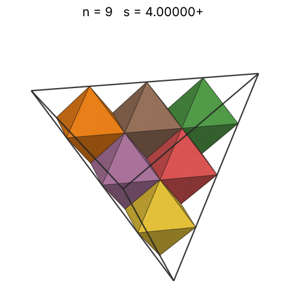 |
| 10 | [4.00000+](octintet_n10.json) | 4.000000247291 | 4 | 3.41995 | 0.6250 | 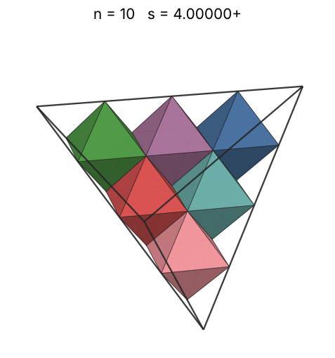 |
| 11 | [4.33333+](octintet_n11.json) | 4.333333668566 | 13/3 | 3.53035 | 0.5407 | 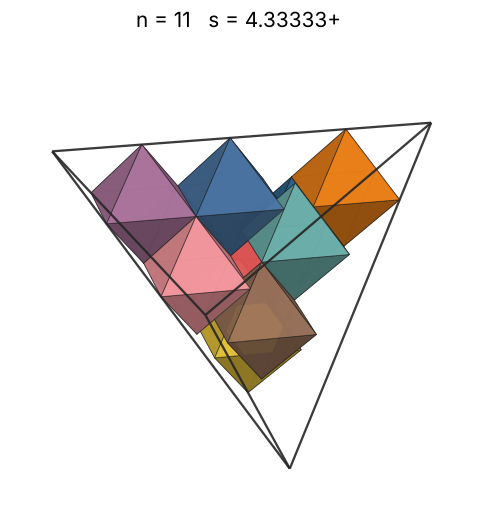 |
| 12 | [4.40000+](octintet_n12.json) | 4.400000349783 | 22/5 | 3.63424 | 0.5635 | 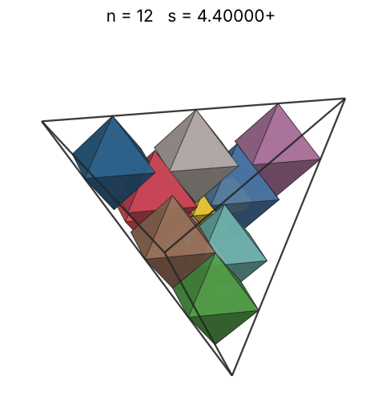 |
| 13 | [4.50000+](octintet_n13.json) | 4.500000326414 | 9/2 | 3.73251 | 0.5706 | 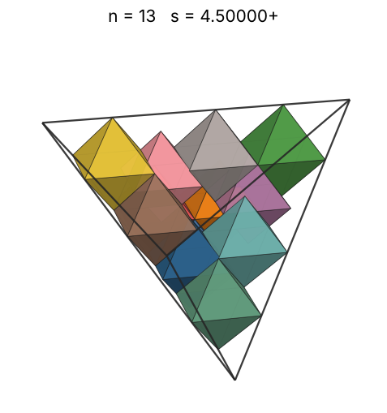 |
| 14 | [4.66666+](octintet_n14.json) | 4.666666994020 | 14/3 | 3.82586 | 0.5510 | 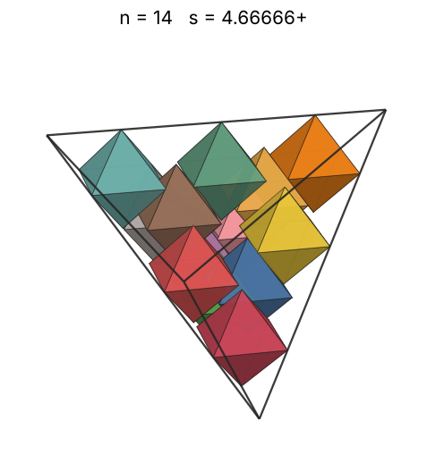 |
| 15 | [4.80833+](octintet_n15.json) | 4.808332266584 |  | 3.91487 | 0.5397 | 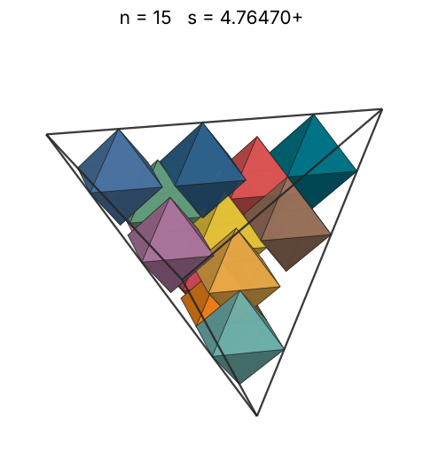 |
| 16 | [4.96309+](octintet_n16.json) | 4.963096514294 |  | 4.00000 | 0.5235 | 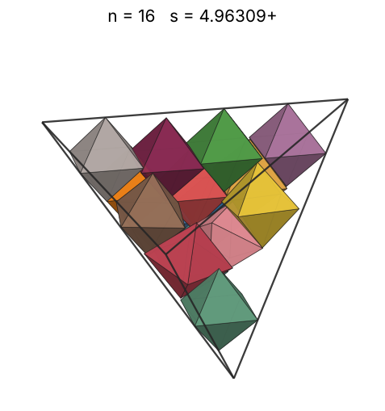 |
| 17 | [4.99849+](octintet_n17.json) | 4.998491384790 |  | 4.08166 | 0.5445 | 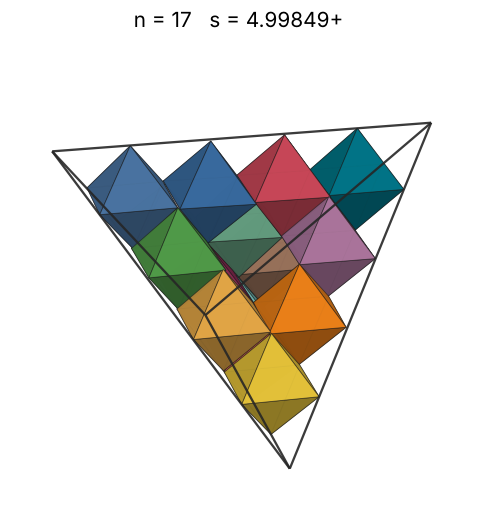 |
| 18 | [5.00000+](octintet_n18.json) | 5.000001192248 | 5 | 4.16017 | 0.5760 | 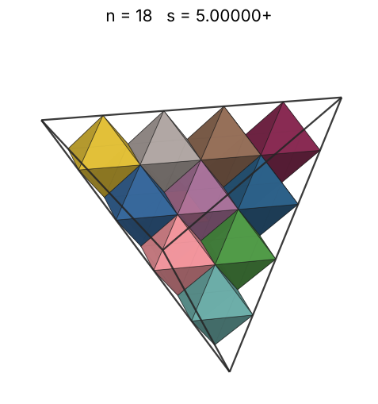 |
| 19 | [5.00001+](octintet_n19.json) | 5.000014871370 |  | 4.23582 | 0.6080 | 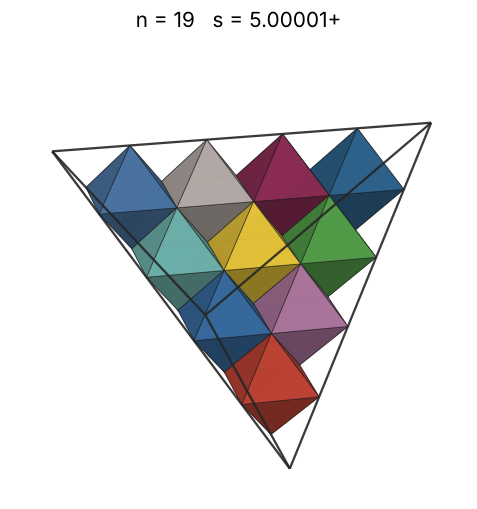 |
| 20 | [5.00001+](octintet_n20.json) | 5.000016040380 |  | 4.30887 | 0.6400 | 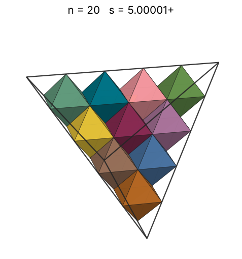 |
| 21 | [5.16668+](octintet_n21.json) | 5.166682020095 |  | 4.37952 | 0.6090 | 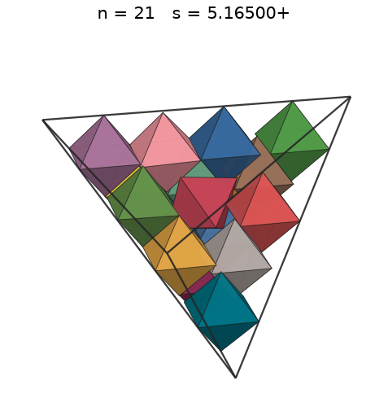 |
| 22 | [5.37449+](octintet_n22.json) | 5.374496794273 |  | 4.44796 | 0.5669 | 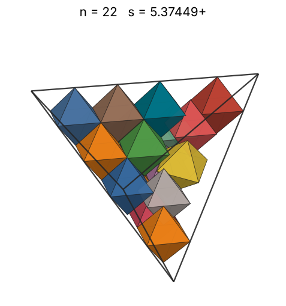 |
| 23 | [5.43992+](octintet_n23.json) | 5.439921384818 |  | 4.51436 | 0.5715 | 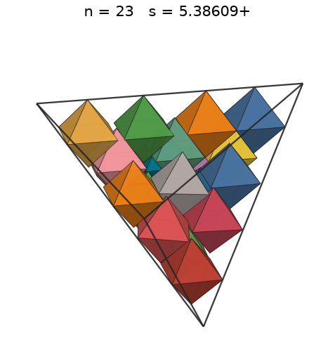 |
| 24 | [5.50027+](octintet_n24.json) | 5.500277896638 |  | 4.57886 | 0.5769 | 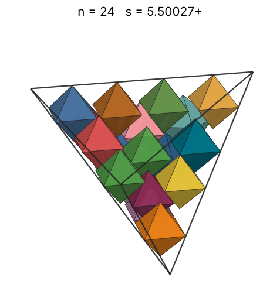 |
| 25 | [5.55557+](octintet_n25.json) | 5.555573735236 |  | 4.64159 | 0.5832 | 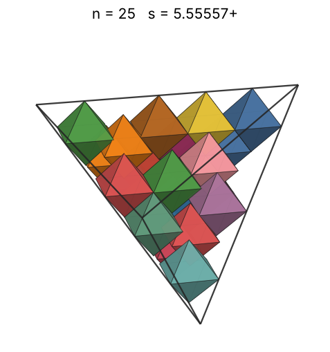 |
| 26 | [5.85432+](octintet_n26.json) | 5.854321490349 |  | 4.70267 | 0.5183 | 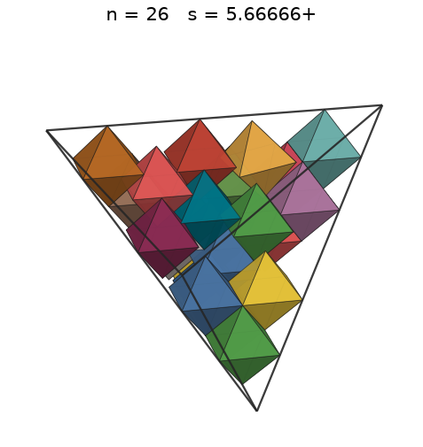 |
| 27 | [5.85432+](octintet_n27.json) | 5.854321749043 |  | 4.76220 | 0.5383 | 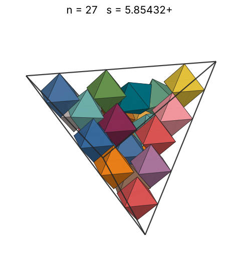 |
| 28 | [5.99139+](octintet_n28.json) | 5.991393722735 |  | 4.82028 | 0.5208 | 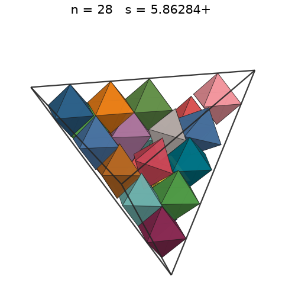 |
| 29 | [5.99139+](octintet_n29.json) | 5.991394478680 |  | 4.87700 | 0.5394 | 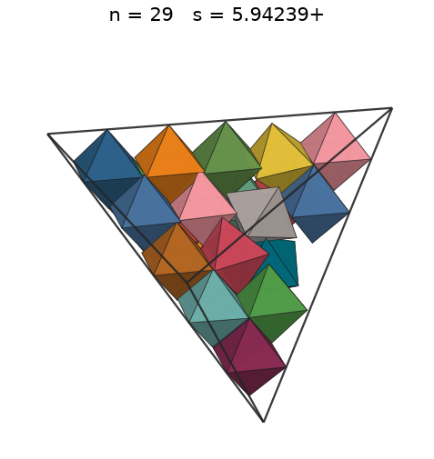 |
| 30 | [6.11844+](octintet_n30.json) | 6.118445272684 |  | 4.93242 | 0.5239 | 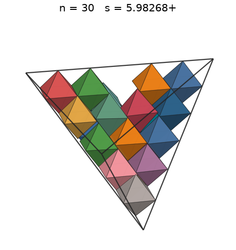 |
| 31 | [6.42857+](octintet_n31.json) | 6.428571428572 | 45/7 | 4.98663 | 0.4667 | 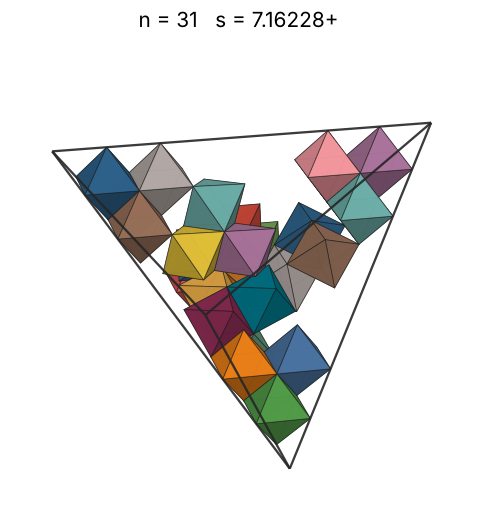 |
| 32 | [6.42857+](octintet_n32.json) | 6.428571428572 | 45/7 | 5.03968 | 0.4818 | 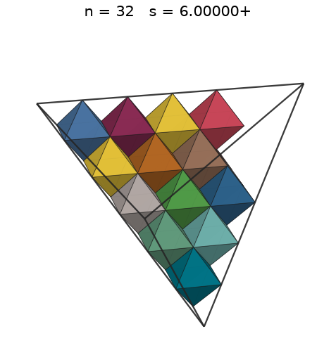 |
| 33 | [6.42857+](octintet_n33.json) | 6.428571428572 | 45/7 | 5.09164 | 0.4969 | 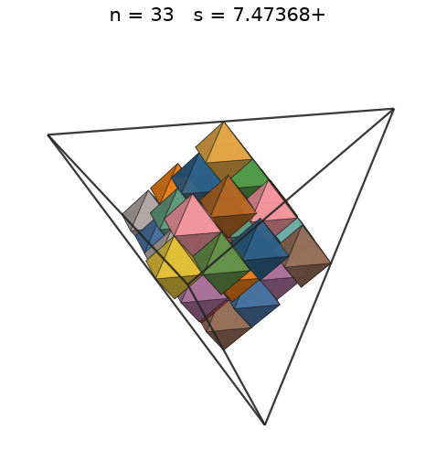 |
| 34 | [6.42857+](octintet_n34.json) | 6.428571428572 | 45/7 | 5.14256 | 0.5119 | 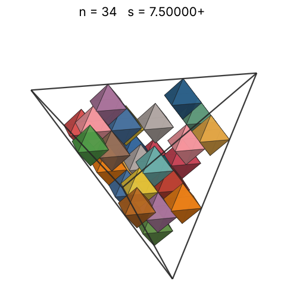 |
| 35 | [6.42857+](octintet_n35.json) | 6.428571428572 | 45/7 | 5.19249 | 0.5270 | 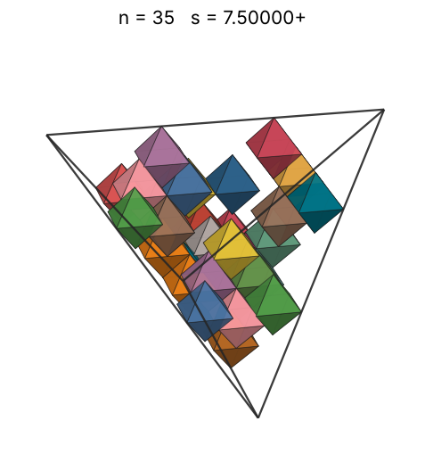 |
| 36 | [6.42857+](octintet_n36.json) | 6.428571428572 | 45/7 | 5.24148 | 0.5420 | 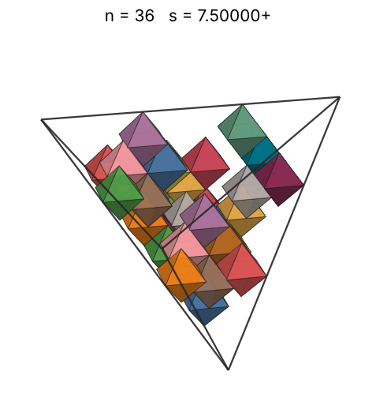 |
| 37 | [6.42857+](octintet_n37.json) | 6.428571428572 | 45/7 | 5.28957 | 0.5571 | 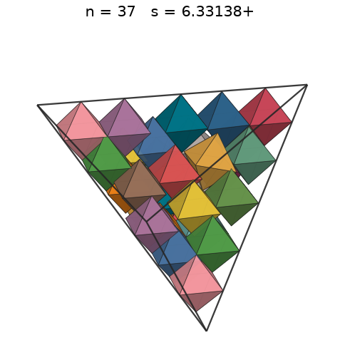 |
| 38 | [6.42857+](octintet_n38.json) | 6.428571428572 | 45/7 | 5.33680 | 0.5721 | 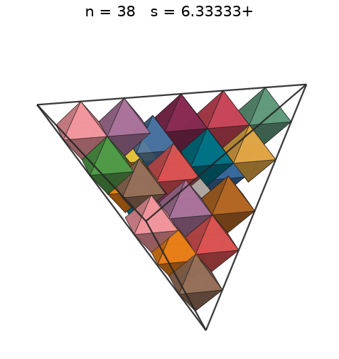 |
| 39 | [6.42857+](octintet_n39.json) | 6.428571428572 | 45/7 | 5.38321 | 0.5872 | 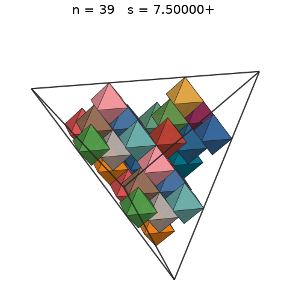 |
| 40 | [6.42857+](octintet_n40.json) | 6.428571428572 | 45/7 | 5.42884 | 0.6022 |  |
| 41 | [6.42857+](octintet_n41.json) | 6.428571428572 | 45/7 | 5.47370 | 0.6173 |  |
| 42 | [6.45642+](octintet_n42.json) | 6.456423521585 |  | 5.51785 | 0.6242 |  |
| 43 | [6.50000+](octintet_n43.json) | 6.500000000000 | 13/2 | 5.56130 | 0.6263 |  |
| 44 | [6.50000+](octintet_n44.json) | 6.500000000000 | 13/2 | 5.60408 | 0.6409 |  |
| 45 | [6.62500+](octintet_n45.json) | 6.625000014528 | 53/8 | 5.64622 | 0.6190 |  |
| 46 | [6.69596+](octintet_n46.json) | 6.695960822103 |  | 5.68773 | 0.6129 |  |
| 47 | [6.78767+](octintet_n47.json) | 6.787674045003 |  | 5.72865 | 0.6012 |  |
| 48 | [6.84331+](octintet_n48.json) | 6.843309575704 |  | 5.76900 | 0.5991 |  |
| 49 | [6.89230+](octintet_n49.json) | 6.892305764832 |  | 5.80879 | 0.5986 |  |
| 50 | [6.90049+](octintet_n50.json) | 6.900498115904 |  | 5.84804 | 0.6087 |  |
| 51 | [6.90049+](octintet_n51.json) | 6.900498115905 |  | 5.88677 | 0.6209 |  |
| 52 | [6.91397+](octintet_n52.json) | 6.913975539155 |  | 5.92499 | 0.6293 |  |
| 53 | [6.95237+](octintet_n53.json) | 6.952375601618 |  | 5.96273 | 0.6309 |  |
| 54 | [6.98391+](octintet_n54.json) | 6.983911811978 |  | 6.00000 | 0.6341 |  |
| 55 | [6.99521+](octintet_n55.json) | 6.995217768074 |  | 6.03681 | 0.6427 |  |
| 56 | [6.99569+](octintet_n56.json) | 6.995697459408 |  | 6.07318 | 0.6543 |  |
| 57 | [7.04738+](octintet_n57.json) | 7.047386230951 |  | 6.10911 | 0.6514 |  |
| 58 | [7.11649+](octintet_n58.json) | 7.116491143130 |  | 6.14463 | 0.6437 |  |
| 59 | [7.15332+](octintet_n59.json) | 7.153325688815 |  | 6.17975 | 0.6447 |  |
| 60 | [7.20140+](octintet_n60.json) | 7.201407051658 |  | 6.21447 | 0.6426 |  |
| 61 | [7.22893+](octintet_n61.json) | 7.228932890655 |  | 6.24880 | 0.6459 |  |
| 62 | [7.27769+](octintet_n62.json) | 7.277696388649 |  | 6.28276 | 0.6434 |  |
| 63 | [7.38623+](octintet_n63.json) | 7.386236629435 |  | 6.31636 | 0.6254 |  |
| 64 | [7.39186+](octintet_n64.json) | 7.391867654407 |  | 6.34960 | 0.6338 |  |
| 65 | [7.42528+](octintet_n65.json) | 7.425287935108 |  | 6.38250 | 0.6351 |  |
| 66 | [7.44174+](octintet_n66.json) | 7.441746998967 |  | 6.41507 | 0.6406 |  |
| 67 | [7.49537+](octintet_n67.json) | 7.495374651591 |  | 6.44731 | 0.6364 |  |
| 68 | [7.49985+](octintet_n68.json) | 7.499853260585 |  | 6.47922 | 0.6448 |  |
| 69 | [7.55555+](octintet_n69.json) | 7.555555555556 | 68/9 | 6.51083 | 0.6399 |  |
| 70 | [7.68012+](octintet_n70.json) | 7.680123110205 |  | 6.54213 | 0.6181 |  |
| 71 | [7.73502+](octintet_n71.json) | 7.735028433708 |  | 6.57314 | 0.6137 |  |
| 72 | [7.80197+](octintet_n72.json) | 7.801974350058 |  | 6.60385 | 0.6064 |  |
| 73 | [7.81345+](octintet_n73.json) | 7.813449855189 |  | 6.63429 | 0.6121 |  |
| 74 | [7.85500+](octintet_n74.json) | 7.855007170014 |  | 6.66444 | 0.6107 |  |
| 75 | [7.87165+](octintet_n75.json) | 7.871655758053 |  | 6.69433 | 0.6151 |  |
| 76 | [7.87165+](octintet_n76.json) | 7.871655789653 |  | 6.72395 | 0.6233 |  |
| 77 | [7.89078+](octintet_n77.json) | 7.890786795475 |  | 6.75331 | 0.6269 |  |
| 78 | [7.91013+](octintet_n78.json) | 7.910135230986 |  | 6.78242 | 0.6304 |  |
| 79 | [7.91345+](octintet_n79.json) | 7.913455655641 |  | 6.81128 | 0.6377 |  |
| 80 | [7.91345+](octintet_n80.json) | 7.913455655688 |  | 6.83990 | 0.6457 |  |
| 81 | [7.96246+](octintet_n81.json) | 7.962460000539 |  | 6.86829 | 0.6418 |  |
| 82 | [7.96878+](octintet_n82.json) | 7.968786840529 |  | 6.89643 | 0.6482 |  |
| 83 | [8.00000+](octintet_n83.json) | 8.000000342129 |  | 6.92436 | 0.6484 |  |
| 84 | [8.06349+](octintet_n84.json) | 8.063493557873 |  | 6.95205 | 0.6409 |  |
| 85 | [8.12951+](octintet_n85.json) | 8.129518375736 |  | 6.97953 | 0.6328 |  |
| 86 | [8.13909+](octintet_n86.json) | 8.139091104748 |  | 7.00680 | 0.6380 |  |
| 87 | [8.17859+](octintet_n87.json) | 8.178592470388 |  | 7.03385 | 0.6361 |  |
| 88 | [8.19920+](octintet_n88.json) | 8.199201541652 |  | 7.06070 | 0.6386 |  |
| 89 | [8.20342+](octintet_n89.json) | 8.203422355934 |  | 7.08734 | 0.6449 |  |
| 90 | [8.24977+](octintet_n90.json) | 8.249777991672 |  | 7.11379 | 0.6412 |  |
| 91 | [8.26906+](octintet_n91.json) | 8.269065768618 |  | 7.14004 | 0.6438 |  |
| 92 | [8.31326+](octintet_n92.json) | 8.313265638658 |  | 7.16610 | 0.6405 |  |
| 93 | [8.36081+](octintet_n93.json) | 8.360815090124 |  | 7.19197 | 0.6365 |  |
| 94 | [8.38278+](octintet_n94.json) | 8.382780812635 |  | 7.21765 | 0.6383 |  |
| 95 | [8.51126+](octintet_n95.json) | 8.511264975625 |  | 7.24316 | 0.6163 |  |
| 96 | [8.53223+](octintet_n96.json) | 8.532234122199 |  | 7.26848 | 0.6182 |  |
| 97 | [8.70640+](octintet_n97.json) | 8.706406805581 |  | 7.29363 | 0.5879 |  |
| 98 | [9.99698+](octintet_n98.json) | 9.996982769581 |  | 7.31861 | 0.3924 |  |
| 99 | [9.99698+](octintet_n99.json) | 9.996982769581 |  | 7.34342 | 0.3964 |  |
| 100 | [9.99698+](octintet_n100.json) | 9.996982769581 |  | 7.36806 | 0.4004 |  |
