# Octahedra in a tetrahedron

s = container edge / piece edge; every row certified in exact arithmetic.

| n | s | touching limit | closed form (conj.) | volume bound | density | picture |
|---|---|---|---|---|---|---|
| 2 | [3.00000+](octintet_n02.json) | 3.000000122491 | 3 | 2.00000 | 0.2963 | 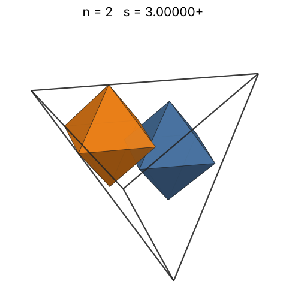 |
| 3 | [3.00000+](octintet_n03.json) | 3.000000122545 | 3 | 2.28943 | 0.4444 | 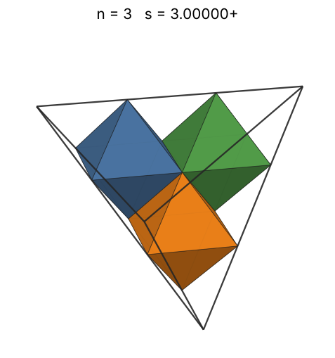 |
| 4 | [3.00000+](octintet_n04.json) | 3.000000122573 | 3 | 2.51984 | 0.5926 | 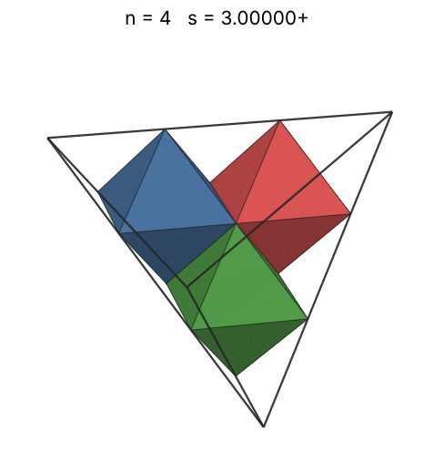 |
| 5 | [3.33333+](octintet_n05.json) | 3.333333496633 | 10/3 | 2.71442 | 0.5400 | 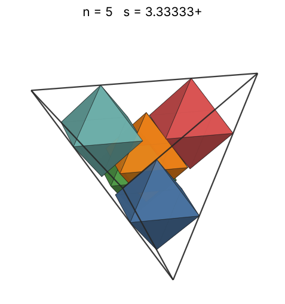 |
| 6 | [3.85501+](octintet_n06.json) | 3.855018795507 | -√(-2·(481422817√479/15768432 + 524213528365/567663552)^(1/3) - 50777449/(342792·(481422817√479/15768432 + 524213528365/567663552)^(1/3)) + 113999311/(146004√(50777449/(342792·(481422817√479/15768432 + 524213528365/567663552)^(1/3)) + 2·(481422817√479/15768432 + 524213528365/567663552)^(1/3) + 1092133/19044)) + 1092133/9522)/2 + √(50777449/(342792·(481422817√479/15768432 + 524213528365/567663552)^(1/3)) + 2·(481422817√479/15768432 + 524213528365/567663552)^(1/3) + 1092133/19044)/2 + 491/92 | 2.88450 | 0.4189 | 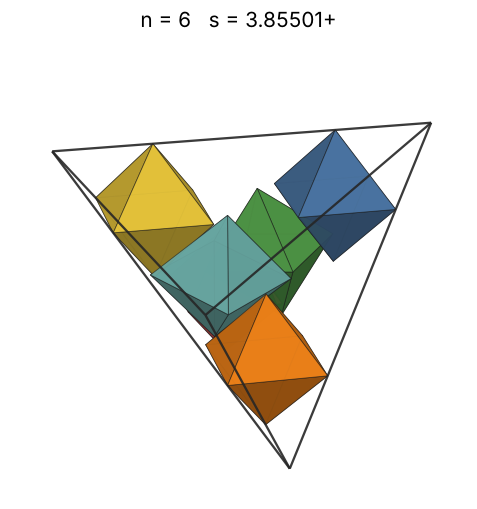 |
| 7 | [4.00000+](octintet_n07.json) | 4.000000245543 | 4 | 3.03659 | 0.4375 | 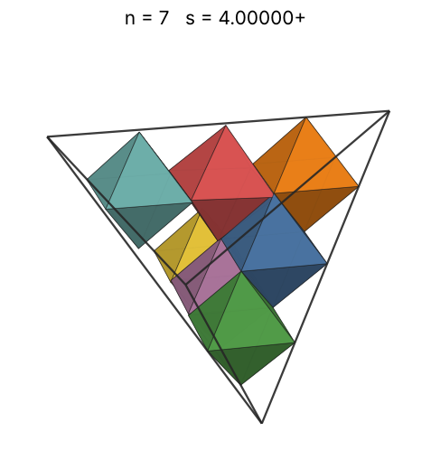 |
| 8 | [4.00000+](octintet_n08.json) | 4.000000245871 | 4 | 3.17480 | 0.5000 | 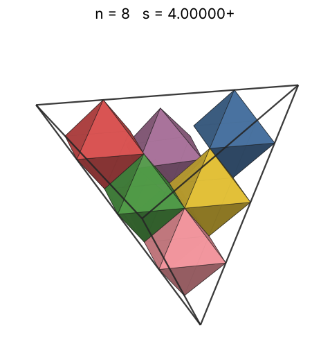 |
| 9 | [4.00000+](octintet_n09.json) | 4.000000246547 | 4 | 3.30193 | 0.5625 | 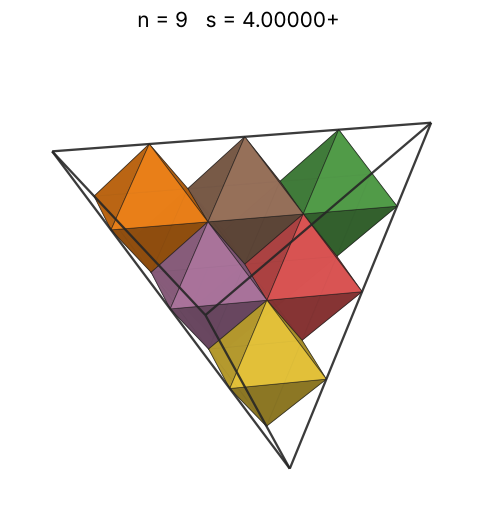 |
| 10 | [4.00000+](octintet_n10.json) | 4.000000247291 | 4 | 3.41995 | 0.6250 | 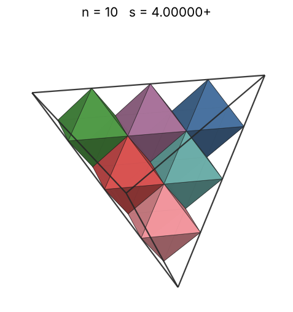 |
| 11 | [4.33333+](octintet_n11.json) | 4.333333668566 | 13/3 | 3.53035 | 0.5407 | 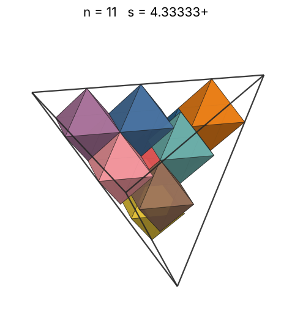 |
| 12 | [4.40000+](octintet_n12.json) | 4.400000349783 | 22/5 | 3.63424 | 0.5635 | 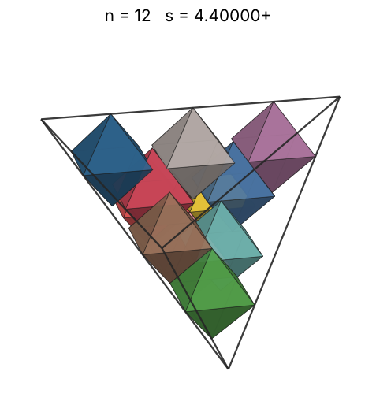 |
| 13 | [4.50000+](octintet_n13.json) | 4.500000326414 | 9/2 | 3.73251 | 0.5706 | 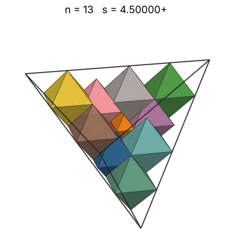 |
| 14 | [4.66666+](octintet_n14.json) | 4.666666994020 | 14/3 | 3.82586 | 0.5510 | 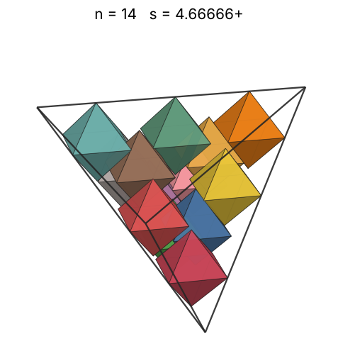 |
| 15 | [4.76470+](octintet_n15.json) | 4.764706711758 | 81/17 | 3.91487 | 0.5547 | 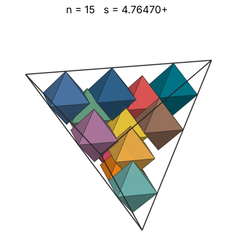 |
| 16 | [4.93596+](octintet_n16.json) | 4.935963240588 |  | 4.00000 | 0.5322 | 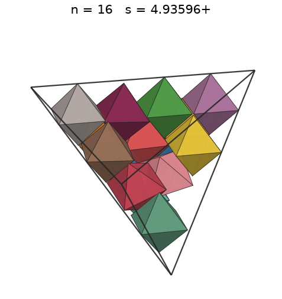 |
| 17 | [4.99642+](octintet_n17.json) | 4.996424445442 |  | 4.08166 | 0.5452 | 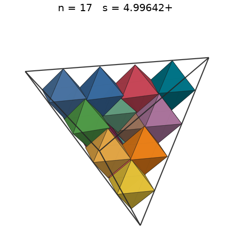 |
| 18 | [5.00000+](octintet_n18.json) | 5.000000900000 | 5 | 4.16017 | 0.5760 | 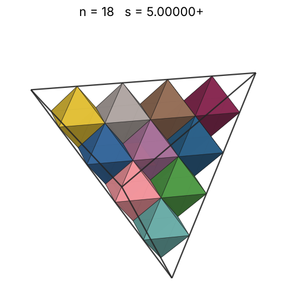 |
| 19 | [5.00000+](octintet_n19.json) | 5.000000900000 | 5 | 4.23582 | 0.6080 | 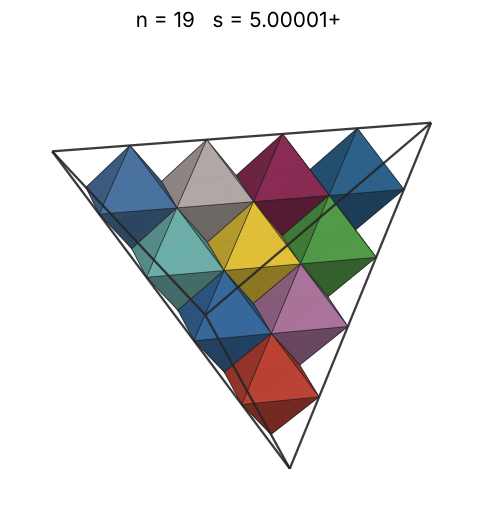 |
| 20 | [5.00000+](octintet_n20.json) | 5.000000900000 | 5 | 4.30887 | 0.6400 | 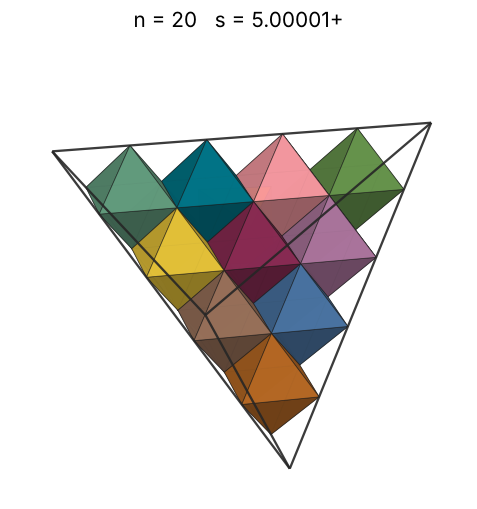 |
| 21 | [5.16435+](octintet_n21.json) | 5.164351366621 |  | 4.37952 | 0.6099 | 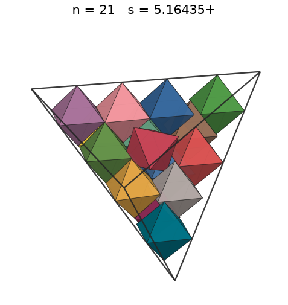 |
| 22 | [5.33182+](octintet_n22.json) | 5.331819519613 |  | 4.44796 | 0.5806 | 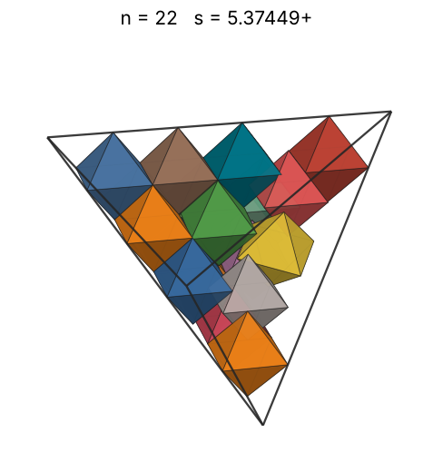 |
| 23 | [5.33333+](octintet_n23.json) | 5.333334333333 |  | 4.51436 | 0.6064 | 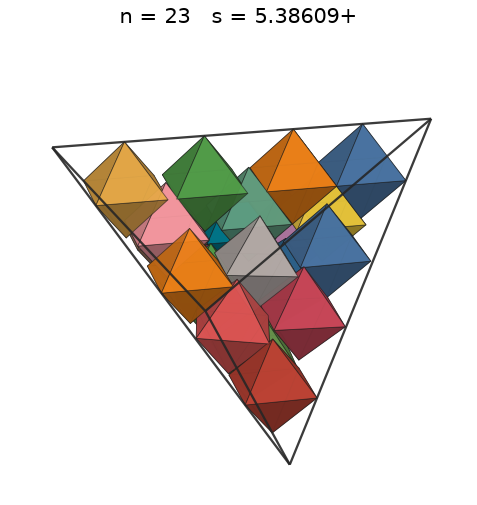 |
| 24 | [5.40000+](octintet_n24.json) | 5.400000402092 |  | 4.57886 | 0.6097 | 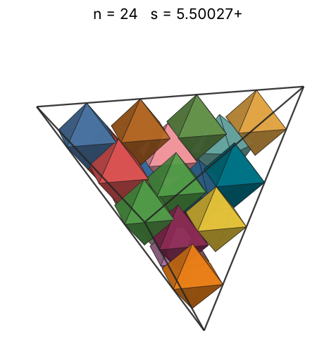 |
| 25 | [5.49998+](octintet_n25.json) | 5.499980664706 |  | 4.64159 | 0.6011 | 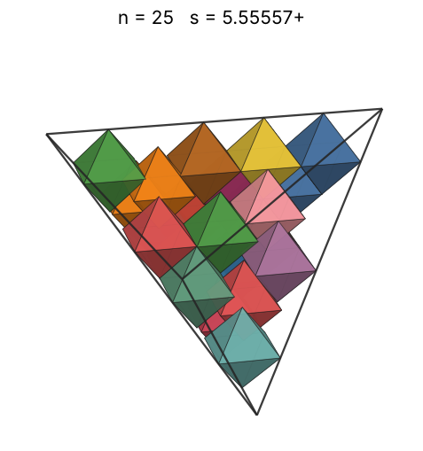 |
| 26 | [5.66666+](octintet_n26.json) | 5.666667101598 |  | 4.70267 | 0.5715 | 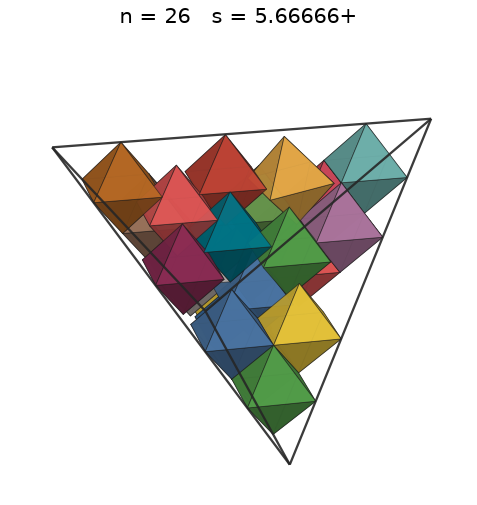 |
| 27 | [5.70596+](octintet_n27.json) | 5.705963791584 |  | 4.76220 | 0.5813 | 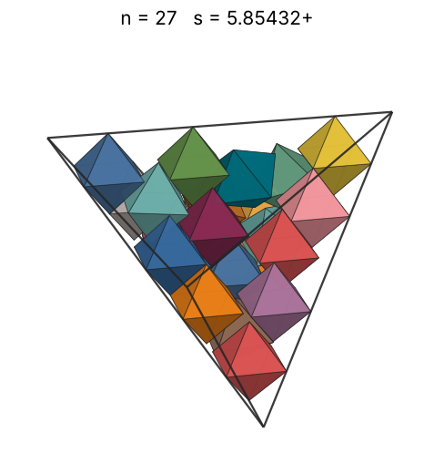 |
| 28 | [5.75000+](octintet_n28.json) | 5.750001125000 |  | 4.82028 | 0.5891 | 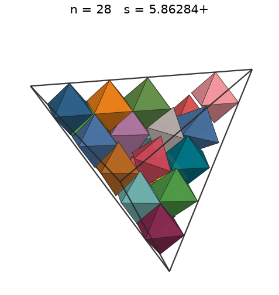 |
| 29 | [5.86666+](octintet_n29.json) | 5.866667826667 |  | 4.87700 | 0.5745 | 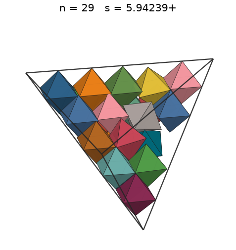 |
| 30 | [5.92338+](octintet_n30.json) | 5.923379959521 |  | 4.93242 | 0.5774 | 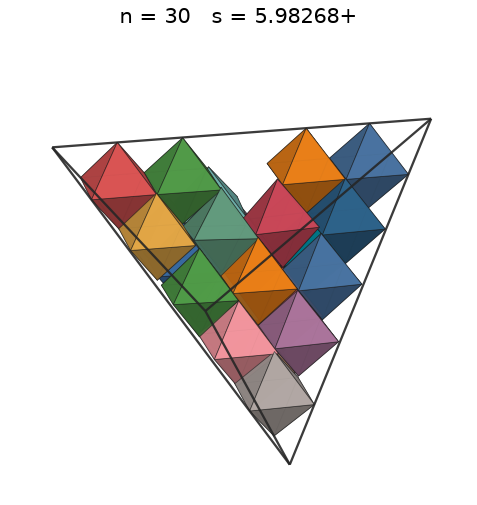 |
| 31 | [5.98538+](octintet_n31.json) | 5.985382927727 |  | 4.98663 | 0.5783 | 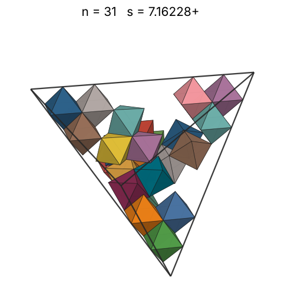 |
| 32 | [5.99255+](octintet_n32.json) | 5.992557829896 |  | 5.03968 | 0.5948 | 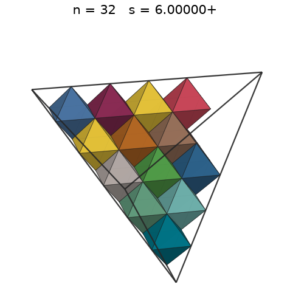 |
| 33 | [6.00000+](octintet_n33.json) | 6.000000666667 | 6 | 5.09164 | 0.6111 | 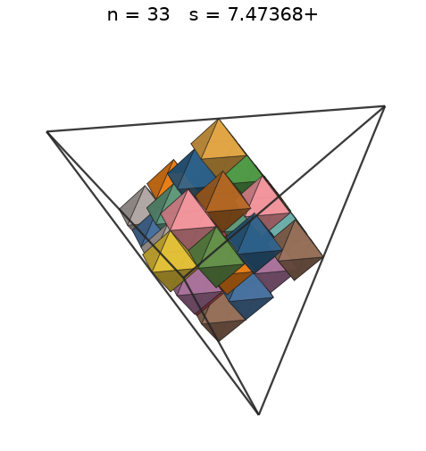 |
| 34 | [6.00000+](octintet_n34.json) | 6.000000666667 | 6 | 5.14256 | 0.6296 | 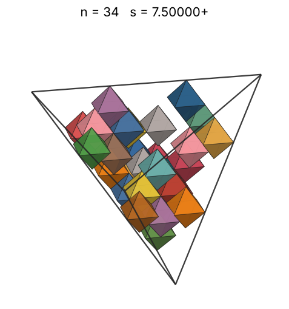 |
| 35 | [6.00000+](octintet_n35.json) | 6.000000666667 | 6 | 5.19249 | 0.6481 | 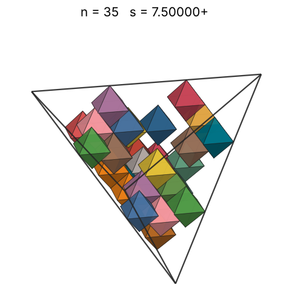 |
| 36 | [6.09801+](octintet_n36.json) | 6.098014173630 |  | 5.24148 | 0.6350 | 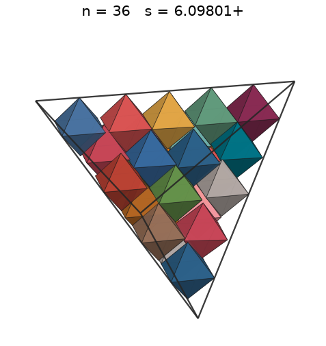 |
| 37 | [6.18099+](octintet_n37.json) | 6.180998269997 |  | 5.28957 | 0.6267 | 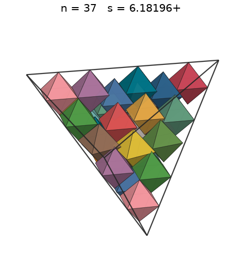 |
| 38 | [6.33316+](octintet_n38.json) | 6.333160168970 |  | 5.33680 | 0.5984 | 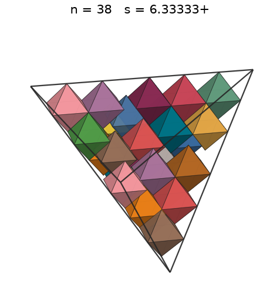 |
| 39 | [6.33333+](octintet_n39.json) | 6.333332988015 |  | 5.38321 | 0.6141 | 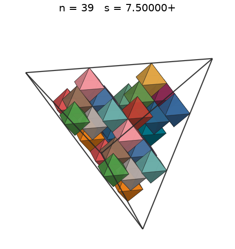 |
| 40 | [6.36363+](octintet_n40.json) | 6.363637672727 |  | 5.42884 | 0.6209 |  |
| 41 | [6.42318+](octintet_n41.json) | 6.423184444561 |  | 5.47370 | 0.6189 |  |
| 42 | [6.42857+](octintet_n42.json) | 6.428571871429 |  | 5.51785 | 0.6324 |  |
| 43 | [6.44444+](octintet_n43.json) | 6.444444888889 |  | 5.56130 | 0.6426 |  |
| 44 | [6.50000+](octintet_n44.json) | 6.500000000000 | 13/2 | 5.60408 | 0.6409 |  |
| 45 | [6.62500+](octintet_n45.json) | 6.625000014528 | 53/8 | 5.64622 | 0.6190 |  |
| 46 | [6.69596+](octintet_n46.json) | 6.695959784686 |  | 5.68773 | 0.6129 |  |
| 47 | [6.76470+](octintet_n47.json) | 6.764707311765 |  | 5.72865 | 0.6073 |  |
| 48 | [6.82994+](octintet_n48.json) | 6.829940400741 |  | 5.76900 | 0.6026 |  |
| 49 | [6.88489+](octintet_n49.json) | 6.884894863468 |  | 5.80879 | 0.6006 |  |
| 50 | [6.89681+](octintet_n50.json) | 6.896809739795 |  | 5.84804 | 0.6097 |  |
| 51 | [6.89681+](octintet_n51.json) | 6.896809739795 |  | 5.88677 | 0.6218 |  |
| 52 | [6.91395+](octintet_n52.json) | 6.913957609963 |  | 5.92499 | 0.6293 |  |
| 53 | [6.95234+](octintet_n53.json) | 6.952347206574 |  | 5.96273 | 0.6309 |  |
| 54 | [6.98382+](octintet_n54.json) | 6.983822261288 |  | 6.00000 | 0.6341 |  |
| 55 | [6.99518+](octintet_n55.json) | 6.995181755192 |  | 6.03681 | 0.6427 |  |
| 56 | [6.99564+](octintet_n56.json) | 6.995644810039 |  | 6.07318 | 0.6543 |  |
| 57 | [7.00000+](octintet_n57.json) | 7.000000500000 |  | 6.10911 | 0.6647 |  |
| 58 | [7.00000+](octintet_n58.json) | 7.000000500000 |  | 6.14463 | 0.6764 |  |
| 59 | [7.15311+](octintet_n59.json) | 7.153118641451 |  | 6.17975 | 0.6448 |  |
| 60 | [7.20138+](octintet_n60.json) | 7.201379813606 |  | 6.21447 | 0.6426 |  |
| 61 | [7.22893+](octintet_n61.json) | 7.228932890655 |  | 6.24880 | 0.6459 |  |
| 62 | [7.27769+](octintet_n62.json) | 7.277696388649 |  | 6.28276 | 0.6434 |  |
| 63 | [7.33333+](octintet_n63.json) | 7.333333866667 |  | 6.31636 | 0.6390 |  |
| 64 | [7.39186+](octintet_n64.json) | 7.391866460758 |  | 6.34960 | 0.6338 |  |
| 65 | [7.40000+](octintet_n65.json) | 7.400000540000 |  | 6.38250 | 0.6416 |  |
| 66 | [7.40000+](octintet_n66.json) | 7.400000540000 |  | 6.41507 | 0.6515 |  |
| 67 | [7.42647+](octintet_n67.json) | 7.426469830745 |  | 6.44731 | 0.6543 |  |
| 68 | [7.44444+](octintet_n68.json) | 7.444444988889 |  | 6.47922 | 0.6593 |  |
| 69 | [7.45454+](octintet_n69.json) | 7.454547090909 |  | 6.51083 | 0.6663 |  |
| 70 | [7.50000+](octintet_n70.json) | 7.500000550000 |  | 6.54213 | 0.6637 |  |
| 71 | [7.50000+](octintet_n71.json) | 7.500000550000 |  | 6.57314 | 0.6732 |  |
| 72 | [7.80152+](octintet_n72.json) | 7.801528388499 |  | 6.60385 | 0.6065 |  |
| 73 | [7.81332+](octintet_n73.json) | 7.813321363384 |  | 6.63429 | 0.6122 |  |
| 74 | [7.85208+](octintet_n74.json) | 7.852084006983 |  | 6.66444 | 0.6114 |  |
| 75 | [7.85208+](octintet_n75.json) | 7.852084006983 |  | 6.69433 | 0.6197 |  |
| 76 | [7.86934+](octintet_n76.json) | 7.869343051510 |  | 6.72395 | 0.6238 |  |
| 77 | [7.89077+](octintet_n77.json) | 7.890779224892 |  | 6.75331 | 0.6269 |  |
| 78 | [7.91013+](octintet_n78.json) | 7.910135230986 |  | 6.78242 | 0.6304 |  |
| 79 | [7.91220+](octintet_n79.json) | 7.912204617790 |  | 6.81128 | 0.6380 |  |
| 80 | [7.91345+](octintet_n80.json) | 7.913455655688 |  | 6.83990 | 0.6457 |  |
| 81 | [7.96246+](octintet_n81.json) | 7.962460000539 |  | 6.86829 | 0.6418 |  |
| 82 | [7.96868+](octintet_n82.json) | 7.968687214883 |  | 6.89643 | 0.6482 |  |
| 83 | [7.98180+](octintet_n83.json) | 7.981801573950 |  | 6.92436 | 0.6529 |  |
| 84 | [7.98858+](octintet_n84.json) | 7.988585672229 |  | 6.95205 | 0.6591 |  |
| 85 | [8.00000+](octintet_n85.json) | 8.000000600000 |  | 6.97953 | 0.6641 |  |
| 86 | [8.00000+](octintet_n86.json) | 8.000000600000 |  | 7.00680 | 0.6719 |  |
| 87 | [8.00000+](octintet_n87.json) | 8.000000600000 |  | 7.03385 | 0.6797 |  |
| 88 | [8.00000+](octintet_n88.json) | 8.000000600000 |  | 7.06070 | 0.6875 |  |
| 89 | [8.00000+](octintet_n89.json) | 8.000000600000 |  | 7.08734 | 0.6953 |  |
| 90 | [8.24964+](octintet_n90.json) | 8.249645295348 |  | 7.11379 | 0.6412 |  |
| 91 | [8.26888+](octintet_n91.json) | 8.268886410989 |  | 7.14004 | 0.6438 |  |
| 92 | [8.31285+](octintet_n92.json) | 8.312853404027 |  | 7.16610 | 0.6406 |  |
| 93 | [8.36074+](octintet_n93.json) | 8.360748169338 |  | 7.19197 | 0.6365 |  |
| 94 | [8.37190+](octintet_n94.json) | 8.371903588861 |  | 7.21765 | 0.6408 |  |
| 95 | [8.40417+](octintet_n95.json) | 8.404171141235 |  | 7.24316 | 0.6402 |  |
| 96 | [8.40417+](octintet_n96.json) | 8.404171141236 |  | 7.26848 | 0.6469 |  |
| 97 | [8.42641+](octintet_n97.json) | 8.426410165614 |  | 7.29363 | 0.6485 |  |
| 98 | [8.42903+](octintet_n98.json) | 8.429031299094 |  | 7.31861 | 0.6546 |  |
| 99 | [8.44019+](octintet_n99.json) | 8.440196198285 |  | 7.34342 | 0.6586 |  |
| 100 | [8.44444+](octintet_n100.json) | 8.444445088889 |  | 7.36806 | 0.6643 |  |
