# Tetrahedra in a cube

s = container edge / piece edge; every row certified in exact arithmetic.

| n | s | touching limit | closed form (conj.) | volume bound | density | picture |
|---|---|---|---|---|---|---|
| 2 | [0.94280+](tetincub_n02.json) | 0.942809104592 |  | 0.61771 | 0.2812 | 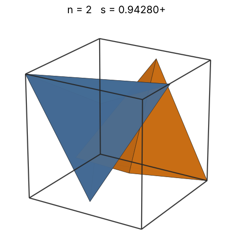 |
| 3 | [1.00000+](tetincub_n03.json) | 1.000000088069 |  | 0.70711 | 0.3536 | 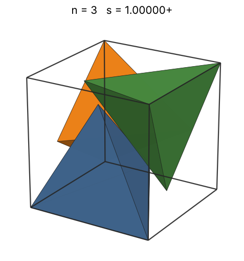 |
| 4 | [1.08647+](tetincub_n04.json) | 1.086477312820 |  | 0.77827 | 0.3676 | 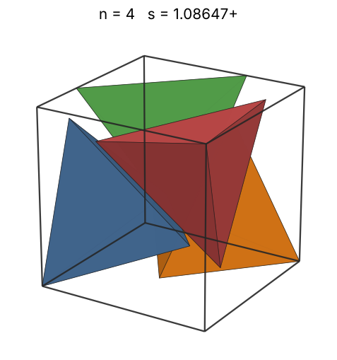 |
| 5 | [1.17760+](tetincub_n05.json) | 1.177606082896 |  | 0.83837 | 0.3608 | 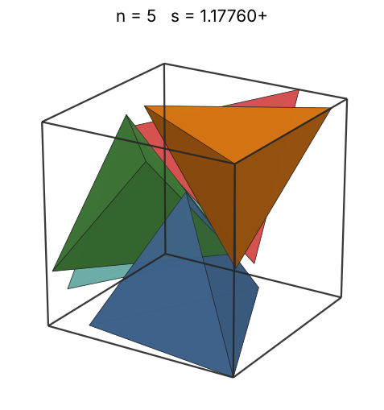 |
| 6 | [1.19645+](tetincub_n06.json) | 1.196456003008 |  | 0.89090 | 0.4129 | 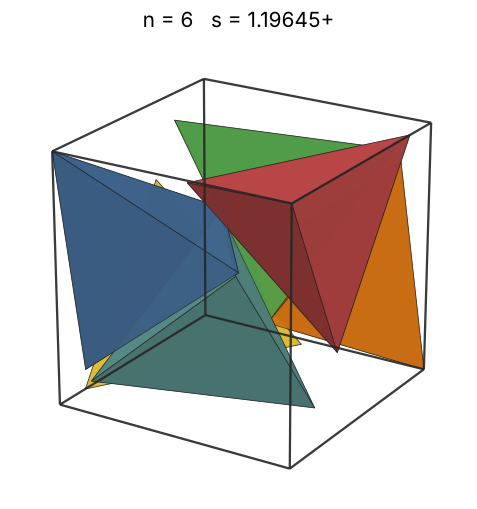 |
| 7 | [1.26223+](tetincub_n07.json) | 1.262231245632 |  | 0.93787 | 0.4102 | 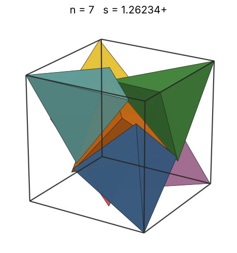 |
| 8 | [1.29628+](tetincub_n08.json) | 1.296284512862 |  | 0.98056 | 0.4328 | 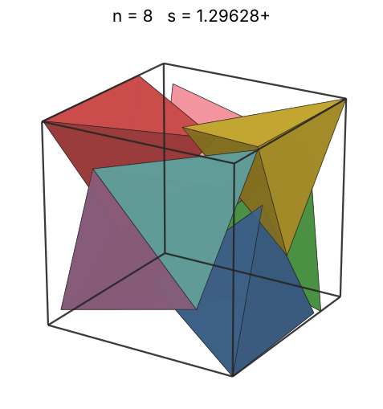 |
| 9 | [1.34240+](tetincub_n09.json) | 1.342402219513 |  | 1.01982 | 0.4385 | 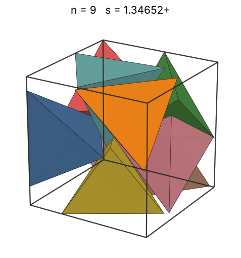 |
| 10 | [1.36738+](tetincub_n10.json) | 1.367383703202 |  | 1.05628 | 0.4610 | 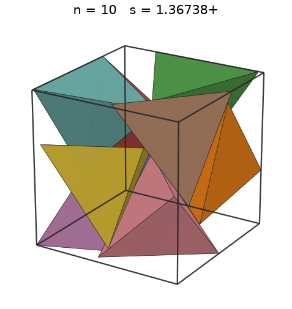 |
| 11 | [1.39896+](tetincub_n11.json) | 1.398966049064 |  | 1.09037 | 0.4735 | 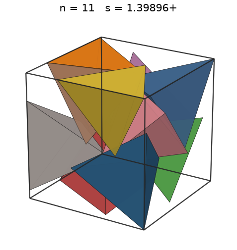 |
| 12 | [1.44078+](tetincub_n12.json) | 1.440785162699 |  | 1.12246 | 0.4728 | 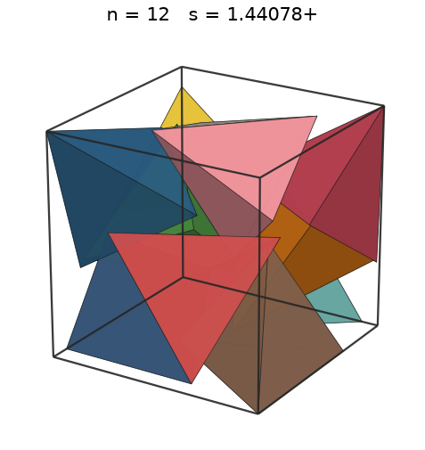 |
| 13 | [1.46675+](tetincub_n13.json) | 1.466756620452 |  | 1.15281 | 0.4855 | 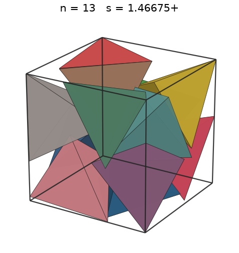 |
| 14 | [1.49994+](tetincub_n14.json) | 1.499944823282 |  | 1.18165 | 0.4889 | 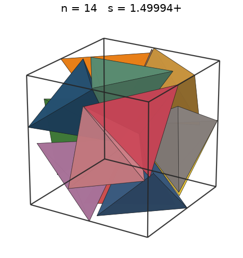 |
| 15 | [1.52860+](tetincub_n15.json) | 1.528603158518 |  | 1.20914 | 0.4949 | 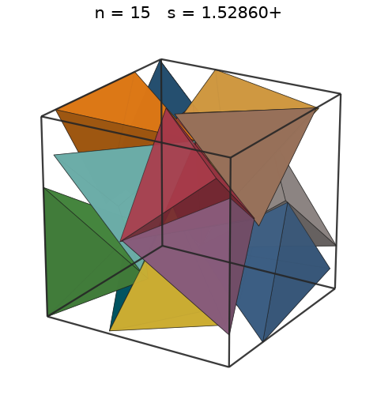 |
| 16 | [1.57358+](tetincub_n16.json) | 1.573580069821 |  | 1.23543 | 0.4839 | 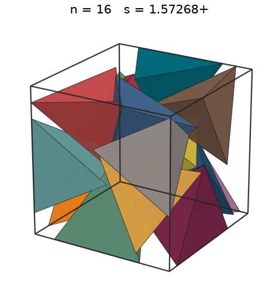 |
| 17 | [1.58797+](tetincub_n17.json) | 1.587974446331 |  | 1.26065 | 0.5003 | 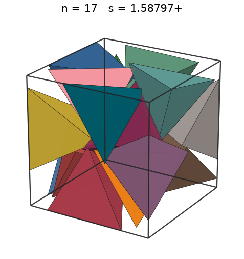 |
| 18 | [1.61266+](tetincub_n18.json) | 1.612660695387 |  | 1.28490 | 0.5058 | 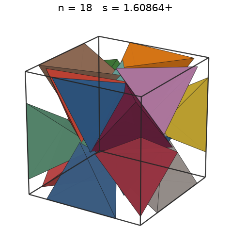 |
| 19 | [1.62515+](tetincub_n19.json) | 1.625150023350 |  | 1.30827 | 0.5217 | 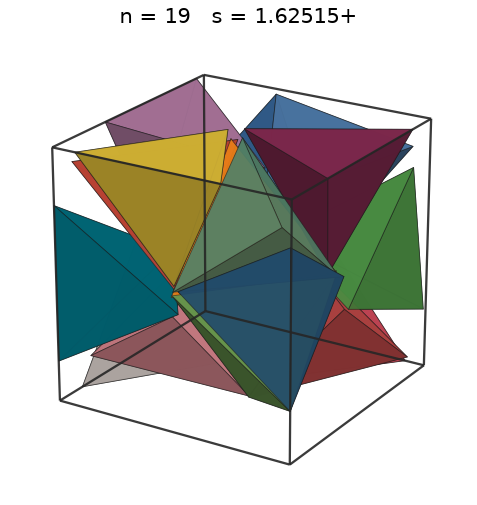 |
| 20 | [1.65209+](tetincub_n20.json) | 1.652098351340 |  | 1.33083 | 0.5227 | 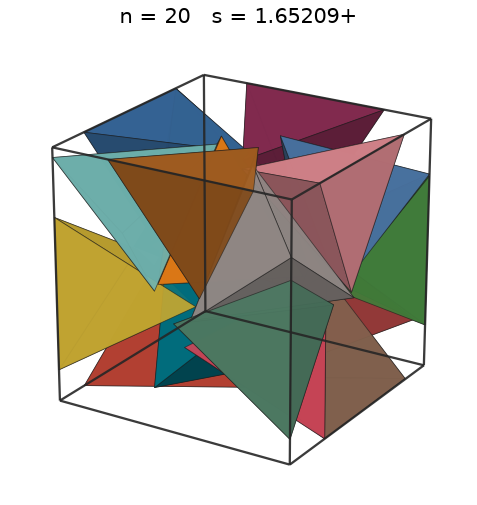 |
| 21 | [1.65584+](tetincub_n21.json) | 1.655845837412 |  | 1.35265 | 0.5451 | 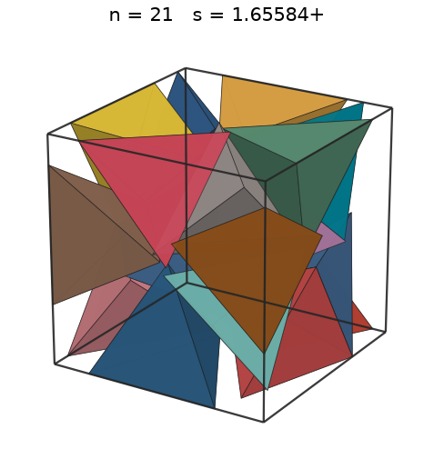 |
| 22 | [1.68170+](tetincub_n22.json) | 1.681700034856 |  | 1.37379 | 0.5451 | 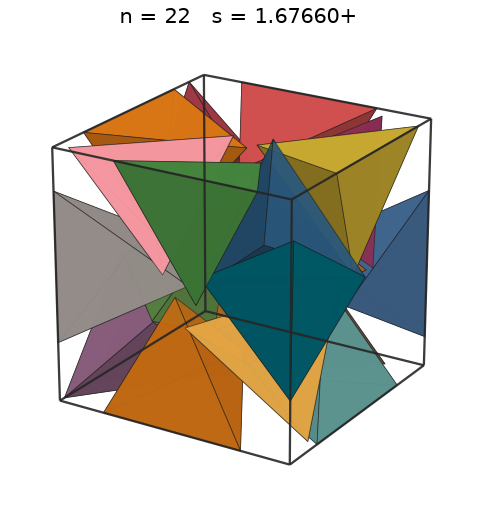 |
| 23 | [1.71725+](tetincub_n23.json) | 1.717250435494 |  | 1.39429 | 0.5353 | 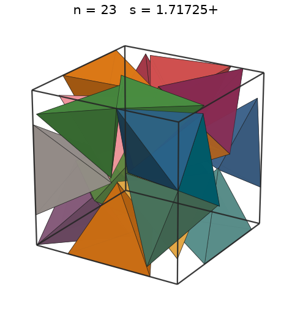 |
| 24 | [1.78388+](tetincub_n24.json) | 1.783881768319 |  | 1.41421 | 0.4982 | 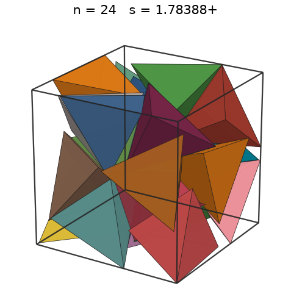 |
| 25 | [1.79398+](tetincub_n25.json) | 1.793987275149 |  | 1.43359 | 0.5103 | 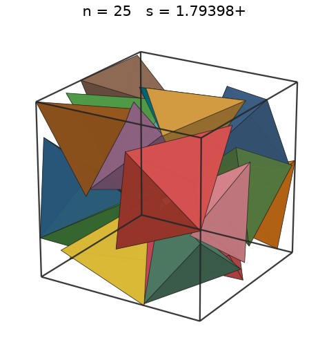 |
| 26 | [1.82960+](tetincub_n26.json) | 1.829600312709 |  | 1.45245 | 0.5003 | 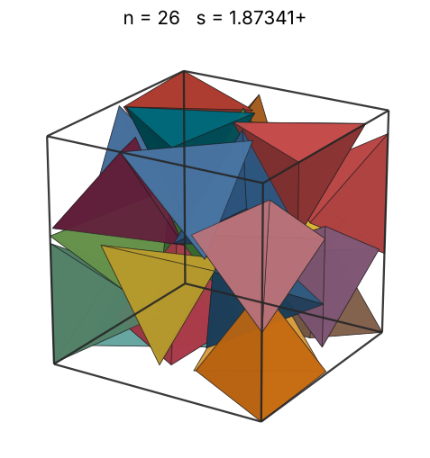 |
| 27 | [1.82960+](tetincub_n27.json) | 1.829600312709 |  | 1.47084 | 0.5196 | 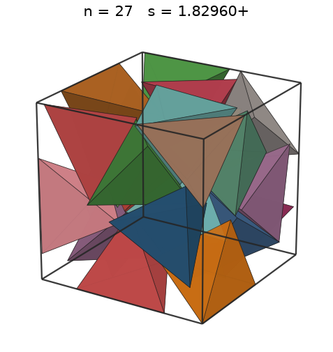 |
| 28 | [1.87164+](tetincub_n28.json) | 1.871646749745 |  | 1.48878 | 0.5033 | 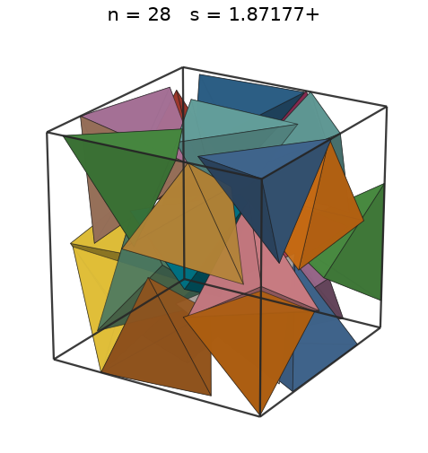 |
| 29 | [1.89737+](tetincub_n29.json) | 1.897372655460 |  | 1.50630 | 0.5003 | 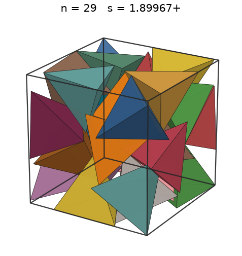 |
| 30 | [1.90257+](tetincub_n30.json) | 1.902576323768 |  | 1.52342 | 0.5134 | 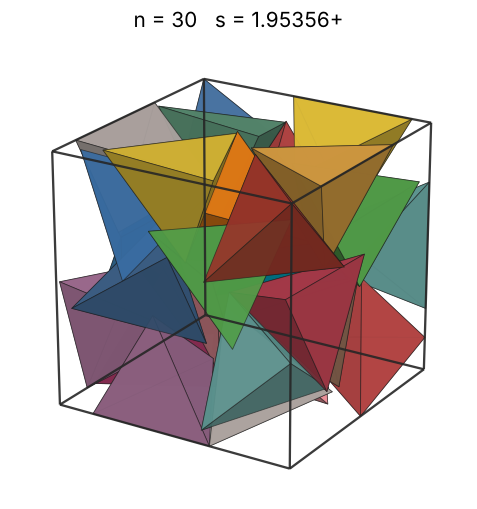 |
| 31 | [1.94503+](tetincub_n31.json) | 1.945033515340 |  | 1.54016 | 0.4965 | 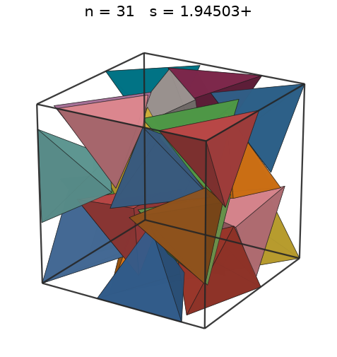 |
| 32 | [1.96978+](tetincub_n32.json) | 1.969788523884 |  | 1.55654 | 0.4934 | 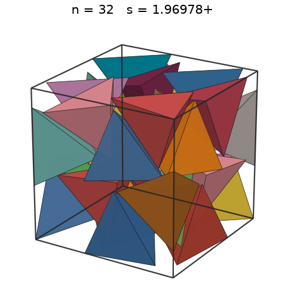 |
| 33 | [1.98485+](tetincub_n33.json) | 1.984850843621 |  | 1.57259 | 0.4974 | 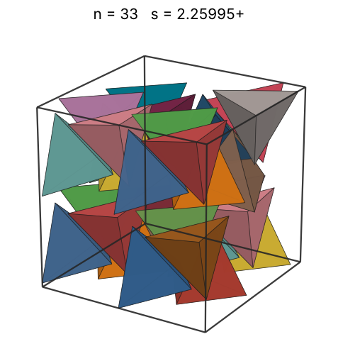 |
| 34 | [2.00457+](tetincub_n34.json) | 2.004577605842 |  | 1.58832 | 0.4974 | 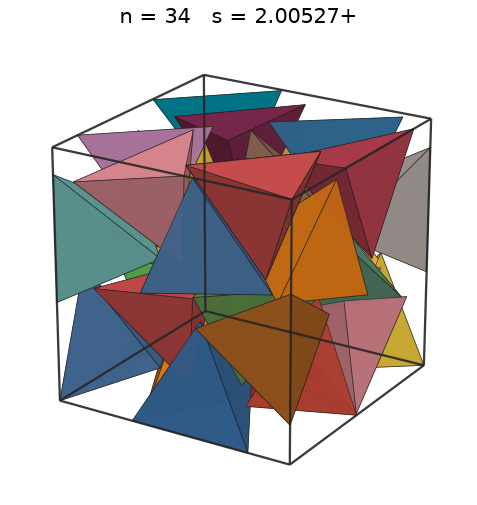 |
| 35 | [2.02586+](tetincub_n35.json) | 2.025865568184 |  | 1.60374 | 0.4961 | 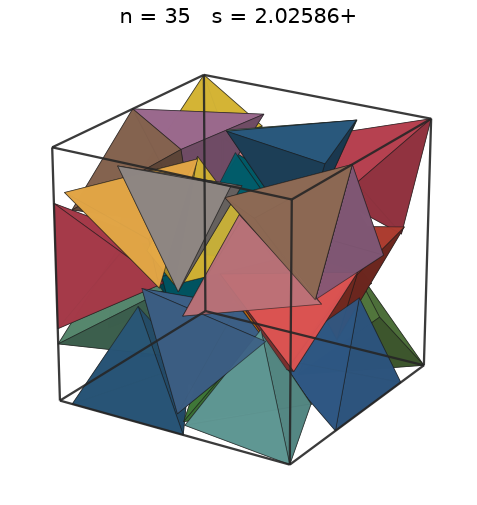 |
| 36 | [2.04958+](tetincub_n36.json) | 2.049585606867 |  | 1.61887 | 0.4928 | 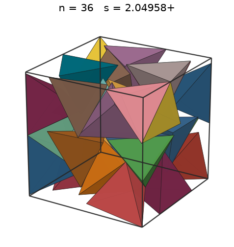 |
| 37 | [2.04958+](tetincub_n37.json) | 2.049585609430 |  | 1.63372 | 0.5065 | 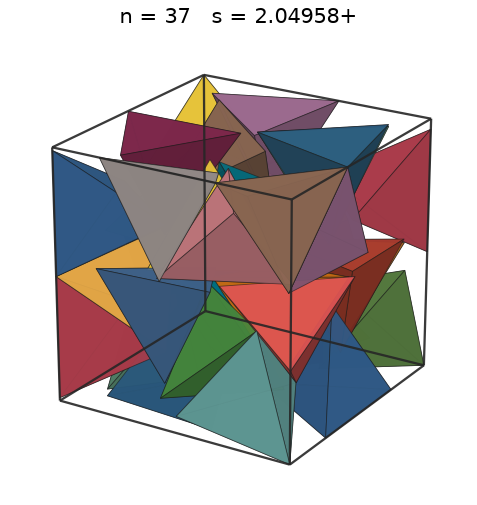 |
| 38 | [2.05823+](tetincub_n38.json) | 2.058232513427 |  | 1.64831 | 0.5136 | 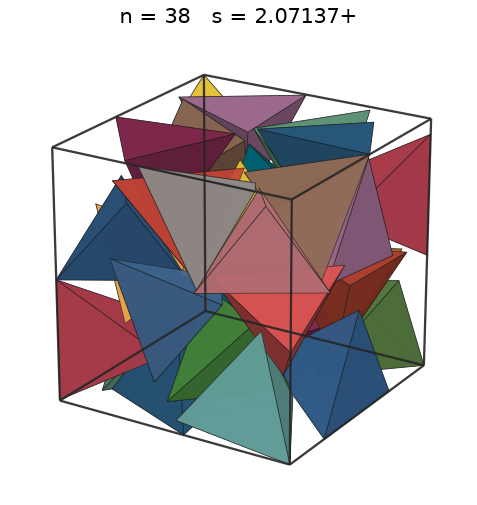 |
| 39 | [2.10659+](tetincub_n39.json) | 2.106598693348 |  | 1.66264 | 0.4916 | 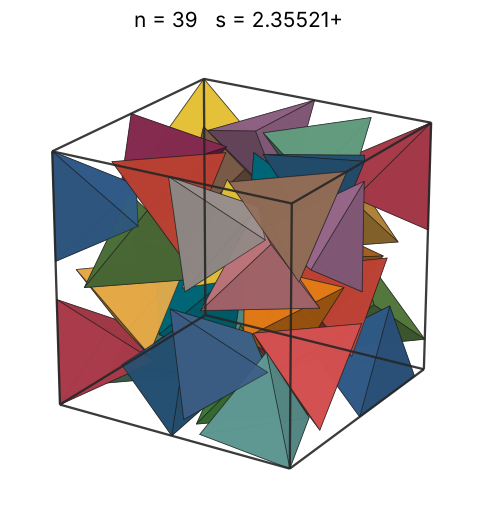 |
| 40 | [2.11052+](tetincub_n40.json) | 2.110527919223 |  | 1.67674 | 0.5014 | 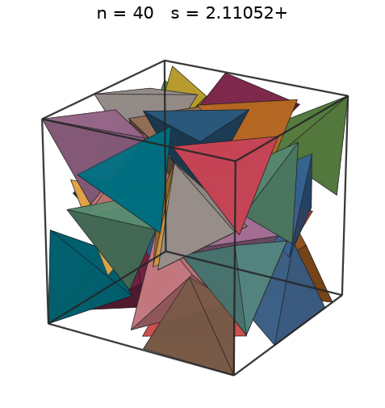 |
| 41 | [2.11052+](tetincub_n41.json) | 2.110527919223 |  | 1.69059 | 0.5140 |  |
| 42 | [2.12475+](tetincub_n42.json) | 2.124755813008 |  | 1.70423 | 0.5160 |  |
| 43 | [2.14804+](tetincub_n43.json) | 2.148047026380 |  | 1.71765 | 0.5113 |  |
| 44 | [2.16551+](tetincub_n44.json) | 2.165513401662 |  | 1.73086 | 0.5106 |  |
| 45 | [2.16551+](tetincub_n45.json) | 2.165513401662 |  | 1.74388 | 0.5222 |  |
| 46 | [2.19514+](tetincub_n46.json) | 2.195141045829 |  | 1.75670 | 0.5125 |  |
| 47 | [2.20540+](tetincub_n47.json) | 2.205403100490 |  | 1.76934 | 0.5164 |  |
| 48 | [2.22456+](tetincub_n48.json) | 2.224561597056 |  | 1.78180 | 0.5139 |  |
| 49 | [2.24379+](tetincub_n49.json) | 2.243795724303 |  | 1.79409 | 0.5112 |  |
| 50 | [2.24882+](tetincub_n50.json) | 2.248826695820 |  | 1.80621 | 0.5181 |  |
| 51 | [2.27140+](tetincub_n51.json) | 2.271406715645 |  | 1.81817 | 0.5129 |  |
| 52 | [2.29442+](tetincub_n52.json) | 2.294424276806 |  | 1.82998 | 0.5074 |  |
| 53 | [2.29442+](tetincub_n53.json) | 2.294424277857 |  | 1.84163 | 0.5171 |  |
| 54 | [2.31206+](tetincub_n54.json) | 2.312061229004 |  | 1.85314 | 0.5149 |  |
| 55 | [2.32976+](tetincub_n55.json) | 2.329768185810 |  | 1.86451 | 0.5126 |  |
| 56 | [2.33565+](tetincub_n56.json) | 2.335651602391 |  | 1.87575 | 0.5180 |  |
| 57 | [2.36713+](tetincub_n57.json) | 2.367138739867 |  | 1.88684 | 0.5065 |  |
| 58 | [2.37372+](tetincub_n58.json) | 2.373724045637 |  | 1.89782 | 0.5111 |  |
| 59 | [2.37372+](tetincub_n59.json) | 2.373724045637 |  | 1.90866 | 0.5199 |  |
| 60 | [2.41226+](tetincub_n60.json) | 2.412266683133 |  | 1.91938 | 0.5037 |  |
| 61 | [2.41226+](tetincub_n61.json) | 2.412266683133 |  | 1.92999 | 0.5121 |  |
| 62 | [2.43908+](tetincub_n62.json) | 2.439084548404 |  | 1.94048 | 0.5036 |  |
| 63 | [2.44594+](tetincub_n63.json) | 2.445942700649 |  | 1.95085 | 0.5074 |  |
| 64 | [2.44605+](tetincub_n64.json) | 2.446051628996 |  | 1.96112 | 0.5154 |  |
| 65 | [2.47496+](tetincub_n65.json) | 2.474966181085 |  | 1.97128 | 0.5053 |  |
| 66 | [2.50121+](tetincub_n66.json) | 2.501219574679 |  | 1.98134 | 0.4971 |  |
| 67 | [2.51188+](tetincub_n67.json) | 2.511885305401 |  | 1.99130 | 0.4982 |  |
| 68 | [2.51188+](tetincub_n68.json) | 2.511885305401 |  | 2.00116 | 0.5056 |  |
| 69 | [2.51188+](tetincub_n69.json) | 2.511885305401 |  | 2.01092 | 0.5131 |  |
| 70 | [2.54507+](tetincub_n70.json) | 2.545072799719 |  | 2.02059 | 0.5004 |  |
| 71 | [2.54507+](tetincub_n71.json) | 2.545072799719 |  | 2.03016 | 0.5076 |  |
| 72 | [2.54507+](tetincub_n72.json) | 2.545072799719 |  | 2.03965 | 0.5147 |  |
| 73 | [2.54507+](tetincub_n73.json) | 2.545072799719 |  | 2.04905 | 0.5219 |  |
| 74 | [2.56707+](tetincub_n74.json) | 2.567070493579 |  | 2.05836 | 0.5155 |  |
| 75 | [2.56707+](tetincub_n75.json) | 2.567070493579 |  | 2.06759 | 0.5225 |  |
| 76 | [2.56707+](tetincub_n76.json) | 2.567070493579 |  | 2.07674 | 0.5295 |  |
| 77 | [2.57394+](tetincub_n77.json) | 2.573946310077 |  | 2.08581 | 0.5321 |  |
| 78 | [2.61576+](tetincub_n78.json) | 2.615763312512 |  | 2.09480 | 0.5136 |  |
| 79 | [2.61576+](tetincub_n79.json) | 2.615763312512 |  | 2.10372 | 0.5202 |  |
| 80 | [2.63836+](tetincub_n80.json) | 2.638360528034 |  | 2.11255 | 0.5134 |  |
| 81 | [2.63836+](tetincub_n81.json) | 2.638360528034 |  | 2.12132 | 0.5198 |  |
| 82 | [2.63836+](tetincub_n82.json) | 2.638360528034 |  | 2.13001 | 0.5262 |  |
| 83 | [2.67104+](tetincub_n83.json) | 2.671041535171 |  | 2.13864 | 0.5133 |  |
| 84 | [2.68448+](tetincub_n84.json) | 2.684480704894 |  | 2.14719 | 0.5117 |  |
| 85 | [2.68448+](tetincub_n85.json) | 2.684480704894 |  | 2.15568 | 0.5178 |  |
| 86 | [2.68448+](tetincub_n86.json) | 2.684480704894 |  | 2.16410 | 0.5239 |  |
| 87 | [2.68448+](tetincub_n87.json) | 2.684480704894 |  | 2.17246 | 0.5300 |  |
| 88 | [2.68448+](tetincub_n88.json) | 2.684480704894 |  | 2.18075 | 0.5361 |  |
| 89 | [2.70599+](tetincub_n89.json) | 2.705990151161 |  | 2.18898 | 0.5294 |  |
| 90 | [2.73931+](tetincub_n90.json) | 2.739312334164 |  | 2.19715 | 0.5160 |  |
| 91 | [2.75537+](tetincub_n91.json) | 2.755371432427 |  | 2.20525 | 0.5127 |  |
| 92 | [2.75537+](tetincub_n92.json) | 2.755371432427 |  | 2.21330 | 0.5183 |  |
| 93 | [2.75537+](tetincub_n93.json) | 2.755371432427 |  | 2.22129 | 0.5239 |  |
| 94 | [2.77518+](tetincub_n94.json) | 2.775180358184 |  | 2.22922 | 0.5183 |  |
| 95 | [2.77518+](tetincub_n95.json) | 2.775180358184 |  | 2.23710 | 0.5238 |  |
| 96 | [2.80825+](tetincub_n96.json) | 2.808257186878 |  | 2.24492 | 0.5109 |  |
| 97 | [2.81800+](tetincub_n97.json) | 2.818002659135 |  | 2.25269 | 0.5108 |  |
| 98 | [2.84239+](tetincub_n98.json) | 2.842395559467 |  | 2.26041 | 0.5029 |  |
| 99 | [2.85295+](tetincub_n99.json) | 2.852952345317 |  | 2.26807 | 0.5024 |  |
| 100 | [2.85384+](tetincub_n100.json) | 2.853845581682 |  | 2.27568 | 0.5070 |  |
