# Tetrahedra in a cube

s = container edge / piece edge; every row certified in exact arithmetic.

| n | s | touching limit | closed form (conj.) | volume bound | density | picture |
|---|---|---|---|---|---|---|
| 2 | [0.94280+](tetincub_n02.json) | 0.942809104592 |  | 0.61771 | 0.2812 | 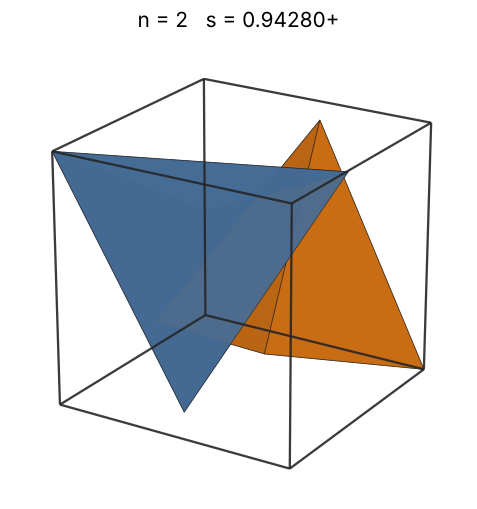 |
| 3 | [1.00000+](tetincub_n03.json) | 1.000000088069 |  | 0.70711 | 0.3536 | 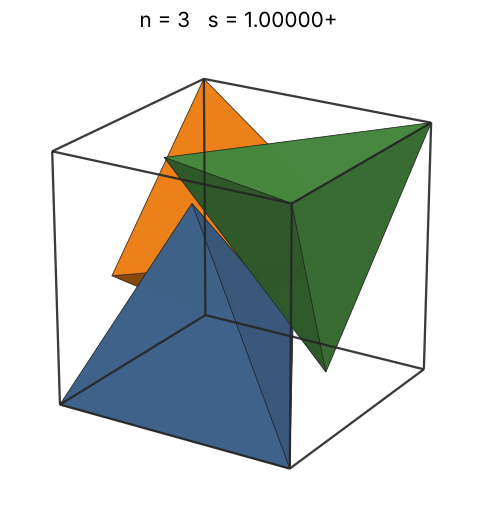 |
| 4 | [1.08647+](tetincub_n04.json) | 1.086477312820 |  | 0.77827 | 0.3676 | 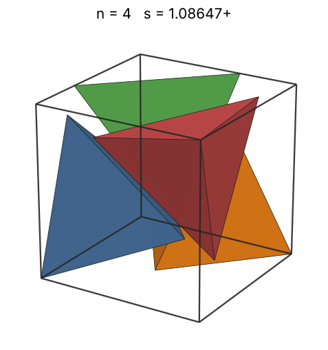 |
| 5 | [1.17760+](tetincub_n05.json) | 1.177606082896 |  | 0.83837 | 0.3608 | 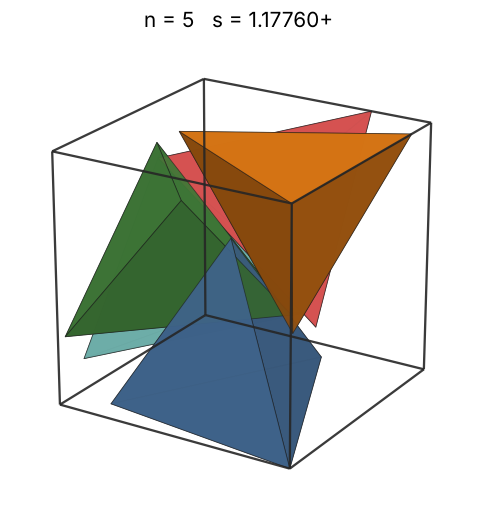 |
| 6 | [1.19645+](tetincub_n06.json) | 1.196456003008 |  | 0.89090 | 0.4129 | 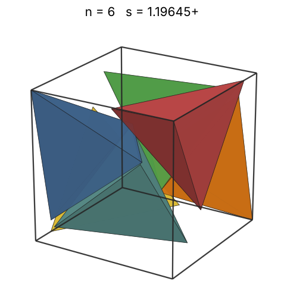 |
| 7 | [1.26234+](tetincub_n07.json) | 1.262345483073 |  | 0.93787 | 0.4101 | 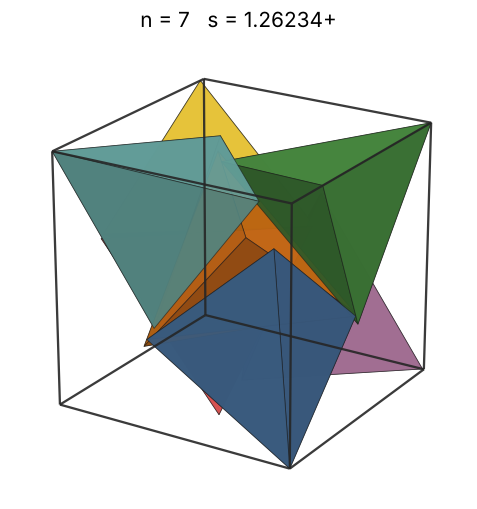 |
| 8 | [1.29628+](tetincub_n08.json) | 1.296284512862 |  | 0.98056 | 0.4328 | 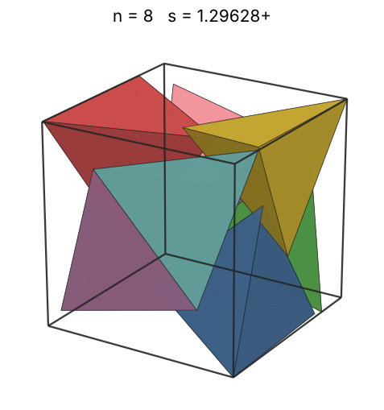 |
| 9 | [1.34652+](tetincub_n09.json) | 1.346520288323 |  | 1.01982 | 0.4344 | 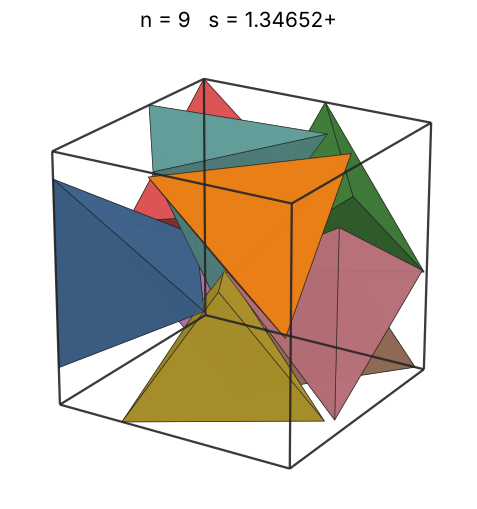 |
| 10 | [1.38120+](tetincub_n10.json) | 1.381207987978 |  | 1.05628 | 0.4473 | 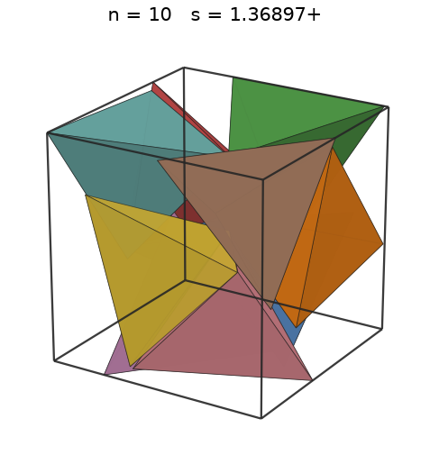 |
| 11 | [1.41563+](tetincub_n11.json) | 1.415636846535 |  | 1.09037 | 0.4570 | 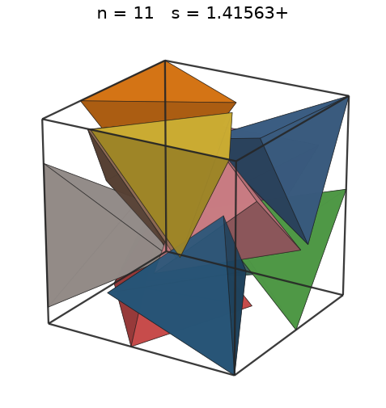 |
| 12 | [1.47063+](tetincub_n12.json) | 1.470633875177 |  | 1.12246 | 0.4446 | 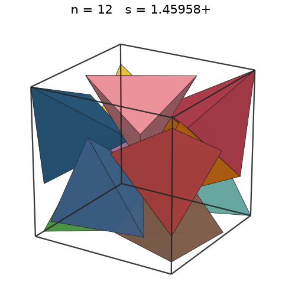 |
| 13 | [1.49853+](tetincub_n13.json) | 1.498537679587 |  | 1.15281 | 0.4553 | 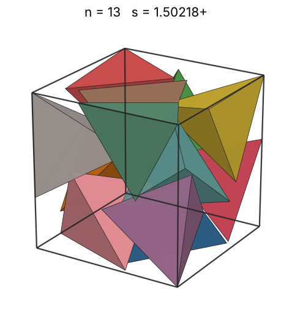 |
| 14 | [1.52458+](tetincub_n14.json) | 1.524586258854 |  | 1.18165 | 0.4656 | 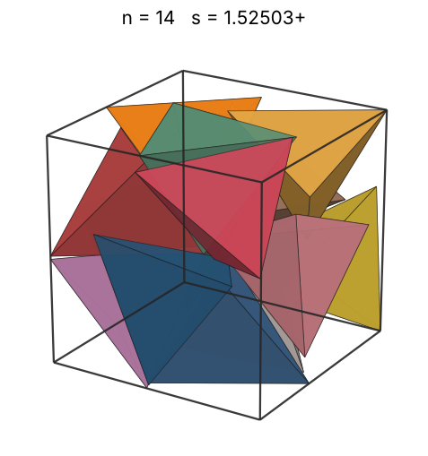 |
| 15 | [1.57316+](tetincub_n15.json) | 1.573159876841 |  | 1.20914 | 0.4541 | 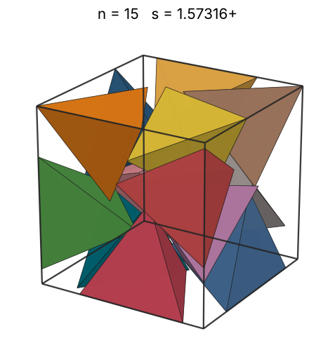 |
| 16 | [1.58969+](tetincub_n16.json) | 1.589699458265 |  | 1.23543 | 0.4694 | 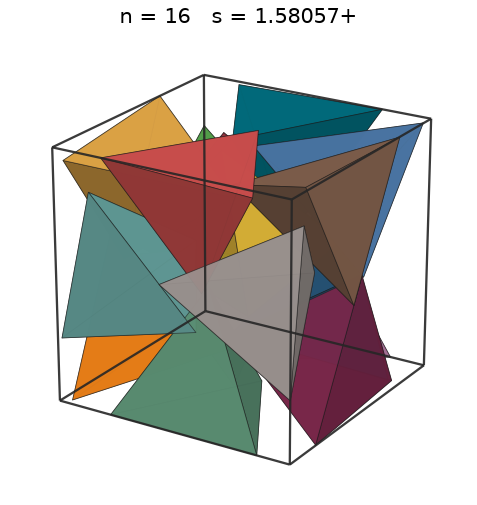 |
| 17 | [1.61298+](tetincub_n17.json) | 1.612987047310 |  | 1.26065 | 0.4774 | 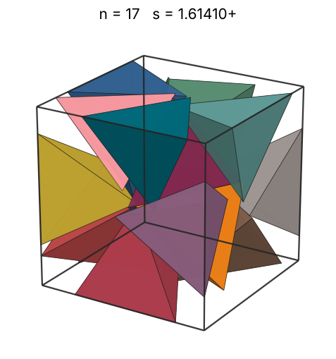 |
| 18 | [1.63962+](tetincub_n18.json) | 1.639628179498 |  | 1.28490 | 0.4812 | 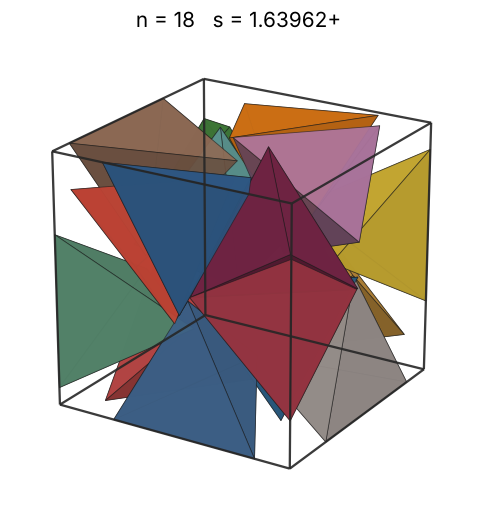 |
| 19 | [1.67186+](tetincub_n19.json) | 1.671866460157 |  | 1.30827 | 0.4792 | 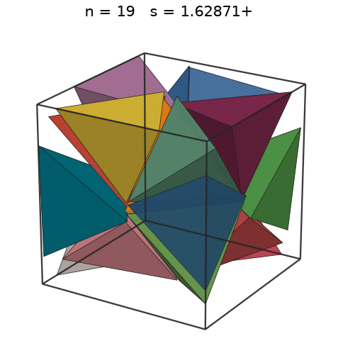 |
| 20 | [1.71130+](tetincub_n20.json) | 1.711309501963 |  | 1.33083 | 0.4703 | 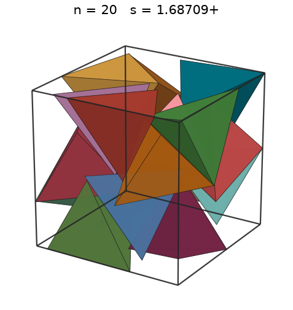 |
| 21 | [1.72306+](tetincub_n21.json) | 1.723061642443 |  | 1.35265 | 0.4838 | 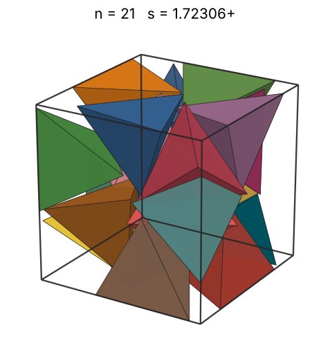 |
| 22 | [1.76198+](tetincub_n22.json) | 1.761981371137 |  | 1.37379 | 0.4740 | 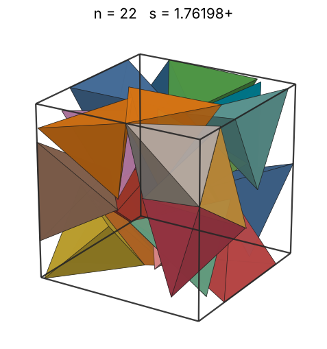 |
| 23 | [1.76198+](tetincub_n23.json) | 1.761981525785 |  | 1.39429 | 0.4955 | 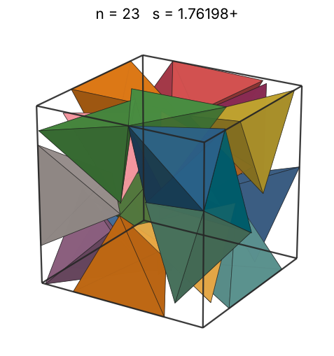 |
| 24 | [1.81667+](tetincub_n24.json) | 1.816669930243 |  | 1.41421 | 0.4718 | 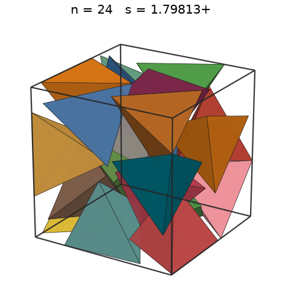 |
| 25 | [1.82875+](tetincub_n25.json) | 1.828755398431 |  | 1.43359 | 0.4817 | 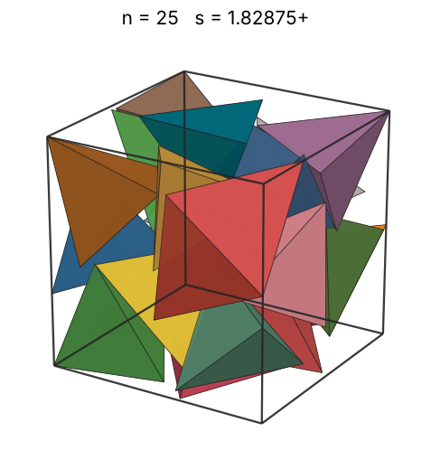 |
| 26 | [1.87341+](tetincub_n26.json) | 1.873411204774 |  | 1.45245 | 0.4660 | 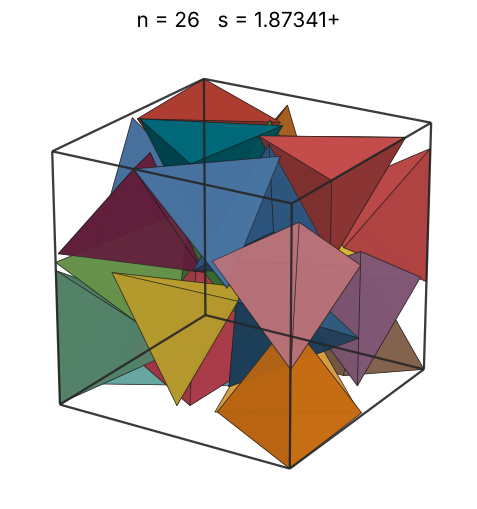 |
| 27 | [1.88204+](tetincub_n27.json) | 1.882049037894 |  | 1.47084 | 0.4773 | 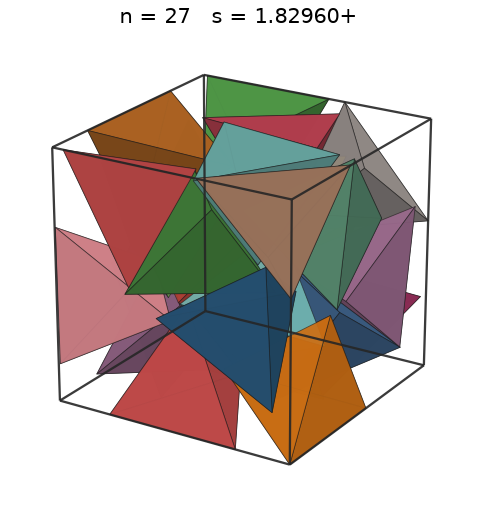 |
| 28 | [1.91567+](tetincub_n28.json) | 1.915670476390 |  | 1.48878 | 0.4694 | 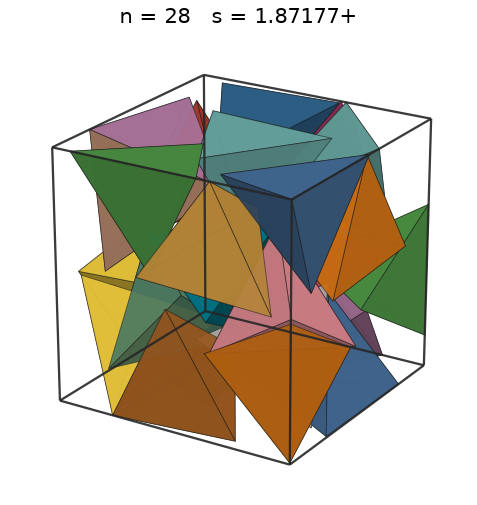 |
| 29 | [1.95356+](tetincub_n29.json) | 1.953567837516 |  | 1.50630 | 0.4584 | 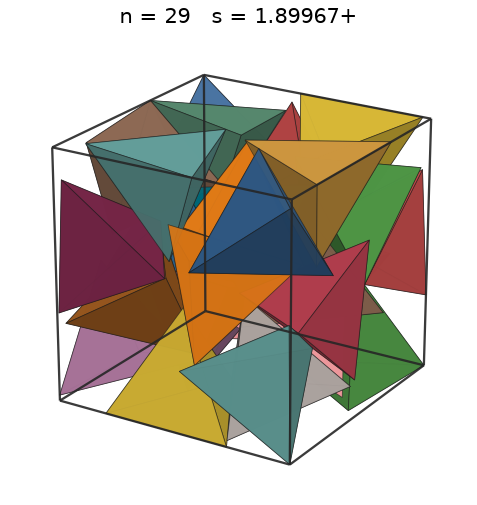 |
| 30 | [1.95356+](tetincub_n30.json) | 1.953567907245 |  | 1.52342 | 0.4742 | 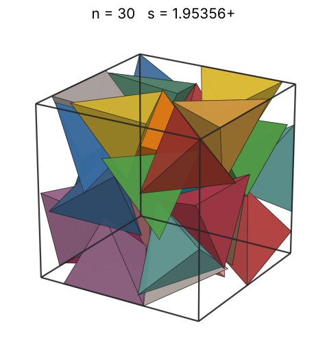 |
| 31 | [2.05484+](tetincub_n31.json) | 2.054844282990 |  | 1.54016 | 0.4211 | 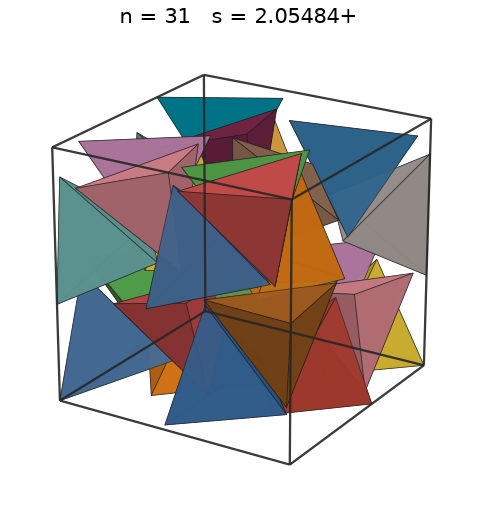 |
| 32 | [2.05516+](tetincub_n32.json) | 2.055161596625 |  | 1.55654 | 0.4345 | 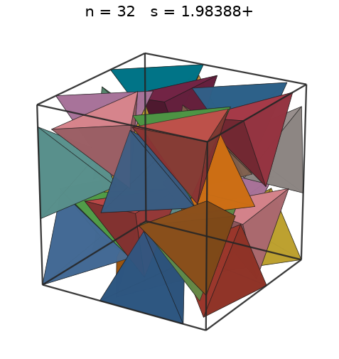 |
| 33 | [2.06826+](tetincub_n33.json) | 2.068268510596 |  | 1.57259 | 0.4396 | 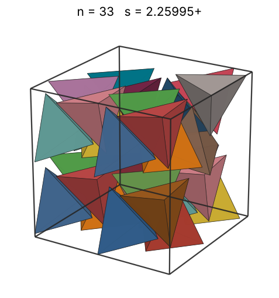 |
| 34 | [2.13706+](tetincub_n34.json) | 2.137062831270 |  | 1.58832 | 0.4105 | 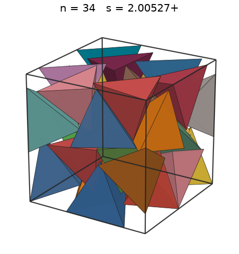 |
| 35 | [2.25438+](tetincub_n35.json) | 2.254386684942 |  | 1.60374 | 0.3600 | 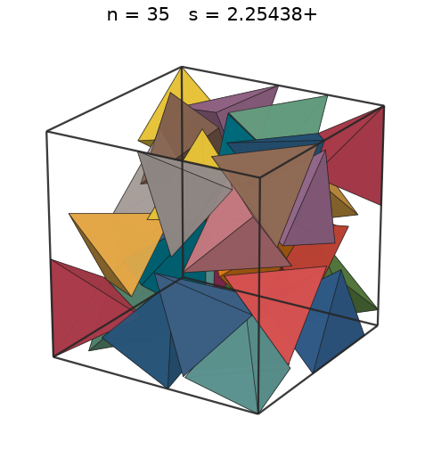 |
| 36 | [2.26084+](tetincub_n36.json) | 2.260848026679 |  | 1.61887 | 0.3671 | 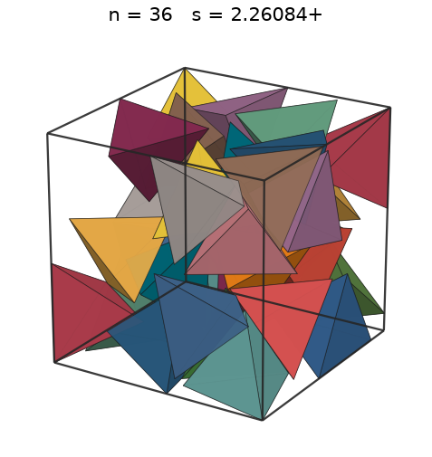 |
| 37 | [2.28513+](tetincub_n37.json) | 2.285130652727 |  | 1.63372 | 0.3654 | 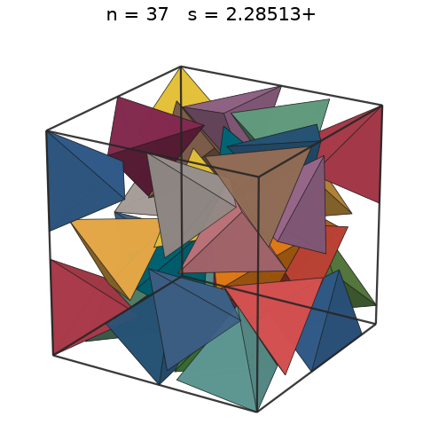 |
| 38 | [2.29768+](tetincub_n38.json) | 2.297686100990 |  | 1.64831 | 0.3692 | 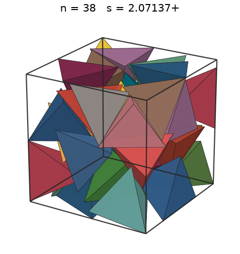 |
| 39 | [2.30507+](tetincub_n39.json) | 2.305074492048 |  | 1.66264 | 0.3753 | 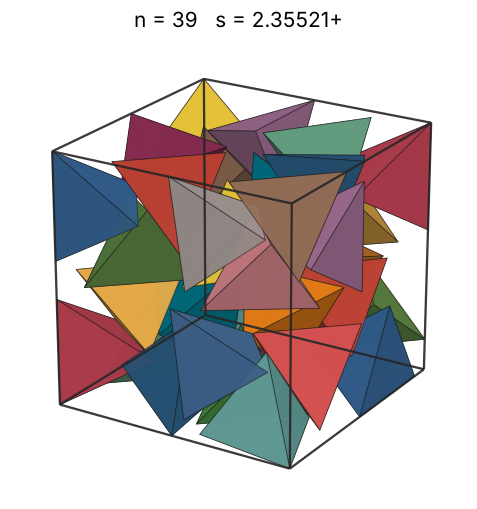 |
| 40 | [2.30755+](tetincub_n40.json) | 2.307557631601 |  | 1.67674 | 0.3837 | 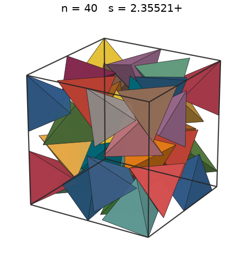 |
| 41 | [2.32668+](tetincub_n41.json) | 2.326683254972 |  | 1.69059 | 0.3836 |  |
| 42 | [2.35257+](tetincub_n42.json) | 2.352572544743 |  | 1.70423 | 0.3801 |  |
| 43 | [2.35952+](tetincub_n43.json) | 2.359521128823 |  | 1.71765 | 0.3858 |  |
| 44 | [2.36504+](tetincub_n44.json) | 2.365046598079 |  | 1.73086 | 0.3920 |  |
| 45 | [2.36802+](tetincub_n45.json) | 2.368026205257 |  | 1.74388 | 0.3994 |  |
| 46 | [2.36969+](tetincub_n46.json) | 2.369693590467 |  | 1.75670 | 0.4074 |  |
| 47 | [2.37142+](tetincub_n47.json) | 2.371420499881 |  | 1.76934 | 0.4153 |  |
| 48 | [2.37682+](tetincub_n48.json) | 2.376821032257 |  | 1.78180 | 0.4213 |  |
| 49 | [2.50710+](tetincub_n49.json) | 2.507108231579 |  | 1.79409 | 0.3664 |  |
| 50 | [2.52469+](tetincub_n50.json) | 2.524690966146 |  | 1.80621 | 0.3662 |  |
| 51 | [2.52469+](tetincub_n51.json) | 2.524690966146 |  | 1.81817 | 0.3735 |  |
| 52 | [2.52469+](tetincub_n52.json) | 2.524690966146 |  | 1.82998 | 0.3808 |  |
| 53 | [2.52469+](tetincub_n53.json) | 2.524690966146 |  | 1.84163 | 0.3881 |  |
| 54 | [2.52469+](tetincub_n54.json) | 2.524690966146 |  | 1.85314 | 0.3955 |  |
| 55 | [2.52469+](tetincub_n55.json) | 2.524690966146 |  | 1.86451 | 0.4028 |  |
| 56 | [2.52469+](tetincub_n56.json) | 2.524690966146 |  | 1.87575 | 0.4101 |  |
| 57 | [2.55130+](tetincub_n57.json) | 2.551304902228 |  | 1.88684 | 0.4045 |  |
| 58 | [2.55151+](tetincub_n58.json) | 2.551516876410 |  | 1.89782 | 0.4115 |  |
| 59 | [2.55292+](tetincub_n59.json) | 2.552929433317 |  | 1.90866 | 0.4179 |  |
| 60 | [2.55298+](tetincub_n60.json) | 2.552983031238 |  | 1.91938 | 0.4250 |  |
| 61 | [2.55525+](tetincub_n61.json) | 2.555257848371 |  | 1.92999 | 0.4309 |  |
| 62 | [2.57086+](tetincub_n62.json) | 2.570867347784 |  | 1.94048 | 0.4300 |  |
| 63 | [2.57113+](tetincub_n63.json) | 2.571132472231 |  | 1.95085 | 0.4368 |  |
| 64 | [2.57203+](tetincub_n64.json) | 2.572036670749 |  | 1.96112 | 0.4433 |  |
| 65 | [2.69304+](tetincub_n65.json) | 2.693040569539 |  | 1.97128 | 0.3922 |  |
| 66 | [2.69304+](tetincub_n66.json) | 2.693040569539 |  | 1.98134 | 0.3982 |  |
| 67 | [2.69304+](tetincub_n67.json) | 2.693040569539 |  | 1.99130 | 0.4043 |  |
| 68 | [2.69304+](tetincub_n68.json) | 2.693040569539 |  | 2.00116 | 0.4103 |  |
| 69 | [2.69304+](tetincub_n69.json) | 2.693040569539 |  | 2.01092 | 0.4163 |  |
| 70 | [2.69304+](tetincub_n70.json) | 2.693040569539 |  | 2.02059 | 0.4224 |  |
| 71 | [2.69304+](tetincub_n71.json) | 2.693040569539 |  | 2.03016 | 0.4284 |  |
| 72 | [2.69304+](tetincub_n72.json) | 2.693040569539 |  | 2.03965 | 0.4344 |  |
| 73 | [2.71656+](tetincub_n73.json) | 2.716561330947 |  | 2.04905 | 0.4291 |  |
| 74 | [2.71997+](tetincub_n74.json) | 2.719978546401 |  | 2.05836 | 0.4334 |  |
| 75 | [2.72138+](tetincub_n75.json) | 2.721386208705 |  | 2.06759 | 0.4386 |  |
| 76 | [2.72167+](tetincub_n76.json) | 2.721678822729 |  | 2.07674 | 0.4443 |  |
| 77 | [2.72231+](tetincub_n77.json) | 2.722311457723 |  | 2.08581 | 0.4498 |  |
| 78 | [2.73197+](tetincub_n78.json) | 2.731970627516 |  | 2.09480 | 0.4508 |  |
| 79 | [2.73881+](tetincub_n79.json) | 2.738815163329 |  | 2.10372 | 0.4532 |  |
| 80 | [2.74250+](tetincub_n80.json) | 2.742502033615 |  | 2.11255 | 0.4571 |  |
| 81 | [2.81675+](tetincub_n81.json) | 2.816751020521 |  | 2.12132 | 0.4271 |  |
| 82 | [2.81685+](tetincub_n82.json) | 2.816851278718 |  | 2.13001 | 0.4324 |  |
| 83 | [2.81716+](tetincub_n83.json) | 2.817169003918 |  | 2.13864 | 0.4375 |  |
| 84 | [2.82115+](tetincub_n84.json) | 2.821156701014 |  | 2.14719 | 0.4409 |  |
| 85 | [2.82532+](tetincub_n85.json) | 2.825326368898 |  | 2.15568 | 0.4442 |  |
| 86 | [2.82572+](tetincub_n86.json) | 2.825722197019 |  | 2.16410 | 0.4492 |  |
| 87 | [2.82633+](tetincub_n87.json) | 2.826336981980 |  | 2.17246 | 0.4541 |  |
| 88 | [2.83372+](tetincub_n88.json) | 2.833721769356 |  | 2.18075 | 0.4558 |  |
| 89 | [2.94126+](tetincub_n89.json) | 2.941267749652 |  | 2.18898 | 0.4122 |  |
| 90 | [2.94126+](tetincub_n90.json) | 2.941267749652 |  | 2.19715 | 0.4168 |  |
| 91 | [2.94126+](tetincub_n91.json) | 2.941267749652 |  | 2.20525 | 0.4215 |  |
| 92 | [2.94126+](tetincub_n92.json) | 2.941267749652 |  | 2.21330 | 0.4261 |  |
| 93 | [2.94126+](tetincub_n93.json) | 2.941267749652 |  | 2.22129 | 0.4307 |  |
| 94 | [2.94126+](tetincub_n94.json) | 2.941267749652 |  | 2.22922 | 0.4354 |  |
| 95 | [2.94126+](tetincub_n95.json) | 2.941267749652 |  | 2.23710 | 0.4400 |  |
| 96 | [2.94126+](tetincub_n96.json) | 2.941267749652 |  | 2.24492 | 0.4446 |  |
| 97 | [3.00436+](tetincub_n97.json) | 3.004365662225 |  | 2.25269 | 0.4215 |  |
| 98 | [3.00436+](tetincub_n98.json) | 3.004365662225 |  | 2.26041 | 0.4259 |  |
| 99 | [3.00436+](tetincub_n99.json) | 3.004365662225 |  | 2.26807 | 0.4302 |  |
| 100 | [3.00436+](tetincub_n100.json) | 3.004365662225 |  | 2.27568 | 0.4346 |  |
