# Tetrahedra in a dodecahedron

s = container edge / piece edge; every row certified in exact arithmetic.

| n | s | touching limit | closed form (conj.) | volume bound | density | picture |
|---|---|---|---|---|---|---|
| 2 | [0.58268+](tetindod_n02.json) | 0.582688071525 |  | 0.31332 | 0.1555 | 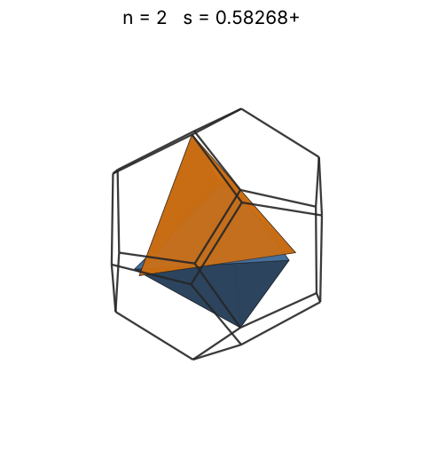 |
| 3 | [0.61803+](tetindod_n03.json) | 0.618034039261 |  | 0.35866 | 0.1954 | 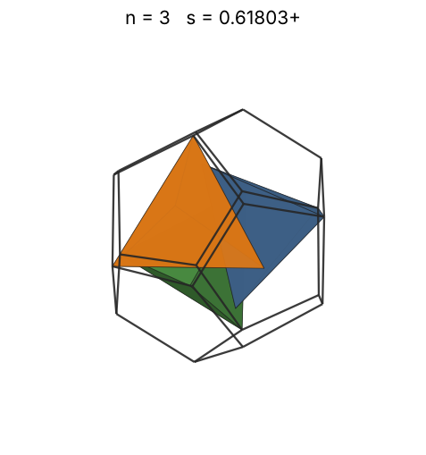 |
| 4 | [0.62677+](tetindod_n04.json) | 0.626774623208 |  | 0.39476 | 0.2498 | 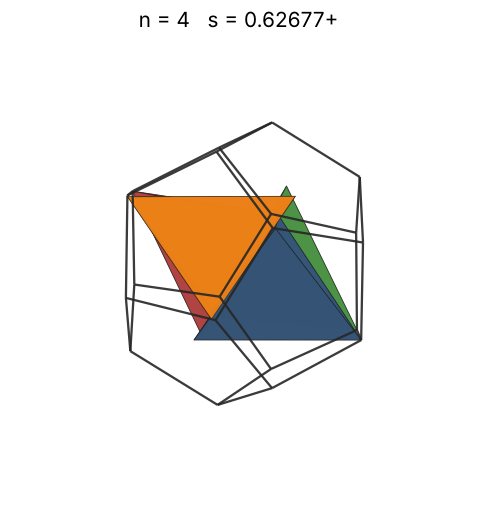 |
| 5 | [0.63166+](tetindod_n05.json) | 0.631661448162 |  | 0.42524 | 0.3051 | 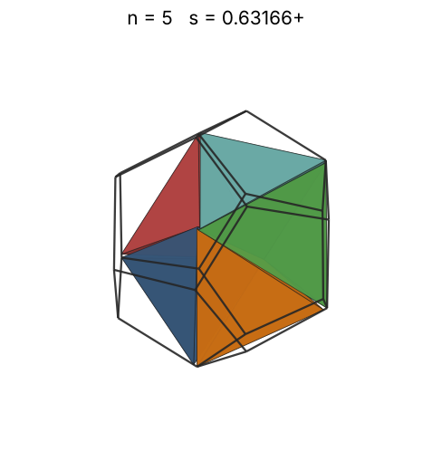 |
| 6 | [0.68232+](tetindod_n06.json) | 0.682322777799 |  | 0.45188 | 0.2905 | 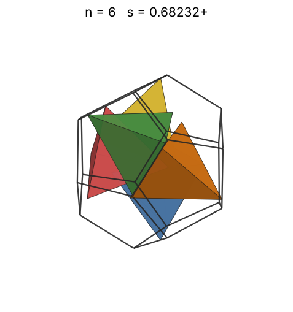 |
| 7 | [0.69523+](tetindod_n07.json) | 0.695234394984 |  | 0.47571 | 0.3204 | 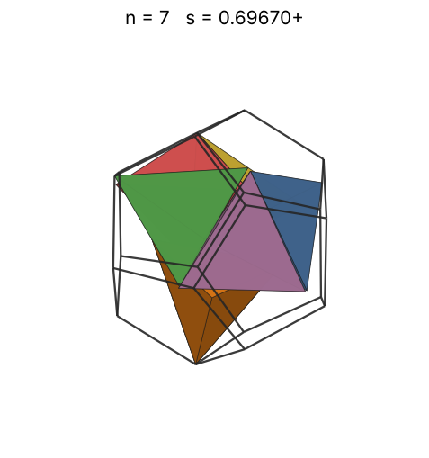 |
| 8 | [0.71555+](tetindod_n08.json) | 0.715554150981 |  | 0.49736 | 0.3358 | 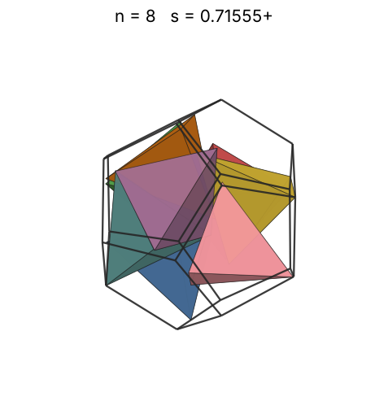 |
| 9 | [0.72602+](tetindod_n09.json) | 0.726025999504 |  | 0.51728 | 0.3617 | 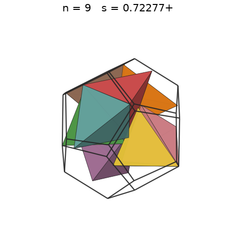 |
| 10 | [0.73606+](tetindod_n10.json) | 0.736060693945 |  | 0.53577 | 0.3856 | 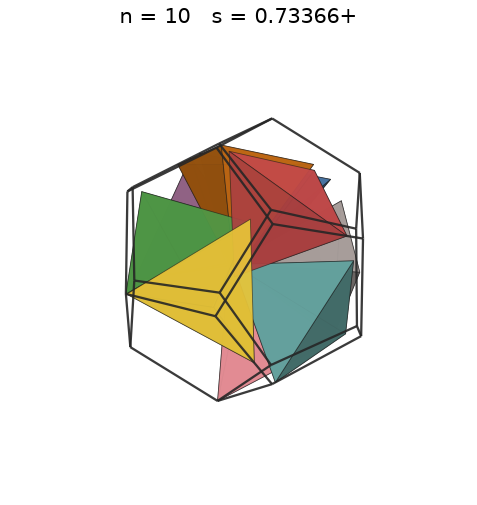 |
| 11 | [0.74749+](tetindod_n11.json) | 0.747499021455 |  | 0.55306 | 0.4050 | 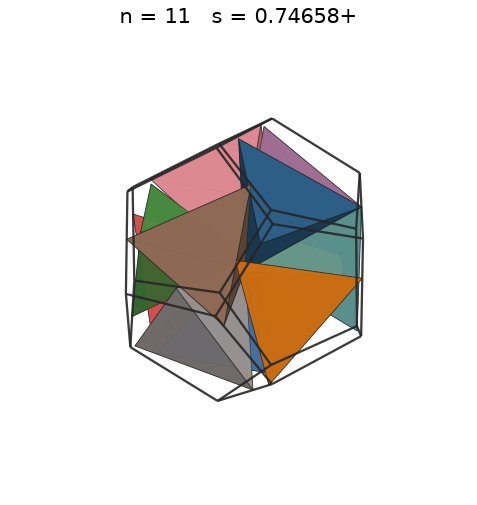 |
| 12 | [0.75415+](tetindod_n12.json) | 0.754150285500 |  | 0.56934 | 0.4303 | 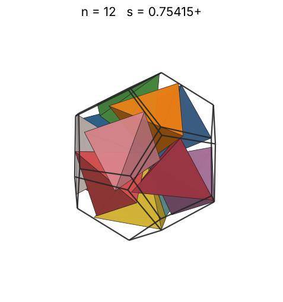 |
| 13 | [0.76182+](tetindod_n13.json) | 0.761829004448 |  | 0.58473 | 0.4522 | 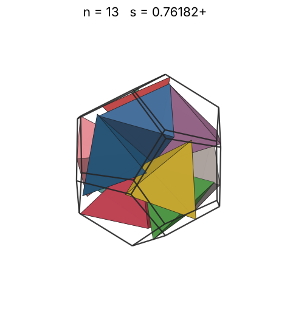 |
| 14 | [0.76588+](tetindod_n14.json) | 0.765888119135 |  | 0.59936 | 0.4792 | 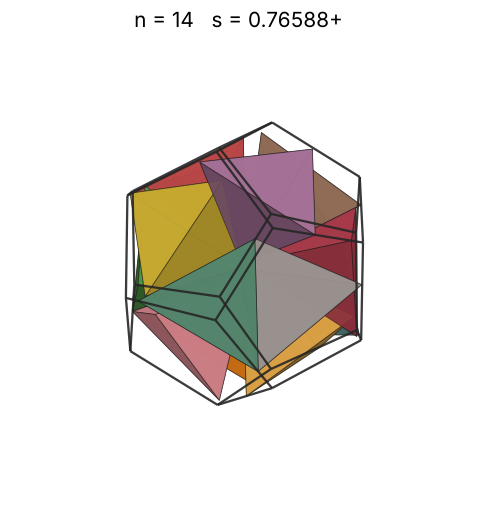 |
| 15 | [0.77214+](tetindod_n15.json) | 0.772142868128 |  | 0.61330 | 0.5011 | 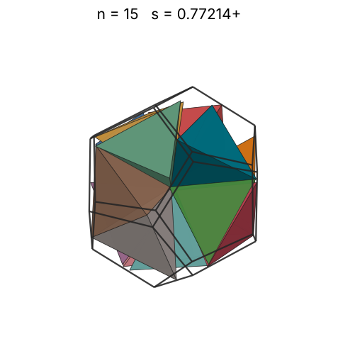 |
| 16 | [0.77943+](tetindod_n16.json) | 0.779435523846 |  | 0.62664 | 0.5196 | 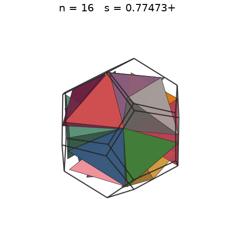 |
| 17 | [0.78266+](tetindod_n17.json) | 0.782667237403 |  | 0.63943 | 0.5453 | 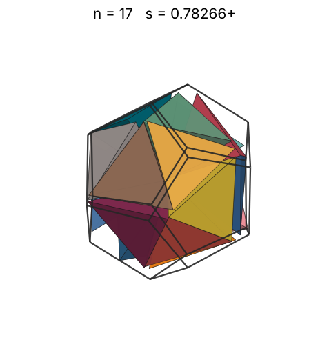 |
| 18 | [0.79634+](tetindod_n18.json) | 0.796348928873 |  | 0.65173 | 0.5481 | 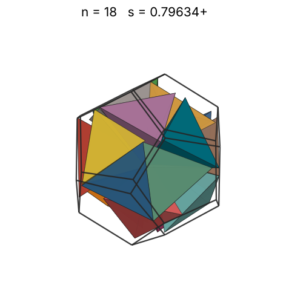 |
| 19 | [0.82209+](tetindod_n19.json) | 0.822092702147 |  | 0.66358 | 0.5259 | 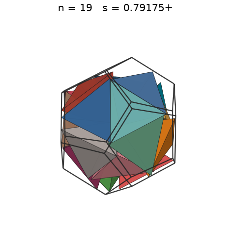 |
| 20 | [0.82209+](tetindod_n20.json) | 0.822092853547 |  | 0.67502 | 0.5536 | 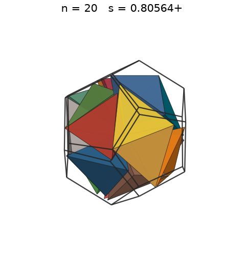 |
| 21 | [0.82929+](tetindod_n21.json) | 0.829293705136 |  | 0.68609 | 0.5663 | 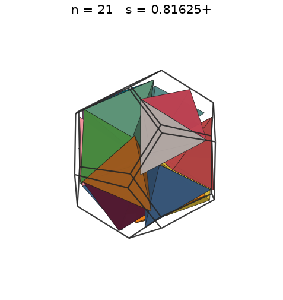 |
| 22 | [0.85626+](tetindod_n22.json) | 0.856260015383 |  | 0.69681 | 0.5389 | 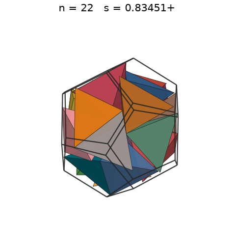 |
| 23 | [0.89585+](tetindod_n23.json) | 0.895857518543 |  | 0.70722 | 0.4920 | 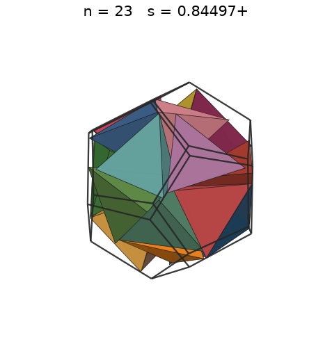 |
| 24 | [0.89585+](tetindod_n24.json) | 0.895857532623 |  | 0.71732 | 0.5134 | 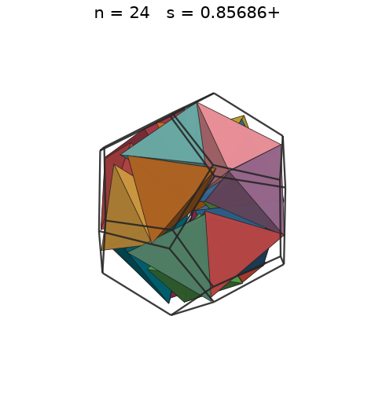 |
| 25 | [0.93341+](tetindod_n25.json) | 0.933415801795 |  | 0.72715 | 0.4728 | 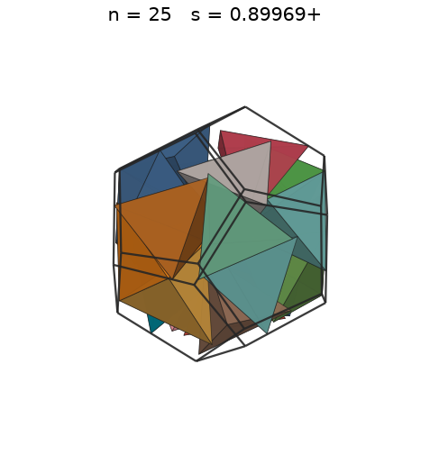 |
| 26 | [0.93341+](tetindod_n26.json) | 0.933415892925 |  | 0.73672 | 0.4917 | 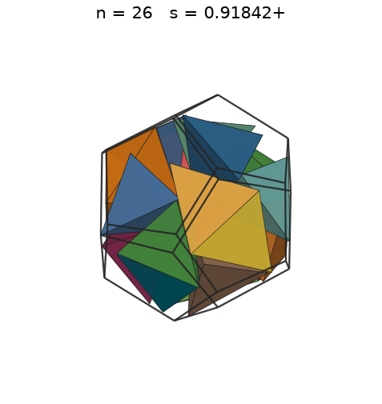 |
| 27 | [0.96418+](tetindod_n27.json) | 0.964182208387 |  | 0.74604 | 0.4632 | 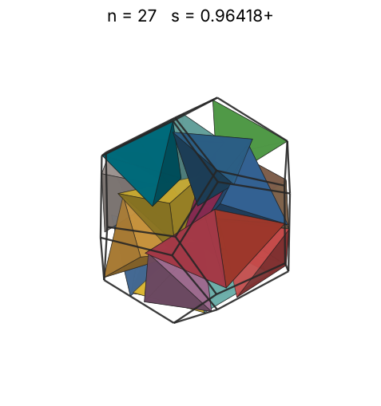 |
| 28 | [0.96894+](tetindod_n28.json) | 0.968943224468 |  | 0.75514 | 0.4734 | 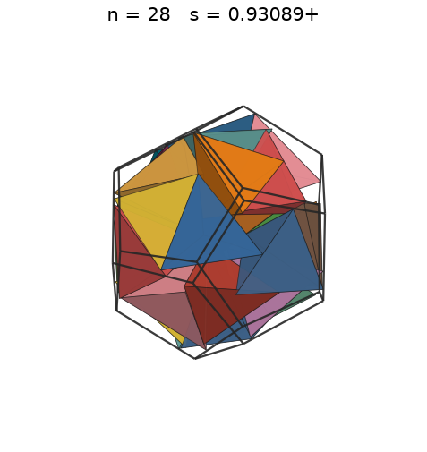 |
| 29 | [1.01208+](tetindod_n29.json) | 1.012085211004 |  | 0.76403 | 0.4302 | 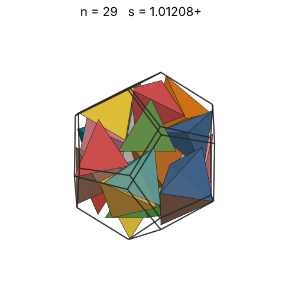 |
| 30 | [1.04258+](tetindod_n30.json) | 1.042588370949 |  | 0.77271 | 0.4071 | 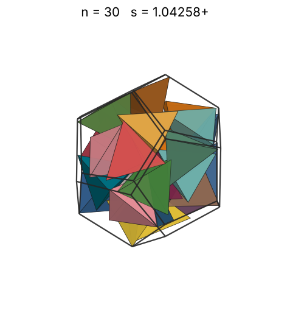 |
| 31 | [1.06211+](tetindod_n31.json) | 1.062113828037 |  | 0.78120 | 0.3979 | 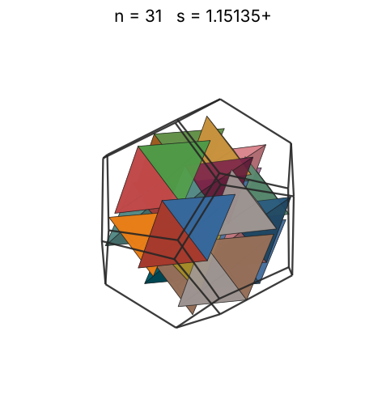 |
| 32 | [1.06456+](tetindod_n32.json) | 1.064560480591 |  | 0.78951 | 0.4079 | 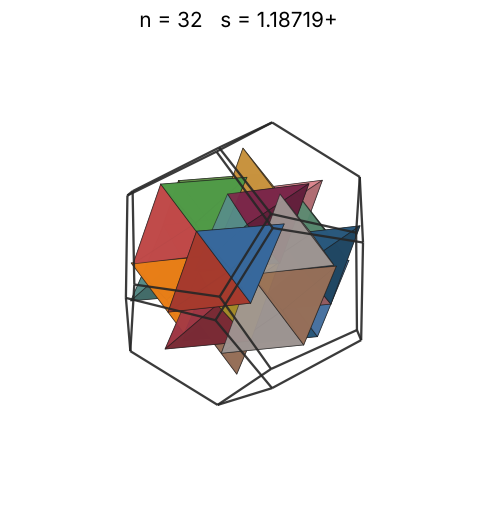 |
| 33 | [1.06519+](tetindod_n33.json) | 1.065199780701 |  | 0.79765 | 0.4199 | 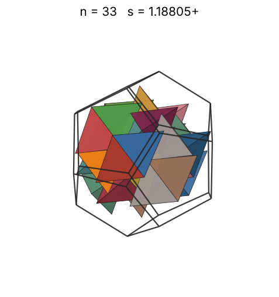 |
| 34 | [1.06867+](tetindod_n34.json) | 1.068670246150 |  | 0.80563 | 0.4284 | 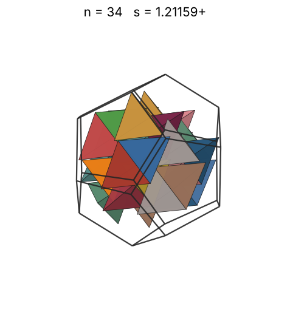 |
| 35 | [1.07594+](tetindod_n35.json) | 1.075948503162 |  | 0.81345 | 0.4321 | 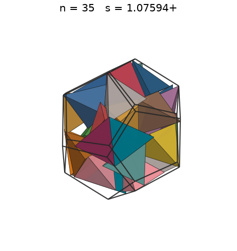 |
| 36 | [1.07771+](tetindod_n36.json) | 1.077716647829 |  | 0.82113 | 0.4423 | 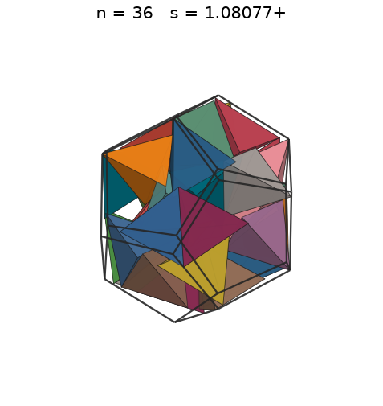 |
| 37 | [1.07873+](tetindod_n37.json) | 1.078735191795 |  | 0.82866 | 0.4533 | 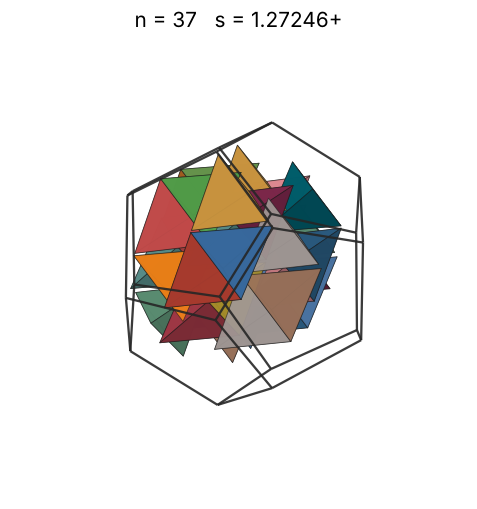 |
| 38 | [1.07901+](tetindod_n38.json) | 1.079016243620 |  | 0.83606 | 0.4652 | 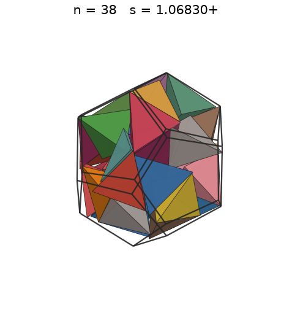 |
| 39 | [1.07984+](tetindod_n39.json) | 1.079842447885 |  | 0.84333 | 0.4763 | 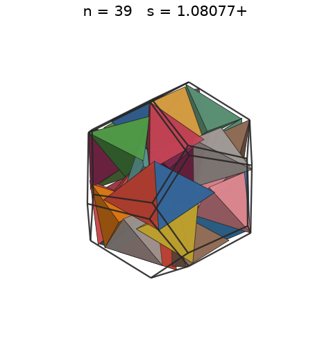 |
| 40 | [1.08054+](tetindod_n40.json) | 1.080547503245 |  | 0.85048 | 0.4876 | 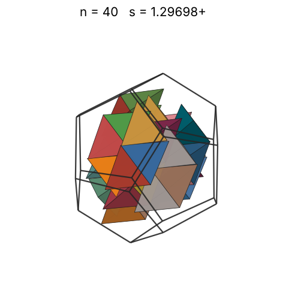 |
| 41 | [1.08077+](tetindod_n41.json) | 1.080778512773 |  | 0.85751 | 0.4995 |  |
| 42 | [1.08183+](tetindod_n42.json) | 1.081830698870 |  | 0.86442 | 0.5102 |  |
| 43 | [1.08237+](tetindod_n43.json) | 1.082371583011 |  | 0.87123 | 0.5215 |  |
| 44 | [1.08432+](tetindod_n44.json) | 1.084325462072 |  | 0.87793 | 0.5308 |  |
| 45 | [1.09757+](tetindod_n45.json) | 1.097572043605 |  | 0.88453 | 0.5234 |  |
| 46 | [1.09937+](tetindod_n46.json) | 1.099375383994 |  | 0.89104 | 0.5324 |  |
| 47 | [1.10708+](tetindod_n47.json) | 1.107080783639 |  | 0.89745 | 0.5327 |  |
| 48 | [1.11485+](tetindod_n48.json) | 1.114856209773 |  | 0.90377 | 0.5327 |  |
| 49 | [1.11629+](tetindod_n49.json) | 1.116290214390 |  | 0.91000 | 0.5417 |  |
| 50 | [1.12620+](tetindod_n50.json) | 1.126202992881 |  | 0.91615 | 0.5383 |  |
| 51 | [1.12871+](tetindod_n51.json) | 1.128714797318 |  | 0.92222 | 0.5454 |  |
| 52 | [1.13454+](tetindod_n52.json) | 1.134544148633 |  | 0.92820 | 0.5476 |  |
| 53 | [1.14311+](tetindod_n53.json) | 1.143116928833 |  | 0.93412 | 0.5457 |  |
| 54 | [1.14926+](tetindod_n54.json) | 1.149267399156 |  | 0.93996 | 0.5471 |  |
| 55 | [1.15393+](tetindod_n55.json) | 1.153935670214 |  | 0.94572 | 0.5505 |  |
| 56 | [1.15577+](tetindod_n56.json) | 1.155776779468 |  | 0.95142 | 0.5578 |  |
| 57 | [1.16990+](tetindod_n57.json) | 1.169903947047 |  | 0.95705 | 0.5475 |  |
| 58 | [1.17713+](tetindod_n58.json) | 1.177139368220 |  | 0.96261 | 0.5469 |  |
| 59 | [1.17723+](tetindod_n59.json) | 1.177230343635 |  | 0.96811 | 0.5562 |  |
| 60 | [1.18057+](tetindod_n60.json) | 1.180573120334 |  | 0.97355 | 0.5608 |  |
| 61 | [1.20330+](tetindod_n61.json) | 1.203301026657 |  | 0.97893 | 0.5384 |  |
| 62 | [1.20636+](tetindod_n62.json) | 1.206362976120 |  | 0.98425 | 0.5431 |  |
| 63 | [1.21079+](tetindod_n63.json) | 1.210791882069 |  | 0.98952 | 0.5458 |  |
| 64 | [1.21478+](tetindod_n64.json) | 1.214783447578 |  | 0.99472 | 0.5490 |  |
| 65 | [1.23047+](tetindod_n65.json) | 1.230472754881 |  | 0.99988 | 0.5366 |  |
| 66 | [1.23277+](tetindod_n66.json) | 1.232773834561 |  | 1.00498 | 0.5418 |  |
| 67 | [1.23437+](tetindod_n67.json) | 1.234374932959 |  | 1.01003 | 0.5478 |  |
| 68 | [1.23509+](tetindod_n68.json) | 1.235096909135 |  | 1.01503 | 0.5551 |  |
| 69 | [1.24894+](tetindod_n69.json) | 1.248945263154 |  | 1.01998 | 0.5447 |  |
| 70 | [1.25955+](tetindod_n70.json) | 1.259558155954 |  | 1.02489 | 0.5387 |  |
| 71 | [1.27090+](tetindod_n71.json) | 1.270903282578 |  | 1.02974 | 0.5319 |  |
| 72 | [1.27422+](tetindod_n72.json) | 1.274228759864 |  | 1.03455 | 0.5352 |  |
| 73 | [1.28743+](tetindod_n73.json) | 1.287434136999 |  | 1.03932 | 0.5261 |  |
| 74 | [1.28901+](tetindod_n74.json) | 1.289013989973 |  | 1.04405 | 0.5314 |  |
| 75 | [1.29334+](tetindod_n75.json) | 1.293348926579 |  | 1.04873 | 0.5331 |  |
| 76 | [1.30098+](tetindod_n76.json) | 1.300983056873 |  | 1.05337 | 0.5308 |  |
| 77 | [1.30568+](tetindod_n77.json) | 1.305687234055 |  | 1.05797 | 0.5320 |  |
| 78 | [1.30922+](tetindod_n78.json) | 1.309225184665 |  | 1.06253 | 0.5345 |  |
| 79 | [1.30935+](tetindod_n79.json) | 1.309353108947 |  | 1.06705 | 0.5412 |  |
| 80 | [1.31398+](tetindod_n80.json) | 1.313988783059 |  | 1.07153 | 0.5423 |  |
| 81 | [1.32157+](tetindod_n81.json) | 1.321577777455 |  | 1.07598 | 0.5397 |  |
| 82 | [1.33225+](tetindod_n82.json) | 1.332250946543 |  | 1.08039 | 0.5333 |  |
| 83 | [1.33225+](tetindod_n83.json) | 1.332250946543 |  | 1.08476 | 0.5398 |  |
| 84 | [1.34162+](tetindod_n84.json) | 1.341621885111 |  | 1.08910 | 0.5350 |  |
| 85 | [1.42831+](tetindod_n85.json) | 1.428312056318 |  | 1.09341 | 0.4486 |  |
| 86 | [1.42831+](tetindod_n86.json) | 1.428312173379 |  | 1.09768 | 0.4539 |  |
| 87 | [1.42831+](tetindod_n87.json) | 1.428312427151 |  | 1.10192 | 0.4592 |  |
| 88 | [1.42831+](tetindod_n88.json) | 1.428312465402 |  | 1.10612 | 0.4645 |  |
| 89 | [1.42831+](tetindod_n89.json) | 1.428312535890 |  | 1.11030 | 0.4697 |  |
| 90 | [1.42831+](tetindod_n90.json) | 1.428312777269 |  | 1.11444 | 0.4750 |  |
| 91 | [1.42831+](tetindod_n91.json) | 1.428312885737 |  | 1.11855 | 0.4803 |  |
| 92 | [1.42831+](tetindod_n92.json) | 1.428312985916 |  | 1.12264 | 0.4856 |  |
| 93 | [1.42831+](tetindod_n93.json) | 1.428313020428 |  | 1.12669 | 0.4908 |  |
| 94 | [1.42831+](tetindod_n94.json) | 1.428313020428 |  | 1.13071 | 0.4961 |  |
| 95 | [1.42831+](tetindod_n95.json) | 1.428313033772 |  | 1.13471 | 0.5014 |  |
| 96 | [1.64418+](tetindod_n96.json) | 1.644185707094 |  | 1.13868 | 0.3322 |  |
| 97 | [1.64418+](tetindod_n97.json) | 1.644185707094 |  | 1.14262 | 0.3356 |  |
| 98 | [1.64418+](tetindod_n98.json) | 1.644185707094 |  | 1.14653 | 0.3391 |  |
| 99 | [1.64418+](tetindod_n99.json) | 1.644185707094 |  | 1.15041 | 0.3425 |  |
| 100 | [1.64418+](tetindod_n100.json) | 1.644185707094 |  | 1.15428 | 0.3460 |  |
