# Tetrahedra in an icosahedron

s = container edge / piece edge; every row certified in exact arithmetic.

| n | s | touching limit | closed form (conj.) | volume bound | density | picture |
|---|---|---|---|---|---|---|
| 2 | [0.85851+](tetinico_n02.json) | 0.858515365522 |  | 0.47627 | 0.1707 | 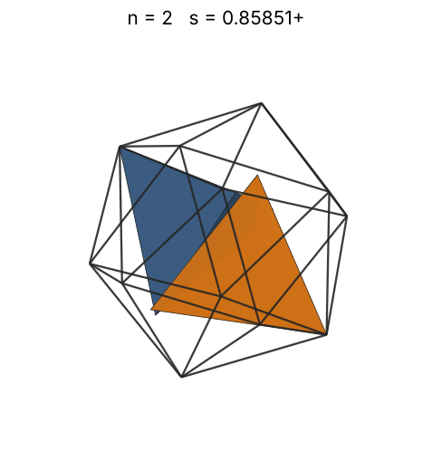 |
| 3 | [0.93217+](tetinico_n03.json) | 0.932176302083 |  | 0.54520 | 0.2001 | 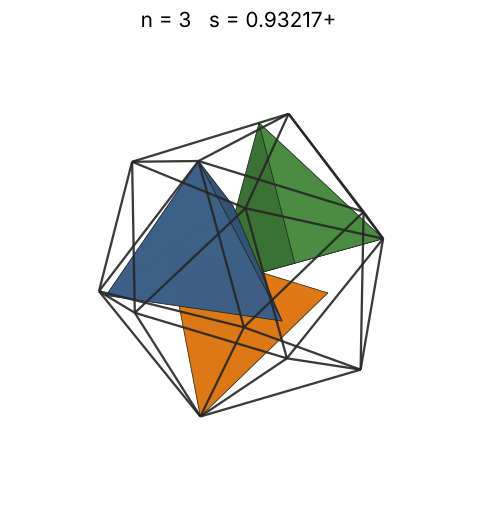 |
| 4 | [0.98651+](tetinico_n04.json) | 0.986514118901 |  | 0.60007 | 0.2251 | 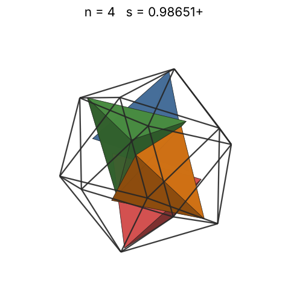 |
| 5 | [1.00910+](tetinico_n05.json) | 1.009100454629 |  | 0.64640 | 0.2628 | 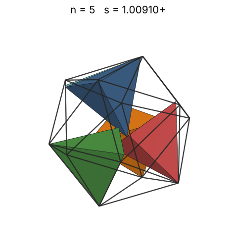 |
| 6 | [1.01873+](tetinico_n06.json) | 1.018736988907 |  | 0.68691 | 0.3066 | 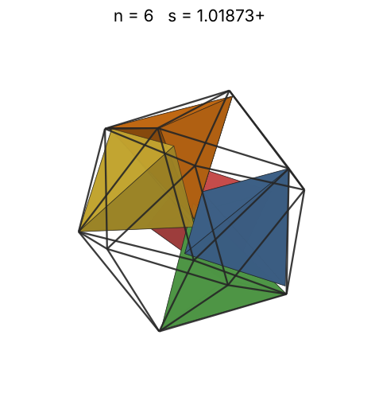 |
| 7 | [1.02714+](tetinico_n07.json) | 1.027147509520 |  | 0.72312 | 0.3489 | 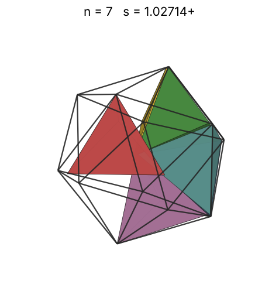 |
| 8 | [1.03686+](tetinico_n08.json) | 1.036862183810 |  | 0.75604 | 0.3877 | 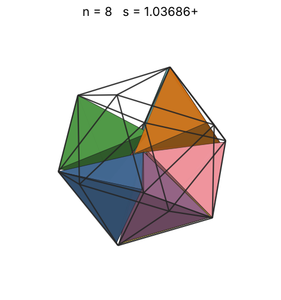 |
| 9 | [1.04041+](tetinico_n09.json) | 1.040419002395 |  | 0.78631 | 0.4317 | 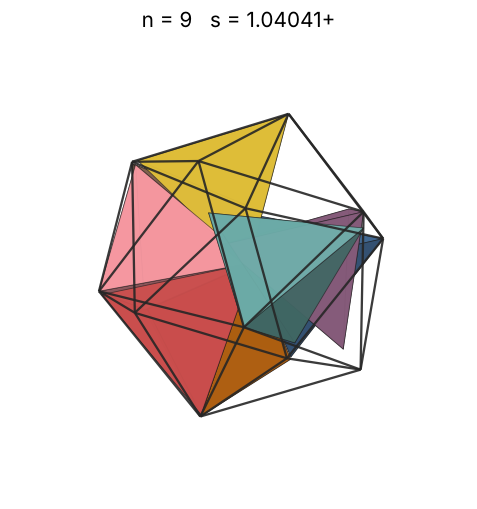 |
| 10 | [1.05057+](tetinico_n10.json) | 1.050573964577 |  | 0.81442 | 0.4659 | 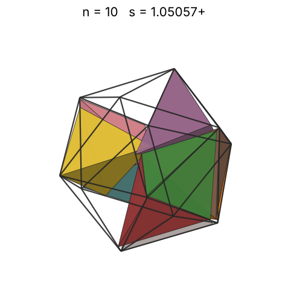 |
| 11 | [1.05544+](tetinico_n11.json) | 1.055443281785 |  | 0.84071 | 0.5054 | 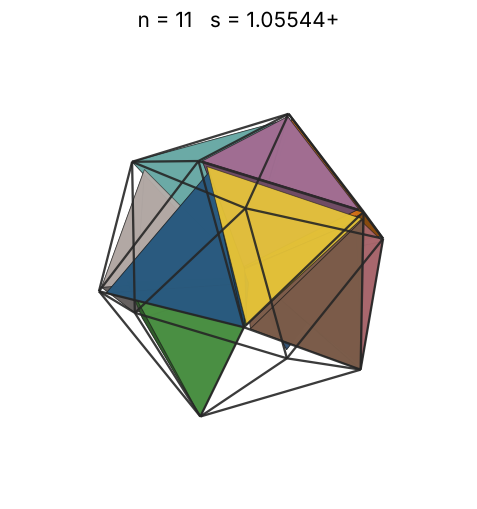 |
| 12 | [1.06160+](tetinico_n12.json) | 1.061602144585 |  | 0.86545 | 0.5418 | 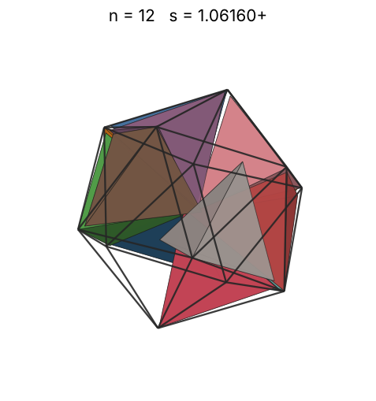 |
| 13 | [1.06827+](tetinico_n13.json) | 1.068270118224 |  | 0.88885 | 0.5760 | 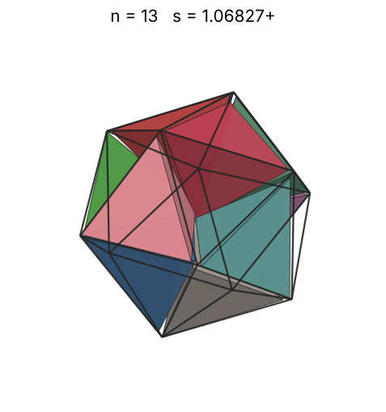 |
| 14 | [1.06949+](tetinico_n14.json) | 1.069494014137 |  | 0.91108 | 0.6182 | 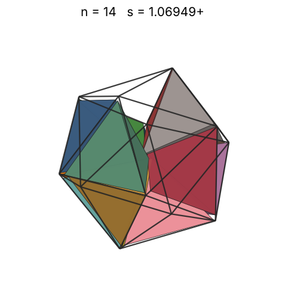 |
| 15 | [1.07377+](tetinico_n15.json) | 1.073774853142 |  | 0.93227 | 0.6545 | 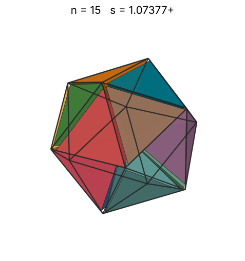 |
| 16 | [1.07676+](tetinico_n16.json) | 1.076767570967 |  | 0.95255 | 0.6923 | 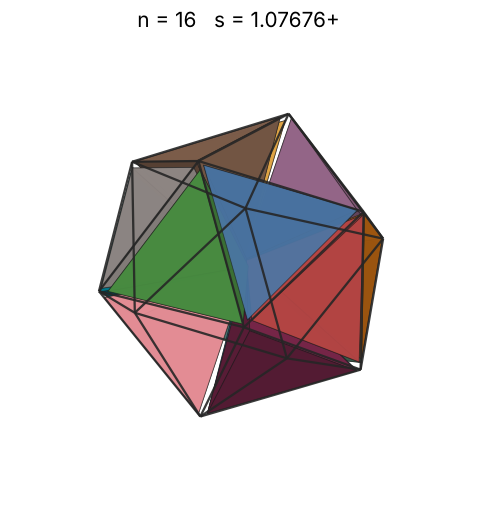 |
| 17 | [1.12070+](tetinico_n17.json) | 1.120703039452 |  | 0.97199 | 0.6524 | 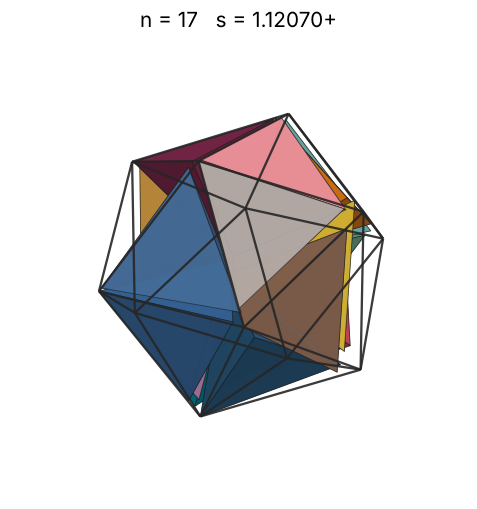 |
| 18 | [1.15697+](tetinico_n18.json) | 1.156973979404 |  | 0.99069 | 0.6278 | 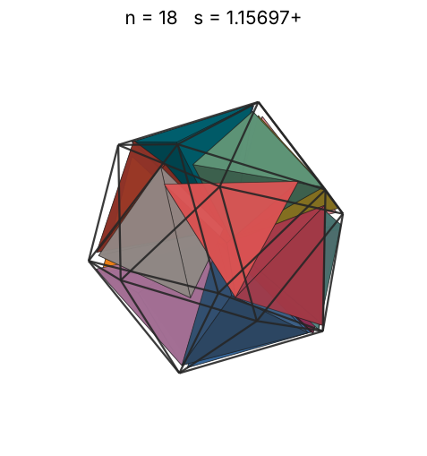 |
| 19 | [1.17116+](tetinico_n19.json) | 1.171164532941 |  | 1.00871 | 0.6389 | 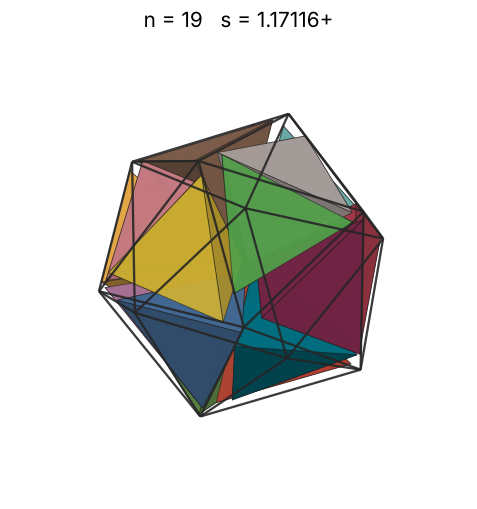 |
| 20 | [1.24846+](tetinico_n20.json) | 1.248463949958 |  | 1.02610 | 0.5552 | 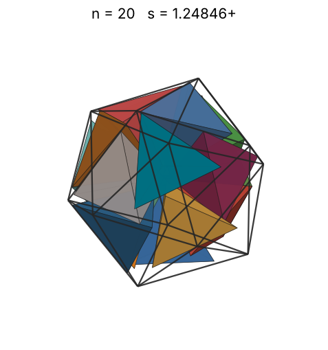 |
| 21 | [1.29908+](tetinico_n21.json) | 1.299086263254 |  | 1.04292 | 0.5174 | 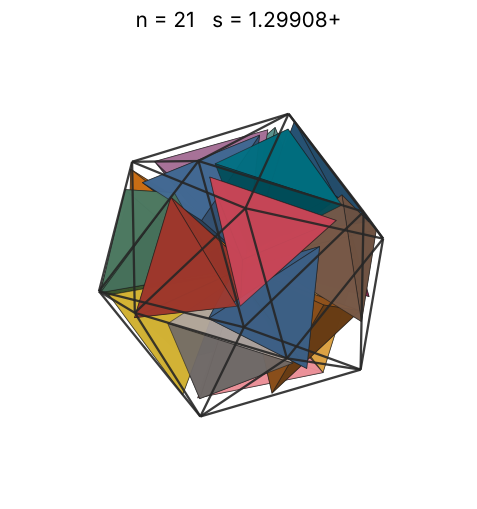 |
| 22 | [1.31807+](tetinico_n22.json) | 1.318076684982 |  | 1.05922 | 0.5190 | 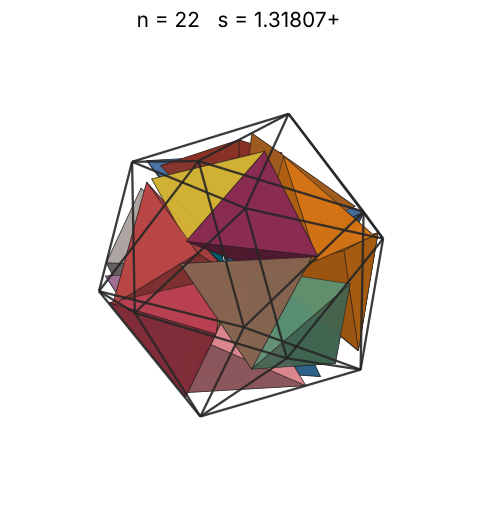 |
| 23 | [1.32185+](tetinico_n23.json) | 1.321850146091 |  | 1.07503 | 0.5379 | 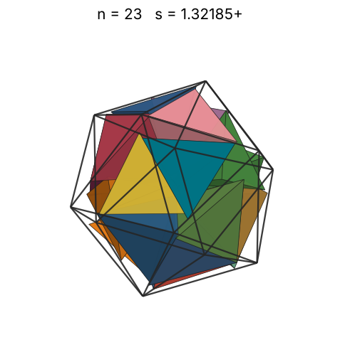 |
| 24 | [1.38508+](tetinico_n24.json) | 1.385082392830 |  | 1.09039 | 0.4879 | 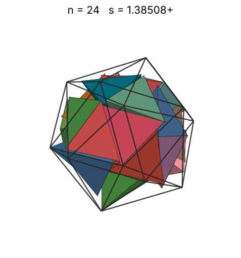 |
| 25 | [1.39742+](tetinico_n25.json) | 1.397427906173 |  | 1.10533 | 0.4949 | 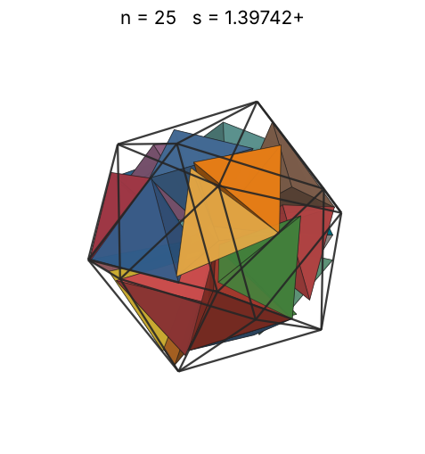 |
| 26 | [1.44295+](tetinico_n26.json) | 1.442951555438 |  | 1.11988 | 0.4675 | 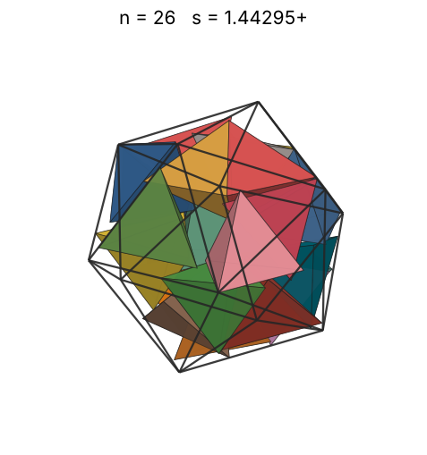 |
| 27 | [1.47668+](tetinico_n27.json) | 1.476688945127 |  | 1.13406 | 0.4529 | 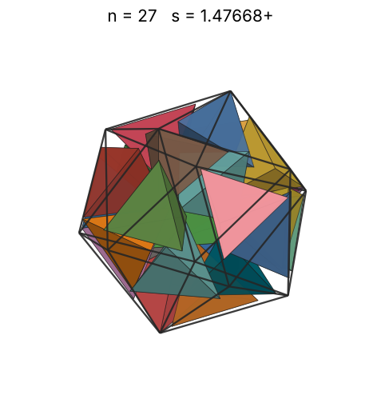 |
| 28 | [1.48202+](tetinico_n28.json) | 1.482028010497 |  | 1.14789 | 0.4647 | 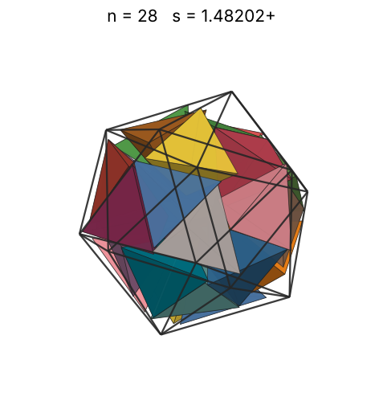 |
| 29 | [1.52537+](tetinico_n29.json) | 1.525378423359 |  | 1.16139 | 0.4414 | 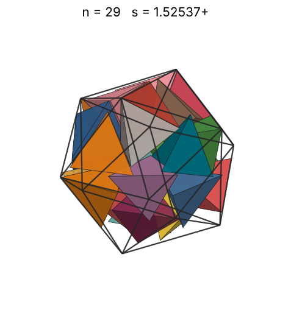 |
| 30 | [1.52645+](tetinico_n30.json) | 1.526457260117 |  | 1.17459 | 0.4556 | 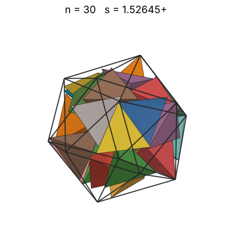 |
