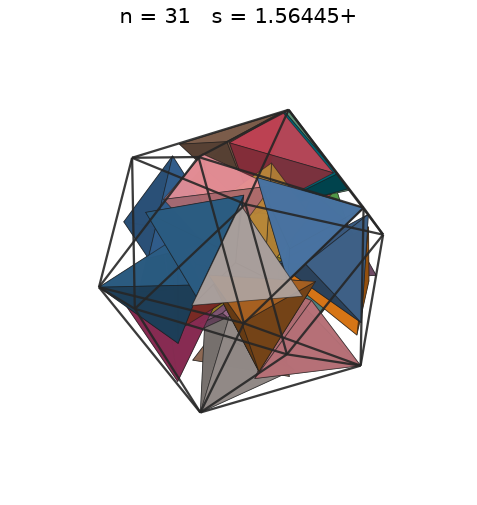
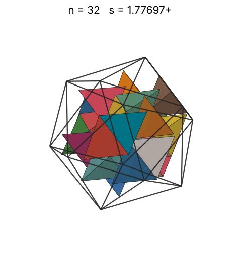
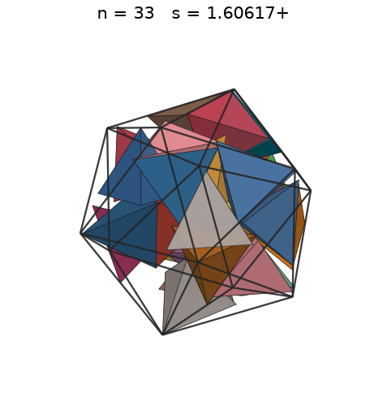
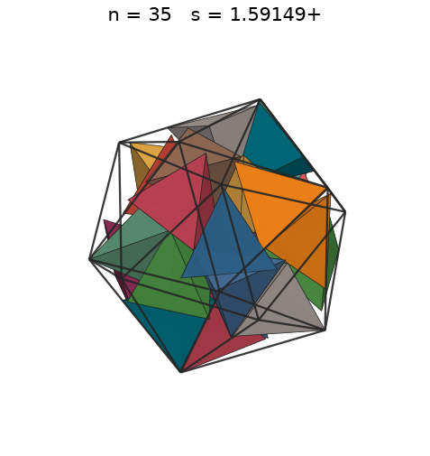
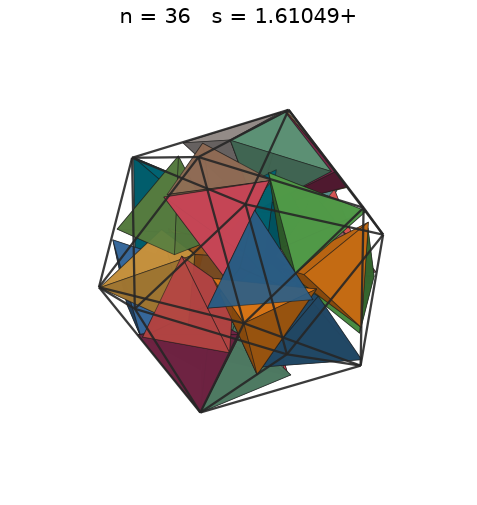
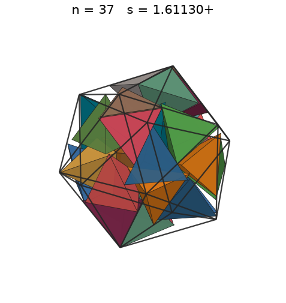
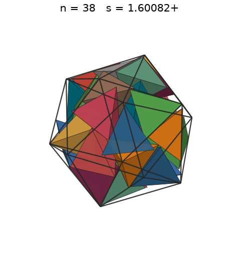
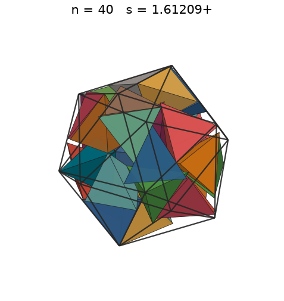

# Tetrahedra in an icosahedron

s = container edge / piece edge; every row certified in exact arithmetic.

| n | s | touching limit | closed form (conj.) | volume bound | density | picture |
|---|---|---|---|---|---|---|
| 2 | [0.85851+](tetinico_n02.json) | 0.858515365522 |  | 0.47627 | 0.1707 |  |
| 3 | [0.93217+](tetinico_n03.json) | 0.932176302083 |  | 0.54520 | 0.2001 |  |
| 4 | [0.98651+](tetinico_n04.json) | 0.986514118901 |  | 0.60007 | 0.2251 |  |
| 5 | [1.00910+](tetinico_n05.json) | 1.009100454629 |  | 0.64640 | 0.2628 |  |
| 6 | [1.01873+](tetinico_n06.json) | 1.018736988907 |  | 0.68691 | 0.3066 |  |
| 7 | [1.02714+](tetinico_n07.json) | 1.027147509520 |  | 0.72312 | 0.3489 |  |
| 8 | [1.03686+](tetinico_n08.json) | 1.036862183810 |  | 0.75604 | 0.3877 |  |
| 9 | [1.04041+](tetinico_n09.json) | 1.040419002395 |  | 0.78631 | 0.4317 |  |
| 10 | [1.05057+](tetinico_n10.json) | 1.050573964577 |  | 0.81442 | 0.4659 |  |
| 11 | [1.05544+](tetinico_n11.json) | 1.055443281785 |  | 0.84071 | 0.5054 |  |
| 12 | [1.06160+](tetinico_n12.json) | 1.061602144585 |  | 0.86545 | 0.5418 |  |
| 13 | [1.06827+](tetinico_n13.json) | 1.068270118224 |  | 0.88885 | 0.5760 |  |
| 14 | [1.06949+](tetinico_n14.json) | 1.069494014137 |  | 0.91108 | 0.6182 |  |
| 15 | [1.07377+](tetinico_n15.json) | 1.073774853142 |  | 0.93227 | 0.6545 |  |
| 16 | [1.07676+](tetinico_n16.json) | 1.076767570967 |  | 0.95255 | 0.6923 |  |
| 17 | [1.12070+](tetinico_n17.json) | 1.120703039452 |  | 0.97199 | 0.6524 |  |
| 18 | [1.15697+](tetinico_n18.json) | 1.156973979404 |  | 0.99069 | 0.6278 |  |
| 19 | [1.17116+](tetinico_n19.json) | 1.171164532941 |  | 1.00871 | 0.6389 |  |
| 20 | [1.24846+](tetinico_n20.json) | 1.248463949958 |  | 1.02610 | 0.5552 |  |
| 21 | [1.29908+](tetinico_n21.json) | 1.299086263254 |  | 1.04292 | 0.5174 |  |
| 22 | [1.31807+](tetinico_n22.json) | 1.318076684982 |  | 1.05922 | 0.5190 |  |
| 23 | [1.32185+](tetinico_n23.json) | 1.321850146091 |  | 1.07503 | 0.5379 |  |
| 24 | [1.38508+](tetinico_n24.json) | 1.385082392830 |  | 1.09039 | 0.4879 |  |
| 25 | [1.39742+](tetinico_n25.json) | 1.397427906173 |  | 1.10533 | 0.4949 |  |
| 26 | [1.44295+](tetinico_n26.json) | 1.442951555438 |  | 1.11988 | 0.4675 |  |
| 27 | [1.47668+](tetinico_n27.json) | 1.476688945127 |  | 1.13406 | 0.4529 |  |
| 28 | [1.48202+](tetinico_n28.json) | 1.482028010497 |  | 1.14789 | 0.4647 |  |
| 29 | [1.52537+](tetinico_n29.json) | 1.525378423359 |  | 1.16139 | 0.4414 |  |
| 30 | [1.52645+](tetinico_n30.json) | 1.526457260117 |  | 1.17459 | 0.4556 |  |
| 31 | [1.61231+](tetinico_n31.json) | 1.612319401226 |  | 1.18750 | 0.3995 |  |
| 32 | [1.61231+](tetinico_n32.json) | 1.612319401226 |  | 1.20013 | 0.4124 |  |
| 33 | [1.61231+](tetinico_n33.json) | 1.612319401226 |  | 1.21251 | 0.4253 |  |
| 34 | [1.61231+](tetinico_n34.json) | 1.612319401226 |  | 1.22463 | 0.4382 |  |
| 35 | [1.61231+](tetinico_n35.json) | 1.612319401226 |  | 1.23652 | 0.4511 |  |
| 36 | [1.61231+](tetinico_n36.json) | 1.612319401233 |  | 1.24819 | 0.4640 |  |
| 37 | [1.61231+](tetinico_n37.json) | 1.612319401237 |  | 1.25964 | 0.4769 |  |
| 38 | [1.61231+](tetinico_n38.json) | 1.612319401241 |  | 1.27089 | 0.4897 |  |
| 39 | [1.61231+](tetinico_n39.json) | 1.612319401251 |  | 1.28194 | 0.5026 |  |
| 40 | [1.61231+](tetinico_n40.json) | 1.612319401275 |  | 1.29281 | 0.5155 |  |
| 41 | [1.61231+](tetinico_n41.json) | 1.612319401279 |  | 1.30349 | 0.5284 |  |
| 42 | [1.61265+](tetinico_n42.json) | 1.612657307629 |  | 1.31400 | 0.5410 |  |
| 43 | [1.62564+](tetinico_n43.json) | 1.625646305271 |  | 1.32435 | 0.5407 |  |
| 44 | [1.63539+](tetinico_n44.json) | 1.635389878071 |  | 1.33454 | 0.5434 |  |
| 45 | [1.65545+](tetinico_n45.json) | 1.655457473214 |  | 1.34457 | 0.5358 |  |
| 46 | [1.66749+](tetinico_n46.json) | 1.667492643234 |  | 1.35446 | 0.5359 |  |
| 47 | [1.67193+](tetinico_n47.json) | 1.671935471841 |  | 1.36420 | 0.5432 |  |
| 48 | [1.69215+](tetinico_n48.json) | 1.692153394268 |  | 1.37381 | 0.5351 |  |
| 49 | [1.69486+](tetinico_n49.json) | 1.694869371613 |  | 1.38329 | 0.5437 |  |
| 50 | [1.71797+](tetinico_n50.json) | 1.717970583736 |  | 1.39263 | 0.5327 |  |
| 51 | [1.73403+](tetinico_n51.json) | 1.734030021989 |  | 1.40186 | 0.5284 |  |
| 52 | [1.73640+](tetinico_n52.json) | 1.736399546171 |  | 1.41096 | 0.5365 |  |
| 53 | [1.73768+](tetinico_n53.json) | 1.737686132737 |  | 1.41995 | 0.5456 |  |
| 54 | [1.73768+](tetinico_n54.json) | 1.737686132737 |  | 1.42882 | 0.5559 |  |
| 55 | [1.74321+](tetinico_n55.json) | 1.743213416180 |  | 1.43759 | 0.5609 |  |
| 56 | [1.75370+](tetinico_n56.json) | 1.753703272745 |  | 1.44625 | 0.5609 |  |
| 57 | [1.77035+](tetinico_n57.json) | 1.770355075388 |  | 1.45481 | 0.5549 |  |
| 58 | [1.78243+](tetinico_n58.json) | 1.782436340025 |  | 1.46326 | 0.5533 |  |
| 59 | [1.79915+](tetinico_n59.json) | 1.799151968782 |  | 1.47163 | 0.5473 |  |
| 60 | [1.80772+](tetinico_n60.json) | 1.807722322415 |  | 1.47989 | 0.5487 |  |
| 61 | [1.86120+](tetinico_n61.json) | 1.861202020181 |  | 1.48807 | 0.5111 |  |
| 62 | [2.13654+](tetinico_n62.json) | 2.136540151305 |  | 1.49616 | 0.3434 |  |
| 63 | [2.13654+](tetinico_n63.json) | 2.136540151305 |  | 1.50416 | 0.3489 |  |
| 64 | [2.13654+](tetinico_n64.json) | 2.136540151305 |  | 1.51207 | 0.3545 |  |
| 65 | [2.13654+](tetinico_n65.json) | 2.136540151305 |  | 1.51991 | 0.3600 |  |
| 66 | [2.13898+](tetinico_n66.json) | 2.138988028274 |  | 1.52766 | 0.3643 |  |
| 67 | [2.13898+](tetinico_n67.json) | 2.138988028274 |  | 1.53534 | 0.3698 |  |
| 68 | [2.13898+](tetinico_n68.json) | 2.138988028274 |  | 1.54294 | 0.3753 |  |
| 69 | [2.13898+](tetinico_n69.json) | 2.138988028274 |  | 1.55047 | 0.3809 |  |
| 70 | [2.13898+](tetinico_n70.json) | 2.138988028274 |  | 1.55792 | 0.3864 |  |
| 71 | [2.14755+](tetinico_n71.json) | 2.147549706283 |  | 1.56531 | 0.3872 |  |
| 72 | [2.14755+](tetinico_n72.json) | 2.147549706283 |  | 1.57262 | 0.3927 |  |
| 73 | [2.14755+](tetinico_n73.json) | 2.147549706283 |  | 1.57987 | 0.3981 |  |
| 74 | [2.14755+](tetinico_n74.json) | 2.147549706283 |  | 1.58705 | 0.4036 |  |
| 75 | [2.14755+](tetinico_n75.json) | 2.147549706283 |  | 1.59417 | 0.4090 |  |
| 76 | [2.15353+](tetinico_n76.json) | 2.153535141934 |  | 1.60122 | 0.4111 |  |
| 77 | [2.15353+](tetinico_n77.json) | 2.153535141934 |  | 1.60821 | 0.4165 |  |
| 78 | [2.15353+](tetinico_n78.json) | 2.153535141934 |  | 1.61514 | 0.4219 |  |
| 79 | [2.15353+](tetinico_n79.json) | 2.153535141934 |  | 1.62202 | 0.4273 |  |
| 80 | [2.15353+](tetinico_n80.json) | 2.153535141934 |  | 1.62883 | 0.4327 |  |
| 81 | [2.24140+](tetinico_n81.json) | 2.241406049017 |  | 1.63559 | 0.3886 |  |
| 82 | [2.24140+](tetinico_n82.json) | 2.241406049017 |  | 1.64230 | 0.3934 |  |
| 83 | [2.24140+](tetinico_n83.json) | 2.241406049017 |  | 1.64894 | 0.3982 |  |
| 84 | [2.24140+](tetinico_n84.json) | 2.241406049017 |  | 1.65554 | 0.4030 |  |
| 85 | [2.24140+](tetinico_n85.json) | 2.241406049017 |  | 1.66208 | 0.4078 |  |
| 86 | [2.31394+](tetinico_n86.json) | 2.313947909548 |  | 1.66858 | 0.3750 |  |
| 87 | [2.31394+](tetinico_n87.json) | 2.313947909548 |  | 1.67502 | 0.3793 |  |
| 88 | [2.31394+](tetinico_n88.json) | 2.313947909548 |  | 1.68141 | 0.3837 |  |
| 89 | [2.31394+](tetinico_n89.json) | 2.313947909548 |  | 1.68776 | 0.3880 |  |
| 90 | [2.31394+](tetinico_n90.json) | 2.313947909548 |  | 1.69405 | 0.3924 |  |
| 91 | [2.34232+](tetinico_n91.json) | 2.342329065882 |  | 1.70031 | 0.3825 |  |
| 92 | [2.34232+](tetinico_n92.json) | 2.342329065882 |  | 1.70651 | 0.3867 |  |
| 93 | [2.34232+](tetinico_n93.json) | 2.342329065882 |  | 1.71267 | 0.3909 |  |
| 94 | [2.34232+](tetinico_n94.json) | 2.342329065882 |  | 1.71879 | 0.3951 |  |
| 95 | [2.34232+](tetinico_n95.json) | 2.342329065882 |  | 1.72486 | 0.3993 |  |
| 96 | [2.46686+](tetinico_n96.json) | 2.466867891198 |  | 1.73089 | 0.3454 |  |
| 97 | [2.49692+](tetinico_n97.json) | 2.496927895785 |  | 1.73688 | 0.3366 |  |
| 98 | [2.49692+](tetinico_n98.json) | 2.496927895785 |  | 1.74283 | 0.3401 |  |
| 99 | [2.49692+](tetinico_n99.json) | 2.496927895785 |  | 1.74874 | 0.3435 |  |
| 100 | [2.49692+](tetinico_n100.json) | 2.496927895785 |  | 1.75461 | 0.3470 |  |
