# Tetrahedra in an octahedron

s = container edge / piece edge; every row certified in exact arithmetic.

| n | s | touching limit | closed form (conj.) | volume bound | density | picture |
|---|---|---|---|---|---|---|
| 2 | [1.15470+](tetinoct_n02.json) | 1.154700617502 |  | 0.79370 | 0.3248 | 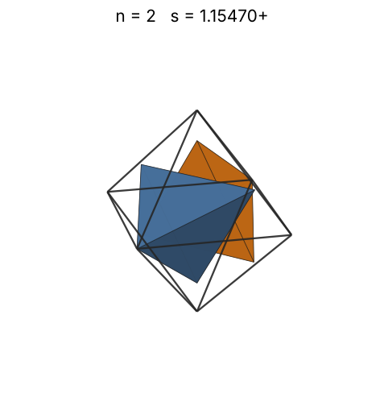 |
| 3 | [1.28445+](tetinoct_n03.json) | 1.284457160042 |  | 0.90856 | 0.3539 | 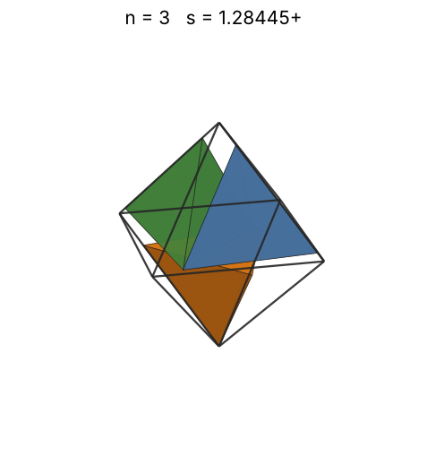 |
| 4 | [1.35355+](tetinoct_n04.json) | 1.353553523103 |  | 1.00000 | 0.4032 | 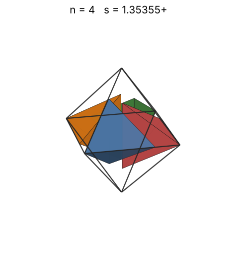 |
| 5 | [1.47561+](tetinoct_n05.json) | 1.475612953591 |  | 1.07722 | 0.3890 | 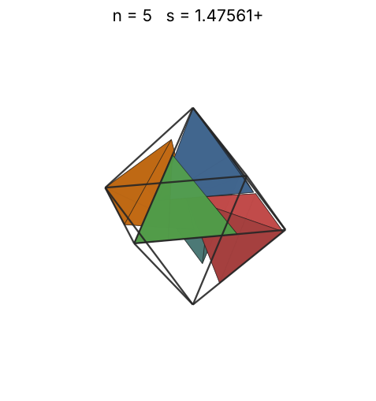 |
| 6 | [1.48186+](tetinoct_n06.json) | 1.481860775184 |  | 1.14471 | 0.4610 | 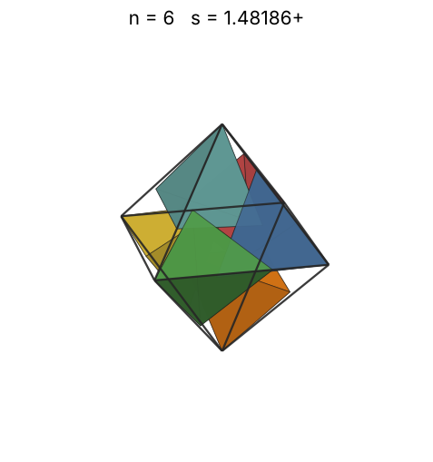 |
| 7 | [1.64305+](tetinoct_n07.json) | 1.643050262473 |  | 1.20507 | 0.3945 | 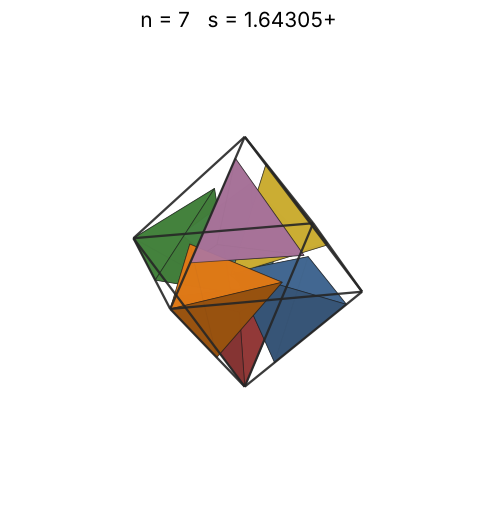 |
| 8 | [1.71646+](tetinoct_n08.json) | 1.716466004950 |  | 1.25992 | 0.3955 | 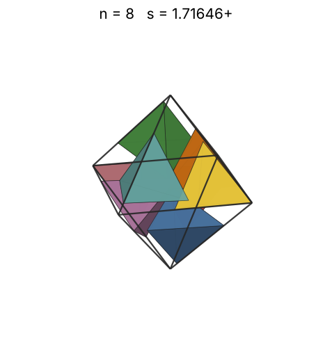 |
| 9 | [1.77044+](tetinoct_n09.json) | 1.770443287245 |  | 1.31037 | 0.4054 | 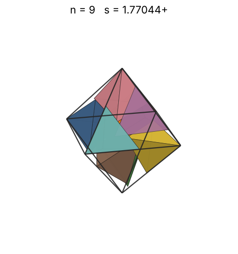 |
| 10 | [1.82408+](tetinoct_n10.json) | 1.824086184636 |  | 1.35721 | 0.4119 | 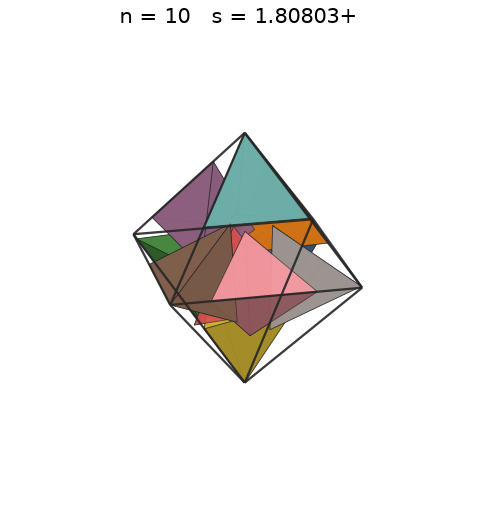 |
| 11 | [1.87954+](tetinoct_n11.json) | 1.879548059781 |  | 1.40102 | 0.4142 | 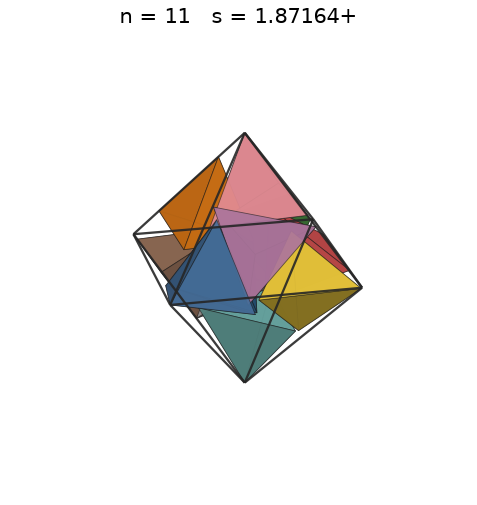 |
| 12 | [1.91959+](tetinoct_n12.json) | 1.919592742958 |  | 1.44225 | 0.4241 | 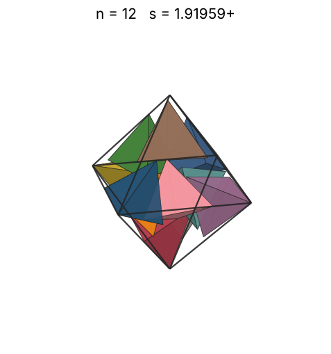 |
| 13 | [1.95210+](tetinoct_n13.json) | 1.952104186711 |  | 1.48125 | 0.4369 | 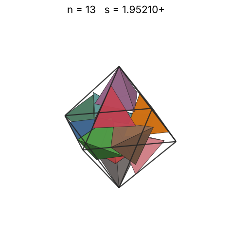 |
| 14 | [1.97987+](tetinoct_n14.json) | 1.979878742886 |  | 1.51829 | 0.4510 | 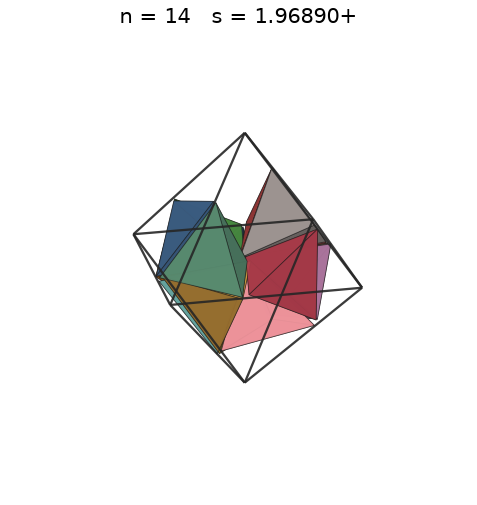 |
| 15 | [1.98780+](tetinoct_n15.json) | 1.987803777030 |  | 1.55362 | 0.4774 | 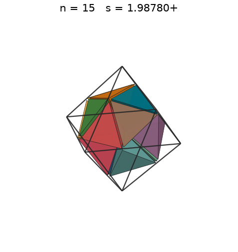 |
| 16 | [1.99334+](tetinoct_n16.json) | 1.993343653473 |  | 1.58740 | 0.5050 | 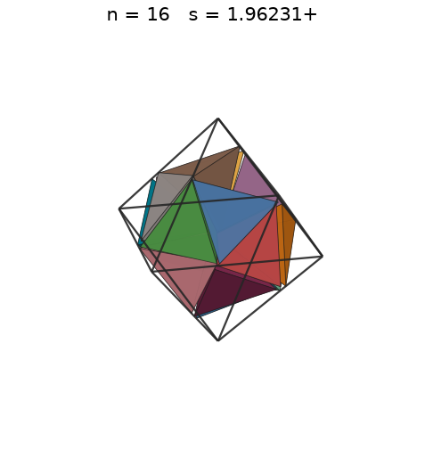 |
| 17 | [2.07391+](tetinoct_n17.json) | 2.073911506278 |  | 1.61981 | 0.4765 | 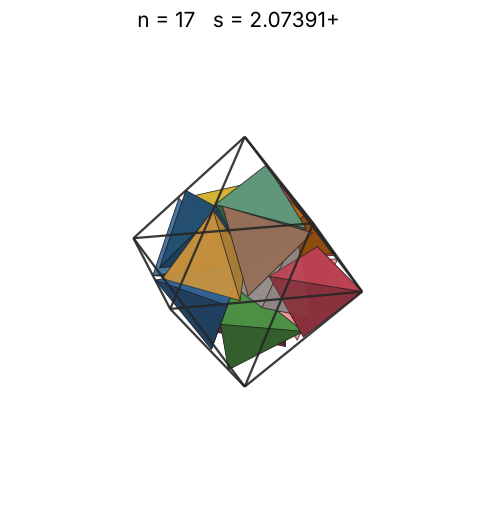 |
| 18 | [2.10491+](tetinoct_n18.json) | 2.104911618282 |  | 1.65096 | 0.4825 | 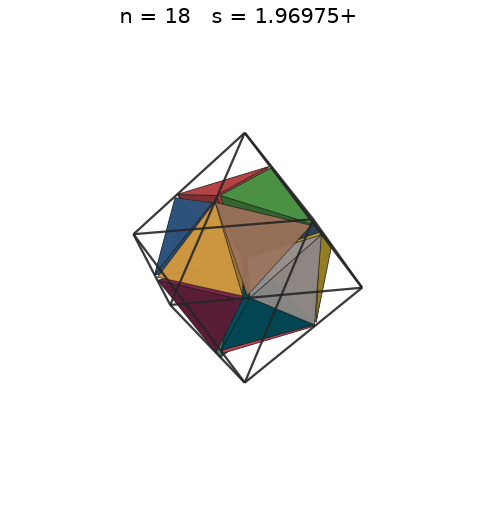 |
| 19 | [2.12611+](tetinoct_n19.json) | 2.126112671534 |  | 1.68099 | 0.4942 | 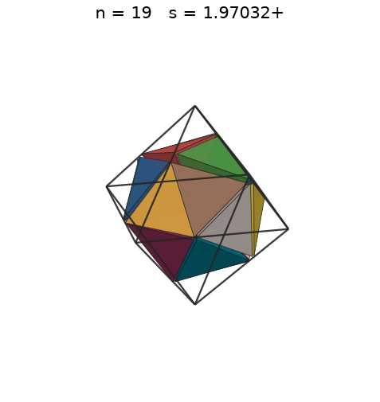 |
| 20 | [2.16672+](tetinoct_n20.json) | 2.166729061192 |  | 1.70998 | 0.4915 | 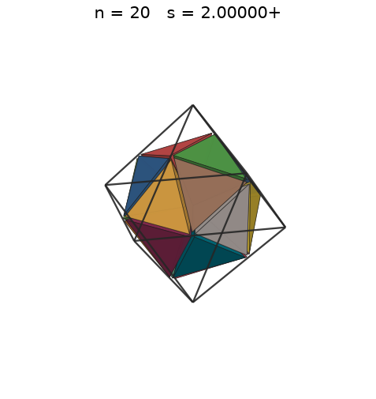 |
| 21 | [2.19377+](tetinoct_n21.json) | 2.193773691420 |  | 1.73801 | 0.4973 | 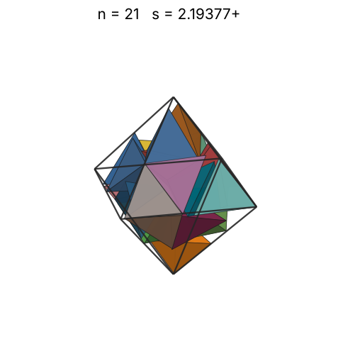 |
| 22 | [2.22577+](tetinoct_n22.json) | 2.225777686327 |  | 1.76517 | 0.4988 | 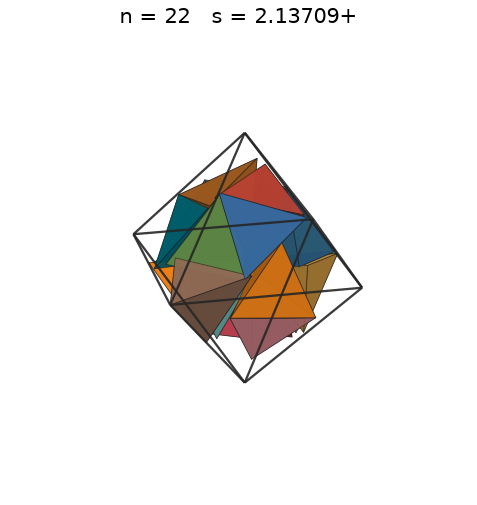 |
| 23 | [2.25479+](tetinoct_n23.json) | 2.254797130506 |  | 1.79152 | 0.5016 | 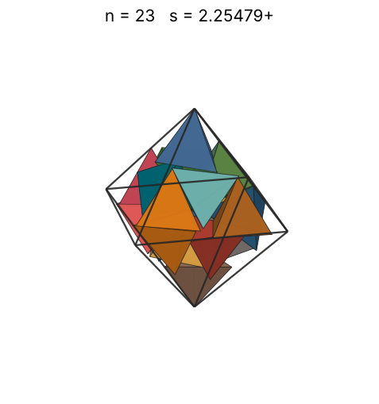 |
| 24 | [2.30733+](tetinoct_n24.json) | 2.307332819222 |  | 1.81712 | 0.4885 | 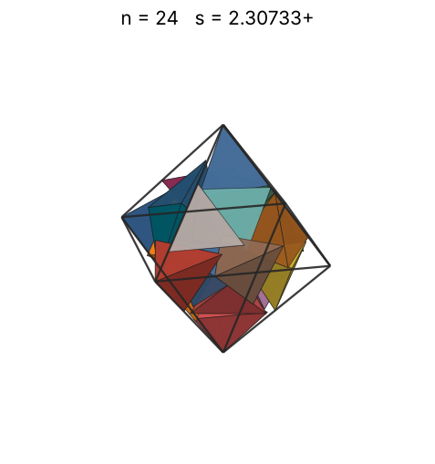 |
| 25 | [2.33547+](tetinoct_n25.json) | 2.335475722228 |  | 1.84202 | 0.4906 | 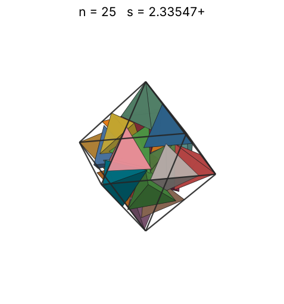 |
| 26 | [2.33547+](tetinoct_n26.json) | 2.335476127423 |  | 1.86626 | 0.5103 | 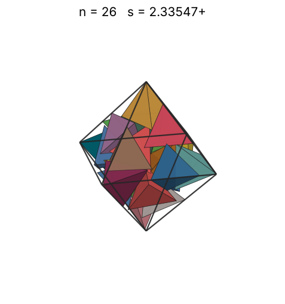 |
| 27 | [2.43298+](tetinoct_n27.json) | 2.432979998332 |  | 1.88988 | 0.4687 | 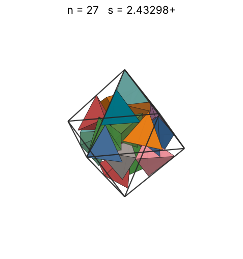 |
| 28 | [2.45854+](tetinoct_n28.json) | 2.458539875486 |  | 1.91293 | 0.4710 | 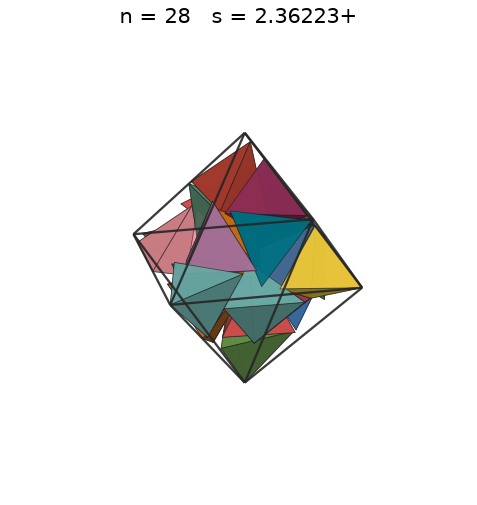 |
| 29 | [2.50033+](tetinoct_n29.json) | 2.500336225164 |  | 1.93544 | 0.4638 | 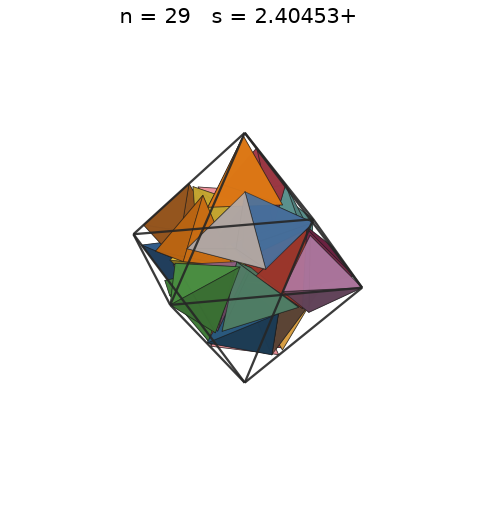 |
| 30 | [2.58012+](tetinoct_n30.json) | 2.580125714830 |  | 1.95743 | 0.4367 | 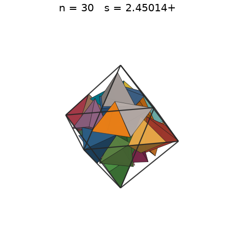 |
| 31 | [2.68560+](tetinoct_n31.json) | 2.685605611779 |  | 1.97895 | 0.4001 | 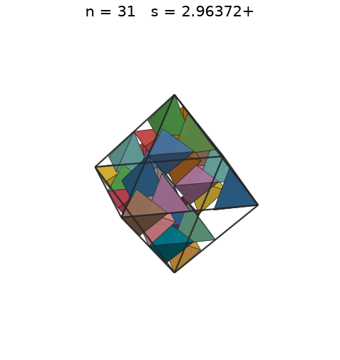 |
| 32 | [2.68560+](tetinoct_n32.json) | 2.685605611985 |  | 2.00000 | 0.4130 | 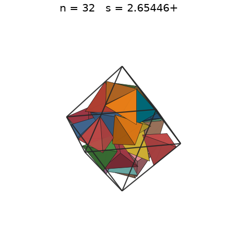 |
| 33 | [2.68560+](tetinoct_n33.json) | 2.685605612224 |  | 2.02062 | 0.4259 | 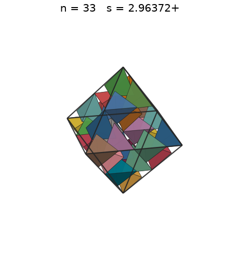 |
| 34 | [2.68560+](tetinoct_n34.json) | 2.685605612317 |  | 2.04083 | 0.4388 | 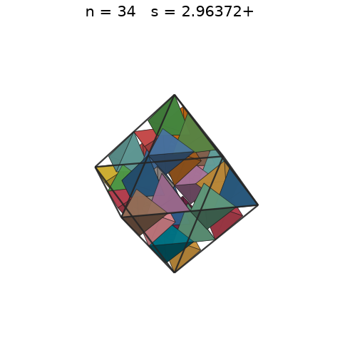 |
| 35 | [2.68560+](tetinoct_n35.json) | 2.685605612646 |  | 2.06064 | 0.4517 | 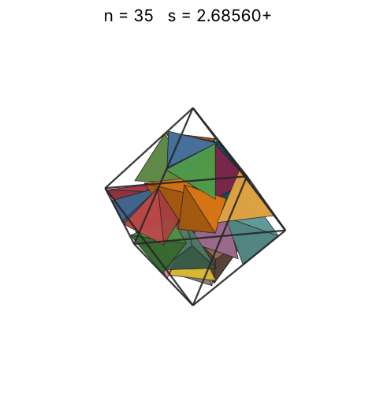 |
| 36 | [2.68560+](tetinoct_n36.json) | 2.685605612685 |  | 2.08008 | 0.4646 | 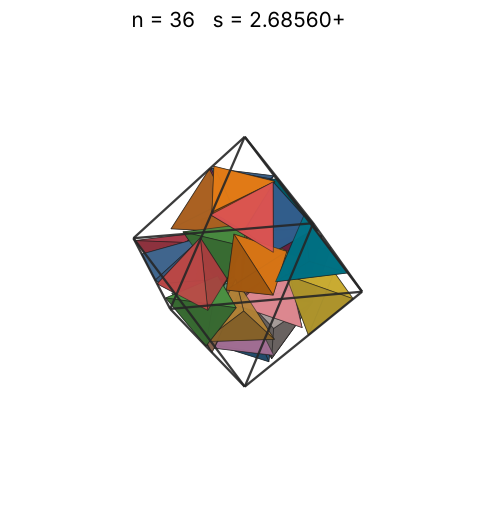 |
| 37 | [2.68560+](tetinoct_n37.json) | 2.685605612775 |  | 2.09917 | 0.4775 | 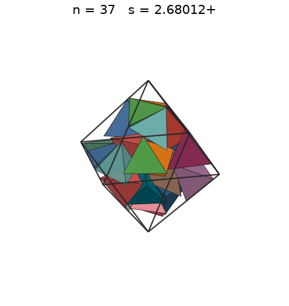 |
| 38 | [2.68560+](tetinoct_n38.json) | 2.685605613247 |  | 2.11791 | 0.4905 | 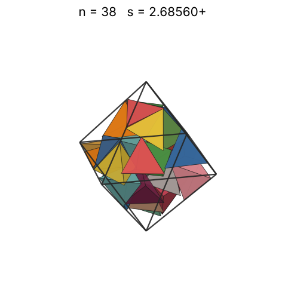 |
| 39 | [2.68560+](tetinoct_n39.json) | 2.685605613311 |  | 2.13633 | 0.5034 | 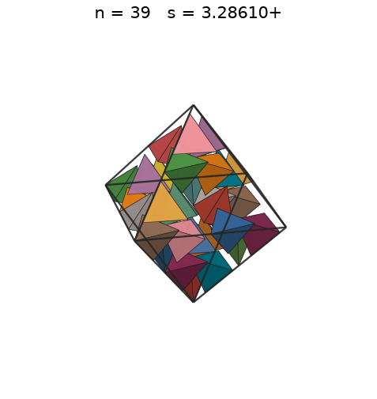 |
| 40 | [2.68560+](tetinoct_n40.json) | 2.685605613428 |  | 2.15443 | 0.5163 | 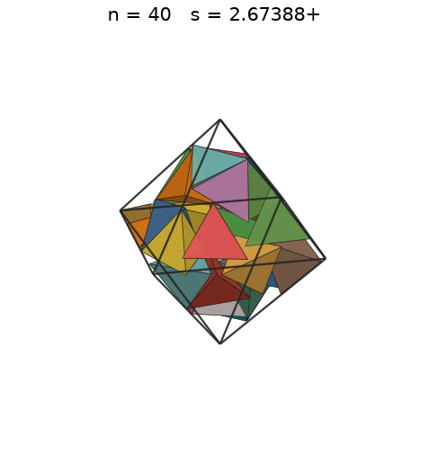 |
| 41 | [2.68560+](tetinoct_n41.json) | 2.685605613428 |  | 2.17224 | 0.5292 |  |
| 42 | [2.72499+](tetinoct_n42.json) | 2.724998564118 |  | 2.18976 | 0.5189 |  |
| 43 | [2.74792+](tetinoct_n43.json) | 2.747927352328 |  | 2.20700 | 0.5181 |  |
| 44 | [2.75869+](tetinoct_n44.json) | 2.758694918901 |  | 2.22398 | 0.5239 |  |
| 45 | [2.77882+](tetinoct_n45.json) | 2.778819226350 |  | 2.24070 | 0.5243 |  |
| 46 | [2.78703+](tetinoct_n46.json) | 2.787038918096 |  | 2.25718 | 0.5312 |  |
| 47 | [2.79046+](tetinoct_n47.json) | 2.790462278637 |  | 2.27342 | 0.5408 |  |
| 48 | [2.80799+](tetinoct_n48.json) | 2.807997602060 |  | 2.28943 | 0.5420 |  |
| 49 | [2.83269+](tetinoct_n49.json) | 2.832698855263 |  | 2.30522 | 0.5389 |  |
| 50 | [2.86233+](tetinoct_n50.json) | 2.862334359062 |  | 2.32079 | 0.5330 |  |
| 51 | [2.87164+](tetinoct_n51.json) | 2.871647719922 |  | 2.33616 | 0.5384 |  |
| 52 | [2.89222+](tetinoct_n52.json) | 2.892223020003 |  | 2.35133 | 0.5373 |  |
| 53 | [2.90725+](tetinoct_n53.json) | 2.907255972479 |  | 2.36631 | 0.5392 |  |
| 54 | [2.91646+](tetinoct_n54.json) | 2.916460734588 |  | 2.38110 | 0.5442 |  |
| 55 | [2.93705+](tetinoct_n55.json) | 2.937058920591 |  | 2.39571 | 0.5427 |  |
| 56 | [2.93841+](tetinoct_n56.json) | 2.938409422284 |  | 2.41014 | 0.5518 |  |
| 57 | [2.96129+](tetinoct_n57.json) | 2.961289536080 |  | 2.42440 | 0.5487 |  |
| 58 | [2.96440+](tetinoct_n58.json) | 2.964400220850 |  | 2.43850 | 0.5566 |  |
| 59 | [2.96440+](tetinoct_n59.json) | 2.964400220851 |  | 2.45243 | 0.5662 |  |
| 60 | [2.96440+](tetinoct_n60.json) | 2.964400220852 |  | 2.46621 | 0.5758 |  |
| 61 | [2.99441+](tetinoct_n61.json) | 2.994413094477 |  | 2.47984 | 0.5680 |  |
| 62 | [2.99830+](tetinoct_n62.json) | 2.998306316247 |  | 2.49332 | 0.5750 |  |
| 63 | [3.00469+](tetinoct_n63.json) | 3.004691484682 |  | 2.50665 | 0.5806 |  |
| 64 | [3.00469+](tetinoct_n64.json) | 3.004691484692 |  | 2.51984 | 0.5898 |  |
| 65 | [3.02423+](tetinoct_n65.json) | 3.024230184120 |  | 2.53290 | 0.5875 |  |
| 66 | [3.11393+](tetinoct_n66.json) | 3.113929391330 |  | 2.54582 | 0.5465 |  |
| 67 | [3.11393+](tetinoct_n67.json) | 3.113930051919 |  | 2.55861 | 0.5547 |  |
| 68 | [3.11393+](tetinoct_n68.json) | 3.113930051920 |  | 2.57128 | 0.5630 |  |
| 69 | [3.11393+](tetinoct_n69.json) | 3.113930178197 |  | 2.58382 | 0.5713 |  |
| 70 | [3.23032+](tetinoct_n70.json) | 3.230324959191 |  | 2.59625 | 0.5192 |  |
| 71 | [3.24238+](tetinoct_n71.json) | 3.242386872930 |  | 2.60855 | 0.5207 |  |
| 72 | [3.24855+](tetinoct_n72.json) | 3.248556594958 |  | 2.62074 | 0.5251 |  |
| 73 | [3.25029+](tetinoct_n73.json) | 3.250294772920 |  | 2.63282 | 0.5315 |  |
| 74 | [3.28944+](tetinoct_n74.json) | 3.289440102284 |  | 2.64479 | 0.5198 |  |
| 75 | [3.29096+](tetinoct_n75.json) | 3.290964840091 |  | 2.65665 | 0.5261 |  |
| 76 | [3.32240+](tetinoct_n76.json) | 3.322404685657 |  | 2.66840 | 0.5181 |  |
| 77 | [3.32624+](tetinoct_n77.json) | 3.326247685258 |  | 2.68005 | 0.5231 |  |
| 78 | [3.32842+](tetinoct_n78.json) | 3.328420137331 |  | 2.69161 | 0.5288 |  |
| 79 | [3.33519+](tetinoct_n79.json) | 3.335195963106 |  | 2.70306 | 0.5324 |  |
| 80 | [3.35018+](tetinoct_n80.json) | 3.350187403256 |  | 2.71442 | 0.5319 |  |
| 81 | [3.35174+](tetinoct_n81.json) | 3.351747912958 |  | 2.72568 | 0.5378 |  |
| 82 | [3.35174+](tetinoct_n82.json) | 3.351747913142 |  | 2.73685 | 0.5444 |  |
| 83 | [3.38103+](tetinoct_n83.json) | 3.381035356428 |  | 2.74793 | 0.5369 |  |
| 84 | [3.38103+](tetinoct_n84.json) | 3.381035356428 |  | 2.75892 | 0.5433 |  |
| 85 | [3.38103+](tetinoct_n85.json) | 3.381035356579 |  | 2.76983 | 0.5498 |  |
| 86 | [3.38750+](tetinoct_n86.json) | 3.387500851641 |  | 2.78065 | 0.5531 |  |
| 87 | [3.38750+](tetinoct_n87.json) | 3.387500851877 |  | 2.79139 | 0.5595 |  |
| 88 | [3.38750+](tetinoct_n88.json) | 3.387500853360 |  | 2.80204 | 0.5660 |  |
| 89 | [3.39825+](tetinoct_n89.json) | 3.398252247372 |  | 2.81261 | 0.5670 |  |
| 90 | [3.39825+](tetinoct_n90.json) | 3.398252247372 |  | 2.82311 | 0.5733 |  |
| 91 | [3.43523+](tetinoct_n91.json) | 3.435231684026 |  | 2.83353 | 0.5612 |  |
| 92 | [3.45440+](tetinoct_n92.json) | 3.454402887687 |  | 2.84387 | 0.5580 |  |
| 93 | [3.53432+](tetinoct_n93.json) | 3.534328774749 |  | 2.85413 | 0.5266 |  |
| 94 | [3.77624+](tetinoct_n94.json) | 3.776244999713 |  | 2.86433 | 0.4364 |  |
| 95 | [3.77624+](tetinoct_n95.json) | 3.776244999713 |  | 2.87445 | 0.4410 |  |
| 96 | [3.77624+](tetinoct_n96.json) | 3.776244999713 |  | 2.88450 | 0.4457 |  |
| 97 | [3.93032+](tetinoct_n97.json) | 3.930327761691 |  | 2.89448 | 0.3994 |  |
| 98 | [3.93032+](tetinoct_n98.json) | 3.930327761691 |  | 2.90439 | 0.4035 |  |
| 99 | [3.93032+](tetinoct_n99.json) | 3.930327761691 |  | 2.91424 | 0.4077 |  |
| 100 | [3.93032+](tetinoct_n100.json) | 3.930327761691 |  | 2.92402 | 0.4118 |  |
