# Tetrahedra in an octahedron

s = container edge / piece edge; every row certified in exact arithmetic.

| n | s | touching limit | closed form (conj.) | volume bound | density | picture |
|---|---|---|---|---|---|---|
| 2 | [1.15470+](tetinoct_n02.json) | 1.154700617502 |  | 0.79370 | 0.3248 | 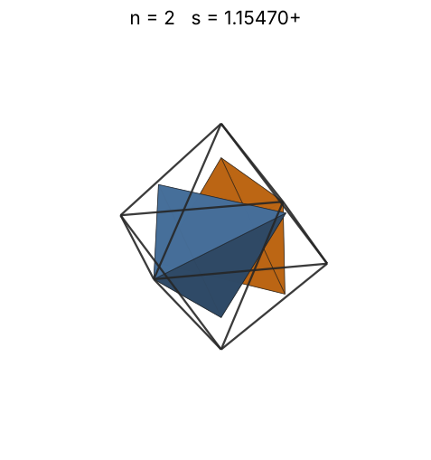 |
| 3 | [1.28445+](tetinoct_n03.json) | 1.284457160042 |  | 0.90856 | 0.3539 | 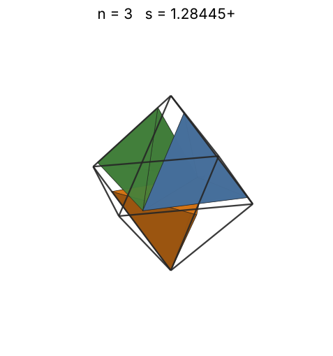 |
| 4 | [1.35355+](tetinoct_n04.json) | 1.353553523103 | √2/4 + 1 | 1.00000 | 0.4032 | 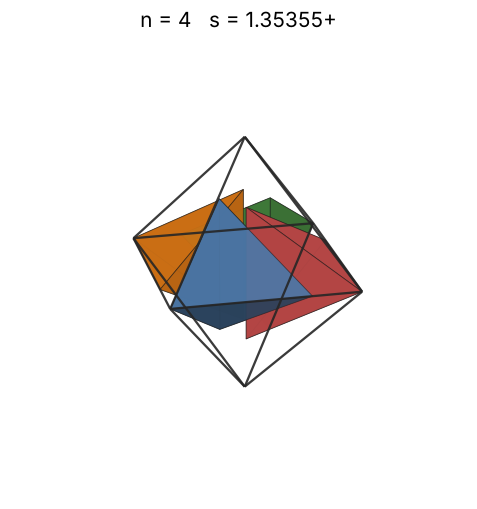 |
| 5 | [1.47561+](tetinoct_n05.json) | 1.475612953591 |  | 1.07722 | 0.3890 | 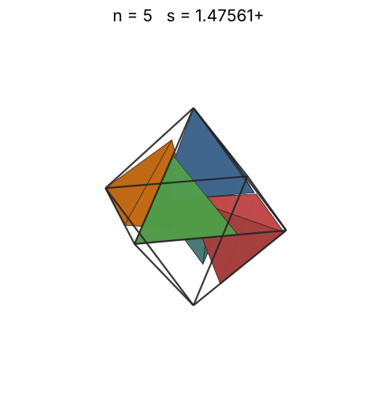 |
| 6 | [1.48186+](tetinoct_n06.json) | 1.481860775184 |  | 1.14471 | 0.4610 | 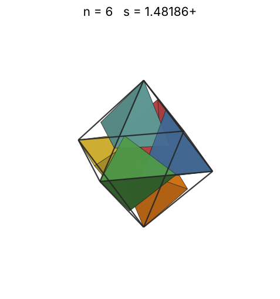 |
| 7 | [1.64305+](tetinoct_n07.json) | 1.643050262473 |  | 1.20507 | 0.3945 | 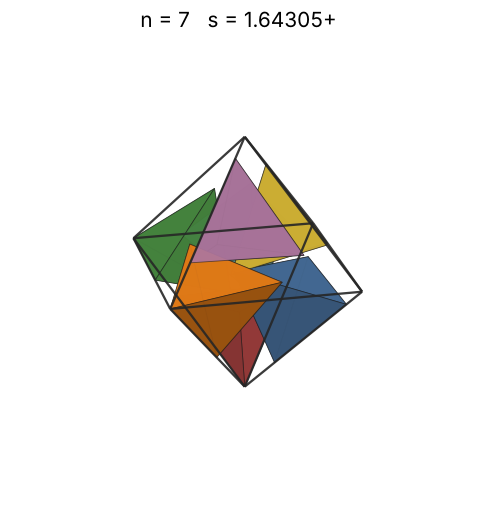 |
| 8 | [1.71646+](tetinoct_n08.json) | 1.716463372391 |  | 1.25992 | 0.3955 | 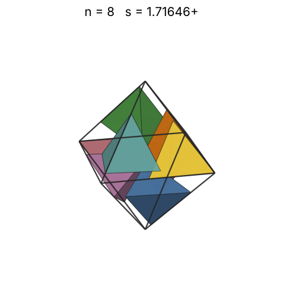 |
| 9 | [1.76068+](tetinoct_n09.json) | 1.760688726649 |  | 1.31037 | 0.4122 | 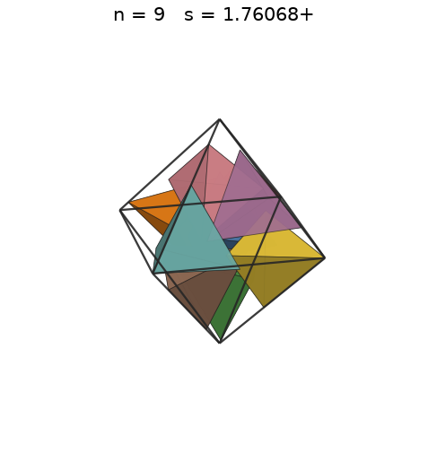 |
| 10 | [1.80803+](tetinoct_n10.json) | 1.808035639315 |  | 1.35721 | 0.4230 | 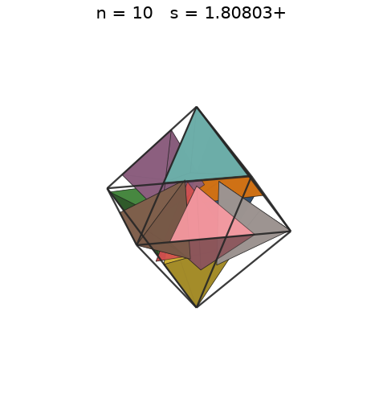 |
| 11 | [1.83974+](tetinoct_n11.json) | 1.839748365029 |  | 1.40102 | 0.4416 | 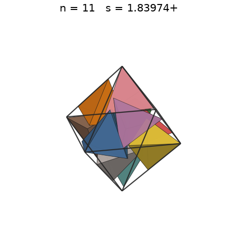 |
| 12 | [1.88295+](tetinoct_n12.json) | 1.882954539751 |  | 1.44225 | 0.4494 | 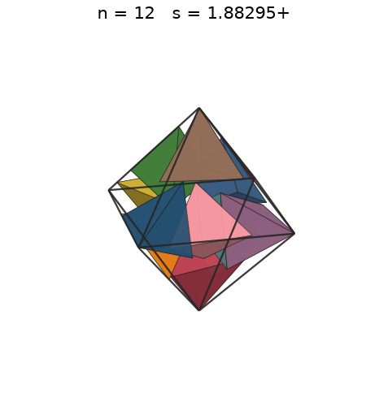 |
| 13 | [1.90649+](tetinoct_n13.json) | 1.906499483392 |  | 1.48125 | 0.4690 | 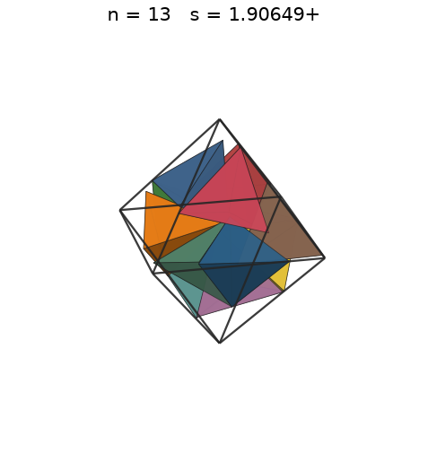 |
| 14 | [1.92472+](tetinoct_n14.json) | 1.924724065906 |  | 1.51829 | 0.4909 | 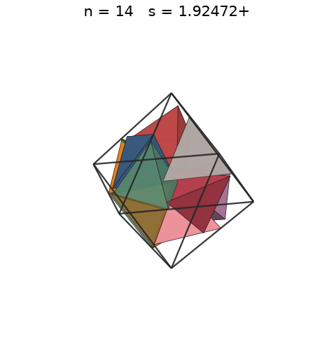 |
| 15 | [1.93464+](tetinoct_n15.json) | 1.934647944265 |  | 1.55362 | 0.5179 | 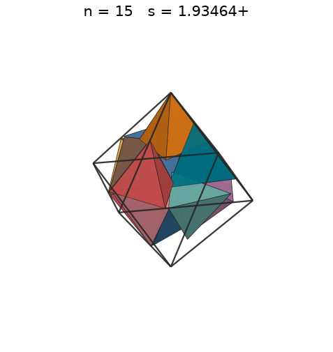 |
| 16 | [1.95091+](tetinoct_n16.json) | 1.950918056470 |  | 1.58740 | 0.5387 | 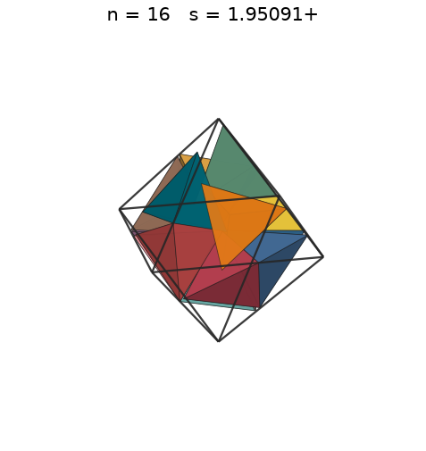 |
| 17 | [1.95749+](tetinoct_n17.json) | 1.957498108792 |  | 1.61981 | 0.5666 | 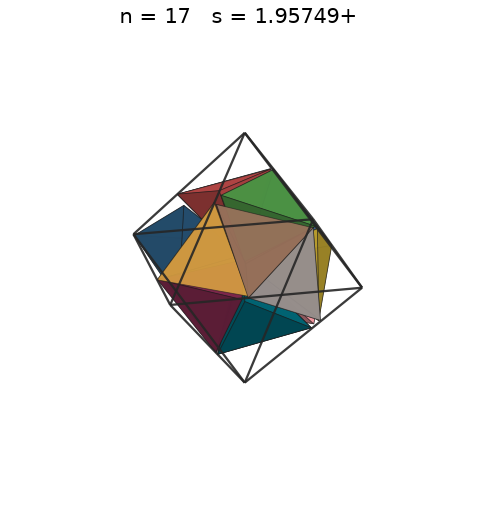 |
| 18 | [1.96334+](tetinoct_n18.json) | 1.963348751856 |  | 1.65096 | 0.5946 | 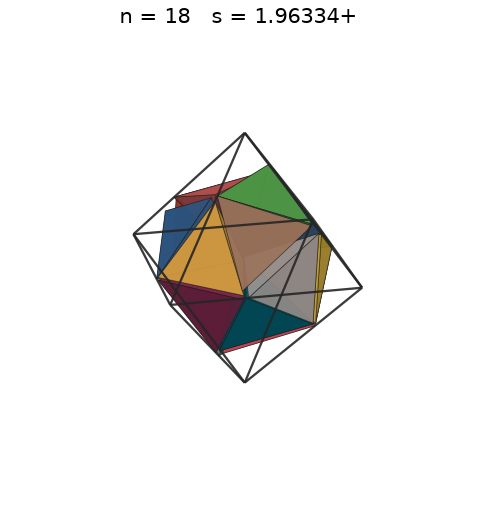 |
| 19 | [1.96701+](tetinoct_n19.json) | 1.967014915135 |  | 1.68099 | 0.6241 | 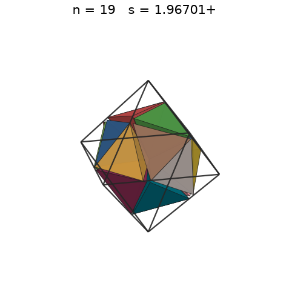 |
| 20 | [1.97050+](tetinoct_n20.json) | 1.970503310915 |  | 1.70998 | 0.6535 | 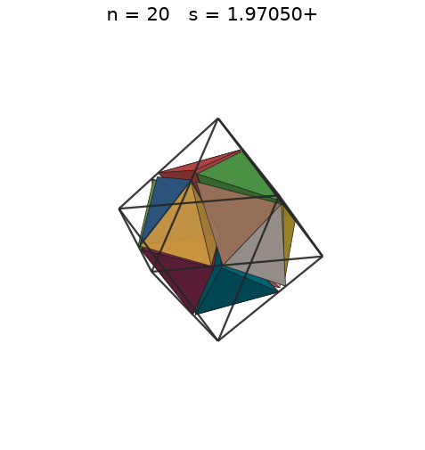 |
| 21 | [2.09615+](tetinoct_n21.json) | 2.096153680418 |  | 1.73801 | 0.5700 | 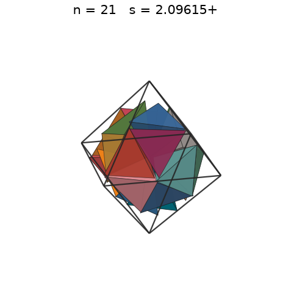 |
| 22 | [2.13578+](tetinoct_n22.json) | 2.135784088142 |  | 1.76517 | 0.5645 | 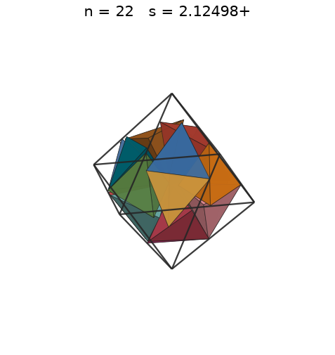 |
| 23 | [2.17784+](tetinoct_n23.json) | 2.177841928397 |  | 1.79152 | 0.5567 | 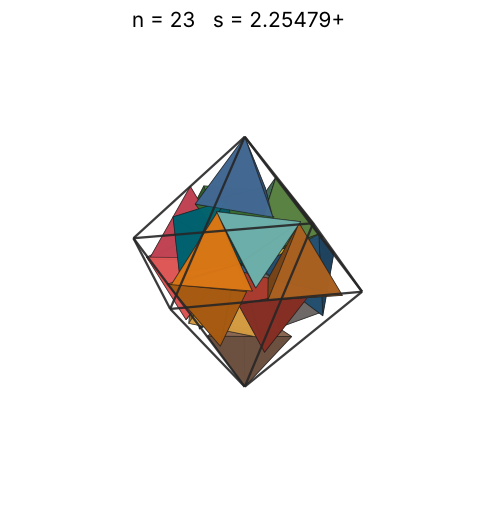 |
| 24 | [2.24747+](tetinoct_n24.json) | 2.247474664163 |  | 1.81712 | 0.5285 | 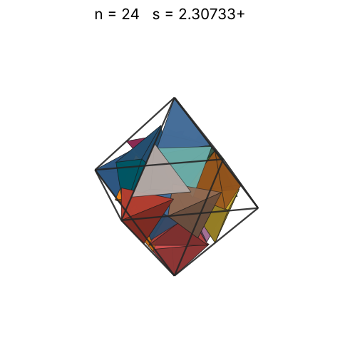 |
| 25 | [2.24747+](tetinoct_n25.json) | 2.247474665484 |  | 1.84202 | 0.5505 | 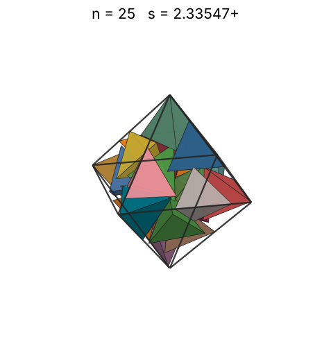 |
| 26 | [2.28424+](tetinoct_n26.json) | 2.284248562836 |  | 1.86626 | 0.5454 | 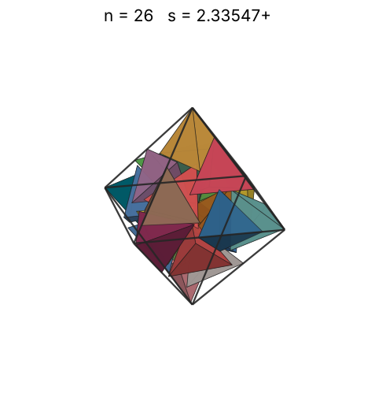 |
| 27 | [2.35078+](tetinoct_n27.json) | 2.350780631017 |  | 1.88988 | 0.5196 | 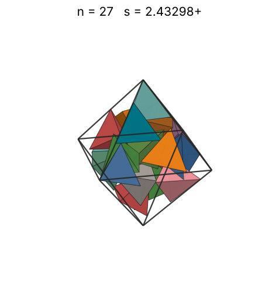 |
| 28 | [2.36223+](tetinoct_n28.json) | 2.362238676498 |  | 1.91293 | 0.5310 | 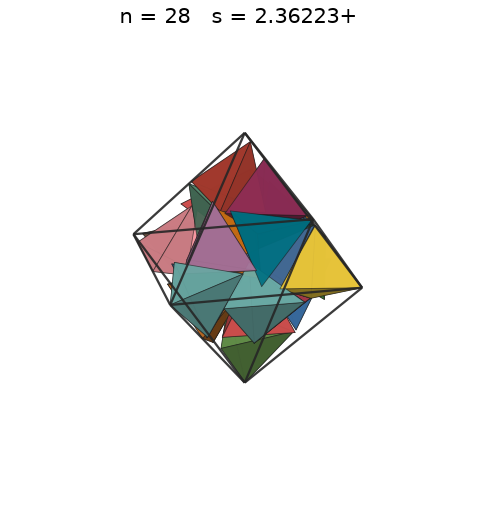 |
| 29 | [2.40321+](tetinoct_n29.json) | 2.403216347001 |  | 1.93544 | 0.5223 | 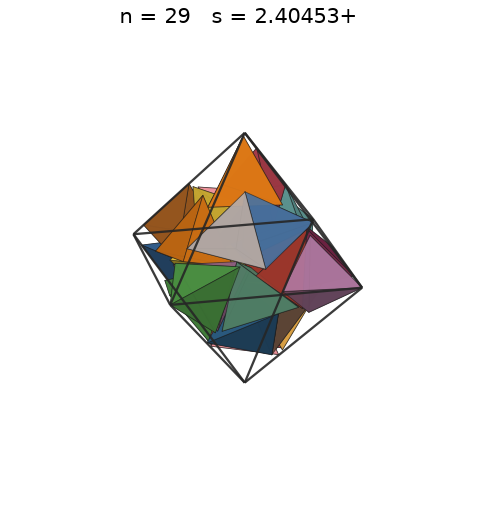 |
| 30 | [2.43889+](tetinoct_n30.json) | 2.438897329487 |  | 1.95743 | 0.5170 | 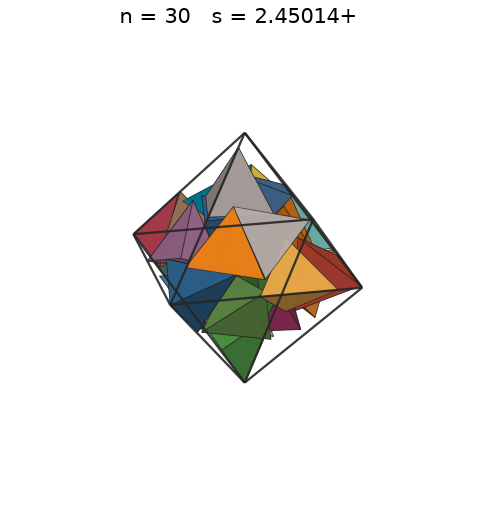 |
| 31 | [2.51951+](tetinoct_n31.json) | 2.519513575680 |  | 1.97895 | 0.4846 | 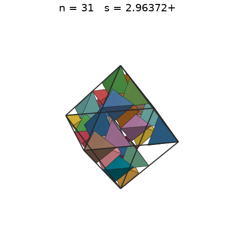 |
| 32 | [2.53714+](tetinoct_n32.json) | 2.537142946142 |  | 2.00000 | 0.4898 | 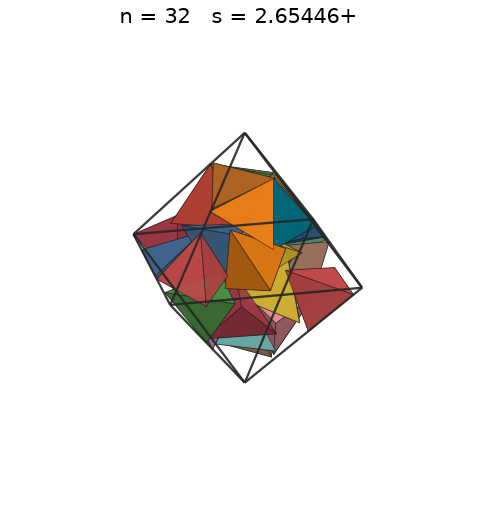 |
| 33 | [2.57224+](tetinoct_n33.json) | 2.572240707475 |  | 2.02062 | 0.4848 | 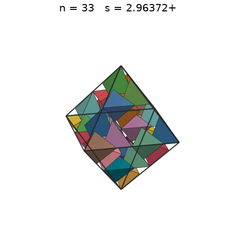 |
| 34 | [2.61331+](tetinoct_n34.json) | 2.613314170697 |  | 2.04083 | 0.4763 | 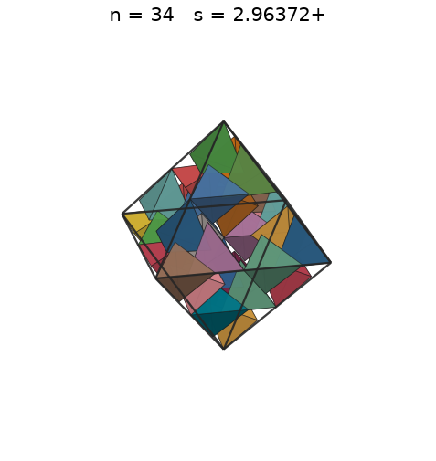 |
| 35 | [2.61522+](tetinoct_n35.json) | 2.615223472513 |  | 2.06064 | 0.4892 | 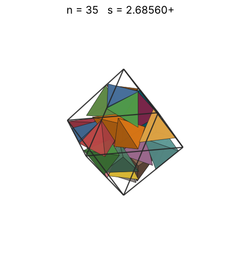 |
| 36 | [2.62359+](tetinoct_n36.json) | 2.623594203462 |  | 2.08008 | 0.4984 | 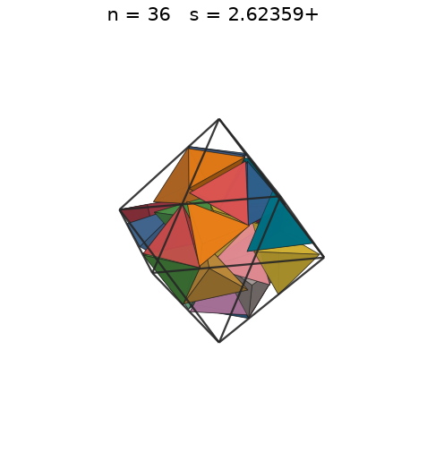 |
| 37 | [2.63905+](tetinoct_n37.json) | 2.639056251544 |  | 2.09917 | 0.5033 | 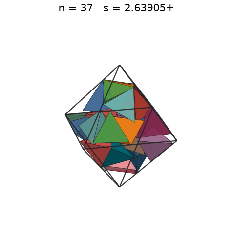 |
| 38 | [2.66584+](tetinoct_n38.json) | 2.665842377851 |  | 2.11791 | 0.5014 | 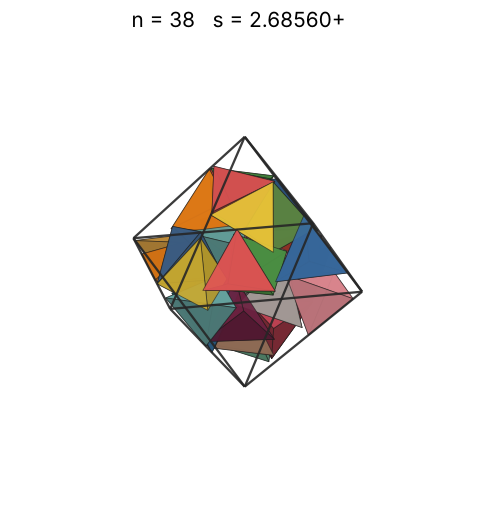 |
| 39 | [2.67369+](tetinoct_n39.json) | 2.673694671352 |  | 2.13633 | 0.5101 | 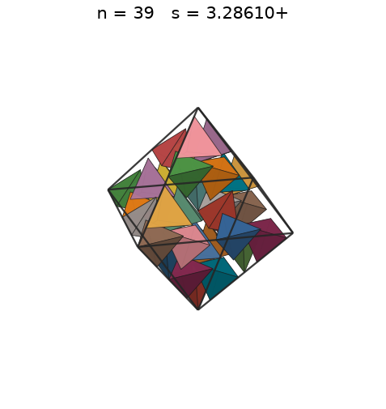 |
| 40 | [2.67369+](tetinoct_n40.json) | 2.673694680948 |  | 2.15443 | 0.5232 | 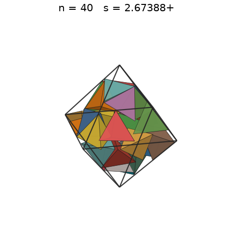 |
| 41 | [2.67369+](tetinoct_n41.json) | 2.673694681031 |  | 2.17224 | 0.5363 |  |
| 42 | [2.72356+](tetinoct_n42.json) | 2.723563349854 |  | 2.18976 | 0.5197 |  |
| 43 | [2.74737+](tetinoct_n43.json) | 2.747372866904 |  | 2.20700 | 0.5184 |  |
| 44 | [2.75211+](tetinoct_n44.json) | 2.752118402015 |  | 2.22398 | 0.5277 |  |
| 45 | [2.77882+](tetinoct_n45.json) | 2.778819226350 |  | 2.24070 | 0.5243 |  |
| 46 | [2.78178+](tetinoct_n46.json) | 2.781789449173 |  | 2.25718 | 0.5342 |  |
| 47 | [2.78178+](tetinoct_n47.json) | 2.781789452741 |  | 2.27342 | 0.5458 |  |
| 48 | [2.80796+](tetinoct_n48.json) | 2.807966245498 |  | 2.28943 | 0.5420 |  |
| 49 | [2.83069+](tetinoct_n49.json) | 2.830691253498 |  | 2.30522 | 0.5401 |  |
| 50 | [2.85370+](tetinoct_n50.json) | 2.853700308258 |  | 2.32079 | 0.5379 |  |
| 51 | [2.86781+](tetinoct_n51.json) | 2.867819178246 |  | 2.33616 | 0.5406 |  |
| 52 | [2.89200+](tetinoct_n52.json) | 2.892005270837 |  | 2.35133 | 0.5375 |  |
| 53 | [2.90713+](tetinoct_n53.json) | 2.907138648673 |  | 2.36631 | 0.5393 |  |
| 54 | [2.91640+](tetinoct_n54.json) | 2.916399956213 |  | 2.38110 | 0.5442 |  |
| 55 | [2.93701+](tetinoct_n55.json) | 2.937019495392 |  | 2.39571 | 0.5427 |  |
| 56 | [2.93840+](tetinoct_n56.json) | 2.938401664052 |  | 2.41014 | 0.5518 |  |
| 57 | [2.95375+](tetinoct_n57.json) | 2.953750913941 |  | 2.42440 | 0.5530 |  |
| 58 | [2.95375+](tetinoct_n58.json) | 2.953750913941 |  | 2.43850 | 0.5627 |  |
| 59 | [2.96209+](tetinoct_n59.json) | 2.962098950016 |  | 2.45243 | 0.5675 |  |
| 60 | [2.96440+](tetinoct_n60.json) | 2.964400220852 |  | 2.46621 | 0.5758 |  |
| 61 | [2.99439+](tetinoct_n61.json) | 2.994399580283 |  | 2.47984 | 0.5680 |  |
| 62 | [2.99823+](tetinoct_n62.json) | 2.998232043264 |  | 2.49332 | 0.5751 |  |
| 63 | [3.00366+](tetinoct_n63.json) | 3.003663452927 |  | 2.50665 | 0.5812 |  |
| 64 | [3.00469+](tetinoct_n64.json) | 3.004691484692 |  | 2.51984 | 0.5898 |  |
| 65 | [3.02423+](tetinoct_n65.json) | 3.024230158340 |  | 2.53290 | 0.5875 |  |
| 66 | [3.10220+](tetinoct_n66.json) | 3.102208792784 |  | 2.54582 | 0.5527 |  |
| 67 | [3.11172+](tetinoct_n67.json) | 3.111722674961 |  | 2.55861 | 0.5559 |  |
| 68 | [3.11265+](tetinoct_n68.json) | 3.112656829709 |  | 2.57128 | 0.5637 |  |
| 69 | [3.11279+](tetinoct_n69.json) | 3.112790652249 |  | 2.58382 | 0.5719 |  |
| 70 | [3.18282+](tetinoct_n70.json) | 3.182822583082 |  | 2.59625 | 0.5428 |  |
| 71 | [3.19409+](tetinoct_n71.json) | 3.194094248162 |  | 2.60855 | 0.5447 |  |
| 72 | [3.20951+](tetinoct_n72.json) | 3.209517504910 |  | 2.62074 | 0.5444 |  |
| 73 | [3.24776+](tetinoct_n73.json) | 3.247759942836 |  | 2.63282 | 0.5327 |  |
| 74 | [3.24815+](tetinoct_n74.json) | 3.248157353645 |  | 2.64479 | 0.5398 |  |
| 75 | [3.25075+](tetinoct_n75.json) | 3.250755645915 |  | 2.65665 | 0.5458 |  |
| 76 | [3.27946+](tetinoct_n76.json) | 3.279462227386 |  | 2.66840 | 0.5387 |  |
| 77 | [3.28612+](tetinoct_n77.json) | 3.286123276942 |  | 2.68005 | 0.5425 |  |
| 78 | [3.31695+](tetinoct_n78.json) | 3.316956177190 |  | 2.69161 | 0.5343 |  |
| 79 | [3.32041+](tetinoct_n79.json) | 3.320419711034 |  | 2.70306 | 0.5395 |  |
| 80 | [3.32083+](tetinoct_n80.json) | 3.320838451197 |  | 2.71442 | 0.5461 |  |
| 81 | [3.32799+](tetinoct_n81.json) | 3.327994625488 |  | 2.72568 | 0.5494 |  |
| 82 | [3.33207+](tetinoct_n82.json) | 3.332073749063 |  | 2.73685 | 0.5541 |  |
| 83 | [3.33231+](tetinoct_n83.json) | 3.332315555621 |  | 2.74793 | 0.5608 |  |
| 84 | [3.33582+](tetinoct_n84.json) | 3.335823612899 |  | 2.75892 | 0.5657 |  |
| 85 | [3.36152+](tetinoct_n85.json) | 3.361523716181 |  | 2.76983 | 0.5594 |  |
| 86 | [3.36566+](tetinoct_n86.json) | 3.365666069017 |  | 2.78065 | 0.5639 |  |
| 87 | [3.37991+](tetinoct_n87.json) | 3.379910278846 |  | 2.79139 | 0.5633 |  |
| 88 | [3.38282+](tetinoct_n88.json) | 3.382820050503 |  | 2.80204 | 0.5683 |  |
| 89 | [3.39689+](tetinoct_n89.json) | 3.396899397371 |  | 2.81261 | 0.5677 |  |
| 90 | [3.39821+](tetinoct_n90.json) | 3.398219617937 |  | 2.82311 | 0.5734 |  |
| 91 | [3.43523+](tetinoct_n91.json) | 3.435231684026 |  | 2.83353 | 0.5612 |  |
| 92 | [3.43705+](tetinoct_n92.json) | 3.437057059290 |  | 2.84387 | 0.5665 |  |
| 93 | [3.53429+](tetinoct_n93.json) | 3.534290796574 |  | 2.85413 | 0.5266 |  |
| 94 | [3.57712+](tetinoct_n94.json) | 3.577127735332 |  | 2.86433 | 0.5134 |  |
| 95 | [3.57712+](tetinoct_n95.json) | 3.577127737762 |  | 2.87445 | 0.5189 |  |
| 96 | [3.57712+](tetinoct_n96.json) | 3.577127738283 |  | 2.88450 | 0.5243 |  |
| 97 | [3.57712+](tetinoct_n97.json) | 3.577127739230 |  | 2.89448 | 0.5298 |  |
| 98 | [3.57712+](tetinoct_n98.json) | 3.577127743583 |  | 2.90439 | 0.5353 |  |
| 99 | [3.57712+](tetinoct_n99.json) | 3.577127743583 |  | 2.91424 | 0.5407 |  |
| 100 | [3.59920+](tetinoct_n100.json) | 3.599208030956 |  | 2.92402 | 0.5362 |  |
